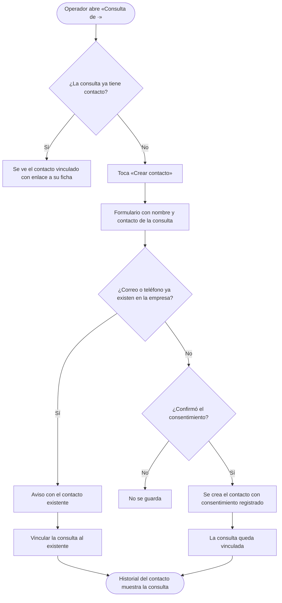
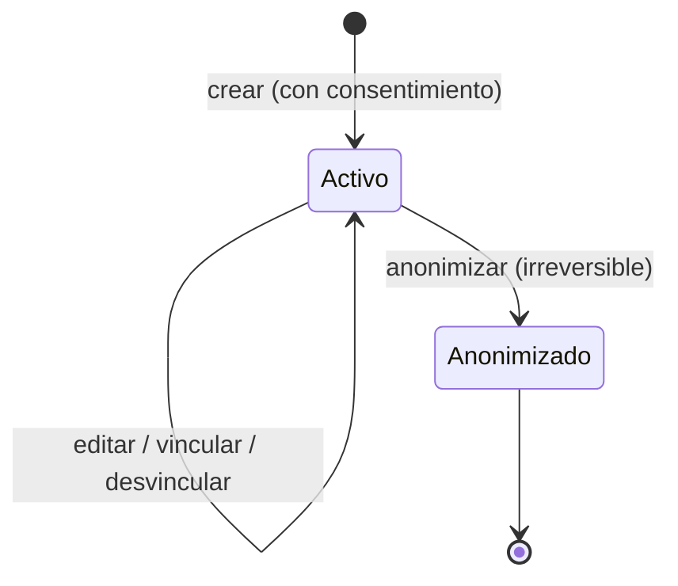

# Feature Specification: Consultas y ventas · Contactos y respuestas rápidas

**Épica**: MSF-144 · **Spec**: `contactos-y-respuestas-rapidas` · **Hito**: Etapa 3 (sin fecha) · **Prioridad**: P2 · **Alcance (Jira)**: fuera · **Horas aprox.**: 20 (las tallas M+S suman 12 h; se mantienen 20 h por el documento de la épica: consentimiento, anonimización y pruebas)
**Alcance de entrega**: `refine`, `supabase` (sin `kestra`, `superset` ni `workers`: no hay proceso aislado ni analítica; la anonimización es una RPC y las respuestas rápidas se arman en el navegador).
**Fuente**: especificación de Nicolás cargada en la épica (Jira) y artefactos del producto. Esta spec **traduce**; no agrega alcance. La épica **no trae pantallas dibujadas** («se dibujan cuando pase a un hito»): lo visual sale del sistema de diseño y de los patrones compartidos del panel (regla de fuentes 3 y 5).

> Nota de rama: la rama `design/prototipo` ya no existe; los prototipos viven en `design/pantallas/` y de ahí sale el inventario (`pnpm prototipo:inventario`; `Consultas.inventory.json` está al día). `Newsletter.dc.html` es de la tienda, no de contactos.

## Objetivo

Al terminar, el equipo guarda a quienes consultan o compran en una libreta de contactos sin duplicados, con su historial y con el consentimiento para tratar sus datos, y contesta más rápido con textos frecuentes por empresa.

## Modelo y supuestos

- **Dependencias** (ya en `main`, verificado en el repo): `dominio.consultas` y su detalle (MSF-122), `texto inicial` de `Responder por…` en una sola función `armarTextoInicial` (MSF-130 / F-CON-04) y `dominio.comprobantes_venta` con `empresa_id` (MSF-159) para `contacto_id` en ventas y el historial de compras. **Bloquea a** MSF-154 (Clientes pedidos y facturación).
- Los datos personales se tratan según la normativa argentina de protección de datos personales; **el texto de consentimiento y el plazo de conservación los define el cliente** (*Decisiones abiertas* 1). Esta spec entrega el **mecanismo** (registrar el consentimiento y anonimizar a pedido); **no** implementa expiración automática por plazo.
- Las respuestas rápidas **arman el texto inicial** de F-CON-04 y **no envían nada**: el panel sigue abriendo WhatsApp o el correo y no sabe si el mensaje se envió.
- **Anonimizar** borra los datos personales del contacto y los que su historia de consultas guarda de esa persona, **sin borrar filas**: las consultas y las ventas siguen existiendo, con sus estados, fechas y totales (la épica pide «sin romper consultas ni ventas»).
- Suposiciones propias de la traducción, **a confirmar** (ver *Decisiones abiertas*): contacto **por empresa** (no por organización); entidad **separada** de `public.clientes`; permisos por la sección `consultas` ya existente; vínculo de compras **manual** desde la ficha; tres variables en las respuestas rápidas.
- El template no trae libreta de personas ajenas a los usuarios, consentimiento ni anonimización (la épica lo aclara): se construyen aquí lo mínimo que piden las historias.

### Esquema de datos (Constitución, Principio VII)

Cada objeto se ubica por su naturaleza y se re-verifica en plan, tareas, implementación y PR.

| Objeto | Esquema | Historia | Justificación | RLS / acceso |
|--------|---------|----------|---------------|--------------|
| `contactos` (**nueva**: `id`, `organizacion_id`, `empresa_id`, `nombre`, `correo`, `telefono`, `correo_normalizado`, `telefono_normalizado`, `consentimiento_en`, `consentimiento_texto`, `consentimiento_por`, `anonimizado_en`, `created_at`, `updated_at`) | `dominio` | F-CON-05 | Entidad de negocio del producto (a quién le vende o responde cada empresa) con datos personales; no es un dato de plataforma. | `organizacion_id = (select private.organizacion_id())` y `empresa_id in (select private.empresas_accesibles())`; select con `consultas`≥`lectura`; **sin insert, update ni delete directos desde la app** (solo RPC `security definer` con validación); `anon` sin privilegios |
| `consultas.contacto_id` (**columna nueva**, nullable, FK compuesta `(contacto_id, organizacion_id)`) | `dominio` | F-CON-05 | Vínculo consulta→contacto sobre una tabla de dominio existente (MSF-122). Aditiva. | hereda la RLS de `dominio.consultas` |
| `comprobantes_venta.contacto_id` (**columna nueva**, nullable, FK compuesta) | `dominio` | F-CON-05 | Vínculo venta→contacto sobre la tabla de ventas (MSF-159). Aditiva; `cliente_id` no se toca. | hereda la RLS de `dominio.comprobantes_venta` |
| `respuestas_rapidas` (**nueva**: `id`, `organizacion_id`, `empresa_id`, `titulo`, `texto`, `created_at`, `updated_at`; **sin datos personales**) | `dominio` | F-CON-06 | Contenido de negocio configurable por empresa. | RLS por organización y empresa accesible; select `consultas`≥`lectura`; escritura solo por RPC con `consultas`=`edicion`; `anon` sin privilegios |
| RPC `public.crear_contacto`, `actualizar_contacto`, `buscar_contactos`, `historial_contacto`, `vincular_consulta_contacto`, `vincular_comprobante_contacto`, `anonimizar_contacto`, `guardar_respuesta_rapida`, `eliminar_respuesta_rapida`; vista `public.respuestas_rapidas_lista` | `public` | ambas | Superficie de lectura/ejecución, no almacenan datos. | RPC `revoke … from public, anon` + `grant execute … to authenticated`; vista `security_invoker`; **ninguna RPC nueva para `anon`** |
| Vista `public.consultas_bandeja` (**alterada**, columna `contacto_id` al final) | `public` | F-CON-05 | Cambio aditivo de una vista existente; no es BREAKING. | `security_invoker`, sin cambios |

La prueba pgTAP `rls_en_toda_tabla` (recorre `public` + `dominio`) debe seguir verde y la de «anon solo ejecuta las RPC permitidas» **no cambia**. Reversión de cada migración: ver `plan.md` (todas aditivas).

## User Scenarios & Testing *(mandatory)*

### User Story 1 - Libreta de contactos (F-CON-05, P2, talla M)

El equipo guarda a quienes consultan o compran en una libreta de contactos, sin duplicados, con su historial de consultas y compras y con el consentimiento registrado, y puede anonimizar a una persona a pedido.

**Why this priority**: P2, Etapa 3. Ordena a quién se le habla y permite cumplir un pedido de supresión de datos sin romper el registro comercial.

**Acceptance Scenarios**:

1. **Dado** una consulta abierta de la empresa activa, **cuando** toco `Crear contacto`, **entonces** se abre un formulario con el nombre y el contacto de la consulta ya cargados (el contacto va a `correo` o `teléfono` según su formato), pido confirmar el consentimiento y, al guardar, la consulta queda **vinculada** al contacto nuevo. (FR-002, FR-004, FR-007)
2. **Dado** un correo o teléfono que ya pertenece a un contacto de esa empresa, **cuando** intento crear otro (a mano o desde una consulta), **entonces** no se crea: el sistema me dice cuál es el contacto existente y me ofrece **vincular la consulta a ese contacto**. El correo se compara sin mayúsculas ni espacios y el teléfono por sus dígitos. (FR-003)
3. **Dado** el alta de un contacto, **cuando** no confirmo el consentimiento, **entonces** no se guarda; si lo confirmo, queda la fecha, quién lo registró y el **texto de consentimiento vigente** copiado en el contacto. (FR-004)
4. **Dado** el menú, **cuando** abro `Contactos`, **entonces** veo la libreta de la empresa activa con búsqueda por nombre, correo o teléfono, paginada, con estados de carga, vacío y error. (FR-005)
5. **Dado** un contacto, **cuando** abro su ficha, **entonces** veo y edito nombre, correo y teléfono (la edición respeta la regla de duplicados y el bloqueo por `updated_at`) y veo su **historial**: las consultas vinculadas y las compras (comprobantes) vinculadas, de las empresas a las que tengo acceso. (FR-006, FR-008)
6. **Dado** un comprobante de venta de la empresa, **cuando** lo vinculo desde la ficha del contacto, **entonces** aparece en su historial de compras; puedo desvincularlo. (FR-007)
7. **Dado** un contacto, **cuando** elijo `Anonimizar` y confirmo en el diálogo (que explica que es irreversible), **entonces** nombre, correo y teléfono del contacto **y** nombre, contacto, mensaje y nota interna de sus consultas vinculadas se reemplazan (la nota interna se vacía) por un texto neutro; el contacto queda marcado `Anonimizado` (solo lectura, sin poder reutilizarse) y se libera su correo/teléfono para un contacto nuevo. (FR-009, FR-010)
8. **Dado** un contacto anonimizado, **entonces** sus consultas y compras **siguen existiendo** con estado, fechas, producto, empresa y totales intactos; la bandeja de Consultas y los comprobantes de Ventas siguen abriéndose. (FR-009)
9. **Dado** los roles: con `consultas`=`edicion` puedo crear, editar, vincular y anonimizar; con `lectura` veo la libreta y las fichas sin poder cambiar nada (botones deshabilitados con «Necesitás permiso de edición»); con `ninguno` el menú no ofrece Contactos y la ruta muestra «Acceso restringido». (FR-011)
10. **Dado** dos organizaciones y dos empresas, **entonces** un contacto de la empresa A no lo ve ni lo modifica quien es de otra organización o no tiene acceso a la empresa A (la base lo impide, no solo la pantalla). (FR-011)
11. **Dado** que cambio la empresa activa de la barra superior, **entonces** la libreta y la ficha recargan todo, reencuadran la paginación, cierran los diálogos abiertos con aviso y nunca muestran filas ni totales de la empresa anterior. (FR-012)
12. **Dado** que crear, editar, vincular y anonimizar son acciones sobre datos personales, **entonces** cada una deja un evento en `registro_actividad` **sin copiar datos personales**. (FR-002, FR-009)

**Independent Test**: pgTAP (alta, duplicados, consentimiento, vínculos, historial, anonimización, aislamiento entre dos organizaciones y empresas, permisos) + Vitest (libreta, ficha, formulario, diálogo de anonimización, cambio de empresa) + E2E de la épica.

### User Story 2 - Respuestas rápidas (F-CON-06, P2, talla S)

El equipo guarda textos frecuentes por empresa, con variables, y los usa para armar el texto inicial al responder una consulta.

**Why this priority**: P2. Acorta el tiempo de respuesta usando los textos de siempre.

**Acceptance Scenarios**:

1. **Dado** la empresa activa, **cuando** abro `Respuestas rápidas` desde Consultas, **entonces** veo la lista de textos de esa empresa y puedo crear, editar y eliminar los míos (título y texto); con `lectura` veo la lista sin poder cambiarla. (FR-013, FR-014, FR-017)
2. **Dado** un texto con variables `{nombre}`, `{tienda}` y `{producto}`, **cuando** lo uso en una consulta, **entonces** se reemplazan por el nombre de quien consultó, la tienda y el producto de esa consulta. Una variable sin valor (consulta sin producto) se reemplaza por vacío sin dejar llaves ni espacios dobles. Una variable desconocida se deja tal cual. (FR-015)
3. **Dado** el detalle de una consulta, **cuando** elijo una respuesta rápida en `Respuesta rápida` y toco `Responder por <correo|WhatsApp>`, **entonces** el texto inicial que se abre en WhatsApp o en el correo es el de esa respuesta con las variables resueltas; el estado, el responsable y el resto del flujo de F-CON-04 no cambian. (FR-016)
4. **Dado** que no elijo ninguna, **entonces** el texto inicial es el de siempre (plantilla fija de F-CON-04). (FR-016)
5. **Dado** una consulta de la empresa A, **entonces** solo se ofrecen las respuestas rápidas de la empresa A. (FR-016, FR-017)
6. **Dado** que las respuestas rápidas solo arman el texto, **entonces** el panel nunca envía nada ni afirma que se envió. (FR-016)
7. **Dado** dos organizaciones y empresas, **entonces** nadie ve ni edita respuestas rápidas de una empresa a la que no tiene acceso. (FR-017)
8. **Dado** que cambio la empresa activa, **entonces** el diálogo de gestión y el selector recargan y no queda nada de la anterior. (FR-018)

**Independent Test**: Vitest (sustitución de variables, selector, texto inicial, gestión, permisos, cambio de empresa) + pgTAP (aislamiento y permisos) + E2E.

### Edge Cases

- Contacto con **solo correo** o **solo teléfono**: se acepta; al menos uno es obligatorio. Teléfono 7 a 15 dígitos (la misma validación de MSF-122).
- Dos consultas de la misma persona con el mismo correo: la segunda ofrece vincularse al contacto existente (FR-003) en vez de crear otro.
- Consulta ya vinculada: `Crear contacto` se reemplaza por el contacto vinculado (enlace a su ficha).
- Anonimizar un contacto con consultas de **varias empresas** (si el correo llegó a otras tiendas, cada contacto es de su empresa: se anonimiza solo el de esa empresa; las demás quedan, ver *Decisiones abiertas* 3).
- Texto de respuesta rápida con `&`, acentos, saltos de línea o llaves sueltas: no rompe el enlace de WhatsApp/correo (se codifica como ya hace F-CON-04).
- Edición simultánea: el segundo guardado recibe un conflicto claro (bloqueo optimista por `updated_at`).
- Un contacto anonimizado **no se puede editar, vincular ni usar** para vincular consultas nuevas.
- Empresa sin respuestas rápidas: estado vacío compartido con una explicación.

## Flujos

### F1 · Crear un contacto desde una consulta



Dueños: formulario y alta FR-002; duplicados FR-003; consentimiento FR-004; vínculo FR-007; historial FR-008. **Fuera de alcance**: pedir el consentimiento en el formulario público de la tienda (Tiendas online, MSF-212).

### F2 · Anonimizar un contacto

```mermaid
sequenceDiagram
  actor O as Operador
  participant P as Panel (ficha del contacto)
  participant R as public.anonimizar_contacto
  participant DB as contactos / consultas / comprobantes_venta
  O->>P: toca «Anonimizar»
  P-->>O: diálogo: acción irreversible, qué se borra y qué se conserva
  O->>P: confirma
  P->>R: contacto_id + updated_at vigente
  alt sin permiso, otra organización o conflicto
    R-->>P: error claro (nada cambia)
  else válido
    R->>DB: contacto: nombre, correo y teléfono neutros; anonimizado_en
    R->>DB: consultas vinculadas: nombre, contacto y mensaje neutros
    R->>DB: comprobantes: sin cambios (contacto_id apunta al contacto anonimizado)
    R->>DB: evento en registro_actividad (sin datos personales)
    R-->>P: ok
  end
  P-->>O: ficha en solo lectura con «Anonimizado»
```

Dueños: datos FR-009; diálogo y estado FR-010; permisos FR-011. **Fuera de alcance**: borrado físico de filas, expiración automática por plazo de conservación (plazo sin definir), anonimizar `public.clientes`.

### F3 · Usar una respuesta rápida

```mermaid
sequenceDiagram
  actor O as Operador
  participant P as Panel (detalle de la consulta)
  participant X as WhatsApp / correo (app externa)
  O->>P: abre «Consulta de ·»
  O->>P: elige «Respuesta rápida» (opcional)
  P->>P: reemplaza {nombre}, {tienda}, {producto} con los datos de la consulta
  O->>P: toca «Responder por <correo|WhatsApp>»
  P->>X: abre wa.me / mailto con ese texto inicial
  Note over P,X: estado y responsable como en F-CON-04; el panel no envía nada
```

Dueños: selector y texto inicial FR-016; variables FR-015. **Fuera de alcance**: el cambio de estado y responsable (F-CON-04, ya construido), confirmación de entrega.

### F4 · Estado de un contacto



Dueños: `Activo` FR-002, FR-006, FR-007; `Anonimizado` FR-009, FR-010. No se deshace: la reversión es por backup (ver `plan.md`).

## Requirements *(mandatory)*

### Functional Requirements

**F-CON-05 · Libreta de contactos**
- **FR-001**: Los contactos viven en `dominio.contactos`, pertenecen a **una empresa**, con RLS por organización y empresa accesible; la app no escribe en la tabla (solo RPC).
- **FR-002**: El sistema permite **crear** un contacto a mano o desde una consulta (nombre obligatorio; al menos correo o teléfono), con datos de la consulta precargados, y registra el evento en `registro_actividad` sin datos personales.
- **FR-003**: **No hay duplicados** por empresa: el correo (normalizado) y el teléfono (solo dígitos) son únicos entre contactos no anonimizados; el intento duplicado se rechaza con el contacto existente identificado y la opción de vincular.
- **FR-004**: Crear un contacto exige **confirmar el consentimiento**; se guarda fecha, quién lo registró y el texto de consentimiento vigente (copiado).
- **FR-005**: La **libreta** lista los contactos de la empresa activa con búsqueda por nombre, correo o teléfono, paginación y estados compartidos de carga, vacío y error; ítem `Contactos` en el menú.
- **FR-006**: La **ficha** muestra y edita nombre, correo y teléfono (reglas de FR-003, bloqueo optimista por `updated_at`).
- **FR-007**: Una consulta y un comprobante de venta pueden **vincularse** a un contacto de su misma empresa (`contacto_id` nullable en ambas tablas); la consulta se vincula al crear o desde su detalle; el comprobante, desde la ficha.
- **FR-008**: El **historial** del contacto reúne sus consultas y sus compras (comprobantes) de las empresas accesibles, ordenado por fecha descendente.
- **FR-009**: **Anonimizar** (RPC) reemplaza los datos personales del contacto y de sus consultas vinculadas (incluida su nota interna, que se vacía) por texto neutro, marca `anonimizado_en`, libera las claves de duplicado, no borra filas, deja las ventas intactas y registra actividad sin datos personales; es irreversible y solo para un contacto activo.
- **FR-010**: La acción `Anonimizar` pide confirmación con un diálogo que explica qué se borra y que no se deshace; el contacto anonimizado se ve en solo lectura con la marca `Anonimizado`.
- **FR-011**: Permisos por la sección `consultas`: `edicion` escribe, `lectura` solo lee (botones deshabilitados con ayuda), `ninguno` ve «Acceso restringido»; aislamiento entre organizaciones y empresas verificado con pgTAP.
- **FR-012**: Libreta, ficha y diálogos respetan la **empresa activa** (Principio VIII): única fuente de verdad, recarga total al cambiar, diálogos cerrados con aviso, sin datos de la empresa anterior.

**F-CON-06 · Respuestas rápidas**
- **FR-013**: Las respuestas rápidas viven en `dominio.respuestas_rapidas`, por empresa, con RLS por organización y empresa accesible; la app no escribe en la tabla (solo RPC).
- **FR-014**: Se pueden **crear, editar y eliminar** respuestas rápidas (título y texto con límite) desde un diálogo `Respuestas rápidas` en Consultas, para la empresa activa.
- **FR-015**: El texto admite las variables `{nombre}`, `{tienda}` y `{producto}`; una función pura las reemplaza con los datos de la consulta (vacío si falta, sin llaves; desconocida se deja tal cual).
- **FR-016**: Al responder una consulta se puede elegir una respuesta rápida **de la empresa de esa consulta**; reemplaza el texto inicial de F-CON-04 (a través de `armarTextoInicial`, único punto); sin selección, queda la plantilla actual; **no envía nada**.
- **FR-017**: Permisos por la sección `consultas` (`edicion` gestiona y usa, `lectura` ve la lista, `ninguno` nada) y aislamiento entre organizaciones y empresas verificado con pgTAP.
- **FR-018**: El diálogo y el selector respetan la **empresa activa** (Principio VIII).

**Cierre**
- **FR-019**: Documentación (`docs/contactos.md`, fila del roadmap) y `pnpm docs:check` verde.
- **FR-020**: Revisión de seguridad y de esquema de cada objeto contra el Principio VII, `anon` sin privilegios nuevos y ningún dato personal en logs ni en `registro_actividad`.

### Success Criteria

- **SC-001**: E2E: desde una consulta se crea un contacto con consentimiento, se ve su historial, se anonimiza y desaparecen sus datos personales (contacto y consultas) sin romper consultas ni ventas.
- **SC-002**: E2E: usar una respuesta rápida con variables arma el texto inicial correcto al responder una consulta.
- **SC-003**: pgTAP de contactos: aislamiento entre dos organizaciones y dos empresas, permisos por nivel, duplicados, consentimiento, vínculos y anonimización.
- **SC-004**: pgTAP de respuestas rápidas: aislamiento y permisos.
- **SC-005**: `pnpm lint`, `pnpm build`, `pnpm infra:config`, `pnpm test`, `rls_en_toda_tabla`, `pnpm prototipo:check`, `pnpm matriz:check` y `pnpm docs:check` verdes.

## Matriz pantalla↔criterios

Inventario determinista con `pnpm prototipo:inventario` sobre `design/pantallas/Consultas.dc.html` (`Consultas.inventory.json`, al día con `pnpm prototipo:check`). **La épica no tiene pantallas dibujadas**: las pantallas nuevas (libreta, ficha, diálogos) no tienen prototipo y se arman con el sistema de diseño y los patrones compartidos; se declara la diferencia para el PR (regla de fuentes 5). La épica pide **menos** que el prototipo: lo que no pide no es deuda.

### Consultas (bandeja con detalle) · `Consultas.dc.html`

| Ítem del inventario | Destino | Criterio |
|---|---|---|
| Tabla: columnas `Estado`, `Cuándo`, `Empresa`, `Contacto`, `Producto`, `Origen` | Fuera de alcance: la bandeja es de MSF-122; esta épica solo agrega `contacto_id` (no visible) | — |
| Botón `Cerrar` (diálogo) | Fuera de alcance: lo construye MSF-122; no se modifica | — |
| Botón `Responder por ·` | En alcance (**comportamiento**): su texto inicial pasa a poder venir de una respuesta rápida; el botón base es de MSF-122/MSF-130 | US2, FR-016 |
| Diálogo `Consulta de ·` | En alcance **solo** para sumar `Crear contacto` / contacto vinculado y el selector `Respuesta rápida` (no dibujados → diferencia anotada para el PR); el resto es de MSF-122 | US1 esc. 1, FR-002, FR-007; US2, FR-016 |
| Filtros, contador y demás controles de la bandeja | Fuera de alcance: son de MSF-122/MSF-130; la épica no los pide | — |
| Fila **Empresa activa** | Aplica a la libreta, la ficha, el diálogo de respuestas rápidas, el selector y el formulario `Crear contacto` (la bandeja hereda de MSF-122): empresa de la barra superior como única fuente; test que cambia de empresa | FR-012, FR-018, SC-001, SC-002 |

### Elementos nuevos sin prototipo (en alcance, mínimos)

| Elemento | Destino | Criterio |
|---|---|---|
| Ítem de menú `Contactos` (grupo Canales, debajo de Consultas), ruta `/contactos` | En alcance | FR-005 |
| Libreta: búsqueda, tabla `Nombre`, `Correo`, `Teléfono`, `Estado`, paginación | En alcance | FR-005 |
| Formulario `Crear contacto` (nombre, correo, teléfono, casilla de consentimiento) | En alcance | FR-002, FR-003, FR-004 |
| Ficha: campos, `Guardar`, historial (consultas y compras), `Vincular comprobante` | En alcance | FR-006, FR-007, FR-008 |
| `Anonimizar` y su diálogo de confirmación | En alcance | FR-009, FR-010 |
| Botón `Respuestas rápidas` y su diálogo (lista, crear/editar/eliminar, ayuda de variables) | En alcance | FR-014, FR-015 |

### Otras pantallas de contexto (sin cambios)

| Ítem | Destino | Criterio |
|---|---|---|
| `ClienteFicha.dc.html` / `Clientes.dc.html` (ficha y lista de clientes de MSF-180) | Fuera de alcance: la épica no las modifica; si contacto y cliente deben ser una sola entidad se decide antes de MSF-154 (*Decisiones abiertas* 2) | — |
| `Newsletter.dc.html` y pantallas de la tienda (`SJ_*`, `MJC_*`) | Fuera de alcance: son de la tienda, no de contactos | — |
| Consentimiento en el formulario público de la tienda | Fuera de alcance: Tiendas online (MSF-212) | — |
| Expiración automática por plazo de conservación | Fuera de alcance: el plazo no está definido (*Decisiones abiertas* 1) | — |

## Decisiones abiertas (provisorias; no bloquean la implementación)

1. **Texto de consentimiento y plazo de conservación** (a definir con el cliente). Provisorio: el texto vive como **constante versionada** en `apps/web/src/lib/consentimientoContacto.ts` con un texto genérico marcado «pendiente de aprobar»; cada contacto guarda una **copia** del texto con el que se aceptó. El plazo no se implementa: solo anonimización manual.
2. **¿Contacto y cliente son una sola entidad?** (solapamiento con MSF-180 / F-CLI-01). Provisorio: **entidades separadas**, sin FK entre `dominio.contactos` y `public.clientes`; se decide antes de que MSF-154 consuma contactos.
3. **Alcance del contacto**: por **empresa** (encaja con RLS y la empresa activa, Principio VIII). Costo: la misma persona puede tener un contacto en cada tienda. Alternativa: por organización con vista combinada.
4. **Vínculo de compras**: manual desde la ficha (`Vincular comprobante`), porque el alta de ventas (MSF-159) no pide un contacto. Confirmar que MSF-159 es la épica correcta (la épica lo marca «a confirmar con Ventas y despacho»).
5. **Quién puede anonimizar**: cualquiera con `consultas`=`edicion`. Alternativa: solo administradores.
6. **Variables**: las tres que ya usa el texto de F-CON-04 (`{nombre}`, `{tienda}`, `{producto}`); más variables se piden aparte.
7. **Horas**: 12 h de tallas vs 20 h de la épica; se mantiene el documento.
8. **Template**: ninguna parte está cubierta (clientes comerciales, auditoría transversal, consentimiento): se construye lo mínimo.

## Matriz de trazabilidad Jira ↔ US ↔ FR ↔ tareas

| Jira | Historia | FR / SC | Tareas |
|------|----------|---------|--------|
| F-CON-05 | US1 Libreta de contactos | FR-001…012, SC-001, SC-003 | T001–T013 |
| F-CON-06 | US2 Respuestas rápidas | FR-013…018, SC-002, SC-004 | T014–T021 |
| Tarea de cierre (label `cierre`) | Docs, seguridad y verificación | FR-019, FR-020, SC-005 | T022–T024 |
