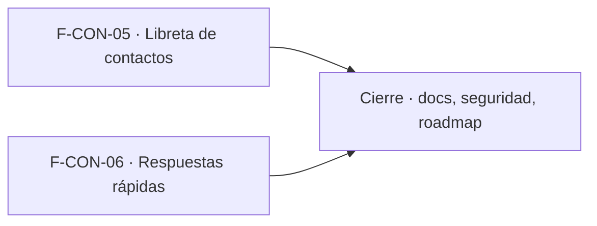

# Tasks: Consultas y ventas · Contactos y respuestas rápidas

**Input**: [spec.md](./spec.md) y [plan.md](./plan.md) · **Épica**: MSF-144
**Formato**: `- [ ] T### [P] [Historia][USx] descripción (FR/SC)`. `[P]` = paralelizable (archivos distintos, sin dependencia dentro del mismo grupo). Cada FR/SC tiene **una sola** tarea dueña ("soporte de" no es dueña). Las dependencias y el orden son **solo dentro de la misma historia**; entre historias rige la tabla *Plan de ejecución*.
**Validación por historia**: `pnpm test:db`, `pnpm lint`, `pnpm build` y `pnpm test:web` verdes antes de cerrar la fase. Cada tabla nueva: esquema re-verificado (Principio VII). Cada migración lleva su reversión en el encabezado.

## Phase 1: F-CON-05 · Libreta de contactos

**Goal**: contactos por empresa sin duplicados, con consentimiento, historial, vínculos con consultas y ventas, y anonimización.

- [ ] T001 [F-CON-05][US1] Migración `supabase/migrations/20270201100000_contactos.sql`: `dominio.contactos` (esquema `dominio`), FK compuesta a `dominio.empresas`, índices únicos parciales por empresa sobre correo y teléfono normalizados (solo no anonimizados), `unique (id, organizacion_id)`, RLS por organización y empresa accesible con select `consultas`≥`lectura`, sin escritura directa ni acceso `anon` (FR-001) (verificación: pgTAP `supabase/tests/database/contactos.test.sql`)
- [ ] T002 [P] [F-CON-05][US1] Migración `supabase/migrations/20270201100100_contactos_vinculos.sql`: `contacto_id` nullable con FK compuesta en `dominio.consultas` y `dominio.comprobantes_venta`; `consultas_bandeja` con `contacto_id` al final (soporte de FR-007) (verificación: `pnpm test:db`, la bandeja existente sigue verde)
- [ ] T003 [P] [F-CON-05][US1] Migración `supabase/migrations/20270201100200_contactos_crear_actualizar.sql`: `public.crear_contacto` y `public.actualizar_contacto` (normalización, `23505` con el contacto existente, consentimiento obligatorio con texto copiado, bloqueo optimista, actividad sin datos personales, `revoke … from public, anon` + `grant … to authenticated`) (FR-002, FR-003, FR-004) (verificación: pgTAP `contactos.test.sql`)
- [ ] T004 [F-CON-05][US1] Migración `supabase/migrations/20270201100300_contactos_vincular.sql`: `vincular_consulta_contacto` y `vincular_comprobante_contacto` (misma empresa, contacto activo, desvincular con `null`, permisos `consultas`=`edicion`) (FR-007) (verificación: pgTAP `contactos.test.sql`)
- [ ] T005 [P] [F-CON-05][US1] Migración `supabase/migrations/20270201100400_contactos_lectura.sql`: `buscar_contactos` (empresa activa o todas las accesibles, búsqueda, paginación) e `historial_contacto` (consultas + compras de empresas accesibles, por fecha descendente) (FR-008) (verificación: pgTAP `contactos.test.sql`)
- [ ] T006 [F-CON-05][US1] Migración `supabase/migrations/20270201100500_anonimizar_contacto.sql`: `public.anonimizar_contacto` (contacto y consultas vinculadas con texto neutro, `anonimizado_en`, claves liberadas, sin borrar filas ni tocar comprobantes, irreversible, solo contacto activo, actividad sin datos personales) (FR-009) (verificación: pgTAP `contactos.test.sql`)
- [ ] T007 [F-CON-05][US1] pgTAP `supabase/tests/database/contactos.test.sql`: aislamiento entre dos organizaciones y dos empresas, permisos por nivel, duplicados, consentimiento, vínculos, historial, anonimización sin romper consultas ni ventas, escritura directa rechazada, `anon` sin acceso, `rls_en_toda_tabla` (FR-011, SC-003) (verificación: `pnpm test:db`)
- [ ] T008 [P] [F-CON-05][US1] `apps/web/src/lib/contactos.ts` y `apps/web/src/lib/consentimientoContacto.ts` (RPC, mapeo de errores a mensajes claros, texto de consentimiento versionado «pendiente de aprobar») y `apps/web/src/pages/contactos/list.tsx` con ruta `/contactos`, ítem `Contactos` en Canales y libreta con búsqueda, paginación y estados compartidos (FR-005) (verificación: Vitest `contactos/list.test.tsx` (`pnpm test:web`))
- [ ] T009 [F-CON-05][US1] `apps/web/src/pages/contactos/ficha.tsx` (carga diferida): campos, `Guardar`, historial de consultas y compras, `Vincular comprobante`/desvincular, conflicto de edición claro (FR-006) (verificación: Vitest `contactos/ficha.test.tsx`)
- [ ] T010 [F-CON-05][US1] `apps/web/src/pages/consultas/ContactoConsulta.tsx` + `CrearContactoDialog.tsx`: `Crear contacto` en el detalle con datos precargados, casilla de consentimiento, aviso de duplicado con `vincular al existente`, contacto vinculado con enlace a la ficha; montado con una línea en el detalle de MSF-122 (soporte de FR-002 y FR-003, parte UI) (verificación: Vitest `ContactoConsulta.test.tsx`)
- [ ] T011 [F-CON-05][US1] `AnonimizarContactoDialog.tsx` en la ficha: confirmación que explica qué se borra y que es irreversible, ficha en solo lectura con `Anonimizado`, botones deshabilitados con «Necesitás permiso de edición» con `lectura` (FR-010) (verificación: Vitest `AnonimizarContactoDialog.test.tsx`)
- [ ] T012 [F-CON-05][US1] Empresa activa en libreta, ficha y diálogos: invalidar y recargar al cambiar, reencuadrar paginación, cerrar diálogos con aviso, sin datos de la empresa anterior (FR-012) (verificación: Vitest, caso cambio de empresa en `contactos/list.test.tsx` y `ficha.test.tsx`)
- [ ] T013 [F-CON-05][US1] E2E Playwright: crear un contacto desde una consulta, ver su historial, anonimizarlo y comprobar que desaparecen sus datos personales sin romper consultas ni ventas (SC-001) (verificación: E2E `pnpm test:e2e`)

**Checkpoint F-CON-05**: `pnpm test:db`, `pnpm lint`, `pnpm build` y `pnpm test:web` verdes.

## Phase 2: F-CON-06 · Respuestas rápidas

**Goal**: textos frecuentes por empresa, con variables, que arman el texto inicial de `Responder`.

- [ ] T014 [F-CON-06][US2] Migración `supabase/migrations/20270201200000_respuestas_rapidas.sql`: `dominio.respuestas_rapidas` (esquema `dominio`), FK compuesta a `dominio.empresas`, límites de largo, RLS por organización y empresa accesible con select `consultas`≥`lectura`, sin escritura directa ni `anon` (FR-013) (verificación: pgTAP `respuestas_rapidas.test.sql`)
- [ ] T015 [F-CON-06][US2] Migración `supabase/migrations/20270201200100_respuestas_rapidas_rpc.sql`: vista `respuestas_rapidas_lista` (`security_invoker`), `guardar_respuesta_rapida` y `eliminar_respuesta_rapida` (permisos `consultas`=`edicion`, empresa accesible, `revoke … from public, anon` + `grant … to authenticated`) (soporte de FR-014) (verificación: pgTAP `respuestas_rapidas.test.sql`)
- [ ] T016 [P] [F-CON-06][US2] `apps/web/src/lib/respuestasRapidas.ts`: `resolverVariables` (`{nombre}`, `{tienda}`, `{producto}`; vacío sin llaves ni espacios dobles; desconocida tal cual) (FR-015) (verificación: Vitest `respuestasRapidas.test.ts`)
- [ ] T017 [F-CON-06][US2] pgTAP `supabase/tests/database/respuestas_rapidas.test.sql`: aislamiento entre dos organizaciones y empresas, permisos por nivel, escritura directa rechazada, `anon` sin acceso (FR-017, SC-004) (verificación: `pnpm test:db`)
- [ ] T018 [F-CON-06][US2] `apps/web/src/pages/consultas/RespuestasRapidasDialog.tsx` + botón `Respuestas rápidas` en Consultas: lista de la empresa activa, crear/editar/eliminar, ayuda de variables, estados compartidos, solo lectura con `lectura` (FR-014) (verificación: Vitest `RespuestasRapidasDialog.test.tsx`)
- [ ] T019 [F-CON-06][US2] Selector `Respuesta rápida` en el flujo de `Responder` (solo las de la empresa de la consulta) y `armarTextoInicial` con la respuesta elegida como único punto; sin selección, plantilla actual; no envía nada (FR-016) (verificación: Vitest `responder.test.tsx`)
- [ ] T020 [F-CON-06][US2] Empresa activa en el diálogo y el selector: recargar al cambiar, cerrar con aviso, sin datos de la empresa anterior (FR-018) (verificación: Vitest, caso cambio de empresa en `RespuestasRapidasDialog.test.tsx`)
- [ ] T021 [F-CON-06][US2] E2E Playwright: crear una respuesta rápida con variables y usarla al responder una consulta; el texto inicial abierto es el esperado (SC-002) (verificación: E2E `pnpm test:e2e`)

**Checkpoint F-CON-06**: `pnpm test:db`, `pnpm lint`, `pnpm build` y `pnpm test:web` verdes.

## Phase 3: Cierre (docs, seguridad, verificación de la épica)

**Goal**: lo que ninguna historia atiende. Las tareas `[CIERRE]` las ejecuta la Tarea de cierre y **nunca** son prerequisito de una historia.

- [ ] T022 [P] [CIERRE] `docs/contactos.md` (modelo, consentimiento, anonimización, permisos, reversión, contrato para MSF-154), fila de `docs/roadmap-template.md` y `pnpm docs:check` verde (FR-019) (verificación: `pnpm docs:check`)
- [ ] T023 [P] [CIERRE] Revisión de seguridad: RLS y grants de tablas, vistas y RPC, `anon` sin privilegios nuevos, ningún dato personal en `registro_actividad` ni logs, y esquema de cada objeto contra el Principio VII (FR-020) (verificación: pgTAP de RLS/grants y `pnpm test:db`)
- [ ] T024 [CIERRE] `pnpm lint`, `pnpm build`, `pnpm infra:config`, `pnpm test`, `rls_en_toda_tabla`, `pnpm prototipo:check`, `pnpm matriz:check` y `pnpm docs:check` verdes (SC-005) (verificación: `pnpm lint && pnpm build && pnpm infra:config && pnpm test`)

**Checkpoint Cierre**: ninguna tarea queda `[ ]` sin hacerse o cerrarse con `Desvío:` y seguimiento trazado.

## Dependencias

Dentro de F-CON-05: T001 primero; T002 [P], T003 [P] y T005 [P] tras T001; T004 tras T002 y T003; T006 tras T002 y T003; T007 tras T003–T006; T008 [P] arranca solo; T009 tras T008; T010 y T011 tras T008; T012 tras T009–T011; T013 al final.
Dentro de F-CON-06: T014 → T015 → T017; T016 [P] arranca solo; T018 tras T016; T019 tras T016; T020 tras T018 y T019; T021 al final.
Cierre: T022 [P] y T023 [P] arrancan cuando todas las historias estén mergeadas; T024 al final.
Entre historias: ninguna dependencia; solo los prerrequisitos externos ya en `main` (MSF-122, MSF-130, MSF-159). El detalle de la consulta se toca en una línea por historia (`ContactoConsulta` y el selector).

## Plan de ejecución (historias)

El **orden de toma** lo declara esta tabla: el orquestador la **consume**. F-CON-05 y F-CON-06 no comparten tabla ni migración (cada una trae las suyas) y tocan archivos distintos, por eso van en paralelo en el mismo grupo.

| Historia | Depende de | Grupo |
|----------|------------|-------|
| F-CON-05 | — | 1 |
| F-CON-06 | — | 1 |
| [Cierre] | F-CON-05, F-CON-06 | 2 |

