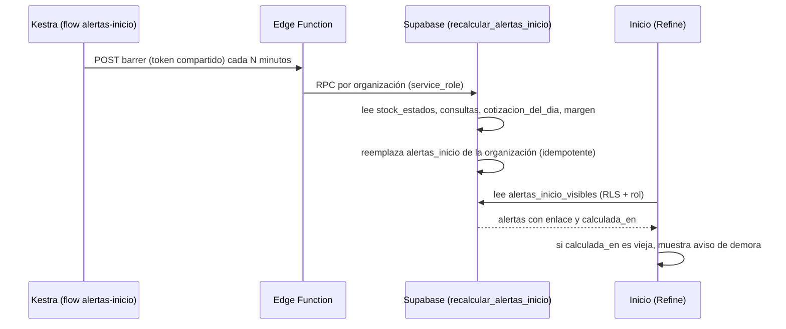
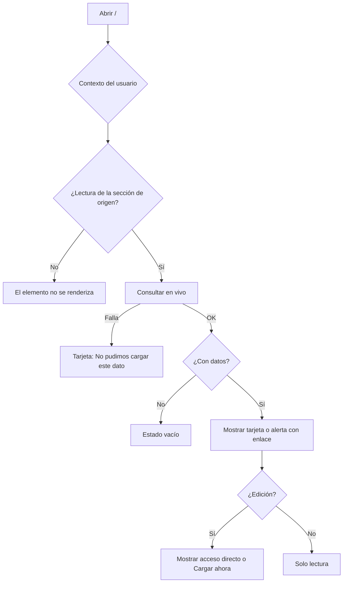
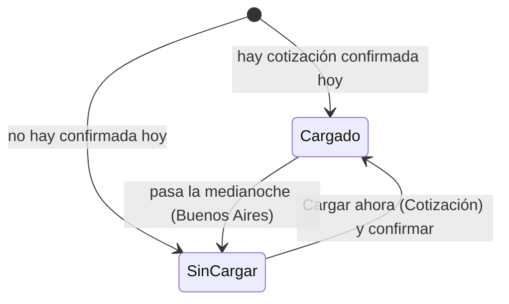
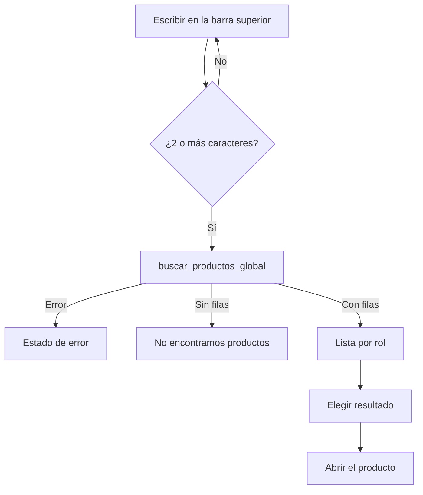

# Feature Specification: Inicio, rentabilidad y reportes · Inicio y alertas

**Épica**: MSF-156 · **Spec**: `inicio-y-alertas` · **Hito**: Etapa 2 (desde enero de 2027; antes de Mercado Libre) · **Prioridad**: P1 · **Alcance (Jira)**: diciembre · **Horas aprox.**: 18
**Alcance de entrega**: `refine`, `supabase`, `kestra` (sin `superset` ni `workers`: Inicio son consultas en vivo en Refine; el recálculo de alertas lo dispara un flow de Kestra contra una Edge Function, precedente `avisos-reposicion-stock`).
**Fuente**: especificación de Nicolás cargada en la épica (It's a Plan), prototipos `design/pantallas/Main.dc.html` y `design/pantallas/AdminHeader.dc.html` y artefactos del repo. Esta spec **traduce**; no agrega alcance.

> Nota de rama: la rama `design/prototipo` ya no existe; los prototipos viven en `design/pantallas/` y de ahí sale el inventario (`pnpm prototipo:inventario`, `pnpm prototipo:check` al día).

## Objetivo

Al terminar, cada persona abre el panel y ve en segundos lo que su rol puede resolver hoy: estado de las empresas, stock, consultas, dólar y una lista de alertas con enlace, y encuentra cualquier producto con una búsqueda global.

## Modelo y supuestos

- **Inicio se hace en Refine con consultas en vivo** (no es un tablero de Superset): depende del rol y lleva acciones directas. Reemplaza al Home actual del template (portada de servicios, `Home` en `apps/web/src/App.tsx`, ruta `index`).
- **Regla única de permisos**: un elemento de Inicio, una alerta o un resultado de búsqueda aparece solo si el rol tiene **al menos lectura** sobre su sección de origen (`private.nivel_seccion`); un **acceso directo** exige además **edición**. La base lo impide, no solo la pantalla.
- **Mercado Libre y precios en revisión**: sus tarjetas y alertas **no se muestran** mientras la organización no tenga esa funcionalidad activa (`private.tiene_feature()`). No existen al arrancar la Etapa 2; se programan con las épicas de Mercado Libre.
- **Datos de otras épicas (ya presentes en el repo; se consumen, no se recrean)**: `public.stock_estados` (MSF-136/F-STK-05; estados `sin_stock`/`stock_bajo`/`disponible`), `public.consultas_bandeja` (MSF-122; estado `nueva`), `public.estado_cotizacion()` y `public.cotizacion_del_dia()` (MSF-116; F-PRE-02/F-PRE-05), `analitica.margen_producto_canal` (MSF-120; ya migrada), `private.nivel_seccion`, `private.empresas_accesibles()`, `public.contexto_panel_actual()`. **Verificar antes de implementar** que MSF-136, MSF-122 y MSF-116 estén mergeadas.
- **Fuera de este mapa de bloqueo**: MSF-231 (stock único y alertas) y MSF-138 (Empresas) no se piden; MSF-121 (permisos por empresa) ya trae `nivel_seccion`; MSF-120 no bloquea (la alerta de margen negativo se activa cuando la vista existe).
- **Supuestos propios de la traducción (a confirmar, ver Decisiones abiertas)**: (a) qué muestra «estado de las empresas»; (b) frecuencia del recálculo y umbral del aviso de demora; (c) el sexto tipo de alerta (Mercado Libre / precios en revisión) queda diferido por feature; (d) la búsqueda global cubre **solo productos** (la épica pide «cualquier producto»).
- Las **rutas viejas** no cambian: Inicio ocupa `/` (la ruta `index`); no se mueve ninguna ruta existente.

### Esquema de datos (Constitución, Principio VII)

| Objeto | Esquema | Historia | Justificación | RLS / acceso |
|--------|---------|----------|---------------|--------------|
| `alertas_inicio` (**nueva**: `id`, `organizacion_id`, `empresa_id` null, `tipo`, `seccion`, `cantidad`, `referencia_id` null, `enlace`, `calculada_en`) | `dominio` | F-INI-02 | Es un dato derivado del negocio (stock, consultas, dólar, margen), no de la plataforma. | `organizacion_id = (select private.organizacion_id())`; **sin insert/update/delete desde la app** (solo la RPC de recálculo); `anon` sin privilegios |
| Vista `public.alertas_inicio_visibles` | `public` | F-INI-02 | Superficie de lectura sin datos propios; filtra por `nivel_seccion(seccion) ≥ lectura` y `empresas_accesibles()`. | `security_invoker`; `anon` sin acceso |
| RPC `public.recalcular_alertas_inicio` (solo `service_role`, llamada por la Edge Function) | `public` | F-INI-02 | Superficie de ejecución; recalcula de forma idempotente. | `revoke … from public, anon, authenticated`; `grant … to service_role` |
| RPC `public.buscar_productos_global` | `public` | F-INI-03 | Superficie de ejecución sin datos propios; usa el índice `pg_trgm` ya presente (`productos_nombre_trgm_idx`, `productos_sku_trgm_idx`). | `security invoker`; `grant execute … to authenticated`, `revoke … from public, anon`; filtra por `nivel_seccion('productos')` |
| F-INI-01 | — | F-INI-01 | **Sin tablas ni RPC nuevas**: lee los objetos existentes listados arriba. | — |

La prueba pgTAP `rls_en_toda_tabla` (recorre `public` + `dominio`) debe seguir verde. Todas las migraciones son **aditivas**; reversión en `plan.md`.

## User Scenarios & Testing *(mandatory)*

### User Story 1 - Pantalla de inicio (F-INI-01 · MSF-344, P1, talla M)

La persona entra al panel y ve, en una sola pantalla, el estado de sus empresas, el stock, las consultas, el dólar del día y accesos directos a lo que su rol puede hacer.

**Why this priority**: es la primera pantalla de todos los roles; sin ella no hay dónde vivan las alertas.

**Acceptance Scenarios**:

1. **Dado** un usuario autenticado, **cuando** abre `/`, **entonces** ve «Buen día, <nombre>» con la fecha y la descripción de lo que ve, en lugar de la portada de servicios del template (FR-001).
2. **Dado** un rol con edición en ventas, stock y/o productos, **entonces** ve los accesos directos `Nuevo comprobante`, `Registrar movimiento` y `Nuevo producto` solo para las secciones donde tiene edición; con solo lectura no ve el acceso (FR-002).
3. **Dado** un usuario con acceso a una o más empresas, **entonces** ve la tarjeta de estado de sus empresas, solo las que `empresas_accesibles()` le permite (FR-003).
4. **Dado** un rol con `stock`≥`lectura`, **entonces** ve cuántos productos están `sin_stock` y `stock_bajo` según `stock_estados`, con enlace a Stock; sin permiso la tarjeta no existe (FR-004).
5. **Dado** un rol con `consultas`≥`lectura`, **entonces** ve cuántas consultas `nueva` esperan atención, con enlace a la bandeja (FR-005).
6. **Dado** un rol con `cotizacion_dolar`≥`lectura`, **entonces** ve la cotización vigente y su fecha; si no hay cotización confirmada hoy ve el aviso «Todavía no se cargó el dólar de hoy» y, solo con edición, el botón `Cargar ahora` que lleva a Cotización (FR-006).
7. **Dado** que una consulta de una tarjeta falla, **entonces** esa tarjeta muestra «No pudimos cargar este dato» y las demás siguen funcionando (FR-008).
8. **Dado** una organización sin productos, **entonces** ve el estado vacío compartido con una explicación, no ceros sin contexto (FR-008).
9. **Dado** que la organización no tiene activa la funcionalidad de Mercado Libre, **entonces** no aparece ninguna tarjeta de Mercado Libre ni de precios en revisión (FR-009).
10. **Dado** que cambia la empresa activa de la barra superior, **entonces** Inicio invalida y recarga todas sus consultas y no queda ningún dato de la anterior (FR-010).
11. **Dado** un ancho de 320, 768 o 1440 px y navegación por teclado, **entonces** Inicio es operable y legible (FR-011).

**Independent Test**: Vitest de cada tarjeta por rol + E2E de Inicio con los tres roles (cierre).

### User Story 2 - Alertas accionables (F-INI-02 · MSF-361, P1, talla S)

La persona ve en Inicio una lista de alertas, cada una con un enlace a donde se resuelve, solo de lo que su rol puede ver.

**Why this priority**: convierte el panel en una lista de pendientes accionables. Depende de F-INI-01 (las alertas viven en esa pantalla).

**Acceptance Scenarios**:

1. **Dado** la organización, **entonces** existe `dominio.alertas_inicio` con una fila por alerta calculada (tipo, sección de origen, cantidad, enlace, fecha de cálculo) (FR-020).
2. **Dado** el recálculo, **entonces** genera estos tipos: productos sin stock, productos con stock bajo, consultas nuevas sin atender, dólar sin cargar hoy y productos con margen negativo (este último solo cuando `analitica.margen_producto_canal` existe) (FR-021).
3. **Dado** que el flow de Kestra corre dos veces seguidas, **entonces** el resultado es el mismo, sin filas duplicadas (FR-022).
4. **Dado** un usuario, **cuando** lee las alertas, **entonces** ve solo las de secciones con ≥`lectura` y empresas accesibles; una alerta de otra organización o sección sin permiso no existe para él (la base lo impide) (FR-023).
5. **Dado** que el último cálculo es más viejo que el umbral, **entonces** la lista muestra un aviso de demora con la hora del último cálculo (FR-024).
6. **Dado** una alerta, **cuando** la persona la toca, **entonces** llega a la pantalla donde se resuelve (Stock, Consultas, Cotización, Rentabilidad) (FR-025).
7. **Dado** que no hay alertas, **entonces** ve el estado vacío compartido «Sin alertas» (FR-026).
8. **Dado** que Mercado Libre / precios en revisión no está activo, **entonces** no se genera ni se muestra su alerta (FR-027).

**Independent Test**: pgTAP de `alertas_inicio` (RLS, idempotencia, filtrado por rol) + Vitest de la lista.

### User Story 3 - Búsqueda global (F-INI-03, P1, talla S)

La persona escribe en la barra superior y encuentra cualquier producto por nombre o SKU.

**Why this priority**: es el atajo para ir a cualquier producto desde cualquier pantalla.

**Acceptance Scenarios**:

1. **Dado** la barra superior, **entonces** muestra un campo de búsqueda en todas las pantallas del panel (FR-030).
2. **Dado** un texto de al menos 2 caracteres, **cuando** la persona escribe, **entonces** ve resultados de productos que coinciden por nombre o SKU, tolerante a mayúsculas, tildes y errores leves de tipeo (FR-031).
3. **Dado** un resultado, **cuando** lo elige, **entonces** abre el producto (FR-032).
4. **Dado** que no hay coincidencias, **entonces** ve «No encontramos productos» (FR-033).
5. **Dado** un rol sin `productos`≥`lectura`, **entonces** la búsqueda no devuelve resultados de productos (la base lo impide) (FR-034).
6. **Dado** que la búsqueda falla, **entonces** ve el estado de error compartido sin cerrar el campo (FR-035).
7. **Dado** teclado y lector de pantalla, **entonces** el campo y la lista son operables (flechas, Enter, Escape) y anuncian cuántos resultados hay (FR-036).

**Independent Test**: pgTAP de la búsqueda por rol + Vitest del campo.

### Edge Cases

- Usuario sin ninguna sección con lectura: Inicio muestra solo el saludo y un estado vacío («Tu rol todavía no tiene secciones habilitadas»), nunca una pantalla en blanco.
- Superadmin sin organización activa: se comporta como el resto del panel (`RequiereOrganizacionActiva`).
- Dólar con carga solo pendiente (sin confirmar): cuenta como «no cargado hoy» (así lo define `cotizacion_del_dia`).
- Recálculo con la Edge Function caída: Inicio sigue mostrando el último cálculo con aviso de demora; no hay error bloqueante.

## Requirements *(mandatory)*

### Functional Requirements

**F-INI-01 — Pantalla de inicio**
- **FR-001**: Inicio DEBE reemplazar al Home del template en `/`, con saludo «Buen día, <nombre>», fecha y subtítulo.
- **FR-002**: DEBE ofrecer los accesos directos `Nuevo comprobante`, `Registrar movimiento` y `Nuevo producto`, cada uno solo con edición en `ventas`, `stock` y `productos` respectivamente.
- **FR-003**: DEBE mostrar el estado de las empresas accesibles al usuario (ver Decisiones abiertas D-1).
- **FR-004**: DEBE mostrar los conteos `sin_stock` y `stock_bajo` desde `public.stock_estados`, con enlace a Stock, si `stock`≥`lectura`.
- **FR-005**: DEBE mostrar las consultas `nueva` desde `public.consultas_bandeja`, con enlace a la bandeja, si `consultas`≥`lectura`.
- **FR-006**: DEBE mostrar la cotización vigente y su fecha (`estado_cotizacion`) y, si no hay carga confirmada hoy (`cotizacion_del_dia`), el aviso «Todavía no se cargó el dólar de hoy» con `Cargar ahora` (solo con edición) hacia Cotización, si `cotizacion_dolar`≥`lectura`.
- **FR-007**: Todo elemento DEBE aplicar la regla única de permisos (lectura para ver, edición para acciones); sin permiso el elemento no se renderiza ni se consulta.
- **FR-008**: DEBE usar los estados compartidos: carga (`EstadoCargaPagina`), vacío de organización sin productos (`EstadoVacio`) y, por tarjeta, error «No pudimos cargar este dato» sin tumbar el resto.
- **FR-009**: NO DEBE mostrar tarjetas ni alertas de Mercado Libre ni de precios en revisión si la funcionalidad no está activa (`private.tiene_feature()`).
- **FR-010**: DEBE respetar la **empresa activa** de la barra superior (Principio VIII): invalida y recarga todas sus consultas al cambiar y nunca mezcla datos de la anterior.
- **FR-011**: DEBE declarar su navegación (ítem «Inicio», ruta canónica `/`, audiencia: todos los roles de organización), usar los patrones compartidos y funcionar con teclado, lector de pantalla y 320/768/1440 px (Principio VI); NO DEBE presentar identificadores técnicos como identidad visible.

**F-INI-02 — Alertas accionables**
- **FR-020**: DEBE existir `dominio.alertas_inicio` con RLS por organización y sin escritura desde la app.
- **FR-021**: El recálculo DEBE generar los tipos `sin_stock`, `stock_bajo`, `consultas_sin_atender`, `dolar_sin_cargar` y `margen_negativo` (este último si existe `analitica.margen_producto_canal`).
- **FR-022**: El recálculo DEBE ser idempotente y auditable (organización, cantidad de alertas, fecha); un flow de Kestra lo dispara por Edge Function con token compartido (precedente `avisos-reposicion-stock`).
- **FR-023**: La lectura DEBE pasar por `public.alertas_inicio_visibles`, filtrada por sección ≥`lectura` y `empresas_accesibles()`.
- **FR-024**: La lista DEBE avisar la demora cuando `calculada_en` supera el umbral (ver D-2).
- **FR-025**: Cada alerta DEBE tener un enlace a la pantalla donde se resuelve; el enlace se arma desde una lista cerrada de rutas, nunca desde texto libre.
- **FR-026**: DEBE mostrar el estado vacío compartido cuando no hay alertas.
- **FR-027**: NO DEBE generar ni mostrar alertas de Mercado Libre / precios en revisión sin la funcionalidad activa.

**F-INI-03 — Búsqueda global**
- **FR-030**: La barra superior DEBE incluir el campo de búsqueda global en todas las pantallas del panel.
- **FR-031**: `buscar_productos_global(q, limite)` DEBE buscar por nombre y SKU con `pg_trgm` (ya habilitada; `private.normalizar_busqueda`), con mínimo 2 caracteres y tope de resultados.
- **FR-032**: Elegir un resultado DEBE abrir el producto.
- **FR-033**: DEBE mostrar «No encontramos productos» sin coincidencias.
- **FR-034**: DEBE devolver solo lo que el rol puede leer (`productos`≥`lectura`), en la base.
- **FR-035**: DEBE mostrar el estado de error compartido si la consulta falla.
- **FR-036**: El campo y su lista DEBEN ser accesibles por teclado y lector de pantalla.

### Success Criteria

- **SC-001**: Un rol con lectura de stock, consultas y dólar ve las tres tarjetas y su lista de alertas sin recargar manualmente (FR-001, FR-004–FR-006, FR-023).
- **SC-002**: Un rol sin permiso sobre una sección no ve su tarjeta, su alerta ni sus resultados de búsqueda, verificado en pgTAP y E2E con los tres roles (FR-007, FR-023, FR-034).
- **SC-003**: Cambiar de empresa recarga todo Inicio sin datos de la anterior (FR-010).
- **SC-004**: Correr el recálculo dos veces deja el mismo conjunto de alertas (FR-022).
- **SC-005**: Una consulta fallida afecta solo su tarjeta (FR-008).
- **SC-006**: `pnpm lint`, `pnpm build`, `pnpm infra:config`, `pnpm test`, `rls_en_toda_tabla`, `pnpm prototipo:check` y `pnpm matriz:check` verdes.

### Verificación por requisito

Cada requisito tiene su verificación nombrada (Vitest en `apps/web/src/pages/inicio/__tests__/`, pgTAP en `supabase/tests/database/`, E2E en `apps/web/e2e/inicio.e2e.ts`, o un comando). Los archivos nacen con la tarea dueña.

| Req. | Verificación | Comando |
|---|---|---|
| FR-001 | Vitest `inicio.test.tsx` «saludo, fecha y subtítulo reemplazan al Home» | `pnpm --filter @platform/web test inicio` |
| FR-002 | Vitest `accesos-directos.test.tsx` (edición muestra, lectura oculta) | ídem |
| FR-003 | Vitest `tarjeta-empresas.test.tsx` (solo `empresas_accesibles()`) | ídem |
| FR-004 | Vitest `tarjeta-stock.test.tsx` (conteos `sin_stock`/`stock_bajo`, enlace) | ídem |
| FR-005 | Vitest `tarjeta-consultas.test.tsx` (consultas `nueva`, enlace) | ídem |
| FR-006 | Vitest `tarjeta-dolar.test.tsx` (cargado / sin cargar / `Cargar ahora` solo con edición) | ídem |
| FR-007 | Vitest `permisos-inicio.test.tsx` por rol + pgTAP `alertas_inicio.test.sql` | `pnpm test` |
| FR-008 | Vitest `estados-inicio.test.tsx` (carga, vacío sin productos, error por tarjeta) | `pnpm --filter @platform/web test inicio` |
| FR-009 | Vitest `feature-ml.test.tsx` (sin `tiene_feature` no hay tarjeta) + pgTAP `alertas_inicio.test.sql` | `pnpm test` |
| FR-010 | Vitest `empresa-activa-inicio.test.tsx` (cambio de empresa invalida `queryKey`) + E2E `inicio.e2e.ts` | `pnpm test` / `pnpm test:e2e` |
| FR-011 | Vitest `navegacion-inicio.test.ts` (`destinosPanel`) + E2E a 320/768/1440 px con axe | `pnpm test:e2e` |
| FR-020 | pgTAP `alertas_inicio.test.sql` (RLS, sin escritura de `authenticated`) + `rls_en_toda_tabla` | `pnpm test` |
| FR-021 | pgTAP `alertas_inicio.test.sql` (cinco tipos, margen solo si existe la vista) | `pnpm test` |
| FR-022 | pgTAP `alertas_inicio.test.sql` (dos corridas = mismo conjunto) + `pnpm infra:config` (flow válido) | `pnpm test && pnpm infra:config` |
| FR-023 | pgTAP `alertas_inicio.test.sql` (filtrado por rol y empresa, `anon` sin acceso) | `pnpm test` |
| FR-024 | Vitest `alertas-demora.test.tsx` (umbral 1 h con `calculada_en`) | `pnpm --filter @platform/web test inicio` |
| FR-025 | Vitest `alertas-lista.test.tsx` (enlace de lista cerrada) + pgTAP (columna `enlace`) | `pnpm test` |
| FR-026 | Vitest `alertas-lista.test.tsx` («Sin alertas») | `pnpm --filter @platform/web test inicio` |
| FR-027 | pgTAP `alertas_inicio.test.sql` (sin feature no se genera) + Vitest `feature-ml.test.tsx` | `pnpm test` |
| FR-030 | Vitest `busqueda-global.test.tsx` (campo en `EncabezadoPanel`) | `pnpm --filter @platform/web test busqueda` |
| FR-031 | pgTAP `busqueda_global.test.sql` (nombre, SKU, tildes, typos, mínimo 2, tope) | `pnpm test` |
| FR-032 | Vitest `busqueda-global.test.tsx` (elegir navega al producto) | `pnpm --filter @platform/web test busqueda` |
| FR-033 | Vitest `busqueda-global.test.tsx` («No encontramos productos») | ídem |
| FR-034 | pgTAP `busqueda_global.test.sql` (rol sin `productos`≥lectura = 0 filas; `anon` sin ejecución) | `pnpm test` |
| FR-035 | Vitest `busqueda-global.test.tsx` (error compartido, campo abierto) | `pnpm --filter @platform/web test busqueda` |
| FR-036 | Vitest `busqueda-global.test.tsx` (flechas, Enter, Escape, `aria-live`) + axe en E2E | ídem |
| SC-001 | E2E `inicio.e2e.ts` (rol con stock, consultas y dólar ve tres tarjetas y alertas) | `pnpm test:e2e` |
| SC-002 | pgTAP `alertas_inicio.test.sql` + `busqueda_global.test.sql` + E2E `inicio.e2e.ts` con tres roles | `pnpm test && pnpm test:e2e` |
| SC-003 | E2E `inicio.e2e.ts` (cambio de empresa) | `pnpm test:e2e` |
| SC-004 | pgTAP `alertas_inicio.test.sql` («recalcular dos veces = mismo conjunto») | `pnpm test` |
| SC-005 | Vitest `estados-inicio.test.tsx` (una tarjeta falla, las demás renderizan) | `pnpm --filter @platform/web test inicio` |
| SC-006 | Los seis comandos de validación | `pnpm lint && pnpm build && pnpm infra:config && pnpm test && pnpm prototipo:check && pnpm matriz:check` |

## Decisiones abiertas (a confirmar con Nicolás)

- **D-1 — «Estado de las empresas»**: la épica lo nombra pero no lo define. Propuesta: una fila por empresa accesible con su nombre y estado (activa / desactivada) y enlace a Empresas; sin métricas de ventas (esas son de F-REP-05). 
- **D-2 — Frecuencia y demora**: propuesta recalcular cada 15 minutos y avisar demora pasada 1 hora.
- **D-3 — Roadmap**: el Roadmap P0 dice «tablero de inicio con Superset» (10 h); el documento del componente dice Etapa 2, P1, 18 h, pantalla Refine. **Esta spec sigue el documento del componente (Refine)**; la fila de Jira trae alcance «diciembre». Falta alinear el roadmap.
- **D-4 — Búsqueda**: el prototipo muestra «Buscar producto, cliente o comprobante…»; la épica pide productos. Se busca solo productos; clientes y comprobantes quedan fuera.
- **Resueltas por el repo**: Kestra→Edge Function con token (precedente `avisos-reposicion-stock`); `pg_trgm` ya está habilitada (`20261016160000_clientes_habilitar_pg_trgm.sql`).

## Flujos

### Recálculo de alertas (F-INI-02)

### Qué ve cada elemento de Inicio (F-INI-01 / F-INI-02)

### Aviso de dólar (F-INI-01)

### Búsqueda global (F-INI-03)

| Paso / estado | Dueño |
|---|---|
| Recálculo, escritura idempotente | FR-021, FR-022 |
| Lectura por rol y demora | FR-023, FR-024 |
| Elemento oculto sin lectura / acción con edición | FR-007 |
| Falla y vacío | FR-008, FR-026 |
| Dólar cargado / sin cargar | FR-006 |
| Búsqueda, vacío, error, elegir | FR-031–FR-035 |

## Matriz pantalla↔criterios

El prototipo muestra mucho más que la épica; lo que la épica no pide queda **fuera de alcance** (no es deuda: otras épicas lo piden después).

| Ítem del prototipo | Pantalla | Dueño |
|---|---|---|
| Título «Buen día, Administrador», fecha y subtítulo | Main | FR-001 |
| Botón `Nuevo comprobante` | Main | FR-002 |
| Botón `Registrar movimiento` | Main | FR-002 |
| Botón `Nuevo producto` | Main | FR-002 |
| Aviso «Todavía no se cargó el dólar de hoy» y botón `Cargar ahora` | Main | FR-006 |
| Tarjeta «Qué hacer hoy» (pendientes) con botones `···Ver` / `···Abrir` | Main | FR-025 (alertas con enlace; los botones del prototipo son los enlaces) |
| Stock hoy (KPI) | Main | FR-004 |
| Consultas nuevas | Main (no dibujada) | FR-005 (la épica la pide; sin elemento propio en el prototipo, se resuelve con el patrón de tarjeta) |
| Estado de empresas | Main (parcial: «Resumen por tienda») | FR-003; las métricas del resumen (unidades, ingresos, margen) fuera de alcance |
| Barra superior: campo «Buscar producto, cliente o comprobante…» | AdminHeader | FR-030–FR-036 (solo productos, ver D-4) |
| Barra superior: `Empresa activa· ·`, «Todas mis empresas» | AdminHeader | FR-010 (ya existe, F-ROL-06; Inicio solo la respeta) |
| Barra superior: `AAdministrador`, `Mi cuenta`, `Usuarios`, `Cerrar sesión` | AdminHeader | Fuera de alcance: ya existen en la barra del template; no se tocan |
| Empresa activa | Main / AdminHeader | FR-010 (fila obligatoria Principio VIII) |
| Filtros `Período`, `Tienda`, `Depósito` y texto «Con una tienda elegida…» | Main | Fuera de alcance: filtros del tablero de ventas (F-REP-05) |
| «Ventas del período» (KPI) y gráficos «Ventas y stock en el tiempo» | Main | Fuera de alcance: gráficos de ventas, F-REP-05 |
| Botón `Ver rentabilidad` y «Resumen por tienda» (unidades, ingresos, margen) | Main | Fuera de alcance: reportes de rentabilidad (MSF-120/F-REP) |
| Tarjeta «Mercado Libre» («3 ventas recibidas hoy», margen, cuentas) y columnas `ML hoy` | Main | Fuera de alcance hasta que exista la funcionalidad activa (FR-009, épicas de Mercado Libre) |
| «Salidas por depósito» | Main | Fuera de alcance: no lo pide la épica |
| Tabla «Actividad reciente» (`Cuándo`, `Tipo`, `Detalle`, `Cant.`, `Responsable`) y botón `Ver todo` | Main | Fuera de alcance: no lo pide la épica (pantalla Actividad ya existente) |
| Tabla «Movimientos por producto» (`··`), `Stock · Movimientos`, `Exportar`, `Categoría: ·`, «Vistas rápidas», «Ordenar por», estado «No hay productos que coincidan» | Main | Fuera de alcance: listado de Stock Movimientos, ya cubierto por la pantalla de Stock |
| Campo `Buscar producto o SKU` (de «Movimientos por producto») | Main | Fuera de alcance: filtro de esa tabla; la búsqueda de esta épica es la global (FR-030) |
| Diálogo «Cargar dólar del día», campo «Dólar del día (pesos por dólar)», tabla `Producto (muestra)`/`Mundo JC hoy`/`Nuevo`/`ML hoy`/`Nuevo`, botón `Cancelar`, avisos de variación | Main | Fuera de alcance: ya entregado en Cotización (MSF-116); `Cargar ahora` navega a esa pantalla |
| Estado «No pudimos cargar este dato» (no está en el prototipo; sale de la historia) | — | FR-008 |
| Estado «No encontramos productos» (sale de la historia) | AdminHeader | FR-033 |
| Estado de organización sin productos (sale de la historia) | — | FR-008 |
| Alertas con aviso de demora (sale de la historia) | — | FR-024 |
