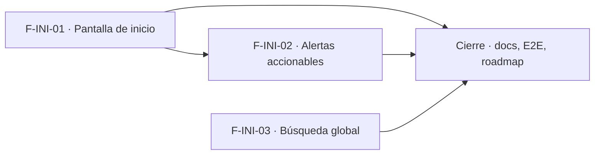

# Tasks: Inicio y alertas (MSF-156)

**Spec**: [`spec.md`](./spec.md) · **Plan**: [`plan.md`](./plan.md) · Formato: `- [ ] T001 [P] [STORY][USy] descripción`. Fuera de alcance = nota en la matriz, no tarea.

## Matriz de trazabilidad (tracker ↔ US ↔ tasks)

| Tracker | Historia | US | FR / SC dueños | Tareas |
|---|---|---|---|---|
| MSF-344 | F-INI-01 | US1 | FR-001–FR-011, SC-005 | T001–T007 |
| MSF-361 | F-INI-02 | US2 | FR-020–FR-027, SC-004 | T008–T016 |
| (hija de MSF-156) | F-INI-03 | US3 | FR-030–FR-036 | T017–T022 |
| Tarea de cierre (label cierre) | — | — | SC-001, SC-002, SC-003, SC-006 (verificación global) | T023–T026 |

## Phase 1: F-INI-01 · Pantalla de inicio (US1)

- [x] T001 [F-INI-01][US1] Ruta `index` → `pages/inicio/index.tsx` en lugar de `Home`: saludo, fecha, subtítulo, ítem «Inicio» en `destinosPanel.ts`, responsive 320/768/1440 y teclado (FR-001, FR-011). Verifica: `inicio.test.tsx`, `navegacion-inicio.test.ts`
- [x] T002 [P] [F-INI-01][US1] Accesos directos `Nuevo comprobante`, `Registrar movimiento`, `Nuevo producto` con edición por sección (FR-002). Verifica: `accesos-directos.test.tsx`
- [x] T003 [P] [F-INI-01][US1] Tarjeta de estado de empresas accesibles (D-1) (FR-003). Verifica: `tarjeta-empresas.test.tsx`
- [x] T004 [P] [F-INI-01][US1] Tarjeta de stock desde `stock_estados` con enlace (FR-004). Verifica: `tarjeta-stock.test.tsx`
- [x] T005 [P] [F-INI-01][US1] Tarjeta de consultas nuevas desde `consultas_bandeja` con enlace (FR-005). Verifica: `tarjeta-consultas.test.tsx`
- [x] T006 [P] [F-INI-01][US1] Tarjeta de dólar: cotización vigente, aviso «Todavía no se cargó el dólar de hoy» y `Cargar ahora` (FR-006). Verifica: `tarjeta-dolar.test.tsx`
- [x] T007 [F-INI-01][US1] Regla única de permisos, estados de carga/vacío/error por tarjeta, ocultamiento por `tiene_feature` y recarga por empresa activa, con Vitest por rol y cambio de empresa (FR-007, FR-008, FR-009, FR-010, SC-005). Verifica: `permisos-inicio`, `estados-inicio`, `feature-ml`, `empresa-activa-inicio` (Vitest)

**Checkpoint F-INI-01**: Inicio renderiza por rol sin migraciones nuevas.

## Phase 2: F-INI-02 · Alertas accionables (US2)

- [x] T008 [F-INI-02][US2] Migración `dominio.alertas_inicio` con RLS, sin escritura desde la app, y reversión documentada (FR-020)
- [x] T009 [F-INI-02][US2] `recalcular_alertas_inicio` con los cinco tipos, enlaces de lista cerrada y `pg_advisory_xact_lock` (FR-021)
- [x] T010 [F-INI-02][US2] Vista `alertas_inicio_visibles` (`security_invoker`, sección ≥ lectura, empresas accesibles) y grants (FR-023)
- [x] T011 [P] [F-INI-02][US2] pgTAP: RLS, idempotencia, filtrado por rol, `anon` sin acceso, feature ML ausente, y «recalcular dos veces = mismo conjunto» en `alertas_inicio.test.sql`; `rls_en_toda_tabla` verde (FR-022, SC-004)
- [x] T012 [F-INI-02][US2] Edge Function `recalcular-alertas-inicio` con token y registro de ejecución por organización (FR-022)
- [x] T013 [P] [F-INI-02][US2] Flow `infra/kestra/flows/alertas-inicio.yml`, variables en `.env.example` y `pnpm infra:config` (FR-022; verifica el flow válido)
- [x] T014 [F-INI-02][US2] Lista de alertas en Inicio con enlace y estado vacío (FR-025, FR-026). Verifica: `alertas-lista.test.tsx`
- [x] T015 [F-INI-02][US2] Aviso de demora según `calculada_en` (FR-024). Verifica: `alertas-demora.test.tsx`
- [x] T016 [F-INI-02][US2] Alertas de Mercado Libre / precios en revisión ausentes sin la funcionalidad (FR-027). Verifica: `feature-ml.test.tsx` + pgTAP

**Checkpoint F-INI-02**: las alertas se recalculan y cada rol ve solo las suyas.

## Phase 3: F-INI-03 · Búsqueda global (US3)

- [x] T017 [F-INI-03][US3] Migración `buscar_productos_global` con `pg_trgm`/`normalizar_busqueda`, mínimo 2 caracteres, tope y grants (FR-031, FR-034). Verifica: `busqueda_global.test.sql`
- [x] T018 [P] [F-INI-03][US3] pgTAP de la búsqueda por rol y `anon` sin ejecución en `busqueda_global.test.sql` (FR-034)
- [x] T019 [F-INI-03][US3] Campo de búsqueda en `EncabezadoPanel` con debounce y lista de resultados (FR-030, FR-031). Verifica: `busqueda-global.test.tsx`
- [x] T020 [F-INI-03][US3] Elegir resultado abre el producto (FR-032). Verifica: `busqueda-global.test.tsx`
- [x] T021 [F-INI-03][US3] Estados «No encontramos productos» y error compartido (FR-033, FR-035). Verifica: `busqueda-global.test.tsx`
- [x] T022 [F-INI-03][US3] Accesibilidad: flechas, Enter, Escape y anuncio de resultados (FR-036). Verifica: `busqueda-global.test.tsx` + axe

**Checkpoint F-INI-03**: la búsqueda responde por rol.

## Phase 4: Cierre

- [x] T023 [P] [CIERRE] Doc `docs/inicio-y-alertas.md` (tarjetas, alertas, búsqueda, flow, variables) y `pnpm docs:check`
- [x] T024 [P] [CIERRE] E2E de Inicio con los tres roles y cambio de empresa en `apps/web/e2e/inicio.e2e.ts` (SC-001, SC-002, SC-003)
- [ ] T025 [CIERRE] `pnpm lint`, `pnpm build`, `pnpm infra:config`, `pnpm test`, `pnpm prototipo:check`, `pnpm matriz:check` verdes (SC-006)
- [x] T026 [CIERRE] Actualizar `docs/roadmap-template.md` (estado, link a la spec, alinear D-3)

**Checkpoint Cierre**: ninguna tarea queda `[ ]` sin hacerse o cerrarse con `Desvío:` y seguimiento trazado.

## Dependencias

Dentro de F-INI-01: T001 → T002–T006 [P] → T007. Dentro de F-INI-02: T008 → T009 → T010 → T011 [P], T012 tras T009 → T013 [P]; T014 tras T010 → T015 → T016. Dentro de F-INI-03: T017 → T018 [P]; T019 → T020 → T021 → T022. F-INI-02 espera a F-INI-01 (las alertas viven en Inicio). Cierre al final.

## Plan de ejecución (historias)

| Historia | Depende de | Grupo |
|----------|------------|-------|
| F-INI-01 | — | 1 |
| F-INI-03 | — | 1 |
| F-INI-02 | F-INI-01 | 2 |
| [Cierre] | F-INI-01, F-INI-02, F-INI-03 | 3 |

