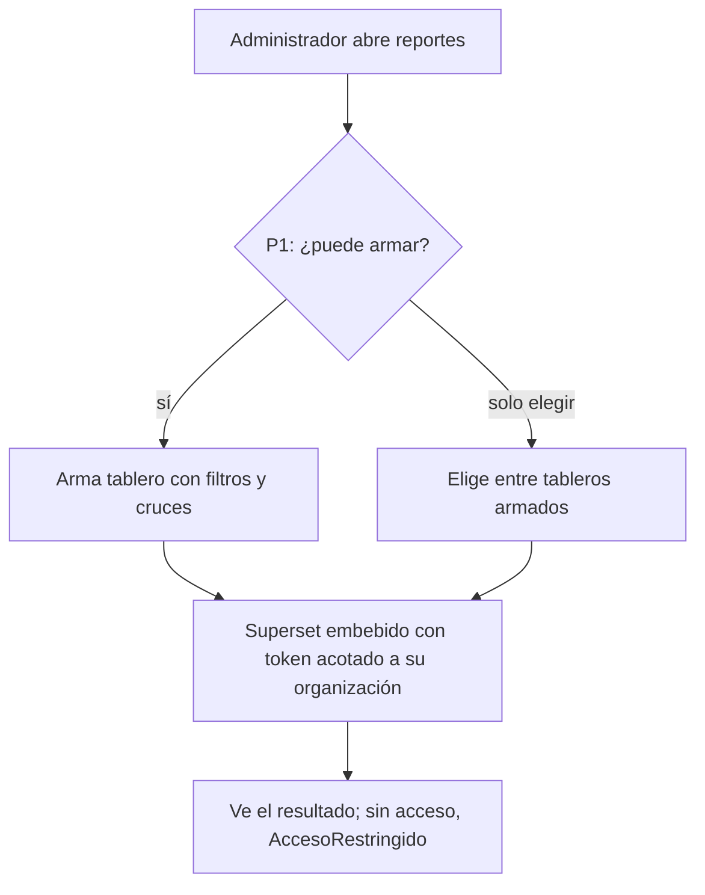
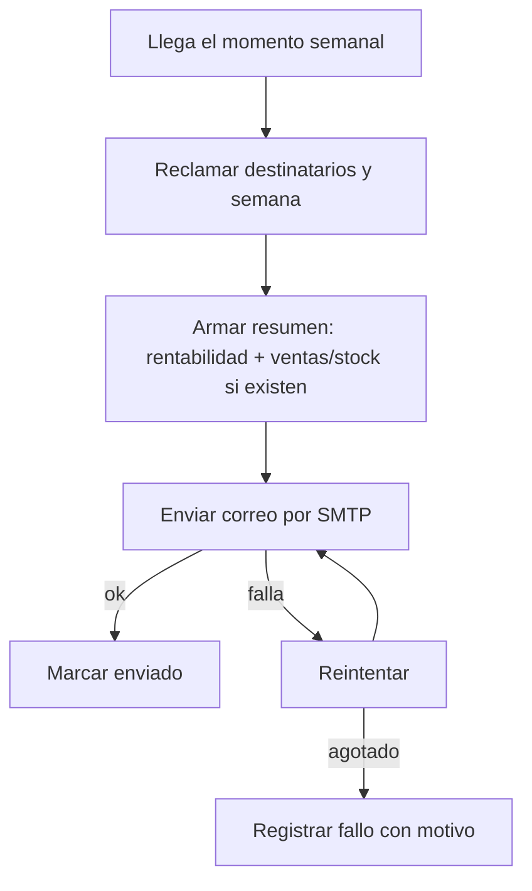

# Feature Specification: Inicio, rentabilidad y reportes · Analítica avanzada y resumen por correo

**Épica**: MSF-265 · **Spec**: `analitica-avanzada-y-resumen-por-correo` · **Hito**: Backlog (a definir con el cliente) · **Prioridad**: P3 · **Alcance (Jira)**: fuera-de-diciembre · **Horas aprox.**: 30 (a estimar al pasar a un hito)
**Alcance de entrega**: `refine`, `supabase`, `superset`, `kestra` (el envío semanal lo orquesta Kestra con el SMTP existente; sin `workers`). El alcance exacto de `superset`/`refine` depende de la pregunta P1.
**Estado**: **PARCIAL — NEEDS_INFO.** La épica declara que F-REP-07 y F-REP-08 **no tienen RF ni CA** («se redactan cuando la épica pase a un hito») y deja abierta una decisión de alcance. Esta spec traduce solo el Objetivo y lo que la épica fija; lo demás queda como pregunta (ver «Preguntas abiertas»). No se inventa alcance.
**Fuente**: especificación de Nicolás cargada en la épica y artefactos del repo.

## Objetivo

Al terminar, el administrador arma sus propios tableros con filtros y cruces y recibe un resumen semanal por correo sin entrar al panel.

## Modelo y supuestos

- **Bloqueada por**: MSF-120 (Rentabilidad margen: tablero base, componente de embebido `ReporteEmbebido`, carpeta `infra/superset/` versionada — ya en el repo) y MSF-189 (Avisos y listas configurables, F-NOT-01: envío de avisos por correo — ya en el repo, ver `docs/avisos-por-correo.md`).
- **Relacionada sin bloqueo**: MSF-192 (ventas: el resumen suma ventas «cuando existan», se construye contra el contrato de sus vistas `analitica`) y MSF-140 (inventario: el resumen incorpora «stock en alerta» cuando exista). Ninguna es prerrequisito: si la fuente no existe, la sección no aparece.
- Los tableros son **Superset embebido** (spec 007) sobre **vistas del esquema `analitica`**; Inicio y la búsqueda son de Refine (no se tocan acá).
- Estado actual relevante (verificado en el repo): la spec 007 hoy permite **crear/editar reportes solo al superadmin**, directo en Superset, y prohíbe al administrador todo acceso a Superset (007 FR-001, FR-013). F-REP-07 («el administrador arma sus propios tableros») **cambia esa regla**: por eso es la pregunta P1.
- El template solo envía por Supabase Auth invitación y recuperación; los avisos de negocio por correo existen vía `enviar-avisos` (Kestra + `KESTRA_SMTP_*`), sin reportes programados (roadmap #34, «Exploración»).
- BI avanzado figura fuera del alcance acordado y el Roadmap a diciembre lo ubica en enero (Etapa 2); la épica está en Backlog P3. **Manda el roadmap; se confirma con el cliente** (A revisar de la épica). No bloquea escribir esta spec.
- Horas: las tallas suman 24 h (L+M) frente a 30 h; se estiman al pasar a un hito.

### Esquema de datos (Constitución, Principio VII) — provisional

| Objeto | Esquema | Historia | Justificación | RLS / acceso |
|---|---|---|---|---|
| Vistas de lectura nuevas que el tablero libre necesite | `analitica` (solo vistas) | F-REP-07 | Contrato de lectura para Superset; no almacenan datos; cada fila lleva `organizacion_id` | Sin acceso para `anon`/`authenticated`; `select` solo al rol de Superset; aislamiento por la cláusula `rls` del guest token (como MSF-120) |
| Tipo de aviso `resumen_semanal` en `public.tipos_aviso` (fila, no tabla) | `public` (plataforma) | F-REP-08 | Reutiliza el catálogo de MSF-189; **a confirmar en P3** | RLS vigente de `tipos_aviso` |
| Persistencia de tableros propios (si P1 = «editar») | **por definir** | F-REP-07 | Depende de P2 (dónde viven); no se declara tabla hasta que se decida | — |

**No se crea ninguna tabla nueva confirmada.** La prueba pgTAP `rls_en_toda_tabla` (recorre `public` + `dominio`) debe seguir verde. Toda migración será aditiva; reversión: `drop` de lo creado por la historia (se detalla en el plan).

## Preguntas abiertas (bloquean la implementación)

1. **P1 (la épica la deja «por dividir»)**: ¿F-REP-07 es **permitir que el administrador edite/arme tableros** (cruza la regla 007 FR-013, hoy prohibida) o **solo elegir entre tableros ya armados** por el equipo? El Objetivo dice «arma sus propios tableros con filtros y cruces».
2. **P2**: si el administrador arma tableros, ¿**dónde** los hace (Superset embebido en modo edición dentro de Refine, o un constructor propio de Refine) y **dónde viven** (en la base de Superset, lo que choca con «los dashboards se exportan a YAML y se commitean»)? ¿Con qué permisos acotados y quién puede compartirlos dentro de la organización?
3. **P3**: resumen semanal: ¿**qué contiene** (rentabilidad, ventas, stock en alerta: ¿todo o por secciones?), ¿**quién lo recibe** (todos los administradores o quien lo active, como preferencia de aviso), ¿**qué día y hora** y en qué zona horaria?
4. **P4**: ¿se confirma esta épica en Backlog/P3 o pasa a Etapa 2 (enero 2027) según el Roadmap? (No cambia el diseño, sí el orden de entrega.)

## User Scenarios & Testing *(mandatory)*

### User Story 1 - Analítica avanzada embebida (F-REP-07, P3, talla L)

Como administrador quiero armar mis propios tableros con filtros y cruces sobre los datos de mi organización, para analizar el negocio sin pedirle un reporte al equipo.

**Escenarios** (derivados solo del Objetivo; el detalle de «armar» queda sujeto a P1/P2):
1. **Dado** un administrador con acceso a la sección de reportes, **cuando** arma un tablero con un filtro y un cruce de datos, **entonces** ve el resultado embebido en el panel.
2. **Dado** dos organizaciones, **cuando** A abre o arma un tablero, **entonces** el token lleva `organizacion_id = '<A>'` y no aparece ninguna fila de B.
3. **Dado** un usuario sin acceso a reportes, **entonces** ve `AccesoRestringido` y no se emite token.
4. **Dado** que Superset no responde, **entonces** ve «Analítica no disponible en este momento», sin detalles técnicos (patrón de la spec 007).

### User Story 2 - Resumen programado por correo (F-REP-08, P3, talla M)

Como administrador quiero recibir cada semana por correo un resumen del negocio, para enterarme sin entrar al panel.

**Escenarios** (detalle de contenido y cadencia sujeto a P3):
1. **Dado** un administrador destinatario, **cuando** llega el momento semanal, **entonces** recibe un correo con el resumen de su organización.
2. **Dado** que existen datos de ventas (MSF-192) o stock en alerta (MSF-140), **entonces** el resumen incluye esa sección; **dado** que no existen, **entonces** la sección no aparece y el resumen sale igual.
3. **Dado** que el envío se reintenta, **entonces** no se duplica el correo de la misma semana a la misma persona.
4. **Dado** que el SMTP falla, **entonces** se reintenta y, si persiste, queda registrado con un motivo útil.
5. **Dado** una persona de otra organización, **entonces** nunca recibe ni ve datos de esta.

## Requirements *(mandatory)*

### F-REP-07 — Analítica avanzada embebida

- **FR-001**: El administrador DEBE poder armar tableros propios con filtros y cruces sobre los datos de su organización (alcance de «armar» sujeto a P1; si P1 = «solo elegir», el FR se reduce a elegir entre tableros armados).
- **FR-002**: Los tableros DEBEN ser Superset embebido (spec 007) sobre vistas del esquema `analitica`; el navegador nunca recibe credenciales de administración de Superset.
- **FR-003**: El aislamiento por organización DEBE resolverse en el servidor (guest token con `rls` por `organizacion_id`); ninguna fila de otra organización es visible.
- **FR-004**: Si el administrador puede editar (P1), esa capacidad DEBE quedar acotada a su organización y a vistas `analitica`, y DEBE reconciliarse explícitamente con 007 FR-013 (excepción documentada en esta spec y su plan).
- **FR-005**: La pantalla DEBE usar los patrones compartidos de carga, vacío, error y éxito, y funcionar con teclado y a 320/768/1440 px (Principio VI).

### F-REP-08 — Resumen programado por correo

- **FR-010**: El sistema DEBE enviar a los administradores destinatarios un resumen semanal por correo (cadencia y contenido sujetos a P3).
- **FR-011**: El envío DEBE reutilizar la infraestructura de avisos por correo de MSF-189 (flow de Kestra y SMTP existentes), sin proveedor nuevo.
- **FR-012**: El resumen DEBE incluir la sección de ventas cuando existan sus vistas (contrato de MSF-192) y la de stock en alerta cuando exista (MSF-140); sin la fuente, la sección se omite sin error.
- **FR-013**: El envío DEBE ser idempotente por destinatario y semana y auditable: origen, estado, timestamps y error útil (Principio III).
- **FR-014**: Cada correo DEBE contener solo datos de la organización del destinatario y escapar los valores en el HTML.

### Criterios de éxito

- **SC-001** (F-REP-07): un administrador arma un tablero con un filtro y un cruce y lo vuelve a abrir con el mismo resultado; otra organización no ve sus filas (test de aislamiento).
- **SC-002** (F-REP-08): en una corrida semanal, cada destinatario recibe un único correo; reintentar la corrida no duplica.
- **SC-003** (F-REP-08): sin ventas ni stock en alerta, el resumen sale sin esas secciones.

## Matriz pantalla↔criterios

`pnpm prototipo:inventario` no aplica: **ninguna de las dos historias tiene pantalla en el prototipo** (el documento del componente dice «Sin dibujar»; las pantallas existentes `RentabilidadResumen`, `RentabilidadProductos`, `VentasReportes` pertenecen a otras historias). No hay `.dc.html` ni inventario que mapear; no hay ítems visibles sin dueño. La UI se resuelve con el sistema de diseño (MSF-117) y los componentes del template, sin inventar secciones del prototipo.

| Ítem | Dueño | Nota |
|---|---|---|
| Ítems del inventario del prototipo | — | Sin pantalla dibujada: fuera de alcance de esta spec por inexistencia, no por omisión |
| Pantalla de tableros propios (F-REP-07) | FR-001–FR-005, SC-001 | Diseño con el sistema de diseño; sujeto a P1 |
| Estados carga/vacío/error/«Analítica no disponible» | FR-005 | Patrones compartidos |
| Empresa activa | FR-003 | La pantalla respeta la empresa activa de la barra superior (Principio VIII): al cambiarla, recarga el tablero con el token acotado y descarta lo de la anterior; test que cambia de empresa en `ReporteEmbebido`. El resumen por correo es por organización (no hay pantalla): no aplica la empresa activa |
| Pantalla de preferencia del resumen (F-REP-08) | — | **Fuera de alcance salvo que P3 la pida** (reutilizaría `/cuenta/avisos` de MSF-189, sin pantalla nueva) |

## Flujos

La épica no trae flujos; se transcribe solo lo que dice el Objetivo y el patrón de MSF-189. **Provisional hasta P1–P3.**

Pasos: A–F → FR-001–FR-005, SC-001. La rama «solo elegir» o «armar» → P1 (pendiente).

Pasos: S, R → FR-010, FR-013; G → FR-012, FR-014; M/OK/RT/FA → FR-011, FR-013, SC-002, SC-003. Frecuencia, destinatarios y contenido exactos → P3.

## Fuera de alcance

BI avanzado más allá de tableros con filtros y cruces; reportes exportables adicionales; cualquier pantalla del prototipo no pedida; Mercado Libre. Son notas, no tareas.
