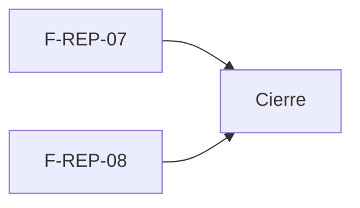

# Tasks: Analítica avanzada y resumen por correo (MSF-265)

**Spec**: [`spec.md`](./spec.md) · **Plan**: [`plan.md`](./plan.md) · Formato: `- [ ] T001 [P] [STORY][USy] descripción`.
**Provisional**: las tareas se confirman o se ajustan al responder P1–P4. Fuera de alcance = nota en la matriz, no tarea.

## Matriz de trazabilidad (tracker ↔ US ↔ tasks)

| Tracker | Historia | US | FR / SC dueños | Tareas |
|---|---|---|---|---|
| (hija de MSF-265) | F-REP-07 | US1 | FR-001–FR-005, SC-001 | T001–T006 |
| (hija de MSF-265) | F-REP-08 | US2 | FR-010–FR-014, SC-002, SC-003 | T007–T013 |
| Tarea de cierre (label cierre) | — | — | docs y roadmap | T014–T015 |

## Phase 1: F-REP-07 · Analítica avanzada embebida (US1)

- [ ] T001 [F-REP-07][US1] Migración aditiva de vistas `analitica` que el tablero libre necesite, con `organizacion_id`, `select` solo al rol de Superset y reversión documentada (FR-002, FR-003)
- [ ] T002 [P] [F-REP-07][US1] pgTAP: aislamiento por organización, `anon`/`authenticated` sin acceso a las vistas; `rls_en_toda_tabla` verde (FR-003, SC-001)
- [ ] T003 [F-REP-07][US1] Configuración de Superset (rol acotado, permisos de edición según P1) en `infra/superset/` e importador idempotente, con excepción documentada a 007 FR-013 (FR-004)
- [ ] T004 [F-REP-07][US1] Pantalla de tableros en Refine con `ReporteEmbebido`, ítem de navegación, permisos por sección y estados compartidos incl. «Analítica no disponible en este momento» (FR-001, FR-002, FR-005). Verifica: Vitest por rol
- [ ] T005 [F-REP-07][US1] Recarga por empresa activa y descarte del tablero anterior al cambiar de empresa (FR-003). Verifica: Vitest de cambio de empresa
- [ ] T006 [P] [F-REP-07][US1] Accesibilidad (teclado, 320/768/1440 px) de la pantalla (FR-005). Verifica: axe + Vitest

**Checkpoint F-REP-07**: un administrador arma un tablero y otra organización no lo ve.

## Phase 2: F-REP-08 · Resumen programado por correo (US2)

- [ ] T007 [F-REP-08][US2] Migración: tipo `resumen_semanal` en `public.tipos_aviso` y función `private` de reclamo idempotente por destinatario y semana, con `search_path = ''` y reversión documentada (FR-010, FR-013)
- [ ] T008 [F-REP-08][US2] Función `private` que arma el resumen desde vistas `analitica`, con secciones de ventas/stock omitidas si la fuente no existe (FR-012, FR-014)
- [ ] T009 [P] [F-REP-08][US2] pgTAP: solo datos de la organización del destinatario, idempotencia y `EXECUTE` solo para `kestra_orquestacion` (FR-013, FR-014, SC-002)
- [ ] T010 [F-REP-08][US2] Flow `infra/kestra/flows/resumen-semanal.yml` con SMTP existente, reintentos y HTML escapado; variables en `.env.example` y `pnpm infra:config` (FR-010, FR-011, FR-014)
- [ ] T011 [P] [F-REP-08][US2] Test del flow (`resumen-semanal.test.mjs`): reintento sin duplicado y fallo con motivo fijo (SC-002)
- [ ] T012 [F-REP-08][US2] Prueba de recorrido: sin ventas ni stock en alerta el resumen sale sin esas secciones (SC-003)
- [ ] T013 [F-REP-08][US2] Alta del tipo en `/cuenta/avisos` solo si P3 lo exige (FR-010)

**Checkpoint F-REP-08**: el resumen llega una vez por semana por destinatario.

## Phase 3: Cierre

- [ ] T014 [CIERRE] Documentar en `docs/` (analitica-avanzada, resumen-semanal-correo, operar-superset, avisos-por-correo) y correr `pnpm docs:check`
- [ ] T015 [CIERRE] Actualizar `docs/roadmap-template.md` (#34 y fila de la épica) y revisión de seguridad de la excepción a 007 FR-013

## Plan de ejecución (historias)

| Historia | Depende de | Grupo |
|---|---|---|
| F-REP-07 | — | 1 |
| F-REP-08 | — | 1 |
| [Cierre] | F-REP-07, F-REP-08 | 2 |

Las dos historias no comparten archivos, tabla ni migración (F-REP-07: vistas y Superset; F-REP-08: tipo de aviso y Kestra), por eso van en paralelo.
