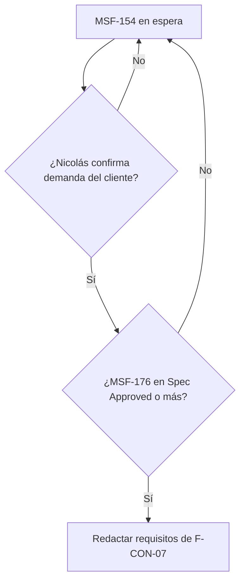

# Spec: Consultas y ventas · Clientes, pedidos y facturación (MSF-154)

**Estado**: EN ESPERA (gate de orquestación) · **Prioridad**: P3 · **Hito**: Backlog (sin fecha)
**Alcance de entrega**: ninguno por ahora (declarado `fuera`). Si se retoma: `refine` + `supabase` (a confirmar al redactar requisitos).
**Historia prevista**: `F-CON-07` Cuentas de clientes (P3, talla L).

## Decisión de orquestación (aplicada)

No hay trabajo para el Desarrollador en este momento. La épica solo se retoma cuando:

1. Nicolás confirme demanda del cliente para esta épica, **y**
2. MSF-176 (Tienda compra y cuentas, F-TDA-26) avance a `Spec Approved` o más.

Además sigue bloqueada por MSF-144 (Contactos y respuestas rápidas). La ausencia de implementación es el estado correcto, no un atasco. Esta spec **no define requisitos funcionales**: la épica dice que "los requisitos se redactan cuando pase a un hito". Inventarlos sería contradecirla.

## Objetivo (tal cual la épica)

Al terminar (cuando se decida encararla) la tienda permite cuentas de clientes, los pedidos se gestionan de la consulta a la entrega y se pueden emitir comprobantes y cobrar en línea.

## Supuestos

- Hoy las tiendas no cobran en línea; la venta se cierra por WhatsApp, correo o en el local.
- Solo se retoma si el cliente confirma demanda.
- Facturación con ARCA y medios de pago son specs propias (punto natural de integración con un ERP).

## Dependencias

- Bloqueada por: MSF-144 y MSF-176. Bloquea a: ninguna.
- F-VEN-04 y F-VEN-05 fueron reemplazadas por Ventas y despacho (F-VTA-10, F-VTA-15, F-VTA-17, F-VTA-34): no se cargan acá.

## Decisiones abiertas (de la épica, "A revisar")

- F-CON-07 se solapa con la cuenta web P0 (F-CLI-05) y con F-TDA-27: se resuelve al redactar requisitos.
- Sin dependencia dura con Ventas y despacho.

## Datos y esquemas

Sin tablas, RPC ni migraciones en esta spec (nada que declarar en `public` ni `dominio`). Cuando se redacten los requisitos, cada tabla declarará su esquema (Principio VII) con RLS.

## Matriz pantalla↔criterios

La épica indica «Esta épica no tiene pantallas dibujadas». No se corrió inventario sobre ningún `.dc.html`: no hay ítems de prototipo. Cualquier pantalla de Cuentas de clientes queda **FUERA DE ALCANCE** hasta que exista diseño (motivo: sin prototipo, la UI no se inventa).

| Ítem | Dueño |
|---|---|
| Pantallas, tablas, campos, botones, tabs, diálogos | FUERA DE ALCANCE (no existen en el prototipo) |
| Empresa activa (Principio VIII) | No aplica: no hay pantalla ni diálogo en esta spec; se declarará al redactar requisitos |

## Flujos

La épica no describe estados, secuencias ni procesos. El único flujo es el de habilitación de la propia épica:

| Paso | Dueño |
|---|---|
| Confirmar demanda; MSF-176 avanza | SC-001 (gate) |
| Redactar requisitos de F-CON-07 | FUERA DE ALCANCE ahora (la épica los difiere al hito) |

## Criterios de éxito

- **SC-001**: Mientras no se cumplan ambas condiciones del gate, no se abre trabajo de desarrollo ni se crean migraciones, pantallas o tareas de implementación.
