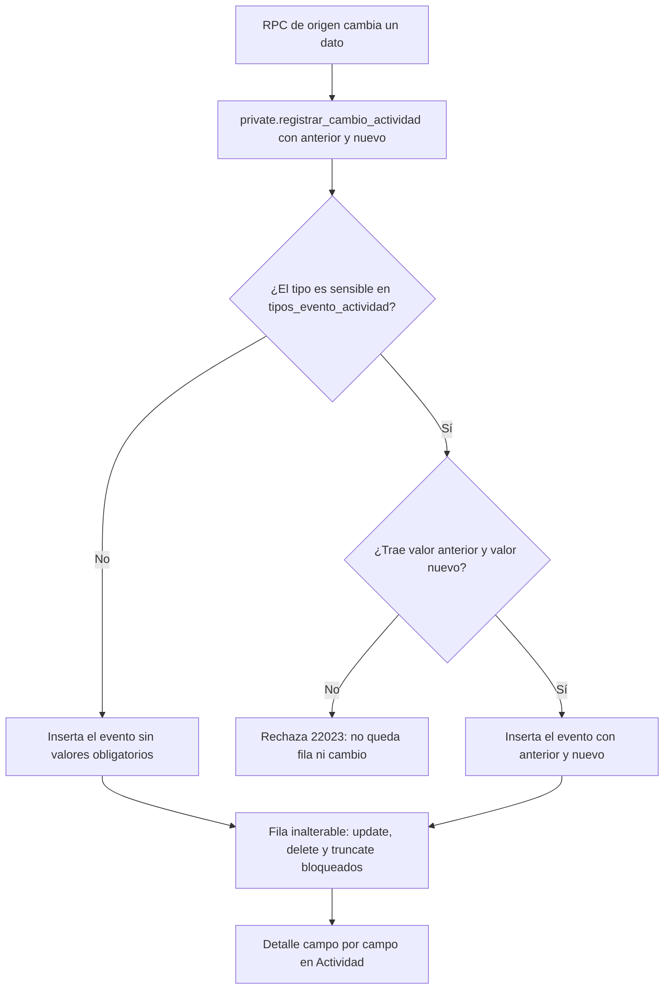
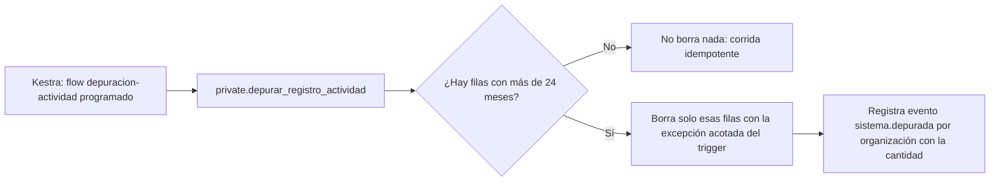
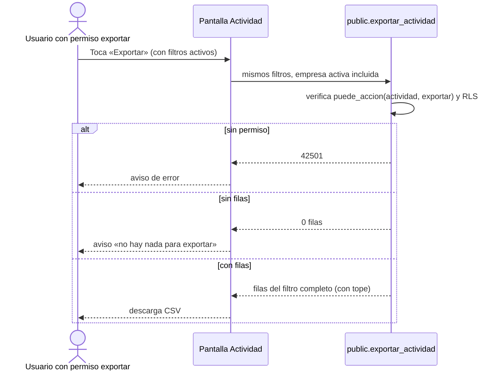
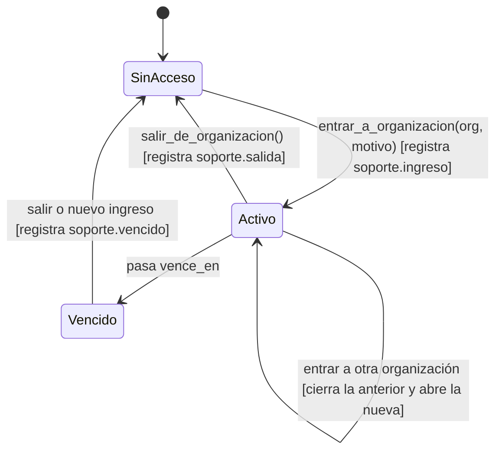

# Feature Specification: Plataforma · Auditoría avanzada y soporte

**Feature Branch**: `epic/MSF-170-plataforma-auditoria-avanzada-y-soporte`

**Jira Epic**: MSF-170 — Plataforma · Auditoría avanzada y soporte (spec `auditoria-avanzada-y-soporte`)

**Created**: 2026-11-02

**Status**: Ready for implementation — la especificación viene completa desde la épica. Los puntos de «A revisar» no bloquean (ver *Decisiones abiertas*).

**Delivery scope**: `refine` (apps/web), `supabase` (migraciones + RPC + pgTAP) y `kestra` (un flow de depuración programada). Sin `superset` ni `workers`.

**Hito / prioridad**: Etapa 2 (desde enero de 2027), P1. Talla total 20 h (M + S + M).

## Objetivo

Al terminar, los cambios sensibles guardan siempre el valor anterior y el nuevo y no se pueden alterar, el historial filtrado se puede exportar, y el equipo de soporte solo entra a los datos de un cliente de forma acotada y registrada.

## Modelo y supuestos

### Esquema de datos (Constitución, Principio VII)

Verificado contra las migraciones del repo (`20261016120000_registro_actividad.sql`, `20260908172920_fundacion_multitenant.sql`, `20260908221453_contexto_organizacion_activa.sql`). Todo es plataforma / transversal → **`public`**; no se crea nada en `dominio`.

| Tabla | Acción | Esquema | Justificación | RLS |
|---|---|---|---|---|
| `registro_actividad` | altera (agrega `valor_anterior jsonb`, `valor_nuevo jsonb`, nullable; triggers de inalterabilidad) | `public` | Registro transversal que escriben todos los componentes (F-AUD-01). | Ya existe: `select` por organización y `nivel_seccion('actividad')`. No se agregan policies de escritura. |
| `tipos_evento_actividad` | **nueva** (`tipo` PK, `sensible boolean not null default false`, `descripcion`) | `public` | Catálogo transversal de los tipos de evento; no es una entidad de negocio. **No existe hoy** (el `tipo` de F-AUD-01 es texto libre con formato `entidad.accion`): la crea esta épica. | Catálogo global (no por organización): `select` para `authenticated`; sin escritura desde la app (solo migraciones). |
| `superadmin_entradas` | altera (agrega `motivo text`) | `public` | Registro de entradas del superadmin del template. | Ya existe: solo `select` de superadmins; append-only. |
| `superadmin_organizacion_activa` | altera (agrega `vence_en timestamptz`) | `public` | Contexto de organización activa del superadmin (spec 004). | Ya existe: cada superadmin lee su propio contexto. |

Esquema re-verificado en spec, plan y tareas (Principio VII); la revisión de PR lo repite.

### Supuestos (de la épica)

- La depuración por retención (24 meses) corre como proceso de Sistema.
- La lista de eventos sensibles se marca en `tipos_evento_actividad.sensible`.
- El Administrador ve la actividad de su organización, incluida la del soporte.
- Solo F-AUD-03 tiene pantalla dibujada (Actividad); el detalle del registro y el acceso de soporte se dibujan al entrar a la etapa.
- F-OPS-04 extiende el superadmin, el contexto de organización activa y el registro de entradas del template; F-AUD-02 y F-AUD-03 son nuevas.

## User Scenarios & Testing *(mandatory)*

### User Story 1 - Registro inalterable con antes y después (F-AUD-02, P1, talla M)

Quien administra una organización puede abrir un evento sensible del historial y ver, campo por campo, el valor anterior y el nuevo. Ese registro no puede editarse ni borrarse por nadie.

**Acceptance Scenarios**:

1. **Given** un cambio de rol de un usuario, **When** se registra, **Then** el evento guarda el rol anterior y el nuevo, y el detalle los muestra lado a lado.
2. **Given** un tipo marcado `sensible`, **When** alguien intenta registrar el evento sin valor anterior o sin valor nuevo, **Then** el servidor lo rechaza y no queda fila.
3. **Given** cualquier fila de `registro_actividad`, **When** cualquier rol (incluido Administrador, superadmin o el dueño de la tabla) intenta `update`, `delete` o `truncate`, **Then** se rechaza.
4. **Given** eventos de más de 24 meses, **When** corre la depuración de Sistema, **Then** se borran solo esos, queda un evento «Sistema» con la cantidad y una segunda corrida no borra nada más.
5. **Given** un evento anterior a esta épica (sin valores), **When** se abre su detalle, **Then** dice que no tiene valores registrados, sin error.

### User Story 2 - Exportar la actividad (F-AUD-03, P1, talla S)

Quien tiene permiso de exportar y edita la sección Actividad (por defecto, el Administrador) descarga un CSV con todo el historial que coincide con los filtros activos.

**Acceptance Scenarios**:

1. **Given** filtros aplicados (período, tienda, usuario, tipo, búsqueda), **When** se toca «Exportar», **Then** se descarga un CSV con **todas** las filas del filtro (no solo la página visible), con las mismas columnas que la tabla.
2. **Given** un rol sin la acción `exportar` en la matriz o sin nivel `edicion` en Actividad (por defecto, todos menos el Administrador), **When** abre Actividad, **Then** no ve el botón y la consulta directa de exportación devuelve `42501`.
3. **Given** un filtro sin resultados, **When** se toca «Exportar», **Then** se avisa que no hay nada para exportar y no se descarga un archivo vacío.

### User Story 3 - Acceso de soporte auditado (F-OPS-04, P1, talla M)

El equipo de soporte (superadmin del template) entra a una organización cliente indicando un motivo; el acceso vence solo y queda registrado de forma visible para el Administrador del cliente.

**Acceptance Scenarios**:

1. **Given** un superadmin, **When** ingresa a una organización sin motivo, **Then** se rechaza.
2. **Given** un ingreso con motivo, **When** se concreta, **Then** hay una fila en `superadmin_entradas` (con motivo) y un evento `soporte.ingreso` en el historial de esa organización.
3. **Given** un acceso vencido, **When** el superadmin consulta datos de la organización, **Then** no ve ninguna fila (la organización activa deja de resolverse) y la app lo manda a elegir organización.
4. **Given** un acceso de soporte, **When** el Administrador del cliente abre Actividad, **Then** ve el ingreso y la salida con quién, cuándo y por qué motivo.
5. **Given** un Administrador de otra organización, **When** abre Actividad, **Then** no ve esos eventos.

### Edge Cases

- **Borrado de una organización**: `registro_actividad` tiene FK `on delete cascade` a `organizaciones`; el trigger de inalterabilidad debe permitir ese borrado en cascada (solo cuando la organización ya no existe) y seguir bloqueando cualquier otro. Se prueba con pgTAP.
- Valores anterior/nuevo con datos grandes: se limitan (jsonb de hasta 8 KB por valor; excedido → `22023`).
- Un reintento de la RPC de origen que revierte no deja evento ni lo duplica (misma transacción que F-AUD-01).
- La depuración y la salida por vencimiento son idempotentes.
- Cambiar de empresa en la barra superior con el detalle abierto: el diálogo se cierra con aviso (Principio VIII).
- Sesión del superadmin con acceso vencido: `salir_de_organizacion` sigue funcionando (limpia el contexto) y cierra el acceso registrando el vencimiento.

## Flujos

### Registro de un cambio sensible (F-AUD-02)

Mapeo: A→FR-005; B/C→FR-001, FR-003; E/F→FR-003; G→FR-002; H→FR-004; I→FR-006, FR-007.

### Depuración por retención (Sistema)

Mapeo: K→FR-009; L/M/N/O→FR-008; P→FR-008 (evento visible como «Sistema»).

### Exportar la actividad (F-AUD-03)

Mapeo: botón→FR-010; filtro completo y tope→FR-011; CSV→FR-012; empresa activa y estados→FR-013.

### Estados del acceso de soporte (F-OPS-04)

Mapeo: SinAcceso→Activo→FR-014 (motivo), FR-016 (registro); Activo→Vencido→FR-015; salidas→FR-016; ver estos eventos→FR-017; banner y diálogo→FR-018.

## Requirements *(mandatory)*

### Functional Requirements

**F-AUD-02 — Registro inalterable con antes y después**

- **FR-001**: tabla `public.tipos_evento_actividad` (`tipo` PK con el mismo formato `entidad.accion`, `sensible boolean not null default false`, `descripcion text`), con RLS (`select` para `authenticated`, sin escritura desde la app, sin privilegios para `anon`) y sembrada con los tipos existentes. Marcados `sensible` en el seed inicial: `usuario.rol_cambiado`, `usuario.removido`, `usuario.suspendido`, `usuario.reactivado`, `permisos.matriz_guardada`, `permisos.matriz_restablecida` (lista a confirmar, ver *Decisiones abiertas*). Un tipo ausente del catálogo se trata como no sensible. **Verificación:** pgTAP `registro_inalterable.test.sql` (catálogo sembrado, RLS, `anon` sin acceso, tipo ausente = no sensible) + `pnpm test:db`.
- **FR-002**: columnas aditivas `valor_anterior jsonb` y `valor_nuevo jsonb` (nullable) en `registro_actividad`; cada una guarda un objeto `{campo: valor}` de hasta 8 KB. **Verificación:** pgTAP `registro_inalterable.test.sql` (columnas jsonb, valor > 8 KB → `22023`) + `pnpm test:db`.
- **FR-003**: un evento de tipo `sensible` exige ambos valores como objetos jsonb (alta → anterior `{}`; baja → nuevo `{}`); sin ellos el servidor rechaza con `22023` y la operación de origen se revierte. Funciones nuevas `private.registrar_cambio_actividad` / `private.insertar_cambio_actividad`; la firma de `insertar_actividad` y `registrar_actividad` no cambia, pero rechazan los tipos sensibles (deben usar las nuevas). **Verificación:** pgTAP `registro_inalterable.test.sql` (sensible sin antes/después → `22023`, sin fila; `insertar_actividad` rechaza sensibles) + `pnpm test:db`.
- **FR-004**: `registro_actividad` es inalterable: triggers `before update`, `before delete` y `before truncate` que rechazan con `42501` para cualquier rol (incluido el dueño y service-role), más `revoke update, delete, truncate`. Únicas excepciones: el borrado en cascada al eliminar la organización y la depuración de FR-008. **Verificación:** pgTAP `registro_inalterable.test.sql` (update/delete/truncate → `42501` por rol; cascada de organización OK) + `pnpm test:db`.
- **FR-005**: los eventos sensibles que ya existen pasan a guardar antes y después: cambio de rol, suspensión, reactivación y remoción (desde `eventos_membresia`, que ya trae `rol_anterior`/`rol_nuevo`) y guardado/restablecimiento de la matriz de permisos (valores anterior y nuevo de cada nivel o acción modificada). Su comportamiento no cambia. **Verificación:** pgTAP `registro_inalterable.test.sql` (cambio de rol, suspensión, remoción y guardado/restablecimiento de matriz guardan antes y después) + `pnpm test:db`.
- **FR-006**: RPC `public.obtener_detalle_actividad(p_id uuid)` (security invoker: rige la RLS de la tabla) que devuelve el evento con `valor_anterior`, `valor_nuevo` y si es sensible. Contrato en `contracts/auditoria-avanzada-y-soporte.md`. **Verificación:** pgTAP `registro_inalterable.test.sql` (`obtener_detalle_actividad`: valores, aislamiento, `anon`) + `pnpm test:db`.
- **FR-007**: en la pantalla Actividad, abrir una fila muestra el detalle del registro: campo por campo, valor anterior → valor nuevo, además de cuándo, tipo, tienda, quién y detalle. Es **solo consulta**: sin acción de deshacer (ver *Decisiones abiertas*). Un evento sin valores (anterior a la épica o no sensible) lo dice. Sin UUID visibles. **Verificación:** Vitest `DetalleActividadDialog.test.tsx` (con y sin valores, cierre al cambiar de empresa) + `pnpm test`.
- **FR-008**: función `private.depurar_registro_actividad(p_hasta timestamptz default now())` que borra los eventos con más de 24 meses (plazo parametrizable, no editable desde la app), ejecutable únicamente por el rol de Sistema `workers_orquestacion` (mismo patrón que `purgar_evidencias_ia`), idempotente, que deja un evento `sistema.depurada` (sin actor → «Sistema») por organización afectada con la cantidad borrada. **Verificación:** pgTAP `depurar_registro_actividad.test.sql` + `pnpm test:db`.
- **FR-009**: flow de Kestra `depuracion-actividad` programado, que invoca FR-008 con la retención por defecto y falla visible si la función falla (Principio III). **Verificación:** `pnpm infra:config` y test de validación del flow `depuracion-actividad.yml` (`pnpm test`).

**F-AUD-03 — Exportar la actividad**

- **FR-010**: botón «Exportar» en el encabezado de Actividad (como el prototipo), visible y habilitado solo si `private.puede_accion('actividad','exportar')` es verdadero **y** el nivel de `actividad` es `edicion` (por defecto solo el Administrador: Operador y Administración tienen la acción pero solo lectura); la matriz de permisos manda. **Verificación:** Vitest `BotonExportarActividad.test.tsx` (visible solo con la acción `exportar`) + `pnpm test`.
- **FR-011**: RPC `public.exportar_actividad(...)` con los mismos filtros que `listar_actividad`, security definer (necesita registrar la constancia), que exige la acción `exportar` y el nivel `edicion` (`42501` si no) y devuelve **todo** el filtro (no la página) en lotes por cursor, con un tope de 50.000 filas contado en el servidor; si se supera, el export avisa que se recortó y pide acotar el filtro. La constancia `actividad.exportada` se registra en la primera llamada de cada exportación y el id se cierra al terminar (reutilizarlo es `22023`). El tope de 50.000 es de UX: el control real es la constancia, y el servidor limita las exportaciones nuevas por persona y hora (60, `22023`). **Verificación:** pgTAP `exportar_actividad.test.sql` (`42501` sin permiso, filtro completo, tope 50.000) + `pnpm test:db`.
- **FR-012**: CSV en UTF-8 con BOM, columnas `Cuándo`, `Tipo`, `Tienda`, `Detalle`, `Quién` (las de la tabla), hora de `America/Argentina/Buenos_Aires`, celdas que empiezan con `=`, `+`, `-` o `@` neutralizadas contra inyección de fórmulas, y nombre `actividad-AAAA-MM-DD.csv`. Se reutiliza `apps/web/src/lib/exportarCsv.ts`. **Verificación:** Vitest `exportarActividadCsv.test.ts` (BOM, columnas, zona horaria, neutralización de fórmulas, nombre) + `pnpm test`.
- **FR-013**: el export respeta todos los filtros de la pantalla y la **empresa activa** de la barra superior (Principio VIII); estados de carga («Exportando…»), error con reintento y vacío («No hay actividad para exportar»); no bloquea la pantalla. **Verificación:** Vitest `exportarActividad.test.tsx` (filtros, cambio de empresa activa, estados exportando/error/vacío/recorte) + `pnpm test`.

**F-OPS-04 — Acceso de soporte auditado**

- **FR-014**: `public.entrar_a_organizacion(org_id uuid, p_motivo text)` exige un motivo no vacío (≤ 500 caracteres) y solo lo ejecuta un superadmin; reemplaza a `entrar_a_organizacion(uuid)` (BREAKING declarado en el contrato; no queda la versión sin motivo). El motivo se guarda en `superadmin_entradas.motivo`. **Verificación:** pgTAP `acceso_soporte_vigencia.test.sql` (sin motivo y no superadmin rechazados, motivo guardado) + `pnpm test:db`.
- **FR-015**: el acceso es acotado en el tiempo: `superadmin_organizacion_activa.vence_en` se fija al ingresar (plazo propuesto: 4 horas, ver *Decisiones abiertas*) y `private.organizacion_id()` y los demás helpers que leen el contexto del superadmin (`puede_escribir`, `nivel_seccion` y los demás que leen el contexto) lo ignoran una vez vencido. Los contextos activos existentes al migrar reciben un vencimiento. Sigue siendo una organización a la vez. **Verificación:** pgTAP `acceso_soporte_vigencia.test.sql` (vencido → 0 filas, sin escritura, backfill) + `pnpm test:db`.
- **FR-016**: cada ingreso, salida y vencimiento se registra en `superadmin_entradas` (acciones `entrada`/`salida`, con motivo) **y** como evento en el historial de la organización visitada: `soporte.ingreso` (con motivo y vencimiento), `soporte.salida` y `soporte.vencido`, con la persona de soporte como actor. Todo en la misma transacción. Si la persona de soporte no vuelve, el flow de Kestra `cierre-accesos-soporte` (cada 15 minutos, `private.cerrar_accesos_soporte_vencidos`) asienta `soporte.vencido` y la salida. **Verificación:** pgTAP `acceso_soporte_vigencia.test.sql`, `cerrar_accesos_soporte.test.sql` y `acceso_soporte_actividad.test.sql` (ingreso, salida y vencimiento en ambos registros) + `pnpm test:db`.
- **FR-017**: el Administrador de la organización ve esos eventos `soporte.*` en su Actividad (por la RLS y la matriz existentes, sin policies nuevas); ninguna otra organización los ve. **Verificación:** pgTAP `acceso_soporte_actividad.test.sql` (Administrador del cliente ve `soporte.*`, otra organización no) + `pnpm test:db`.
- **FR-018**: UI mínima con componentes del template: al «Ingresar» desde Organizaciones se pide el motivo en un diálogo (campo obligatorio, Cancelar / Ingresar, errores del servidor visibles); el banner de organización activa muestra «Acceso de soporte hasta HH:MM» con la acción de salir; al vencer, la app limpia el contexto y vuelve a Organizaciones con aviso. **Verificación:** Vitest `AccesoSoporte.test.tsx` (diálogo de motivo, banner con vencimiento, limpieza al vencer) + `pnpm test`.

**Transversales**

- **FR-019**: la pantalla Actividad conserva lo entregado por F-AUD-01 sin cambios de comportamiento (columnas, filtros, búsqueda, paginación «1–10 de N», estados, permisos por matriz). **Verificación:** Vitest `actividad/list.test.tsx` (regresión de columnas, filtros, búsqueda, paginación y permisos) + `pnpm test`.
- **FR-020** (Cierre): documentación y trazabilidad: `docs/actividad.md` (quita «sin Exportar»), guía de acceso de soporte, `docs/roadmap-template.md`, y revisión de seguridad integral. **Verificación:** `pnpm docs:check` y `pnpm matriz:check`.

### Success Criteria

- **SC-001**: pgTAP: `update`, `delete` y `truncate` sobre `registro_actividad` fallan para Administrador, Operador, superadmin y el dueño de la tabla; el borrado en cascada de una organización sí funciona. **Verificación:** pgTAP `registro_inalterable.test.sql` + `pnpm test:db`.
- **SC-002**: pgTAP: un evento sensible sin antes/después se rechaza y no deja fila; con ambos queda consultable campo por campo vía `obtener_detalle_actividad`; el cambio de rol y el guardado de matriz guardan antes y después. **Verificación:** pgTAP `registro_inalterable.test.sql` + `pnpm test:db`.
- **SC-003**: pgTAP: la depuración borra solo lo de más de 24 meses, solo la ejecuta `workers_orquestacion`, deja el evento «Sistema» y es idempotente. **Verificación:** pgTAP `depurar_registro_actividad.test.sql` + `pnpm test:db`.
- **SC-004**: el total exportado coincide con el «N» de «1–10 de N» para el mismo filtro (hasta el tope). **Verificación:** pgTAP `exportar_actividad.test.sql` (total = `total` de `listar_actividad` para el mismo filtro) + `pnpm test:db`.
- **SC-005**: sin la acción `exportar`, no hay botón y `exportar_actividad` devuelve `42501`; `anon` no ejecuta ninguna RPC nueva. **Verificación:** pgTAP `exportar_actividad.test.sql`, Vitest `BotonExportarActividad.test.tsx` y prueba de `anon` + `pnpm test:db`.
- **SC-006**: sin motivo no se entra; con el acceso vencido el superadmin ve 0 filas de la organización. **Verificación:** pgTAP `acceso_soporte_vigencia.test.sql` + `pnpm test:db`.
- **SC-007**: cada ingreso/salida/vencimiento deja evento visible al Administrador de esa organización y a nadie más. **Verificación:** pgTAP `acceso_soporte_actividad.test.sql` + `pnpm test:db`.
- **SC-008** (Cierre): `rls_en_toda_tabla`, `aislamiento_organizaciones` y la prueba de ejecutabilidad por `anon` siguen verdes con lo nuevo; `pnpm lint`, `pnpm build`, `pnpm infra:config`, `pnpm test`, `pnpm docs:check` y `pnpm matriz:check` verdes. **Verificación:** `pnpm lint`, `pnpm build`, `pnpm infra:config`, `pnpm test`, `pnpm docs:check`, `pnpm matriz:check` y pgTAP `rls_en_toda_tabla`/`aislamiento_organizaciones`.

## Matriz de verificación

Cada requisito tiene su verificación nombrada (archivo de test o comando) y su tarea dueña.

| Requisito | Verificación | Tarea |
|---|---|---|
| FR-001 | pgTAP `registro_inalterable.test.sql` (catálogo sembrado, RLS, `anon` sin acceso, tipo ausente = no sensible) + `pnpm test:db` | T002 |
| FR-002 | pgTAP `registro_inalterable.test.sql` (columnas jsonb, valor > 8 KB → `22023`) + `pnpm test:db` | T003 |
| FR-003 | pgTAP `registro_inalterable.test.sql` (sensible sin antes/después → `22023`, sin fila; `insertar_actividad` rechaza sensibles) + `pnpm test:db` | T004 |
| FR-004 | pgTAP `registro_inalterable.test.sql` (update/delete/truncate → `42501` por rol; cascada de organización OK) + `pnpm test:db` | T005 |
| FR-005 | pgTAP `registro_inalterable.test.sql` (cambio de rol, suspensión, remoción y guardado/restablecimiento de matriz guardan antes y después) + `pnpm test:db` | T006 |
| FR-006 | pgTAP `registro_inalterable.test.sql` (`obtener_detalle_actividad`: valores, aislamiento, `anon`) + `pnpm test:db` | T007 |
| FR-007 | Vitest `DetalleActividadDialog.test.tsx` (con y sin valores, cierre al cambiar de empresa) + `pnpm test` | T012 |
| FR-008 | pgTAP `depurar_registro_actividad.test.sql` + `pnpm test:db` | T009 |
| FR-009 | `pnpm infra:config` y test de validación del flow `depuracion-actividad.yml` (`pnpm test`) | T011 |
| FR-010 | Vitest `BotonExportarActividad.test.tsx` (visible solo con la acción `exportar`) + `pnpm test` | T023 |
| FR-011 | pgTAP `exportar_actividad.test.sql` (`42501` sin permiso, filtro completo, tope 50.000) + `pnpm test:db` | T022 |
| FR-012 | Vitest `exportarActividadCsv.test.ts` (BOM, columnas, zona horaria, neutralización de fórmulas, nombre) + `pnpm test` | T024 |
| FR-013 | Vitest `exportarActividad.test.tsx` (filtros, cambio de empresa activa, estados exportando/error/vacío/recorte) + `pnpm test` | T025 |
| FR-014 | pgTAP `acceso_soporte_vigencia.test.sql` (sin motivo y no superadmin rechazados, motivo guardado) + `pnpm test:db` | T015 |
| FR-015 | pgTAP `acceso_soporte_vigencia.test.sql` (vencido → 0 filas, sin escritura, backfill) + `pnpm test:db` | T016 |
| FR-016 | pgTAP `acceso_soporte_vigencia.test.sql` y `acceso_soporte_actividad.test.sql` (ingreso, salida y vencimiento en ambos registros) + `pnpm test:db` | T017 |
| FR-017 | pgTAP `acceso_soporte_actividad.test.sql` (Administrador del cliente ve `soporte.*`, otra organización no) + `pnpm test:db` | T018 |
| FR-018 | Vitest `AccesoSoporte.test.tsx` (diálogo de motivo, banner con vencimiento, limpieza al vencer) + `pnpm test` | T020 |
| FR-019 | Vitest `actividad/list.test.tsx` (regresión de columnas, filtros, búsqueda, paginación y permisos) + `pnpm test` | T013 |
| FR-020 | `pnpm docs:check` y `pnpm matriz:check` | T028 |
| SC-001 | pgTAP `registro_inalterable.test.sql` + `pnpm test:db` | T008 |
| SC-002 | pgTAP `registro_inalterable.test.sql` + `pnpm test:db` | T008 |
| SC-003 | pgTAP `depurar_registro_actividad.test.sql` + `pnpm test:db` | T010 |
| SC-004 | pgTAP `exportar_actividad.test.sql` (total = `total` de `listar_actividad` para el mismo filtro) + `pnpm test:db` | T026 |
| SC-005 | pgTAP `exportar_actividad.test.sql`, Vitest `BotonExportarActividad.test.tsx` y prueba de `anon` + `pnpm test:db` | T026 |
| SC-006 | pgTAP `acceso_soporte_vigencia.test.sql` + `pnpm test:db` | T019 |
| SC-007 | pgTAP `acceso_soporte_actividad.test.sql` + `pnpm test:db` | T018 |
| SC-008 | `pnpm lint`, `pnpm build`, `pnpm infra:config`, `pnpm test`, `pnpm docs:check`, `pnpm matriz:check` y pgTAP `rls_en_toda_tabla`/`aislamiento_organizaciones` | T029 |

## Matriz pantalla↔criterios

Prototipo: `design/pantallas/Actividad.dc.html` (inventario `Actividad.inventory.json`, corrido con `pnpm prototipo:inventario`: 1 tabla de 5 columnas, 1 botón, 0 campos, 0 tabs, 0 diálogos). La pantalla ya existe (F-AUD-01); esta épica agrega el botón «Exportar» y la apertura del detalle.

| Ítem del prototipo / visible | Criterio | Estado |
|---|---|---|
| Botón **Exportar** (encabezado, botón borde) | FR-010, FR-011, FR-012, FR-013, SC-004, SC-005 | En alcance (F-AUD-03) |
| Columna **Cuándo** | FR-019 | Entregada por F-AUD-01; sin cambios |
| Columna **Tipo** | FR-019 | Ídem |
| Columna **Tienda** | FR-019 | Ídem |
| Columna **Detalle** | FR-019 | Ídem |
| Columna **Quién** | FR-019 | Ídem |
| Filtro de píldoras de tienda y su texto de ayuda | FR-019, FR-013 (el export lo respeta) | Entregado por F-AUD-01 |
| Buscar en la actividad, chips de tipo, selector de período y de usuario, paginación «1–10 de N» | FR-019, FR-013 (el export respeta los filtros) | Entregados por F-AUD-01; sin cambios |
| **Empresa activa** (Principio VIII) | FR-013 (export acotado a la empresa activa), FR-007 (el detalle se cierra al cambiar de empresa) | Test que cambia de empresa en T026 y T012 |
| Diálogos del prototipo | — | No hay ninguno dibujado |
| Detalle de un registro con cambio campo por campo (**no dibujado**) | FR-006, FR-007 | En alcance; sin prototipo: componentes del template, a validar al entrar a la etapa |
| Diálogo de motivo y banner de acceso de soporte (**no dibujados**) | FR-014, FR-015, FR-018 | En alcance; sin prototipo. Pantalla Organizaciones: la empresa activa **no aplica** (es una vista de superadmin sobre organizaciones, no lee datos de una empresa) |
| Acción de deshacer / revertir desde el detalle | — | **FUERA DE ALCANCE**: la épica solo pide consultar el valor anterior (ver «A revisar») |
| Columnas «valor anterior / nuevo» en el CSV | — | **FUERA DE ALCANCE**: el CSV lleva las columnas de la tabla; ver *Decisiones abiertas* |

## Fuera de alcance / no objetivos

- Deshacer o revertir un cambio desde la pantalla.
- Solo lectura obligatoria para el soporte, correo de aviso al cliente por cada ingreso y un rol «Soporte» nuevo (la épica no los pide).
- Otros formatos de exportación (Excel, PDF) y exportaciones programadas.
- Edición de la retención o de la lista de eventos sensibles desde la UI (se cambian por migración).
- Auditar el propio acto de exportar (ver *Decisiones abiertas*).

## Decisiones abiertas (no bloquean)

1. **Lista de eventos sensibles**: el seed propuesto (FR-001) es usuarios y permisos; falta confirmar si suman `empresa.*` u otros.
2. **Retención de 24 meses**: supuesto a confirmar con el cliente (puede haber un requisito legal o contable distinto); es un parámetro, no una constante dispersa.
3. **Operador y eventos de usuarios/permisos**: se mantiene lo vigente (la matriz decide; hoy el Operador los ve). A confirmar.
4. **Plazo del acceso de soporte**: se propone 4 horas; la épica pide «acotado» sin plazo.
5. **«Acotado»** se interpreta como motivo obligatorio + vencimiento + una organización a la vez; no se restringe a solo lectura porque la épica no lo pide.
6. **Valores antes/después en el CSV** y **auditar la exportación** no se piden; se dejan afuera salvo que Nicolás los sume.
7. **Dependencia F-AUD-01**: `registro_actividad` ya está entregada en este repo (`20261016120000_registro_actividad.sql`), así que la dependencia declarada «sin link» en Jira queda resuelta.

## Matriz de trazabilidad Jira ↔ US ↔ FR/SC

| Jira | Historia | FR / SC |
|---|---|---|
| F-AUD-02 | US1 Registro inalterable con antes y después | FR-001…FR-009, FR-019, SC-001, SC-002, SC-003 |
| F-AUD-03 | US2 Exportar la actividad | FR-010…FR-013, SC-004, SC-005 |
| F-OPS-04 | US3 Acceso de soporte auditado | FR-014…FR-018, SC-006, SC-007 |
| Tarea de cierre (label cierre) | Docs, roadmap y seguridad | FR-020, SC-008 |
