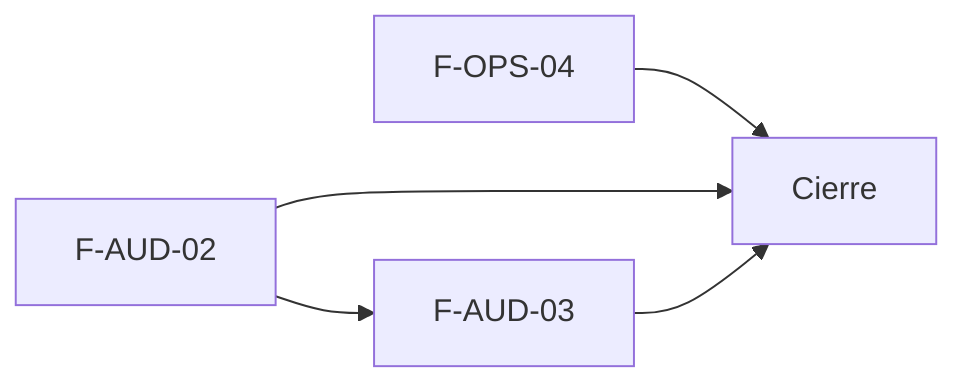

# Tasks: Plataforma · Auditoría avanzada y soporte

**Input**: `specs/20261102-100000-auditoria-avanzada-y-soporte/` (spec.md, plan.md, contracts/)

**Formato**: `- [ ] T### [P] [STORY-x][USy] descripción`. **[P]** = paralelizable (archivos distintos, sin dependencia); sin [P] = secuencial. Dependencias y orden solo dentro de la misma historia.

**Delivery scope**: `refine`, `supabase`, `kestra`

**Regla**: ninguna tarea queda `[ ]` al cierre: se hace con evidencia o se cierra con `[x]` + `Desvío:` y seguimiento trazado.

## Matriz de trazabilidad tracker ↔ US ↔ tasks

| Tracker | Historia | FR / SC (dueño único) | Tasks |
|---|---|---|---|
| F-AUD-02 | US1 Registro inalterable con antes y después | FR-001…FR-009, FR-019, SC-001, SC-002, SC-003 | T001–T014 |
| F-OPS-04 | US3 Acceso de soporte auditado | FR-014…FR-018, SC-006, SC-007 | T015–T021 |
| F-AUD-03 | US2 Exportar la actividad | FR-010…FR-013, SC-004, SC-005 | T022–T027 |
| Tarea de cierre (label cierre) | Docs, roadmap y seguridad | FR-020, SC-008 | T028–T029 |

## Phase 1: F-AUD-02 — Registro inalterable con antes y después (US1)

- [x] T001 [F-AUD-02][US1] Verificar con `graphify`/migraciones el estado actual (`registro_actividad`, `insertar_actividad`, trigger de membresía, `guardar_matriz_permisos`) y anotar en plan.md que cada tabla va en `public` (Principio VII); confirmar que `tipos_evento_actividad` no existe
- [x] T002 [F-AUD-02][US1] Migración `20270207100001_registro_inalterable_antes_despues.sql`: tabla `public.tipos_evento_actividad` con RLS (`select` authenticated, sin `anon`), seed de tipos existentes y marcas `sensible`, reversión en el encabezado (FR-001; verifica `registro_inalterable.test.sql`)
- [x] T003 [F-AUD-02][US1] En la misma migración: columnas aditivas `valor_anterior`/`valor_nuevo` con check de objeto jsonb ≤ 8 KB (FR-002; verifica `registro_inalterable.test.sql`)
- [x] T004 [F-AUD-02][US1] En la misma migración: `private.registrar_cambio_actividad`/`insertar_cambio_actividad` y rechazo de tipos sensibles sin valores en `insertar_actividad` (firmas existentes intactas) (FR-003; verifica `registro_inalterable.test.sql`)
- [x] T005 [F-AUD-02][US1] En la misma migración: triggers `before update/delete/truncate` + `revoke update, delete, truncate`; excepción de borrado en cascada solo si la organización ya no existe (FR-004; verifica `registro_inalterable.test.sql`)
- [x] T006 [F-AUD-02][US1] En la misma migración: reemplazar el trigger de membresía y `guardar_matriz_permisos`/`restablecer_matriz_permisos` para guardar antes y después (comportamiento intacto) (FR-005; verifica `registro_inalterable.test.sql`)
- [x] T007 [F-AUD-02][US1] En la misma migración: `public.obtener_detalle_actividad` con `revoke … public, anon` / `grant … authenticated` (FR-006; verifica `registro_inalterable.test.sql`)
- [x] T008 [P] [F-AUD-02][US1] pgTAP `registro_inalterable.test.sql`: update/delete/truncate rechazados para todos los roles, cascada de organización OK, sensible sin valores rechazado, antes/después consultable, aislamiento entre organizaciones, `anon` sin acceso (verifica FR-001…FR-006, SC-001, SC-002; `pnpm test:db`)
- [x] T009 [F-AUD-02][US1] Migración `20270207100002_depurar_registro_actividad.sql`: `private.depurar_registro_actividad` (solo `workers_orquestacion`, idempotente, evento `sistema.depurada`), excepción acotada del trigger (FR-008; verifica `depurar_registro_actividad.test.sql`)
- [x] T010 [P] [F-AUD-02][US1] pgTAP `depurar_registro_actividad.test.sql`: borra solo >24 meses, rol no autorizado rechazado, evento «Sistema», segunda corrida sin cambios (verifica FR-008, SC-003; `pnpm test:db`)
- [x] T011 [F-AUD-02][US1] Flow `infra/kestra/flows/depuracion-actividad.yml` programado que invoca la función; falla visible; test de validación del flow y `pnpm infra:config` (FR-009; verifica `pnpm infra:config` y el test del flow)
- [x] T012 [F-AUD-02][US1] Hook `useDetalleActividad` y `DetalleActividadDialog` (antes → después campo por campo, solo consulta, evento sin valores, cierre al cambiar la empresa activa) abierto desde la fila en `pages/actividad/list.tsx`; teclado y 320/768/1440 px (FR-007; verifica `DetalleActividadDialog.test.tsx`)
- [x] T013 [P] [F-AUD-02][US1] Vitest: detalle con y sin valores, cierre al cambiar de empresa y regresión de columnas, filtros, búsqueda y paginación de Actividad (verifica FR-019, `actividad/list.test.tsx`; `pnpm test`)
- [x] T014 [F-AUD-02][US1] Documentar en `docs/actividad.md` el registro inalterable, el antes/después, la depuración y el contrato de `registrar_cambio_actividad`

**Checkpoint**: `pnpm test:db`, `pnpm lint`, `pnpm build`, `pnpm infra:config`, `pnpm test` verdes.

## Phase 2: F-OPS-04 — Acceso de soporte auditado (US3)

- [x] T015 [F-OPS-04][US3] Migración `20270207100003_acceso_soporte_auditado.sql`: `superadmin_entradas.motivo`; `entrar_a_organizacion(uuid, text)` con motivo obligatorio reemplaza la versión sin motivo (BREAKING en `contracts/`); actualizar la UI llamadora y los tests existentes que la usan (FR-014; verifica `acceso_soporte_vigencia.test.sql`)
- [x] T016 [F-OPS-04][US3] En la misma migración: `superadmin_organizacion_activa.vence_en` (backfill de contextos existentes) y predicado de vigencia en `private.organizacion_id()` y en todo helper que lea el contexto (listarlos antes) (FR-015; verifica `acceso_soporte_vigencia.test.sql`)
- [x] T017 [F-OPS-04][US3] En la misma migración: registrar ingreso, salida y vencimiento en `superadmin_entradas` y como `soporte.*` en el historial de la organización visitada, misma transacción, vía `private.insertar_actividad` (FR-016; verifica `acceso_soporte_actividad.test.sql`)
- [x] T018 [P] [F-OPS-04][US3] pgTAP `acceso_soporte_actividad.test.sql`: el Administrador del cliente ve `soporte.*`, el de otra organización no, el Operador según la matriz (verifica FR-017, SC-007; `pnpm test:db`)
- [x] T019 [P] [F-OPS-04][US3] pgTAP `acceso_soporte_vigencia.test.sql`: sin motivo rechazado, no superadmin rechazado, acceso vencido ve 0 filas y no escribe, salir con acceso vencido registra `soporte.vencido`, `anon` sin acceso (verifica FR-014, FR-015, FR-016, SC-006; `pnpm test:db`)
- [x] T020 [F-OPS-04][US3] UI: diálogo de motivo al «Ingresar» en `pages/organizaciones/list.tsx`, banner con vencimiento en `OrganizacionActivaBanner`, limpieza del contexto y aviso al vencer, `lib/superadmin.ts` con `vence_en`; Vitest de los tres estados (FR-018; verifica `AccesoSoporte.test.tsx`)
- [x] T021 [F-OPS-04][US3] Guía `docs/acceso-soporte.md` y nota de reemplazo en `specs/003-fundacion-multitenant/contracts/entrar-a-organizacion.md`

**Checkpoint**: `pnpm test:db`, `pnpm lint`, `pnpm build`, `pnpm test` verdes.

## Phase 3: F-AUD-03 — Exportar la actividad (US2)

- [x] T022 [F-AUD-03][US2] Migración `20270210110000_exportar_actividad.sql`: `public.exportar_actividad` (mismos filtros, `puede_accion('actividad','exportar')`, tope 50.000, `total` real) con `revoke … public, anon` / `grant … authenticated` (FR-011; verifica `exportar_actividad.test.sql`)
- [x] T023 [F-AUD-03][US2] `BotonExportarActividad` en el encabezado de `pages/actividad/list.tsx` visible solo con la acción `exportar` (FR-010; verifica `BotonExportarActividad.test.tsx`)
- [x] T024 [F-AUD-03][US2] CSV con `lib/exportarCsv.ts`: UTF-8 con BOM, columnas de la tabla, hora de Buenos Aires, neutralización de `= + - @`, nombre `actividad-AAAA-MM-DD.csv` (FR-012; verifica `exportarActividadCsv.test.ts`)
- [x] T025 [F-AUD-03][US2] Filtros y empresa activa en el export, estados «Exportando…», error con reintento, vacío y aviso de recorte (FR-013; verifica `exportarActividad.test.tsx`)
- [x] T026 [P] [F-AUD-03][US2] Tests: pgTAP de `exportar_actividad` (permiso, `anon`, aislamiento, filtros = total de `listar_actividad`) y Vitest del botón, del CSV y del cambio de empresa activa (verifica FR-010…FR-013, SC-004, SC-005; `pnpm test:db`, `pnpm test`)
- [x] T027 [F-AUD-03][US2] Actualizar `docs/actividad.md` (sección Exportar; quitar «sin Exportar») y `docs/permisos-por-rol.md` si corresponde

**Checkpoint**: `pnpm test:db`, `pnpm lint`, `pnpm build`, `pnpm test` verdes.

## Phase 4: Cierre

- [x] T028 [CIERRE] Actualizar `docs/roadmap-template.md` (estado, link a la spec), índice de docs y correr `pnpm docs:check` y `pnpm matriz:check` (FR-020; verifica `pnpm docs:check`, `pnpm matriz:check`)
- [x] T029 [CIERRE] Revisión de seguridad integral (`authz-security`): `rls_en_toda_tabla`, `aislamiento_organizaciones`, ejecutabilidad por `anon`, inalterabilidad y vigencia del soporte; `pnpm lint`, `pnpm build`, `pnpm infra:config`, `pnpm test` (SC-008; verifica los comandos listados)

## Plan de ejecución (historias)

| Historia | Depende de | Grupo |
|---|---|---|
| F-AUD-02 | — | 1 |
| F-OPS-04 | — | 1 |
| F-AUD-03 | F-AUD-02 | 2 |
| [Cierre] | F-AUD-02, F-OPS-04, F-AUD-03 | 3 |

F-AUD-02 y F-OPS-04 no comparten archivos, tablas ni migraciones (van en paralelo). F-AUD-03 espera a F-AUD-02 porque ambas modifican `pages/actividad/list.tsx` y `docs/actividad.md`.

Desvío: los E2E del detalle de Actividad y del acceso de soporte NO están escritos (necesitan Supabase y no se ejecutaron al corregir); criterio de aceptación pendiente: E2E deterministas verdes en el CI al integrar la épica.

Desvío: FR-010/FR-011 decían que exportan Administrador, Operador y Administración; el código exige además nivel `edicion` en Actividad, así que por defecto solo exporta el Administrador (decisión deliberada, CA-AUD-03-2). Spec y contrato alineados con el código en MSF-170 (revisión independiente).
