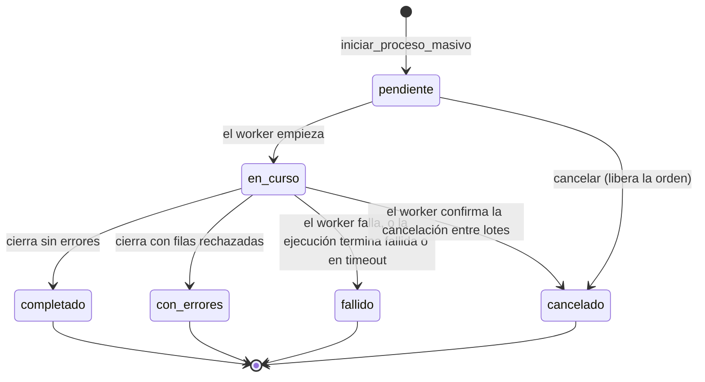
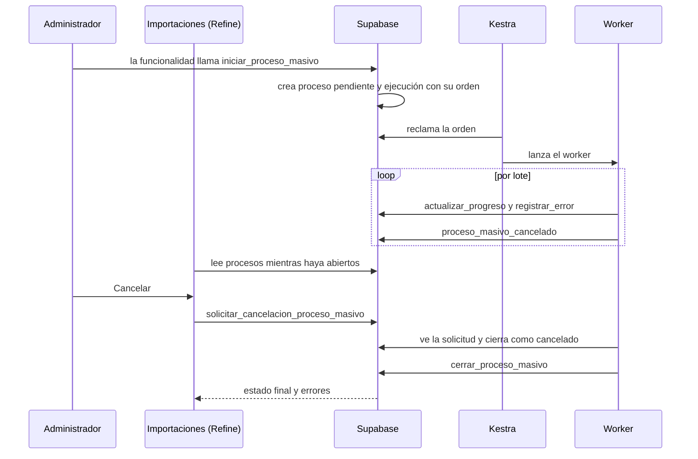
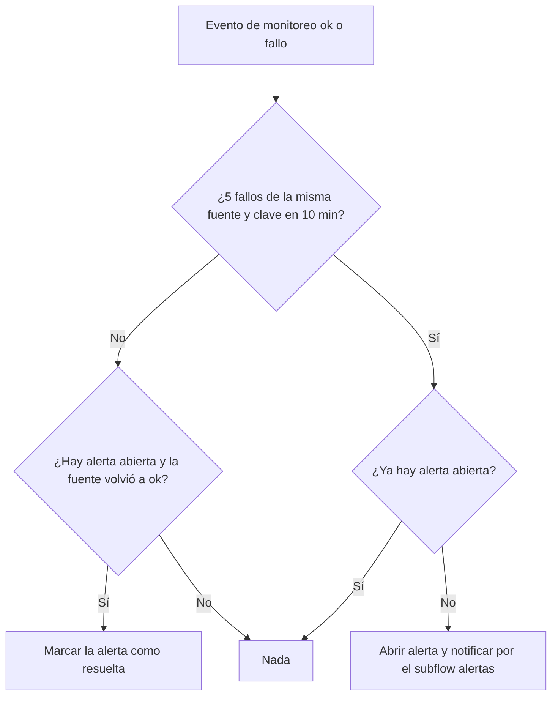
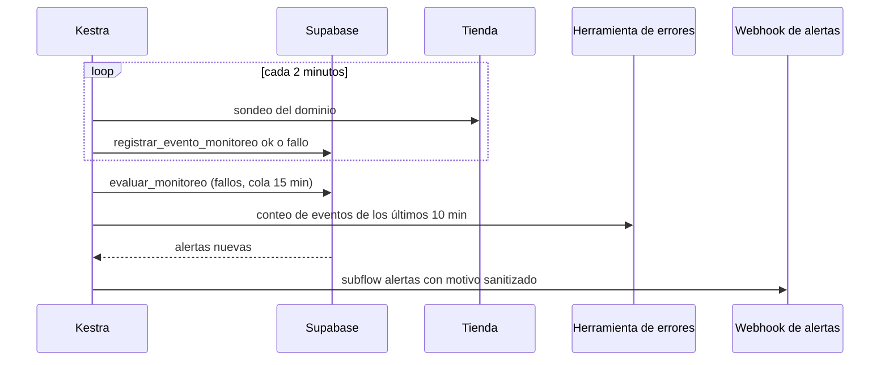
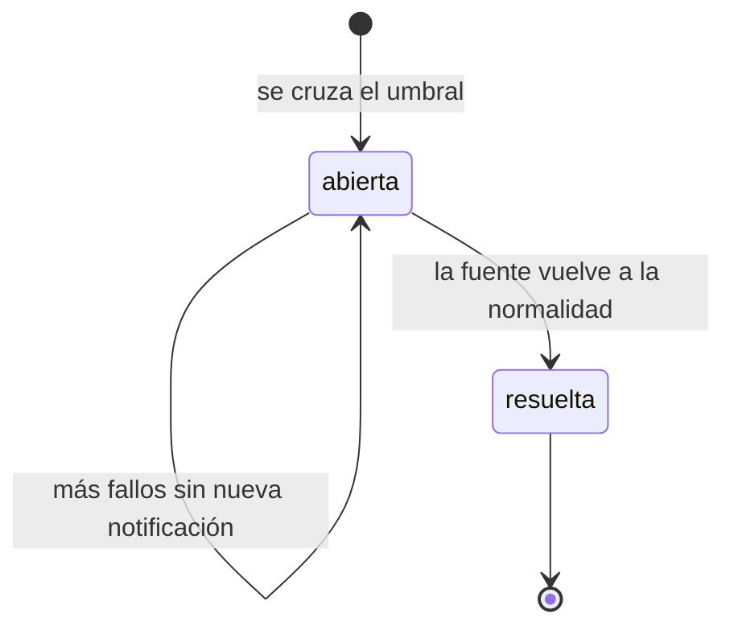

# Feature Specification: Plataforma · Importaciones y monitoreo

**Épica**: MSF-206 · **Spec**: `importaciones-y-monitoreo` · **Hito**: Etapa 2 (antes de las importaciones de Mercado Libre) · **Prioridad**: P1 · **Alcance (Jira)**: etapa2 · **Horas aprox.**: 16
**Historias**: F-IMP-01 Centro de importaciones y exportaciones (MSF-354) · F-OPS-03 Monitoreo y registro de errores (MSF-369)
**Alcance de entrega**: `refine`, `supabase`, `kestra`, `workers` (más un producto de infraestructura nuevo con su propio Compose, `infra/glitchtip/`, para el registro de errores; ver D-1).
**Fuente**: especificación de Nicolás cargada en la épica (It's a Plan), "Regla de fuentes" y "Para el SDLC" del issue, prototipos de referencia `design/pantallas/MLImportaciones.dc.html`, `ProductosCarga.dc.html` y `StockExcel.dc.html`, y artefactos del repo. Esta spec **traduce**; no agrega alcance.
**Bloquea a**: MSF-224 (F-OPS-06, exportación total: reutiliza `procesos_masivos` de F-IMP-01). **Bloqueada por**: ninguna (MSF-189 ya está Finalizada).

> Nota de rama: la rama `design/prototipo` ya no existe; los prototipos viven en `design/pantallas/`.

## Objetivo

Al terminar, el administrador ve y sigue todas las cargas y descargas masivas con su estado y sus errores, y el equipo de soporte detecta fallos de la aplicación, de las tiendas y de la sincronización antes que el cliente.

## Modelo y supuestos

- **El centro es de la Plataforma.** Es un registro genérico de procesos masivos (`procesos_masivos`) más una pantalla que los muestra. No importa ni exporta nada por sí mismo: cada funcionalidad (Catálogo MSF-202, Stock MSF-368, Mercado Libre MSF-143, exportación total MSF-224) registra sus procesos con el contrato de esta épica. Eso evita duplicar un importador genérico (cierra la duda de MSF-275, *Decisiones abiertas* 3 de `ventas-historial-de-consulta`).
- **Los procesos largos corren como trabajos de worker** con el ciclo auditable del template: `ejecuciones_worker` (spec 016) y la outbox `despachos_ejecucion` (spec 019), consumida por Kestra. Cada proceso masivo cuelga de una ejecución; no se crea un segundo ciclo.
- **Verificado en el repo (la épica lo marcaba "no verificado")**: `ejecuciones_worker` solo tiene los estados `en_curso | exitosa | fallida | timeout`, y ni ella ni el contrato de workers traen **progreso** ni **cancelación**. Esas dos capacidades las agrega esta épica, en `procesos_masivos`, sin tocar el ciclo existente.
- **El template ya trae** el ciclo de ejecuciones, la outbox, el contrato de workers, Kestra con el subflow `alertas` (webhook `KESTRA_ALERTAS_WEBHOOK_URL`) y las pantallas `/ejecuciones`. El monitoreo reutiliza el subflow `alertas` tal cual (no cambia su firma).
- **No hay pantalla propia dibujada** para el centro. Por la Regla de fuentes (3 y 4) se construye con los componentes del template y los tokens del sistema de diseño (MSF-117 no la bloquea), tomando como referencia visual la tabla y el diálogo de `MLImportaciones` (que es de Mercado Libre y podrá reutilizar el centro). `ProductosCarga` y `StockExcel` son pantallas de carga de otras épicas: esta épica **no las modifica**.
- **Monitoreo sin pantalla propia**: la épica no pide una pantalla de monitoreo. El registro de errores se consulta en la herramienta de errores (D-1) y las alertas llegan por el webhook existente (D-2).
- **Lectura y cancelación**: solo administradores de la organización (`private.es_administrador_de`), igual que `ejecuciones_worker`. Ver D-6.
- **Fuentes del monitoreo hoy disponibles**: fallos de ejecuciones (`ejecuciones_worker`), salud de las tiendas (`dominio.tiendas`, MSF-241 ya en el repo), cola de despachos (`despachos_ejecucion`) y errores de la aplicación (herramienta de errores). La cola de Mercado Libre (MSF-175) **no existe aún**: se enchufa a la misma regla cuando se entregue (fuera de alcance, ver Matriz).

### Esquema de datos (Constitución, Principio VII)

| Objeto | Esquema | Historia | Justificación | RLS / acceso |
|--------|---------|----------|---------------|--------------|
| `procesos_masivos` (**nueva**: `id`, `organizacion_id`, `empresa_id` null, `tipo` importacion/exportacion, `funcionalidad`, `nombre`, `estado`, `ejecucion_id`, `solicitado_por`, `total`, `procesados`, `con_errores`, `cancelacion_solicitada`, `creado_en`, `iniciado_en`, `finalizado_en`) | `public` | F-IMP-01 | Capacidad **transversal de plataforma**: la usan Catálogo, Stock, Mercado Libre y la exportación total; cuelga de `ejecuciones_worker`/`conexiones`, que también son `public`. | `organizacion_id`; `select` solo administradores de la organización; **sin insert/update/delete desde la app** (solo funciones); `anon` sin privilegios |
| `procesos_masivos_errores` (**nueva**: `id`, `proceso_id`, `organizacion_id`, `fila` null, `referencia` null, `motivo_sanitizado`, `creado_en`) | `public` | F-IMP-01 | Detalle del mismo registro transversal. | ídem |
| Funciones `iniciar_proceso_masivo`, `actualizar_progreso_proceso_masivo`, `registrar_error_proceso_masivo`, `cerrar_proceso_masivo`, `solicitar_cancelacion_proceso_masivo`, `proceso_masivo_cancelado` | `public` | F-IMP-01 | Superficie de ejecución sin datos propios. | `revoke … from public, anon`; `grant … to authenticated` (app) o rol de worker según contrato |
| Trigger de reconciliación sobre `ejecuciones_worker` | `public` | F-IMP-01 | Mantiene coherente el proceso si su ejecución termina mal; no cambia la tabla. | función `security definer`, sin grants |
| `eventos_monitoreo` (**nueva**: `id`, `organizacion_id` null, `fuente`, `clave`, `resultado` ok/fallo, `motivo_sanitizado`, `ocurrido_en`) | `public` | F-OPS-03 | Dato **operativo de plataforma** (salud de servicios, no del negocio). | `select` solo superadmin/operador; escritura solo por función; `anon` sin privilegios |
| `alertas_monitoreo` (**nueva**: `id`, `fuente`, `clave`, `organizacion_id` null, `estado` abierta/resuelta, `motivo_sanitizado`, `abierta_en`, `notificada_en`, `resuelta_en`) | `public` | F-OPS-03 | Estado de las alertas de plataforma para no repetirlas. | ídem |
| Funciones `registrar_evento_monitoreo`, `evaluar_monitoreo` | `public`/`private` | F-OPS-03 | Superficie de ejecución para los flows de Kestra. | solo rol `kestra_orquestacion`; `revoke` a `public, anon, authenticated` |

Ninguna tabla va a `dominio`: ninguna es una entidad de negocio del producto. La prueba pgTAP `rls_en_toda_tabla` (recorre `public` + `dominio`) debe seguir verde. Todas las migraciones son **aditivas**; la reversión está en `plan.md`.

## User Scenarios & Testing *(mandatory)*

### User Story 1 - Centro de importaciones y exportaciones (F-IMP-01 · MSF-354, P1, talla M)

El administrador abre el centro y ve todas las cargas y descargas masivas de su organización con su estado, su progreso y sus errores, y puede cancelar las que todavía no terminaron.

**Why this priority**: sin esta capa, cada importación o exportación inventa su propio seguimiento, y MSF-224 queda bloqueada.

**Acceptance Scenarios**:

1. **Dado** una funcionalidad que registra un proceso, **cuando** llama a `iniciar_proceso_masivo`, **entonces** nacen en la misma transacción el proceso (`pendiente`) y su ejecución auditable de worker con su orden de despacho, con actor, empresa opcional y tipo importación/exportación (FR-001, FR-002, FR-004).
2. **Dado** un proceso, **entonces** su estado es uno de `pendiente`, `en_curso`, `completado`, `con_errores`, `fallido`, `cancelado`, y un estado terminal no vuelve atrás (FR-002).
3. **Dado** un worker que procesa por lotes, **cuando** informa su avance, **entonces** el proceso guarda `total` y `procesados` sin retroceder (FR-005).
4. **Dado** una fila inválida, **cuando** el worker la reporta, **entonces** queda un error con fila, referencia y motivo sanitizado, y `con_errores` aumenta (FR-006).
5. **Dado** que el worker termina, **entonces** cierra el proceso como `completado` (sin errores), `con_errores` (terminó con filas rechazadas) o `fallido` (no pudo terminar) (FR-007).
6. **Dado** que la ejecución del proceso termina `fallida` o `timeout` sin que el worker lo haya cerrado, **entonces** el proceso pasa a `fallido` y no queda abierto para siempre (FR-008).
7. **Dado** un proceso `pendiente`, **cuando** el administrador cancela, **entonces** pasa a `cancelado` y su orden de despacho se libera; **dado** uno `en_curso`, **entonces** queda `cancelacion_solicitada`, el worker lo detecta entre lotes y lo cierra `cancelado` conservando lo ya procesado; **dado** uno terminal, **entonces** cancelar da un error claro (FR-009).
8. **Dado** una persona que no es administradora de la organización, o una organización ajena, **entonces** no lee ni cancela procesos; `anon` no tiene acceso (FR-010).
9. **Dado** el panel, **entonces** el ítem «Importaciones» abre `/importaciones` con una tabla de procesos (fecha, origen, estado, avance, errores, duración) y los estados compartidos de carga, vacío y error (FR-011).
10. **Dado** procesos abiertos, **entonces** la tabla se actualiza sola mientras haya alguno `pendiente` o `en_curso`, y deja de consultar cuando todos son terminales (FR-012).
11. **Dado** un proceso, **cuando** se pulsa «Ver detalle», **entonces** un diálogo muestra su resumen y la tabla paginada de errores (fila, referencia, motivo), y se cierra con «Cerrar» (FR-013).
12. **Dado** un proceso abierto, **entonces** la fila ofrece «Cancelar» con confirmación; en un proceso terminal el botón no aparece (FR-014).
13. **Dado** que cambia la empresa activa de la barra superior, **entonces** el centro recarga sus consultas, reencuadra la paginación, cierra el diálogo abierto con aviso y nunca muestra procesos de la empresa anterior (FR-015).
14. **Dado** 320, 768 o 1440 px y navegación por teclado y lector de pantalla, **entonces** el centro es operable (FR-016).
15. **Dado** un equipo que quiere registrar su carga o descarga, **entonces** el contrato de workers y la guía `docs/importaciones.md` le explican el protocolo (iniciar → progreso por lote → errores → revisar cancelación → cerrar) (FR-017).

**Independent Test**: pgTAP de `procesos_masivos` (RLS, estados, progreso monótono, cancelación, reconciliación) + Vitest de la pantalla + E2E del centro (cierre).

### User Story 2 - Monitoreo y registro de errores (F-OPS-03 · MSF-369, P1, talla M)

El equipo de soporte ve agrupados los errores de la aplicación y de los workers, y recibe una alerta cuando fallan la aplicación, una tienda o la sincronización, o cuando una cola deja de avanzar, antes de que el cliente lo note.

**Why this priority**: hoy un fallo solo se descubre cuando alguien lo reporta (roadmap: «Monitoreo, alertas y errores», pendientes healthchecks y registro central de errores).

**Acceptance Scenarios**:

1. **Dado** el repo, **entonces** existe el producto `infra/glitchtip/compose.yaml` (proyecto Compose propio, comandos `dev:glitchtip` / `dev:down:glitchtip`) y se valida con `pnpm infra:config` (FR-020).
2. **Dado** una excepción no manejada o un error de render en `apps/web`, **entonces** llega agrupada a la herramienta de errores con ambiente y versión, **sin** correos, teléfonos, tokens ni cuerpos de formulario (FR-021).
3. **Dado** un worker que falla, **entonces** el error llega con el identificador de su ejecución (`EJECUCION_ID`) para enlazarlo con `/ejecuciones` (FR-022).
4. **Dado** que el DSN no está configurado (desarrollo local, CI), **entonces** nada se envía y nada falla; el DSN vive en `.env.example` sin secretos (FR-023).
5. **Dado** una tienda en `dominio.tiendas`, **entonces** un flow de Kestra la sondea cada 2 minutos y registra `ok` o `fallo` en `eventos_monitoreo` (FR-024, FR-025).
6. **Dado** 5 fallos de una misma fuente y clave (una tienda; una capacidad de sincronización con ejecuciones `fallida`/`timeout`) dentro de 10 minutos, **entonces** se abre **una** alerta y se notifica una vez; mientras siga abierta no se repite (FR-026, FR-028).
7. **Dado** una orden de despacho de la cola que lleva 15 minutos sin avanzar, **entonces** se abre una alerta de cola, con la misma deduplicación (FR-027, FR-028).
8. **Dado** que la fuente vuelve a la normalidad, **entonces** la alerta se marca `resuelta` y una nueva caída abre otra (FR-028).
9. **Dado** una alerta nueva, **entonces** se envía por el subflow `alertas` existente (tipo `tecnica`) al webhook configurado, con motivo sanitizado y sin secretos (FR-029).
10. **Dado** que los umbrales son 5 fallos / 10 min y 15 min de cola, **entonces** se ajustan sin cambiar código (inputs del flow) (FR-030).
11. **Dado** 5 o más eventos de error de la aplicación en 10 minutos en un mismo proyecto de la herramienta, **entonces** se abre una alerta de fuente `aplicacion` (FR-033).
12. **Dado** una persona que no es operador de plataforma, **entonces** no lee `eventos_monitoreo` ni `alertas_monitoreo`; `anon` tampoco (FR-031).
13. **Dado** un incidente, **entonces** `docs/monitoreo.md` explica qué se mira, dónde, qué significa cada alerta y cómo ajustar umbrales (FR-032).

**Independent Test**: pgTAP de `monitoreo` (umbrales, deduplicación, resolución, permisos) + tests de los flows de Kestra + error inducido en un entorno con GlitchTip (SC-006).

### Edge Cases

- Dos procesos del mismo tipo en simultáneo: lo decide la capacidad (`iniciar_ejecucion_worker` rechaza con `YA_EN_CURSO`); el centro muestra el error de la funcionalidad, no lo reinterpreta.
- Worker que muere sin cerrar: la ejecución termina `timeout` y la reconciliación cierra el proceso `fallido` (FR-008).
- Cancelar justo cuando el worker cierra: gana el estado terminal ya guardado; la cancelación devuelve «el proceso ya terminó».
- Proceso sin empresa (`empresa_id` null): aparece en «Todas mis empresas»; con una empresa concreta elegida no aparece (D-6).
- Exportación: el centro muestra su estado y errores; la entrega del archivo es de MSF-224.
- Herramienta de errores caída: la aplicación no se rompe (el envío es en segundo plano y tolera fallos).
- Tienda sin dominio: no se sondea.
- Tormenta de errores: la alerta es una sola mientras esté abierta (FR-028).

## Requirements *(mandatory)*

### Functional Requirements

**F-IMP-01 — Centro de importaciones y exportaciones**
- **FR-001**: DEBEN existir `public.procesos_masivos` y `public.procesos_masivos_errores` con RLS por organización, sin escritura desde la app (solo funciones), ligados a la ejecución auditable del template. Es la tabla que reutiliza MSF-224.
- **FR-002**: El proceso DEBE tener `tipo` (`importacion`/`exportacion`), `funcionalidad` de origen y estado `pendiente | en_curso | completado | con_errores | fallido | cancelado`; un estado terminal no vuelve atrás.
- **FR-003**: Cada proceso DEBE poder asociarse a una empresa o a toda la organización (`empresa_id` opcional) y guardar quién lo solicitó.
- **FR-004**: `iniciar_proceso_masivo` DEBE crear el proceso y su ejecución de worker (con su orden en la outbox) en una sola transacción, reutilizando `iniciar_ejecucion_worker`; no crea un ciclo paralelo.
- **FR-005**: El worker DEBE poder informar `total` y `procesados`; `procesados` nunca retrocede ni supera `total`.
- **FR-006**: El worker DEBE poder registrar errores por fila (fila, referencia, `motivo_sanitizado`); el motivo nunca contiene el error crudo ni datos personales.
- **FR-007**: El worker DEBE cerrar el proceso como `completado`, `con_errores` o `fallido`. Desvío: la base además valida que `completado`/`con_errores` tengan `procesados = total` (si se informó el total) y que `cancelado` tenga una cancelación solicitada (ver contrato).
- **FR-008**: Si la ejecución asociada termina `fallida` o `timeout` y el proceso sigue abierto, DEBE pasar a `fallido` automáticamente.
- **FR-009**: DEBE existir la cancelación: `pendiente` → `cancelado` de inmediato (libera la orden de despacho); `en_curso` → `cancelacion_solicitada` hasta que el worker la confirme entre lotes y cierre `cancelado`; terminal → error claro.
- **FR-010**: Solo administradores de la organización dueña DEBEN leer y cancelar procesos; ninguna otra organización ni `anon`; el worker solo escribe en procesos de su propia organización.
- **FR-011**: DEBE existir la pantalla `/importaciones` («Importaciones», ítem de navegación con icono, audiencia administradores de la organización, rutas anteriores: ninguna) con tabla de procesos y los estados compartidos (`EstadoCargaPagina`, `EstadoVacio`, error).
- **FR-012**: La tabla DEBE refrescarse automáticamente mientras haya procesos abiertos y dejar de hacerlo al terminar todos.
- **FR-013**: DEBE existir el diálogo «Detalle de la importación» con resumen del proceso y errores paginados, y su botón «Cerrar».
- **FR-014**: DEBE existir «Cancelar» con confirmación, solo en procesos abiertos.
- **FR-015**: La pantalla DEBE respetar la **empresa activa** de la barra superior (Principio VIII): una sola fuente de verdad, invalida y recarga todas sus consultas al cambiar, reencuadra la paginación y no mezcla datos en el diálogo.
- **FR-016**: DEBE cumplir el Principio VI: patrones compartidos, teclado, lector de pantalla, 320/768/1440 px, sin identificadores técnicos como identidad visible (la funcionalidad de origen se muestra con su nombre legible).
- **FR-017**: DEBE documentarse el contrato para workers y funcionalidades (`workers/CONTRATO.md`, `docs/importaciones.md`); esta épica **no** migra cargas existentes.

**F-OPS-03 — Monitoreo y registro de errores**
- **FR-020**: DEBE existir el producto `infra/glitchtip/compose.yaml` (proyecto Compose propio, sin Compose raíz, `dev:glitchtip` y `dev:down:glitchtip`), válido con `pnpm infra:config` (herramienta: D-1).
- **FR-021**: `apps/web` DEBE enviar a la herramienta los errores no manejados y de render, con ambiente y versión, **filtrando** datos personales, tokens y cuerpos de formularios antes de enviar.
- **FR-022**: Los workers DEBEN enviar sus errores con el identificador de ejecución para enlazarlos con `/ejecuciones`.
- **FR-023**: El DSN DEBE configurarse solo por variables (`.env.example`, sin secretos en Git); sin DSN el envío es un no-op silencioso y el desarrollo local sigue reproducible.
- **FR-024**: DEBEN existir `public.eventos_monitoreo` y `public.alertas_monitoreo`, escritas solo por funciones, legibles solo por el operador de plataforma (FR-031), con RLS.
- **FR-025**: Un flow de Kestra DEBE sondear cada 2 minutos cada tienda con dominio de `dominio.tiendas` y registrar `ok`/`fallo` con motivo sanitizado.
- **FR-026**: El sistema DEBE abrir una alerta cuando una misma fuente y clave acumula **5 fallos en 10 minutos** (fuentes: `tienda` y `sincronizacion`, esta última por ejecuciones `fallida`/`timeout` de una capacidad).
- **FR-027**: El sistema DEBE abrir una alerta cuando una orden de la cola de despachos (`despachos_ejecucion`) lleva **15 minutos sin avanzar**; la cola de Mercado Libre usa la misma regla cuando exista (fuera de alcance hoy).
- **FR-028**: Las alertas DEBEN ser idempotentes: una sola `abierta` por fuente y clave, notificada una vez; pasan a `resuelta` al normalizarse y una nueva caída abre otra.
- **FR-029**: Las alertas nuevas DEBEN enviarse por el subflow `alertas` existente (tipo `tecnica`) al `KESTRA_ALERTAS_WEBHOOK_URL`, con motivo sanitizado y sin secretos (proveedor y casilla: D-2).
- **FR-030**: Los umbrales (5 / 10 min / 15 min) y la frecuencia de sondeo DEBEN ser inputs de los flows, ajustables sin cambiar código.
- **FR-031**: `eventos_monitoreo` y `alertas_monitoreo` DEBEN ser legibles solo por el operador de plataforma (superadmin); ninguna otra persona ni `anon`; las funciones solo las ejecuta `kestra_orquestacion`.
- **FR-032**: DEBE existir `docs/monitoreo.md` (qué se mira, dónde, qué significa cada alerta, umbrales, variables).
- **FR-033**: Un flow de Kestra DEBE consultar a la herramienta de errores el conteo de eventos de los últimos 10 minutos y abrir una alerta de fuente `aplicacion` al llegar a 5 en un mismo proyecto.

### Success Criteria

- **SC-001**: Un administrador ve un proceso nuevo, su avance y sus errores en `/importaciones` sin recargar a mano (FR-001, FR-005, FR-006, FR-011–FR-013).
- **SC-002**: Cancelar un proceso `pendiente` o `en_curso` termina en `cancelado` conservando lo ya procesado (FR-009, FR-014).
- **SC-003**: Otra organización, un no administrador y `anon` no leen ni cancelan procesos; `rls_en_toda_tabla` verde (FR-010).
- **SC-004**: 5 fallos en 10 min generan **una** alerta, no repetida mientras esté abierta, y una nueva caída tras resolverse genera otra (FR-026, FR-028).
- **SC-005**: Una orden de cola sin avanzar 15 min genera su alerta (FR-027).
- **SC-006**: Un error inducido en web y en un worker aparece en la herramienta de errores, sin datos personales (FR-021, FR-022).
- **SC-007**: Cambiar de empresa recarga el centro sin datos de la anterior (FR-015).
- **SC-008**: `pnpm lint`, `pnpm build`, `pnpm infra:config`, `pnpm test`, `pnpm docs:check`, `pnpm prototipo:check` y `pnpm matriz:check` verdes.

### Verificación por requisito

Cada FR/SC tiene aquí su verificación nombrada (archivo de test o comando) y, en `tasks.md`, una única tarea dueña que la ejecuta («Verifica:»).

| Req. | Verificación | Comando |
|---|---|---|
| FR-001, FR-002, FR-003 | pgTAP `procesos_masivos.test.sql` (tablas, estados, terminal irreversible, empresa opcional) + `rls_en_toda_tabla` | `pnpm test` |
| FR-004 | pgTAP `procesos_masivos.test.sql` (proceso + ejecución + orden en una transacción; `YA_EN_CURSO` se propaga) | `pnpm test` |
| FR-005, FR-006, FR-007 | pgTAP `procesos_masivos_worker.test.sql` (progreso monótono, errores sanitizados, tres cierres) | `pnpm test` |
| FR-008 | pgTAP `procesos_masivos_worker.test.sql` (ejecución `timeout` → proceso `fallido`) | `pnpm test` |
| FR-009 | pgTAP `procesos_masivos_cancelacion.test.sql` (pendiente, en curso, terminal) | `pnpm test` |
| FR-010 | pgTAP `procesos_masivos.test.sql` (otra organización, no administrador, `anon`, worker ajeno) | `pnpm test` |
| FR-011 | Vitest `importaciones.test.tsx` (columnas, carga, vacío, error) + `navegacion-importaciones.test.ts` | `pnpm --filter @platform/web test importaciones` |
| FR-012 | Vitest `importaciones-vivo.test.tsx` (refresca con abiertos, se detiene al terminar) | ídem |
| FR-013 | Vitest `detalle-importacion.test.tsx` (resumen, errores paginados, Cerrar) | ídem |
| FR-014 | Vitest `cancelar-proceso.test.tsx` (confirmación, solo abiertos) | ídem |
| FR-015 | Vitest `empresa-activa-importaciones.test.tsx` + E2E `importaciones.e2e.ts` | `pnpm test` / `pnpm test:e2e` |
| FR-016 | E2E `importaciones-a11y.e2e.ts` (axe sin violaciones a 320/768/1440 px, recorrido por teclado, sin identificadores técnicos visibles) | `pnpm test:e2e` |
| FR-017 | test `documentacion-importaciones.test.mjs` (`workers/CONTRATO.md` y `docs/importaciones.md` nombran las funciones del protocolo) + `pnpm docs:check` | `pnpm test` |
| FR-020 | test `validar-glitchtip-compose.test.mjs` (Compose válido, proyecto propio, comandos `dev:glitchtip`/`dev:down:glitchtip`) + `pnpm infra:config` | `pnpm test && pnpm infra:config` |
| FR-021 | Vitest `errores-web.test.ts` (filtra correos/tokens/cuerpos; adjunta ambiente y versión) | `pnpm --filter @platform/web test errores` |
| FR-022 | test del helper de workers `errores-worker.test.mjs` (adjunta `EJECUCION_ID`; dueña T017) | `pnpm test` |
| FR-023 | Vitest `errores-web.test.ts` + test del worker (sin DSN = no-op) | `pnpm test` |
| FR-024, FR-031 | pgTAP `monitoreo.test.sql` (RLS, solo superadmin, `anon` sin acceso, grants a `kestra_orquestacion`) + `rls_en_toda_tabla` | `pnpm test` |
| FR-025 | `validar-monitoreo-tiendas.test.mjs` (flow válido, sondea solo tiendas con dominio) + `pnpm infra:config` | `pnpm test && pnpm infra:config` |
| FR-026, FR-028 | pgTAP `monitoreo.test.sql` (4 fallos no alertan, 5 sí, una sola abierta, resolución, reapertura) | `pnpm test` |
| FR-027 | pgTAP `monitoreo.test.sql` (orden sin avanzar 14 min no alerta, 15 sí) | `pnpm test` |
| FR-029, FR-030 | `validar-monitoreo-alertas.test.mjs` (usa el subflow `alertas`, inputs con 5/10/15 por defecto, sin secretos en el cuerpo) | `pnpm test` |
| FR-032 | test `documentacion-monitoreo.test.mjs` (secciones de umbrales, DSN y `KESTRA_ALERTAS_WEBHOOK_URL`) + `pnpm docs:check` | `pnpm test` |
| FR-033 | `validar-monitoreo-errores.test.mjs` (flow válido, umbral 5/10 min, token solo como secreto de Kestra) | `pnpm test` |
| SC-001, SC-002, SC-007 | E2E `importaciones.e2e.ts` | `pnpm test:e2e` |
| SC-003 | pgTAP `procesos_masivos.test.sql` | `pnpm test` |
| SC-004, SC-005 | pgTAP `monitoreo.test.sql` | `pnpm test` |
| SC-006 | Vitest `errores-web.test.ts` y `errores-worker.test.mjs` (automático) + paso manual «error inducido» de `docs/monitoreo.md` contra `pnpm dev:glitchtip` (evidencia en el PR) | `pnpm test` |
| SC-008 | los siete comandos de validación | `pnpm lint && pnpm build && pnpm infra:config && pnpm test && pnpm docs:check && pnpm prototipo:check && pnpm matriz:check` |

## Decisiones abiertas (a confirmar con Nicolás)

La épica pide dejarlas anotadas. Cada una trae una propuesta provisoria con la que se implementa si no hay respuesta.

- **D-1 — Herramienta de errores y alertas (F-OPS-03)**. Propuesta: **GlitchTip self-hosted** (`infra/glitchtip/`). Razones: licencia permisiva (MIT), compatible con los SDK de Sentry, cabe en el VPS (Supabase también es self-hosted) y cumple la regla de licencias del repo. Alternativas: Sentry (self-hosted o SaaS: licencia no permisiva / datos fuera) o solo el registro propio de `eventos_monitoreo`. Las alertas **operativas** (tiendas, sincronización, cola) no dependen de la herramienta: salen de Kestra y la base.
- **D-2 — Proveedor y casilla de destino de las alertas**. Hoy el subflow `alertas` publica a un webhook (`KESTRA_ALERTAS_WEBHOOK_URL`) y «el receptor decide los destinatarios» (operador de plataforma para `tecnica`). Propuesta: **no cambiar el subflow**; el destino real (correo, chat u otro) y la casilla los define el receptor del webhook. Falta que Nicolás nombre el proveedor y la casilla. La implementación no depende de eso: queda como configuración.
- **D-3 — Umbrales**. Propuesta de la épica: 5 fallos en 10 minutos y cola sin avanzar 15 minutos. Se agregan dos supuestos propios: el sondeo de tiendas es **cada 2 minutos** (con 5 fallos consecutivos se llega justo a 10 minutos) y los fallos se agrupan **por fuente y clave** (una tienda, una capacidad), no globalmente.
- **D-4 — Progreso**. El avance se muestra **consultando cada pocos segundos** mientras haya procesos abiertos (no Realtime): más simple, mismo resultado visible.
- **D-5 — Qué cargas se conectan al centro**. Esta épica entrega el registro, el contrato y la pantalla. Conectar Stock Excel, Productos (carga masiva), Mercado Libre y el importador del historial (MSF-275) es trabajo de sus épicas («relacionada, sin bloqueo»). Hasta entonces el centro puede estar vacío en producción.
- **D-6 — Visibilidad**. Solo **administradores** ven y cancelan (igual que `/ejecuciones`). Un proceso sin empresa aparece solo en «Todas mis empresas».
- **D-7 — Estados**. La épica pide «estado» sin enumerarlos; los seis estados de FR-002 son una propuesta mínima que cubre éxito, éxito parcial, fallo y cancelación.

## Flujos

La épica describe estados y secuencias en texto; se transcriben tal cual, sin pasos nuevos.

### Estados de un proceso masivo (F-IMP-01)

### Secuencia de un proceso con progreso y cancelación (F-IMP-01)

### Regla de alerta por fallos (F-OPS-03)

### Cola sin avanzar y salud de tiendas (F-OPS-03)

### Estados de una alerta de monitoreo (F-OPS-03)

| Paso / estado | Dueño |
|---|---|
| Crear proceso y ejecución | FR-004 |
| Estados del proceso y terminalidad | FR-002 |
| Progreso por lote y errores | FR-005, FR-006 |
| Cierre completado / con errores / fallido | FR-007 |
| Ejecución fallida o timeout cierra el proceso | FR-008 |
| Cancelación pendiente / en curso / terminal | FR-009, FR-014 |
| Lectura del progreso en la pantalla | FR-011, FR-012 |
| Sondeo de tiendas | FR-025 |
| Regla de 5 fallos en 10 min | FR-026 |
| Cola 15 min sin avanzar | FR-027 |
| Una alerta abierta, resolver, reabrir | FR-028 |
| Notificación por el subflow `alertas` | FR-029 |
| Conteo de errores de la herramienta | FR-033 |

## Matriz pantalla↔criterios

La épica **no dibuja pantalla propia**: la referencia visual es `MLImportaciones` (de Mercado Libre). Lo que el centro toma de ella tiene dueño; lo demás queda **fuera de alcance** (no es deuda: es de otras épicas o no lo pide esta). `ProductosCarga` y `StockExcel` son cargas de otras épicas y esta épica no las toca.

### MLImportaciones (referencia: tabla de importaciones y diálogo de detalle)

| Ítem del prototipo | Pantalla | Dueño |
|---|---|---|
| Tabla, columna `Fecha` | MLImportaciones | FR-011 |
| Tabla, columna `Origen` (funcionalidad de origen, nombre legible) | MLImportaciones | FR-011, FR-016 |
| Tabla, columna `Resultado` (estado del proceso) | MLImportaciones | FR-002, FR-011 |
| Tabla, columna `Leídas` (se muestra como avance `procesados` de `total`) | MLImportaciones | FR-005, FR-011 |
| Tabla, columna `Errores` | MLImportaciones | FR-006, FR-011 |
| Tabla, columna `Duración` | MLImportaciones | FR-011 |
| Tabla, columna de acciones (sin título) | MLImportaciones | FR-013, FR-014 |
| Tabla, columnas `Nuevas` y `Actualizadas` | MLImportaciones | Fuera de alcance: son conteos del dominio de Mercado Libre; el centro es genérico (MSF-143) |
| Botón `Ver detalle` | MLImportaciones | FR-013 |
| Diálogo «Detalle de la importación» | MLImportaciones | FR-013 |
| Botón `Cerrar` (del diálogo) | MLImportaciones | FR-013 |
| Botón `Cancelar` | MLImportaciones | FR-014 (cancelar un proceso abierto, con confirmación) |
| Tabla de errores, columna `Publicación` (se muestra como `Referencia` y `Fila`) | MLImportaciones | FR-006, FR-013 |
| Tabla de errores, columna `Error` | MLImportaciones | FR-006, FR-013 |
| Tabla de errores, columnas `Intento` y `Estado` | MLImportaciones | Fuera de alcance: reintentos por error, no los pide la épica |
| Tabla de errores, columna de acciones (sin título) | MLImportaciones | Fuera de alcance: acción por error (reintento), no la pide la épica |
| Botón `Reintentar todos` | MLImportaciones | Fuera de alcance: reintentar no está en la épica |
| Botón `Descargar registro` | MLImportaciones | Fuera de alcance: descarga del registro, no la pide la épica |
| Botón `Importar publicaciones` | MLImportaciones | Fuera de alcance: dispara una importación de Mercado Libre (MSF-143); el centro solo la muestra |
| Pestañas `Cuentas`, `Publicaciones`, `Sincronización`, `Importaciones` y botones homónimos | MLImportaciones | Fuera de alcance: navegación interna de Mercado Libre; el centro es una pantalla de la Plataforma |
| Empresa activa | MLImportaciones / `/importaciones` | FR-015 (fila obligatoria Principio VIII) |

### ProductosCarga (carga masiva de productos, otra épica)

| Ítem del prototipo | Pantalla | Dueño |
|---|---|---|
| Tabla `Columna`, `Obligatoria`, `Ejemplo` | ProductosCarga | Fuera de alcance: es la carga de Catálogo (MSF-202); se conectará al centro con FR-017 |
| Tabla `Fila`, `SKU`, `Nombre`, `Categoría`, `Precio x1`, `Imágenes`, `Acción`, `Validación` | ProductosCarga | Fuera de alcance: ídem |
| Botones `Descargar plantilla CSV`, `Elegir imágenes`, `Cancelar`, `Importar · productos` | ProductosCarga | Fuera de alcance: ídem |

### StockExcel (actualización de stock por Excel, otra épica)

| Ítem del prototipo | Pantalla | Dueño |
|---|---|---|
| Tabla `Columna`, `Contenido` | StockExcel | Fuera de alcance: es la carga de Stock (MSF-368) |
| Tabla `SKU`, `Producto`, `Stock actual`, `En planilla`, `Quedará`, `Diferencia`, `Validación` | StockExcel | Fuera de alcance: ídem |
| Campos `Depósito de mercadería`, `Modo` | StockExcel | Fuera de alcance: ídem |
| Botones `Descargar plantilla Excel`, `Cancelar`, `Aplicar · ajustes` | StockExcel | Fuera de alcance: ídem |
| Pestañas y botones `Stock actual`, `Movimientos`, `Ingreso de mercadería`, `Depósitos de mercadería`, `Faltantes`, `Actualizar por Excel` | StockExcel | Fuera de alcance: navegación de Stock |

### Estados que salen de la historia (no están en el prototipo)

| Estado | Dueño |
|---|---|
| Carga, vacío («todavía no hay importaciones ni exportaciones») y error de la tabla | FR-011 |
| Confirmación de cancelación | FR-014 |
| Aviso al cambiar de empresa con el diálogo abierto | FR-015 |
| F-OPS-03 no tiene pantalla (herramienta de errores y alertas por webhook) | FR-020, FR-029 |
