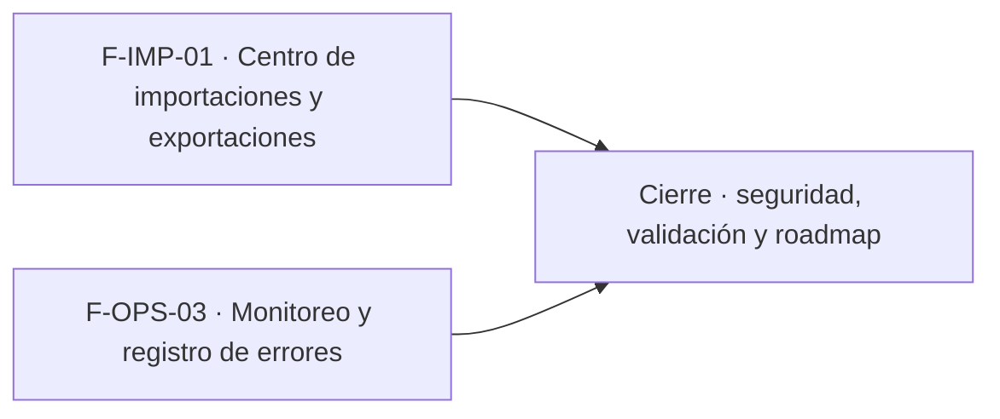

# Tasks: Importaciones y monitoreo (MSF-206)

**Spec**: [`spec.md`](./spec.md) · **Plan**: [`plan.md`](./plan.md) · **Contratos**: [`contracts/importaciones-y-monitoreo.md`](./contracts/importaciones-y-monitoreo.md)

Formato: `- [ ] T### [P] [Historia][USn] descripción (FR/SC que posee)`. `[P]` = paralelizable (archivos distintos, sin dependencia dentro de la historia). Cada FR/SC tiene **una sola** tarea dueña. Las dependencias son solo dentro de la misma historia.

## Matriz de trazabilidad (tracker ↔ US ↔ tareas)

| Tracker | Historia | US | Tareas | Requisitos que poseen |
|---|---|---|---|---|
| MSF-354 | F-IMP-01 Centro de importaciones y exportaciones | US1 | T001–T014 | FR-001–FR-017, SC-001, SC-002, SC-003, SC-007 |
| MSF-369 | F-OPS-03 Monitoreo y registro de errores | US2 | T015–T024 | FR-020–FR-033, SC-004, SC-005, SC-006 |
| Tarea de cierre (label cierre) | Seguridad, validación completa y roadmap | — | T025–T027 | SC-008 |

## Phase 1: F-IMP-01 · Centro de importaciones y exportaciones (US1)

- [x] T001 [F-IMP-01][US1] Migración `20270202100000_procesos_masivos_tablas.sql`: `public.procesos_masivos` y `public.procesos_masivos_errores` con estados, empresa opcional, RLS solo administradores, sin escritura directa, grants sin `anon` y reversión documentada. Verifica: pgTAP `procesos_masivos.test.sql` (`pnpm test`) (FR-001, FR-002, FR-003, FR-010)
- [x] T002 [F-IMP-01][US1] Migración `…_procesos_masivos_inicio.sql`: `iniciar_proceso_masivo` crea proceso y ejecución con su orden en una transacción vía `iniciar_ejecucion_worker`, con grants explícitos. Verifica: pgTAP `procesos_masivos.test.sql` (`pnpm test`) (FR-004)
- [x] T003 [P] [F-IMP-01][US1] Migración `…_procesos_masivos_worker.sql`: `actualizar_progreso_…` (monótono, tope `total`), `registrar_error_…` (motivo sanitizado, tope de errores guardados) y `cerrar_…` (`completado`/`con_errores`/`fallido`), solo rol de worker de la organización. Verifica: pgTAP `procesos_masivos_worker.test.sql` (`pnpm test`) (FR-005, FR-006, FR-007)
- [x] T004 [P] [F-IMP-01][US1] Migración `…_procesos_masivos_cancelacion.sql`: `solicitar_cancelacion_…` (pendiente libera la orden, en curso marca la solicitud, terminal da `PROCESO_TERMINADO`) y `proceso_masivo_cancelado`. Verifica: pgTAP `procesos_masivos_cancelacion.test.sql` (`pnpm test`) (FR-009)
- [x] T005 [P] [F-IMP-01][US1] Migración `…_procesos_masivos_reconciliar.sql`: trigger sobre `ejecuciones_worker` que cierra `fallido` el proceso abierto cuya ejecución termina `fallida`/`timeout`. Verifica: pgTAP `procesos_masivos_worker.test.sql` (`pnpm test`) (FR-008)
- [x] T006 [P] [F-IMP-01][US1] pgTAP `procesos_masivos.test.sql`, `procesos_masivos_worker.test.sql` y `procesos_masivos_cancelacion.test.sql`: RLS, otra organización, no administrador, `anon`, worker ajeno, estados, progreso, cancelación y reconciliación; `rls_en_toda_tabla` verde. Verifica: `pnpm test` (los tres archivos pgTAP + `rls_en_toda_tabla`) (SC-003)
- [x] T007 [P] [F-IMP-01][US1] Contrato para workers en `workers/CONTRATO.md` (iniciar → progreso por lote → errores → revisar cancelación → cerrar) y guía `docs/importaciones.md` para que Catálogo, Stock, Mercado Libre y MSF-224 registren sus procesos; aclara que esta épica no migra cargas existentes. Verifica: test `scripts/tests/documentacion-importaciones.test.mjs` (ambos documentos nombran `iniciar_proceso_masivo`, `cerrar_proceso_masivo` y `proceso_masivo_cancelado`) y `pnpm docs:check` (FR-017)
- [x] T008 [F-IMP-01][US1] Ruta `/importaciones`, ítem «Importaciones» con icono en la navegación (audiencia administradores) y tabla de procesos con fecha, origen legible, estado, avance, errores y duración, con estados de carga, vacío y error compartidos. Verifica: `importaciones.test.tsx`, `navegacion-importaciones.test.ts` (FR-011)
- [x] T009 [F-IMP-01][US1] Refresco periódico mientras haya procesos `pendiente`/`en_curso`; se detiene al terminar todos. Verifica: `importaciones-vivo.test.tsx` (FR-012)
- [x] T010 [P] [F-IMP-01][US1] Diálogo «Detalle de la importación» con resumen y errores paginados (fila, referencia, motivo) y «Cerrar». Verifica: `detalle-importacion.test.tsx` (FR-013)
- [x] T011 [F-IMP-01][US1] Botón «Cancelar» con confirmación, solo en procesos abiertos, con mensaje claro si el proceso ya terminó. Verifica: `cancelar-proceso.test.tsx` (FR-014)
- [x] T012 [F-IMP-01][US1] Empresa activa: `queryKey` con la empresa, invalidación al cambiar, paginación reencuadrada y diálogo cerrado con aviso. Verifica: `empresa-activa-importaciones.test.tsx` (FR-015)
- [x] T013 [F-IMP-01][US1] Accesibilidad y responsive a 320/768/1440 px, teclado y lector de pantalla, sin identificadores técnicos visibles. Verifica: E2E `importaciones-a11y.e2e.ts` (`pnpm test:e2e`) (FR-016)
- [x] T014 [F-IMP-01][US1] E2E `apps/web/e2e/importaciones.e2e.ts` con axe: proceso creado por las funciones, avance visible, errores en el detalle, cancelación y cambio de empresa. Verifica: `pnpm test:e2e` (`importaciones.e2e.ts`) (SC-001, SC-002, SC-007)
- [x] T014b [F-IMP-01][US1] Correcciones de la revisión retroactiva (migraciones `20270214100001`/`02`): columna en el reporte y «Descargar errores (CSV)» (RF-IMP-01-3), eventos `importacion.iniciada/finalizada/cancelada` (RF-IMP-01-5), carga infinita en lista y errores, resultado «N correctas y M con error» (CA-IMP-01-1) e idempotencia de `con_errores`. Verifica: `detalle-importacion.test.tsx`, `importaciones.test.tsx`, `procesosMasivos.test.ts`, pgTAP `procesos_masivos_reporte_actividad.test.sql`

**Checkpoint F-IMP-01**: un proceso registrado por una funcionalidad se ve, se sigue, se cancela y se aísla por organización y empresa.

## Phase 2: F-OPS-03 · Monitoreo y registro de errores (US2)

- [x] T015 [F-OPS-03][US2] Spike de la API de conteo de eventos de GlitchTip (nota en `docs/monitoreo.md`; si no sirve, volver a D-1) y producto `infra/glitchtip/compose.yaml` con proyecto propio, `dev:glitchtip`/`dev:down:glitchtip`, variables en `.env.example` (DSN vacío = desactivado), `pnpm infra:config` y proyecto Compose en el Principio IV de la constitución. Verifica: test `scripts/tests/validar-glitchtip-compose.test.mjs` (Compose válido, proyecto propio, `dev:glitchtip`/`dev:down:glitchtip` en `package.json`, DSN vacío en `.env.example`), `pnpm infra:config` y `docker compose -f infra/glitchtip/compose.yaml config -q` (FR-020)
- [x] T016 [P] [F-OPS-03][US2] SDK de errores en `apps/web`: errores no manejados y de render con ambiente y versión, `beforeSend` que filtra correos, teléfonos, tokens y cuerpos de formularios, no-op sin DSN; dependencia revisada con `supply-chain-security`. Verifica: `errores-web.test.ts` (filtrado, ambiente y versión, sin DSN no envía nada) (FR-021, FR-023)
- [x] T017 [P] [F-OPS-03][US2] Captura de errores en workers con `EJECUCION_ID` en el evento, no-op sin DSN, y sección en `workers/README.md`. Verifica: `errores-worker.test.mjs` (adjunta `EJECUCION_ID`; sin DSN no-op); error inducido en web y worker visible en GlitchTip sin datos personales (FR-022, SC-006)
- [x] T018 [F-OPS-03][US2] Migración `20270211100011_monitoreo_tablas.sql`: `public.eventos_monitoreo` y `public.alertas_monitoreo` con RLS solo superadmin, sin escritura directa, índice único parcial por alerta abierta y reversión documentada. Verifica: pgTAP `monitoreo.test.sql` (`pnpm test`) (FR-024, FR-031)
- [x] T019 [F-OPS-03][US2] Migración `20270211100012_monitoreo_funciones.sql`: `registrar_evento_monitoreo` y `evaluar_monitoreo` (5 fallos en 10 min por fuente y clave, cola 15 min sin avanzar, una alerta abierta, resolución y reapertura) con permisos solo a `kestra_orquestacion`. Verifica: pgTAP `monitoreo.test.sql` (`pnpm test`) (FR-026, FR-027, FR-028)
- [x] T020 [P] [F-OPS-03][US2] pgTAP `monitoreo.test.sql`: 4 fallos no alertan y 5 sí, una sola abierta, resolución y reapertura, cola 14 vs 15 min, permisos, `anon` y `rls_en_toda_tabla`. Verifica: `pnpm test` (`monitoreo.test.sql`) (SC-004, SC-005)
- [x] T021 [P] [F-OPS-03][US2] Flow `infra/kestra/flows/monitoreo-salud-tiendas.yml` (sondeo cada 2 min de las tiendas con dominio, sin seguir redirecciones a otros hosts) y grants del rol en `sincronizar-rol-orquestacion.mjs`. Verifica: `validar-monitoreo-tiendas.test.mjs`, `pnpm infra:config` (FR-025)
- [x] T022 [P] [F-OPS-03][US2] Flow `monitoreo-evaluar.yml`: llama a `evaluar_monitoreo` con inputs 5/10/15 y notifica cada alerta nueva por el subflow `alertas` (tipo `tecnica`) sin secretos. Verifica: `validar-monitoreo-alertas.test.mjs` (FR-029, FR-030)
- [x] T023 [P] [F-OPS-03][US2] Flow `monitoreo-errores-aplicacion.yml`: cuenta eventos de los últimos 10 min en la herramienta de errores y registra el fallo para abrir la alerta de fuente `aplicacion` al llegar a 5; token solo como secreto de Kestra. Verifica: `validar-monitoreo-errores.test.mjs` (FR-033)
- [x] T024 [P] [F-OPS-03][US2] `docs/monitoreo.md`: qué se mira y dónde, significado de cada alerta, umbrales, variables, destino de alertas (D-2) y verificación manual de SC-006; `pnpm docs:check`. Verifica: test `scripts/tests/documentacion-monitoreo.test.mjs` (secciones de umbrales, DSN y `KESTRA_ALERTAS_WEBHOOK_URL` en `docs/monitoreo.md`) y `pnpm docs:check` (FR-032)

**Checkpoint F-OPS-03**: un fallo de aplicación, tienda, sincronización o cola genera una sola alerta, y los errores quedan agrupados.

## Phase 3: Cierre

- [x] T025 [CIERRE] Revisión de seguridad de la épica: `authz-security` (RLS y funciones de ambas historias), `crypto-secrets` (DSN, token de lectura, sin secretos en Git), `infra-security` (Compose de GlitchTip) y `supply-chain-security` (SDK nuevo); hallazgos trazados
- [x] T026 [CIERRE] `pnpm lint`, `pnpm build`, `pnpm infra:config`, `pnpm test`, `pnpm docs:check`, `pnpm prototipo:check`, `pnpm matriz:check` verdes. Verifica: los siete comandos listados (SC-008)
- [x] T027 [CIERRE] Actualizar `docs/roadmap-template.md` (fila de Monitoreo, alerta y errores con su spec y guías; centro de importaciones; dejar a MSF-224 desbloqueada)

**Checkpoint Cierre**: ninguna tarea queda `[ ]` sin hacerse o cerrarse con `Desvío:` y seguimiento trazado.

## Dependencias

Dentro de F-IMP-01: T001 → T002, T003 [P], T004 [P], T005 [P] → T006 [P]; T007 [P] independiente; T008 → T009 → T011; T010 [P] tras T008; T012 tras T009 y T010 → T013 → T014 (tras T006). Dentro de F-OPS-03: T015 primero; T016 [P] y T017 [P] tras T015; T018 → T019 → T020 [P], T021 [P], T022 [P]; T023 [P] tras T015 y T019; T024 [P] al final de la historia. Cierre al final, nunca prerrequisito de una historia.

## Plan de ejecución (historias)

| Historia | Depende de | Grupo |
|----------|------------|-------|
| F-IMP-01 | — | 1 |
| F-OPS-03 | — | 1 |
| [Cierre] | F-IMP-01, F-OPS-03 | 2 |

