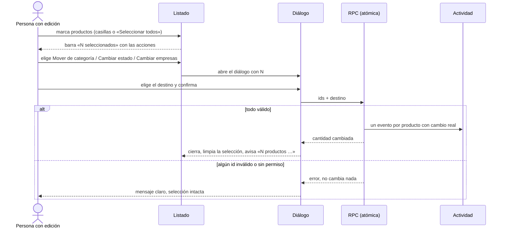
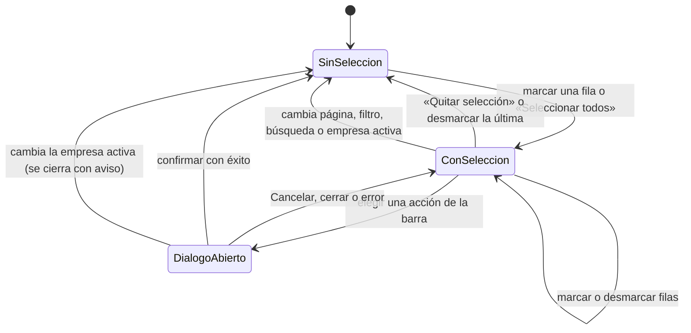
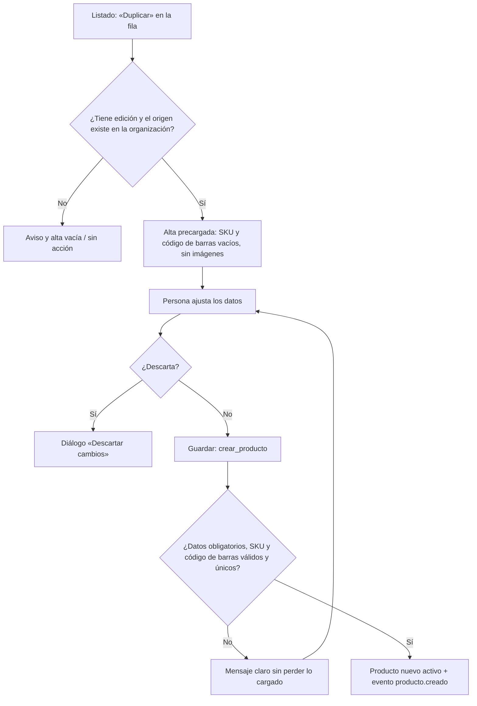

# Feature Specification: Catálogo · Catálogo productividad

**Feature Branch**: `epic/MSF-218-catalogo-catalogo-productividad`

**Jira Epic**: MSF-218 — Catálogo · Catálogo productividad (spec `catalogo-productividad`)

**Created**: 2026-11-03

**Status**: Ready for implementation — la especificación viene completa desde It's a Plan; las dos decisiones abiertas de «A revisar» se resuelven abajo («Decisiones») con el criterio más conservador y quedan marcadas para el OK de Nicolás en el PR. **Bloqueada por MSF-160**: no se implementa hasta que cierre (se monta sobre su listado).

**Delivery scope**: `refine` (apps/web) y `supabase` (migración con 3 RPC y pgTAP). Sin `kestra`, `superset` ni `workers`.

**Prioridad / Hito**: P2 · Etapa 3 (sin fecha) · ~10 h · fuera de diciembre.

**Dependencias**:
- Bloqueada por: MSF-160 (Catálogo listado y categorías: `v_productos_listado`, `producto_empresa`, `categorias`, `productos.categoria_id`, RPC `asignar_categoria_producto` y `definir_empresas_producto`). Sobre MSF-456 (alta y edición: `crear_producto`, `cambiar_estado_producto`, SKU único) y MSF-529 (código de barras único), ya en `main`.
- Bloquea a: ninguna.
- Relacionada, sin bloqueo: ninguna.

**Input**: Epic MSF-218. Objetivo: «Al terminar, el equipo carga y corrige catálogo más rápido: cambia muchos productos a la vez y duplica uno parecido.»

**Regla de fuentes** (literal de la épica):
1. Comportamiento y datos: mandan los requisitos y escenarios de esta spec.
2. Qué se ve (disposición, textos, estados, popups, flujos): el prototipo validado es referencia visual, no hace falta que quede extremadamente idéntico.
3. Cómo se construye: mandan el template y el sistema de diseño (MSF-117, `docs/sistema-de-diseno.md`). No se copia el HTML ni el CSS del prototipo.
4. El prototipo muestra más que esta historia: se implementa solo lo que piden F-CAT-12 y F-CAT-13.
5. Si algo no se puede igualar: lo más cercano, sin inventar, anotando la diferencia en el PR.
6. Si prototipo y requisitos se contradicen: requisitos para el comportamiento, prototipo para lo visual, y la contradicción queda anotada en el PR.

**Prototipos** (solo lectura, presentes en el árbol): `design/pantallas/Productos.dc.html` (barra de selección y diálogo «Mover de categoría») y `design/pantallas/ProductoAlta.dc.html` (formulario que reutiliza «Duplicar»). **Ninguna pantalla propia está dibujada** para F-CAT-12 ni F-CAT-13 (la épica lo declara): lo no dibujado usa el mismo patrón visual de la barra y de los diálogos existentes y se anota en el PR.

## Modelo y supuestos

- **No hay tablas nuevas ni columnas nuevas.** Edición masiva y duplicado operan sobre lo que ya existe: `dominio.productos` (`activo`, `categoria_id`), `dominio.producto_empresa` y `crear_producto`.
- **El producto es compartido en la organización**; «empresas» es la relación `producto_empresa` (la columna «Visible en» del listado).
- **Reutilizan las validaciones del alta** (supuesto de la épica): permisos de sección `productos` con `edicion`, pertenencia a la organización, y SKU y código de barras únicos. La edición masiva **no toca** SKU ni código de barras (no se pide), así que esas unicidades solo juegan en el duplicado, que guarda con `crear_producto`.
- **Permisos** (`docs/permisos-por-rol.md`): sección `productos`, Administrador y Operador editan; el resto lee y **no ve** casillas, barra ni «Duplicar». Se resuelve con `private.nivel_seccion('productos')` en pantalla y en las RPC; nunca con `private.puede_escribir()`.
- **Selección = lo visible de la página actual** (como el prototipo: «Seleccionar todos» marca las filas mostradas, hasta 25). Se descarta al cambiar de página, filtro, búsqueda o empresa.
- **Actividad**: se reutilizan los eventos existentes (`producto.categoria_asignada`, `producto.activado` / `producto.desactivado`, `producto.empresas_actualizadas`, `producto.creado`), uno por producto con cambio real. No se crea un evento nuevo.

### Esquema de datos (Constitución, Principio VII)

| Objeto | Esquema | Justificación | RLS |
|--------|---------|---------------|-----|
| Tablas nuevas o alteradas | — | **Ninguna.** `dominio.productos` y `dominio.producto_empresa` no se alteran. | Sin cambios; `rls_en_toda_tabla` debe seguir verde (`public` + `dominio`). |
| `public.mover_productos_categoria`, `public.cambiar_estado_productos`, `public.definir_empresas_productos` (RPC nuevas) | **`public`** (funciones, no tablas) | Son el contrato de la app para operar sobre varios productos; los datos siguen en `dominio`. | `security invoker` (rigen las políticas de las tablas de `dominio`); `revoke … from public, anon`; `grant execute … to authenticated`. |

Migración **aditiva** (solo `create function`), con reversión en el encabezado: `drop function` de las tres RPC. Se re-verifica en plan, tareas, implementación y PR que ninguna tabla se crea en `public`.

## Decisiones (resuelven «A revisar» sin agregar alcance)

1. **Qué acciones masivas entran:** las que pide la historia: **categoría, estado (activar/desactivar) y empresas**. «Mover de categoría» está dibujada; «Cambiar estado» y «Cambiar empresas» no, y se resuelven con el mismo patrón de botón de la barra y de diálogo. **Quedan fuera** «Marcar destacado», «Enviar al newsletter» y «Borrar» (no los pide ninguna historia; destacado y newsletter ya eran FUERA DE ALCANCE en MSF-160).
2. **Borrado:** no entra. El producto se **desactiva, no se borra** (MSF-456); la baja masiva es «Cambiar estado → Desactivar». El diálogo «Borrar productos» del prototipo queda fuera, anotado en el PR (contradicción prototipo↔regla del producto).
3. **Prototipo «hasta 3.er nivel»** en «Mover de categoría»: MSF-160 limita el árbol a 2 niveles; manda el requisito, el texto del diálogo no menciona el nivel.
4. **Duplicar — qué se copia** (la épica no lo detalla; criterio conservador a confirmar): se copian nombre, descripción, «Compatible con», moneda, precio de lista, categoría, empresas y, solo con acceso a Rentabilidad, costo y proveedor. **No se copian** SKU (queda vacío: se autogenera, o se escribe uno), código de barras (queda vacío porque es único), imágenes, stock ni estado (nace activo). Nada se guarda hasta confirmar el alta.
5. **Dónde está «Duplicar»:** acción de fila en la columna de acciones del listado (solo con edición). No se agrega a la ficha.

## Flujos

### Edición masiva (F-CAT-12)

### Estados de la selección

### Duplicar producto (F-CAT-13)

| Paso / estado / transición | Dueño |
|---|---|
| Marcar filas, «Seleccionar todos», barra «N seleccionados», «Quitar selección» | FR-001, FR-002 |
| Abrir diálogo de categoría / estado / empresas, confirmar, aviso | FR-003, FR-004, FR-005 |
| RPC atómica, error sin cambios, evento por producto | FR-006 |
| Selección y diálogo descartados al cambiar página, filtro o empresa | FR-007 |
| Carga, error y éxito de la acción | FR-008 |
| «Duplicar» en la fila | FR-009 |
| Alta precargada (qué se copia y qué no) | FR-010 |
| Descartar, validar, guardar y `producto.creado` | FR-011 |
| Origen inexistente o sin permiso | FR-012 |

## User Scenarios & Testing *(mandatory)*

### User Story 1 - Edición masiva (F-CAT-12, P2, talla M)

Como persona con permiso de edición en Productos, quiero cambiar la categoría, el estado o las empresas de varios productos a la vez, para corregir el catálogo sin editar uno por uno.

**Independent Test**: en el listado, un Operador marca 3 productos, usa «Mover de categoría → Joysticks» y los 3 quedan en esa categoría con un evento de Actividad cada uno; luego los desactiva, y les agrega una empresa. Un usuario de solo lectura no ve casillas ni barra.

**Acceptance Scenarios**:
1. **Given** el listado con edición, **When** se marca una fila, **Then** aparece la barra «1 seleccionados» (texto del prototipo: «N seleccionados») con «Mover de categoría», «Cambiar estado», «Cambiar empresas» y «Quitar selección».
2. **Given** filas visibles, **When** se usa la casilla del encabezado, **Then** se marcan o desmarcan todas las de la página.
3. **Given** productos seleccionados, **When** se confirma «Mover de categoría», **Then** todos pasan a la categoría elegida y el aviso dice «N productos movidos a <categoría>».
4. **Given** productos seleccionados, **When** se confirma «Cambiar estado», **Then** quedan activos o inactivos sin perder datos ni imágenes.
5. **Given** productos seleccionados, **When** se confirma «Cambiar empresas» con empresas a agregar y/o quitar, **Then** cada producto queda con ese resultado y los demás vínculos no cambian.
6. **Given** un id de otra organización o sin permiso, **When** se confirma, **Then** la operación falla completa y no cambia ningún producto.
7. **Given** una selección activa, **When** cambia la empresa activa, la página, el filtro o la búsqueda, **Then** la selección se descarta y un diálogo abierto se cierra con aviso.

### User Story 2 - Duplicar producto (F-CAT-13, P2, talla S)

Como persona con permiso de edición, quiero duplicar un producto parecido, para cargar uno nuevo sin tipear todo de nuevo.

**Independent Test**: un Operador duplica «Joystick Pro»: se abre el alta con los datos copiados y SKU y código de barras vacíos; guarda y existe un producto nuevo activo, con su evento `producto.creado`.

**Acceptance Scenarios**:
1. **Given** el listado con edición, **When** se pulsa «Duplicar» en una fila, **Then** se abre el alta precargada con los datos copiables (Decisión 4).
2. **Given** la alta precargada, **When** se guarda con un SKU o código de barras ya usados, **Then** se informa con el mensaje del alta, sin perder lo cargado.
3. **Given** el SKU vacío, **When** se guarda, **Then** el producto recibe el SKU autogenerado del alta (requisito de SKU autogenerado de MSF-456).
4. **Given** un origen inexistente o de otra organización, **When** se abre la ruta de duplicado, **Then** se avisa y se muestra el alta vacía.

### Edge Cases

- Selección con 0 productos: la barra no se muestra; las RPC rechazan listas vacías (`22023`).
- Más de 100 ids recibidos (aunque tras quitar repetidos queden menos): la RPC rechaza (`22023`); la pantalla solo manda las filas cargadas (tope de 100, ver el `Desvío:` de RF-CAT-12-1 en `tasks.md`).
- Productos que ya tienen el estado, categoría o empresas pedidos: no se cambian ni dejan evento; si ninguno cambia, el aviso es «No hubo cambios».
- Dos personas editan a la vez: gana la última escritura; cada RPC es una sola transacción.
- Empresa en `agregar` y en `quitar` a la vez, o de otra organización: `22023`.
- Duplicar un producto inactivo: el nuevo nace activo.

## Requirements *(mandatory)*

### Functional Requirements

- **FR-001** (F-CAT-12): El listado suma una casilla por fila (`aria-label` «Seleccionar producto») y una en el encabezado («Seleccionar todos», sobre las filas visibles). Solo con `edicion` en `productos`; con `lectura` no aparecen. **Verificación:** `apps/web/src/pages/productos/list.test.tsx` › «casillas solo con edición» (con `lectura` no hay casillas; «Seleccionar todos» marca las filas visibles).
- **FR-002** (F-CAT-12): Con 1 o más filas marcadas aparece una barra «N seleccionados» con «Mover de categoría», «Cambiar estado», «Cambiar empresas» y «Quitar selección»; ninguna otra acción masiva del prototipo. **Verificación:** `apps/web/src/pages/productos/list.test.tsx` › «barra de selección» (texto «N seleccionados», cuatro acciones, ninguna otra).
- **FR-003** (F-CAT-12): Diálogo «Mover de categoría»: «Se mueven N productos a la categoría elegida.», lista del árbol de categorías con sangría por nivel (la de MSF-160), «Cancelar»; al elegir, mueve y avisa «N productos movidos a <categoría>». **Verificación:** `apps/web/src/pages/productos/list.test.tsx` › «Mover de categoría» (texto, árbol con sangría, aviso) y `apps/web/e2e/catalogo-productividad.e2e.ts` › «mueve 3 productos».
- **FR-004** (F-CAT-12): Diálogo «Cambiar estado» con las opciones Activar / Desactivar, texto de confirmación con N, «Cancelar» y confirmar; avisa «N productos activados» o «N productos desactivados». Desactivar no borra nada. **Verificación:** `apps/web/src/pages/productos/list.test.tsx` › «Cambiar estado» (aviso activados/desactivados) y `apps/web/e2e/catalogo-productividad.e2e.ts` › «desactiva 3 productos».
- **FR-005** (F-CAT-12): Diálogo «Cambiar empresas» con `SelectorEmpresas` (casillas) para «Agregar a» y «Quitar de», «Cancelar» y confirmar; avisa «N productos actualizados». No se agregan `Chip`, `Select` ni listas propias para elegir empresas. **Verificación:** `apps/web/src/pages/productos/list.test.tsx` › «Cambiar empresas» (usa `SelectorEmpresas`; aviso) y `apps/web/e2e/catalogo-productividad.e2e.ts` › «asigna empresa a 3 productos»; `pnpm ui:empresas:check`.
- **FR-006** (F-CAT-12): RPC `public.mover_productos_categoria`, `public.cambiar_estado_productos` y `public.definir_empresas_productos` (contrato en `contracts/edicion-masiva.md`): `security invoker`, atómicas (todo o nada), idempotentes, exigen `edicion` en `productos` (`42501`), máximo 100 ids y lista no vacía (`22023`), rechazan productos o categoría de otra organización o inexistentes (`P0002`) y empresas ajenas o inexistentes (`22023`); el máximo de 100 se mide sobre los ids recibidos, antes de quitar repetidos, reutilizan las RPC individuales para que cada producto con cambio real deje su evento de Actividad existente, y devuelven la cantidad de productos que cambiaron. `anon` sin ejecución. **Verificación:** `supabase/tests/database/catalogo_edicion_masiva.test.sql` (aislamiento, roles, `anon`, atomicidad, tope 100, idempotencia, un evento por producto) vía `pnpm test:db`.
- **FR-007** (F-CAT-12): Principio VIII: la selección y los diálogos respetan la empresa activa de la barra superior: al cambiarla se invalidan las consultas del listado, se reencuadra la paginación, se descarta la selección y se cierra con aviso un diálogo abierto; el diálogo nunca guarda datos cargados de la empresa anterior. La selección también se descarta al cambiar de página, filtro o búsqueda. **Verificación:** `apps/web/src/pages/productos/list.test.tsx` › «cambio de empresa descarta la selección y cierra el diálogo» (también página, filtro y búsqueda).
- **FR-008** (F-CAT-12): Estados del patrón compartido: botón de confirmar deshabilitado mientras corre, error con mensaje claro y selección intacta, éxito con aviso; foco al diálogo y de vuelta al botón de origen, teclado, lector de pantalla y 320/768/1440 px. **Verificación:** `apps/web/src/pages/productos/list.test.tsx` › «estados del diálogo» (confirmar deshabilitado, error con selección intacta, éxito, foco y teclado) en 320/768/1440 px.
- **FR-009** (F-CAT-13): La columna de acciones del listado suma «Duplicar» (solo con `edicion`), que navega al alta con `?duplicar_de=<id>`. **Verificación:** `apps/web/src/pages/productos/list.test.tsx` › «Duplicar solo con edición» (navega a `?duplicar_de=<id>`).
- **FR-010** (F-CAT-13): `/productos/create?duplicar_de=<id>` lee el origen y precarga el formulario de alta con lo que define la Decisión 4: copia nombre, descripción, «Compatible con», moneda, precio de lista, categoría y empresas (y costo y proveedor solo con acceso a Rentabilidad); deja vacíos SKU y código de barras, sin imágenes; el producto nuevo nace activo y nada se guarda hasta confirmar. **Verificación:** `apps/web/src/pages/productos/create.test.tsx` › «precarga desde duplicar_de sin SKU ni código de barras ni imágenes».
- **FR-011** (F-CAT-13): El guardado usa el alta existente (`crear_producto`) con sus validaciones: «Faltan datos obligatorios», «Descartar cambios», SKU único (con autogenerado si queda vacío) y código de barras único, con mensaje claro sin perder lo cargado; registra `producto.creado`. No se crea RPC ni migración. **Verificación:** `apps/web/src/pages/productos/create.test.tsx` › «guardado con validaciones del alta» y `apps/web/e2e/catalogo-productividad.e2e.ts` › «duplica y guarda» (`producto.creado`); `git diff --stat` sin migración para F-CAT-13.
- **FR-012** (F-CAT-13): Origen inexistente o de otra organización: aviso y alta vacía; sin `edicion`, la ruta aplica el guard de sección del alta. **Verificación:** `apps/web/src/pages/productos/create.test.tsx` › «origen inexistente o ajeno avisa y deja el alta vacía».
- **FR-013** (Cierre): Documentación: sección «Productividad» en `docs/catalogo.md` (acciones masivas, duplicado, diferencias con el prototipo) y, si corresponde, `docs/permisos-por-rol.md`. **Verificación:** `pnpm docs:check` (falla si falta la sección «Productividad» en `docs/catalogo.md`).
- **FR-014** (Cierre): Actualizar la fila de MSF-218 en `docs/roadmap-template.md` (estado, link a la spec) como paso manual. **Verificación:** `pnpm docs:check` y `grep -n 'MSF-218' docs/roadmap-template.md` muestra la fila actualizada.

### Success Criteria

- **SC-001** (F-CAT-12): pgTAP: las 3 RPC respetan aislamiento entre dos organizaciones, permisos por rol (lectura rechazada), `anon` sin acceso, atomicidad (un id inválido no cambia nada), tope de 100, idempotencia y un evento de Actividad por producto con cambio real; `rls_en_toda_tabla` sigue verde. **Verificación:** `pnpm test:db` (`supabase/tests/database/catalogo_edicion_masiva.test.sql` y `rls_en_toda_tabla`).
- **SC-002** (F-CAT-12): Vitest de pantalla (casillas, barra, tres diálogos, error, solo lectura sin casillas, cambio de empresa que descarta la selección, 320/768/1440 y teclado) y un E2E con 3 productos movidos, desactivados y asignados a una empresa. **Verificación:** `pnpm --filter @platform/web test -- list.test.tsx` y `pnpm --filter @platform/web test:e2e -- catalogo-productividad`.
- **SC-003** (F-CAT-13): Vitest y E2E: «Duplicar» precarga sin SKU ni código de barras, un SKU repetido se informa sin perder lo cargado, y el guardado crea un producto nuevo activo con `producto.creado`. **Verificación:** `pnpm --filter @platform/web test -- create.test.tsx` y `pnpm --filter @platform/web test:e2e -- catalogo-productividad`.
- **SC-004** (Cierre): revisión de seguridad (`authz-security`) de las 3 RPC y de los grants. **Verificación:** informe de la revisión `authz-security` adjunto al PR + `pnpm test:db` (el test pgTAP de grants de `anon` de la migración `20261013120001` sigue verde con las 3 RPC nuevas).
- **SC-005** (Cierre): verificación final: `pnpm lint`, `pnpm build`, `pnpm infra:config`, `pnpm test`, `pnpm docs:check`, `pnpm prototipo:check`, `pnpm matriz:check`. **Verificación:** los siete comandos listados, en verde en el CI del PR.

## Verificación

Cada FR/SC tiene su verificación nombrada (también inline en cada requisito) y una sola tarea dueña.

| Requisito | Verificación (test o comando) | Tarea |
|---|---|---|
| FR-001 | `apps/web/src/pages/productos/list.test.tsx` › «casillas solo con edición» (con `lectura` no hay casillas; «Seleccionar todos» marca las filas visibles) | T003 |
| FR-002 | `apps/web/src/pages/productos/list.test.tsx` › «barra de selección» (texto «N seleccionados», cuatro acciones, ninguna otra) | T004 |
| FR-003 | `apps/web/src/pages/productos/list.test.tsx` › «Mover de categoría» (texto, árbol con sangría, aviso) y `apps/web/e2e/catalogo-productividad.e2e.ts` › «mueve 3 productos» | T005 |
| FR-004 | `apps/web/src/pages/productos/list.test.tsx` › «Cambiar estado» (aviso activados/desactivados) y `apps/web/e2e/catalogo-productividad.e2e.ts` › «desactiva 3 productos» | T006 |
| FR-005 | `apps/web/src/pages/productos/list.test.tsx` › «Cambiar empresas» (usa `SelectorEmpresas`; aviso) y `apps/web/e2e/catalogo-productividad.e2e.ts` › «asigna empresa a 3 productos»; `pnpm ui:empresas:check` | T007 |
| FR-006 | `supabase/tests/database/catalogo_edicion_masiva.test.sql` (aislamiento, roles, `anon`, atomicidad, tope 100, idempotencia, un evento por producto) vía `pnpm test:db` | T001 |
| FR-007 | `apps/web/src/pages/productos/list.test.tsx` › «cambio de empresa descarta la selección y cierra el diálogo» (también página, filtro y búsqueda) | T009 |
| FR-008 | `apps/web/src/pages/productos/list.test.tsx` › «estados del diálogo» (confirmar deshabilitado, error con selección intacta, éxito, foco y teclado) en 320/768/1440 px | T008 |
| FR-009 | `apps/web/src/pages/productos/list.test.tsx` › «Duplicar solo con edición» (navega a `?duplicar_de=<id>`) | T011 |
| FR-010 | `apps/web/src/pages/productos/create.test.tsx` › «precarga desde duplicar_de sin SKU ni código de barras ni imágenes» | T012 |
| FR-011 | `apps/web/src/pages/productos/create.test.tsx` › «guardado con validaciones del alta» y `apps/web/e2e/catalogo-productividad.e2e.ts` › «duplica y guarda» (`producto.creado`); `git diff --stat` sin migración para F-CAT-13 | T013 |
| FR-012 | `apps/web/src/pages/productos/create.test.tsx` › «origen inexistente o ajeno avisa y deja el alta vacía» | T012 |
| FR-013 | `pnpm docs:check` (falla si falta la sección «Productividad» en `docs/catalogo.md`) | T016 |
| FR-014 | `pnpm docs:check` y `grep -n 'MSF-218' docs/roadmap-template.md` muestra la fila actualizada | T017 |
| SC-001 | `pnpm test:db` (`supabase/tests/database/catalogo_edicion_masiva.test.sql` y `rls_en_toda_tabla`) | T002 |
| SC-002 | `pnpm --filter @platform/web test -- list.test.tsx` y `pnpm --filter @platform/web test:e2e -- catalogo-productividad` | T010 |
| SC-003 | `pnpm --filter @platform/web test -- create.test.tsx` y `pnpm --filter @platform/web test:e2e -- catalogo-productividad` | T014 |
| SC-004 | informe de la revisión `authz-security` adjunto al PR + `pnpm test:db` (el test pgTAP de grants de `anon` de la migración `20261013120001` sigue verde con las 3 RPC nuevas) | T015 |
| SC-005 | los siete comandos listados, en verde en el CI del PR | T018 |

## Matriz pantalla↔criterios

Inventario: `design/pantallas/Productos.inventory.json` (`pnpm prototipo:inventario`). Alta: `ProductoAlta.inventory.json`, solo se reutiliza, sin cambios.

### Productos · listado (`Productos.dc.html`)

| Ítem del prototipo | Dueño |
|---|---|
| Tabla, col. «» (casilla por fila y «Seleccionar todos») | FR-001 |
| Tabla, cols. Producto, Precio, Costo, Margen, Stock, Visible en, Estado | Sin cambios (MSF-160 / MSF-179); la épica no las toca |
| Tabla, col. «» final (acciones) | FR-009 (suma «Duplicar»; Editar y Activar/Desactivar siguen como están) |
| Barra «N seleccionados» | FR-002 |
| «Mover de categoría» + diálogo «Mover de categoría» | FR-003 |
| «Cambiar estado» y «Cambiar empresas» (no dibujados) | FR-004, FR-005 (mismo patrón; diferencia anotada en el PR) |
| «Quitar selección» | FR-002 |
| «Cancelar» (diálogos de la barra) | FR-003, FR-004, FR-005 |
| «Marcar destacado», «·· · ·Destacado» | FA — sin historia; destacado ya era FA en MSF-160 |
| «Enviar al newsletter» | FA — sin historia; Etapa 2 |
| «Borrar», «Borrar · productos», diálogo «Borrar productos» | FA — el producto se desactiva, no se borra (MSF-456); la baja masiva es FR-004 |
| «Exportar», diálogo «Exportar productos» (Qué exportar, Formato, Columnas) | FA — MSF-202 |
| «Importar CSV» | FA — sin historia en esta épica |
| «Nuevo producto» | Sin cambios (MSF-456) |
| Campo «Buscar por nombre o SKU», filtros, «Categoría: ·», «Limpiar filtros» | Sin cambios (MSF-160) |
| Aviso (snackbar) tras la acción | FR-003, FR-004, FR-005, FR-008 |
| Empresa activa (Principio VIII) | FR-007 — el listado ya sigue la empresa activa (MSF-160); selección y diálogos la respetan. Test en SC-002 |

### Alta de producto (`ProductoAlta.dc.html`) — reutilizada por «Duplicar»

| Ítem | Dueño |
|---|---|
| Campos y botones del alta (nombre, descripción, SKU, «Compatible con», moneda, precio, costo, código de barras, categoría, empresas, imágenes, Guardar, Cancelar) | FR-010 (precarga) y FR-011 (guardado); no se modifican |
| Aviso «Faltan datos obligatorios», diálogo «Descartar cambios» | FR-011 |
| Resto de secciones del alta (variantes, relacionados, video, escalas, estado de producto) | FA — no las pide esta épica |

FA = FUERA DE ALCANCE. Son notas, no deuda ni tareas.

## Fuera de alcance

Marcar destacado, newsletter, borrado de productos, exportación e importación CSV, edición masiva de SKU, código de barras, precio o costo, seleccionar más allá de la página visible, duplicar imágenes o stock, duplicar desde la ficha, y deshacer una acción masiva. Son notas, no deuda.
