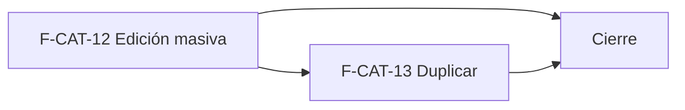

# Tasks: Catálogo · Catálogo productividad

**Input**: `specs/20261103-100000-catalogo-productividad/` (spec.md, plan.md, contracts/edicion-masiva.md)

**Formato**: `- [ ] T### [P] [F-CAT-NN][USy] descripción`. **[P]** = paralelizable (archivos distintos, sin dependencia; las [P] del mismo grupo van en paralelo); sin [P] = secuencial. Las dependencias de cada historia son **solo internas**. **Bloqueada por MSF-160**: no se empieza hasta que cierre.

**Delivery scope**: `refine`, `supabase`

## Matriz de trazabilidad tracker ↔ US ↔ tasks

| Tracker | Historia | Requisitos (dueño único) | Tasks |
|---------|----------|--------------------------|-------|
| F-CAT-12 | US1 Edición masiva | FR-001…FR-008, SC-001, SC-002 | T001–T010 |
| F-CAT-13 | US2 Duplicar producto | FR-009…FR-012, SC-003 | T011–T014 |
| Tarea de cierre (label `cierre`) | Seguridad, docs, roadmap | FR-013, FR-014, SC-004, SC-005 | T015–T018 |

## Phase 1: Edición masiva (F-CAT-12 · supabase + refine)

- [ ] T001 [F-CAT-12][US1] Migración `20261103100000_catalogo_edicion_masiva.sql`: `mover_productos_categoria`, `cambiar_estado_productos`, `definir_empresas_productos` según `contracts/edicion-masiva.md` (`security invoker`, atómicas, tope 100, `revoke … public, anon`, `grant … authenticated`, reversión en el encabezado; ninguna tabla) (FR-006)
- [ ] T002 [P] [F-CAT-12][US1] pgTAP `catalogo_edicion_masiva.test.sql`: dos organizaciones, lectura rechazada, `anon` sin acceso, un id inválido no cambia nada, tope 100, idempotencia, un evento por producto con cambio real, `rls_en_toda_tabla` verde (SC-001)
- [ ] T003 [P] [F-CAT-12][US1] `useSeleccionProductos` y la casilla por fila y de encabezado «Seleccionar todos», solo con `edicion` (FR-001)
- [ ] T004 [P] [F-CAT-12][US1] `BarraSeleccion`: «N seleccionados», «Mover de categoría», «Cambiar estado», «Cambiar empresas», «Quitar selección» (FR-002)
- [ ] T005 [P] [F-CAT-12][US1] `MoverCategoriaDialog` con el árbol de categorías, texto y aviso del prototipo (FR-003)
- [ ] T006 [P] [F-CAT-12][US1] `CambiarEstadoDialog` Activar / Desactivar con confirmación y aviso (FR-004)
- [ ] T007 [P] [F-CAT-12][US1] `CambiarEmpresasDialog` con `SelectorEmpresas` para «Agregar a» y «Quitar de» (FR-005)
- [ ] T008 [P] [F-CAT-12][US1] `lib/edicionMasiva.ts` + hook de ejecución con carga, error con selección intacta y éxito; foco y teclado de los diálogos (FR-008)
- [ ] T009 [F-CAT-12][US1] Integrar en `pages/productos/list.tsx`: casillas, barra y diálogos (carga diferida); invalidar consultas, reencuadrar paginación, descartar selección y cerrar diálogos al cambiar empresa, página, filtro o búsqueda (FR-007)
- [ ] T010 [F-CAT-12][US1] Vitest de pantalla (casillas, barra, tres diálogos, error, solo lectura, cambio de empresa, 320/768/1440, teclado) y E2E: mover, desactivar y asignar empresa a 3 productos (SC-002)

**Checkpoint**: se cambia categoría, estado y empresas de varios productos; `pnpm lint`, `pnpm build`, `pnpm test` verdes.

## Phase 2: Duplicar producto (F-CAT-13 · refine)

- [ ] T011 [P] [F-CAT-13][US2] Acción «Duplicar» en la columna de acciones de `pages/productos/list.tsx`, solo con `edicion`, hacia `/productos/create?duplicar_de=<id>` (FR-009)
- [ ] T012 [P] [F-CAT-13][US2] `lib/duplicarProducto.ts` y precarga en `pages/productos/create.tsx`: copia lo de la Decisión 4, SKU y código de barras vacíos, sin imágenes; origen inexistente o ajeno avisa y deja el alta vacía (FR-010, FR-012)
- [ ] T013 [F-CAT-13][US2] Guardado con las validaciones del alta (obligatorios, «Descartar cambios», SKU y código de barras únicos sin perder lo cargado, SKU autogenerado) sin que `duplicar_de` llegue al servidor (FR-011)
- [ ] T014 [F-CAT-13][US2] Vitest y E2E del duplicado: precarga sin SKU ni barras, SKU repetido informado, producto nuevo activo con `producto.creado` (SC-003)

**Checkpoint**: se duplica un producto y se guarda como nuevo; `pnpm lint`, `pnpm build`, `pnpm test` verdes.

## Phase 3: Cierre (Tarea de cierre, label `cierre`)

- [ ] T015 [P] [CIERRE] Revisión de seguridad (`authz-security`): RLS, grants, `anon` sin RPC, ids de otra organización, tope de ids, ninguna tabla en `public` (Principio VII) (SC-004)
- [ ] T016 [P] [CIERRE] Sección «Productividad» en `docs/catalogo.md` (acciones masivas, duplicado, diferencias con el prototipo) y `docs/permisos-por-rol.md` si corresponde (FR-013)
- [ ] T017 [P] [CIERRE] Actualizar la fila de MSF-218 en `docs/roadmap-template.md` (estado, link a la spec) como paso manual (FR-014)
- [ ] T018 [CIERRE] Verificación final: `pnpm lint`, `pnpm build`, `pnpm infra:config`, `pnpm test`, `pnpm docs:check`, `pnpm prototipo:check`, `pnpm matriz:check` (SC-005)

## Plan de ejecución (historias)

| Historia | Depende de | Grupo |
|----------|------------|-------|
| F-CAT-12 | — | 1 |
| F-CAT-13 | F-CAT-12 | 2 |
| [Cierre] | F-CAT-12, F-CAT-13 | 3 |

Las dos historias editan `pages/productos/list.tsx` (barra y casillas / acción «Duplicar»), por eso se serializan; no es un orden por dependencia de datos. Ambas esperan a MSF-160 (externa).

