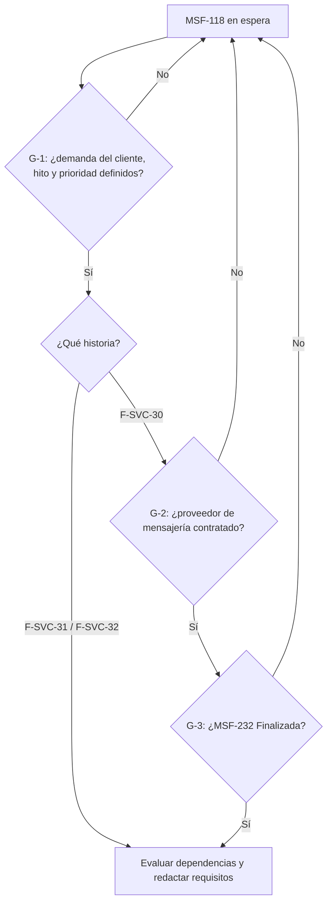

# Spec: Service técnico · Service ideas futuras (MSF-118)

**Estado**: EN ESPERA (spec de gate) · **Prioridad**: P3 · **Hito**: Backlog (a definir con el cliente) · **Alcance**: fuera de diciembre
**Alcance de entrega**: ninguno por ahora (declarado `fuera`). Si se retoma, se declarará al redactar los requisitos de cada historia.
**Historias previstas** (siguen en `Backlog`, no se tocan): `F-SVC-30` Aviso al cliente por WhatsApp (MSF-181) · `F-SVC-31` Comisiones de técnicos (MSF-187) · `F-SVC-32` Etiqueta con código QR del equipo (MSF-190). Las tres P3, talla sin definir.

## Decisión de orquestación (aplicada)

Esta épica no está trabada por un fallo del flujo: nunca tuvo spec. Es un contenedor de ideas futuras. Esta spec **solo documenta el gate**; no define requisitos funcionales, escenarios ni estimaciones, porque la épica dice que «los requisitos se redactan cuando cada historia pase a un hito». Inventarlos sería contradecirla. La ausencia de desarrollo es el estado correcto.

## Objetivo (tal cual la épica)

Al terminar (cuando pase a un hito), el taller avisa por WhatsApp, calcula comisiones de técnicos y etiqueta los equipos.

## Supuestos

- Son ideas futuras: no tienen requisitos, escenarios ni estimación.
- Los requisitos se redactan cuando cada historia pase a un hito.
- El aviso por WhatsApp necesita contratar un proveedor de mensajería.

## Gate (qué debe pasar antes de abrir desarrollo)

| Id | Condición | Aplica a |
|---|---|---|
| G-1 | Demanda del cliente confirmada y definición del hito y la prioridad real de cada historia | F-SVC-30, F-SVC-31, F-SVC-32 |
| G-2 | Proveedor de mensajería elegido y contratado | F-SVC-30 (WhatsApp) |
| G-3 | MSF-232 (Service cobro y avisos) en `Finalizada`: F-SVC-30 extiende el aviso de F-SVC-14 | F-SVC-30 |

F-SVC-31 y F-SVC-32 **no tienen dependencia dura declarada**; se evalúan al pasar a un hito. Bloquea a: ninguna épica.

## Decisiones abiertas (de la épica, «A revisar»)

- Falta definir el hito de cada historia y su prioridad real.
- Falta elegir el proveedor de mensajería para WhatsApp (F-SVC-30).
- No hay horas estimadas.

## Datos y esquemas

Sin tablas, RPC ni migraciones (nada que declarar en `public` ni `dominio`). Cuando se redacten requisitos, cada tabla declarará su esquema (Principio VII) con RLS. Sin `contracts/` ni `openapi/`: no se crean ni cambian RPC o endpoints.

## Matriz pantalla↔criterios

La épica indica «Ninguna pantalla dibujada todavía» y no hay archivos `.dc.html` que enlazar. No se corrió `pnpm prototipo:inventario`: no hay ítems de prototipo.

| Ítem | Dueño |
|---|---|
| Pantallas, tablas, columnas, campos, botones, tabs, diálogos (incl. aviso por WhatsApp, comisiones y etiqueta QR) | FUERA DE ALCANCE — no existen en el prototipo; la UI no se inventa |
| Empresa activa (Principio VIII) | No aplica: no hay pantalla ni diálogo en esta spec; se declarará al redactar requisitos |

## Flujos

La épica no describe estados, secuencias ni procesos del producto. El único flujo es el de habilitación de la propia épica:

| Paso | Dueño |
|---|---|
| G-1, G-2, G-3 (condiciones del gate) | SC-001 |
| Redactar requisitos de cada historia | FUERA DE ALCANCE ahora (la épica los difiere al hito) |

## Criterios de éxito

- **SC-001**: Mientras el gate siga cerrado (G-1, y para F-SVC-30 también G-2 y G-3), no se abre desarrollo ni se crean migraciones, pantallas o tareas de implementación.
