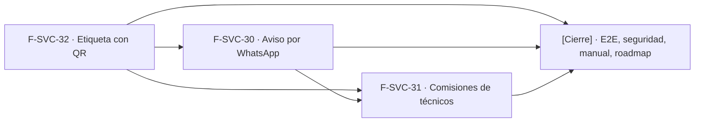

# Tasks: Service técnico · Service ideas futuras (MSF-118)

**Input**: `specs/20261104-100000-service-ideas-futuras/` (spec.md, plan.md, contracts/service-ideas-futuras.md)

**Formato**: `- [ ] T### [P] [F-SVC-NN][USn] descripción — **Evidencia**: qué prueba que está hecha`. **[P]** = paralelizable (archivos distintos, sin dependencia con las demás [P] de su grupo). **`[REV]`** = tarea de **revisión independiente**: la hace otra sesión o un revisor que **no escribió** el código revisado (QA, Código + Seguridad), con hallazgos corregidos antes de seguir; no se marca hecha por quien implementó. Se implementa **historia por historia** (orden **F-SVC-32 → F-SVC-30 → F-SVC-31**, D-22), con `/clear` entre una y otra, y los **Checkpoints** al final de cada fase. Cada historia tiene su PR a `dokploy` y se mergea (merge commit, `--no-ff`) con sus dos `[REV]` aprobadas y el CI verde **antes** de empezar la siguiente.

**Estado** (2026-11-17): spec cerrada y verificada contra `origin/dokploy` (`845620a5`); ninguna historia implementada. Este archivo se escribe con todas las tareas en `[ ]` porque es la planificación; al implementar cada una se marca con su evidencia (regla del repo: ninguna queda `[ ]` en el cierre).

**Delivery scope**: `refine`, `supabase`

**Migraciones**: las versiones de este archivo (`20270508…`) son **provisionales**: antes de cada historia se integra `origin/dokploy` por merge, se lee el máximo real y se renumera por encima con margen (`node scripts/verificar-migraciones.mjs`). F-SVC-32 no tiene migraciones.

**Historias**: US1 = F-SVC-30 (WhatsApp), US2 = F-SVC-31 (Comisiones), US3 = F-SVC-32 (QR). Pantallas: P-1 a P-7 de `spec.md › Pantallas y textos`. **Solo dev** (D-26).

## Trazabilidad requisito → tarea dueña

Cada requisito tiene **una sola tarea dueña**; las tareas de **soporte** apoyan o verifican, pero no son dueñas. Ninguna tarea de una historia cubre alcance de otra.

| Requisito | Tarea dueña | Tareas de soporte | | Requisito | Tarea dueña | Tareas de soporte |
|---|---|---|---|---|---|---|
| FR-001 | T022 | T024 | | FR-031 | T054 | T055, T058 |
| FR-002 | T021 | T024 | | FR-032 | T056 | — |
| FR-003 | T023 | T024 | | FR-033 | T057 | T052 |
| FR-004 | T023 | T024 | | FR-034 | T054 | T058 |
| FR-005 | T025 | — | | FR-035 | T054 | T055, T058 |
| FR-006 | T026 | T028 | | FR-036 | T042 | T051 |
| FR-007 | T026 | T028 | | FR-037 | T046 | T059 |
| FR-008 | T027 | T028 | | FR-040 | T002 | T006 |
| FR-009 | T026 | T028 | | FR-041 | T003 | T004, T005 |
| FR-010 | T028 | T033 | | FR-042 | T007 | — |
| FR-011 | T030 | — | | FR-043 | T010 | T009 |
| FR-020 | T041 | T047 | | FR-044 | T008 | — |
| FR-021 | T044 | T047 | | FR-045 | T007 | T009 |
| FR-022 | T044 | T047 | | FR-046 | T009 | T008 |
| FR-023 | T043 | T048 | | FR-047 | T007 | T009 |
| FR-024 | T043 | T048 | | FR-048 | T012 | T008, T009 |
| FR-025 | T043 | T048 | | FR-049 | T009 | — |
| FR-026 | T044 | T049 | | FR-050 | T011 | — |
| FR-027 | T044 | T049 | | FR-051 | T014 | — |
| FR-028 | T045 | T040, T050 | | FR-052 | T013 | — |
| FR-029 | T044 | T050 | | FR-090 | T071 | T016, T033, T062 |
| FR-030 | T053 | — | | FR-091 | T070 | — |
| FR-092 | T072 | — | | FR-093 | T073 | T076 |
| SC-001 | T024 | — | | SC-004 | T058 | — |
| SC-002 | T028 | — | | SC-005 | T005 | T003, T004, T009 |
| SC-003 | T047 | T048, T049, T050, T051 | | SC-006 | T014 | — |
| SC-007 | T070 | — | | SC-008 | T076 | T014, T031, T060 |
| Amenazas 1.x | T033 | T024, T028 | | Amenazas 2.x | T062 | T050, T057 |
| Amenazas 3.x | T016 | T005, T007, T014 | | | | |

---

## Fase 0 — Recontrol (transversal)

- [ ] T001 [F-SVC-32][US3] **Recontrol al empezar** (no es código): integrar `origin/dokploy` por merge en la rama de la historia; leer el máximo real de `supabase/migrations` y confirmar que siguen vigentes las afirmaciones de la spec (`dominio.reparacion_avisos`, `avisar_cliente_reparacion`, `avisos_de_reparacion`, `lib/whatsapp.ts`, `lib/enlaceConsulta.ts`, `DocumentoA4`, `PestanasService`, `tecnicos_de_service`, `private.puede_accion`, `private.conjuntos_exportacion_total`, `destinoInternoSeguro`, `lib/exportarCsv.ts`, `FiltroEmpresa`, `CargaInfinita`, `useListadoAcumulado`, `ayuda/contenidos/service.ts`); correr `pnpm prototipo:inventario` y confirmar que los inventarios de `ServicioReparacion` y `ServicioReparaciones` no cambiaron. **Se repite como primera acción de cada fase** (T020 y T040). — **Evidencia**: nota en el PR con el commit integrado, el máximo de migraciones y las diferencias encontradas (si las hay, se corrige la spec en el mismo PR).

---

## Fase 1 — US3 · F-SVC-32 Etiqueta con código QR (sin base de datos)

- [ ] T002 [F-SVC-32][US3] Generador `apps/web/src/lib/qr/` (`qr.ts`, `galois.ts`, `plantillas.ts`): GF(256) con polinomio 0x11D, generadores de Reed-Solomon, tablas de las versiones 1 a 10 con corrección **M** (bloques, palabras de datos y de corrección, patrones de alineación), modo byte UTF-8, relleno, entrelazado de bloques, colocación en zigzag, patrones de búsqueda/temporización/módulo oscuro, 8 máscaras con las cuatro reglas de penalización, información de formato (BCH 15,5) y de versión (BCH 18,6) y `QrDemasiadoLargo` sobre 213 bytes. Funciones puras: sin DOM, red, `eval` ni `Function`. **Dueña de FR-040; D-18**. — **Evidencia**: Vitest `qr.test.ts`: tamaño `17 + 4 × versión`, versión mínima por longitud (14/26/42/…/213 bytes y el siguiente falla), patrones fijos en su lugar, módulo oscuro, formato y versión válidos (BCH), determinismo (misma entrada = misma matriz) y 213/214 bytes.
- [ ] T003 [F-SVC-32][US3] **Vectores dorados** (FR-041a): generar **una sola vez**, en un contenedor descartable (`node` con una implementación de QR de referencia instalada solo ahí, nunca agregada al repo ni al lockfile), las matrices de al menos 8 textos (URLs de 40 a 213 bytes, una con acentos y otra con el tamaño que cambia de versión) y guardarlas en `apps/web/src/lib/qr/fixtures/qr-dorados.json` con el comando usado y la versión de la referencia anotados en el propio archivo; test que compara módulo a módulo. — **Evidencia**: Vitest `qr.dorados.test.ts` verde y el comando de generación en el PR.
- [ ] T004 [F-SVC-32][US3] **Prueba de ida y vuelta** (FR-041b): lector de prueba **solo en tests** (`qr.lector.ts` bajo `__tests__` o `*.test-util.ts`, excluido del bundle) que lee formato y máscara de la matriz, deshace la máscara, recorre el zigzag, desentrelaza, verifica que el **resto de Reed-Solomon de cada bloque sea cero** y reconstruye el texto; recorre una batería de textos aleatorios con semilla fija (1 a 213 bytes, ASCII y UTF-8). — **Evidencia**: Vitest `qr.test.ts`: el texto reconstruido es idéntico en 200 casos y falla si se invierte un módulo de datos.
- [ ] T005 [F-SVC-32][US3] **Escaneo real** (FR-041c, SC-005) y **evaluación del criterio de abandono de D-18**: renderizar las etiquetas de al menos 6 URLs (incluida la más larga y una por versión de 1 a 10 representativa) a PNG, decodificarlas con `zbarimg` en un contenedor descartable y con un segundo decodificador independiente, e imprimir una etiqueta real y escanearla con un celular. Si algo no decodifica, corregir; si tras corregir sigue sin cerrar, **se activa el fallback de D-18** (librería sin dependencias transitivas, versión exacta con más de 14 días, `supply-chain-security`) detrás de la misma interfaz `generarQr`, y se anota el desvío. — **Evidencia**: comando y salida de los decodificadores y nota del escaneo con celular (modelo, resultado) en el PR; decisión explícita «generador propio confirmado» o «fallback activado».
- [ ] T006 [P] [F-SVC-32][US3] `qrASvgPath(modulos, { zonaQuieta })` en `lib/qr/svg.ts`: un único `<path>` de SVG con `viewBox` que incluye la zona quieta de 4 módulos, coordenadas enteras y corridas horizontales fusionadas. **Soporte de FR-040**. — **Evidencia**: Vitest `qr.test.ts`: el `path` reproduce exactamente la matriz (se re-rasteriza en el test) y el `viewBox` es `tamano + 8`.
- [ ] T007 [P] [F-SVC-32][US3] `apps/web/src/lib/etiquetaReparacion.ts`: `urlEtiquetaReparacion(origen, id)` (lista blanca de forma de uuid y de origen, **dueña de FR-042**), `TAMANOS_ETIQUETA`, validación de `ancho`/`alto`/`copias`, lectura y escritura de la preferencia en `localStorage['msf.service.etiqueta']` con `try/catch` y recorte a rangos (**dueña de FR-045**), cálculo de `mmPorModulo` y `etiquetaDemasiadoChica` con el umbral de 0,4 mm (**dueña de FR-047**) y disposición horizontal/vertical. — **Evidencia**: Vitest `etiquetaReparacion.test.ts`: contenido exacto de la URL; origen con credenciales/ruta/query/fragmento y `id` que no es uuid lanzan; ningún dato personal ni `/seguimiento/` en lo codificado; `localStorage` ausente, bloqueado o corrupto cae al predeterminado; umbral exacto de 0,4 mm; URL de más de 213 bytes.
- [ ] T008 [F-SVC-32][US3] `components/service/EtiquetaReparacion.tsx` (**P-4**, hoja): QR como `<svg role="img" aria-label="Código QR de la reparación R-0238" shape-rendering="crispEdges">` con un solo `<path>`, código grande, tienda, equipo (2 líneas con elipsis) y «Ingreso dd/mm/aaaa»; negro sobre blanco como `DocumentoA4`; sin `dangerouslySetInnerHTML`; ningún dato personal. **Dueña de FR-044**. — **Evidencia**: Vitest `etiqueta.test.tsx`: con una reparación cargada de nombre, contacto, falla, serie, accesorios, técnico e importes, la etiqueta contiene **solo** los cuatro textos previstos; valores con `<script>` y HTML se muestran literales.
- [ ] T009 [F-SVC-32][US3] Vista `pages/service-tecnico/etiqueta.tsx` y ruta lazy `/service-tecnico/reparaciones/:id/etiqueta` en `App.tsx` (`RequiereAccesoSeccion seccion="service_tecnico"`, como `orden` y `remito`), con `useDocumentoReparacion`: controles de tamaño, medidas personalizadas, cantidad, `@page { size: Wmm Hmm; margin: 0 }` (**dueña de FR-046**), una etiqueta por página, `.no-imprimir`, avisos de «demasiado chica», «dirección demasiado larga», «entorno de prueba» (**dueña de FR-049**) y anulada; los textos exactos de **P-4**. — **Evidencia**: Vitest `etiqueta.test.tsx`: tamaños y límites con sus errores de campo, estilo `@page` por tamaño, `window.print` llamado, copias, preferencia recordada, cada alerta, carga/error/anulada y `Acceso restringido`; `App.guard.test.ts` verde.
- [ ] T010 [P] [F-SVC-32][US3] **P-3**: botón «Imprimir etiqueta» (`QrCode2`, `RouterLink`) en `pages/service-tecnico/reparacion.tsx` junto a «Imprimir orden», con `lectura` o más y reparación no anulada; orden de tabulación de P-3. **Dueña de FR-043**. — **Evidencia**: Vitest `reparacion.test.tsx`: aparece con `lectura`, no con anulada, enlaza a `/etiqueta`, orden de tabulación.
- [ ] T011 [F-SVC-32][US3] Acceso al escanear (**dueña de FR-050**): sin sesión → `/login?to=/service-tecnico/reparaciones/<id>` y vuelta (solo ruta interna), sin `service_tecnico` «Acceso restringido», tienda no accesible el mismo mensaje del detalle; sin rutas ni RPC nuevas. — **Evidencia**: Vitest de `authProvider`/`destinoInternoSeguro` con esa ruta y un destino externo rechazado; la verificación de punta a punta queda en T070.
- [ ] T012 [F-SVC-32][US3] Accesibilidad y responsive de la vista (**dueña de FR-048**): axe a 320, 768 y 1440 px, teclado, nombre accesible del QR, sin scroll horizontal. — **Evidencia**: Vitest con `src/test/axe.ts` y `src/test/ancho.ts` en los tres anchos, sin violaciones.
- [ ] T013 [P] [F-SVC-32][US3] Docs (**dueña de FR-052**): `docs/service-etiqueta-qr.md` (flujo, qué lleva y qué **no** lleva el QR, tamaños, impresión recomendada —escala 100 %, sin márgenes—, cambio de dominio del panel, el generador y su verificación, reversión), cruce en `docs/service-impresion.md`, índice en `docs/service-tecnico.md` y entrada de ayuda en `apps/web/src/ayuda/contenidos/service.ts`. — **Evidencia**: `pnpm docs:check` verde.
- [ ] T014 [F-SVC-32][US3] Guards de la historia y **sin dependencias** (**dueña de FR-051, SC-006**; soporte de SC-008): `git diff --stat origin/dokploy -- apps/web/package.json pnpm-lock.yaml supabase/migrations` vacío; `pnpm lint`, `pnpm build`, `pnpm --filter @platform/web test`, `pnpm docs:check`, `pnpm estilos:check`, `pnpm ui:empresas:check`, `pnpm matriz:check`, `pnpm prototipo:check`, `pnpm e2e:escritura:check`, `pnpm e2e:omitidos:check`, commitlint (títulos ≤ 100 caracteres). — **Evidencia**: salida de cada comando y del diff vacío en el PR.
- [ ] T015 [F-SVC-32][US3] **[REV]** Revisión independiente **QA** de F-SVC-32 (otra sesión que no escribió el código): recorre **P-3 y P-4** contra lo implementado (textos exactos, estados, responsive a 320/768/1440), los escenarios 1 a 10 de la Historia 3 e imprime una etiqueta real en una impresora. — **Evidencia**: informe en el PR con veredicto (APRUEBA / CAMBIOS), hallazgos corregidos y re-revisados.
- [ ] T016 [F-SVC-32][US3] **[REV]** Revisión independiente **Código + Seguridad** de F-SVC-32 (**dueña de las amenazas 3.x**; skills `supply-chain-security`, `authz-security` y `code-review`, subagentes `code-reviewer` y `security-reviewer`): amenazas 3.1 a 3.8, el generador (límites, desbordes de índices, entradas hostiles), que el QR no contenga más que la URL y que no haya dependencias nuevas ni `dangerouslySetInnerHTML`. Merge a `dokploy` con merge commit (`--no-ff`) solo con las dos revisiones aprobadas y el CI verde. — **Evidencia**: informe en el PR, hallazgos corregidos y merge hecho.

**Checkpoint F-SVC-32**: el QR escaneado con un decodificador independiente y con un celular da exactamente la URL de la reparación; la etiqueta no lleva datos personales; `package.json`, lockfile y migraciones sin cambios; la impresión sale del tamaño elegido; revisiones aprobadas y mergeada.

---

## Fase 2 — US1 · F-SVC-30 Aviso al cliente por WhatsApp

- [ ] T020 [F-SVC-30][US1] **Recontrol** (como T001) en la rama de la historia: integrar `origin/dokploy`, renumerar `20270508100000…100200` por encima del máximo del momento y confirmar que `avisos_de_reparacion` y los grants de `reparacion_avisos` siguen como en `20270201200133` y `20270201200135`. — **Evidencia**: nota en el PR con el máximo y las versiones finales.
- [ ] T021 [F-SVC-30][US1] Migración `…20270508100000_reparacion_avisos_whatsapp.sql` (**dueña de FR-002**): `canal`, `clave_envio`, `check` de `estado_envio` con `abierto`, `check` de coherencia, índice único parcial `(reparacion_id, clave_envio) where canal = 'whatsapp'`, `grant select (canal)`; esquema **`dominio`** (ya lo es); reversión en el encabezado. — **Evidencia**: pgTAP de T024 (columnas, checks, filas previas intactas) y `pnpm test:db:validar-aditivas` / `pnpm test:db:guard-migraciones` verdes.
- [ ] T022 [P] [F-SVC-30][US1] Migración `…100100_datos_aviso_whatsapp.sql` (**dueña de FR-001**): `public.datos_aviso_whatsapp` con el contrato exacto (claves, orden de teléfonos, `42501`/`P0002`/`55000`), `revoke … from public, anon` y `grant … to authenticated`. — **Evidencia**: pgTAP de T024.
- [ ] T023 [F-SVC-30][US1] Migración `…100200_registrar_aviso_whatsapp.sql` (**dueña de FR-003 y FR-004**): `public.registrar_aviso_whatsapp` (validaciones, idempotencia por clave, actividad `reparacion.aviso_whatsapp_abierto` sin el número) y `public.avisos_de_reparacion` con `canal` (misma firma, salida aditiva). — **Evidencia**: pgTAP de T024.
- [ ] T024 [F-SVC-30][US1] pgTAP `supabase/tests/database/service_aviso_whatsapp.test.sql` (**dueña de SC-001**; soporte de FR-001 a FR-004, amenazas 1.1, 1.2, 1.4, 1.7, 1.8): **dos organizaciones y dos tiendas** (una restringida): claves exactas de `datos_aviso_whatsapp`, orden de teléfonos, sin correo/domicilio/costos; `42501` con `lectura`, `P0002` ajena y tienda no accesible, `55000` anulada, `anon` sin ejecución; destino inválido (letras, `+`, 7 y 16 dígitos, espacios, `?`), estado de otra organización, clave repetida = una fila, clave faltante; la actividad no contiene el número; una fila de WhatsApp no cuenta como aviso pendiente de correo ni rompe `avisar_cliente_reparacion`; `rls_en_toda_tabla`; **`service_avisos.test.sql` corre sin cambios**. — **Evidencia**: `pnpm test:db` verde.
- [ ] T025 [P] [F-SVC-30][US1] `apps/web/src/lib/avisoWhatsapp.ts` (**dueña de FR-005**): `armarMensajeAvisoWhatsapp`, `telefonosCandidatos` (reutiliza `normalizarNumero`), `obtenerDatosAvisoWhatsapp`, `registrarAvisoWhatsapp`, mensajes de error en castellano. — **Evidencia**: Vitest `avisoWhatsapp.test.ts`: plantilla exacta, descripción vacía, recorte a 1.000 sin cortar el enlace, sin enlace no aparece `/seguimiento/`, candidatos sin repetidos ni inválidos, batería de entradas hostiles (`?`, `&`, `%`, saltos de línea) solo viajan codificadas.
- [ ] T026 [F-SVC-30][US1] **P-2**: `components/service/AvisoWhatsappDialog.tsx` (+ hook de datos): teléfono con opciones y «Otro número», mensaje editable con contador, casilla del enlace (`obtenerEnlaceConsulta` + `urlEnlaceSeguimiento`), «Abrir WhatsApp» con **`window.open` dentro del clic y registro después**, clave generada al abrir, doble clic, ventana bloqueada, errores y textos exactos, cierre al cambiar la empresa activa. **Dueña de FR-006, FR-007 y FR-009**. — **Evidencia**: Vitest de T028.
- [ ] T027 [F-SVC-30][US1] **P-1**: `AvisosReparacion.tsx`, `lib/reparacionAvisos.ts` (`canal`, estado `abierto`) y `pages/service-tecnico/reparacion.tsx`: botón «Avisar por WhatsApp» (solo `edicion` y no anulada), filas «Abierto en WhatsApp» con la nota, «Avisar de nuevo por WhatsApp»; el correo no cambia. **Dueña de FR-008**. — **Evidencia**: Vitest de T028.
- [ ] T028 [F-SVC-30][US1] Vitest del WhatsApp (**dueña de SC-002 y FR-010**; soporte de FR-006 a FR-009, amenazas 1.2, 1.3, 1.6, 1.9): `AvisoWhatsappDialog.test.tsx` y ampliación de `reparacion.avisos.test.tsx`: la URL abierta es exactamente `https://wa.me/<dígitos>?text=<codificado>` con `noopener,noreferrer`, `window.open` ocurre antes del registro, doble clic = una apertura y un registro, número inválido sin apertura, `window.open` bloqueado sin registro, error de registro con su texto, enlace de seguimiento (con y sin), **ningún `fetch` ni otra RPC distinta de las tres previstas**, cambio de empresa activa con el diálogo abierto, `lectura` sin botón, anulada sin botón, filas por canal, sin regresión del correo; axe a 320, 768 y 1440 px. — **Evidencia**: `pnpm --filter @platform/web test` verde.
- [ ] T029 [P] [F-SVC-30][US1] Seguimientos trazados (Tarea `seguimiento` en el tracker, con su clave anotada en `docs/service-avisos.md`): **S-1** envío automático por WhatsApp con proveedor y **S-4** plantillas por empresa. — **Evidencia**: claves en el PR y en la doc.
- [ ] T030 [P] [F-SVC-30][US1] Docs (**dueña de FR-011**): sección «WhatsApp (click-to-chat)» en `docs/service-avisos.md` (flujo, modelo `canal`/`abierto`, plantilla, qué no hace, reversión, camino a un proveedor), tipos de actividad en `docs/actividad.md`, entrada del manual de ayuda. — **Evidencia**: `pnpm docs:check` verde.
- [ ] T031 [F-SVC-30][US1] Guards de la historia (los de T014 más `node scripts/verificar-migraciones.mjs --estricto`, `pnpm der:check` y `pnpm test:db`). **Soporte de SC-008**. — **Evidencia**: salida de cada comando en el PR.
- [ ] T032 [F-SVC-30][US1] **[REV]** Revisión independiente **QA** de F-SVC-30: recorre **P-1 y P-2** contra la spec (textos exactos, estados, responsive), los escenarios 1 a 12 de la Historia 1 y prueba en un navegador real que `wa.me` abre el chat con el mensaje listo (escritorio y celular). — **Evidencia**: informe en el PR con veredicto, hallazgos corregidos y re-revisados.
- [ ] T033 [F-SVC-30][US1] **[REV]** Revisión independiente **Código + Seguridad** de F-SVC-30 (**dueña de las amenazas 1.x**; skills `authz-security`, `code-review`; subagentes `code-reviewer` y `security-reviewer`): RLS y grants de `reparacion_avisos` tras el cambio, `search_path`, fuga de datos personales en `datos_aviso_whatsapp`, inyección en el enlace, idempotencia, regresión del correo y que el diff **no toque `infra/`, `workers/` ni `supabase/functions/`** (FR-010); amenazas 1.1 a 1.9. Merge a `dokploy` con merge commit (`--no-ff`) solo con las dos revisiones aprobadas y el CI verde. — **Evidencia**: informe en el PR, hallazgos corregidos y merge hecho.

**Checkpoint F-SVC-30**: el aviso por correo de MSF-232 sigue idéntico; el diálogo abre `wa.me` con el mensaje exacto y deja un único registro «Abierto en WhatsApp»; el servidor no envía nada; revisiones aprobadas y mergeada.

---

## Fase 3 — US2 · F-SVC-31 Comisiones de técnicos

- [ ] T040 [F-SVC-31][US2] **Recontrol** (como T001) y **verificación del hueco del técnico** (soporte de FR-028): integrar `origin/dokploy`, renumerar `20270508110000…110500` y leer `actualizar_reparacion` y `private.validar_reparacion` para saber si hoy se puede cambiar el `tecnico_id` de una reparación entregada. Si **no** se puede, T045 se cierra con la nota `Desvío: ya cubierto por …` y solo se agrega el test; si se puede, T045 aplica. — **Evidencia**: nota en el PR con el resultado y la lectura del código (archivo y versión de migración).
- [ ] T041 [F-SVC-31][US2] Migración `…110000_comision_reglas.sql` (**dueña de FR-020**): tabla `dominio.comision_reglas` (esquema **`dominio`**, justificado en la spec), rangos, FK compuesta de tienda, disparador de membresía del técnico, índice único por alcance y vigencia, RLS de `select` (`ver_costos`), sin escritura ni `anon`; reversión en el encabezado. — **Evidencia**: pgTAP de T047.
- [ ] T042 [P] [F-SVC-31][US2] Migración `…110100_reparaciones_entregadas_indice.sql` (**dueña de FR-036**): índice parcial `dominio.reparaciones (organizacion_id, entrega_real) where entrega_real is not null and anulada_en is null` (`if not exists`). — **Evidencia**: pgTAP de T051 (`explain`).
- [ ] T043 [F-SVC-31][US2] Migración `…110200_calculo_comisiones.sql` (**dueña de FR-023, FR-024 y FR-025**): `private.regla_comision` (precedencia y vigencia por fecha de entrega) y `private.comisiones_calculadas` (una fila por reparación; base agregada **antes** de unir; `cobrada` y `tiene_comprobante` con `exists`; sin costos internos). `security definer`, `search_path = ''`, sin `execute` para la API. — **Evidencia**: pgTAP de T048.
- [ ] T044 [F-SVC-31][US2] Migración `…110300_comisiones_rpc.sql` (**dueña de FR-021, FR-022, FR-026, FR-027 y FR-029**): `guardar_regla_comision`, `listar_reglas_comision`, `comisiones_resumen`, `comisiones_detalle` con el contrato exacto, actividad `comision.regla_guardada` y `revoke/grant`. — **Evidencia**: pgTAP de T047, T049 y T050.
- [ ] T045 [F-SVC-31][US2] Migración `…110400_reparaciones_tecnico_entregada.sql` (**dueña de FR-028**, solo si T040 lo pide): rechazo `22023` del cambio de técnico de una entregada sin `ver_costos` y actividad `reparacion.tecnico_cambiado_entregada` cuando lo permite. — **Evidencia**: pgTAP de T050.
- [ ] T046 [P] [F-SVC-31][US2] Migración `…110500_exportacion_total_comision_reglas.sql` (**dueña de FR-037**): `private.conjuntos_exportacion_total()` incluye `dominio.comision_reglas`. — **Evidencia**: el pgTAP de completitud de la exportación total (existente) verde.
- [ ] T047 [F-SVC-31][US2] pgTAP `supabase/tests/database/service_comisiones.test.sql` — parte **reglas** (**dueña de SC-003**; soporte de FR-020, FR-021, FR-022, FR-029, amenazas 2.1, 2.4, 2.9, 2.10): columnas y rangos, único por alcance y fecha (`23505`), técnico y tienda ajenos, `vigente_desde` fuera de rango, regla 0 %/$ 0, `listar_reglas_comision` con `vigente`/`futura`/`reemplazada`, **sin `ver_costos`**, `lectura`, Técnico, `anon`, lectura directa de la tabla, sin `update`/`delete`, actividad. — **Evidencia**: `pnpm test:db`.
- [ ] T048 [F-SVC-31][US2] pgTAP `service_comisiones.test.sql` — parte **cálculo** (soporte de FR-023, FR-024, FR-025 y SC-003; amenaza 2.7): las cuatro precedencias; regla futura que no aplica al pasado; **el ejemplo de la spec ($ 15.000 de base, 15 % + $ 500 = $ 2.750; el repuesto no cuenta)**; monto fijo no aplicado con base $ 0; anulada y sin técnico excluidas; redondeo por reparación; comprobante `cobrado`, `confirmada`, borrador, ausente y «anulado + vigente» sin duplicar la reparación; varios ítems no duplican filas. — **Evidencia**: `pnpm test:db`.
- [ ] T049 [F-SVC-31][US2] pgTAP `service_comisiones.test.sql` — parte **resumen y detalle** (soporte de FR-026, FR-027, amenazas 2.2, 2.6, 2.8): dos técnicos y tres reglas con cifras exactas; `sin_tecnico`, `sin_regla`, `hay_reglas`; rango de 366 días y `p_desde > p_hasta`; `p_empresa` ajena = vacío; cursor y tope de 100; claves exactas del detalle (**sin datos del cliente**); **invariante resumen = Σ detalle**. — **Evidencia**: `pnpm test:db`.
- [ ] T050 [F-SVC-31][US2] pgTAP `service_comisiones.test.sql` — parte **aislamiento y técnico** (soporte de FR-028, FR-029, amenazas 2.1, 2.2, 2.3, 2.9): **dos organizaciones y dos tiendas con acceso restringido**; `has_function_privilege` de `anon` y `authenticated` en cada función (`private.*` sin `execute`); reasignar el técnico de una entregada sin `ver_costos` (rechazo `22023`), con `ver_costos` (permitido y en la actividad) y de una no entregada (libre). — **Evidencia**: `pnpm test:db`.
- [ ] T051 [P] [F-SVC-31][US2] pgTAP `supabase/tests/database/service_comisiones_volumen.test.sql` (soporte de FR-036, patrón de `service_listado_volumen.test.sql`): 10.000 reparaciones entregadas y 20.000 ítems; resumen y primera página del detalle dentro del tope de tiempo; `explain` sin recorrido secuencial de `reparaciones` completa. — **Evidencia**: `pnpm test:db` y el plan de ejecución en el PR.
- [ ] T052 [P] [F-SVC-31][US2] `apps/web/src/lib/comisiones.ts` (soporte de FR-033): llamadas a las cuatro RPC, períodos («Este mes», «Mes anterior» con el día de Buenos Aires), columnas de CSV con `armarCsv`, `nombreArchivoCsv('comisiones-service')` (la unión de prefijos de `lib/exportarCsv.ts` se amplía en esta tarea), textos de regla («15 %», «15 % + $ 500», «$ 500 fijos», «Sin regla»), mensajes de error. — **Evidencia**: Vitest `comisiones.test.ts`: períodos en los bordes de mes y de zona horaria, formato de reglas, CSV con valores hostiles (`=`, `+`, `-`, `@`) neutralizados y cifras iguales a las de la pantalla.
- [ ] T053 [F-SVC-31][US2] **FR-030** (dueña): pestaña «Comisiones» en `PestanasService`, ruta lazy `/service-tecnico/comisiones` con `RequiereAccesoSeccion` (y la verificación de `ver_costos`), destino `service-tecnico-comisiones` en `destinosPanel.ts`, `lib/permisos.ts`, `lib/recursosCondicionadosAFeature.ts`, `ayuda/manualPorDestino.ts` y `App.tsx`; sin `ver_costos` ni pestaña ni destino y la ruta responde «Acceso restringido». — **Evidencia**: Vitest de `PestanasService`, `destinosPanel` y `comisiones.test.tsx` (pestaña por permiso, ruta sin permiso); `App.guard.test.ts` verde.
- [ ] T054 [F-SVC-31][US2] **P-5**: `pages/service-tecnico/comisiones.tsx`: período («Este mes» por defecto), tabla/tarjetas, totales, notas de «sin técnico» y «sin regla», aviso «Es una estimación para liquidar: no registra pagos.», estados (carga, vacío, sin reglas, error con reintento, rango inválido), **empresa activa** sin selector propio, sin ninguna acción de pago. **Dueña de FR-031, FR-034 y FR-035**. — **Evidencia**: Vitest de T058.
- [ ] T055 [F-SVC-31][US2] **P-6**: `components/service/DetalleComisionesDialog.tsx`: encabezado de cifras, filas con regla, comisión y cobro, `CargaInfinita` de 25 en 25 con «Cargar más» por teclado y contador, columna «Tienda» con más de una tienda, cierre con aviso al cambiar la empresa. **Soporte de FR-031 y FR-035**. — **Evidencia**: Vitest `DetalleComisionesDialog.test.tsx`: tandas acumuladas, fin de lista, error con reintento, cierre al cambiar de empresa, y la suma del detalle igual a la fila del resumen.
- [ ] T056 [F-SVC-31][US2] **P-7**: `components/service/ReglasComisionDialog.tsx`: lista con `Vigente`/`Futura`/`Reemplazada`, formulario «Nueva regla» con `FiltroEmpresa` para la tienda, validaciones y textos exactos, sin editar ni borrar, explicación de precedencia y de cómo «apagar». **Dueña de FR-032**. — **Evidencia**: Vitest `ReglasComisionDialog.test.tsx` y `pnpm ui:empresas:check`.
- [ ] T057 [F-SVC-31][US2] «Exportar CSV» (**dueña de FR-033**; amenaza 2.5): solo con la acción `exportar`; del resumen y del detalle completo de un técnico (recorre las tandas hasta `TOPE_FILAS_EXPORTACION`), con las mismas cifras de la pantalla. — **Evidencia**: Vitest `comisiones.test.tsx`: sin `exportar` no hay botón, el contenido coincide con la pantalla y valores hostiles quedan neutralizados.
- [ ] T058 [F-SVC-31][US2] Vitest integral de comisiones (**dueña de SC-004**; soporte de FR-031, FR-034, FR-035): informe con cifras exactas, sin acciones de pago, estados, **cambio de empresa activa con el detalle abierto** (recarga todo, vuelve al principio, cierra el detalle), `Todas mis empresas`, `lectura` sin pestaña, axe a 320, 768 y 1440 px, sin scroll horizontal. — **Evidencia**: `pnpm --filter @platform/web test` verde.
- [ ] T059 [P] [F-SVC-31][US2] Docs (**soporte de FR-037**): `docs/service-comisiones.md` (modelo, precedencia, vigencia, ejemplo de cálculo, devengo a la entrega, permiso, qué **no** hace —no liquida ni paga—, reversión), tipos de actividad en `docs/actividad.md`, entrada del manual de ayuda, actualización de `docs/exportacion-total.md` si lista las tablas. — **Evidencia**: `pnpm docs:check` verde.
- [ ] T060 [F-SVC-31][US2] Guards de la historia (los de T031). **Soporte de SC-008**. — **Evidencia**: salida de cada comando en el PR.
- [ ] T061 [F-SVC-31][US2] **[REV]** Revisión independiente **QA** de F-SVC-31: recorre **P-5, P-6 y P-7** contra la spec (textos exactos, estados, responsive), los escenarios 1 a 14 de la Historia 2, y **recalcula a mano** el informe de un período de prueba con dos técnicos y tres reglas. — **Evidencia**: informe en el PR con veredicto y las cifras recalculadas.
- [ ] T062 [F-SVC-31][US2] **[REV]** Revisión de **seguridad** independiente de F-SVC-31 (**dueña de las amenazas 2.x**; skill `authz-security`, contra el modelo de amenazas 2.x): `ver_costos`, RLS, aislamiento entre organizaciones y tiendas, vigencia append-only, técnico congelado, inyección CSV, rangos, volumen. — **Evidencia**: nota en `docs/seguridad-service-ideas-futuras.md` con hallazgos H-n corregidos o trazados.
- [ ] T063 [F-SVC-31][US2] **[REV]** Revisión independiente de **Código** de F-SVC-31 (skill `code-review`, subagentes `code-reviewer` y `security-reviewer`): un solo punto de cálculo, agregar antes de unir, `search_path`, grants. Merge a `dokploy` con merge commit (`--no-ff`) solo con T061, T062 y esta aprobadas y el CI verde. — **Evidencia**: informe en el PR, hallazgos corregidos y merge hecho.

**Checkpoint F-SVC-31**: el ejemplo del escenario 3 da $ 2.750; resumen = Σ detalle; cambiar una regla no altera lo anterior a su vigencia; sin `ver_costos` no se ve nada; no hay acciones de pago; revisiones aprobadas y mergeada.

---

## Fase 4 — Cierre (tarea de cierre, label `cierre`)

Ninguna de estas tareas atiende una historia: las ejecuta una **Tarea de cierre** (label `cierre`) que el orquestador crea, después de que las tres historias estén Finalizadas.

- [ ] T070 [CIERRE] **E2E** `apps/web/e2e/service-ideas-futuras.e2e.ts` (**dueña de FR-091 y SC-007**; con la sesión y los datos de prueba de dev): (a) reparación con cliente con celular → «Avisar por WhatsApp» → la URL `wa.me` exacta y la fila «Abierto en WhatsApp»; (b) dos técnicos con reglas → informe con cifras exactas, detalle y CSV; (c) etiqueta → el QR (decodificado en el test) igual a la ruta de la reparación y, abierto sin sesión, pasa por el ingreso y vuelve. Axe en las tres pantallas. — **Evidencia**: corrida de `pnpm test:e2e` en el PR (se omite sin `SUPABASE_URL` / `SUPABASE_SERVICE_ROLE_KEY`, como los otros E2E de Service).
- [ ] T071 [CIERRE] **[REV]** Revisión de seguridad **integral** → `docs/seguridad-service-ideas-futuras.md` (**dueña de FR-090**): recorre las tablas 1, 2 y 3 del modelo de amenazas contra el código final (RLS, grants, `search_path`, SQL dinámico, datos personales, enlace `wa.me`, CSV, QR) con hallazgos H-n y seguimientos; skills `authz-security`, `supply-chain-security` y `repo-security-posture`. — **Evidencia**: el archivo con hallazgos corregidos o trazados y los commits de corrección.
- [ ] T072 [CIERRE] Manual de usuario y ayuda (**dueña de FR-092**): un recorrido por función (avisar por WhatsApp, cargar reglas y leer el informe, imprimir y pegar la etiqueta) en `apps/web/src/ayuda/contenidos/service.ts` y en la guía de usuario del sitio de docs; con el aviso de verificar que la dirección del QR empiece con el dominio del panel. — **Evidencia**: `pnpm docs:check` y Vitest del contenido de ayuda existente.
- [ ] T073 [CIERRE] Roadmap e índice (**dueña de FR-093**): actualizar la fila de Service técnico en `docs/roadmap-template.md` (estado, links a esta spec y a las tres guías; mover MSF-118 a «Backlog entregado» si aplica) e índice en `docs/service-tecnico.md`. — **Evidencia**: `pnpm docs:check` verde y el diff de las filas.
- [ ] T074 [CIERRE] Seguimientos de cierre trazados (Tarea `seguimiento` en el tracker, con su clave anotada en las docs): **S-1** envío automático con proveedor, **S-2** reparto entre técnicos, **S-3** «Mis comisiones», **S-4** plantillas por empresa, **S-5** escáner de QR en la app, **S-6** acción de permiso `ver_comisiones`; y cierre del PR #680 como reemplazado (D-25). — **Evidencia**: claves de las tareas en el PR y en las docs; PR #680 cerrado sin mergear.
- [ ] T075 [CIERRE] Verificación **en dev** (después de cada merge; nunca staging ni producción): bundle de dev con las rutas `etiqueta` y `comisiones`, migraciones aplicadas por el cron, `anon` sin `execute` en las seis RPC, `search_path` vacío, 0 tablas sin RLS; probar con datos de prueba el aviso por WhatsApp, un informe y una etiqueta. — **Evidencia**: nota con la salida de las comprobaciones y capturas.
- [ ] T076 [CIERRE] Verificar que **ninguna tarea de este archivo queda `[ ]`**: cada una hecha con evidencia, o `[x]` + `Desvío:` + seguimiento trazado. Guards finales y CI verde del último PR (`pnpm lint`, `pnpm build`, `pnpm test` con `pnpm dev:supabase`, `pnpm docs:check`, `pnpm matriz:check`, `pnpm der:check`, `pnpm prototipo:check`, `pnpm estilos:check`, `pnpm ui:empresas:check`, `pnpm e2e:escritura:check`, `pnpm e2e:omitidos:check`, `node scripts/verificar-migraciones.mjs` y commitlint). **Dueña de SC-008**. — **Evidencia**: `grep -c '^- \[ \]' tasks.md` = 0 en el commit de cierre y la salida de cada comando.

> Notas de desvío que se agreguen acá van cortas, con `ver commit <hash>` (CLAUDE.md).

## Plan de ejecución (historias)

El **orden de toma** lo declara esta tabla: el orquestador la **consume** (no lo infiere del orden de las tareas). Una historia arranca cuando sus dependencias (`Depende de`) están **Finalizadas (mergeadas)**; las del **mismo** `Grupo` van **en paralelo**.

El orden total es deliberado y viene de **D-22** (decisión de Nicolás, 2026-11-14): una historia a la vez, con su PR, sus dos revisiones independientes y su merge **antes** de empezar la siguiente. Además hay una razón técnica: F-SVC-32 y F-SVC-30 tocan `pages/service-tecnico/reparacion.tsx`, y F-SVC-32 y F-SVC-31 tocan `App.tsx` (la tabla de archivos que cambian está en `plan.md`).

| Historia | Depende de | Grupo |
|----------|------------|-------|
| F-SVC-32 | — | 1 |
| F-SVC-30 | F-SVC-32 | 2 |
| F-SVC-31 | F-SVC-32, F-SVC-30 | 3 |
| [Cierre] | F-SVC-30, F-SVC-31, F-SVC-32 | 4 |

