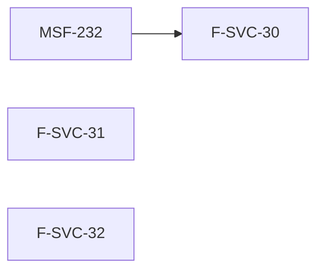

# Tareas: MSF-118 Service ideas futuras

## Fase 1: Historias previstas (en espera)

- [x] T001 [F-SVC-30][US1] Redactar requisitos e implementar el aviso por WhatsApp (SC-001). Desvío: en espera; requiere G-1, proveedor contratado (G-2) y MSF-232 `Finalizada` (G-3). La épica difiere los requisitos al hito.
- [x] T002 [F-SVC-31][US2] Redactar requisitos e implementar comisiones de técnicos (SC-001). Desvío: en espera hasta G-1; sin dependencia dura declarada.
- [x] T003 [F-SVC-32][US3] Redactar requisitos e implementar la etiqueta con QR del equipo (SC-001). Desvío: en espera hasta G-1; sin dependencia dura declarada.

## Matriz de trazabilidad (tracker ↔ US ↔ tasks)

| Tracker | Historia | Requisito | Verificación | Tarea |
|---|---|---|---|---|
| MSF-181 | F-SVC-30 (US1) | SC-001 (G-1, G-2, G-3) | Sin desarrollo abierto mientras el gate esté cerrado | T001 |
| MSF-187 | F-SVC-31 (US2) | SC-001 (G-1) | ídem | T002 |
| MSF-190 | F-SVC-32 (US3) | SC-001 (G-1) | ídem | T003 |

## Plan de ejecución (historias)

Sin tarea de cierre: no hay trabajo real de docs/seguridad/roadmap que ninguna historia atienda mientras la épica está en espera.

| Historia | Depende de | Grupo |
|---|---|---|
| F-SVC-30 | MSF-232 (externa, Finalizada) | 1 |
| F-SVC-31 | — | 1 |
| F-SVC-32 | — | 1 |

