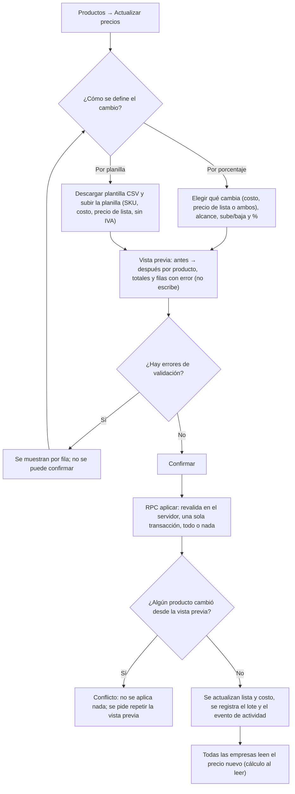
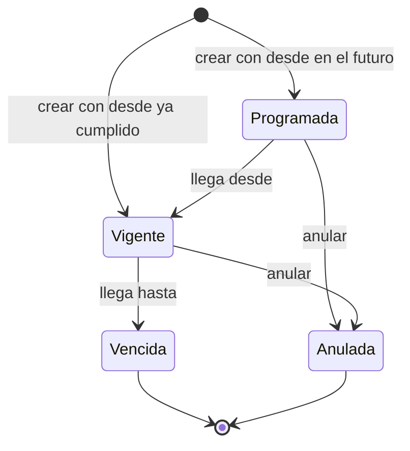
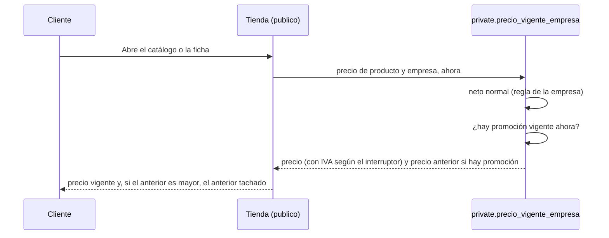

# Feature Specification: Precios y dólar · Precios masivos y promociones

**Épica**: MSF-363 · **Spec**: `precios-masivos-y-promociones` · **Hito**: Etapa 3 (sin fecha) · **Prioridad**: P2 · **Horas aprox.**: 22 (M + L ≈ 24 h; se mantiene la cifra del relevamiento)
**Alcance de entrega**: `refine`, `supabase` (sin `kestra`, `superset` ni `workers`: el vencimiento de promociones se resuelve al consultar, ver *Decisiones abiertas* 1).
**Historias hijas (ya creadas, en `Backlog`)**: MSF-436 (F-PRE-10), MSF-439 (F-PRE-11).
**Fuente**: especificación de Nicolás cargada en la épica, contrato ya entregado por MSF-114 (`specs/20261022-120000-precios-e-iva/`, mergeado a `main` en el PR #438) y prototipo en `design/pantallas/`. Esta spec **traduce**; no agrega alcance.

> Estado de la épica bloqueante: MSF-114 tiene todas sus historias `Finalizada`; solo falta la aprobación de despliegue DEV→STG de Nicolás, que **no** impide escribir esta spec (solo el despliegue).

## Objetivo

Al terminar, el administrador puede subir o bajar costos y precios en bloque con vista previa y programar precios promocionales por empresa con fecha de inicio y fin.

## Modelo y supuestos

- Los costos y precios se cargan **sin IVA**, también en la planilla (supuesto de la épica).
- Las promociones de Mercado Libre se gestionan en esa plataforma y el sistema solo las detecta (F-MLS-07, Etapa 2): **no** se crean ni se envían desde acá.
- **Ya existe** (MSF-114, verificado en migraciones): `dominio.productos(moneda, precio_lista numeric(14,2) > 0)`, `dominio.producto_costos(costo numeric(14,2) ≥ 0, sección rentabilidad)`, `dominio.precios_empresa` (regla por empresa), `private.a_pesos`, `private.aplicar_regla_precio`, `private.precio_neto_empresa`, `private.precio_final_publico` (+ `_escala`), vistas `public.precios_empresa_neto` / `_final`, evento `producto.precio_actualizado` (disparadores sobre productos y costos) y `private.insertar_actividad`.
- **No se guarda ningún precio en pesos** (modelo de MSF-114): el precio de lista y el costo son los únicos importes que se escriben; el neto por empresa y el final se **calculan al leer**. Por eso «recalcular `precios_empresa`» (F-PRE-10) significa que, al cambiar lista y costo, todas las empresas pasan de inmediato al valor nuevo, en la misma transacción, sin tabla derivada que quede desactualizada.
- La promoción se superpone al **precio neto calculado por empresa** (después de la regla de la empresa, antes del IVA): el IVA y el interruptor «Precios que ve el cliente» de la empresa se aplican igual. El importe promocional es un **precio fijo en pesos, sin IVA** (la moneda de las tiendas es ARS): no se mueve con el dólar ni con una actualización masiva posterior.
- Permisos (matriz vigente de MSF-114): el precio de lista lo edita la sección `productos`=`edicion`; el **costo** solo con `rentabilidad`=`edicion` (quien no tiene `rentabilidad` ni ve ni modifica costos). Lo usa el **Administrador**.
- Las dos historias son **independientes entre sí** (no comparten tablas nuevas ni pantallas); comparten solo el contrato de MSF-114.

### Esquema de datos (Constitución, Principio VII)

Ambas tablas nuevas son entidades de negocio del producto (qué se cobra y a cuánto) → **`dominio`**; ninguna va a `public`. Las RPC/vistas expuestas viven en `public` (superficie de ejecución/lectura, **no almacenan datos**); el cálculo, en `private`; la lectura anónima de la tienda, en `publico` (ya existente, sin tablas). Se re-verifica en plan, tareas, implementación y PR.

| Objeto | Esquema | Historia | Justificación | RLS / acceso |
|---|---|---|---|---|
| `actualizaciones_precio` (**nueva**) | `dominio` | F-PRE-10 | Registro de cada lote aplicado (quién, cuándo, modo, parámetros, cantidad, clave de idempotencia). Dato de negocio auditable. | `organizacion_id = (select private.organizacion_id())`; select `productos`≥`lectura`; **sin** insert/update/delete para `authenticated` (escribe solo la RPC); `anon` sin privilegios |
| `promociones_precio` (**nueva**) | `dominio` | F-PRE-11 | Precio promocional de un producto en una empresa con `desde`/`hasta`. Dato de negocio. | RLS por organización; FK compuestas `(empresa_id, organizacion_id)` y `(producto_id, organizacion_id)`; select `productos`≥`lectura`; escritura solo por RPC (`productos`=`edicion`); sin delete; `anon` sin privilegios |
| `productos`, `producto_costos` (existentes) | `dominio` (sin cambio) | F-PRE-10 | Se **actualizan** (`precio_lista`, `costo`) desde la RPC masiva; sin cambios de esquema. | RLS vigente de F-CAT-02 / F-PRE-01 |
| `public.previsualizar_actualizacion_precios`, `public.aplicar_actualizacion_precios`, `public.guardar_promocion_precio`, `public.anular_promocion_precio`, vista `public.promociones_precio_estado` | `public` (RPC y vista; no almacenan datos) | F-PRE-10 / F-PRE-11 | Superficie expuesta. | `security invoker`; `revoke … from public, anon`; `grant execute … to authenticated` |
| `private.precio_vigente_empresa`, `private.promocion_vigente` | `private` | F-PRE-11 | Cálculo único del precio vigente (con promoción). | Sin `execute` para `anon`/`authenticated` |
| `publico.catalogo_pagina_por_dominio`, ficha pública (existentes; **se alteran**, aditivo) | `publico` | F-PRE-11 | Suman `precio_anterior`. | Lectura anónima con lista blanca de campos (vigente) |

Estado verificado en el repo: **no existe** `promociones_precio` ni precios propios por empresa (F-PRE-08); todo lo nuevo se crea por migración y nada se asume. Las migraciones son aditivas y su reversión va documentada en cada una (y en el plan).

## Flujos

### Flujo 1 · Actualización masiva de costos y precios (F-PRE-10)

| Paso | Dueño |
|---|---|
| Entrada «Actualizar precios» desde Productos y permisos | FR-001 |
| Modo por porcentaje y alcance | FR-002 |
| Modo por planilla CSV y plantilla | FR-003 |
| Vista previa sin escribir | FR-004 |
| Errores por fila bloquean la confirmación | FR-006 |
| Aplicar atómico, idempotente, conflicto de edición | FR-005 |
| Lote registrado y evento | FR-007 |
| Costo solo con `rentabilidad`; qué no se toca | FR-008 |
| Empresas leen el precio nuevo | FR-009 |

### Flujo 2 · Estados de una promoción (F-PRE-11)

Los estados `programada`, `vigente` y `vencida` **no se guardan**: se derivan de `desde`/`hasta` y la hora actual al consultar (Decisión 1). Solo `anulada` es un dato (`anulada_at`).

| Estado / transición | Dueño |
|---|---|
| Crear (programar) con precio, empresa, `desde` y `hasta` | FR-013 |
| Programada → Vigente → Vencida por fecha, sin tarea programada | FR-014, FR-015 |
| Anular una promoción programada o vigente | FR-013 |
| No hay dos promociones solapadas del mismo producto y empresa | FR-012 |

### Flujo 3 · Precio visible en la tienda con precio anterior tachado (F-PRE-11)

| Paso | Dueño |
|---|---|
| Cálculo único con promoción vigente por fecha | FR-014 |
| `precio_anterior` en el catálogo y la ficha públicos | FR-017 |
| Tachado en la tienda | FR-018 |

## User Scenarios & Testing *(mandatory)*

### US1 · Actualización masiva de costos y precios (F-PRE-10, P2, talla M)

El administrador sube o baja costos y precios de muchos productos a la vez, ve primero cómo quedan y confirma.

1. **Dado** productos con lista y costo, **cuando** elige «Por porcentaje», +10 % sobre el precio de lista de una categoría, **entonces** la vista previa muestra antes → después por producto sin escribir nada.
2. **Dado** una planilla con una fila con SKU inexistente, **cuando** la sube, **entonces** la vista previa señala esa fila y no deja confirmar; no se cambia ningún producto.
3. **Dado** una vista previa válida, **cuando** confirma y la operación falla a mitad, **entonces** no cambia ningún producto (todo o nada).
4. **Dado** que el mismo lote se envía dos veces (doble clic, reintento), **entonces** se aplica una sola vez.
5. **Dado** un producto editado por otra persona después de la vista previa, **cuando** confirma, **entonces** se informa el conflicto y no se aplica nada.
6. **Dado** un usuario sin `rentabilidad`, **entonces** no ve ni puede cambiar costos; solo precios de lista.

### US2 · Precios promocionales por empresa (F-PRE-11, P2, talla L)

El administrador programa, para una empresa, un precio promocional de un producto con fecha de inicio y fin; la tienda muestra el precio promocional y el anterior tachado mientras dura.

1. **Dado** una promoción con `desde` futuro, **entonces** figura «Programada» y la tienda sigue mostrando el precio normal.
2. **Dado** que llega `desde`, **entonces** la tienda muestra el precio promocional con el anterior tachado, sin ninguna acción.
3. **Dado** que llega `hasta`, **entonces** vuelve el precio normal, sin tarea programada ni acción.
4. **Dado** otra promoción del mismo producto y empresa que se solapa en fechas, **entonces** no se guarda y se explica por qué.
5. **Dado** una empresa que muestra los precios con IVA, **entonces** el precio promocional y el tachado se ven con IVA.
6. **Dado** una promoción de la empresa A, **entonces** la empresa B no la ve ni la hereda.

## Requirements *(mandatory)*

### F-PRE-10 · Actualización masiva de costos y precios (MSF-436)

- **FR-001**: La acción «Actualizar precios» se ofrece desde el listado de Productos (ruta canónica `/productos/precios-masivos`), exige `productos`=`edicion`; sin permiso muestra «Acceso restringido». La pantalla es de la organización (no de una empresa).
- **FR-002**: Modo «Por porcentaje»: se elige qué cambia (costo, precio de lista o ambos), el alcance (todos los productos activos o los de una categoría) y un porcentaje que **sube o baja** (> −100 %). El resultado se redondea a 2 decimales en la moneda del producto.
- **FR-003**: Modo «Por planilla»: CSV UTF-8 (coma o punto y coma, BOM, CRLF) leído en el navegador con el lector existente `migracionCsv`, con plantilla descargable. Columnas `SKU` (obligatoria), `costo` y `precio_lista` (al menos una; sin IVA). **No depende** del Centro de importaciones (F-IMP-01); ver Decisión 3.
- **FR-004**: `public.previsualizar_actualizacion_precios` **solo lee**: devuelve por producto `antes → después` (lista y, solo con `rentabilidad`, costo), totales (afectados, sin cambio, con error) y las filas con error numeradas. Es la misma fórmula que aplica la confirmación.
- **FR-005**: `public.aplicar_actualizacion_precios` revalida todo en el servidor (no confía en la vista previa), actualiza en **una sola transacción, todo o nada**, es **idempotente** por clave de operación y rechaza con conflicto si algún producto cambió (`updated_at`) desde la vista previa. Exige `productos`=`edicion`.
- **FR-006**: Validación: `precio_lista` > 0; `costo` ≥ 0; SKU existente y de la organización, sin repetir en la planilla; porcentaje > −100 %. Cualquier error bloquea la confirmación y se informa **por fila**; nunca se aplica parcialmente.
- **FR-007**: Cada lote aplicado queda en `dominio.actualizaciones_precio` (autor, fecha, modo, parámetros, cantidad, clave) y genera el evento de actividad `precios.actualizacion_masiva` **sin importes de costo** (la Actividad la ve quien no tiene `rentabilidad`). Un producto sin cambio real no genera evento.
- **FR-008**: El **costo** solo se ve y se modifica con `rentabilidad`: la vista previa lo omite y la aplicación lo rechaza sin esa sección.
- **FR-009**: La aplicación solo escribe `precio_lista` y `costo` (el cálculo al leer hace que todas las empresas lean de inmediato el precio nuevo, consistentes entre sí). **No** toca moneda, escalas de precio (F-PRE-15), precios propios por empresa (F-PRE-08, hoy inexistentes) ni nada de Mercado Libre; ver Decisión 2.
- **FR-010**: La pantalla usa los patrones compartidos de carga, vacío, error y éxito; funciona con teclado, lector de pantalla y 320/768/1440 px; no muestra identificadores técnicos. Navegación: entrada dentro de Productos (sin ítem nuevo de menú). **Empresa activa: no aplica** (precio de lista y costo son de la organización, no de una empresa).
- **SC-001**: pgTAP: atomicidad (una fila inválida o una falla provocada ⇒ nada cambia), idempotencia, conflicto por `updated_at`, aislamiento entre dos organizaciones en `actualizaciones_precio`, permisos por rol (sin `rentabilidad` ⇒ costo rechazado), evento sin importes de costo, redondeo, `anon` sin ejecución.
- **SC-002**: Vitest: modos, validación de planilla, vista previa, ocultamiento del costo sin `rentabilidad`, estados de carga/error, teclado.
- **SC-003**: E2E de la vista previa y de la confirmación (ver `docs/e2e-app.md`).

### F-PRE-11 · Precios promocionales por empresa (MSF-439)

- **FR-011**: Existe `dominio.promociones_precio` (`id`, `organizacion_id`, `empresa_id`, `producto_id`, `precio_promocional numeric(14,2) > 0` sin IVA en pesos, `desde`, `hasta` con `hasta > desde`, `anulada_at`, `created_at`, `updated_at`) con RLS por organización y FK compuestas; sin delete.
- **FR-012**: No pueden solaparse dos promociones **no anuladas** del mismo producto y empresa; la regla vive en la base (restricción/disparador), no solo en la pantalla, con error legible.
- **FR-013**: `public.guardar_promocion_precio` (crear/editar) y `public.anular_promocion_precio` exigen `productos`=`edicion`, validan empresa y producto de la organización, aplican bloqueo optimista por `updated_at`, son idempotentes y registran `promocion_precio.programada` / `.actualizada` / `.anulada`. Una promoción ya vencida no se edita.
- **FR-014**: **Cálculo único** `private.precio_vigente_empresa(producto, empresa, ahora)`: si hay una promoción no anulada con `desde ≤ ahora < hasta`, el neto es el precio promocional; si no, el neto normal (`private.precio_neto_empresa`). Luego se aplican la alícuota y el interruptor de la empresa con las mismas fórmulas de MSF-114. Devuelve también el precio normal (anterior). El vencimiento es por **consulta por fecha**: sin Kestra ni worker.
- **FR-015**: La vista `public.promociones_precio_estado` (`security_invoker`) devuelve cada promoción con su estado derivado (`programada`, `vigente`, `vencida`, `anulada`), el precio normal y el vigente de la empresa.
- **FR-016**: Pantalla «Promociones» (ruta `/productos/promociones`, ícono de etiqueta de oferta, dentro de Productos; audiencia `productos`≥`lectura`, escritura `edicion`): lista con producto, empresa, precio normal, precio promocional, desde, hasta y estado; diálogo Nueva/Editar y acción Anular. **Respeta la empresa activa** de la barra superior: con una empresa concreta lista y crea para ella; con «Todas mis empresas» lista todas (columna Empresa) y «Nueva promoción» queda deshabilitada con «Elegí una empresa en la barra superior». Al cambiar de empresa recarga todas sus consultas, cierra el diálogo con aviso y no arrastra datos.
- **FR-017**: `publico.catalogo_pagina_por_dominio` y la ficha pública devuelven, de forma **aditiva**, `precio_anterior` (null si no hay promoción vigente) y `precio` ya con la promoción; sin promoción el resultado es idéntico al de hoy. Misma lista blanca de campos; sin filtrar el importe promocional de otra empresa.
- **FR-018**: La tienda (catálogo y ficha, MSF-167) muestra el precio vigente y el **anterior tachado** solo cuando `precio_anterior` > `precio`; sin promoción, sin cambios visuales.
- **SC-004**: pgTAP: aislamiento entre dos organizaciones y entre empresas, permisos por rol, no solapamiento, vencimiento por fecha (justo antes de `desde`, entre fechas, en `hasta`, después), anulación, IVA con y sin interruptor, `precio_anterior`, `anon` sin ejecución y sin escritura.
- **SC-005**: Vitest: pantalla (lista, diálogo, validaciones, estados derivados, **cambio de empresa sin arrastre**, «Todas mis empresas»), componente de precio tachado.
- **SC-006**: E2E de la tienda mostrando el precio tachado durante la promoción y el precio normal fuera de ella.

### Cierre de la épica (sin historia dueña)

- **FR-019**: Documentación integrada: `docs/precios.md` (sección de masivos y promociones), guía de la épica y `docs/documentacion-cambios.md` si corresponde; `pnpm docs:check` verde.
- **FR-020**: Revisión de seguridad: RLS en `actualizaciones_precio` y `promociones_precio`, `anon` sin ejecución sobre las RPC nuevas, la prueba de aislamiento recorre `public` + `dominio`, sin importes de costo en actividad.
- **FR-021**: `docs/roadmap-template.md`: se actualiza la fila de la épica al mergear (paso manual con criterio).
- **SC-007**: `pnpm lint`, `pnpm build`, `pnpm test`, `pnpm docs:check`, `pnpm prototipo:check` y `pnpm matriz:check` en verde.

## Decisiones abiertas (anotadas, no son gates de Nicolás)

1. **Cómo vencen las promociones — resuelto: consulta por fecha.** El precio vigente se calcula al leer comparando `desde`/`hasta` con la hora actual (FR-014). Razón: coincide con el modelo «el precio se calcula al leer» de MSF-114, no necesita Kestra ni worker (el template no trae ningún worker concreto), no hay ventana en la que un precio quede vencido por una tarea caída y es testeable con pgTAP. Costo: una comparación más por lectura de precio (con índice por `(empresa_id, producto_id, desde, hasta)`). *Alternativa descartada:* tarea programada que cierre promociones (más piezas, y un fallo deja precios promocionales de más).
2. **Convivencia con precios propios por empresa (F-PRE-08, MSF-352) — resuelto: la masiva no los toca.** Hoy no existen en el repo. La actualización masiva cambia **lista y costo central**; cuando F-PRE-08 exista, un precio propio es un valor fijado a mano por empresa y **queda excluido** de la masiva (el punto de extensión ya está en `private.precio_neto_empresa`). La promoción, por su parte, se superpone al neto **incluido el precio propio**. Si F-PRE-10 resulta necesitar el precio propio, se restituye el bloqueo con MSF-352.
3. **Planilla de F-PRE-10 — resuelto: lector CSV existente, no el Centro de importaciones.** F-IMP-01 está en Plataforma, Etapa 2, y la épica no puede esperarlo. Se reutiliza `migracionCsv` (navegador) y una RPC atómica; si F-IMP-01 llega después, podrá reemplazar solo la carga del archivo (la RPC no cambia).
4. **Alcance del porcentaje (supuesto):** «todos los activos» o «una categoría» (filtro que ya existe en Productos). Otros filtros (proveedor, marca) quedan fuera.
5. **Escalas de precio (F-PRE-15):** la masiva **no** las cambia; subir la lista puede dejar una escala por encima de x1. Se anota; actualizar escalas sería otra historia.
6. **Ventas y pedidos:** esta épica pide mostrar el precio promocional en la tienda. Que el carrito, los comprobantes y el POS cobren el promocional **no** está en la épica: con `private.precio_vigente_empresa` queda el cálculo único listo para adoptarlo, pero queda como pregunta para Nicolás (riesgo: cobrar distinto de lo mostrado).
7. **Otras superficies de la tienda** (inicio/destacados, búsqueda, móvil) usan `private.precio_final_publico`: la épica nombra catálogo y ficha; las demás se incorporan solo si Nicolás lo pide.
8. **Editar y anular una promoción** no figuran literalmente en la épica; se asumen como parte de «programar» (sin ellas una carga equivocada no tiene salida).

## Matriz pantalla↔criterios

La épica indica: *«Ninguna pantalla dibujada todavía»*. El prototipo no trae pantallas de actualización masiva ni de promociones, ni precio tachado en la tienda (verificado: ningún `.dc.html` usa `line-through`). Se corrió el inventario determinista (`pnpm prototipo:inventario`); los inventarios cercanos se mapean así. Lo que la épica no pide queda **fuera de alcance** (nota, no deuda).

| Ítem del prototipo | Pantalla | Dueño |
|---|---|---|
| Botón `Descargar plantilla CSV` | ProductosCarga (referencia visual del patrón de planilla) | FR-003 |
| Tabla `Columna`, `Obligatoria`, `Ejemplo` (descripción de columnas de la planilla) | ProductosCarga | FR-003 |
| Tabla de resultado por fila: `Fila`, `SKU`, `Validación` | ProductosCarga | FR-004, FR-006 |
| Tabla de resultado: `Precio x1` (como «antes → después» del precio de lista) | ProductosCarga | FR-004 |
| Tabla de resultado: `Nombre`, `Categoría` (contexto del producto en la vista previa) | ProductosCarga | FR-004 |
| Botón `Cancelar` | ProductosCarga | FR-010 |
| Botón `Importar · productos`, columna `Acción` (alta/actualización de productos) | ProductosCarga | Fuera de alcance: es el alta masiva de productos (otra historia de Catálogo); aquí solo se actualizan costo y precio de productos existentes |
| Botón `Elegir imágenes`, columna `Imágenes` | ProductosCarga | Fuera de alcance: imágenes no son precios |
| Pestaña «Precios y moneda» y su tabla «Así quedan los precios» (`Producto (muestra)`, `Central`, `<Empresa>`), campos `Base`, `Ajuste sobre el precio central`, `Redondeo`, `Precios que ve el cliente`, `Moneda de la tienda`, `Cotización que usa`, botón `Guardar` | StorePrecios / SJ_StorePrecios | Fuera de alcance: ya entregada en MSF-114 (F-PRE-07/F-PRE-12); aquí solo se **lee** su regla vía FR-014 |
| Pestañas `General`, `Mercado Libre`, `Identidad visual`, `Contenido`, `Catálogo visible`, `Dominio y publicación`, botones `Empresas`, `Ver tienda`, `Cambiar a …` | StorePrecios / StoreCatalogo | Fuera de alcance: otras historias de Empresas; Mercado Libre es Etapa 2 |
| Tabla `Producto`, `Precio`, `Stock`, `Visible`, `Destacado` y diálogos `Publicar cambios` / `Descartar cambios` | StoreCatalogo | Fuera de alcance: curaduría del catálogo visible; el `Precio` mostrado pasa a ser el vigente (FR-017) sin cambiar esa pantalla |
| Pantalla «Actualizar precios» (modos, alcance, porcentaje, vista previa, confirmar) | — (sin prototipo) | FR-001…FR-006, FR-010 |
| Pantalla «Promociones» (lista, diálogo Nueva/Editar, Anular, estados) | — (sin prototipo) | FR-015, FR-016 |
| Precio anterior tachado en catálogo y ficha de la tienda | — (sin prototipo) | FR-017, FR-018 |
| Columnas/ofertas de Mercado Libre | — | Fuera de alcance: las promociones de ML se gestionan en ML (F-MLS-07, Etapa 2) |
| Fila **Empresa activa** | Barra superior | FR-016 (Promociones respeta la empresa activa, con test de cambio de empresa en SC-005); FR-010 (Actualizar precios: **no aplica**, datos de la organización) |

Como no hay prototipo, la UI se arma con los componentes del template y el sistema de diseño (MSF-117) y se anota en el PR (regla de fuentes 3 y 5).

## Matriz de trazabilidad Jira ↔ US ↔ FR ↔ tareas

| Jira | Historia | FR / SC | Tareas |
|---|---|---|---|
| MSF-436 · F-PRE-10 | US1 Actualización masiva de costos y precios | FR-001…010, SC-001…003 | T001–T010 |
| MSF-439 · F-PRE-11 | US2 Precios promocionales por empresa | FR-011…018, SC-004…006 | T011–T021 |
| Tarea de cierre (label `cierre`) | Docs, seguridad y roadmap | FR-019…021, SC-007 | T022–T024 |
