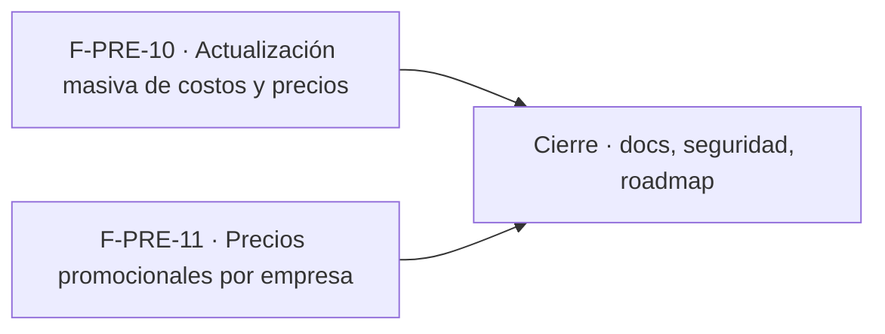

# Tasks: Precios y dólar · Precios masivos y promociones

**Spec**: [spec.md](./spec.md) · **Plan**: [plan.md](./plan.md) · **Épica**: MSF-363
Formato: `- [ ] T### [P] [STORY][US#] descripción`. **[P]** = paralelizable (archivos distintos y sin dependencia con otra tarea del mismo grupo). Las dependencias y el orden son **solo dentro de la misma historia**. Cada FR/SC tiene **una sola** tarea dueña. Cada historia trae su propia migración aditiva con su timestamp (no se encadenan entre sí).
Validación por fase: `pnpm lint`, `pnpm build`, `pnpm test` (con `pnpm dev:supabase`), `pnpm docs:check`.

## Fase 1 · F-PRE-10 · Actualización masiva de costos y precios (MSF-436) — US1

- [x] T001 [P] [F-PRE-10][US1] Migración `supabase/migrations/<ts>_actualizaciones_precio.sql`: tabla `dominio.actualizaciones_precio` (autor, fecha, modo, parámetros jsonb, cantidad, `clave` única por organización) con RLS por organización, select `productos`≥`lectura`, sin escritura directa, `anon` sin privilegios; evento `precios.actualizacion_masiva` sin importes de costo; reversión documentada. **FR-007**. **Verificación**: FR-007: pgTAP `precios_masivos.test.sql` (T004).
- [x] T002 [P] [F-PRE-10][US1] Migración `<ts>_precios_masivos_previsualizar.sql`: `public.previsualizar_actualizacion_precios(...)` solo lectura (modo porcentaje con alcance todos/categoría, modo planilla por SKU), redondeo a 2 decimales, validaciones por fila, omite costo sin `rentabilidad`; `revoke … from public, anon` + `grant execute … to authenticated`. **FR-002, FR-004, FR-006**. **Verificación**: FR-002/004/006: pgTAP `precios_masivos.test.sql` (T004) y Vitest `preciosMasivos.test.ts` (T008).
- [x] T003 [F-PRE-10][US1] Migración `<ts>_precios_masivos_aplicar.sql`: `public.aplicar_actualizacion_precios(...)` atómica (todo o nada), idempotente por clave, conflicto por `updated_at`, exige `productos`=`edicion` y `rentabilidad`=`edicion` para costo, escribe solo `precio_lista` y `costo`, registra el lote (T001). Depende de T001 y T002. **FR-005, FR-008, FR-009**. **Verificación**: FR-005/008/009: pgTAP `precios_masivos.test.sql` (T004) y Vitest `precios-masivos.test.tsx` (T008).
- [x] T004 [F-PRE-10][US1] pgTAP `supabase/tests/database/precios_masivos.test.sql`: atomicidad con falla provocada, idempotencia, conflicto, aislamiento entre dos organizaciones, permisos por rol, evento sin costos, redondeo, `anon` sin ejecución. Depende de T003. **SC-001**. **Verificación**: SC-001: `pnpm test` (pgTAP `precios_masivos.test.sql`).
- [x] T005 [P] [F-PRE-10][US1] `apps/web/src/lib/preciosMasivos.ts`: plantilla CSV descargable y parseo/validación de la planilla sobre `migracionCsv` (SKU, `costo`, `precio_lista`; errores por fila numerados). **FR-003**. **Verificación**: FR-003: Vitest `preciosMasivos.test.ts` (T008).
- [x] T006 [F-PRE-10][US1] Capa de datos en `apps/web/src/lib/preciosMasivos.ts`/hooks: tipos y llamadas a las RPC de vista previa y aplicar, clave de idempotencia por intento, manejo de conflicto. Depende de T003. (Soporte de FR-005 desde el cliente; sin FR propio).
- [x] T007 [F-PRE-10][US1] Pantalla `apps/web/src/pages/productos/precios-masivos.tsx` (ruta `/productos/precios-masivos`) y botón «Actualizar precios» en `pages/productos/list.tsx`: modos porcentaje/planilla, alcance, vista previa antes → después, errores por fila, confirmación, estados compartidos, teclado y 320/768/1440 px, «Acceso restringido» sin permiso, costo oculto sin `rentabilidad`. Depende de T005 y T006. **FR-001, FR-010**. **Verificación**: FR-001/010: Vitest `precios-masivos.test.tsx` (T008), E2E `apps/web/e2e/precios-masivos.e2e.ts` (T009) y `pnpm matriz:check`.
- [x] T008 [F-PRE-10][US1] Vitest de la pantalla y la planilla (modos, validación, vista previa, costo oculto, estados de carga/error, teclado). Depende de T007. **SC-002**. **Verificación**: SC-002: `pnpm test` (Vitest).
- [x] T009 [F-PRE-10][US1] E2E de la vista previa y la confirmación (ver `docs/e2e-app.md`). Depende de T007. **SC-003**. **Verificación**: SC-003: Playwright `apps/web/e2e/precios-masivos.e2e.ts` (escrito, **nunca ejecutado**; ver `notas.md`).
- [x] T010 [F-PRE-10][US1] Documento `docs/precios-masivos.md` (modelo, RPC, permisos, decisiones 2–5, reversión) enlazado desde la spec. Depende de T003 y T007. (Documentación obligatoria del cambio; sin FR propio).

**Evidencia F-PRE-10 (MSF-436)**: migraciones `20270221100006`…`08` (renumeradas al integrar con `dokploy`), pgTAP `precios_masivos.test.sql` (job `database` del CI, verde en el PR #784), Vitest de la pantalla y la planilla (verde al integrar), docs `docs/precios-masivos.md`. **Desvío**: el E2E `e2e/precios-masivos.e2e.ts` queda escrito pero no se ejecutó (sin Supabase local; se corre con `pnpm dev:supabase`); la spec lo nombraba `.spec.ts` y se corrigió porque el `testMatch` del repo es `*.e2e.ts`.

**Checkpoint F-PRE-10**: migraciones aplicadas con `supabase db reset`, pgTAP y Vitest verdes, E2E de vista previa verde.

Dentro de F-PRE-10: T001 [P] y T002 [P] y T005 [P] arrancan juntas; T003 ← T001+T002; T004 ← T003; T006 ← T003; T007 ← T005+T006; T008 y T009 ← T007; T010 ← T003+T007.

## Fase 2 · F-PRE-11 · Precios promocionales por empresa (MSF-439) — US2

- [x] T011 [F-PRE-11][US2] Migración `<ts>_promociones_precio.sql`: tabla `dominio.promociones_precio` con FK compuestas, `precio_promocional > 0`, `hasta > desde`, `anulada_at`, índice `(empresa_id, producto_id, desde, hasta)`, RLS por organización, restricción/disparador contra solapes de promociones no anuladas, sin delete, `anon` sin privilegios; reversión documentada. **FR-011, FR-012**. **Verificación**: FR-011/012: pgTAP `promociones_precio.test.sql` (T015).
- [x] T012 [P] [F-PRE-11][US2] Migración `<ts>_promociones_precio_rpc.sql`: `public.guardar_promocion_precio` y `public.anular_promocion_precio` (permisos, validación de empresa/producto, bloqueo optimista, idempotencia, eventos `promocion_precio.*`, no editar vencidas). Depende de T011. **FR-013**. **Verificación**: FR-013: pgTAP `promociones_precio.test.sql` (T015).
- [x] T013 [P] [F-PRE-11][US2] Migración `<ts>_promociones_precio_vigente.sql`: `private.promocion_vigente`, `private.precio_vigente_empresa(producto, empresa, ahora)` (neto con promoción → alícuota → interruptor, devuelve también el anterior) y vista `public.promociones_precio_estado` (`security_invoker`, estado derivado). Depende de T011. **FR-014, FR-015**. **Verificación**: FR-014/015: pgTAP `promociones_precio.test.sql` (T015).
- [x] T014 [F-PRE-11][US2] Migración `<ts>_tienda_precio_anterior.sql`: `publico.catalogo_pagina_por_dominio` y la ficha pública suman `precio_anterior` y `precio` con promoción (aditivo, misma lista blanca; sin promoción idéntico a hoy); inventariar los usos de `private.precio_final_publico` y dejar constancia de los que no se tocan (Decisión 7). Depende de T013. **FR-017**. **Verificación**: FR-017: pgTAP `promociones_precio.test.sql` (T015).
- [x] T015 [F-PRE-11][US2] pgTAP `supabase/tests/database/promociones_precio.test.sql`: aislamiento entre organizaciones y empresas, permisos, no solapamiento, vencimiento en los bordes de `desde`/`hasta`, anulación, IVA con y sin interruptor, `precio_anterior`, `anon` sin ejecución ni escritura. Depende de T012, T013 y T014. **SC-004**. **Verificación**: SC-004: `pnpm test` (pgTAP `promociones_precio.test.sql`).
- [x] T016 [P] [F-PRE-11][US2] Capa de datos `apps/web/src/lib/promociones.ts`/hooks: tipos, lectura de `promociones_precio_estado`, guardar y anular, invalidación completa al cambiar de empresa. Depende de T012 y T013. (Soporte de FR-016; sin FR propio).
- [x] T017 [F-PRE-11][US2] Pantalla `apps/web/src/pages/productos/promociones.tsx` (ruta `/productos/promociones`, ícono y entrada de navegación dentro de Productos): lista con estados derivados, diálogo Nueva/Editar, Anular, empresa activa (concreta / «Todas mis empresas» con alta deshabilitada), estados compartidos, teclado y 320/768/1440 px. Depende de T016. **FR-016**. **Verificación**: FR-016: Vitest `promociones.test.tsx` (T019).
- [x] T018 [P] [F-PRE-11][US2] Tienda pública (`apps/web/src/pages/tienda-publica`): precio vigente y precio anterior tachado solo si `precio_anterior` > `precio`, accesible (texto para lector, no solo tachado visual). Depende de T014. **FR-018**. **Verificación**: FR-018: Vitest `PrecioTachado.test.tsx` (T019) y E2E `apps/web/e2e/tienda-promocion.e2e.ts` (T020).
- [x] T019 [F-PRE-11][US2] Vitest: pantalla de promociones (lista, diálogo, validaciones, cambio de empresa sin arrastre, «Todas mis empresas») y componente de precio tachado. Depende de T017 y T018. **SC-005**. **Verificación**: SC-005: `pnpm test` (Vitest).
- [x] T020 [F-PRE-11][US2] E2E de la tienda con precio tachado durante la promoción y precio normal fuera de ella. Depende de T017 y T018. **SC-006**. **Verificación**: SC-006: Playwright `apps/web/e2e/tienda-promocion.e2e.ts` (escrito, **nunca ejecutado**; ver `notas.md`).
- [x] T021 [F-PRE-11][US2] Documento `docs/promociones-precio.md` (modelo, vencimiento por consulta, RPC, contrato público, decisiones 1, 6 y 7, reversión) enlazado desde la spec. Depende de T014 y T017. (Documentación obligatoria del cambio; sin FR propio).

**Evidencia F-PRE-11 (MSF-439)**: migraciones `20270221100001`…`05` (renumeradas), pgTAP `promociones_precio.test.sql`, Vitest de la pantalla y de `PrecioTachado`, docs `docs/promociones-precio.md`. **Desvío**: el E2E `e2e/tienda-promocion.e2e.ts` queda escrito pero no se ejecutó (sin Supabase local).

**Checkpoint F-PRE-11**: migraciones aplicadas con `supabase db reset`, pgTAP y Vitest verdes, E2E de la tienda verde.

Dentro de F-PRE-11: T011 → (T012 [P], T013 [P]) → T014 ← T013; T015 ← T012+T013+T014; T016 [P] ← T012+T013; T018 [P] ← T014; T017 ← T016; T019 y T020 ← T017+T018; T021 ← T014+T017.

## Fase 3 · Cierre

- [x] T022 [P] [CIERRE] Integrar la documentación: sección «Masivos y promociones» en `docs/precios.md` enlazando `docs/precios-masivos.md` y `docs/promociones-precio.md`; `pnpm docs:check` verde. **FR-019**. **Verificación**: FR-019: `pnpm docs:check`.
- [x] T023 [P] [CIERRE] Revisión de seguridad: RLS en `actualizaciones_precio` y `promociones_precio`, `anon` sin ejecución sobre las RPC nuevas, pgTAP `rls_en_toda_tabla.test.sql` sobre `public` + `dominio`, actividad sin importes de costo. **FR-020**. **Verificación**: FR-020: pgTAP `rls_en_toda_tabla.test.sql` y `anon` sin ejecución en `precios_masivos.test.sql`/`promociones_precio.test.sql`.
- [x] T024 [CIERRE] Actualizar la fila de la épica en `docs/roadmap-template.md` (estado, link a la spec) al mergear el PR y correr la validación completa (`lint`, `build`, `test`, `docs:check`, `prototipo:check`, `matriz:check`). Depende de T022 y T023. **FR-021, SC-007**. **Verificación**: FR-021/SC-007: `git diff main -- docs/roadmap-template.md` y `pnpm lint && pnpm build && pnpm test && pnpm docs:check && pnpm prototipo:check && pnpm matriz:check`.

**Evidencia cierre (MSF-815)**: T022 sección «Masivos y promociones» en `docs/precios.md` y `node scripts/verificar-documentacion-cambios.mjs && node scripts/verificar-migraciones.mjs` OK; T023 revisión de seguridad integral escrita en `docs/precios.md` (el archivo `aislamiento_rls.test.sql` que nombraba la spec no existe: lo cubre `rls_en_toda_tabla.test.sql`); T024 fila de MSF-363 en `docs/roadmap-template.md`, y `tsc -b`, `oxlint src` (0 errores), `vite build`, `verificar-inventario-prototipo`, `verificar-matriz-pantalla`, `verificar-estilos-sueltos`, commitlint sobre el rango y Vitest de `pages/productos`, `pages/tienda-publica` y `App` (693 pruebas) verdes en local. **Desvío**: `pnpm test` completo y pgTAP no corren en la máquina de Claude Code; los valida el CI del PR de la épica.

## Fase 4 · Seguimiento tras la revisión por roles (#842, #845)

- [x] T025 [F-PRE-11] Migración `20270223200000_promociones_precio_permisos_por_tienda.sql`: `private.nivel_productos_en_empresa`, `guardar_promocion_precio`/`anular_promocion_precio` y política de lectura de `dominio.promociones_precio` por tienda (tienda desactivada o persona sin tiendas no lee). **FR-011, FR-013**. **Verificación**: pgTAP `promociones_precio.test.sql` (permiso por tienda, tienda desactivada, sin tiendas).
- [x] T026 [F-PRE-10] Migración `20270223200100_precios_masivos_previsualizar_costos.sql` (la vista previa exige `rentabilidad`=`edicion` para cambiar costos) y vista previa con carga infinita en `apps/web/src/pages/productos/precios-masivos.tsx`. **FR-004, FR-008**. **Verificación**: pgTAP `precios_masivos.test.sql` y Vitest `precios-masivos.test.tsx` («Cargar más», «Mostrando N de M») y `preciosMasivos.test.ts` (tope de 5.000).
- [x] T027 [F-PRE-11] Migración `20270225100000_promociones_precio_permiso_antes_del_lock.sql` (#845): el permiso por tienda se comprueba antes del lock de la fila. **FR-013**. **Verificación**: pgTAP `promociones_precio.test.sql` y `precios_masivos.test.sql`.
- [x] T028 [F-PRE-10] Decisión 14 (2026-11-12): migración `20270228300200_precios_masivos_por_tienda_y_bandera.sql`: `previsualizar_`/`aplicar_actualizacion_precios` exigen `productos` en edición en TODAS las tiendas activas de la organización (una sin acceso cuenta como sin edición) (`private.productos_edicion_en_todas_las_tiendas`, sobre `private.nivel_productos_en_empresa`), antes de cualquier lock; el precio de lista es de la organización y no hay subconjunto «afectado» limpio. **Verificación**: pgTAP `precios_masivos.test.sql` (80 pruebas OK en stack local aislado: edición en A y lectura en B → `42501` en previsualizar y aplicar; edición en todas → pasa; acceso con edición solo a A → `42501`; tienda desactivada no cuenta; sin acceso → `42501`; persona de solo lectura con la bandera apagada → `42501` y no `55000`; reintento de aplicar con bandera apagada → `55000`).
- [x] T029 [F-PRE-11] Decisión 15 (2026-11-12): migraciones `20270228300000_banderas_plataforma.sql` (tabla `public.banderas_plataforma`, `private.bandera_activa`, claves `promociones_precio` y `precios_masivos` APAGADAS) y `20270228300100_promociones_precio_bandera.sql` (`private.promocion_vigente` devuelve null apagada: las 5 funciones públicas de la tienda muestran el precio normal sin `precio_anterior`; `guardar_promocion_precio` → `55000`). **Verificación**: pgTAP `promociones_precio.test.sql` (108 pruebas OK en stack local aislado: apagada ⇒ catálogo y ficha sin promoción, guardar rechaza con mensaje claro, anular permitida; encendida ⇒ como siempre).
- [x] T030 [F-PRE-10] Decisión 15: la misma bandera `precios_masivos` apaga «Actualizar precios» (ambas RPC → `55000`). **Verificación**: pgTAP `precios_masivos.test.sql` (apagada ⇒ `55000` con mensaje claro y sin lote; encendida ⇒ como siempre).
- [x] T031 [F-PRE-10/F-PRE-11] UI: `public.capacidades_precios()` (`20270228300300`), `lib/capacidadesPrecios.ts` y `hooks/useCapacidadesPrecios.ts` (fallo cerrado). «Actualizar precios» se oculta con la bandera apagada y se deshabilita con el motivo sin edición en todas las tiendas; la pantalla de precios masivos y la de Promociones explican el motivo; `puedeEditar` de Promociones pasa a ser por tienda (cierra el pendiente 8 de `notas.md`). Ayuda en pantalla actualizada. **Verificación**: Vitest `promociones.test.tsx`, `precios-masivos.test.tsx`, `list.test.tsx`, `capacidadesPrecios.test.ts` (138 pruebas OK).

**Evidencia del seguimiento**: PR #842 (`1203a48d`, `336de780`) y #845 (`77018e2b`), mergeados a `dokploy`; pgTAP en el job `database` del CI. **Pendientes** (no son tareas de esta fase): ver `notas.md`.

## Matriz de trazabilidad Jira ↔ US ↔ tareas

| Jira | Historia | FR / SC (dueño único) | Tareas |
|---|---|---|---|
| MSF-436 · F-PRE-10 | US1 | FR-001, 010 → T007 · FR-002, 004, 006 → T002 · FR-003 → T005 · FR-005, 008, 009 → T003 · FR-007 → T001 · SC-001 → T004 · SC-002 → T008 · SC-003 → T009 | T001–T010 |
| MSF-439 · F-PRE-11 | US2 | FR-011, 012 → T011 · FR-013 → T012 · FR-014, 015 → T013 · FR-017 → T014 · FR-016 → T017 · FR-018 → T018 · SC-004 → T015 · SC-005 → T019 · SC-006 → T020 | T011–T021 |
| Tarea de cierre (label `cierre`) | — | FR-019 → T022 · FR-020 → T023 · FR-021, SC-007 → T024 | T022–T024 |
| Seguimiento (#842, #845) | — | soporte de FR-004, FR-008, FR-011, FR-013 (sin dueño nuevo) | T025–T031 |

**Verificación por requisito**: cada FR/SC tiene su prueba o comando nombrado en la sección «Matriz de verificación» de `spec.md`. Las tareas de prueba son: T004 (`precios_masivos.test.sql`, FR-002/004/005/006/007/008/009), T008 (`precios-masivos.test.tsx` y `preciosMasivos.test.ts`, FR-001/003/010), T009 (`apps/web/e2e/precios-masivos.e2e.ts`), T015 (`promociones_precio.test.sql`, FR-011…015 y FR-017), T019 (`promociones.test.tsx`, `PrecioTachado.test.tsx`, FR-016/018), T020 (`apps/web/e2e/tienda-promocion.e2e.ts`) y, en el cierre, `pnpm docs:check` (FR-019), el pgTAP de aislamiento (FR-020) y la validación completa (FR-021, SC-007).

## Plan de ejecución (historias)

El **orden de toma** lo declara esta tabla: el orquestador la **consume**. F-PRE-10 y F-PRE-11 son **independientes**: no comparten tabla nueva, migración, pantalla ni archivo (F-PRE-10 toca `pages/productos/list.tsx` y `precios-masivos.tsx`, y escribe en `productos`/`producto_costos`; F-PRE-11 crea `promociones_precio`, `promociones.tsx`, el módulo de la tienda y la navegación); solo comparten el contrato de MSF-114, que ya está entregado. Por eso van en el **mismo grupo** (paralelo).

| Historia | Depende de | Grupo |
|----------|------------|-------|
| F-PRE-10 | — | 1 |
| F-PRE-11 | — | 1 |
| [Cierre] | F-PRE-10, F-PRE-11 | 2 |

