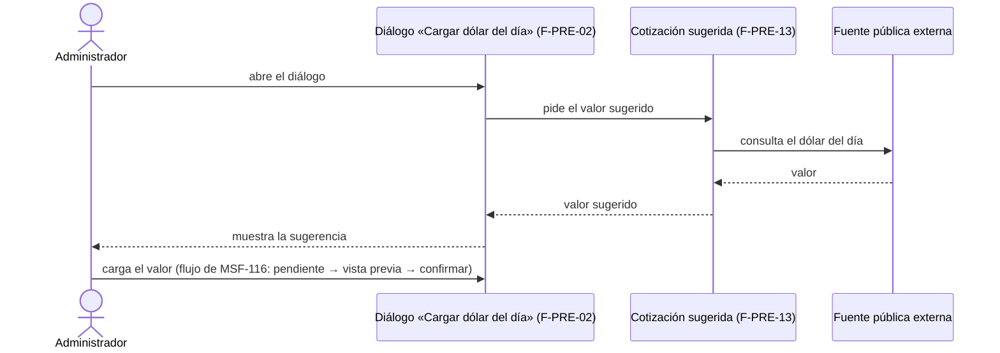

# Feature Specification: Precios y dólar · Cotización sugerida y mayoristas

**Épica**: MSF-373 · **Spec**: `cotizacion-sugerida-y-mayoristas` · **Hito**: Backlog (a definir con el cliente) · **Prioridad**: P3 · **Horas aprox.**: a estimar al pasar a un hito (por tallas M + L ≈ 24 h)
**Alcance de entrega**: provisional — `refine` y `supabase` para F-PRE-13; el uso de `workers`/`kestra` para leer la fuente externa **no está decidido** (Pregunta 1). F-PRE-14: sin alcance hasta resolver las Preguntas 2 y 3.
**Estado**: **F-PRE-13 implementada con decisión provisoria (2026-11-10: DolarApi, dólar oficial venta); F-PRE-14 sin requisitos.** Texto original: SPEC PARCIAL — NEEDS_INFO. La propia épica dice «los requisitos se redactan cuando la épica pase a un hito»; Nicolás confirmó que siguen abiertos el conflicto F-PRE-14 vs. F-PRE-15, el modelo comercial mayorista, las horas y el hito. Esta spec **traduce lo que la épica sí dice** y no inventa el resto.

## Objetivo

Al terminar, el sistema sugiere el dólar del día desde una fuente pública y existe una lista de precios para revendedores. *(Texto literal de la épica.)*

## Modelo y supuestos

- **Idea futura condicionada a validar demanda** (supuesto de la épica).
- **Bloqueada por** `dolar-y-recalculo` (MSF-116): F-PRE-13 sugiere el valor que se carga con el diálogo de F-PRE-02. MSF-116 ya está en `dokploy` (diálogo «Cargar dólar del día», `specs/20261023-120000-dolar-y-recalculo/`); la condición se cumplió y F-PRE-13 se implementó sobre ese diálogo. Condición de reanudación 2.
- F-PRE-13 y F-PRE-14 son **independientes entre sí**.
- **Relacionada, sin bloqueo**: F-PRE-14 depende de clientes registrados y de una cuenta de cliente con acceso propio, que el relevamiento da por no definidos (existen Clientes alta y búsqueda, MSF-180, y Cuenta web del cliente, MSF-237; los links se deciden al redactar requisitos).
- **Conflicto abierto**: F-PRE-14 (listas mayoristas, P3) choca con F-PRE-15 (escalas por tipo de cliente, P0, **ya implementada** en `TiposCliente`, spec `20261022-120000-precios-e-iva`). Hay que decidir si F-PRE-14 sigue siendo necesaria.
- El dólar sigue siendo de **carga manual con confirmación en dos pasos** (MSF-116); la sugerencia no reemplaza esa confirmación (la épica dice que sugiere «el valor que se carga con el diálogo de F-PRE-02»).

### Esquema de datos (Constitución, Principio VII)

**No se declara ninguna tabla nueva todavía**: la fuente y el modelo comercial no están definidos. Antes de crear una, la spec debe fijar su esquema (dato del producto → `dominio`; RLS por organización). Verificado en el grafo/migraciones: no existe hoy tabla ni RPC de cotización sugerida ni de listas mayoristas; el template «no trae lectura de fuentes externas de cotización ni listas de precios» (A revisar de la épica).

## User Scenarios & Testing *(mandatory)*

### User Story 1 - Cotización sugerida desde una fuente externa (F-PRE-13, P3, talla M)

El sistema sugiere el dólar del día tomándolo de una fuente pública; el administrador lo ve al cargar el dólar con el diálogo «Cargar dólar del día» (F-PRE-02).

**Why this priority**: P3, fuera de diciembre; depende de MSF-116.

**Acceptance Scenarios** *(solo lo que dice la épica; el detalle queda en las Preguntas)*:
1. **Given** MSF-116 en `main` y la fuente pública disponible, **When** el administrador abre el diálogo «Cargar dólar del día», **Then** ve el valor sugerido del día para cargarlo (FR-001).
2. **Given** que la fuente no responde, **When** abre el diálogo, **Then** puede cargar el valor a mano como hoy; la carga manual no depende de la fuente (FR-002, consecuencia de que la sugerencia es una ayuda, no un reemplazo).

### User Story 2 - Listas de precios mayoristas (F-PRE-14, P3, talla L) — SIN REQUISITOS

La épica solo dice que «existe una lista de precios para revendedores». No hay pantalla dibujada, modelo comercial ni resolución del conflicto con F-PRE-15. **No se redactan escenarios** (Preguntas 2 y 3). Ver FR-003.

## Flujos

Único flujo que la épica describe: la sugerencia alimenta el diálogo de F-PRE-02 (la carga y confirmación siguen siendo las de MSF-116).

| Paso | Dueño |
|------|-------|
| Abrir el diálogo, cargar, vista previa, confirmar | **Fuera de alcance**: MSF-116 (F-PRE-02/03) |
| Pedir/obtener/mostrar el valor sugerido | FR-001 |
| Fuente no disponible | FR-002 |

F-PRE-14 no describe flujo alguno: sin flujo hasta resolver Preguntas 2–3.

## Requirements *(mandatory)*

- **FR-001** *(F-PRE-13)*: el sistema obtiene el dólar del día de una fuente pública y lo ofrece como valor sugerido en el diálogo de carga de F-PRE-02. Fuente concreta, qué valor (oficial/blue/etc.) y frecuencia: **Pregunta 1**.
- **FR-002** *(F-PRE-13)*: si la fuente no está disponible, la carga manual de MSF-116 sigue funcionando sin cambios.
- **FR-003** *(F-PRE-14)*: **reservado**. Sin requisitos hasta que Nicolás resuelva el conflicto con F-PRE-15 y el modelo comercial. No se implementa.
- **SC-001**: test del diálogo con sugerencia disponible y con fuente caída (FR-001, FR-002).

## Decisiones abiertas (máx. 5 — NEEDS_INFO)

1. **Fuente y valor (F-PRE-13)** *(decisión provisoria tomada: DolarApi, dólar oficial venta; a confirmar)*: ¿qué fuente pública y qué tipo de dólar (oficial, blue, MEP…)? Condiciona si hace falta worker/Kestra y qué se muestra.
2. **F-PRE-14 vs. F-PRE-15**: F-PRE-15 (escalas por tipo de cliente) ya está implementada. ¿F-PRE-14 sigue siendo necesaria o se cancela/redefine?
3. **Modelo comercial mayorista**: si sigue, ¿qué es «revendedor» (tipo de cliente existente, cuenta propia), quién ve la lista y cómo se arma? Hoy clientes registrados y cuenta de cliente están «no definidos».
4. **Hito y horas**: ¿en qué hito entra la épica? (M + L ≈ 24 h por talla.)
5. **Orden con MSF-116**: confirmar que se reanuda recién con MSF-116 en `main` (hoy PR #409 cerrado en rojo según el tracker).

## Matriz pantalla↔criterios

La épica indica que **no hay pantalla dibujada** para ella. Se revisaron `Cotizacion.dc.html` (host del diálogo) y `TiposCliente.dc.html` (solo contexto de F-PRE-15). La sugerencia **no figura** en el prototipo: se agrega al diálogo sin diseño visual propio (se usa lo más cercano del sistema de diseño y se anota en el PR, regla de fuentes 5).

| Ítem del inventario | Estado | Criterio |
|---|---|---|
| Diálogo «Cargar dólar del día» · campo «Dólar del día (pesos por dólar)» | Host de la sugerencia; el campo es de MSF-116 | FR-001 (solo agrega la sugerencia) |
| Cotizacion: tabla Fecha/Valor/Variación/Cargó/Precios/Mercado Libre; tabla Producto (muestra); campos Alcance, Redondeo, Umbral; botones Cargar cotización, Cargar ahora, Una para todo el sistema, Una por empresa, Guardar configuración, Cancelar | **Fuera de alcance**: son de MSF-116 / MSF-352 (la épica no los pide) | — |
| TiposCliente: tabla, campos y botones (Nuevo tipo de cliente, Guardar tipo, Cancelar) | **Fuera de alcance**: son de F-PRE-15 (MSF-114) | — |
| Pantalla/lista para revendedores (F-PRE-14) | **Fuera de alcance por ahora**: sin diseño ni requisitos (Preguntas 2–3) | FR-003 |
| Fila **Empresa activa** | No aplica: la cotización es una sola para la organización (igual que MSF-116); test de que cambiar de empresa no altera el diálogo | SC-001 |

## Matriz de trazabilidad Jira ↔ US ↔ FR ↔ tareas

| Tracker | US | FR/SC | Tareas |
|---|---|---|---|
| F-PRE-13 | US1 | FR-001, FR-002, SC-001 | T001–T003 |
| F-PRE-14 | US2 | FR-003 (reservado) | — |
| Tarea de cierre (label cierre) | — | docs | T004 |
