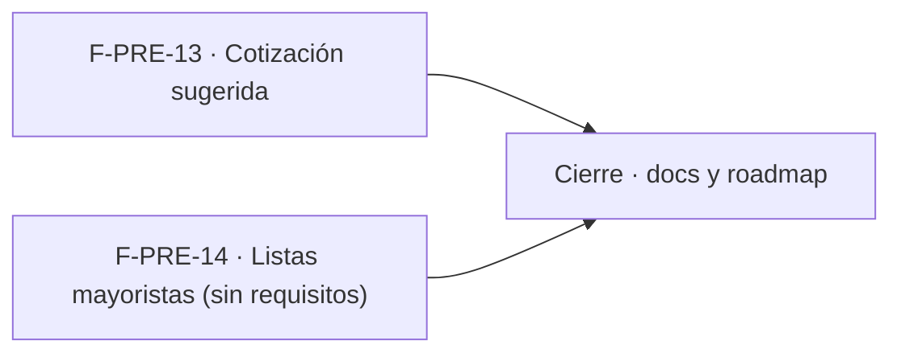

# Tareas: Precios y dólar · Cotización sugerida y mayoristas

**Estado**: MSF-116 ya está en `dokploy`. F-PRE-13 se implementó con la fuente de la Pregunta 1 (DolarApi, dólar oficial venta; ver `docs/precios.md`), confirmada por Nicolás el 2026-11-12. F-PRE-14 está **CANCELADA** (decisión de Nicolás, 2026-11-12) y no tiene tareas.

## Phase 1: F-PRE-13 · Cotización sugerida desde una fuente externa

- [x] T001 [F-PRE-13/MSF-441][US1] Lectura de la fuente pública y entrega del valor sugerido (FR-001); ubicación y fuente según Pregunta 1. Incluye `contracts/`/`openapi/` si hay RPC o Edge Function.
  Hecho: Edge Function `cotizacion-sugerida` + `pnpm test:edge:cotizacion-sugerida` (9 pruebas). Desvío: sin `openapi/` (la función no es API pública; contrato en `docs/precios.md`).
- [x] T002 [F-PRE-13/MSF-441][US1] Mostrar la sugerencia en el diálogo «Cargar dólar del día» y mantener la carga manual si la fuente falla (FR-001, FR-002).
  Hecho: `SugerenciaDelDia` en `DialogoCargarDolar` + hook `useCotizacionSugerida`. Desvío: diseño propio ausente en el prototipo (regla de fuentes 5): texto `xs` y botón de texto.
- [x] T003 [F-PRE-13/MSF-441][US1] Vitest del diálogo con fuente disponible y caída, y cambio de empresa activa (SC-001).
  Hecho: pruebas del diálogo y del hook. Desvío: no hay prueba de «cambio de empresa»: la sugerencia no depende de la empresa (la función no recibe empresa).

**Checkpoint**: la sugerencia aparece en el diálogo y la carga manual sigue igual.

## Phase 2: Cierre

- [x] T004 [CIERRE] Actualizar `docs/precios.md` y `docs/roadmap-template.md` con la sugerencia y el estado de F-PRE-14 (cancelada/redefinida según la decisión).
  Hecho: sección «Cotización sugerida» en `docs/precios.md`, fila en el roadmap; F-PRE-14 queda **Cancelada** (decisión de Nicolás, 2026-11-12).

## Plan de ejecución (historias)

F-PRE-13 y F-PRE-14 son independientes entre sí; F-PRE-14 está cancelada: no tiene tareas.

| Historia | Depende de | Grupo |
|----------|------------|-------|
| F-PRE-13 | — | 1 |
| F-PRE-14 | — | 1 |
| [Cierre] | F-PRE-13, F-PRE-14 | 2 |

