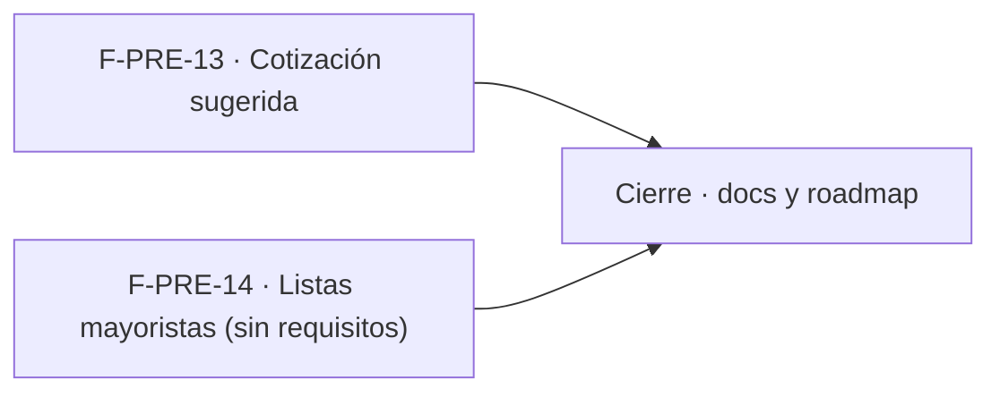

# Tareas: Precios y dólar · Cotización sugerida y mayoristas

**Bloqueo**: no iniciar hasta que MSF-116 esté en `main` y Nicolás responda las Preguntas 1–5 de la spec. F-PRE-14 no tiene tareas (FR-003 reservado).

## Phase 1: F-PRE-13 · Cotización sugerida desde una fuente externa

- [ ] T001 [F-PRE-13][US1] Lectura de la fuente pública y entrega del valor sugerido (FR-001); ubicación y fuente según Pregunta 1. Incluye `contracts/`/`openapi/` si hay RPC o Edge Function.
- [ ] T002 [F-PRE-13][US1] Mostrar la sugerencia en el diálogo «Cargar dólar del día» y mantener la carga manual si la fuente falla (FR-001, FR-002).
- [ ] T003 [F-PRE-13][US1] Vitest del diálogo con fuente disponible y caída, y cambio de empresa activa (SC-001).

**Checkpoint**: la sugerencia aparece en el diálogo y la carga manual sigue igual.

## Phase 2: Cierre

- [ ] T004 [CIERRE] Actualizar `docs/precios.md` y `docs/roadmap-template.md` con la sugerencia y el estado de F-PRE-14 (cancelada/redefinida según la decisión).

## Plan de ejecución (historias)

F-PRE-13 y F-PRE-14 son independientes entre sí; F-PRE-14 queda sin tareas hasta decidir.

| Historia | Depende de | Grupo |
|----------|------------|-------|
| F-PRE-13 | — | 1 |
| F-PRE-14 | — | 1 |
| [Cierre] | F-PRE-13, F-PRE-14 | 2 |

