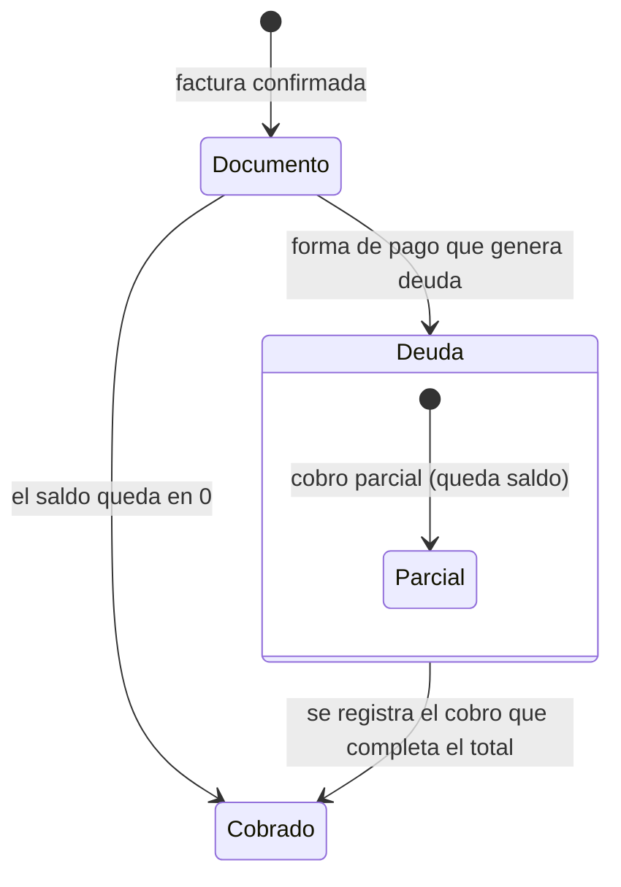

# Feature Specification: Clientes y proveedores · Cuenta corriente y saldo del cliente

**Feature Branch**: `feat/story-MSF-451`
**Componente**: Clientes y proveedores
**Jira**: MSF-451 (F-CLI-19) · épica MSF-450 `cuentas-y-compras-a-proveedores`
**Created**: 2026-11-09
**Status**: Finalizada y mergeada (#848; seguimientos #850, #851 y #852). La historia pasó a hito: su tarea de
épica (T001) pide «redactar requisitos, pantalla (saldo en la ficha de `ClienteFicha`) y matriz de la cuenta
corriente, a partir de cómo Ventas maneje cobros y estado Deuda». Esta spec es esa redacción. Desde el
2026-11-11 el comportamiento creció (notas de crédito, saldo neto, disparador): ver *Ampliación (2026-11-11)*; los
requisitos FR-001…FR-009 originales se leen con las aclaraciones de esa sección.
**Delivery scope**: `refine`, `supabase`
**Prioridad / Talla**: P3 · L (heredado de la épica)

## Contexto (por qué esta spec existe)

La épica MSF-450 («Clientes y proveedores · Cuentas y compras a proveedores») registró cuatro
ideas P3 **sin requisitos de comportamiento**, con la regla explícita de que «los requisitos se
redactan cuando pasen a un hito». F-CLI-19 («Cuenta corriente y saldo del cliente») es la primera
de esas ideas que pasa a hito: esta spec redacta sus requisitos y la historia los implementa en la
misma rama.

La fuente del comportamiento es **Ventas · cobros y conciliación** (épica MSF-195, ya entregada):

- El libro de dinero que entra es `dominio.cobros_comprobante`: un cobro por fila (parcial o
  total) de una factura.
- El saldo de una factura es **total con IVA menos lo cobrado menos sus notas de crédito**, nunca negativo
  (`private.saldo_comprobante`, F-VTA-12; las notas restan desde 20270227140000, ver *Ampliación (2026-11-11)*).
- El estado «Deuda» (F-VTA-10) no se consulta para calcular el saldo: una factura en «Deuda»
  simply no tiene cobros, así que debe su total completo; y una factura «Cobrada» tiene el
  saldo en 0. El saldo se calcula siempre con el mismo criterio, sin mirar el estado.
- Un borrador no se debe y una factura anulada no le debe nada a nadie.

Lo que **no** hay en el repo y esta historia **no** inventa: vencimientos, límites de crédito,
descuentos por pronto pago ni ningún estado nuevo de comprobante. (Las notas de crédito, que la primera versión dejó
afuera, restan desde el 2026-11-11: ver *Ampliación (2026-11-11)*.)

## Regla de fuentes (de la épica)

1. Comportamiento y datos: mandan los requisitos de esta spec.
2. Qué se ve: el prototipo validado (`design/pantallas/ClienteFicha.dc.html`) es referencia
   visual; esta historia **dibuja** la parte nueva (la tarjeta «Cuenta corriente») en el
   prototipo y la mapea en la *Matriz pantalla↔criterios*.
3. Cómo se construye: mandan el template y el sistema de diseño (MUI + tokens).
4. El prototipo muestra más que esta historia: se implementa solo lo que piden los requisitos.
5. Si algo no se puede igualar con el template: usar lo más cercano, sin inventar, y anotar la
   diferencia en el PR.
6. Si el prototipo y los requisitos se contradicen: requisitos para el comportamiento, prototipo
   para lo visual, y la contradicción queda anotada en el PR.

## Requisitos funcionales

- **FR-001** (F-CLI-19): DEBE existir `public.cuenta_corriente_cliente(p_cliente_id uuid)` que
  devuelve la cuenta corriente del cliente: `saldo_total` (cuánto debe), `comprobantes` (cuántos
  comprobantes tienen saldo) y una fila por comprobante **con saldo** (`id`, `numero`, `fecha`,
  `tipo`, `estado`, `total_con_iva`, `cobrado`, `saldo`), del más reciente al más antiguo. El `id`
  es el del comprobante: el número se repite entre tiendas (el correlativo es por organización,
  empresa y tipo) y el `id` es lo que identifica la fila. `security
  definer` con `search_path = ''`, organización de `private.organizacion_id()` (nunca del
  llamador), sección `clientes` en `lectura`/`edicion`; un cliente de otra organización devuelve
  saldo 0 y sin documentos (no revela si existe); `revoke … from public, anon` y `grant execute
  … to authenticated`. **Verificación**: pgTAP `supabase/tests/database/cuenta_corriente_cliente.test.sql`.
- **FR-002** (F-CLI-19): El saldo de un comprobante DEBE ser el que devuelve
  `private.saldo_comprobante` —dueño de `greatest(total_con_iva − Σ cobros, 0)`—; la RPC le resta además las notas de
  crédito emitidas de cada factura (`max(total − cobrado − notas, 0)`, actualización 2026-11-11). **Verificación**: pgTAP (cobro parcial, cobro
  total, cobro que supera el total → 0) + comparación del total y lo cobrado de cada documento con
  `private.saldo_comprobante` (SC-001).
- **FR-003** (F-CLI-19): A la cuenta corriente entran **solo facturas** que no están en
  `borrador`, `anulada` ni `cobrado` (una cobrada está saldada aunque su cobro no esté en el libro). Los presupuestos no son deuda y no entran; las notas de crédito no
  entran como filas: restan de su factura (ver *Fuera de alcance*). **Verificación**: pgTAP (presupuesto, anulada, borrador y nota
  de crédito quedan fuera; la factura en estado `deuda` entra con su total completo).
- **FR-004** (F-CLI-19): `saldo_total` DEBE ser la suma de los saldos de los comprobantes listados
  (y 0 si no hay ninguno); `comprobantes` DEBE ser la cantidad de comprobantes listados.
  **Verificación**: pgTAP.
- **FR-005** (F-CLI-19): La ficha (`/clientes/show/:id`) DEBE mostrar, en la tarjeta «Resumen
  comercial», el **«Saldo deudor»** junto al «Facturado en el año» (el prototipo ya lo muestra) y,
  debajo de «Últimos comprobantes», la tabla **«Cuenta corriente»** con los comprobantes que
  tienen saldo (Comprobante, Fecha, Estado, Total, Cobrado, Saldo). Los números de comprobante
  son texto (el enlace al comprobante es de Ventas). **Verificación**: Vitest
  (`apps/web/src/components/clientes/ComprasCliente.test.tsx`) + E2E `apps/web/e2e/cuenta-corriente-cliente.e2e.ts`.
- **FR-006** (F-CLI-19): La sección DEBE usar los patrones compartidos de carga, vacío y error
  (con «Reintentar»), ser usable en 320/768/1440 px, con teclado y lector de pantalla; si la
  cuenta corriente no se puede leer, el «Saldo deudor» muestra «—» y el bloque «Cuenta corriente»
  muestra el error con «Reintentar» (el error no se come el resto de la ficha). **Verificación**:
  Vitest (carga, vacío, error + reintento).
- **FR-007** (F-CLI-19): La cuenta corriente se calcula sobre **las tiendas a las que la persona
  accede** (`private.empresas_accesibles()`, como `public.saldo_comprobante`; el administrador accede
  a todas): no ve la deuda de tiendas ajenas. **Verificación**: pgTAP
  (las facturas de las dos tiendas suman en el mismo saldo).
- **FR-008** (F-CLI-19): La RPC NO DEBE crear ni alterar **tablas**; la migración original (20270222100000) DEBE ser
  aditiva con el camino de reversión documentado en el encabezado. **Verificación**: pgTAP (`rls_en_toda_tabla`
  verde) + `pnpm test:db:validar-aditivas` + revisión del encabezado de la migración. *Aclaración 2026-11-11: sigue
  sin haber tablas nuevas ni alteradas, pero las migraciones posteriores ya no son «aditivas» en sentido estricto:
  recrean funciones (drop + create) y agregan un disparador; ver la ampliación.*
- **FR-009** (F-CLI-19): La documentación del repo (`docs/clientes.md`) DEBE describir la cuenta
  corriente y el saldo de la ficha. **Verificación**: `pnpm docs:check` + revisión del diff.

## Escenarios de verificación

- **FR-001** — *Given* un cliente con una factura de $1.210 totalmente cobrada, otra de $1.210 con
  un cobro de $400 y otra de $605 en estado `deuda`, *When* se lee su cuenta corriente, *Then*
  devuelve saldo total $1.415 ($810 + $605), 2 comprobantes con saldo y sus filas con total,
  cobrado y saldo.
- **FR-002** — *Given* una factura con un cobro que supera su total, *When* se lee su cuenta
  corriente, *Then* su saldo es 0 y no aparece en la lista.
- **FR-003** — *Given* un cliente con un presupuesto, una factura anulada, una factura en
  borrador y una nota de crédito, *When* se lee su cuenta corriente, *Then* ninguno de esos
  documentos aparece como fila; la nota de crédito, si cuelga de una factura abierta, resta de esa factura
  (FR-010).
- **FR-004** — *Given* un cliente sin comprobantes con saldo, *When* se lee su cuenta corriente,
  *Then* devuelve saldo 0, 0 comprobantes y ninguna fila de documento.
- **FR-005** — *Given* la ficha de un cliente con deuda, *When* se abre, *Then* se ve el «Saldo
  deudor» con el importe y la tabla «Cuenta corriente» con los documentos abiertos.
- **FR-006** — *Given* que la base no responde, *When* se abre la ficha, *Then* el bloque
  «Cuenta corriente» muestra el error con «Reintentar» y el resto de la ficha sigue visible.
- **FR-007** — *Given* un cliente que debe en dos tiendas, *When* se lee su cuenta corriente,
  *Then* el saldo suma las dos tiendas si la persona accede a ambas; si accede a una sola, suma solo esa.
- **FR-001** (seguridad) — *Given* un usuario sin permiso de Clientes, *When* llama la RPC
  directo a la base, *Then* recibe error de permiso; y `anon` no puede ejecutarla.
- **FR-001** (seguridad) — *Given* un cliente de otra organización, *When* se lee su cuenta
  corriente, *Then* devuelve saldo 0 y sin documentos.

## Criterios de éxito

- **SC-001**: la cuenta corriente de un cliente cuadra con `private.saldo_comprobante` documento
  por documento (total y cobrado; el saldo, además, resta las notas de crédito) —el pgTAP la llama y compara cada fila—, y el saldo total es la suma de los saldos
  listados (pgTAP).
- **SC-002**: aislamiento: otra organización no lee saldos ajenos; la sección Clientes en
  `ninguno` no lee la cuenta corriente; `anon` sin ejecución; ninguna tabla nueva sin RLS
  (pgTAP).
- **SC-003**: la ficha muestra el «Saldo deudor» y la tabla «Cuenta corriente», con vacío para un
  cliente sin deuda y sin romperse si la base falla (Vitest + E2E).
- **SC-004**: `pnpm lint && pnpm build && pnpm test && pnpm docs:check && pnpm matriz:check &&
  pnpm prototipo:check` sin errores.
- **SC-005**: el diff **original (#848, 20270222100000)** no toca tablas ni el comportamiento de Ventas: solo una RPC
  de lectura nueva, la ficha del cliente y su prototipo. **Ya no es cierto para el conjunto**: desde #851 y #852 sí
  cambia el comportamiento de Ventas (ver *Ampliación (2026-11-11)*).

## Esquemas de datos (Principio VII)

Esta spec **no crea ni altera tablas** (ni en la ampliación del 2026-11-11). No hay esquema que declarar:

| Objeto | Esquema | Motivo |
|---|---|---|
| `dominio.comprobantes_venta` | `dominio` (existente) | Documentos de venta: se leen, no se escriben. |
| `dominio.cobros_comprobante` | `dominio` (existente) | Libro de cobros: se lee, no se escribe. |
| `public.clientes` | `public` (existente) | Se lee para verificar que el cliente es de la organización. |
| `public.cuenta_corriente_cliente(uuid)` | `public` (nueva RPC) | Mecanismo de plataforma (la usan el panel y la tienda); no es una entidad de negocio. Recreada en 20270227110000 y 20270227140000. |
| `private.saldo_comprobante(uuid)` y `public.saldo_comprobante(uuid)` | `private` / `public` (existentes, recreadas) | Cambian de forma (columna `notas_credito`) en 20270227140000: drop + create, sin tocar tablas. |
| `private.sincronizar_efectos_nota_credito(uuid)` y disparador `comprobantes_venta_nota_credito_efectos` | `private` / sobre `dominio.comprobantes_venta` (nuevos) | 20270227150000: escriben el estado de facturas y el importe de `dominio.contrarreembolsos` (tablas existentes; no se crean ni alteran columnas). |

Ninguna tabla nueva: el pgTAP `rls_en_toda_tabla` sigue verde sin cambios.

## Matriz pantalla↔criterios

Inventario determinista con `pnpm prototipo:inventario` sobre `design/pantallas/ClienteFicha.dc.html`
(`ClienteFicha.inventory.json`). La tarjeta «Cuenta corriente» la dibuja esta historia (la tarea
de épica T001 pide «pantalla … y matriz de la cuenta corriente»); el resto del prototipo ya
existía.

### Clientes · Ficha (`ClienteFicha.dc.html`)

| Ítem del inventario | Destino | Criterio |
|---|---|---|
| Tarjeta «Resumen comercial» → «Saldo deudor» | En alcance | F-CLI-19 US1-1, FR-005 |
| Tarjeta «Resumen comercial» → «Facturado en 12 meses» | Ya entregado por F-CLI-10 (como «Facturado en el año», sin IVA) | — |
| Tarjeta «Resumen comercial» → «Comprobantes», «Último» y botón «Nuevo comprobante» | **FUERA DE ALCANCE** — no los pide esta historia (son de Ventas) | — |
| Tabla de «Cuenta corriente» (Comprobante, Fecha, Estado, Total, Cobrado, Saldo) | En alcance (la dibuja esta historia) | F-CLI-19 US1-2, FR-005 |
| Tarjeta «Últimos comprobantes» (número, estado, total) | Ya entregado por F-CLI-10; esta historia no lo cambia | — |
| Campos de datos del cliente, botones «Etiqueta», «Guardar cambios», «Configurar tipos de cliente →», «Incluir en el correo masivo», «Imprimir etiqueta de envío», bloque «Cuenta web» y sus acciones | **FUERA DE ALCANCE** — ficha, edición y cuenta web ya entregadas (MSF-180, MSF-237) | — |

### Empresa activa (Principio VIII)

| Ítem | Destino | Motivo |
|---|---|---|
| Empresa activa (selector de la barra superior) | **No aplica** | La cuenta corriente suma las tiendas a las que la persona accede (FR-007, `private.empresas_accesibles()`): es la deuda del cliente en esas tiendas, no la de la empresa activa. La sección **no depende** de la empresa activa y no hay datos que reencuadrar al cambiarla. Lo que sí depende de la empresa activa en esta ficha —el bloque «Cuenta web», que es por tienda— ya se reencuadra (test `apps/web/src/pages/clientes/empresa-activa.test.tsx`). El texto «Si elegís una empresa en la barra superior, se filtra por esa tienda» es del **listado** de Clientes (`Clientes.dc.html`), no de la ficha. |

## Flujos

El saldo de un documento no se guarda: se calcula siempre como total con IVA menos cobros menos notas de crédito. Por
eso el saldo del cliente tampoco se guarda: se calcula sumando los documentos abiertos. (Lo que sí se guarda, desde
20270227150000, es el efecto de una nota de crédito sobre el *estado* de la factura y el importe de sus
contrarreembolsos pendientes; el saldo en sí sigue calculándose al leer.)

## Ampliación (2026-11-11)

Esta sección documenta lo que cambió **después** de #848 y que contradice o amplía el texto original. Manda sobre
FR-002, FR-003, FR-008, SC-005 y *Esquemas de datos* cuando difieran.

### Qué se entregó y en qué PR

| PR | Migración | Qué hace |
|---|---|---|
| Historia MSF-451 (previa a #848) | `20270222100000` | La RPC `public.cuenta_corriente_cliente` (aditiva, sin tablas). |
| #848 | `20270227110000` | Decisión de Nicolás: las notas de crédito restan. Se recrea `public.cuenta_corriente_cliente` (drop + create) con la columna `notas_credito`. |
| #850 | `20270227130000` | Qué nota cuenta lo decide `private.comprobante_cuenta_como_facturado` (sin cambio de comportamiento). |
| #851 | `20270227140000` | Se recrean (drop + create) `private.saldo_comprobante` y `public.saldo_comprobante` con la columna `notas_credito`; `cuenta_corriente_cliente` pasa a usar `private.saldo_comprobante`; `grant execute` del predicado `private.comprobante_cuenta_como_facturado(text, text)` a `authenticated`. **Cambia el comportamiento de Ventas** (detalle del comprobante, tope de `registrar_cobro`, importe del contrarreembolso). |
| #852 | `20270227150000` | Disparador sobre `dominio.comprobantes_venta` (solo filas `nota_credito`) que escribe el estado de las facturas y el importe de los contrarreembolsos pendientes. **Cambia el comportamiento de Ventas**. |

(La migración `20270227120000` es de la API y no pertenece a esta historia.)

### Requisitos nuevos

- **FR-010** (saldo neto en `saldo_comprobante`): `private.saldo_comprobante` y `public.saldo_comprobante` DEBEN
  devolver `total`, `cobrado`, `notas_credito` y `saldo = round(max(total − cobrado − notas_credito, 0), 2)`; las
  notas son las que cuelgan de la factura (`comprobante_origen_id`), del mismo cliente y organización, y que cuentan
  según `private.comprobante_cuenta_como_facturado` (hoy: ni `borrador` ni `anulada`). La cuenta corriente usa ese mismo
  cálculo. **Verificación**: pgTAP `cuenta_corriente_cliente.test.sql` (46 aserciones) y los pgTAP de cobros.
- **FR-011** (tope de cobro): `registrar_cobro` DEBE rechazar un importe mayor que el saldo neto. **Verificación**:
  pgTAP de cobros.
- **FR-012** (contrarreembolso pendiente): un contrarreembolso se abre por el saldo neto y, mientras esté pendiente, su
  importe se ajusta al saldo neto cuando se emite o se anula una nota (evento `contrarreembolso.importe_ajustado`);
  con saldo 0 se deja como está. **Verificación**: pgTAP.
- **FR-013** (estado → Cobrado): si el saldo neto queda en 0 y la factura TIENE cobros, el disparador la pasa a
  «Cobrado» por `private.marcar_estado_cobro_comprobante`, solo si la transición existe para el actor `sistema` en la
  matriz de la organización (si no, no hace nada y nunca aborta la emisión de la nota). Una factura cubierta entera por
  notas y SIN cobros queda como está. **Verificación**: pgTAP.
- **FR-014** (anular una nota no reabre): si se anula una nota después de que la factura pasó a «Cobrado», el estado NO
  vuelve a «Deuda» (una factura cobrada en mostrador, anterior al libro de cobros, puede estar en «Cobrado» sin cobros
  y no hay forma segura de distinguirla). Los contrarreembolsos pendientes sí se reajustan. Límite documentado en
  `docs/cobros-por-comprobante.md`.
- **FR-015** (seguridad del disparador): las funciones nuevas son `private`, `security definer` con
  `search_path = ''`, sin execute para `public`/`anon`/`authenticated`; la factura se bloquea primero (`for update`).

### Escenarios de verificación (ampliación)

- **FR-010 (nota de crédito)** — *Given* una factura de $1.000 con una nota de crédito emitida de $300, *When* se lee
  su cuenta corriente y el detalle del comprobante, *Then* ambos muestran saldo $700 (antes: 700 en la ficha y 1.000 en
  el comprobante).
- **FR-010 (nota no emitida)** — *Given* una nota de crédito en `borrador` o `anulada`, *When* se calcula el saldo,
  *Then* no resta.
- **FR-010 (otro cliente)** — *Given* una nota de otro cliente que apunta a la factura, *When* se calcula el saldo,
  *Then* no resta.
- **FR-010 (redondeo)** — *Given* una factura de $1.210,50 con una nota de $0,10, *When* se calcula el saldo, *Then*
  el saldo es $1.210,40 (2 decimales).
- **FR-010 (sin saldo a favor)** — *Given* una factura de $1.000 con $800 cobrados y una nota de $400, *When* se lee la
  cuenta corriente, *Then* el saldo es $0, la factura no aparece y el excedente de $200 no se acredita en ningún lado.
- **FR-010 (nota mayor que el total)** — *Given* una nota de $1.200 sobre una factura de $1.000 sin cobros, *When* se
  calcula el saldo, *Then* es $0 (no negativo).
- **FR-010 (tienda desactivada)** — *Given* una factura de una tienda desactivada, *When* se lee la cuenta corriente,
  *Then* no suma (tampoco para el administrador).
- **FR-010 (persona sin tiendas)** — *Given* una persona sin tiendas asignadas, *When* lee la cuenta corriente de un
  cliente con deuda, *Then* ve saldo $0.
- **FR-011** — *Given* una factura de $1.000 con una nota de $300, *When* se intenta registrar un cobro de $1.000, *Then*
  se rechaza («El importe supera el saldo pendiente») y un cobro de $700 se acepta.
- **FR-012** — *Given* un contrarreembolso pendiente de $1.000, *When* se emite una nota de $300, *Then* el importe
  pasa a $700 y queda el evento `contrarreembolso.importe_ajustado`; marcarlo cobrado ya no falla por el tope.
- **FR-013** — *Given* una factura de $1.000 en «Deuda» con un cobro parcial de $600, *When* se emite una nota de $400,
  *Then* el saldo neto es $0 y la factura pasa a «Cobrado».
- **FR-013 (sin cobros)** — *Given* una factura en «Deuda» sin cobros, *When* una nota la cubre entera, *Then* el estado
  no cambia.
- **FR-014** — *Given* la factura anterior ya en «Cobrado», *When* se anula la nota, *Then* el estado sigue en «Cobrado».

### Decisión para Nicolás: aprobación retroactiva

Las migraciones **20270227140000 y 20270227150000 cambian el comportamiento de Ventas** (tope de cobro, estado de la
factura, importe del contrarreembolso) y se mergearon como seguimientos de una revisión, sin que esta spec ni la de
Ventas (MSF-195) las hubieran ampliado antes. Quedan **a la espera de la aprobación retroactiva de Nicolás**; si no
las aprueba, se revierten (ver *Reversión* en `docs/clientes.md`, que ahora incluye ambas). Otras decisiones abiertas
están en `notas.md`.

## Fuera de alcance (explícito)

- **Notas de crédito restando de la cuenta corriente**: *dejado afuera en la primera versión; hoy implementado*
  (decisión de Nicolás, 2026-11-11, MSF-450). Las notas de crédito emitidas RESTAN de la factura de la que cuelgan
  (`max(total − cobrado − notas, 0)`, sin saldo a favor, 2 decimales); ver *Ampliación (2026-11-11)*, `docs/clientes.md`
  y las migraciones `20270227110000` y `20270227140000`.
- Vencimientos, límites de crédito, pago a plazo, descuentos por pronto pago, saldo a fin de mes
  o cualquier otra aritmética de crédito.
- Un estado nuevo de comprobante o una tabla nueva de «movimientos de la cuenta corriente»: la
  cuenta corriente es una **lectura** de los documentos abiertos, no un libro propio.
- Un historical de la deuda por fecha («saldo a fin de mes»): la cuenta corriente es la deuda
  **de hoy**.
- La reversa de un cobro mal cargado (es de MSF-195) y la exportación de la cuenta corriente.
- El «Nuevo comprobante», el contador de «Comprobantes» y la fecha del «Último» de la ficha
  (son de Ventas y quedaron fuera de alcance en F-CLI-08…10).
- El saldo por tienda o el detalle por tienda de la cuenta corriente: la tabla no muestra la
  tienda de cada documento. Como el correlativo es por empresa, el número puede repetirse entre
  tiendas de la misma organización; lo que distingue las filas es el `id` del comprobante.

## Decisiones (provisorias, con valor por defecto)

1. **Base del saldo** — con IVA: es el saldo que el cliente debe (el mismo criterio de
   `private.saldo_comprobante`). El «Facturado» que ya se muestra en la ficha es sin IVA (criterio
   del ranking); son dos números distintos y cada uno dice su base en la etiqueta.
2. **Alcance por tiendas accesibles** — las tiendas a las que la persona accede (FR-007); a diferencia de la sección «Compras», que hoy es de toda la organización (diferencia conocida, con seguimiento).
3. **Quién ve el saldo** — cualquiera con Clientes en `lectura`/`edicion`, el mismo permiso que
   la sección «Compras»: el saldo es un agregado de comprobantes que esa persona ya ve en la
   ficha, no información nueva.
4. **Paginación** — la cuenta corriente **no** pagina: lista los documentos abiertos del cliente.
   El «Facturado en el año» y los «Últimos comprobantes» de F-CLI-10 sí paginan.
5. **Notas de crédito** — restan de su factura desde el 2026-11-11 (ver *Ampliación (2026-11-11)*).
6. **Identidad de la fila** — el `id` del comprobante, no el número: el correlativo es por
   organización, empresa y tipo, así que el mismo número puede repetirse entre tiendas de la misma
   organización. La tabla no muestra la tienda (el detalle por tienda está fuera de alcance), pero
   cada fila es un comprobante distinto.

## Matriz de trazabilidad Jira ↔ US ↔ FR ↔ tareas

| Jira | Historia | FR / SC | Tasks |
|---|---|---|---|
| MSF-451 | F-CLI-19 US1 Cuenta corriente y saldo del cliente | FR-001…FR-009, SC-001…SC-005 | T001–T007 |
| MSF-450 (seguimiento, decisión 2026-11-11) | Notas de crédito restan, saldo neto, efectos | FR-010…FR-015 | T008–T012 |
