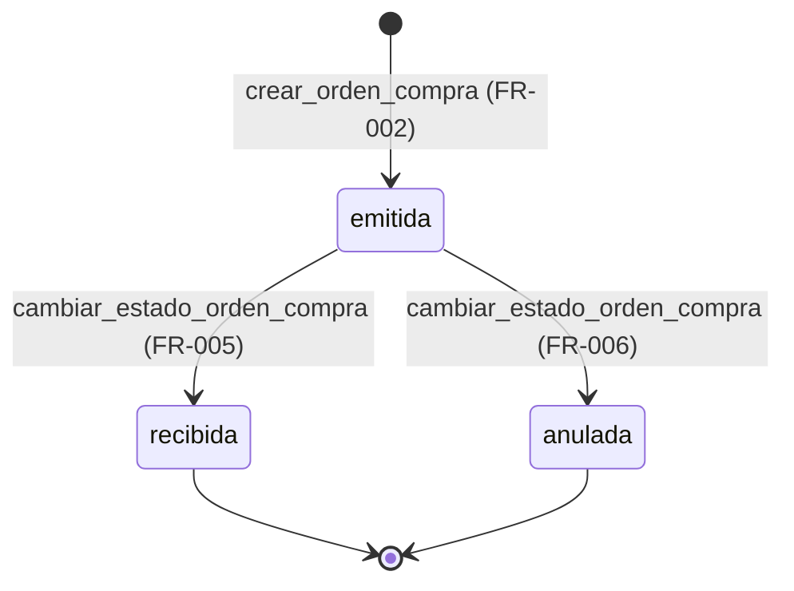
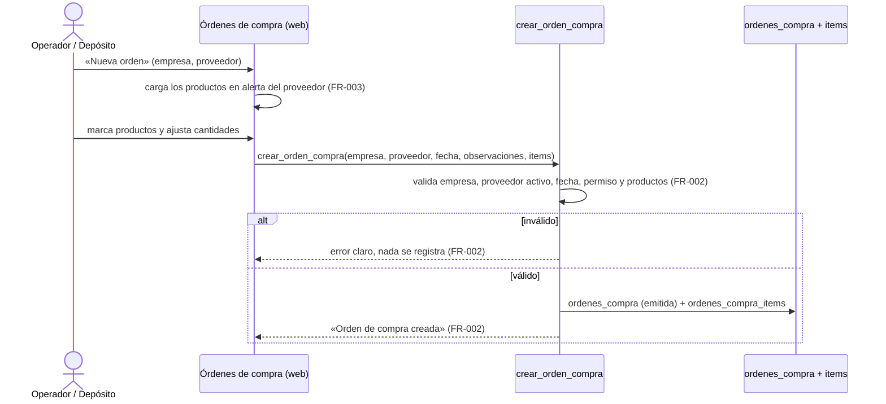

# Feature Specification: Clientes y proveedores · Cuentas y compras a proveedores — F-PRV-09 · Órdenes de compra a proveedores

**Feature Branch**: `feat/story-MSF-454`

**Jira Epic**: MSF-450 — Clientes y proveedores · Cuentas y compras a proveedores (spec `cuentas-y-compras-a-proveedores`)

**Historia**: F-PRV-09 · Órdenes de compra a proveedores (US4 de la épica)

**Created**: 2026-11-09

**Status**: Ready for implementation — la épica (MSF-450) deja esta historia **sin requisitos de comportamiento** y los delega en la spec de la historia («los requisitos se redactan cuando pasen a un hito», *Decisiones* 1 y 4 de la épica). Esta spec los redacta y fija el alcance mínimo operable.

**Delivery scope**: `supabase` (migraciones + RPC + pgTAP) y `refine` (apps/web). Sin `kestra`, `superset` ni `workers`: no hay proceso en segundo plano, ni correo, ni analítica.

**Prioridad / Hito**: P3 · Backlog de la épica (prioridad heredada; la épica la dejó en P3) · talla L (heredada).

**Dependencias** (verificadas en esta rama, no son historias de esta épica):
- **Stock · listado de reposición** (`docs/stock-avisos-reposicion.md`, `docs/stock.md`): `public.stock_estados` (producto, cantidad, reservado, disponible, mínimo, estado `sin_stock`/`stock_bajo`/`disponible`) y la pantalla `/stock` con el filtro «Ver solo alertas». Es el insumo de esta historia.
- **Proveedores y productos** (F-PRV-01/02/03, `docs/proveedores.md`): `dominio.proveedores` y `dominio.productos.proveedor_id` (un producto tiene **un** proveedor). Es el origen de la orden (decisión 4 de la épica).
- **Ingreso de mercadería** (F-PRV-04/05, `docs/ingreso-de-mercaderia.md`): `dominio.ingresos_mercaderia` y el movimiento de stock de entrada. **No se modifica**: esta historia no vincula la orden con el ingreso (ver *Fuera de alcance*).
- **Bloquea a**: ninguna épica.

**Input**: Epic MSF-450, historia prevista F-PRV-09 («Órdenes de compra a proveedores», P3, talla L, «Se apoya en el listado de reposición de Stock»).

**Regla de fuentes** (literal de la épica):
1. Comportamiento y datos: mandan los requisitos y escenarios de esta historia.
2. Qué se ve (disposición, textos, estados, popups, flujos): el prototipo validado es referencia visual, no hace falta que quede extremadamente idéntido.
3. Cómo se construye: mandan el template y el system design del producto (`docs/sistema-de-diseno.md`). No copiar el HTML ni el CSS del prototipo.
4. El prototipo muestra más que esta historia: se implementa solo lo que piden los requisitos.
5. Si algo no se puede igualar con el template / el sistema de diseño: usar lo más cercano, sin inventar, y anotar la diferencia en el PR.
6. Si el prototipo y los requisitos se contradicen: requisitos para el comportamiento, prototipo para lo visual, y dejar la contradicción anotada en el PR.

Prototipo (solo lectura): **no hay pantalla de órdenes de compra en `design/pantallas/`**. Las referencias visuales son `design/pantallas/Stock.dc.html` (listado con «Ver solo alertas») y `design/pantallas/IngresoMercaderia.dc.html` (documento de proveedor). Inventarios: `Stock.inventory.json`, `IngresoMercaderia.inventory.json`.

## Modelo y supuestos

- **Qué es una orden de compra**: el pedido de mercadería que la organización le hace a **un** proveedor, con los productos y las cantidades que se piden. Se crea **desde el listado de reposición de Stock** (los productos en alerta de ese proveedor) y se sigue hasta que la mercadería se recibe o la orden se anula.
- **Origen de la orden** (decisión 4 de la épica): el proveedor es **el del producto** (`dominio.productos.proveedor_id`), no uno elegido a mano. Por eso una orden es de un solo proveedor y sus productos son los que ese proveedor tiene en alerta. Un producto **sin** proveedor no entra en ninguna orden: no hay a quién pedirle.
- **Estados**: `emitida` (creada, el pedido está en curso), `recibida` (el proveedor entregó) y `anulada` (se canceló, con motivo). Una orden no se edita ni se borra: se anula. Los estados terminales (`recibida`, `anulada`) no cambian.
- **Recibir no es ingresar mercadería**: marcar la orden como `recibida` **no mueve stock**. El stock entra con «Ingreso de mercadería» (F-PRV-04), que ya existe y pide costo unitario; esta historia no cambia ese flujo ni lo vincula (ver *Fuera de alcance*).
- **Empresa**: la orden se hace «a nombre de» una empresa (la empresa activa de la barra superior por omisión), igual que el ingreso de mercadería. El stock es único por organización, pero el pedido pertenece a una empresa.
- **Permisos**: lectura con la sección `stock` ≥ `lectura`; crear, recibir y anular exigen `stock` ≥ `edicion`. La RPC valida el permiso: la UI no es la autorización. No se agrega una sección nueva a la matriz de roles: reusa `stock`.
- **Sin número de orden**: no hay correlativo (queda fuera de alcance, ver *Fuera de alcance*). La orden se identifica por proveedor, fecha y estado.

### Esquema de datos (Constitución, Principio VII)

| Objeto | Esquema | Justificación | RLS / acceso |
|--------|---------|---------------|--------------|
| `ordenes_compra` (**nueva**, F-PRV-09) | **`dominio`** | Pedido de mercadería a un proveedor: entidad de negocio del producto. | RLS por organización y sección `stock` (`select` ≥ `lectura`); **sin escritura directa** (solo RPC `security definer`); `anon` sin privilegios. |
| `ordenes_compra_items` (**nueva**, F-PRV-09) | **`dominio`** | Línea del pedido (producto y cantidad pedida): detalle de la entidad anterior. | Igual que la cabecera: RLS por organización, `select` con `stock`, sin escritura directa, `anon` sin acceso. |
| `dominio.proveedores` / `dominio.productos` / `dominio.existencias` (**existentes**) | `dominio` (sin cambio) | Proveedor del pedido y productos en alerta del listado de reposición. | Vigente. |
| `dominio.ingresos_mercaderia` (**existente**) | `dominio` (sin cambio) | El ingreso de mercadería, que sigue siendo el camino del stock. | Vigente, sin cambios. |

No se crean otras tablas. `rls_en_toda_tabla` (pgTAP, recorre `public` + `dominio`) debe seguir verde. Las migraciones son **aditivas** con reversión en su encabezado.

## Flujos

### Flujo 1 · Ciclo de vida de la orden (máquina de estados)

(Una orden `emitida` no vuelve atrás: `recibida` y `anulada` son finales.)

### Flujo 2 · Crear la orden desde el listado de reposición (secuencia)

## User Scenarios & Testing *(mandatory)*

### User Story 1 - Pedir lo que falta a cada proveedor (F-PRV-09, P3, talla L)

Como operador, quiero ver los productos que están en alerta de reposición y armarles una orden a su proveedor, para que la mercadería que falta esté pedida y no dependa de que alguien la recuerde.

**Why this priority**: es el corazón de la historia; sin la orden no hay seguimiento.

**Independent Test**: con dos productos en alerta del mismo proveedor y otro de otro proveedor, creo una orden para el primero con las cantidades sugeridas; la orden queda `emitida` con sus dos líneas; el producto del otro proveedor no aparece.

### User Story 2 - Seguir la orden hasta que llega o se cancela (F-PRV-09)

Como responsable de compras, quiero ver las órdenes de compra y su estado, y poder marcar una como recibida o anularla con motivo, para saber qué está en camino y qué se canceló.

**Why this priority**: sin estado, la orden es un papel sin seguimiento.

**Independent Test**: creo una orden, la marco como `recibida` con la fecha de recepción y después intento anularla; la orden queda `recibida` y la anulación se rechaza.

### Edge Cases

- Un producto en alerta **sin** proveedor: no aparece en ninguna orden (no hay a quién pedirle).
- Un producto en alerta de un proveedor **inactivo**: no se puede crear la orden (el proveedor inactivo no recibe pedidos); el histórico se conserva.
- La **empresa** de la orden: debe ser una empresa activa a la que el usuario tenga acceso; la omisión es la empresa activa de la barra superior.
- **Fecha futura**: se rechaza (una orden no se emite en el futuro).
- Reintento de la misma orden: se crea otra orden (no hay clave de idempotencia: cada orden es un pedido distinto). El botón se deshabilita mientras guarda.
- Orden **sin productos** o con cantidad cero: se rechaza.
- Un producto que ya no está en alerta al crear la orden: se rechaza con un mensaje claro (la lista de reposición cambió).
- Rol con `stock` en `lectura`: ve el listado y el detalle, no puede crear, recibir ni anular.

## Requirements *(mandatory)*

### Functional Requirements

- **FR-001**: Existen `dominio.ordenes_compra` (cabecera: empresa, proveedor, fecha, estado, observaciones, recepción y anulación) y `dominio.ordenes_compra_items` (producto y cantidad pedida), con RLS por organización y por nivel de la sección `stock`: `authenticated` lee con `lectura` o `edicion`; **no hay escritura directa** desde el rol (solo las RPC); `anon` no tiene privilegios.
- **FR-002**: Se puede crear una orden de compra para una empresa activa accesible y un proveedor activo de la organización, con fecha no futura y al menos un producto con cantidad mayor a cero. La orden queda en estado `emitida` y sus líneas guardan producto y cantidad. La RPC rechaza con mensaje claro cualquier dato inválido y **no deja nada a medias**.
- **FR-003**: Los productos de una orden salen del **listado de reposición de Stock**: los productos del proveedor elegido que están en estado `sin_stock` o `stock_bajo`. La cantidad sugerida es `max(1, mínimo − disponible)` y el usuario puede ajustarla. Un producto sin proveedor, o de otro proveedor, no se puede pedir.
- **FR-004**: Se puede listar las órdenes de compra con paginación en servidor y filtro por estado; el listado muestra fecha, proveedor, empresa, estado y unidades pedidas, y solo las órdenes que el llamador puede ver (RLS).
- **FR-005**: Se puede ver el detalle de una orden (cabecera y líneas) y marcar una orden `emitida` como `recibida` con fecha de recepción. Recibir **no mueve stock** y no vuelve editable la orden.
- **FR-006**: Se puede anular una orden `emitida` indicando el motivo (3 a 500 caracteres). Una orden anulada o recibida no cambia de estado.
- **FR-007**: La pantalla «Órdenes de compra» vive en Stock (ruta canónica `/stock/ordenes-compra`, pestaña propia, entrada de menú), con estados compartidos de carga, vacío y error, con las acciones de recibir y anular visibles solo con `edicion` en `stock`, y funciona con teclado, lector de pantalla y anchos de 320 px, 768 px y 1440 px.
- **FR-008** (Principio VIII, empresa activa): el alta toma la **empresa activa** de la barra superior por omisión y permite elegir otra empresa accesible; el listado filtra por la empresa elegida con el componente compartido `FiltroEmpresa`; al cambiar de empresa el listado se reencuadra (página, filtros y datos recargados).
- **FR-009**: La documentación del repo refleja el modelo, los permisos, la reversión y el vínculo con el ingreso de mercadería (`docs/ordenes-compra.md`), y la historia queda registrada en `docs/cuentas-y-compras-a-proveedores.md`.

### Success Criteria

- **SC-001**: La prueba de pgTAP de la historia cubre el aislamiento por organización, los permisos por rol (`lectura` no escribe, `edicion` sí), los tres estados y sus transiciones, el rechazo de datos inválidos, la ausencia de escritura directa y de `anon` sin privilegios; `rls_en_toda_tabla` sigue verde.
- **SC-002**: La prueba de web (Vitest) cubre la validación del formulario (empresa, proveedor, fecha, cantidades), el mensaje de error de la base, el listado con filtro y paginación, y la visibilidad de las acciones según el rol.
- **SC-003**: `pnpm lint`, `pnpm build`, `pnpm docs:check`, `pnpm matriz:check` y `pnpm prototipo:check` terminan con código 0; el E2E de la historia lleva el rótulo `[MSF-454:<TASK>]`.

## Decisiones (de la épica, aplicadas a esta historia)

1. **Hito**: la épica dejó las cuatro historias sin requisitos y abiertas a propósito; esta historia los redacta ahora, como pide su tarea (`T004`: «redactar requisitos de órdenes de compra a proveedores sobre el listado de reposición de Stock»).
2. **Origen de la orden** (decisión 4 de la épica): el proveedor es el del producto (`dominio.productos.proveedor_id`), sobre el listado de reposición de Stock.
3. **Sin requisitos nuevos fuera de la historia**: la cuenta corriente del proveedor, los pagos y las condiciones de compra no se tocan.

## Matriz pantalla↔criterios

El prototipo **no tiene** pantalla de órdenes de compra: esta historia agrega una pantalla nueva. Se implementa con los patrones del panel (pestañas de Stock, tabla adaptable, estados compartidos) y se anotan las diferencias en el PR. Los ítems de los prototipos que rozan esta historia se mapean así:

### Stock actual (`Stock.dc.html`)

| Ítem del inventario | Destino | Motivo |
|---|---|---|
| Botón «Ver solo alertas» | **FR-003** | Es el listado de reposición: de ahí salen los productos y la cantidad sugerida de la orden. |
| Tabs «Stock actual», «Movimientos», «Ingreso de mercadería», «Depósitos de mercadería», «Faltantes», «Actualizar por Excel» | **Fuera de alcance** | Son de otras historias; esta historia **agrega** una pestaña propia («Órdenes de compra») y no cambia las existentes. |
| Tabla «Producto, Stock, Reservado, Disponible, Mínimo, Estado, Último movimiento» | **Fuera de alcance** | La pantalla de Stock no cambia; sus cifras alimentan el diálogo de alta. |
| Campos «Producto, Tipo de movimiento, Depósito de mercadería, Tienda o canal, Fecha, Motivo, Nota (opcional)» y diálogo «Registrar movimiento de stock» | **Fuera de alcance** | Diálogo de movimientos, de Stock. |
| Botones «Nuevo movimiento», «Registrar», «Cancelar» | **Fuera de alcance** | Ídem. |

### Ingreso de mercadería (`IngresoMercaderia.dc.html`)

| Ítem del inventario | Destino | Motivo |
|---|---|---|
| Diálogo de ingreso de mercadería (empresa, proveedor, productos, cantidades, costos) | **Fuera de alcance** | El ingreso de mercadería sigue siendo el camino del stock (F-PRV-04). Esta historia no lo modifica ni lo vincula; la diferencia queda anotada en el PR. |
| Pestaña «Ingreso de mercadería» | **Fuera de alcance** | Pestaña existente; esta historia agrega la suya al lado. |

### Proveedores · Ficha (`ProveedorFicha.dc.html`)

| Ítem del inventario | Destino | Motivo |
|---|---|---|
| Tabla «Producto / Código del proveedor / Costo / Último ingreso» y botón «Ingresar mercadería» | **Fuera de alcance** | La ficha no cambia (ya lo declaró la épica). Verificar que esta historia no los toca. |
| Columnas «N.º», «Último ingreso», «Costo», condiciones de compra, «Compra para», «Enviar correo a proveedor» | **Fuera de alcance** | Son seguimientos de MSF-219/MSF-179 (ya trazados en la épica de Proveedores). Esta historia no agrega el N.º correlativo de la orden. |

### Empresa activa (Principio VIII)

| Ítem | Destino | Motivo |
|---|---|---|
| Empresa activa (selector de la barra superior) | **FR-008** | El alta usa la empresa activa por omisión y el listado filtra por empresa con `FiltroEmpresa`; al cambiar de empresa la pantalla se reencuadra. |

## Fuera de alcance (explícito)

- **Vincular la orden con el ingreso de mercadería**: el stock sigue entrando por «Ingreso de mercadería» (F-PRV-04). Vincular la orden al ingreso (o recibir la mercadería desde la orden) es una historia aparte: cambiaría el contrato de `registrar_ingreso_mercaderia`.
- **N.º correlativo de la orden** y las columnas «N.º», «Último ingreso» y «Costo» de la ficha del proveedor (seguimientos MSF-219/MSF-179 ya trazados en la épica de Proveedores).
- **Condiciones de compra, «Compra para», «Enviar correo a proveedor»** y el resto de lo que el prototipo muestra y la épica no pide (MSF-523 y otros, ya trazados).
- **Costo de la orden**: el costo unitario se conoce al ingresar la mercadería; la orden no lo guarda.
- **Envío de la orden por correo** al proveedor.
- **Edición de una orden emitida**: se anula con motivo; no se edita.
- **Varias empresas por orden** y **órdenes de varios proveedores** en una sola pantalla de alta: una orden es de un proveedor.

## Matriz de trazabilidad Jira ↔ US ↔ FR ↔ tareas

| Jira | US | FR | Tasks |
|------|----|----|-------|
| F-PRV-09 | US1 · Pedir lo que falta a cada proveedor | FR-001, FR-002, FR-003 | T001–T006 |
| F-PRV-09 | US2 · Seguir la orden hasta que llega o se cancela | FR-004, FR-005, FR-006 | T007–T011 |
| F-PRV-09 | US1 + US2 (pantalla y empresa activa) | FR-007, FR-008 | T012–T017 |
| F-PRV-09 | Cierre de la historia | FR-009, SC-001, SC-002, SC-003 | T018–T021 |
