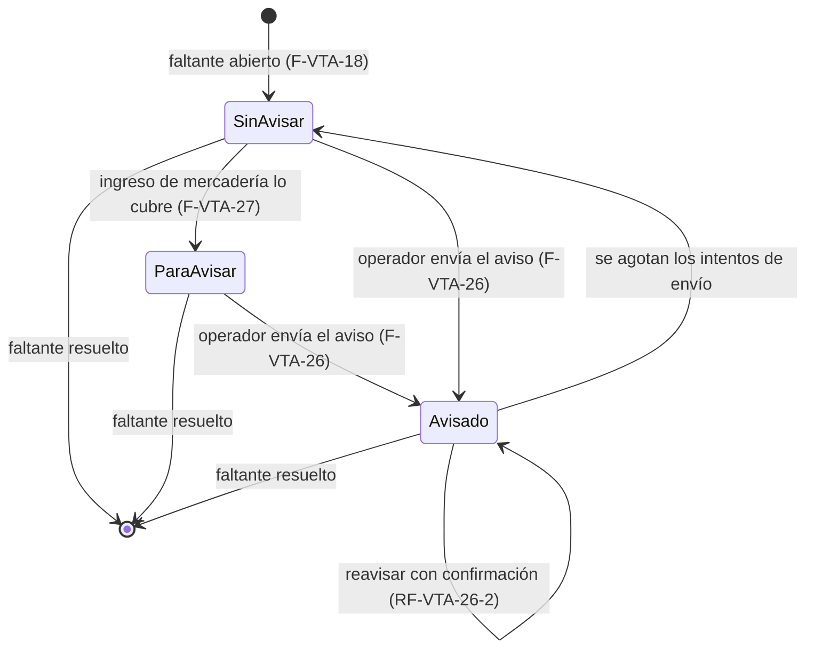

# Feature Specification: Ventas y despacho · Ventas avisos de faltantes

**Feature Branch**: `epic/MSF-161-ventas-y-despacho-ventas-avisos-de-faltantes`

**Jira Epic**: MSF-161 — Ventas y despacho · Ventas avisos de faltantes (spec `ventas-avisos-de-faltantes`)

**Created**: 2026-11-10

**Status**: Ready for implementation — traducción fiel de la épica y de las historias MSF-257 y MSF-270; no agrega requisitos de negocio. Las decisiones de diseño que la épica deja abiertas están en *Relación con F-STK-17 y F-VTA-18* y en *Decisiones tomadas al traducir*; las que necesitaban el OK de Nicolás quedaron aprobadas («avanza con todo») y se marcan **(OK de Nicolás)**.

**Delivery scope**: `refine` (`apps/web`) y `supabase` (migraciones, RPC, pgTAP y un ajuste a la Edge Function `enviar-aviso-faltante`). Sin `kestra` nuevo (el flow `avisos-faltantes` ya existe y no cambia), sin `superset` ni `workers`.

**Prioridad / Hito**: P1 · alcance diciembre (el roadmap manda sobre el documento del componente, que decía Etapa 2; etiqueta `revisar-roadmap` hasta que el cliente confirme) · ~12 h.

**Historias**: F-VTA-26 (MSF-257, S) y F-VTA-27 (MSF-270, M). Más la tarea de cierre (docs, roadmap, revisión de seguridad).

**Extiende**: `specs/20261024-130000-ventas-despacho-y-faltantes/` (F-VTA-18, MSF-201: tabla `dominio.faltantes_venta`, `listar_faltantes`, pantalla `/ventas/faltantes`) y reutiliza lo entregado por `specs/20261024-130000-stock-carga-exportacion-y-avisos/` (F-STK-17, MSF-405: cola `dominio.faltantes_avisos`, Edge Function `enviar-aviso-faltante`, flow `avisos-faltantes`). No cambia el comportamiento de ninguna de las dos fuera de lo declarado en *Relación…*.

**Input**: Epic MSF-161. Objetivo: «Al terminar, se avisa a los clientes con un faltante cuando la mercadería vuelve a haber, de forma manual o automática.»

## Regla de fuentes (literal de la épica)

1. Comportamiento y datos: mandan los requisitos y escenarios de esta historia.
2. Qué se ve (disposición, textos, estados, popups, flujos): el prototipo validado es referencia visual, no hace falta que quede extremadamente idéntico; los flujos (si hay) aclaran estados y acciones.
3. Cómo se construye (componentes, estilos y patrones): mandan el template y el system design del producto (épica Plataforma · Sistema de diseño, MSF-117). No copiar el HTML ni el CSS del prototipo: reproducir lo que muestra con los componentes del template y los tokens del sistema de diseño.
4. El prototipo muestra más que esta historia: implementar solo lo que piden los requisitos de esta historia; otras secciones, botones o diálogos son de otras historias.
5. Si algo no se puede igualar con el template / el sistema de diseño: usar lo más cercano, sin inventar, y anotar la diferencia en la descripción del PR.
6. Si el prototipo y los requisitos se contradicen: requisitos para el comportamiento, prototipo para lo visual, y dejar la contradicción anotada en el PR.

Prototipo (solo lectura, ya presente en el árbol): `design/pantallas/VentasFaltantes.dc.html` (+ `VentasFaltantes.inventory.json`). `VentasReportes.dc.html` aparece en la fila de la épica pero **ninguna historia lo pide** (es de ventas-reportes-basicos).

## Relación con F-STK-17 y F-VTA-18

Esta es la sección clave de la spec: en la base (`dokploy`) conviven **dos conceptos de «faltante»** y la épica se escribió antes de que existieran. Se verificó en el código real (migraciones `20261213100200…100400` de F-STK-17 y `20270112130100…130300` de F-VTA-18).

| | F-STK-17 (MSF-405) | F-VTA-18 (MSF-201) |
|---|---|---|
| Qué es un faltante | Línea de una factura confirmada «A pedido» con **reserva de stock activa** (se cierra sola al descontarse la reserva). No tiene tabla: es la vista `public.faltantes_listado`. | Línea de una factura que **no se pudo despachar por falta de stock**; la registra el despacho (`registrar_faltantes_despacho`) y la deja Incompleta. Tabla `dominio.faltantes_venta` (una fila por línea, `estado` `abierto`/`resuelto`, `cantidad_faltante`). Se resuelve al reanudar el armado. |
| Pantalla | `/stock/faltantes` (pestaña de Stock) | `/ventas/faltantes` (grupo Ventas) |
| Aviso al cliente | **Sí**: `avisar_faltantes(uuid[])` → cola `dominio.faltantes_avisos` (PK `linea_id`) → Edge Function `enviar-aviso-faltante` → flow `avisos-faltantes` (cada minuto). | **No** (esta épica) |

La épica MSF-161 habla de «la tabla `faltantes` (F-VTA-18) y la pantalla Faltantes» de Ventas: por lo tanto **F-VTA-26 y F-VTA-27 se construyen sobre `dominio.faltantes_venta` y `/ventas/faltantes`**. La pantalla de Stock (F-STK-17) no se toca.

### Qué se reutiliza (sin duplicar)

- **La cola de avisos `dominio.faltantes_avisos`**: una fila por línea de factura (`linea_id` → `comprobantes_venta_lineas`). Un faltante de `faltantes_venta` se identifica con `(comprobante_id, linea_orden)`, que es exactamente `(comprobante_id, orden)` de la línea: **hay una correspondencia 1 a 1 con `linea_id`**. Se encola ahí el aviso de F-VTA-26. No se crea otra tabla de avisos.
- **La Edge Function `enviar-aviso-faltante`** y su secreto `AVISOS_FALTANTES_TOKEN`, el correo SMTP (`_shared/correo.ts`), el reintento (tope 5, reserva de 2 minutos), «un correo por cliente», el saneamiento de errores y las tres RPC de `service_role` (`faltantes_avisos_pendientes`, `tomar_aviso_faltante`, `cerrar_aviso_faltante`).
- **El flow `infra/kestra/flows/avisos-faltantes.yml`**: sin cambios (barrido cada minuto). El SQL sigue sin hacer HTTP (`docs/adoptar-ciclo-ejecuciones.md` §3.1).
- **`private.nivel_ventas_en_empresa`**, `private.puede_leer_faltantes_empresa`, `private.registrar_actividad`, `FiltroEmpresa`, `useFiltroPorEmpresaActiva`, `useListadoAcumulado`, `CargaInfinita`, `ContenidoAdaptable`, `EtiquetaEstado` y el patrón de diálogo de `pages/stock/faltantes.tsx`.
- **La semántica «Avisado» de F-STK-17**: avisada = fila en la cola con estado `pendiente` o `enviado`; si se agotan los intentos (`agotado`) la línea vuelve a «Sin avisar» y el error queda registrado.

### Qué se agrega (cambio mínimo de superficie)

| Objeto | Cambio | Historia |
|---|---|---|
| `dominio.faltantes_avisos` | **Columna** nueva `mensaje text` (texto editable del correo, ≤ 1.000 caracteres, nulo = texto por defecto). | F-VTA-26 |
| `private.faltante_abierta(uuid)` | `create or replace` (misma firma): además del criterio de F-STK-17 (factura «A pedido» con reserva activa) también es abierto el faltante cuya línea tiene una fila **abierta** en `dominio.faltantes_venta`. Así `tomar_aviso_faltante` no descarta ni manda avisos de faltantes ya cerrados (FR-007). | F-VTA-26 |
| `public.tomar_aviso_faltante(uuid, integer)` | `create or replace` (misma firma y mismo `returns table`): cada elemento de `lineas` suma `mensaje`; la `cantidad` pasa a ser la **faltante** si la línea tiene un faltante de venta abierto; y la tanda de un cliente agrupa solo líneas con el mismo `mensaje` (las otras salen en el barrido siguiente). | F-VTA-26 |
| `public.avisar_faltantes_venta(p_ids uuid[], p_mensaje text, p_reavisar boolean)` | **RPC nueva** (`authenticated`): encola en `faltantes_avisos`. | F-VTA-26 |
| `public.listar_faltantes` | Se reemplaza (`drop` de la firma `(uuid, integer, integer)` y alta con `p_aviso text default null` al final, mismo nombre): suma `aviso` (`sin_avisar`/`avisado`; `para_avisar` desde F-VTA-27) y `aviso_en`. Se actualiza el pgTAP existente que nombra la firma vieja. | F-VTA-26 (firma) y F-VTA-27 (cuerpo) |
| `dominio.faltantes_venta` | **Columnas** nuevas `para_avisar_en timestamptz` y `para_avisar_ingreso_id uuid` (FK a `dominio.ingresos_mercaderia`, `on delete set null`) + índice parcial. | F-VTA-27 |
| `private.marcar_faltantes_para_avisar()` + disparador `AFTER INSERT` en `dominio.ingresos_mercaderia_lineas` | **Función y disparador nuevos**: al registrarse cada línea de un ingreso, marca los faltantes abiertos del producto «Para avisar». | F-VTA-27 |
| `supabase/functions/enviar-aviso-faltante/contenido.ts` | El cuerpo usa `mensaje` si viene (saneado) en lugar de las frases fijas; la lista de productos siempre se incluye. Sin cambios en `handler.ts` más allá del tipo. | F-VTA-26 |
| `apps/web` | `pages/ventas/faltantes.tsx`, `lib/ventasFaltantes.ts`, `hooks/useListarFaltantes.ts` (selección, columna Aviso, diálogo, filtro «Para avisar»). | F-VTA-26 y F-VTA-27 |

**No se crea** ninguna tabla, Edge Function, flow ni worker nuevos. Tampoco se tocan `registrar_ingreso_mercaderia`, `registrar_faltantes_despacho` ni `avisar_faltantes` (F-STK-17).

### Por qué así (decisiones donde la épica deja dudas)

1. **«Avisado con fecha» no es un valor de `estado`.** La épica supone `faltantes.estado ∈ {abierto, avisado, resuelto}` + `avisado_at`; el código real tiene `estado ∈ {abierto, resuelto}` con un `check ((estado = 'abierto') = (resuelto_en is null))`, un índice único parcial `where estado = 'abierto'` (un faltante abierto por línea), un disparador que resuelve «los abiertos» y el listado que filtra `abierto`. Agregar `avisado` a `estado` obligaría a reescribir las cuatro piezas y a romper el índice (un faltante avisado dejaría de ser «abierto» y se podría registrar un duplicado). Se representa con **dos marcas ortogonales al ciclo de vida**, derivadas en una sola expresión que usan el listado y la RPC:
   - `avisado` ⇔ existe fila en `dominio.faltantes_avisos` de esa línea con estado `pendiente` o `enviado`; su fecha (`aviso_en`) es `coalesce(enviado_en, created_at)`.
   - `para_avisar` ⇔ `faltantes_venta.para_avisar_en is not null` y no está avisado.
   - `sin_avisar` ⇔ ninguna de las dos.
   Esto reutiliza la cola, hereda su reintento y su regla «agotado → vuelve a Sin avisar», y no duplica el dato (una sola fuente de verdad del aviso). **(OK de Nicolás: la épica decía «estado avisado + avisado_at».)** Revisión MSF-161: `En cola` (pendiente) se distingue de `Avisado` (enviado), y un aviso `agotado` se expone como «Aviso fallido» con un código genérico (`aviso_error`).
2. **Reavisar con confirmación (RF-VTA-26-2).** El servidor no reavisa una línea ya avisada salvo `p_reavisar = true` (resultado `ya_avisado`). La pantalla pide la confirmación explícita dentro del diálogo («Volver a avisar a los N ya avisados»). Al reavisar la fila de la cola se reinicia (`pendiente`, `intentos = 0`, `created_at = now()`); el rastro de cada aviso queda en `registro_actividad` (`ventas.faltantes_avisados`). Una línea con un envío en curso (`pendiente`) no se reavisa nunca (resultado `en_cola`). El prototipo dice que los avisados «no se vuelven a avisar»: manda el requisito (la historia lo aclara).
3. **Texto editable (RF-VTA-26-1).** El diálogo precarga un texto por defecto y la persona lo edita; viaja a la RPC como `p_mensaje` y se guarda en `faltantes_avisos.mensaje` (≤ 1.000). El correo es **texto plano**: `Hola <cliente>,` + el texto editable + la lista de productos (producto, SKU, unidades faltantes, comprobante). Se sanea en el servidor (caracteres de control fuera, sin HTML). Si `mensaje` es nulo se usa el texto de F-STK-17 sin cambios.
4. **«Ingreso de mercadería confirmado» en el código real.** No existe un paso de «confirmación» separado: `dominio.ingresos_mercaderia.estado ∈ {registrado, anulado}` y `public.registrar_ingreso_mercaderia` (F-PRV-04/07, la única RPC de «Ingreso de mercadería») crea la cabecera `registrado`, mueve el stock por cada línea con `registrar_movimiento_stock` y crea una fila en `dominio.ingresos_mercaderia_lineas` (con `producto_id`, `cantidad`) **en la misma transacción**. Por eso **«confirmar el ingreso» = registrarlo**, y el punto de enganche es un disparador `AFTER INSERT` sobre `ingresos_mercaderia_lineas`: no se redefine la RPC grande de Stock (que además tiene su propia historia de firmas), y atomiza la marca con el ingreso. Las demás entradas de stock (carga en lote, toma de inventario, traslados, devoluciones de nota de crédito, RMA) **no** marcan: la historia dice «ingreso de mercadería». **(OK de Nicolás: esas entradas quedan fuera.)**
5. **Cobertura por antigüedad «hasta agotar la cantidad» (RF-VTA-27-2, CA-VTA-27-2).** Para cada línea del ingreso (producto + `cantidad`), entre los faltantes **abiertos** de ese producto en toda la organización (el stock es único: no se distingue tienda ni depósito) que aún no están ni «Para avisar» ni «Avisados», se recorren del **más antiguo** al más nuevo (`creado_en`, `id`) con un saldo inicial igual a la cantidad ingresada; se marca cada faltante **completo** mientras su `cantidad_faltante` entre en el saldo (`saldo -= cantidad_faltante`) y el que **no entra se salta** y se sigue con el siguiente más antiguo (un faltante grande no bloquea a los demás del producto; QA 2026-11-10). Es decir, se marcan **primero los más antiguos hasta agotar la cantidad**. Ejemplo: ingreso 10, faltantes 4 (hace 3 días), 4 (2 días), 4 (1 día) → se marcan los dos primeros; el tercero espera el próximo ingreso. Un ingreso que cubre todo (CA-VTA-27-1: 10 unidades, 3 faltantes abiertos de 1 a 3 unidades) marca los 3. Solo cuenta la cantidad **del ingreso**, no el stock que ya hubiera. **(OK de Nicolás: faltantes completos con «saltar el que no entra».)** Los faltantes ya marcados no consumen saldo de un ingreso posterior (decisión de diseño: «Para avisar» es una sugerencia y el «Stock hoy» real se ve al lado; QA M3).
6. **Anular el ingreso no desmarca.** «Para avisar» es una sugerencia para el operador (no envía nada); la pantalla muestra el «Stock hoy» real al lado. Anular un ingreso no deshace marcas (la historia no lo pide). **(OK de Nicolás.)**
7. **No se exige stock disponible para avisar a mano (F-VTA-26).** A diferencia de F-STK-17 (`omitidos_sin_stock`), la historia no lo pide y el operador puede estar avisando algo ya recibido; se avisa lo que el operador elige. El texto del prototipo («productos que volvieron a tener stock») queda como texto por defecto del mensaje editable.
8. **Línea compartida con F-STK-17.** Si una misma línea fuera a la vez «A pedido» con reserva (F-STK-17) y faltante de despacho (F-VTA-18), comparte **una sola fila de cola**: avisar desde cualquiera de las dos pantallas la deja «Avisada» en ambas (no se manda dos veces). Es el comportamiento deseable y no requiere código extra.
9. **El envío ya no depende de MSF-189.** El «A revisar» de la épica dudaba de quién construye el correo saliente: el SMTP de F-CON-03 y la Edge Function de F-STK-17 ya están en `dokploy`. MSF-189 deja de ser bloqueante de F-VTA-26. MSF-135 (F-VTA-18) y MSF-136 (ingresos) están en la base.
10. **Listado.** `/ventas/faltantes` ya carga por tandas (carga infinita); no se agrega paginación. «Para avisar» se ve como **chip en la columna Aviso** y como **filtro** (Todos · Para avisar); con el filtro activo la lista va **del más antiguo al más nuevo** (`desde` ascendente, RF-VTA-27-2); sin filtro mantiene el orden actual (más reciente primero).

## Navegación y patrones del panel (Principio VI)

- **Ubicación**: sin rutas ni ítems de menú nuevos; todo vive en `/ventas/faltantes` (sección `ventas`, ya protegida). Rutas anteriores: ninguna que mantener.
- **Audiencia y contexto**: organización activa (`ContextoOrganizacionActiva`) y empresa activa (Principio VIII, ver matriz).
- Estados compartidos de carga, vacío, error (con reintento) y éxito; teclado y lector de pantalla; operable a 320 / 768 / 1440 px (axe en E2E); **sin UUID visible**.
- Selección y envío solo con `ventas` en `edicion` en la tienda del faltante; con `lectura` la pantalla se ve igual, sin casillas ni botón.

## Esquema de datos (Constitución, Principio VII)

| Objeto | Esquema | Justificación | RLS |
|--------|---------|---------------|-----|
| `faltantes_venta` (existente, F-VTA-18) — columnas nuevas `para_avisar_en`, `para_avisar_ingreso_id` | **`dominio`** | Dato de negocio del producto (qué faltante ya tiene mercadería ingresada). | Sin cambios: lectura por organización, empresa accesible y `ventas` en esa empresa; sin escritura para `authenticated`; la marca la escribe solo el disparador `security definer`. |
| `faltantes_avisos` (existente, F-STK-17) — columna nueva `mensaje` | **`dominio`** | Dato del aviso (texto que se mandó). | Sin cambios: lectura con `ventas` en la empresa; solo la escriben las RPC. |
| `ingresos_mercaderia_lineas` (existente) | **`dominio`** | Solo se le agrega un disparador de lectura de la línea nueva; no se altera la tabla. | Sin cambios. |
| `comprobantes_venta(_lineas)`, `productos`, `reservas_stock` (existentes) | **`dominio`** | Solo se leen. | Sin cambios. |
| `public.clientes`, `public.stock_estados`, `public.registro_actividad` (existentes) | **`public`** (plataforma) | Solo se leen / se registra actividad por `private.registrar_actividad`. | Sin cambios. |

No se crea ninguna tabla. El esquema se re-verifica en spec, plan, tareas, implementación y revisión (tarea de cierre).

## Flujos

«Avisado» y «Para avisar» son marcas del faltante abierto; resolverlo (reanudar el armado) lo saca de la lista en cualquier estado. Nada de F-VTA-27 envía correos.

## User Scenarios & Testing *(mandatory)*

### User Story 1 — Avisar a clientes con faltantes (F-VTA-26, MSF-257, P1, S)

Como operador quiero seleccionar faltantes y avisar a sus clientes para recuperar la venta.

**Independent Test**: pgTAP de `avisar_faltantes_venta` y la cola; Vitest de la pantalla y el diálogo; E2E de CA-VTA-26-1 y CA-VTA-26-2.

**Acceptance Scenarios**:
1. **Given** dos faltantes abiertos con cliente con correo válido (`CA-VTA-26-1`), **When** los selecciono y envío, **Then** ambos pasan a «Avisado» con fecha y el cliente recibe el correo con el producto y el texto que edité.
2. **Given** un cliente sin correo (`CA-VTA-26-2`), **When** intento avisarlo, **Then** se informa «El cliente no tiene correo» y el faltante **no** se marca.
3. **Given** un usuario con rol Consulta (`CA-VTA-26-3`), **When** intenta avisar (llamando a la RPC), **Then** el servidor rechaza (`42501`).
4. **Given** un faltante ya avisado (`RF-VTA-26-2`), **When** lo incluyo en la selección, **Then** no se vuelve a avisar salvo que confirme «Volver a avisar»; sin la confirmación el servidor lo omite.
5. **Given** que el faltante se resolvió (reanudó el armado) antes de que salga el correo, **When** corre el barrido, **Then** no se manda nada y la línea vuelve a «Sin avisar» con el motivo.
6. **Given** que falla el envío, **When** se reintenta hasta el tope, **Then** el faltante vuelve a «Sin avisar» con el error registrado (sin datos personales).

### User Story 2 — «Para avisar» al ingresar mercadería (F-VTA-27, MSF-270, P1, M)

Como operador quiero que el sistema me diga qué faltantes se pueden cubrir cuando entra stock, para no revisarlo a mano.

**Independent Test**: pgTAP de la marca (orden y tope por cantidad); Vitest del filtro; E2E de CA-VTA-27-1.

**Acceptance Scenarios**:
1. **Given** un ingreso de 10 unidades de un producto con 3 faltantes abiertos (`CA-VTA-27-1`), **When** se confirma (registra), **Then** los 3 aparecen en «Para avisar» y **no se envía ningún correo**.
2. **Given** un ingreso que no cubre todos (`CA-VTA-27-2`), **When** se confirma, **Then** se marcan primero los más antiguos hasta agotar la cantidad.
3. **Given** la vista «Para avisar», **When** la abro, **Then** veo los faltantes marcados del más antiguo al más nuevo.
4. **Given** un faltante «Para avisar» que luego se avisa, **When** el aviso se encola, **Then** pasa a «Avisado» y deja de verse como «Para avisar».

## Requirements *(mandatory)*

### Functional Requirements — F-VTA-26

- **FR-001** (`RF-VTA-26-1`): `public.avisar_faltantes_venta(p_ids, p_mensaje, p_reavisar)` **DEBE** permitir avisar faltantes **abiertos** de `dominio.faltantes_venta` (1 a 200): por cada uno con cliente con correo válido encola en `dominio.faltantes_avisos` (clave `linea_id`, idempotente) un aviso con el texto `p_mensaje`, de modo que el cliente reciba **un correo con el producto y el texto**, y el faltante pasa a «Avisado» con fecha. Devuelve conteos y un detalle por faltante (`encolado`, `ya_avisado`, `en_cola`, `sin_correo`, `sin_permiso`, `no_abierto`).
- **FR-002** (`RF-VTA-26-1`, UI): la pantalla `/ventas/faltantes` **DEBE** permitir seleccionar faltantes abiertos (casilla por fila y «seleccionar todo» de lo visible), mostrar «N seleccionados de M faltantes» y el botón «Avisar a los seleccionados (N)» (deshabilitado con 0), y abrir el diálogo «Avisar a los clientes» con un **texto editable** precargado, «Cancelar» y «Enviar avisos»; al terminar, aviso emergente «Avisos enviados» con lo omitido y por qué, y la columna **Aviso** (Sin avisar / Para avisar / Avisado con fecha). Solo con `ventas` en `edicion`; con `lectura` no hay casillas ni botón.
- **FR-003** (`RF-VTA-26-2`): el servidor **NO DEBE** avisar dos veces el mismo faltante sin confirmación: una línea ya avisada se omite (`ya_avisado`) salvo `p_reavisar = true`; una línea con un envío en curso nunca se reenvía (`en_cola`). La pantalla pide la confirmación explícita («Volver a avisar a los N ya avisados») y por defecto los excluye.
- **FR-004** (`CA-VTA-26-3`): la RPC **DEBE** rechazar con `42501` a quien no tenga `ventas` en `edicion` (rol Consulta incluido), y por faltante omitir (`sin_permiso`) los de tiendas donde no tenga `edicion`. La organización y el actor salen de la sesión (nunca de un argumento); `anon` sin ejecución; `search_path = ''`.
- **FR-005** (`CA-VTA-26-2`): si el cliente no tiene correo (vacío) la RPC **DEBE** omitir el faltante (`sin_correo`) **sin marcarlo**, y la pantalla **DEBE** informar «El cliente no tiene correo» (en plural, «N clientes no tienen correo», con sus nombres). Un correo con formato inválido lo rechaza la Edge Function y la línea vuelve a «Sin avisar» con el error.
- **FR-006**: el envío **DEBE** reutilizar la Edge Function `enviar-aviso-faltante` y el flow `avisos-faltantes`: un correo por cliente, texto plano, `mensaje` saneado (sin caracteres de control ni HTML, ≤ 1.000), reintento acotado (tope 5) y nunca tocar la venta ni el stock. Sin `mensaje` el correo es el de F-STK-17 sin cambios.
- **FR-007**: un faltante cerrado antes de salir el correo (resuelto por reanudar el armado) **NO DEBE** avisarse: `private.faltante_abierta` reconoce el faltante abierto de `faltantes_venta` y la línea vuelve a «Sin avisar» con «El faltante se cerró antes de enviar el aviso».
- **FR-008**: `public.listar_faltantes` **DEBE** devolver por faltante `aviso` (`sin_avisar` | `avisado`; `para_avisar` por FR-103) y `aviso_en` (fecha del aviso), y aceptar `p_aviso` para filtrar; la columna Aviso de la pantalla los muestra.
- **FR-009** (Principio VIII): la selección, el diálogo, los conteos y el listado **DEBEN** reencuadrarse al cambiar la empresa activa (barra superior o filtro): la selección se descarta, el diálogo abierto se cierra con aviso y no se dibuja ni una fila de la empresa anterior; nunca se avisa un faltante de otra tienda.

### Functional Requirements — F-VTA-27

- **FR-101** (`RF-VTA-27-1`): al registrarse un ingreso de mercadería, el sistema **DEBE** detectar los faltantes abiertos del producto y marcarlos «Para avisar» (`para_avisar_en`, `para_avisar_ingreso_id`), **sin enviar nada** (no escribe en `faltantes_avisos` ni invoca correo).
- **FR-102** (`RF-VTA-27-2`, `CA-VTA-27-2`): la cobertura **DEBE** recorrer los faltantes por antigüedad (`creado_en`, `id`) con saldo igual a la cantidad ingresada y marcar los más antiguos completos hasta agotarla (regla de la decisión 5); no marca los ya «Para avisar» ni «Avisados».
- **FR-103**: `public.listar_faltantes` **DEBE** devolver `aviso = 'para_avisar'` (y `aviso_en = para_avisar_en`) para los marcados no avisados, aceptar `p_aviso = 'para_avisar'` y, con ese filtro, ordenar del más antiguo al más nuevo (`desde` ascendente, `id`).
- **FR-104** (UI): `/ventas/faltantes` **DEBE** mostrar el chip «Para avisar» en la columna Aviso y un filtro «Para avisar» (Todos · Para avisar) con el orden por antigüedad; el filtro respeta la empresa activa y es independiente de la casilla/envío de FR-002 (se puede seleccionar y avisar desde la vista).
- **FR-105**: el disparador **DEBE** ser atómico con el ingreso, idempotente (una vez por línea de ingreso), `security definer` con `search_path = ''` (marca faltantes de tiendas que el actor quizá no ve; la lectura sigue por RLS), **no** romper el ingreso si falla (la excepción se registra como aviso del servidor y el ingreso sigue), registrar actividad `ventas.faltantes_para_avisar` y **no** alterar `registrar_ingreso_mercaderia`.

### Success Criteria

- **SC-001** (`CA-VTA-26-1`): dos faltantes con correo válido, seleccionados y enviados, quedan «Avisado» con fecha (E2E; pgTAP verifica la cola).
- **SC-002** (`CA-VTA-26-2`): un cliente sin correo no se marca y se informa «El cliente no tiene correo» (E2E; pgTAP verifica que no hay fila de cola).
- **SC-003** (`CA-VTA-26-3`): el rol Consulta es rechazado por el servidor (pgTAP).
- **SC-101** (`CA-VTA-27-1`): un ingreso de 10 unidades con 3 faltantes abiertos los deja a los 3 en «Para avisar» (E2E; pgTAP verifica la marca).
- **SC-102** (`CA-VTA-27-2`): un ingreso que no cubre todos marca primero los más antiguos hasta agotar la cantidad (pgTAP: orden y tope).
- **SC-900**: documentación, roadmap y revisión de seguridad cerradas (tarea de cierre).

## Matriz pantalla↔criterios

Inventario: `design/pantallas/VentasFaltantes.inventory.json` (correr `pnpm prototipo:inventario`).

| Ítem del inventario | Tipo | Criterio / decisión |
|---|---|---|
| Tabla Faltantes: Tienda, Cliente, Producto, Pedido, Comprobante, Desde, Stock hoy | tabla | Ya entregado por F-VTA-18 (FR-044): sin cambios |
| Columna de selección (casilla) | tabla | FR-002 |
| Columna **Aviso** (Sin avisar / Para avisar / Avisado con fecha) | tabla | FR-002, FR-008, FR-104 |
| Pie «N seleccionados de M faltantes» | texto | FR-002 |
| Botón «Avisar a los seleccionados (·)» | botón | FR-002 |
| Diálogo «Avisar a los clientes» (texto de ayuda, «Cancelar», «Enviar avisos») + **texto editable** | diálogo | FR-002, FR-001 (el texto editable y la confirmación para reavisar no están dibujados: se construyen con los componentes del template) |
| Aviso emergente «Avisos enviados» | snackbar | FR-002 |
| Mensaje «El cliente no tiene correo» | texto | FR-005 (no dibujado) |
| Confirmación «Volver a avisar a los N ya avisados» | casilla | FR-003 (no dibujada) |
| Estado «Para avisar» y filtro «Para avisar» / orden por antigüedad | chip y filtro | FR-103, FR-104 (no dibujados) |
| Filtro de tienda (`FiltroEmpresa`) | filtro | FR-009 (ya existe) |
| Tabla «Avisos de la tienda web»: Producto, Contacto, Tienda, Pedido el, Stock hoy (y chip «4 pendientes») | tabla | **FUERA DE ALCANCE**: pedidos «avisame cuando vuelva» de visitantes de la tienda web (otra épica); la épica lo excluye expresamente |
| Pestañas «Comprobantes», «Presupuestos», «Pagos», «Devoluciones (RMA)», «Transportes y contrarreembolsos» | tabs | **FUERA DE ALCANCE**: navegación de Ventas (otras épicas) |
| Texto «Un faltante se cierra solo cuando se ingresa la mercadería» | texto | **FUERA DE ALCANCE**: F-VTA-27 solo **marca**; el faltante de despacho se cierra al reanudar el armado (F-VTA-18, FR-042) |
| «Stock hoy» como chip «L 1 · D 2» (desglose por depósito) | texto | **FUERA DE ALCANCE**: sin requisito |
| `VentasReportes.dc.html` | pantalla | **FUERA DE ALCANCE**: es de ventas-reportes-basicos (F-VTA-22/23) |

### Empresa activa (Principio VIII)

| Pantalla | ¿Aplica? | Criterio / test |
|---|---|---|
| `/ventas/faltantes` (selección, diálogo, Aviso, filtro «Para avisar») | **Sí** | FR-009, FR-104; Vitest `faltantes.empresa.test.tsx` |

## Decisiones tomadas al traducir («A revisar»)

1. **Hito**: el roadmap manda (diciembre, P1); etiqueta `revisar-roadmap` hasta que el cliente confirme. Cambia el hito, no el alcance. **(OK de Nicolás.)**
2. **Pantalla Faltantes «a dibujar»** en el documento del componente: sí existe `VentasFaltantes.dc.html`; la spec se apoya en él.
3. **Correo / MSF-189**: resuelto reutilizando F-STK-17 (decisión 9 de *Relación…*).
4. **Todo el dominio es nuevo** (épica): ya no lo es; se extiende F-VTA-18/F-STK-17. Horas sin cambio (12 h).
5. **El bloqueo F-VTA-26 → F-VTA-27 se quitó** (épica): marcar «Para avisar» no usa el envío. Aun así F-VTA-26 fija la firma final de `listar_faltantes` y F-VTA-27 solo reemplaza su cuerpo (orden de fases en `tasks.md`).
6. **Decisiones 1, 4, 5 y 6 de *Relación…* (OK de Nicolás: «avanza con todo»)**: «Avisado» derivado de la cola (no `estado`), qué es «ingreso confirmado», cobertura de faltantes completos con corte en el primero que no entra, y que anular un ingreso no desmarca.

## Verificación por requisito

Rutas: pgTAP en `supabase/tests/database/`, Vitest junto a la pantalla en `apps/web/src/`, handlers con `node --test` en `supabase/functions/<función>/`, E2E en `apps/web/e2e/`.

| Requisito | Verificación (test o comando) | Tarea |
|---|---|---|
| FR-001 | pgTAP `faltantes_avisos_venta.test.sql` (encola con mensaje; un correo por cliente; idempotente; conteos y detalle) | T002 |
| FR-002 | Vitest `pages/ventas/faltantes.test.tsx` (casillas, «seleccionar todo», pie, botón deshabilitado con 0, diálogo con texto editable, «Avisos enviados», columna Aviso, `lectura` sin casillas) | T008 |
| FR-003 | pgTAP `faltantes_avisos_venta.test.sql` (ya avisado omitido sin `p_reavisar`, reavisa con él, en cola nunca) y Vitest `faltantes.test.tsx` (confirmación) | T002 |
| FR-004 | pgTAP `faltantes_avisos_venta.test.sql` (Consulta `42501`, `anon` sin ejecución, tienda sin `edicion` omitida, organización de la sesión) | T002 |
| FR-005 | pgTAP `faltantes_avisos_venta.test.sql` (sin correo no marca) y Vitest `faltantes.test.tsx` («El cliente no tiene correo») | T002 |
| FR-006 | `node --test supabase/functions/enviar-aviso-faltante/handler.test.ts` (mensaje saneado, texto por defecto intacto) y `pnpm infra:config` (flow sin cambios) | T004 |
| FR-007 | pgTAP `faltantes_avisos_venta.test.sql` (faltante resuelto antes del envío → no se manda, «Sin avisar» con motivo) | T001 |
| FR-008 | pgTAP `faltantes.test.sql` (columnas `aviso`/`aviso_en`, filtro `p_aviso`, firma nueva) | T003 |
| FR-009 | Vitest `pages/ventas/faltantes.empresa.test.tsx` (selección descartada, diálogo cerrado con aviso, sin filas de la empresa anterior) | T008 |
| FR-101 | pgTAP `faltantes_para_avisar.test.sql` (marca y no encola nada en `faltantes_avisos`) | T012 |
| FR-102 | pgTAP `faltantes_para_avisar.test.sql` (orden, tope por cantidad, salto del que no entra, no remarca) | T012 |
| FR-103 | pgTAP `faltantes_para_avisar.test.sql` (`aviso = 'para_avisar'`, filtro y orden ascendente) | T013 |
| FR-104 | Vitest `pages/ventas/faltantes.test.tsx` (chip, filtro, orden) | T016 |
| FR-105 | pgTAP `faltantes_para_avisar.test.sql` (atomicidad, falla del disparador no rompe el ingreso, actividad, `registrar_ingreso_mercaderia` intacta) | T012 |
| SC-001 | E2E `ventas-faltantes-avisos.e2e.ts` (+ axe a 320/768/1440 px) | T010 |
| SC-002 | E2E `ventas-faltantes-avisos.e2e.ts` | T010 |
| SC-003 | pgTAP `faltantes_avisos_venta.test.sql` | T005 |
| SC-101 | E2E `ventas-faltantes-para-avisar.e2e.ts` (+ axe a 320/768/1440 px) | T018 |
| SC-102 | pgTAP `faltantes_para_avisar.test.sql` | T014 |
| SC-900 | `pnpm test:db` (`rls_en_toda_tabla`, `aislamiento_organizaciones`, test de `anon`), `pnpm lint`, `pnpm build`, `pnpm test`, `pnpm docs:check`, `pnpm infra:config`, `pnpm matriz:check` | T021 |

## Matriz de trazabilidad Jira ↔ US ↔ requisitos

| Jira | Historia | FR / SC |
|------|----------|---------|
| F-VTA-26 (MSF-257) | US1 Avisar a clientes con faltantes | FR-001…FR-009, SC-001…SC-003 |
| F-VTA-27 (MSF-270) | US2 «Para avisar» al ingresar mercadería | FR-101…FR-105, SC-101, SC-102 |
| Tarea de cierre (label `cierre`) | Docs, roadmap y seguridad | SC-900 |

## Riesgos y preguntas para Nicolás

- **Concepto doble de faltante** (F-STK-17 vs F-VTA-18): hay dos pantallas con datos distintos; no se unifican (fuera de alcance). La línea compartida usa una sola cola.
- **Fecha del aviso**: «Avisado» es la fecha de envío (`enviado_en`) o, mientras el correo está en cola, la de encolado; puede pasar hasta ~1 minuto entre ambas.
- **Reavisar sobrescribe** la fila de la cola (el historial está en `registro_actividad`, no en la tabla).
- **El disparador de ingresos** corre sobre una tabla de Stock: un fallo se aísla con un bloque de excepción (el ingreso nunca se rompe), pero un error silenciado necesita monitoreo en el log del servidor.
- **Cobertura**: un faltante grande que no entra en el saldo del ingreso se salta y los más nuevos y chicos que sí entran se marcan; el grande espera un ingreso que lo cubra.

## Decisiones de la revisión de Código, Seguridad y QA (MSF-161)

- **`para_avisar_en` no se limpia al quedar el aviso `agotado`** (revisión m-1, QA M1). Con el aviso agotado, `listar_faltantes` vuelve a mostrar «Para avisar»: llegó mercadería y el aviso falló, así que sigue pendiente de avisar. El diagrama de estados queda así: Avisado → (agota los intentos) → Para avisar / Sin avisar **con «Aviso fallido» y el motivo**; «Reintentar» lo reencola. No se cambia `para_avisar_en`.
- **Estados visibles**: `sin_avisar | para_avisar | en_cola | avisado`; «Avisado · fecha» solo cuando el correo salió (QA M5); el aviso emergente dice «Avisos en cola».
- **Topes (M-3)**: no se reavisa un faltante enviado hace menos de 24 horas (sin override) y una organización encola como máximo 1.000 líneas por día móvil; el servidor los valida y la pantalla lo informa.
- **Envío (M-2, m-3, m-4, m-4b, m-5)**: timeout de 30 s, token de tanda en el cierre, destinatario de una sola dirección, `ultimo_error` como código genérico, `mensaje` saneado en la base y sin líneas que empiecen con «.».
- **Una sola regla de encolado (m-6)**: `avisar_faltantes_venta` y `avisar_faltantes` usan `private.encolar_aviso_faltante`.
- **Selección (m-7, QA M4)**: se descarta al cambiar de filtro de aviso, así «Avisar (n)» y el envío solo cuentan lo que se ve.
- **Trigger (m-2)**: reintenta ante deadlock/lock_not_available y deja una actividad segura si no puede; nunca bloquea el ingreso.
- **Prototipo**: `design/pantallas/VentasFaltantes.dc.html` no dibuja los chips «En cola» y «Aviso fallido» ni «Reintentar»; son un agregado pedido por la revisión (M-1) que reutiliza `EtiquetaEstado` y los botones del sistema, y queda para confirmar con el prototipo.
- **Revisión del PR #915** (migración `20270306120000`): tope diario con bloqueo por organización e índice; `smtp_timeout` = intento incierto (queda `agotado`, sin reenvío automático); orden de bloqueo común a las dos RPC; la pantalla de Stock informa el tope diario; el barrido de la Edge Function corta por reloj.
