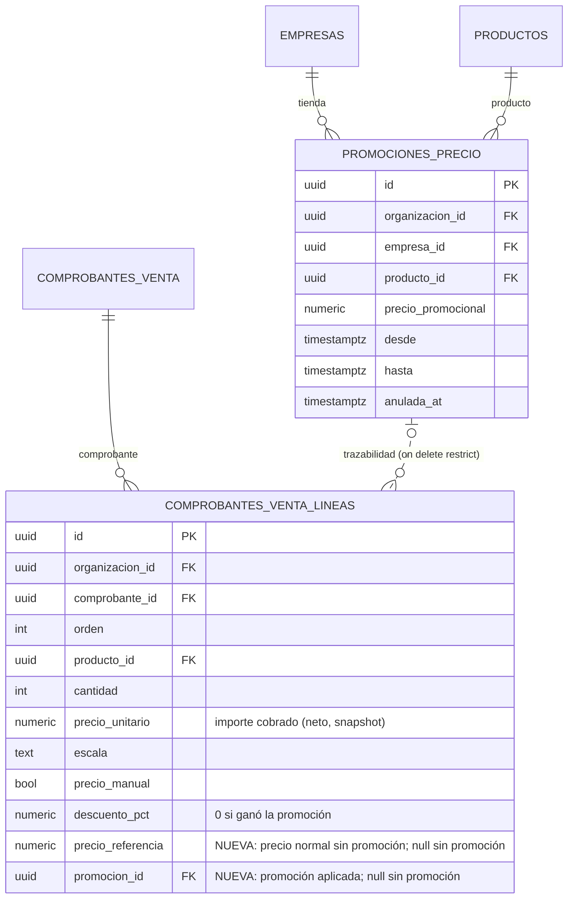
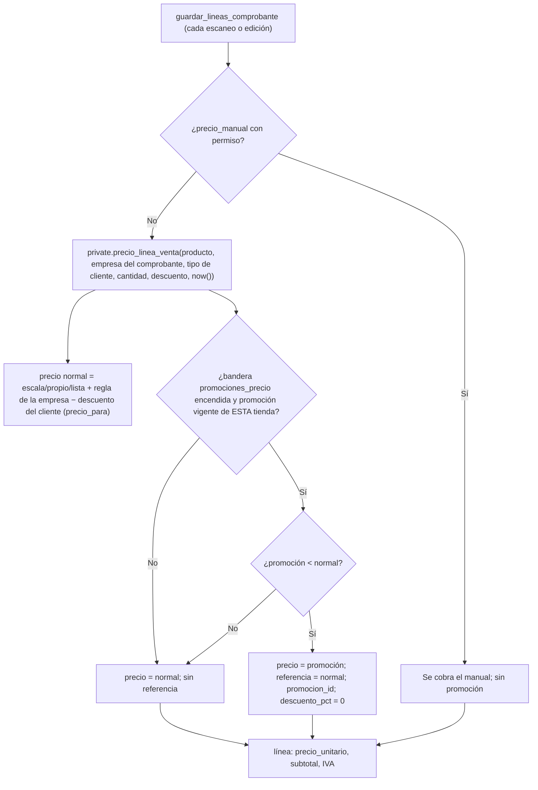

# Feature Specification: Precios y dólar · Precio promocional en el mostrador (POS) y en los comprobantes

**Épica**: MSF-816 «adopción del precio promocional en POS y comprobantes» · **Spec**: `precio-promocional-en-pos-y-comprobantes` · **Gate**: MSF-834 (decisión de Nicolás, 2026-11-13: **SÍ se cobra** el precio promocional; se implementa como épica aparte) · **Prioridad**: P2 · **Horas aprox.**: 28 (F-1 8, F-2 8, F-3 6, F-4 4, cierre 2)
**Alcance de entrega**: `refine` y `supabase`. Sin `kestra`, `superset` ni `workers` (ver «Impactos»: los tableros de Superset leen los importes ya guardados en las líneas y el PDF de comprobantes no cambia).
**Historias hijas**: se crean en el tracker al aprobar esta spec (F-1 a F-4, sección «Fases»). **Estado**: spec lista, sin código.
**Fuente**: Decisión 6 de la spec `specs/20261104-103000-precios-masivos-y-promociones/spec.md` (MSF-363), `docs/promociones-precio.md`, `docs/precios.md`, `docs/ventas-comprobantes.md`, `docs/ventas-mostrador.md` y el código de `supabase/migrations` y `apps/web/src` relevado el 2026-11-13 (sección «Hallazgos»). Esta spec **traduce una decisión ya tomada** y propone reglas donde el código no las define; lo que no está decidido figura como **DECISIÓN ABIERTA** con recomendación.

## Objetivo

Al terminar, lo que el cliente ve en la tienda pública durante una promoción vigente es lo que se le cobra en el local: el mostrador y los comprobantes calculan el precio de cada línea en el servidor con **una sola función** que conoce la promoción vigente de la tienda del comprobante, el importe cobrado queda **fijado en la línea** (con el precio de referencia y la promoción aplicada) y cambiar o vencer la promoción después **no altera** ningún comprobante emitido. Con la bandera `promociones_precio` apagada, todo se comporta exactamente como hoy.

## El problema, verificado en el código

- La tienda pública muestra el precio promocional (y el normal tachado) con `private.precio_vigente_empresa` (`20270221100003`, versión plpgsql `20270305100300`), que reemplaza el neto por `private.promocion_vigente` (apagada por la bandera desde `20270228300100`).
- El mostrador **no tiene precio propio**: es una factura `borrador` de canal Mostrador cuyas líneas guarda `public.guardar_lineas_comprobante` (última versión `20270201200129`), que calcula con `private.precio_para(producto, empresa, escala)` + `private.escala_para_linea(tipo_cliente, cantidad)` y el descuento del cliente. `precio_para` **no** conoce `promociones_precio`: se factura el precio normal. Un cliente ve $X en la tienda y en el local se le factura otro importe.
- El navegador nunca fija el precio (solo envía producto, cantidad, depósito y, con permiso, `precio_manual`): el cambio es **100 % de servidor**; el cliente solo debe mostrar lo que vuelve.

## Hallazgos del código que fijan el alcance

1. **Caminos que calculan precio de línea con `precio_para`** (los únicos, `grep` de `supabase/migrations`): `guardar_lineas_comprobante` (alta y edición de factura y presupuesto, y cada escaneo del mostrador) y `copiar_presupuesto` (`20261204150100`). Los otros usos de `precio_para` son docs, tests y su propia definición. **No existe carrito ni checkout en la tienda pública** (la decisión 6 de MSF-363 lo nombraba, pero el repo solo tiene catálogo y ficha): no hay otro camino de precio que adoptar. Mercado Libre no cobra por este camino (fuera de alcance, ya declarado en MSF-363).
2. **`confirmar_comprobante` (`20270216400000`) no reprecia**: cobra lo que quedó guardado en el último guardado de líneas. Un borrador abierto horas puede quedar con una promoción vencida o sin una recién iniciada. Es el hueco que más afecta al cobro (FR-009).
3. **`copiar_presupuesto` no aplica el descuento del cliente** (usa `round(neto, 2)` sin descuento y no copia `descuento_pct`), a diferencia de `guardar_lineas_comprobante`. Es un defecto previo e independiente de esta épica; se registra como seguimiento (Decisión 9) y se **conserva** su comportamiento con la bandera apagada.
4. **El mostrador reprecia todas las líneas en cada escaneo** (`guardar_lineas_comprobante` borra y recrea las líneas no `sin_stock`; solo conserva los precios manuales): una promoción que empieza o vence con la venta abierta se refleja en el siguiente escaneo.
5. **Notas de crédito y RMA ya devuelven al precio cobrado**: `emitir_nota_credito` copia `precio_unitario` y `subtotal_sin_iva` de la línea original y un disparador `BEFORE INSERT` (`copiar_costo_linea_nota`, `20270202201006`) copia el costo. Con el snapshot en la línea esto es automático (FR-011); solo hay que copiar también las columnas nuevas.
6. **El IVA y los totales salen de las líneas**: `subtotal = round(unitario × cantidad, 2)`, `iva = round(subtotal × alícuota / 100, 2)`. La promoción es un neto fijo sin IVA, así que entra por el mismo cálculo. La tienda con «Precios con IVA» redondea al **peso entero** (`private.aplicar_iva`), el mostrador a **centavos**: la diferencia ya existe hoy con el precio normal (< $1 por unidad) y no es de esta épica.
7. **La tienda con sesión de cliente** (`publico.precios_cliente_por_dominio`, escalas `x1…x50`) **no aplica promociones** (Decisión 7 de MSF-363: seguimiento). Un mayorista con cantidad 1-4 ve en la tienda su precio `x1` sin promoción y en el local pagaría la promoción (más barato): no perjudica al cliente, pero es una asimetría a cerrar en el seguimiento de la tienda (S1).
8. **Reparaciones (Service)** generan facturas con precios propios del presupuesto de reparación (`generar_comprobante_reparacion`, líneas `sin_stock`): no usan `precio_para` ni se tocan.
9. `precio_para` es `security invoker` y su compuerta pide `empresas` o `ventas` (lectura/edición); `promociones_precio` solo la lee `productos` **por tienda** (RLS). Una persona de ventas sin `productos` no podría leer la promoción desde la función de venta: hace falta un acceso `security definer` acotado (FR-013).

## Modelo y supuestos

- **Una sola función de precio de línea** (nueva, `private`), que **envuelve** `precio_para` sin modificarlo: la lista, las escalas, el precio propio (F-PRE-08) y la regla de la empresa siguen siendo las de siempre. La promoción solo se evalúa si la bandera `promociones_precio` está encendida (misma función que ya apaga la tienda).
- **El precio se calcula en el servidor con `now()`** del servidor (instante, `timestamptz`); la promoción rige en `[desde, hasta)` (igual que la tienda). Las fechas de la promoción son instantes: «hasta la medianoche del 10/03 en Buenos Aires» es `2027-03-10 00:00-03`. No hay conversión de zona dentro de la función.
- **El importe promocional es un neto fijo en pesos sin IVA** (spec de MSF-363): la línea toma ese neto como `precio_unitario`; el IVA se agrega con la alícuota del producto como siempre.
- La promoción es **por empresa (tienda)** y el comprobante tiene **una** `empresa_id`: la función usa la del comprobante, **no** la empresa activa de la barra superior (Principio VIII).
- Se **conservan** las acciones actuales de precio: `precio_manual` exige `editar_precio` (`private.puede_editar_precio_en_empresa`).

### Regla de precedencia (DECISIÓN ABIERTA 1)

Entran cuatro precios posibles para una línea. **Recomendación: «gana el más bajo, sin acumular».**

1. `precio_manual` (con permiso): manda siempre; la promoción no interviene.
2. Si no, **precio normal de la línea** = el que hoy calcula el servidor: escala por tipo de cliente y cantidad (`x1/x5/x10/x50`; una escala cargada manda sobre el precio propio), o el precio propio de la empresa en `x1`, o la lista con la regla de la empresa; **menos el descuento del cliente** (F-VTA-32), `round(neto × (1 − d/100), 2)`.
3. **Precio de la promoción vigente** de la tienda (si hay).
4. La línea cobra `least(precio normal, precio de la promoción)`. Si gana la promoción, la línea guarda `promocion_id`, `precio_referencia` = el precio normal (el «tachado») y `descuento_pct = 0` (el descuento no se aplicó). Si gana el normal (o no hay promoción), la línea queda como hoy, sin referencia.

Ejemplos (producto con lista $1.000 sin IVA, escala `x10` = $800, promoción vigente de la tienda A = $900):

| Caso | Precio normal | Promoción | Se cobra | Por qué |
|---|---|---|---|---|
| Minorista, cantidad 1 | 1.000 | 900 | **900** | la promoción es menor (referencia 1.000) |
| Mayorista, 10 unidades (`x10`) | 800 | 900 | **800** | la escala es menor: la promoción no se aplica |
| Mayorista, 3 unidades (`x1`) | 1.000 | 900 | **900** | rige `x1`; gana la promoción |
| Cliente con 15 % de descuento | 850 | 900 | **850** | el descuento es menor; no se acumula |
| Cliente con 5 % de descuento | 950 | 900 | **900** | gana la promoción; **no** 855 (no se acumulan) |
| Precio propio de la tienda = 950 (`x1`) | 950 | 900 | **900** | la promoción baja el propio |
| Precio propio 950 y promoción 980 | 950 | 980 | **950** | una promoción mayor al normal se ignora |
| Promoción 700 con `x10` = 800 (10 unidades) | 800 | 700 | **700** | gana la más baja |
| Precio manual 700 | — | 900 | **700** | el manual manda |
| Promoción de la tienda B, venta en la tienda A | 1.000 | (no aplica) | **1.000** | la promoción es por tienda |

Garantía que da la regla: **el local nunca cobra más que el precio visible en la tienda** para ese producto, esa tienda y ese momento (salvo que el precio normal sea mayor y la promoción no esté vigente). Alternativas: (A) la promoción **reemplaza siempre** el precio normal (paridad exacta con la tienda, pero un mayorista de 10 unidades pagaría $900 en vez de $800: castiga al mejor cliente); (C) la promoción **se acumula** con el descuento del cliente (promoción $900 − 15 % = $765: puede dejar el precio bajo el costo, y la tienda no lo hace). Se recomienda B («el más bajo») por no cobrar nunca más que lo visible y no apilar descuentos.

## Esquema de datos (Constitución, Principio VII)

No hay tablas nuevas. Se **altera** una tabla existente de dominio y se agrega lógica en `private`; se re-verifica en plan, tareas, implementación y PR.

| Objeto | Esquema | Cambio | Justificación | RLS / acceso |
|---|---|---|---|---|
| `comprobantes_venta_lineas` (existente) | `dominio` | **+2 columnas aditivas**: `precio_referencia numeric(14,2)` y `promocion_id uuid` (FK a `promociones_precio`, `on delete restrict`); `check` de que ambas van juntas | Dato de negocio del documento emitido (qué se cobró y contra qué precio). **No** va a `public`. | RLS vigente (organización + sección `ventas`); sin políticas nuevas; `anon` sin privilegios; las escribe solo la RPC |
| `promociones_precio` (existente, MSF-363) | `dominio` | sin cambios | — | RLS por tienda vigente |
| `private.promocion_vigente_fila`, `private.precio_linea_venta` (**nuevas**) | `private` | cálculo | Lógica sin datos | `security definer`/`invoker` según el contrato; sin `execute` para `anon` |
| `private.copiar_costo_linea_nota` (existente) | `private` | se amplía para copiar las columnas nuevas a las notas de crédito | El snapshot viaja con la devolución | Sin acceso para `anon`/`authenticated` |
| `public.guardar_lineas_comprobante`, `public.obtener_comprobante`, `public.confirmar_comprobante`, `public.copiar_presupuesto` (existentes) | `public` | cuerpo nuevo, **misma firma** (la lectura suma claves al JSON) | Superficie expuesta; no almacenan datos | `grant … to authenticated` y `revoke … from public, anon`, sin cambios |

## Modelo de datos (DER)

Una tabla alterada (`comprobantes_venta_lineas`, +2 columnas) y una referenciada (`promociones_precio`). El comprobante conserva el vínculo a la promoción solo como **trazabilidad**: el importe cobrado y el de referencia viven **en la línea** y no se recalculan nunca.

| Tabla | Estado | Cambio |
|---|---|---|
| `dominio.comprobantes_venta_lineas` | existente | `+ precio_referencia numeric(14,2) null`, `+ promocion_id uuid null` (FK compuesta `(promocion_id, organizacion_id)`), `check ((precio_referencia is null) = (promocion_id is null))` y `precio_referencia >= precio_unitario` |
| `dominio.promociones_precio` | existente | sin cambios (se la referencia) |
| `dominio.comprobantes_venta` | existente | sin cambios |



**Reversión (migración posterior, nunca en el PR que las crea):** exportar antes las dos columnas si ya hay datos; `alter table dominio.comprobantes_venta_lineas drop constraint …, drop column promocion_id, drop column precio_referencia`; restaurar los cuerpos anteriores de las cuatro RPC y de `copiar_costo_linea_nota` (cada migración nombra la versión a restaurar). **Reversión operativa inmediata, sin migrar:** apagar `promociones_precio` (la función deja de ver promociones y todo vuelve al precio normal).

## Flujos

### Flujo 1 · Precio de una línea (servidor)



### Flujo 2 · Ciclo de vida del precio de una venta

```mermaid
sequenceDiagram
  participant U as Cajero (mostrador)
  participant R as guardar_lineas_comprobante
  participant K as confirmar_comprobante
  U->>R: escanea producto (borrador)
  R-->>U: líneas con precio de hoy (promoción vigente: tachado + leyenda)
  Note over R: cada guardado reprecia con now()
  U->>K: «Cobrar»
  K->>K: ¿cambió el efecto de alguna promoción desde el último guardado?
  alt cambió (venció o empezó una)
    K-->>U: error «precios cambiaron» (no confirma, no mueve stock)
    U->>R: se re-guarda con las mismas líneas (reprecia)
    R-->>U: nuevos precios; el cajero vuelve a cobrar
  else sin cambios
    K-->>U: factura confirmada: precios y snapshot ya fijos en la línea
  end
```

| Paso | Dueño |
|---|---|
| Función única de precio de línea, vigencia, bandera | FR-001, FR-002, FR-005 |
| Precedencia y precio manual | FR-003, FR-004 |
| Snapshot en la línea e inmutabilidad | FR-006, FR-007 |
| Borrador, presupuesto, confirmación | FR-008, FR-009, FR-010 |
| Notas de crédito, saldos, cobros, IVA | FR-011, FR-012 |
| Permisos y tienda | FR-013, FR-014 |
| Pantallas | FR-015 a FR-018 |

## User Scenarios & Testing *(mandatory)*

### US1 · El servidor cobra el precio promocional y lo deja fijado (F-1, P1, talla L)

1. **Dado** una promoción vigente de $900 para el producto P en la tienda A (lista $1.000) y la bandera encendida, **cuando** se guarda una línea de P en una factura de la tienda A (cliente minorista, cantidad 1), **entonces** la línea queda con `precio_unitario = 900`, `precio_referencia = 1000` y `promocion_id` de esa promoción. **Verificación**: pgTAP `ventas_precio_promocional.test.sql`.
2. **Dado** la misma promoción, **cuando** la venta es en la tienda B, **entonces** se cobra $1.000 sin referencia. **Verificación**: pgTAP (promoción por tienda A vs B).
3. **Dado** la bandera **apagada**, **cuando** se guarda la misma línea, **entonces** el resultado es idéntico al de hoy en cada columna (`precio_unitario`, `escala`, `descuento_pct`, `subtotal_sin_iva`, `iva`, totales) y `precio_referencia`/`promocion_id` quedan nulos. **Verificación**: pgTAP (baseline con la expresión legada, varios escenarios).
4. **Dado** las filas de la tabla de precedencia, **cuando** se guarda cada caso, **entonces** se cobra el importe de la columna «Se cobra». **Verificación**: pgTAP (un `is()` por caso).
5. **Dado** una factura confirmada con una línea en promoción, **cuando** la promoción se anula, vence o se edita su precio, **entonces** la línea y el total del comprobante no cambian. **Verificación**: pgTAP.
6. **Dado** el instante `hasta = 2027-03-10 00:00-03`, **cuando** se guarda una línea a las `23:59:59.999-03` del día 9 y a las `00:00:00-03` del día 10, **entonces** la primera usa la promoción y la segunda no. **Verificación**: pgTAP con `now()` simulado a través de un parámetro de la función (`p_ahora`).

### US2 · Mostrador y comprobante muestran lo que se cobra (F-2, P1, talla M)

1. **Dado** la venta de mostrador con un producto en promoción, **cuando** el cajero escanea el código, **entonces** la fila muestra el precio promocional, el precio normal tachado y la leyenda «Promoción», y el total coincide con la suma de las líneas. **Verificación**: Vitest `mostrador.test.tsx` y E2E.
2. **Dado** una línea con precio manual, **entonces** no muestra tachado ni leyenda (muestra «precio manual», como hoy). **Verificación**: Vitest `LineasComprobante.test.tsx`.
3. **Dado** la pantalla de un comprobante de la tienda B abierta con la tienda A como empresa activa, **entonces** los precios son los de B. **Verificación**: Vitest + pgTAP (FR-014).
4. **Dado** un lector de pantalla, **entonces** cada fila en promoción anuncia «Precio promocional» y «Precio anterior». **Verificación**: Vitest con axe a 320/768/1440 px.

### US3 · Confirmar, presupuestos y devoluciones no rompen el precio (F-3, P1, talla M)

1. **Dado** un borrador con una línea en promoción que **venció** antes de cobrar, **cuando** el cajero pulsa «Cobrar», **entonces** la confirmación se rechaza sin mover stock ni cobros, la pantalla avisa «Los precios cambiaron», re-guarda las líneas y pide cobrar de nuevo con el total nuevo. **Verificación**: pgTAP (rechazo, nada cambia) + Vitest + E2E.
2. **Dado** un borrador **sin** promoción cuando empieza una promoción, **entonces** se rechaza igual y reprecia (el cliente nunca paga más de lo visible).
3. **Dado** un presupuesto `pendiente` con una línea en promoción, **cuando** se acepta después de que venció la promoción, **entonces** conserva el precio presupuestado hasta su `valido_hasta` (Decisión 4). **Verificación**: pgTAP.
4. **Dado** «Copiar» presupuesto, **entonces** las líneas se repreciaron con la misma función (con la promoción de hoy) salvo precio manual. **Verificación**: pgTAP.
5. **Dado** una nota de crédito (total o parcial) sobre una factura con promoción, **entonces** devuelve el precio cobrado (no el normal) y la línea de la nota hereda `precio_referencia` y `promocion_id`; el saldo neto (`private.saldo_comprobante`) cuadra. **Verificación**: pgTAP (`comprobante_nota_credito`-style).
6. **Dado** la bandera apagada, **entonces** confirmar nunca rechaza por precios (la guarda solo compara el efecto de promociones). **Verificación**: pgTAP.

### US4 · Reportes, exportaciones, API y documentación (F-4, P2, talla S)

1. **Dado** ventas con promoción, **entonces** el rentabilidad realizado (`precio_unitario` − `costo_unitario` por línea) refleja el precio cobrado. **Verificación**: pgTAP sobre la vista de rentabilidad real.
2. **Dado** la exportación total, **entonces** incluye las columnas nuevas sin cambiar el código de exportación (lista de columnas por catálogo). **Verificación**: pgTAP/Vitest de exportación.
3. **Dado** la API pública `/v1/ventas`, **entonces** su contrato no cambia. **Verificación**: `pnpm test:openapi` verde sin diff.

## Requirements *(mandatory)*

### F-1 · Función de precio en el servidor y snapshot

- **FR-001**: Existe **una sola** función de precio de línea de venta, `private.precio_linea_venta(producto, empresa, tipo_cliente, cantidad, descuento, ahora, aplicar_descuento)`, que envuelve `private.precio_para` + `private.escala_para_linea` y es la única que usan `guardar_lineas_comprobante` y `copiar_presupuesto`. `precio_para` no se modifica. **Verificación**: pgTAP (las dos RPC y la función dan el mismo importe para el mismo caso).
- **FR-002**: La promoción vigente es la **no anulada** de la **tienda del comprobante** con `desde <= now() < hasta`, solo si `private.bandera_activa('promociones_precio')`. El instante es el del servidor; el parámetro `p_ahora` existe solo para probar. **Verificación**: pgTAP (bordes de `desde`/`hasta`, anulada, otra tienda, bandera).
- **FR-003**: Precedencia (Decisión 1, recomendación «gana el más bajo, sin acumular»): `least(precio normal con descuento, promoción)`; si gana la promoción, `descuento_pct = 0`; una promoción mayor o igual al normal se ignora. **Verificación**: pgTAP, una aserción por fila de la tabla de ejemplos.
- **FR-004**: `precio_manual` manda siempre: la línea no lleva referencia ni promoción y exige `editar_precio` como hoy. **Verificación**: pgTAP.
- **FR-005**: Con la bandera apagada el resultado es **idéntico** al actual en todas las columnas de línea y en los totales, y `precio_referencia`/`promocion_id` son nulos. **Verificación**: pgTAP (baseline contra la expresión legada `coalesce(manual, round(neto * (1 - d/100), 2))`).
- **FR-006**: Cada línea guarda el **snapshot**: `precio_unitario` (cobrado), `precio_referencia` (normal sin promoción) y `promocion_id` (trazabilidad), solo cuando ganó la promoción. **Verificación**: pgTAP.
- **FR-007**: Los comprobantes ya emitidos **no cambian nunca**: ninguna promoción nueva, editada, anulada o vencida modifica sus líneas; la migración no escribe filas existentes (las columnas nuevas quedan nulas); `guardar_lineas_comprobante` sigue rechazando comprobantes cerrados (`55000`). **Verificación**: pgTAP (editar/anular/vencer la promoción tras confirmar; las filas previas a la migración intactas).

### F-3 · Ciclo de vida: borrador, presupuesto, confirmación, devoluciones

- **FR-008**: En borrador y presupuesto `pendiente` el precio se **recalcula en cada guardado** de líneas (como hoy). Un presupuesto `aceptado` o `pendiente` **conserva** el precio guardado hasta su `valido_hasta` (Decisión 4); `aceptar_presupuesto` no reprecia. **Verificación**: pgTAP.
- **FR-009**: `confirmar_comprobante` compara, por cada línea no manual y no `sin_stock`, la promoción que aplicaría **ahora** con la guardada; si el efecto difiere (otra promoción, una nueva, una vencida o un precio promocional editado) rechaza con `40001` y `hint = 'precios_cambiaron'` **antes** de tocar stock, costo o estado, y la transacción no deja rastro (Decisión 3). Con la bandera apagada la guarda no actúa. **Verificación**: pgTAP (rechazo sin efectos; confirmación normal; bandera apagada).
- **FR-010**: `copiar_presupuesto` reprecia con `private.precio_linea_venta` (sin descuento del cliente, **igual que hoy**, hallazgo 3) y respeta el precio manual. **Verificación**: pgTAP.
- **FR-011**: Las notas de crédito (y por lo tanto las devoluciones RMA que las usan) devuelven **al precio cobrado**; el disparador `copiar_costo_linea_nota` copia también `precio_referencia` y `promocion_id` de la línea original. **Verificación**: pgTAP (nota total y parcial; saldo neto y cobros).
- **FR-012**: IVA, redondeo y saldos **no cambian de fórmula**: `subtotal = round(unitario × cantidad, 2)`, `iva = round(subtotal × alícuota / 100, 2)`, totales y `private.saldo_comprobante` salen de las líneas. Cobros, contrarreembolsos de motos (abono, `least(abono, saldo neto)`) y rendiciones usan el total confirmado (ya con promoción). **Verificación**: pgTAP (alícuota 21 % y exento; saldo y abono sobre una factura promocional).

### Permisos y tienda

- **FR-013**: Quien edita ventas en la tienda (`nivel_ventas_en_empresa = 'edicion'`) cobra la promoción **sin** necesitar `productos`: el acceso a la promoción es `security definer`, acotado a (producto, empresa) de la propia consulta, con `set search_path = ''`, sin `execute` para `anon`, y solo se evalúa cuando `precio_para` devolvió fila (producto y empresa visibles para quien llama). No se agrega ninguna lectura nueva de la tabla. **Verificación**: pgTAP (operador solo `ventas` cobra la promoción; consulta/lectura no escribe; `anon` sin ejecución; otra organización sin efecto).
- **FR-014**: La promoción aplicada es la de la `empresa_id` **del comprobante**, nunca la empresa activa de la barra superior; «Todas mis empresas» no habilita crear ventas de mostrador (como hoy) y un comprobante de la tienda B abierto con A activa muestra los precios de B. **Verificación**: pgTAP (A vs B) y Vitest (`comprobante.test.tsx`).

### F-2 · Pantallas

- **FR-015**: `public.obtener_comprobante` devuelve en cada línea `precio_referencia` y `promocion_id` (aditivo, sin claves existentes cambiadas). **Verificación**: pgTAP.
- **FR-016**: En el comprobante (`pages/ventas/comprobante.tsx` + `components/ventas/LineasComprobante.tsx`) una línea con promoción muestra el precio cobrado, el precio de referencia **tachado** y la leyenda «Promoción», accesible para lector de pantalla (texto, no solo tachado visual); el rótulo de escala no cambia. **Verificación**: Vitest `LineasComprobante.test.tsx` (con axe a 320/768/1440 px).
- **FR-017**: En el mostrador (`pages/ventas/mostrador.tsx`) la tabla de líneas muestra lo mismo; los totales no cambian de estructura. **Verificación**: Vitest `mostrador.test.tsx` y E2E `apps/web/e2e/ventas-mostrador.e2e.ts`.
- **FR-018**: Ante `40001`/`precios_cambiaron` al cobrar, el mostrador y el comprobante re-guardan las líneas (mismas cantidades, mismos precios manuales), muestran «Los precios cambiaron: revisá el total y cobrá de nuevo» y **no** reintentan el cobro solos. **Verificación**: Vitest + E2E.
- **FR-019**: **Edición manual de precio**: sin cambios. Solo quien tiene `editar_precio` puede fijar un precio manual (también sobre un producto en promoción); la línea queda `precio_manual = true` sin referencia y el guardado deja el evento existente `comprobante.editado`. No se agrega un permiso nuevo ni un registro extra (Decisión 5). **Verificación**: pgTAP (sin permiso `42501`; con permiso manda sobre la promoción).

### F-4 · Consistencia, reportes, API y documentación

- **FR-020**: Con la bandera encendida, para producto/tienda/instante iguales, minorista, cantidad 1, sin descuento y sin interruptor de IVA, el neto unitario del local es **igual** al `precio` de `private.precio_vigente_empresa` de la tienda (test de paridad). Con «Precios con IVA» la diferencia está acotada a < $1 por el redondeo al peso de la tienda (hallazgo 6). **Verificación**: pgTAP.
- **FR-021**: Reportes y exportaciones no cambian de contrato: ventas y rentabilidad realizada leen `subtotal_sin_iva`/`precio_unitario` y `costo_unitario` de la línea (precio cobrado); la exportación total incorpora las columnas nuevas por catálogo; la API pública `/v1/ventas` y `/v1/precios` no cambian (OpenAPI sin diff). El margen «actual» por producto/canal (`analitica.margen_producto_canal`) sigue con el precio normal (Decisión 8). **Verificación**: `pnpm test:openapi` sin diff; pgTAP de rentabilidad y exportación.
- **FR-022**: Documentación y ayuda al día: `docs/ventas-comprobantes.md`, `docs/ventas-mostrador.md`, `docs/promociones-precio.md` (Decisión 6 pasa de «aprobada» a «implementada», banderas y orden de encendido), `docs/precios.md`, `docs/deployment.md` (gate de encendido) y la ayuda contextual de Ventas. **Verificación**: `pnpm docs:check` y `ayuda-cobertura.test.ts`.
- **FR-023**: Migraciones **aditivas**, con versión mayor que la última de `dokploy` y de los PRs abiertos, y reversión documentada en el encabezado de cada una. **Verificación**: `pnpm docs:check` (guard de migraciones) y revisión de PR.
- **FR-024**: Rendimiento: `guardar_lineas_comprobante` (hasta 200 líneas) suma **una** búsqueda indexada por línea (índice `(empresa_id, producto_id, desde, hasta)` de MSF-363); sin promociones no suma costo medible. **Verificación**: pgTAP/medición en dev con 200 líneas (< 1,5× el tiempo actual).

## Success Criteria

- **SC-001**: Para cada fila de la tabla de precedencia, el importe cobrado coincide (pgTAP, FR-003).
- **SC-002**: Con la bandera apagada, la suite existente de comprobantes y precios pasa sin cambios y los nuevos tests de equivalencia pasan (FR-005).
- **SC-003**: Ninguna operación sobre promociones altera un comprobante confirmado (FR-007).
- **SC-004**: En el E2E de mostrador contra el build, un producto en promoción se cobra al precio promocional y el total del comprobante y del cobro coinciden.
- **SC-005**: `pnpm lint`, `pnpm build`, `pnpm test` (con Supabase local), `pnpm docs:check`, `pnpm matriz:check` y `pnpm prototipo:check` verdes.

## Matriz pantalla↔criterios

Prototipos involucrados (`pnpm prototipo:inventario` corrido el 2026-11-13): `design/pantallas/VentasComprobante.dc.html` (detalle y líneas del comprobante), `VentasComprobantes.dc.html` (listado), `VentasPresupuestos.dc.html`. **El mostrador (`/ventas/mostrador`) no tiene prototipo propio** (no existe `Mostrador*.dc.html`): reutiliza la tabla de líneas del comprobante. **Ningún prototipo dibuja el precio de referencia tachado ni la leyenda «Promoción»**: son los dos únicos elementos visibles nuevos, se declaran acá y requieren aprobar (Decisión 7) y sumar al prototipo antes de implementar F-2.

| Ítem del prototipo / elemento | Pantalla | Dueño |
|---|---|---|
| Tabla 1 «Producto · Cantidad · **Precio** · Importe» | Comprobante | FR-016 (columna Precio: cobrado + referencia tachada + leyenda, solo con promoción) |
| (mostrador) tabla de líneas «Precio s/IVA» | Mostrador (sin prototipo) | FR-017 |
| Tabla 2 «Cuándo · Acción · Quién · Tienda» | Comprobante | **Fuera de alcance**: sin cambios |
| Campos Tienda, Canal de venta, Cliente, CUIT/DNI, Fecha, Condición frente al IVA, Dirección de entrega, Cuenta de cobro, Guía, Fecha de envío, Operador, Armó, Controló, Entregó | Comprobante | **Fuera de alcance**: sin cambios |
| «Agregar producto», «Guardar cambios» | Comprobante | FR-016 y FR-018 (re-guardado ante precios cambiados); el botón no cambia |
| «Copiar» | Comprobante / Presupuestos | FR-010 (comportamiento servidor; el botón no cambia) |
| «Nota de crédito», «Emitir nota de crédito» | Comprobante | FR-011 (comportamiento servidor; el diálogo no cambia) |
| «Imprimir», «Imprimir remito», «Enviar por correo» | Comprobante | **Fuera de alcance**: el PDF no cambia (Decisión 6) |
| «Agregar flete», «Local», «Principal», «Ir a Pagos →», «Cancelar», «Comprobantes» | Comprobante | **Fuera de alcance**: sin cambios |
| Diálogos «Imprimir comprobante», «Nota de crédito» | Comprobante | **Fuera de alcance**: sin cambios visibles |
| Aviso «Los precios cambiaron…» (no dibujado) | Mostrador / Comprobante | FR-018 (componente de aviso compartido del panel) |
| Presupuestos: tabla y «Exportar», «Nuevo presupuesto», «Facturar», pestañas | Presupuestos | **Fuera de alcance**: sin cambios («Facturar» no existe aún, ver `docs/ventas-comprobantes.md`) |
| Comprobantes (listado): KPI, filtros, tabla, «Exportar», «Nuevo comprobante» | Listado | **Fuera de alcance**: los totales salen del comprobante confirmado |

**Principio VI y empresas**: no se agrega navegación, ruta ni selector de empresa; el mostrador y el comprobante ya usan el patrón vigente (`FiltroEmpresa`/empresa activa). Sin tablas nuevas en pantalla, sin paginación.

## Impactos relevados

| Área | Efecto | Cambia |
|---|---|---|
| IVA y redondeo | Neto fijo sin IVA → mismas fórmulas de línea; diferencia tienda (peso entero) vs local (centavos) preexistente | No |
| Notas de crédito, RMA | Devuelven el precio cobrado de la línea; heredan referencia y promoción | Solo copia de 2 columnas (FR-011) |
| Saldos y cobros | `private.saldo_comprobante`, cobros y tope por saldo neto salen del total confirmado | No |
| Contrarreembolsos de motos | `abono` es un dato del envío; rendir cobra `least(abono, saldo neto)`; un borrador reprecio antes de confirmar no queda inconsistente porque rendir con abono exige confirmar | No |
| Reportes de ventas / rentabilidad | Leen precio, subtotal y costo de la línea: reflejan lo cobrado. «Margen actual» por producto y canal sigue con el precio normal (Decisión 8) | No |
| Exportaciones | La exportación total toma las columnas por catálogo: incluye las nuevas sola; CSV de comprobantes sin cambios | Verificar (FR-021) |
| API pública | `/v1/ventas` expone totales de facturas confirmadas; `/v1/precios` lista y escalas: sin cambios | No (OpenAPI sin diff) |
| Superset | Tableros leen líneas/totales guardados | No |
| Tienda pública | No se toca (salvo, si se aprueba la Decisión 2, ignorar promociones ≥ precio normal) | Condicional |
| PDF / impresión | Muestra el precio cobrado de cada línea | No (Decisión 6) |
| Mercado Libre, carrito | Fuera de alcance (el carrito no existe) | No |

## Riesgos y despliegue

- **R1 · Cobrar distinto de lo mostrado** si la bandera se enciende antes de que el local esté listo: **no encender `promociones_precio` en producción hasta que esta épica esté en dev y verificada**. Hoy la bandera está apagada en producción y así sigue. El orden de encendido por entorno (dev → stg → prd) y la verificación de cada uno van en `docs/deployment.md` (FR-022).
- **R2 · Estado intermedio entre fases**: F-1 sola no cambia nada visible (columnas nulas, bandera apagada); F-2 y F-3 se despliegan antes de encender. La bandera es el único interruptor.
- **R3 · Precio que cambia durante la venta** (promoción que vence con el carro abierto): cubierto por FR-009 y FR-018; el cajero ve el cambio antes de cobrar.
- **R4 · Regresión de precios normales**: `precio_para` no se toca y el baseline de FR-005 compara columna por columna.
- **R5 · Reescritura de RPC grandes** (`guardar_lineas_comprobante`, `confirmar_comprobante`): se toma el cuerpo vigente de la última migración, se cambia solo lo necesario y se corre la suite de comprobantes existente (`ventas_comprobantes_lineas`, `ventas_mostrador`, `comprobante_*`, `cobros_comprobante`) sin modificarla.
- **R6 · Descuento y copiar presupuesto** (hallazgo 3): se conserva el comportamiento actual; el defecto se traza (Decisión 9).
- **Reversión**: apagar la bandera (inmediata, sin migrar) o `git revert -m 1` del PR; las columnas nuevas quedan nulas e inofensivas.

## Decisiones abiertas para Nicolás (con recomendación)

1. **Precedencia entre promoción, escala, precio propio y descuento del cliente.** Recomendación: **gana el más bajo, sin acumular** (tabla de ejemplos). Alternativas: la promoción reemplaza siempre; la promoción se acumula con el descuento.
2. **Promoción mayor o igual al precio normal.** El local ya la ignora (`least`). La tienda hoy la muestra igual. Recomendación: **alinear la tienda** (que `precio_vigente_empresa` también la ignore, y que `guardar_promocion_precio` avise al cargarla). Alternativa: dejarlo como seguimiento.
3. **Confirmar con precios desactualizados.** Recomendación: **rechazar y repreciar con aviso** (nunca se cobra una cifra que el cliente no vio). Alternativa: repreciar en silencio dentro de la confirmación.
4. **Presupuestos.** Recomendación: el presupuesto **conserva el precio presupuestado hasta su `valido_hasta`**, aunque la promoción termine (es una oferta comercial hecha). Alternativa: repreciar al aceptar.
5. **Edición manual de precio.** Recomendación: sin cambios (`editar_precio`, sin permiso ni traza nuevos). Alternativa: exigir un motivo cuando el manual se aparta de una promoción vigente.
6. **PDF e impresión.** Recomendación: sin cambios (muestra el precio cobrado). Alternativa: mostrar «Precio de lista» tachado en el documento (toca el worker de PDF).
7. **Elementos visuales nuevos** (referencia tachada y leyenda «Promoción», aviso «Los precios cambiaron») no están en el prototipo. Recomendación: aprobarlos y **sumarlos al prototipo** antes de F-2.
8. **Margen «actual»** de Rentabilidad con el precio normal (no el promocional); la rentabilidad realizada sí refleja lo cobrado. Recomendación: así, y mostrar ventas con promoción como seguimiento.
9. **Descuento del cliente en `copiar_presupuesto`** (hallazgo 3). Recomendación: **seguimiento aparte** (S2), para no cambiar el comportamiento con la bandera apagada.
10. **Leyenda.** La promoción no tiene nombre. Recomendación: leyenda fija «Promoción» (sin agregar un campo nombre).

## Seguimientos (se trazan en el tracker al aprobar; no bloquean la épica)

- **S1**: la tienda con sesión de cliente (`precios_cliente_por_dominio`) no aplica promociones (hallazgo 7; Decisión 7 de MSF-363).
- **S2**: `copiar_presupuesto` no aplica el descuento del cliente (hallazgo 3).
- **S3**: indicador «ventas con promoción» en reportes y Superset (hoy el dato queda en la línea).
- **S4**: PDF con precio de lista tachado (solo si se elige la alternativa de la Decisión 6).

## Fuera de alcance

Mercado Libre; carrito o checkout (no existen); reparaciones (Service); cambios en la pantalla de Promociones; editar o crear promociones desde ventas; nuevos permisos; reprecio masivo de comprobantes existentes (prohibido por FR-007); encender la bandera en cualquier entorno (es una operación del equipo técnico con su verificación, ver Riesgos).
