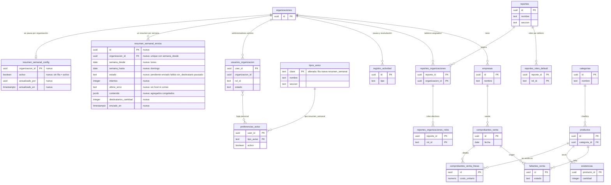
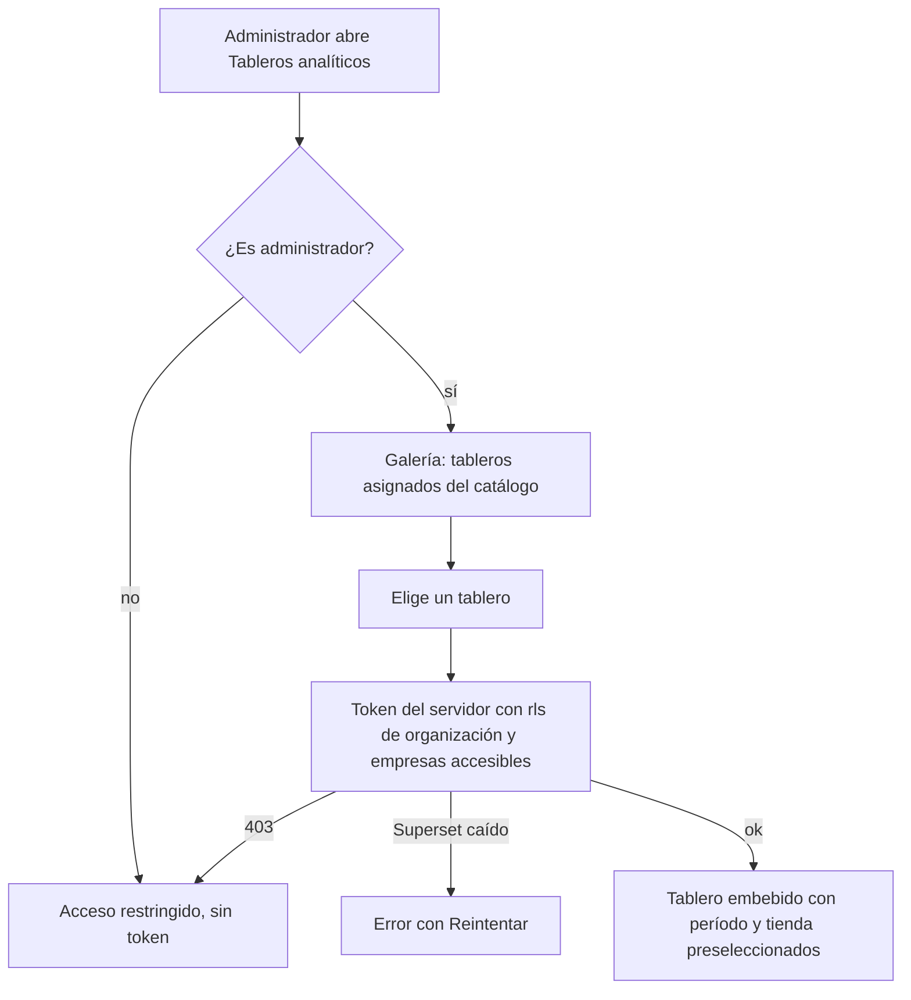
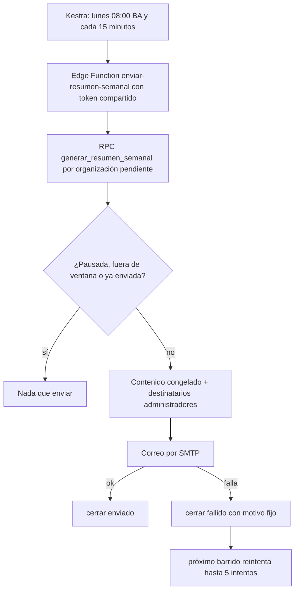

# Feature Specification: Inicio, rentabilidad y reportes · Analítica avanzada y resumen por correo

**Épica**: MSF-265 · **Spec**: `analitica-avanzada-y-resumen-por-correo` · **Historias**: F-REP-07 (analítica avanzada embebida) y F-REP-08 (resumen programado por correo) · **Prioridad**: P3
**Alcance de entrega**: `refine`, `supabase`, `kestra`, `superset` (sin `workers`).
**Estado**: completa. Reemplaza la spec parcial `20261101-100000-analitica-avanzada-y-resumen-por-correo` (NEEDS_INFO, sin RF ni CA), que vive solo en la rama `epic/MSF-265-inicio-rentabilidad-y-reportes-analitica`: se reutilizó su contexto y se cerraron las preguntas P1–P4 con las decisiones de abajo.
**Fuente**: especificación de Nicolás cargada en la épica, las decisiones que delegó (2026-11-14, comentadas en el issue) y los artefactos del repo.

## Objetivo

Al terminar, el administrador **elige entre tableros ya armados** con filtros y cruces propios —sin pedirle un reporte al equipo— y **recibe un resumen semanal por correo** sin entrar al panel.

## Decisiones confirmadas (Nicolás delegó todas las decisiones)

| Pregunta | Decisión | Consecuencia en esta spec |
|---|---|---|
| **P1** · ¿«armar» o «elegir»? | F-REP-07 = el administrador **elige** entre tableros ya armados y versionados (YAML en `infra/superset/dashboards/`, vistas del esquema `analitica`) con los filtros y cruces propios de cada tablero. **No edita tableros dentro de Superset.** | No hace falta la excepción a la regla de la spec 007 (FR-001/FR-013): el administrador sigue sin entrar a Superset ni crear ni editar reportes. Se agregan 2 tableros nuevos versionados. |
| **P2** · ¿dónde viven los tableros propios? | **No aplica**: no hay guardado de tableros propios. | Sin tabla de tableros por persona; los tableros de equipo se exportan a YAML y se commitean (CLAUDE.md). |
| **P3** · resumen semanal | Resumen semanal por correo a los **administradores de cada organización**, **lunes 08:00 (America/Argentina/Buenos_Aires)**, con ventas de la semana (si existen sus vistas), margen/rentabilidad (MSF-120), stock en alerta (MSF-231/140) y faltantes pendientes (MSF-161); **las secciones cuya fuente no existe se omiten**. Cada organización puede **pausarlo** (configuración por organización, editable solo por administradores, con evento en Actividad). El correo lleva enlace al panel y a la baja/pausa. Sin datos sensibles de clientes más allá de agregados. Castellano. | RF-REP-08-1…9. |
| **P4** · ¿Backlog/P3 o Etapa 2? | La épica se desarrolla completa ahora (las dos historias). | El orden de entrega ya no depende del roadmap; se actualiza su fila (`docs/roadmap-template.md`). |

## Modelo y supuestos (verificados en el código)

- **Bloqueada por** (ya entregadas): MSF-120 (Rentabilidad: tablero base, `ReporteEmbebido`, `infra/superset/`, vistas `analitica.*`) y MSF-189 (Avisos y listas configurables: catálogo `tipos_aviso`, preferencias por persona, SMTP genérico). **Relacionadas**: MSF-192 (vistas de ventas `analitica.ventas_periodo_canal`), MSF-140/231 (`public.stock_estados`) y MSF-161 (`dominio.faltantes_venta`): existen en el repo; si en un entorno una fuente no existe, su sección se omite sin error.
- Los tableros son **Superset embebido** (spec 007) sobre **vistas del esquema `analitica`**; el navegador solo recibe un **guest token** que arma el servidor (`emitir-acceso-reporte`) con la cláusula `rls` `organizacion_id = '<org>'` y, para los tableros con `filtro_empresa`, `empresa_id IN (<empresas accesibles>)`. Esta spec no cambia esa Edge Function.
- La pantalla existente `/analitica` (spec 007) lista los reportes asignados y está oculta del menú; la galería de esta spec **no la reemplaza**: es un destino nuevo del menú *Reportes* con descripción, cruces y filtros de cada tablero.
- El envío de correos de negocio sigue el patrón de MSF-394/MSF-405: **flow de Kestra con cron → Edge Function → RPC de `service_role` → SMTP del proyecto** (`SMTP_*` de los secretos de la función); el SQL solo calcula y registra (el repo prohíbe disparar HTTP desde SQL, `docs/adoptar-ciclo-ejecuciones.md` §3.1).
- Estado actual relevante de la regla 007: el administrador **no entra a Superset** (007 FR-013) y esta spec lo respeta tal cual.

### Esquema de datos (Constitución, Principio VII), verificado objeto por objeto

| Objeto | Esquema | Historia | Justificación | Acceso |
|---|---|---|---|---|
| `analitica.ventas_empresa_categoria` (vista) | `analitica` | F-REP-07 | Contrato de lectura para Superset; no almacena datos; cada fila lleva `organizacion_id`, `empresa_id` y `empresa_nombre` | Sin acceso para `anon`/`authenticated`; `select` solo para `superset_analitica` |
| `analitica.margen_real_categoria` (vista) | `analitica` | F-REP-07 | Ídem; reutiliza `analitica.rentabilidad_ventas_real` (un único cálculo del margen) y le suma la categoría; expone costo y margen | Ídem; el tablero se registra con la sección `rentabilidad` |
| Filas en `public.reportes` (+ `reportes_roles_default`, `reportes_organizaciones`, `reportes_organizaciones_roles`) | `public` (plataforma, spec 007) | F-REP-07 | Solo DATO (2 reportes) y 3 funciones de disparador en `private`; sin tablas ni columnas nuevas | RLS vigente de la spec 007 |
| `public.resumen_semanal_config` (tabla) | `public` (**plataforma**) | F-REP-08 | Configuración por organización (activo/pausado), como `organizaciones_features`: no es una entidad del negocio | RLS activada **sin políticas**; sin privilegios para `anon` ni `authenticated`; solo RPC `security definer` |
| `public.resumen_semanal_envios` (tabla) | `public` (**plataforma**) | F-REP-08 | Registro/outbox de un aviso de plataforma, como `avisos_pendientes`: estado, intentos y error de cada resumen | Ídem |
| Fila `resumen_semanal` en `public.tipos_aviso` | `public` (plataforma) | F-REP-08 | Reutiliza el catálogo de MSF-189 solo para la **baja personal** desde `/cuenta/avisos`; no usa la cola `avisos_pendientes` | RLS vigente de `tipos_aviso` |

`analitica` no tiene tablas: `rls_en_toda_tabla` (recorre `public` + `dominio`) sigue verde. Toda migración es aditiva e idempotente; la reversión de cada una está documentada en su encabezado.

## Modelo de datos (DER)

Las dos tablas nuevas están en `public` (plataforma, Principio VII, justificado arriba). Las vistas de `analitica` no son tablas y no se dibujan; leen las tablas `existente` que figuran. El resto del grafo se muestra completo para ver a qué se ata cada tabla.

| Tabla | Estado | Cambio |
|---|---|---|
| `public.resumen_semanal_config` | nueva | Una fila por organización: `activo` (sin fila = activo), quién y cuándo lo cambió |
| `public.resumen_semanal_envios` | nueva | Un resumen por organización y semana (`unique`): estado, intentos, error útil, contenido congelado y cantidad de destinatarios |
| `public.tipos_aviso` | alterada | Fila nueva `resumen_semanal` (sección `usuarios_permisos`) para la baja personal; sin cambio de estructura |
| `public.preferencias_aviso` | existente | Preferencia por persona y tipo; la baja personal del resumen |
| `public.organizaciones` | existente | Organización dueña de la configuración y de los envíos |
| `public.usuarios_organizacion` | existente | Quién es administrador activo (los destinatarios) |
| `public.registro_actividad` | existente | Eventos `resumen_semanal.pausado` y `resumen_semanal.reanudado` |
| `public.reportes` | existente | Catálogo de reportes embebidos (2 filas nuevas «Analítica · …») |
| `public.reportes_organizaciones` | existente | Asignación de cada tablero a las organizaciones |
| `public.reportes_roles_default` | existente | Roles por defecto de cada tablero |
| `public.reportes_organizaciones_roles` | existente | Roles efectivos por organización |
| `dominio.comprobantes_venta` | existente | Fuente de las ventas (vistas `analitica`) |
| `dominio.comprobantes_venta_lineas` | existente | Fuente de unidades, facturado y costo guardado |
| `dominio.productos` | existente | Producto de cada línea y de los faltantes |
| `dominio.categorias` | existente | Categoría del producto (el cruce nuevo) |
| `dominio.empresas` | existente | Tienda / canal |
| `dominio.faltantes_venta` | existente | Faltantes abiertos del resumen (MSF-161) |
| `dominio.existencias` | existente | Stock que alimenta `public.stock_estados` (stock en alerta) |

## User Scenarios & Testing *(mandatory)*

### Historia 1 — Analítica avanzada embebida (F-REP-07, P3)

Como administrador quiero **elegir entre tableros ya armados** y acotarlos por período y tienda, para analizar el negocio con cruces útiles sin pedirle un reporte al equipo.

**Escenarios de aceptación**

- **CA-REP-07-1** — **Dado** un administrador con tableros asignados, **cuando** abre «Tableros analíticos», **entonces** ve una tarjeta por tablero con su título, descripción, **cruces** y **filtros**; los reportes asignados que no están en el catálogo no se ofrecen, y no hay ninguna acción para crear, editar ni guardar tableros.
- **CA-REP-07-2** — **Dado** la galería, **cuando** elige «Abrir tablero», **entonces** lo ve embebido en el panel (`ReporteEmbebido`, guest token del servidor), con el período del mes en curso preseleccionado; «Volver a los tableros» regresa a la galería. El navegador nunca recibe credenciales de Superset ni entra a su interfaz.
- **CA-REP-07-3** — **Dado** una tienda elegida en la barra superior, **cuando** abre un tablero, **entonces** el filtro de tienda del tablero queda preseleccionado; **cuando** cambia la empresa activa, **entonces** el tablero se vuelve a montar con la tienda nueva y vuelve a pedir el token (nunca quedan filas de la anterior). Con «Todas» no se preselecciona ninguna.
- **CA-REP-07-4** — **Dado** el tablero «Analítica · Ventas por tienda y categoría», **cuando** se lo abre, **entonces** muestra el cruce tienda × categoría, período × categoría y producto × tienda del facturado con IVA y las unidades; sin costo ni margen ni datos de clientes.
- **CA-REP-07-5** — **Dado** el tablero «Analítica · Margen real por tienda, categoría y producto», **cuando** se lo abre, **entonces** muestra vendido, costo y margen real por tienda × categoría, período × tienda y producto × tienda (primero lo que más pierde), y exige la sección `rentabilidad`.
- **CA-REP-07-6** — **Dado** que se registra un tablero «Analítica · …» o se crea una organización nueva, **entonces** el tablero queda asignado a **todas** las organizaciones con sus roles por defecto; el superadmin puede desasignarlo.
- **CA-REP-07-7** — **Dado** dos organizaciones A y B, **cuando** A abre un tablero, **entonces** el token lleva `organizacion_id = '<A>'` (y las empresas accesibles de quien mira) y no aparece ninguna fila de B ni de una tienda ajena.
- **CA-REP-07-8** — **Dado** un usuario que no es administrador, **cuando** llega a la pantalla por URL, **entonces** ve «Acceso restringido» y no se pide ningún token; si el token responde 403 (sin la sección del tablero) se muestra el mismo acceso restringido.
- **CA-REP-07-9** — **Dado** que Superset no responde, **entonces** ve el error «No pudimos cargar el tablero…» con **Reintentar**, sin detalle técnico (patrón de la spec 007); sin tableros asignados ve el estado vacío.

### Historia 2 — Resumen semanal por correo (F-REP-08, P3)

Como administrador quiero recibir cada lunes por correo un resumen de la semana, para enterarme del negocio sin entrar al panel, y poder pausarlo o darme de baja.

**Escenarios de aceptación**

- **CA-REP-08-1** — **Dado** una organización activa con administradores, **cuando** es lunes a las 08:00 (hora de Buenos Aires), **entonces** se genera **un** resumen de la semana que terminó (lunes a domingo anteriores) y se envía **un correo** a todos sus administradores activos. Antes de las 08:00, el domingo o desde el miércoles no nace ningún resumen.
- **CA-REP-08-2** — **Dado** una organización con un administrador suspendido, otro dado de baja del resumen y un miembro que no es administrador, **entonces** solo recibe el correo el administrador activo con la preferencia encendida.
- **CA-REP-08-3** — **Dado** que existen las fuentes de ventas, margen, stock y faltantes, **entonces** el correo trae las cuatro secciones; **dado** que una fuente no existe (p. ej. sin la vista de ventas), **entonces** esa sección se omite y el resumen sale igual; sin stock en alerta ni faltantes abiertos esas dos secciones no aparecen y el correo lo dice en una línea.
- **CA-REP-08-4** — **Dado** que el barrido corre varias veces (cada 15 minutos) o se reintenta, **entonces** no se duplica: hay un único registro por organización y semana, y uno `enviado` no se reenvía.
- **CA-REP-08-5** — **Dado** que el SMTP falla, **entonces** el resumen queda `fallido` con un motivo útil sin host, IP ni correo, el barrido siguiente lo reintenta con **el mismo contenido** hasta el tope de intentos, y la ejecución de Kestra se marca con error.
- **CA-REP-08-6** — **Dado** un administrador en «Mi organización», **cuando** pausa el resumen, **entonces** no se genera ni se envía ninguno (lo pendiente queda `pausado`), el cambio queda en **Actividad** y un rol que no es administrador no puede verlo ni cambiarlo; al reanudarlo vuelve a salir el lunes siguiente. Cada persona puede además darse de baja en «Avisos por correo».
- **CA-REP-08-7** — **Dado** dos organizaciones, **entonces** cada correo contiene solo agregados de **su** organización (totales, conteos, nombres de producto en alerta) y nunca datos de clientes, comprobantes individuales ni correos.
- **CA-REP-08-8** — **Dado** un correo recibido, **entonces** está en castellano (fechas y pesos de Argentina), es texto plano (sin HTML que escapar) y trae el enlace al panel, a los tableros, a la pausa (Mi organización) y a la baja personal (Avisos por correo).

### Casos borde

- Una semana sin ventas: la sección de ventas dice «No hubo ventas en la semana»; no se inventan totales.
- Organización sin administradores con correo: el resumen queda `sin_destinatario` y se reevalúa dentro de la ventana (por si se agrega uno).
- Kestra caído el lunes: el barrido del martes todavía genera el resumen (ventana lunes 08:00 a martes); pasado el martes ya no se genera uno atrasado.
- El correo salió pero la base no pudo cerrar el resumen: el reintento lo reenvía (al menos una vez; se prefiere un duplicado a perder el resumen) y queda en los registros.
- Superadmin sin organización activa: no administra el resumen de ninguna.

## Requirements *(mandatory)*

### F-REP-07 — Analítica avanzada embebida

- **RF-REP-07-1**: La galería «Tableros analíticos» DEBE listar, de los reportes asignados a la organización y presentes en el catálogo `apps/web/src/lib/tablerosAnaliticos.ts`, una tarjeta por tablero con título, descripción, cruces y filtros; no ofrece crear, editar ni guardar tableros.
- **RF-REP-07-2**: Elegir un tablero DEBE mostrarlo embebido con `ReporteEmbebido` y el guest token que emite el servidor; el administrador NO entra a Superset (regla de la spec 007 FR-013, sin excepción).
- **RF-REP-07-3**: La pantalla DEBE preseleccionar los filtros nativos de **período** y de **tienda** (la empresa activa de la barra superior, Principio VIII) y volver a montar el tablero al cambiarlos; el aislamiento NO depende de esos filtros.
- **RF-REP-07-4**: DEBE existir el tablero versionado en YAML «Analítica · Ventas por tienda y categoría» sobre `analitica.ventas_empresa_categoria`, con filtros de período, tienda, categoría y «agrupar por».
- **RF-REP-07-5**: DEBE existir el tablero versionado en YAML «Analítica · Margen real por tienda, categoría y producto» sobre `analitica.margen_real_categoria`, con los filtros anteriores más «estado del margen», registrado con la sección `rentabilidad`.
- **RF-REP-07-6**: Los dos tableros DEBEN quedar registrados en `public.reportes` (importador idempotente de `infra/superset/dashboards/analitica-avanzada/reportes.json`, `filtro_empresa = true`) y asignados a todas las organizaciones, actuales y nuevas (migración `20270324100100`); el despliegue DEBE importarlos.
- **RF-REP-07-7**: El aislamiento por organización y por empresa DEBE resolverse en el servidor (guest token con `rls`); las vistas exponen `organizacion_id`, `empresa_id` y `empresa_nombre`, no tienen privilegios para `anon` ni `authenticated` y solo las lee el rol `superset_analitica`.
- **RF-REP-07-8**: La galería DEBE estar disponible solo para administradores; sin acceso muestra «Acceso restringido» sin pedir token, y el 403 del token muestra lo mismo. Si Superset no responde, muestra el error con «Reintentar» y sin detalle técnico.
- **RF-REP-07-9**: La pantalla DEBE usar los patrones compartidos de carga, vacío y error, y funcionar con teclado y a 320/768/1440 px (Principio VI).

### F-REP-08 — Resumen programado por correo

- **RF-REP-08-1**: El sistema DEBE enviar el resumen semanal los **lunes a las 08:00 (America/Argentina/Buenos_Aires)**, cubriendo la semana lunes–domingo que terminó. La generación solo ocurre dentro de la ventana lunes 08:00 – martes; un barrido cada 15 minutos reintenta lo pendiente.
- **RF-REP-08-2**: Los destinatarios DEBEN ser los miembros **activos** con rol `administrador`, con correo y con la preferencia `resumen_semanal` encendida (sin fila = encendida); los resuelve la base, nunca el pedido.
- **RF-REP-08-3**: El resumen DEBE incluir ventas de la semana (con comparación contra la anterior y por tienda), margen real y productos con margen bajo o negativo, stock en alerta (sin stock y stock bajo) y faltantes pendientes; la sección cuya fuente no existe se omite sin error.
- **RF-REP-08-4**: El envío DEBE ser idempotente por organización y semana (`unique (organizacion_id, semana_desde)`) y auditable: estado, intentos, timestamps y error útil (Principio III).
- **RF-REP-08-5**: Un fallo de SMTP DEBE dejar el resumen `fallido` con un motivo fijo, reintentarse con el contenido congelado hasta un tope de 5 intentos, y marcar la ejecución de Kestra con error; un resumen `enviado` nunca se reenvía.
- **RF-REP-08-6**: Cada organización PUEDE pausar el resumen desde «Mi organización» (solo administradores; cambio real → evento `resumen_semanal.pausado|reanudado` en Actividad); cada persona puede darse de baja en «Avisos por correo».
- **RF-REP-08-7**: Cada correo DEBE contener solo agregados de la organización del destinatario, sin datos de clientes.
- **RF-REP-08-8**: El correo DEBE estar en castellano, en texto plano, con enlaces al panel, a los tableros, a la pausa y a la baja.
- **RF-REP-08-9**: Seguridad: RLS activada en las dos tablas sin políticas y sin privilegios para `anon`/`authenticated`; RPC del barrido solo para `service_role`; RPC de la app solo para `authenticated` con verificación de administrador; todas `security definer` con `search_path = ''`; secretos solo por entorno (`RESUMEN_SEMANAL_TOKEN`, `SMTP_*`, base64 en Kestra).

### Criterios de éxito

- **SC-001** (F-REP-07): un administrador abre un tablero con un filtro y un cruce y otra organización no ve sus filas (pgTAP de aislamiento + token del servidor).
- **SC-002** (F-REP-08): en una corrida semanal, cada organización genera un único resumen y un único correo; reintentar la corrida no duplica.
- **SC-003** (F-REP-08): sin una fuente (ventas, p. ej.) el resumen sale sin esa sección.

## Verificación por requisito

Cada RF/SC tiene una tarea dueña y una verificación nombrada. Las pruebas de base de datos se corrieron a mano en la base de dev dentro de `begin … rollback` (no se puede `supabase test db`); el CI las corre con `pnpm test:db`.

| Requisito | Tarea dueña | Verificación (test / comando) |
|---|---|---|
| RF-REP-07-1 | T006 | Vitest `src/pages/reportes/Tableros.test.tsx` («la galería muestra solo los tableros del catálogo asignados…») y `src/lib/tablerosAnaliticos.test.ts` |
| RF-REP-07-2 | T006 | Vitest `Tableros.test.tsx` («abrir un tablero lo monta embebido…») |
| RF-REP-07-3 | T006 | Vitest `Tableros.test.tsx` («empresa activa…», «no monta el tablero hasta conocer la tienda») |
| RF-REP-07-4 | T001, T004 | pgTAP `analitica_tableros_avanzados.test.sql` (tests 1–7) + `node --test infra/superset/analitica-avanzada.test.mjs` |
| RF-REP-07-5 | T001, T004 | pgTAP `analitica_tableros_avanzados.test.sql` (tests 8–12) + `analitica-avanzada.test.mjs` (sección `rentabilidad`) |
| RF-REP-07-6 | T002, T005 | pgTAP `analitica_tableros_avanzados.test.sql` (tests 16–20) + `analitica-avanzada.test.mjs` (importación idempotente) + `.github/workflows/deploy-infraestructura-vps.yml` |
| RF-REP-07-7 | T001 | pgTAP `analitica_tableros_avanzados.test.sql` (tests 2, 10, 13–15, 21–23) + `pnpm test:edge:emitir-acceso-reporte` (sin cambios) |
| RF-REP-07-8 | T006 | Vitest `Tableros.test.tsx` («quien no es administrador…», «un 403 del token…», «error con Reintentar») |
| RF-REP-07-9 | T006 | Vitest `Tableros.test.tsx` (axe a 320/768/1440 px y foco con teclado) |
| RF-REP-08-1 | T007, T010 | pgTAP `resumen_semanal.test.sql` (ventana, semana cubierta) + `node --test infra/kestra/validar-resumen-semanal.test.mjs` (cron y zona horaria) |
| RF-REP-08-2 | T007 | pgTAP `resumen_semanal.test.sql` (destinatarios; baja personal) |
| RF-REP-08-3 | T008, T011 | pgTAP `resumen_semanal.test.sql` (contenido; sin la vista de ventas) + `node --test supabase/functions/enviar-resumen-semanal/handler.test.ts` |
| RF-REP-08-4 | T007 | pgTAP `resumen_semanal.test.sql` (idempotente por semana; reserva) |
| RF-REP-08-5 | T009 | pgTAP (fallo, mismo contenido, tope) + `handler.test.ts` (motivo fijo, 502, sin duplicar) |
| RF-REP-08-6 | T007, T012 | pgTAP (pausa, Actividad, sin permiso) + Vitest `ResumenSemanal.test.tsx` |
| RF-REP-08-7 | T008 | pgTAP `resumen_semanal.test.sql` (aislamiento, sin datos de clientes ni correos) |
| RF-REP-08-8 | T009 | `handler.test.ts` («trae las cuatro secciones… enlaces», «limpia saltos de línea») |
| RF-REP-08-9 | T007, T010 | pgTAP (privilegios exactos, RLS, search_path) + `validar-resumen-semanal.test.mjs` (secreto en base64, sin valores en el YAML) + guards |
| SC-001 | T001 | pgTAP `analitica_tableros_avanzados.test.sql` |
| SC-002 | T007, T009 | pgTAP + `handler.test.ts` |
| SC-003 | T008 | pgTAP `resumen_semanal.test.sql` («sin la vista de ventas…») |

Validación general antes del PR: `pnpm lint`, `pnpm build`, `pnpm infra:config`, `pnpm docs:check`, `pnpm matriz:check`, `pnpm der:check`.

## Matriz pantalla↔criterios

`pnpm prototipo:inventario` **no aplica**: ninguna de las dos historias tiene pantalla dibujada en el prototipo (`design/pantallas/*.dc.html`; el documento del componente dice «Sin dibujar»). No hay `.dc.html` ni inventario que mapear ni ítems visibles sin dueño. La UI se resuelve con el sistema de diseño (`docs/sistema-de-diseno.md`) y los componentes compartidos del panel (`EncabezadoPagina`, `ContenedorSeccion`, `EstadoVacio`/`EstadoError`/`EstadoCargaPagina`, `FiltroEmpresa`, `FiltrosPeriodo`, `ReporteEmbebido`, `Switch` de MUI), sin inventar secciones del prototipo. Cuando el equipo dibuje estas pantallas, la matriz se actualiza antes de cambiar la UI.

| Ítem | Dueño | Nota |
|---|---|---|
| Ítems del inventario del prototipo | — | Sin pantalla dibujada: fuera de alcance por inexistencia, no por omisión |
| Galería «Tableros analíticos» (`/reportes/tableros`, `apps/web/src/pages/reportes/Tableros.tsx`): tarjetas con título, descripción, cruces y filtros; «Abrir tablero» | RF-REP-07-1, RF-REP-07-2, CA-REP-07-1, CA-REP-07-2 | Destino nuevo del menú *Reportes* (ícono Insights), audiencia administrador; carga diferida (`lazy`) |
| Tablero abierto: título, «Volver a los tableros», filtro de tienda (`FiltroEmpresa`), filtros de período (`FiltrosPeriodo`), tablero embebido | RF-REP-07-2, RF-REP-07-3, CA-REP-07-2, CA-REP-07-3 | Los mismos controles que «Reportes de ventas» |
| Estados: carga, vacío («Todavía no hay tableros disponibles…»), error con «Reintentar», acceso restringido, «Analítica no disponible» | RF-REP-07-8, RF-REP-07-9, CA-REP-07-8, CA-REP-07-9 | Patrones compartidos |
| **Empresa activa** | RF-REP-07-3, CA-REP-07-3 | La galería **sigue la empresa activa** de la barra superior (Principio VIII): una tienda o «Todas»; el filtro nativo de tienda del tablero se preselecciona con su nombre; al cambiar la empresa se **vuelve a montar** el tablero (clave de montaje con los filtros) y se pide un token nuevo, así que nunca quedan filas de la anterior; sin diálogos ni selección que descartar. El aislamiento real lo fuerza el token del servidor. Test que cambia de empresa: `Tableros.test.tsx` («empresa activa…») |
| Interruptor «Resumen semanal por correo» en Mi organización (`apps/web/src/pages/organizacion/ResumenSemanal.tsx`): activo/pausado, próximo envío, último resumen | RF-REP-08-6, CA-REP-08-6 | Sección nueva de una pantalla existente (Mi organización absorbe la configuración: no hay pantalla nueva); solo administradores |
| Empresa activa en el resumen y en su interruptor | — | **Empresa activa: no aplica**: el resumen y su pausa son de **toda la organización** (no filtran ni leen datos por empresa de la pantalla) |
| Baja personal en `/cuenta/avisos` | RF-REP-08-6, CA-REP-08-6 | Sin pantalla nueva: el tipo `resumen_semanal` aparece solo en el catálogo que ya lista esa pantalla |

## Flujos

Pasos: A–C → RF-REP-07-1, RF-REP-07-8; D–G → RF-REP-07-2, RF-REP-07-3, RF-REP-07-7.

Pasos: S, H → RF-REP-08-1; R, P → RF-REP-08-4, RF-REP-08-6; G → RF-REP-08-2, RF-REP-08-3, RF-REP-08-7; M/OK/FA/RT → RF-REP-08-5, RF-REP-08-8.

## Contratos

- [`contracts/tableros-analiticos.md`](./contracts/tableros-analiticos.md): vistas `analitica.*`, tableros, catálogo y registro.
- [`contracts/resumen-semanal.md`](./contracts/resumen-semanal.md): RPC, Edge Function, flow, contenido y estados.

## Fuera de alcance

- Que el administrador **arme o edite** tableros dentro de Superset (decisión P1) y el guardado de tableros propios (P2).
- Reportes exportables adicionales, BI más allá de los tableros descritos y Mercado Libre.
- Un editor de contenido del correo, otro día u hora por organización, correo en HTML y envío a personas que no son administradores.
- Una pantalla de preferencia del resumen distinta de «Mi organización» y «Avisos por correo».
