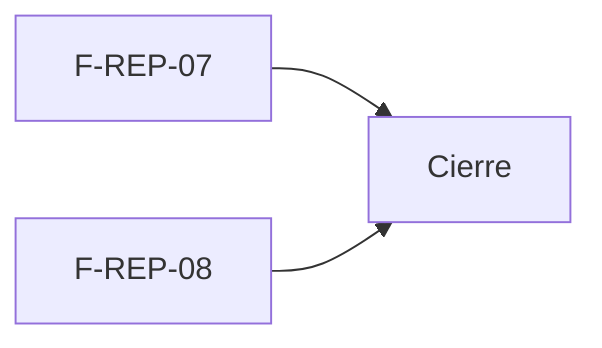

# Tasks: Analítica avanzada y resumen por correo (MSF-265)

**Spec**: [`spec.md`](./spec.md) · **Plan**: [`plan.md`](./plan.md) · Formato: `- [x] T001 [P] [STORY][USy] descripción — evidencia`.
Cada RF/SC tiene una tarea dueña y su verificación nombrada (tabla «Verificación por requisito» de `spec.md`). Ninguna tarea queda `[ ]`.

## Matriz de trazabilidad (tracker ↔ US ↔ tasks)

| Tracker | Historia | US | RF / SC dueños | Tareas |
|---|---|---|---|---|
| (hija de MSF-265) | F-REP-07 | US1 | RF-REP-07-1…9, SC-001 | T001–T006 |
| (hija de MSF-265) | F-REP-08 | US2 | RF-REP-08-1…9, SC-002, SC-003 | T007–T012 |
| Tarea de cierre (label cierre) | — | — | docs, roadmap, seguridad y guards | T013–T015 |

## Phase 1: F-REP-07 · Analítica avanzada embebida (US1)

- [x] T001 [F-REP-07][US1] Migración `20270324100000_analitica_tableros_avanzados.sql`: vistas `analitica.ventas_empresa_categoria` y `analitica.margen_real_categoria`, `select` solo para `superset_analitica`, reversión documentada (dueña de RF-REP-07-4, RF-REP-07-5, RF-REP-07-7, SC-001). Evidencia: pgTAP `analitica_tableros_avanzados.test.sql` 23/23 en la base dev dentro de `begin … rollback`.
- [x] T002 [F-REP-07][US1] Migración `20270324100100_reportes_tableros_analiticos.sql`: 2 reportes «Analítica · …» con sección (`reportes` y `rentabilidad`), roles por defecto, disparadores y backfill que los asignan a todas las organizaciones, existentes y nuevas (dueña de RF-REP-07-6). Evidencia: pgTAP `analitica_tableros_avanzados.test.sql` (tests 16–23: asignación, herencia de roles, organización nueva, `resolver_organizacion_reporte` por organización).
- [x] T003 [F-REP-07][US1] Tableros versionados en YAML `infra/superset/dashboards/analitica-avanzada/` (2 datasets, 6 gráficos, 2 dashboards, `reportes.json` con `filtro_empresa: true`) (dueña de RF-REP-07-4, RF-REP-07-5). Evidencia: `node --test infra/superset/analitica-avanzada.test.mjs` 7/7. Desvío: los YAML no se pudieron importar en un Superset real desde esta sesión (no se escribe en dev); queda validado su contenido y su importación contra un Superset simulado. Seguimiento a trazar (Tarea `seguimiento`): importar `analitica-avanzada` en dev/staging y verificar a ojo que los 6 gráficos rendericen con los filtros.
- [x] T004 [P] [F-REP-07][US1] Prueba de los tableros versionados: dataset físico con `organizacion_id`/`empresa_id`, sin costo en el de ventas, sección `rentabilidad` en el de margen, gráficos y filtros nativos coherentes, empaquetado sin credenciales, importación idempotente y catálogo del panel igual a `reportes.json` y a la migración (verifica RF-REP-07-4/5/6). Evidencia: `pnpm test:superset:importar-dashboards` (47/47 con las pruebas existentes).
- [x] T005 [F-REP-07][US1] Importación en el despliegue: `.github/workflows/deploy-infraestructura-vps.yml` importa `analitica-avanzada` en staging y producción (dueña de RF-REP-07-6). Evidencia: diff del workflow (2 líneas) y `pnpm test:superset:importar-dashboards`.
- [x] T006 [F-REP-07][US1] Galería «Tableros analíticos»: catálogo `lib/tablerosAnaliticos.ts`, pantalla `pages/reportes/Tableros.tsx` con `ReporteEmbebido`, filtros de período y tienda (empresa activa), estados compartidos, destino de menú «Tableros analíticos» (administrador), ruta `/reportes/tableros` con carga diferida, ayuda y manual (dueña de RF-REP-07-1, 2, 3, 8, 9). Evidencia: Vitest `Tableros.test.tsx` y `tablerosAnaliticos.test.ts` (axe a 320/768/1440 px, cambio de empresa), `ayuda-cobertura.test.ts`, `tsc -b` sin errores y `oxlint src` sin errores.

**Checkpoint F-REP-07**: un administrador elige un tablero, lo ve acotado a su organización y tiendas, y otra organización no ve sus filas.

## Phase 2: F-REP-08 · Resumen programado por correo (US2)

- [x] T007 [F-REP-08][US2] Migración `20270324100200_resumen_semanal.sql` (tablas `resumen_semanal_config` y `resumen_semanal_envios` en `public`, tipo de aviso, ventana lunes 08:00 de Buenos Aires, generación idempotente por semana con reserva, cierre, pausa y estado, privilegios exactos) y `20270324100300_exportacion_total_excluye_resumen_semanal.sql` (dueña de RF-REP-08-1, 2, 4, 6, 9). Evidencia: pgTAP `resumen_semanal.test.sql` 81/81 y pgTAP existentes `exportacion_total`, `rls_en_toda_tabla`, `privilegios_anon_endurecidos`, `avisos_listas_grants_seguridad`, `service_role_grants_public_e2e` verdes con las migraciones aplicadas, todo en dev dentro de `begin … rollback`.
- [x] T008 [F-REP-08][US2] Contenido del resumen `private.armar_resumen_semanal` (ventas, margen, stock en alerta, faltantes; fuentes ausentes omitidas; solo agregados) (dueña de RF-REP-08-3, RF-REP-08-7, SC-003). Evidencia: pgTAP `resumen_semanal.test.sql` (contenido, aislamiento, sin datos de clientes, sin la vista de ventas).
- [x] T009 [F-REP-08][US2] Edge Function `enviar-resumen-semanal` (`handler.ts`, `contenido.ts`, `index.ts`): un correo por organización y semana, fallo con motivo fijo, barrido que responde 502 si algo falla, enlaces al panel, a los tableros, a la pausa y a la baja (dueña de RF-REP-08-5, RF-REP-08-8, SC-002). Evidencia: `pnpm test:edge:enviar-resumen-semanal` 22/22.
- [x] T010 [F-REP-08][US2] Flow `infra/kestra/flows/resumen-semanal.yml` (lunes 08:00 y cada 15 minutos, zona `America/Argentina/Buenos_Aires`), variables en `compose.yaml`/`.env.example`, secreto en `config.toml` y `supabase/functions/.env.example` (verifica RF-REP-08-1 y RF-REP-08-9). Evidencia: `pnpm test:kestra:resumen-semanal` 8/8, `node --test infra/kestra/*.test.mjs infra/kestra/flows/*.test.mjs` 149/149 y `pnpm infra:config` sin errores. Desvío respecto de la spec parcial: el envío NO usa el rol JDBC `kestra_orquestacion` ni `MailSend` de Kestra sino la Edge Function con RPC de `service_role` (patrón MSF-394/405), y el correo es texto plano en vez de HTML (no hay HTML que escapar).
- [x] T011 [P] [F-REP-08][US2] Pruebas del contenido y del barrido de la función: secciones, omisión, saneamiento de cabeceras, tope de ítems, reintento sin duplicar, 403/503 y destinatarios nunca del pedido (dueña de la verificación de RF-REP-08-3/5/8). Evidencia: `handler.test.ts` (parte de los 22 de T009).
- [x] T012 [F-REP-08][US2] «Resumen semanal por correo» en Mi organización (interruptor activo/pausado, próximo envío, último resumen), etiquetas del evento en Actividad y alta del tipo en `/cuenta/avisos` (automática: la lista sale del catálogo `tipos_aviso`) (dueña de RF-REP-08-6). Evidencia: Vitest `ResumenSemanal.test.tsx` (axe incluido) y `edit.test.tsx`; pgTAP (baja personal con `guardar_preferencia_aviso`).

**Checkpoint F-REP-08**: el resumen llega una vez por organización y semana, se puede pausar y no se duplica al reintentar.

## Phase 3: Cierre

- [x] T013 [CIERRE] Documentación en `docs/`: `analitica-avanzada.md`, `resumen-semanal-correo.md`, `producto/tableros-analiticos.md`, actualización de `operar-superset.md`, `avisos-por-correo.md`, `administracion-organizacion.md` y `actividad.md`, y `mkdocs.yml`. Evidencia: `pnpm docs:check` y `verificar-documentacion-cambios` verdes.
- [x] T014 [CIERRE] `docs/roadmap-template.md` (fila de la épica y #34) y revisión de seguridad integral escrita en `docs/revision-seguridad-analitica-avanzada.md` (RLS, `anon`, `security definer`, secretos, aislamiento del embebido). Evidencia: documento y fila del roadmap.
- [x] T015 [CIERRE] Guards y validación local: `verificar-migraciones`, `verificar-documentacion-cambios` (`DOCUMENTATION_CHECK_BASE=origin/dokploy`), `verificar-matriz-pantalla` y `verificar-der` (`GITHUB_BASE_REF=dokploy`), `verificar-inventario-prototipo`, `verificar-estilos-sueltos`, `ui:empresas:check`, commitlint, `tsc -b`, `oxlint src` (0 errores), `vite build`. Evidencia: resultados en el informe de cierre. Desvío: no se corrieron `pnpm test:db` completo ni las suites E2E (sin memoria para la suite completa y el job `e2e-tienda` solo corre specs de tienda); los pgTAP de esta spec y los afectados se corrieron a mano en dev. Sin deuda real: el CI corre ambas.

## Plan de ejecución (historias)

| Historia | Depende de | Grupo |
|---|---|---|
| F-REP-07 | — | 1 |
| F-REP-08 | — | 1 |
| [Cierre] | F-REP-07, F-REP-08 | 2 |

Las dos historias no comparten archivos, tabla ni migración (F-REP-07: vistas, catálogo de reportes, Superset y la galería; F-REP-08: tablas del resumen, Kestra y Mi organización).
