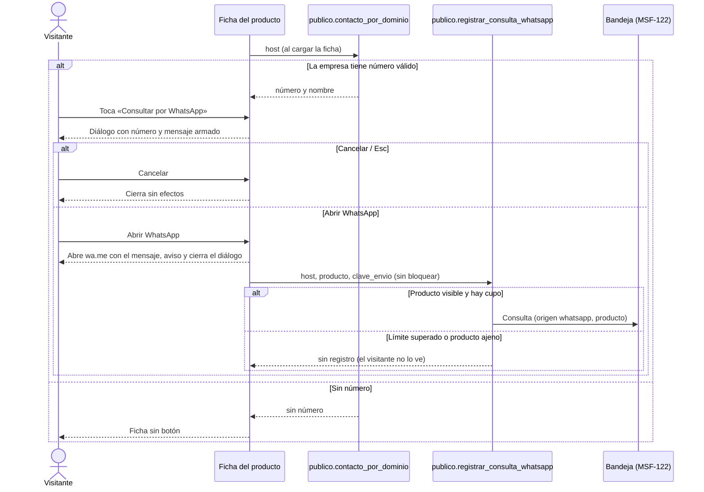
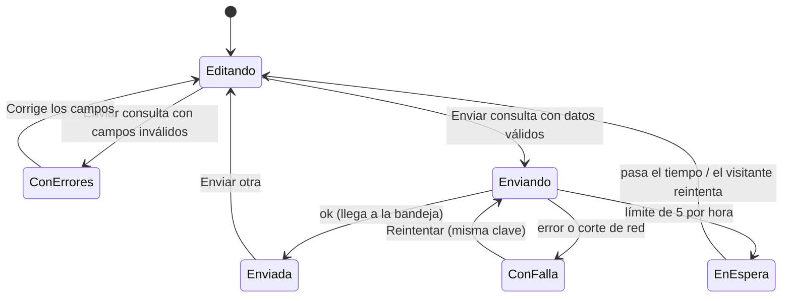
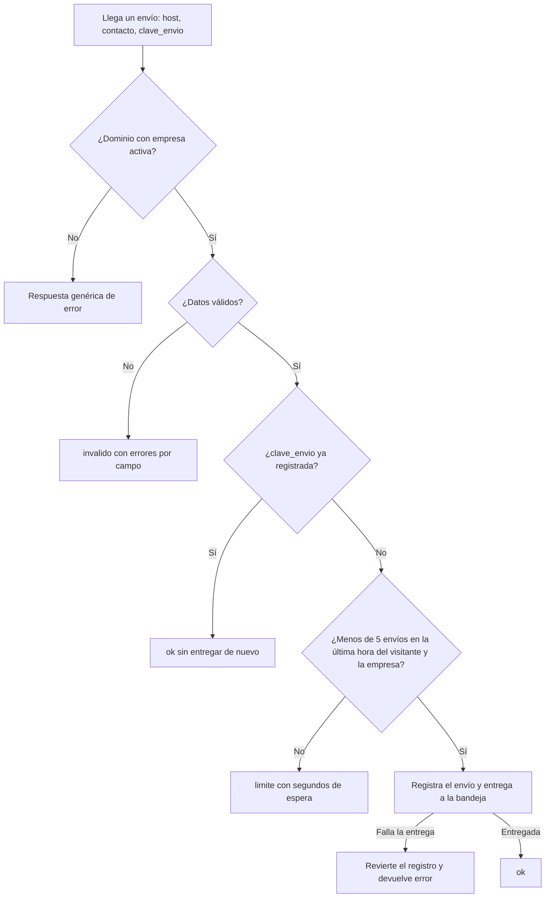

# Feature Specification: Tiendas online · Tienda WhatsApp y contacto

**Feature Branch**: `epic/MSF-212-tiendas-online-tienda-whatsapp-y-contact`

**Componente**: Tiendas online

**Jira Epic**: MSF-212 — Tiendas online · Tienda whatsapp y contacto (spec `tienda-whatsapp-y-contacto`)

**Historias previstas**: F-TDA-14 (M), F-TDA-16 (M), ambas P0.

**Created**: 2026-10-24

**Status**: Draft — lista para planificar. Las decisiones de Nicolás quedan en *Decisiones abiertas*; ninguna bloquea implementar con el supuesto indicado.

**Delivery scope**: `refine` (`apps/web`: front público de la tienda y un campo en Empresas) y `supabase` (migraciones aditivas, funciones de `publico`, pgTAP). Sin `kestra`, `superset` ni `workers`.

**Prioridad / Hito**: P0 · Hito 3 (16 de noviembre al 11 de diciembre de 2026) · ~16 h · alcance diciembre.

**Input**: Epic MSF-212. Objetivo: «Al terminar, el visitante puede abrir WhatsApp con un mensaje ya armado desde la ficha o enviar un formulario de contacto, y ambas consultas llegan a la bandeja de Consultas y ventas.»

## Regla de fuentes (literal de la épica)

1. Comportamiento y datos: mandan los requisitos y escenarios de esta historia.
2. Qué se ve (disposición, textos, estados, popups, flujos): el prototipo validado es referencia visual, no hace falta que quede extremadamente idéntico; los flujos (si hay) aclaran estados y acciones.
3. Cómo se construye (componentes, estilos y patrones): mandan el template y el system design del producto (épica Plataforma · Sistema de diseño). No copiar el HTML ni el CSS del prototipo: reproducir lo que muestra con los componentes del template y los tokens del sistema de diseño.
4. El prototipo muestra más que esta historia: implementar solo lo que piden los requisitos de esta historia; otras secciones, botones o diálogos son de otras historias.
5. Si algo no se puede igualar con el template / el sistema de diseño: usar lo más cercano, sin inventar, y anotar la diferencia en la descripción del PR.
6. Si el prototipo y los requisitos se contradicen: requisitos para el comportamiento, prototipo para lo visual, y dejar la contradicción anotada en el PR.

Prototipos (solo lectura, ya presentes en `design/pantallas/`): `MJC_Producto`, `MJC_Contacto`, `SJ_Producto`, `SJ_Contacto` (con su `.inventory.json`). Las variantes `MJC_M_*` / `SJ_M_*` (móvil) se adaptan en tienda-inicio-busqueda-movil (F-TDA-17, MSF-191). La bandeja que recibe las consultas es `Consultas.dc.html` (MSF-122, no es de esta épica).

## Dependencias

| Dependencia | Estado en esta rama | ¿Bloquea? |
|---|---|---|
| MSF-167 · Tienda catálogo y ficha (la ficha `/producto/:productoId`, `publico.producto_por_dominio`, layout con menú y pie) | **Presente** (`apps/web/src/pages/tienda-publica/`, migración `20261023150300`) | Sí; ya está en la base. |
| MSF-147 · Tienda dominio e identidad (resolución por `Host`, `dominio.tiendas`, `dominio.empresas.activa`) | **Presente** | Sí; ya está en la base. |
| MSF-122 · Consultas bandeja y aviso (F-CON-01 interfaz de entrada, F-CON-03 aviso por correo) | **No presente**: no hay tabla ni función de consultas en las migraciones de esta rama; solo el prototipo `Consultas.dc.html` | **Sí, bloquea**: define la interfaz de entrada que esta épica invoca (ver D4). |
| F-EMP-02 · Datos de la empresa (`dominio.empresas.whatsapp`, `correo`; **no existe `horarios`**) | `whatsapp` y `correo` presentes; `horarios` ausente (ver D2) | No. |
| MSF-130 · Consultas seguimiento y WhatsApp (F-CON-02, P1) | No presente | No (relacionada, ver D1). |
| MSF-117 · Sistema de diseño (tokens, `TemaTienda`) | Presente | No. |

Bloquea a: MSF-164 (tienda-contenido-y-analitica: eventos de clic en WhatsApp y envío de contacto; esta épica **no emite eventos de analítica**, solo deja los puntos de enganche en los handlers de clic y de envío).

## Supuestos (de la épica)

- El número de WhatsApp, el correo y los horarios son datos de la empresa (F-EMP-02).
- La entrada de consultas a la bandeja y el aviso por correo los define y construye Consultas y ventas (MSF-122); acá solo se referencian.
- El límite de envíos es de **5 por hora por visitante y empresa** (constante única, se ajusta con pruebas reales).
- Nota de alcance: F-CON-01 y F-CON-03 quedan en Consultas y ventas; por eso la épica tiene dos historias y 16 h.

## Contradicciones prototipo ↔ épica (anotar en el PR)

1. **«Se abrió WhatsApp con el mensaje listo (simulado en el prototipo)».** El «simulado» es un artefacto del prototipo. En producción el botón abre WhatsApp de verdad y el aviso dice «Se abrió WhatsApp con el mensaje listo.» (FR-023).
2. **Texto fijo «Respondemos dentro de las 24 h» y bloque «Retiro y envíos / Coordinamos por WhatsApp / No hay compra online en esta versión».** La épica no pide ninguno; prometen un plazo y un estado de la compra que cambia con MSF-176. Quedan fuera de alcance (ver matriz).
3. **Horarios.** La épica los trae como dato de la empresa; el repo no tiene la columna ni el prototipo de Empresas el campo (D2).

## Decisiones abiertas (no bloquean; se implementa el supuesto)

- **D1 · Registro de la consulta por WhatsApp (F-CON-02, P1) en el Hito 3** (de la épica, «A revisar»). El objetivo de la épica dice que **ambas** consultas llegan a la bandeja y el E2E exigido va «de la ficha hasta la bandeja». **Supuesto**: al abrir WhatsApp se registra una consulta con `origen = whatsapp` por la **interfaz de entrada F-CON-01** (la misma del formulario), sin esperar a F-CON-02 (que solo suma seguimiento). Si Nicolás decide diferirlo, se quita la llamada del front (FR-024) y el RPC de F-TDA-14; el resto no cambia.
- **D2 · Fuente de los horarios.** `dominio.empresas` no tiene `horarios`. **Supuesto**: F-TDA-16 agrega la columna nullable `horarios text` (aditiva) y un campo «Horarios de atención» en la edición de Empresas (FR-014). Si F-EMP-02 ya lo trae al implementar, se descarta la migración de esa columna y esa tarea.
- **D3 · Alcance del límite.** **Supuesto**: los 5 envíos por hora cuentan juntos formulario y WhatsApp (misma ventana por visitante y empresa). Superado el límite, el formulario muestra la espera; el botón de WhatsApp **igual abre WhatsApp** (es una acción del propio visitante) y solo se omite el registro.
- **D4 · Interfaz de entrada de MSF-122 (F-CON-01).** No existe todavía. **Supuesto**: acepta empresa, origen (`formulario` | `whatsapp`), contacto, nombre y mensaje opcionales, producto opcional (la bandeja del prototipo tiene columnas Empresa, Contacto, Producto y Origen). Esta épica la invoca desde un **único adaptador** (`private.entregar_a_bandeja`, FR-005); si la firma real difiere, solo cambia ese adaptador. La primera tarea de la historia confirma la firma real.
- **D5 · Antispam adicional (captcha, honeypot).** La épica pide límite de envíos y pruebas de spam; **no** pide captcha. **Supuesto**: defensa = límite por visitante y empresa + validación y topes de longitud + texto siempre literal. Si el límite de 5/h no alcanza con pruebas reales, se evalúa captcha en otra historia.
- **D6 · Identidad del «visitante».** El visitante es anónimo. **Supuesto**: se identifica por un hash (SHA-256 con sal fija de la empresa) de la IP del primer salto de `X-Forwarded-For` que llega por PostgREST; no se guarda la IP. Si el proxy no la entrega, todos caen en un único cupo estricto «sin-ip» (falla cerrada, no abierta). T002 verifica en el entorno que la cabecera llega.
- **D7 · Reglas de validación concretas.** La épica pide «errores de validación por campo» sin reglas. **Supuesto**: nombre obligatorio (máx. 100); «Correo o WhatsApp» obligatorio (máx. 120) y debe parecer un correo o un teléfono (≥ 8 dígitos); mensaje obligatorio (máx. 2000). Constantes únicas ajustables.
- **D8 · Horas.** El roadmap asigna menos horas que la suma de las épicas de Tiendas online (el recorte queda pendiente de decidir); no cambia el alcance.

## Modelo y supuestos técnicos

- **Una tabla de control, sin tablas de consultas.** Las consultas viven en MSF-122. Esta épica agrega solo `dominio.tienda_envios` (registro mínimo de envíos para el límite y la idempotencia) y la columna `dominio.empresas.horarios`.
- **Lectura y escritura anónima solo por funciones de `publico`** (`SECURITY DEFINER`, `set search_path = ''`, lista blanca, `revoke … from public`, `grant execute … to anon, authenticated`), como MSF-167. La tabla no tiene política ni `grant` para `anon`/`authenticated`: solo las funciones la tocan.
- **Límite atómico**: `private.registrar_envio_tienda` toma un `pg_advisory_xact_lock` por (empresa, visitante), cuenta los envíos de la última hora y, si hay cupo, inserta; así dos envíos simultáneos no superan 5. Las filas de más de 24 h se podan en la misma función (sin worker ni cron).
- **Idempotencia (Principio III)**: cada intento del formulario o del clic lleva una `clave_envio` (uuid generado en el navegador); `unique (empresa_id, clave_envio)` hace que un reintento o doble clic devuelva «ok» sin entregar dos veces ni gastar cupo.
- **WhatsApp**: el número sale de `publico.contacto_por_dominio` (empresa), se normaliza a dígitos y el enlace es `https://wa.me/<dígitos>?text=<mensaje codificado>`, abierto en pestaña nueva con `noopener`. Si no hay un número válido (≥ 8 dígitos), no hay botón.
- **Front público**: se agrega `rutas/contacto.tsx` (el enrutador por archivo de MSF-167 lo registra solo en `/contacto`), componentes `contacto/` y `whatsapp/`, y clientes `lib/tiendaContacto.ts` y `lib/whatsapp.ts`. Carga diferida por ruta (Principio VI). El diálogo de WhatsApp se carga solo al abrirlo.

## Esquema de datos (Constitución, Principio VII)

| Objeto | Esquema | Historia | Naturaleza / justificación |
|---|---|---|---|
| `dominio.tienda_envios` (tabla nueva) | **`dominio`** | F-TDA-16 | Dato del producto Tiendas online atado a una empresa: registro de envíos de visitantes de su tienda (límite e idempotencia). No es plataforma genérica. **RLS habilitada** por organización (`organizacion_id = private.organizacion_id()`, solo `select` para `authenticated`); sin `insert/update/delete` para roles de API: escribe solo `private.registrar_envio_tienda` (definer). Sin privilegios para `anon`. |
| `dominio.empresas.horarios` (columna nueva, nullable) | **`dominio`** | F-TDA-16 | La tabla ya es de dominio y tiene RLS; se suma la columna y su `grant update (horarios)` a `authenticated`. Aditiva. |
| `publico.contacto_por_dominio(host)` | `publico` (función) | F-TDA-16 | Lectura anónima mínima; `publico` sigue sin tablas. |
| `publico.enviar_consulta_contacto(…)` | `publico` (función) | F-TDA-16 | Escritura anónima acotada (validación + límite + entrega). |
| `private.registrar_envio_tienda(…)`, `private.entregar_a_bandeja(…)` | `private` (función) | F-TDA-16 | Lógica interna; sin `grant` a roles de API. |
| `publico.registrar_consulta_whatsapp(…)` | `publico` (función) | F-TDA-14 | Escritura anónima acotada del interés por WhatsApp (D1). |

No se agrega ninguna tabla en `public`. Cada historia trae **su propia migración aditiva** con reversión documentada (ver `plan.md`). El pgTAP de aislamiento sigue recorriendo `public` + `dominio` (la tabla nueva debe tener RLS) y verifica que `publico` no tiene tablas y que `anon` ejecuta solo funciones de `publico` (regla `anon` del repositorio).

## Navegación y patrones (Principio VI)

Es el **front público** de la tienda, no el panel: sin sesión, sin menú del panel ni empresa activa. Pantalla nueva `/contacto` (enlazada desde «Contacto» del menú y «Escribinos» del pie) y un diálogo nuevo sobre la ficha existente. Estados de carga / vacío / error / éxito del kit; teclado y lector de pantalla; 320 / 768 / 1440 px; sin identificadores técnicos en pantalla; carga por ruta con `lazy`. El campo «Horarios de atención» vive en la pantalla de Empresas existente (ruta y menú sin cambios).

## User Scenarios & Testing *(mandatory)*

### US1 — Contacto con formulario (F-TDA-16, P0)

El visitante abre «Contacto», ve los datos de la empresa (WhatsApp con sus horarios y correo) y envía una consulta con nombre, correo o WhatsApp y mensaje. Recibe la confirmación y la consulta aparece en la bandeja de Consultas y ventas de esa empresa.

1. **Given** la tienda de Mundo JC, **When** el visitante abre `/contacto`, **Then** ve el WhatsApp con sus horarios y el correo de Mundo JC y el formulario; en San Javucho ve los de San Javucho.
2. **Given** el formulario vacío, **When** toca «Enviar consulta», **Then** cada campo inválido muestra su error y no se envía nada.
3. **Given** datos válidos, **When** envía, **Then** ve «¡Gracias! Recibimos tu consulta» y «Enviar otra»; la consulta (origen formulario) llega a la bandeja.
4. **Given** 5 envíos en la última hora desde el mismo visitante a la misma empresa, **When** intenta el sexto, **Then** ve el mensaje de espera y no se registra.
5. **Given** una falla del servidor, **When** envía, **Then** ve el error con «Reintentar» y conserva lo escrito.

### US2 — Consulta por WhatsApp desde el producto (F-TDA-14, P0)

El visitante toca «Consultar por WhatsApp» en la ficha, revisa el mensaje armado en un diálogo y abre WhatsApp; la consulta queda registrada en la bandeja.

1. **Given** una empresa con número, **When** abre la ficha, **Then** ve el botón; al tocarlo ve el diálogo con el número, «Mensaje que se va a enviar» («Hola MundoJC, quiero consultar por Case OLED Zelda para Nintendo Switch ($50.625). ¿Está disponible?») y «Cancelar» / «Abrir WhatsApp».
2. **Given** el diálogo abierto, **When** toca «Abrir WhatsApp», **Then** se abre WhatsApp con ese mensaje, el diálogo se cierra y se registra la consulta (origen whatsapp, con el producto).
3. **Given** una empresa sin número, **When** abre la ficha, **Then** la ficha se ve sin el botón.
4. **Given** el límite de envíos superado, **When** toca «Abrir WhatsApp», **Then** WhatsApp igual se abre y no se registra una consulta más.

### Casos borde

- Host desconocido o tienda desactivada: «Volvemos pronto» de MSF-147; `contacto_por_dominio` devuelve `null` y los envíos se rechazan igual que un dominio inexistente (sin revelar si existe).
- Texto con HTML/script en nombre, contacto o mensaje: se guarda y muestra literal (escapado).
- Doble clic o reintento tras un corte: misma `clave_envio` → una sola consulta y un solo cupo.
- Dos envíos simultáneos con 4 ya hechos: solo uno pasa (lock).
- Producto de WhatsApp oculto, inactivo o de otra empresa: no se registra (la ficha ya muestra 404 en esos casos).
- Producto sin precio calculable: el mensaje omite el paréntesis «($…)».
- Número de WhatsApp con espacios, `+`, guiones: se normaliza a dígitos; con menos de 8 dígitos se trata como «sin número».
- Empresa sin correo u horarios: el bloque o la línea que falta no se muestra (sin hueco ni texto inventado).

## Requirements *(mandatory)*

### F-TDA-16 — Contacto con formulario

- **FR-001**: `publico.contacto_por_dominio(host)` (ejecutable por `anon`) devuelve `{ nombre, whatsapp, correo, horarios }` de la empresa del dominio (lista blanca; nunca `organizacion_id`, `instagram` ni columnas internas). Host desconocido y empresa desactivada devuelven lo mismo (`null`).
- **FR-002**: Tabla `dominio.tienda_envios` (`id`, `organizacion_id`, `empresa_id`, `visitante` hash, `clave_envio uuid`, `origen`, `creado_en`) con RLS habilitada, índice por (`empresa_id`, `visitante`, `creado_en`), `unique (empresa_id, clave_envio)` y sin privilegios para `anon`; el visitante se guarda como hash, nunca la IP (D6).
- **FR-003**: Límite de **5 envíos por hora por visitante y empresa**, constante única en `private`, atómico (advisory lock por empresa+visitante); superado el cupo la función responde `limite` con los segundos de espera. Cuenta formulario y WhatsApp juntos (D3).
- **FR-004**: Idempotencia: una `clave_envio` repetida devuelve «ok» sin entregar de nuevo ni gastar cupo.
- **FR-005**: Adaptador único `private.entregar_a_bandeja(empresa, origen, nombre, contacto, mensaje, producto)` hacia la interfaz de entrada F-CON-01 de MSF-122 (D4); es el único punto que conoce esa firma. Una falla de la entrega revierte el registro del envío (no se gasta cupo ni se pierde la consulta en silencio).
- **FR-006**: `publico.enviar_consulta_contacto(host, nombre, contacto, mensaje, clave_envio)` valida en el servidor con las mismas reglas de FR-008, aplica FR-003/FR-004, entrega con `origen = formulario` y responde `{ estado: 'ok' | 'invalido' | 'limite' | 'error', campos?, espera_segundos? }` sin detalles técnicos. Host inexistente o empresa desactivada → respuesta idéntica (`error` genérico).
- **FR-007**: El cliente `lib/tiendaContacto.ts` traduce esas respuestas en estados de pantalla (`enviando`, `exito`, `invalido`, `espera`, `falla`) y genera la `clave_envio` por intento.
- **FR-008**: Validación por campo, en cliente y servidor, con mensajes en español bajo cada campo: «Nombre» obligatorio (≤ 100); «Correo o WhatsApp» obligatorio (≤ 120) con formato de correo o teléfono; «Mensaje» obligatorio (≤ 2000). Texto recortado (`trim`) y siempre mostrado literal (D7).
- **FR-009**: Ruta `/contacto` (carga diferida) con migas «Inicio / Contacto», título «Contacto» con la bajada de la tienda, y los bloques de datos: **WhatsApp** (número y horarios) y **Correo**, desde FR-001; el bloque o línea sin dato no se muestra. `/contacto/<algo>` muestra la 404 amable.
- **FR-010**: Los botones «Contacto» del menú y «Escribinos» del pie de la tienda enlazan a `/contacto` (en las páginas de MSF-167 y la de inicio).
- **FR-011**: Formulario «Escribinos» con campos «Nombre» (placeholder «Tu nombre»), «Correo o WhatsApp» («Para responderte») y «Mensaje» («Contanos qué producto te interesa») y botón «Enviar consulta» (deshabilitado mientras envía). En éxito muestra «¡Gracias! Recibimos tu consulta» / «Te respondemos por el medio que dejaste.» y «Enviar otra», que vuelve al formulario vacío con una `clave_envio` nueva.
- **FR-012**: Si la respuesta es `limite`, muestra un mensaje de espera en criollo con el tiempo aproximado («Hiciste varias consultas seguidas. Probá de nuevo en N minutos.») y conserva lo escrito.
- **FR-013**: Si la respuesta es `error` o hay un corte de red, muestra el estado de error del kit con «Reintentar» (misma `clave_envio`) y conserva lo escrito.
- **FR-014**: Columna `dominio.empresas.horarios text` (nullable, ≤ 200) con `grant update (horarios)` a `authenticated`, y campo «Horarios de atención» en la edición de Empresas (D2). Opera sobre la empresa activa como el resto de ese formulario.
- **FR-015**: La pantalla funciona con teclado y lector de pantalla (etiquetas, errores asociados con `aria-describedby`, foco al primer error y al mensaje de éxito) y sin desbordes a 320 / 768 / 1440 px.

### F-TDA-14 — Consulta por WhatsApp desde el producto

- **FR-020**: En la ficha (`/producto/:productoId`) el botón «Consultar por WhatsApp» aparece solo si la empresa tiene un número válido (FR-001, ≥ 8 dígitos); si no, la ficha se ve sin el botón y sin hueco.
- **FR-021**: Al tocarlo se abre un diálogo con título «Consultar por WhatsApp», línea «<empresa> · <número>», la etiqueta «Mensaje que se va a enviar» con el mensaje de FR-022 (solo lectura) y los botones «Cancelar» y «Abrir WhatsApp». Se cierra con «Cancelar», Esc o clic fuera, sin efectos.
- **FR-022**: Mensaje armado en el cliente: `Hola <empresa>, quiero consultar por <producto> (<precio>). ¿Está disponible?`; con precio en el formato de la ficha y, si el producto no tiene precio, sin el paréntesis. Los textos se tratan como datos (nunca como HTML).
- **FR-023**: «Abrir WhatsApp» abre `https://wa.me/<dígitos>?text=<mensaje codificado>` en una pestaña nueva con `noopener`, cierra el diálogo y muestra el aviso «Se abrió WhatsApp con el mensaje listo.».
- **FR-024**: Al abrir WhatsApp el front llama una vez a `publico.registrar_consulta_whatsapp` con una `clave_envio` por apertura; la llamada **no bloquea** la apertura y sus fallas o el límite no se muestran al visitante (D1, D3).
- **FR-025**: `publico.registrar_consulta_whatsapp(host, producto, clave_envio)` verifica que el producto es efectivamente visible en la tienda del host (misma visibilidad que la ficha), aplica el límite y la idempotencia de F-TDA-16 (FR-003, FR-004), y entrega por `private.entregar_a_bandeja` con `origen = whatsapp` y el producto; responde `{ estado: 'ok' | 'limite' | 'error' }`. Host inexistente, empresa desactivada o producto ajeno/oculto → respuesta idéntica sin registrar.
- **FR-026**: El diálogo es accesible: `role="dialog"` con título asociado, foco inicial dentro, foco atrapado, devuelve el foco al botón al cerrar, utilizable con teclado y sin desbordes a 320 / 768 / 1440 px; el botón y el diálogo usan los tokens del tema de la tienda.

### Transversales

- **FR-060**: Aislamiento entre tiendas: todo dato leído o escrito sale de la empresa del `Host`; nada mezcla empresas y las respuestas no revelan la existencia de dominios ni productos ajenos.
- **FR-061**: Ninguna respuesta pública incluye datos internos (ids de organización, costos, existencias, IP, hash del visitante).

## Matriz pantalla↔criterios

Ítems tomados de `design/pantallas/MJC_Producto.inventory.json`, `MJC_Contacto.inventory.json`, `MJC_M_Producto.inventory.json`, `MJC_M_Contacto.inventory.json` y sus pares `SJ_*` (mismos ítems; solo cambian datos, marca y colores). Corrido con `pnpm prototipo:inventario`; no hay tablas ni pestañas, y el inventario no marca el diálogo de WhatsApp (sí sus botones «Cancelar» y «Abrir WhatsApp»).

### Ficha (`MJC_Producto`, `SJ_Producto`)

| Ítem del inventario | Dueño | Criterio / nota |
|---|---|---|
| Botón «Consultar por WhatsApp» (en la ficha y en el pie del diálogo) | F-TDA-14 | FR-020, FR-021. |
| Diálogo: título, «<empresa> · <número>», «Mensaje que se va a enviar» y texto armado | F-TDA-14 | FR-021, FR-022. |
| Botón «Cancelar» | F-TDA-14 | FR-021. |
| Botón «Abrir WhatsApp» | F-TDA-14 | FR-023, FR-024. |
| Aviso «Se abrió WhatsApp con el mensaje listo (simulado en el prototipo)» | F-TDA-14 | FR-023 (sin «simulado»; contradicción 1). |
| Botón «Escribinos» (pie) | F-TDA-16 | FR-010. |
| Botón «Contacto» (menú) | F-TDA-16 | FR-010. |
| Buscador «Buscar productos», «Ver todos los resultados →» | **Fuera de alcance** | Búsqueda: MSF-191. |
| Botones «Inicio», categorías, «Todos los productos», «Ver más productos», «SAN JAVUCHO»; migas, galería, precio, SKU, disponibilidad | **Fuera de alcance** | Ya entregados por MSF-167 / MSF-147; esta épica no los toca. |
| «Productos relacionados» y su tarjeta «Sin imagen / Sin stock» | **Fuera de alcance** | La épica no los pide. |
| Teléfono y correo del pie, lema y © | **Fuera de alcance** | Pie de MSF-147 (`PieTienda`); no lo pide la épica. |
| Ficha sin número de WhatsApp (estado citado, no dibujado) | F-TDA-14 | FR-020 (sin botón, sin hueco). |

### Contacto (`MJC_Contacto`, `SJ_Contacto`)

| Ítem del inventario | Dueño | Criterio / nota |
|---|---|---|
| Migas «Inicio / Contacto», título «Contacto» y bajada | F-TDA-16 | FR-009. |
| Bloque «WhatsApp» (número y «Lunes a viernes de 10 a 19 h») | F-TDA-16 | FR-001, FR-009, FR-014 (los horarios son dato de la empresa). |
| Bloque «Correo» (dirección) | F-TDA-16 | FR-001, FR-009. |
| Texto «Respondemos dentro de las 24 h» | **Fuera de alcance** | No lo pide la épica; promete un plazo no definido (contradicción 2). |
| Bloque «Retiro y envíos / Coordinamos por WhatsApp / No hay compra online en esta versión…» | **Fuera de alcance** | No lo pide la épica y deja de ser cierto con MSF-176 (contradicción 2). |
| Título «Escribinos» y campos «Nombre» («Tu nombre»), «Correo o WhatsApp» («Para responderte»), «Mensaje» («Contanos qué producto te interesa») | F-TDA-16 | FR-011. |
| Botón «Enviar consulta» | F-TDA-16 | FR-006, FR-011. |
| Confirmación «¡Gracias! Recibimos tu consulta / Te respondemos por el medio que dejaste.» y botón «Enviar otra» | F-TDA-16 | FR-011. |
| Errores de validación por campo (estado citado, no dibujado) | F-TDA-16 | FR-008. |
| Mensaje de espera por límite de envíos (citado, no dibujado) | F-TDA-16 | FR-003, FR-012. |
| Mensaje de error con reintento (citado, no dibujado) | F-TDA-16 | FR-013. |
| Buscador, categorías, «Inicio», «SAN JAVUCHO», pie (teléfono, correo, lema, ©) | **Fuera de alcance** | Búsqueda: MSF-191; layout y pie: MSF-167 / MSF-147. |

### Pantallas móviles (`MJC_M_Producto`, `MJC_M_Contacto`, `SJ_M_Producto`, `SJ_M_Contacto`)

| Ítem del inventario | Dueño | Criterio / nota |
|---|---|---|
| «Consultar por WhatsApp», «Cancelar», «Abrir WhatsApp», «Enviar consulta» | F-TDA-14 / F-TDA-16 | Mismos FR que en escritorio; los componentes son responsivos y se verifican a 320 px (FR-015, FR-026). |
| Botón «← Todos los productos» y la navegación móvil dedicada (menú, categorías) | **Fuera de alcance** | Adaptación móvil: tienda-inicio-busqueda-movil (F-TDA-17, MSF-191). |

### Campo nuevo fuera del prototipo

| Ítem | Dueño | Criterio / nota |
|---|---|---|
| Campo «Horarios de atención» en Empresas | F-TDA-16 | FR-014. El prototipo de Empresas no lo dibuja; el comportamiento manda (D2). Se anota en el PR. |

### Empresa activa (Principio VIII)

| Ítem | Dueño | Criterio / nota |
|---|---|---|
| Empresa activa de la barra superior | **No aplica** a `/contacto` y al diálogo de WhatsApp | Front público anónimo: sin barra superior ni selector; la tienda se resuelve por el `Host` y nunca mezcla empresas (FR-060). El equivalente a «cambiar de empresa» es cambiar de dominio, verificado en el E2E con las dos tiendas del seed (SC-004, SC-008). |
| Campo «Horarios de atención» en Empresas | F-TDA-16 | **Aplica**: vive en la edición de la empresa activa; se reutiliza el formulario existente, que ya se reencuadra al cambiar de empresa (FR-014, test en SC-003). |

## Fuera de alcance

- Registro y seguimiento de la consulta por WhatsApp más allá de entregarla a la bandeja (F-CON-02, MSF-130).
- La bandeja, la interfaz de entrada y el aviso por correo (F-CON-01 / F-CON-03, MSF-122).
- Eventos de analítica de clic en WhatsApp y envío de contacto (MSF-164).
- Buscador, inicio y adaptación móvil dedicada (MSF-191).
- Captcha u otras defensas antispam (D5); bloque «Retiro y envíos» y plazo de respuesta (contradicción 2); «Productos relacionados».
- Compra online y cuentas (MSF-176).

## Flujos

La épica describe los flujos en prosa (historias y criterios); se transcriben sin agregar estados ni transiciones.

### Consulta por WhatsApp (F-TDA-14 · FR-020…FR-026)

### Envío del formulario de contacto (F-TDA-16 · FR-003…FR-013)

### Límite de envíos y entrega (F-TDA-16 · FR-002…FR-006)

Trazabilidad de los flujos: apertura, diálogo, cancelar, abrir, registro y sin número → FR-020…FR-025; estados Editando / ConErrores / Enviando / Enviada / EnEspera / ConFalla y «Enviar otra» → FR-008, FR-011, FR-012, FR-013; límite, idempotencia, entrega y reversión → FR-003, FR-004, FR-005, FR-006. Sin pasos fuera de alcance.

## Success Criteria *(mandatory)*

- **SC-001** (F-TDA-16): pgTAP de `contacto_por_dominio`: solo datos de la empresa del host, lista blanca, `null` idéntico para host desconocido y empresa desactivada, horarios opcionales (FR-001, FR-014, FR-060, FR-061).
- **SC-002** (F-TDA-16): pgTAP de `enviar_consulta_contacto` y `registrar_envio_tienda`: validación por campo, sexto envío rechazado con espera, ventana de una hora, límite independiente por empresa y por visitante, idempotencia por clave, simultaneidad (lock), reversión si falla la entrega, texto con HTML literal, tabla con RLS y sin acceso de `anon`/`authenticated` (FR-002, FR-003, FR-004, FR-005, FR-006, FR-008).
- **SC-003** (F-TDA-16): Vitest + axe de `/contacto` y del campo de horarios en Empresas: errores por campo, confirmación y «Enviar otra», espera, error con reintento que conserva lo escrito, bloques sin dato ocultos, 404 de subruta, enlaces «Contacto» / «Escribinos», 320 / 768 / 1440 px (FR-007, FR-009, FR-010, FR-011, FR-012, FR-013, FR-014, FR-015).
- **SC-004** (F-TDA-16): E2E con las dos tiendas del seed y la bandeja de MSF-122: el formulario de cada tienda muestra sus datos y la consulta llega a la bandeja de **su** empresa con origen formulario (FR-009, FR-011, FR-060).
- **SC-005** (F-TDA-16): E2E de spam y límite: ráfaga de 6 envíos del mismo visitante → el sexto muestra la espera y la bandeja recibe 5; HTML/script en los campos se ve literal (FR-003, FR-012, FR-008).
- **SC-006** (F-TDA-14): pgTAP de `registrar_consulta_whatsapp`: producto visible de la tienda, rechazo de oculto / inactivo / de otra empresa con la misma respuesta, límite compartido con el formulario, idempotencia y origen `whatsapp` (FR-025).
- **SC-007** (F-TDA-14): Vitest + axe de botón, diálogo y utilidades: botón solo con número válido, mensaje con y sin precio, URL de `wa.me` correctamente codificada, apertura con `noopener`, registro sin bloqueo ante fallas, foco y 320 / 768 / 1440 px (FR-020, FR-021, FR-022, FR-023, FR-024, FR-026).
- **SC-008** (F-TDA-14): E2E ficha → diálogo → WhatsApp → bandeja en las dos tiendas, y ficha sin botón para la empresa sin número (FR-020, FR-024, FR-060).
- **SC-009** (Cierre): documentación al día (`docs/tiendas-online.md`, notas de contradicciones para el PR).
- **SC-010** (Cierre): `pnpm lint`, `pnpm build`, `pnpm infra:config`, `pnpm test`, `pnpm prototipo:check`, `pnpm matriz:check` y `pnpm docs:check` pasan.
- **SC-011** (Cierre): la fila de la épica en `docs/roadmap-template.md` refleja estado y link a esta spec al cerrar el PR (paso manual).

## Verificación por requisito

| Requisito | Verifica |
|---|---|
| FR-001, FR-061 | pgTAP SC-001 |
| FR-002, FR-003, FR-004, FR-005, FR-006 | pgTAP SC-002 · E2E SC-005 |
| FR-007, FR-009, FR-010, FR-011, FR-012, FR-013, FR-015 | Vitest + axe SC-003 · E2E SC-004 |
| FR-008 | pgTAP SC-002 · Vitest SC-003 · E2E SC-005 |
| FR-014 | pgTAP SC-001 · Vitest SC-003 |
| FR-020, FR-021, FR-022, FR-023, FR-024, FR-026 | Vitest + axe SC-007 · E2E SC-008 |
| FR-025 | pgTAP SC-006 |
| FR-060 | pgTAP SC-001, SC-006 · E2E SC-004, SC-008 |
| SC-009, SC-011 | Revisión de `docs/tiendas-online.md` y `docs/roadmap-template.md` (tareas de cierre) |
| SC-010 | `pnpm lint`, `build`, `infra:config`, `test`, `prototipo:check`, `matriz:check`, `docs:check` |
