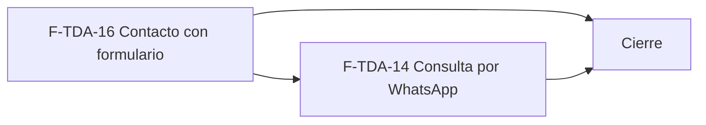

# Tasks: Tiendas online · Tienda WhatsApp y contacto

**Input**: `specs/20261202-100000-tienda-whatsapp-y-contacto/` (spec.md, plan.md, contracts/tienda-contacto.md)

**Formato**: `- [ ] T### [P] [F-TDA-xx][USy] descripción`. **[P]** = paralelizable (archivos distintos, sin dependencia; las [P] del mismo grupo van en paralelo); sin [P] = secuencial. Las dependencias de cada tarea son solo dentro de su historia. Regla del proyecto: ninguna tarea queda `[ ]` al cierre — se hace con evidencia o se cierra con `[x]` + `Desvío:` y seguimiento trazado.

**Delivery scope**: `refine`, `supabase`

## Matriz de trazabilidad Jira ↔ US ↔ tasks

| Jira | Historia | FR / SC (dueño único) | Tasks |
|------|----------|-----------------------|-------|
| F-TDA-16 (clave Jira: la asigna el orquestador) | US1 Contacto con formulario | FR-001…FR-015, FR-060, FR-061, SC-001…SC-005 | T001–T013 |
| F-TDA-14 (clave Jira: la asigna el orquestador) | US2 Consulta por WhatsApp desde el producto | FR-020…FR-026, SC-006, SC-007, SC-008 | T020–T028 |
| Tarea de cierre (label cierre) | Documentación, roadmap y gates | SC-009, SC-010, SC-011 | T070–T072 |

Cada FR/SC declara su verificación nombrada (archivo de test o comando) en `spec.md`, junto al requisito y en «Verificación por requisito»; la tarea dueña la ejecuta y deja la evidencia.

### Dueño único por requisito

| Requisito | Tarea dueña | | Requisito | Tarea dueña |
|---|---|---|---|---|
| FR-001 | T001 | | FR-020 | T026 |
| FR-002, FR-003, FR-004 | T002 | | FR-021, FR-023, FR-026 | T024 |
| FR-005 | T003 | | FR-022 | T022 |
| FR-006, FR-061 | T004 | | FR-024 | T025 |
| FR-060, SC-001, SC-002 | T005 | | FR-025 | T020 |
| FR-008 | T006 | | SC-006 | T021 |
| FR-007 | T007 | | SC-007 | T027 |
| FR-009 | T008 | | SC-008 | T028 |
| FR-010 | T009 | | SC-009 | T070 |
| FR-014 | T010 | | SC-011 | T071 |
| FR-011, FR-012, FR-013 | T011 | | SC-010 | T072 |
| FR-015, SC-003 | T012 | | SC-004, SC-005 | T013 |

## Phase 1 — F-TDA-16 · Contacto con formulario (US1)

**Base de datos** (secuencial: un solo archivo de migración `supabase/migrations/20261202100000_tienda_contacto.sql`, con su reversión documentada en `plan.md`)

- [ ] T001 [F-TDA-16][US1] Crear la migración con la columna aditiva `dominio.empresas.horarios text` (check ≤ 200, `grant update (horarios)` a `authenticated`) y `publico.contacto_por_dominio(host)` con lista blanca, `null` idéntico para host desconocido / empresa desactivada y `revoke … from public, anon` + `grant execute … to anon, authenticated` (FR-001; la columna sostiene FR-014).
- [ ] T002 [F-TDA-16][US1] En la misma migración: tabla `dominio.tienda_envios` (esquema `dominio`, RLS por organización con solo `select` a `authenticated`, índice `(empresa_id, visitante, creado_en)`, `unique (empresa_id, clave_envio)`, sin privilegios para `anon`), `private.visitante_hash(empresa)` (SHA-256 de la IP del primer salto de `X-Forwarded-For` desde `request.headers`; sin cabecera → cupo «sin-ip»; **verificar en el entorno que la cabecera llega**) y `private.registrar_envio_tienda` con `pg_advisory_xact_lock`, poda de filas > 24 h, constante única de 5 por hora, idempotencia por clave (FR-002, FR-003, FR-004).
- [ ] T003 [F-TDA-16][US1] **Primero confirmar la firma real de la interfaz F-CON-01 de MSF-122** (migraciones y spec de esa épica; si aún no está mergeada, avisar y frenar con el estado del bloqueo en lugar de inventarla). Después crear `private.entregar_a_bandeja(empresa, origen, nombre, contacto, mensaje, producto)` como único adaptador; una falla propaga la excepción y revierte el registro del envío. Actualizar `contracts/tienda-contacto.md` con la firma real (FR-005).
- [ ] T004 [F-TDA-16][US1] `publico.enviar_consulta_contacto(host, nombre, contacto, mensaje, clave_envio)`: normaliza host, valida con las reglas de D7 / FR-008, aplica T002, entrega por T003 con `origen = formulario` y responde `ok | invalido | limite | error` sin detalles técnicos ni datos internos (FR-006, FR-061).
- [ ] T005 [F-TDA-16][US1] pgTAP `supabase/tests/database/tienda_contacto.test.sql`: aislamiento entre dos tiendas, `null` idéntico, lista blanca, validación, sexto envío con espera, ventana de una hora, límite independiente por empresa y por visitante, idempotencia, simultaneidad, reversión si falla la entrega, HTML literal, tabla con RLS y sin acceso de `anon` / `authenticated`; el pgTAP de aislamiento global sigue verde (FR-060, SC-001, SC-002).

**Front** (archivos distintos entre sí; no dependen de la base para sus pruebas unitarias)

- [ ] T006 [P] [F-TDA-16][US1] `apps/web/src/pages/tienda-publica/contacto/validacion.ts`: reglas por campo (nombre ≤ 100, correo o WhatsApp ≤ 120 con formato de correo o teléfono ≥ 8 dígitos, mensaje ≤ 2000, `trim`) con mensajes en español, espejo exacto de las del servidor; constantes únicas y test unitario (FR-008).
- [ ] T007 [P] [F-TDA-16][US1] `apps/web/src/lib/tiendaContacto.ts`: cliente de `contacto_por_dominio` y `enviar_consulta_contacto`, hook `useContactoTienda(host)`, traducción a estados `enviando | exito | invalido | espera | falla`, `clave_envio` por intento y tests (FR-007).
- [ ] T008 [P] [F-TDA-16][US1] `rutas/contacto.tsx` y `contacto/DatosContacto.tsx`: ruta `/contacto` con migas «Inicio / Contacto», título «Contacto» con la bajada de la tienda, bloques «WhatsApp» (número y horarios) y «Correo», bloque sin dato oculto, 404 de subruta y estados de carga/error del kit (FR-009).
- [ ] T009 [P] [F-TDA-16][US1] `layout/MenuCategorias.tsx` y `layout/PieCategorias.tsx`: botón «Contacto» del menú y «Escribinos» del pie enlazan a `/contacto` (FR-010).
- [ ] T010 [P] [F-TDA-16][US1] `apps/web/src/pages/empresas/edit.tsx` (y su hook `useEmpresa`): campo «Horarios de atención» (≤ 200) sobre la empresa activa, con su test; anotar en el PR que el prototipo de Empresas no lo dibuja (FR-014).
- [ ] T011 [F-TDA-16][US1] `contacto/FormularioContacto.tsx` montado en `rutas/contacto.tsx`: título «Escribinos», campos y placeholders del prototipo, «Enviar consulta» deshabilitado al enviar, confirmación «¡Gracias! Recibimos tu consulta» con «Enviar otra» (clave nueva), mensaje de espera por límite y error con «Reintentar» que conserva lo escrito (depende de T006, T007, T008) (FR-011, FR-012, FR-013).
- [ ] T012 [F-TDA-16][US1] Vitest + axe de `/contacto`, enlaces del menú / pie y campo de Empresas: errores por campo, éxito, «Enviar otra», espera, reintento, bloques ocultos, 404 de subruta y cambio de empresa en el formulario de Empresas, a 320 / 768 / 1440 px; foco al primer error y al éxito (depende de T009, T010, T011) (FR-015, SC-003).
- [ ] T013 [F-TDA-16][US1] E2E `apps/web/e2e/tienda-contacto.e2e.ts` con las dos tiendas del seed y la bandeja de MSF-122: datos de cada tienda, consulta que llega a la bandeja de **su** empresa con origen formulario, ráfaga de 6 envíos (el sexto muestra la espera y la bandeja recibe 5) y HTML literal (depende de T005, T012) (SC-004, SC-005).

**Checkpoint F-TDA-16**: formulario de punta a punta hasta la bandeja; `pnpm test` verde.

## Phase 2 — F-TDA-14 · Consulta por WhatsApp desde el producto (US2)

- [ ] T020 [F-TDA-14][US2] Migración `supabase/migrations/20261202110000_tienda_whatsapp.sql` con `publico.registrar_consulta_whatsapp(host, producto, clave_envio)`: producto efectivamente visible de la tienda del host (`private.catalogo_tienda_efectivo`), límite e idempotencia compartidos (`registrar_envio_tienda`), entrega con `origen = whatsapp` y producto, respuesta idéntica para host inexistente / empresa desactivada / producto ajeno u oculto, `revoke … from public, anon` + `grant execute … to anon, authenticated` (FR-025).
- [ ] T021 [F-TDA-14][US2] pgTAP `supabase/tests/database/tienda_whatsapp.test.sql`: producto visible, rechazo idéntico de oculto / inactivo / de otra empresa, límite compartido con el formulario, idempotencia, origen `whatsapp`, sin datos internos (depende de T020) (SC-006).
- [ ] T022 [F-TDA-14][US2] `apps/web/src/lib/whatsapp.ts`: `normalizarNumero` (solo dígitos; < 8 = inválido), `armarMensaje` («Hola <empresa>, quiero consultar por <producto> (<precio>). ¿Está disponible?», sin paréntesis si no hay precio) y `urlWhatsapp` (`wa.me` con texto codificado), con tests unitarios (FR-022).
- [ ] T023 [P] [F-TDA-14][US2] `whatsapp/BotonWhatsApp.tsx` y `whatsapp/useContactoWhatsapp.ts` (lee `publico.contacto_por_dominio` con el cliente Supabase compartido, sin tocar `lib/tiendaContacto.ts`): componente del botón «Consultar por WhatsApp» con los tokens de la tienda; soporte de T026.
- [ ] T024 [F-TDA-14][US2] `whatsapp/DialogoWhatsApp.tsx` (carga diferida): título, «<empresa> · <número>», «Mensaje que se va a enviar» solo lectura, «Cancelar» / «Abrir WhatsApp»; cierra con Cancelar, Esc o clic fuera; «Abrir WhatsApp» abre `wa.me` en pestaña nueva con `noopener`, cierra y avisa «Se abrió WhatsApp con el mensaje listo.»; `role="dialog"`, foco atrapado y devuelto al cerrar (depende de T022) (FR-021, FR-023, FR-026).
- [ ] T025 [F-TDA-14][US2] `apps/web/src/lib/registroWhatsapp.ts` (`registrarConsultaWhatsapp` con `clave_envio` por apertura) y su llamada desde `DialogoWhatsApp` al abrir: no bloquea la apertura y no muestra fallas ni límite al visitante (depende de T024) (FR-024).
- [ ] T026 [F-TDA-14][US2] Integrar en la ficha (`rutas/producto.tsx` / `ficha/DatosProducto.tsx`): botón solo si la empresa tiene número válido; sin número la ficha se ve sin botón y sin hueco (depende de T023, T025) (FR-020).
- [ ] T027 [F-TDA-14][US2] Vitest + axe del botón, el diálogo y la ficha: botón solo con número, mensaje con y sin precio, URL codificada, `noopener`, registro que no bloquea ante fallas, foco, Esc, 320 / 768 / 1440 px (depende de T026) (SC-007).
- [ ] T028 [F-TDA-14][US2] E2E `apps/web/e2e/tienda-whatsapp.e2e.ts` en las dos tiendas: ficha → diálogo → «Abrir WhatsApp» (URL verificada, sin abrir la red) → consulta con origen whatsapp y producto en la bandeja de su empresa; ficha sin botón para una empresa sin número (depende de T021, T027) (SC-008).

**Checkpoint F-TDA-14**: consulta por WhatsApp de punta a punta hasta la bandeja; `pnpm test` verde.

## Phase 3 — Cierre [CIERRE]

- [ ] T070 [CIERRE] Documentar en `docs/tiendas-online.md` (sección «Contacto y WhatsApp»): rutas, funciones públicas, tabla `dominio.tienda_envios` y su esquema, límite (constante), identidad del visitante (D6), decisiones D1…D8 con su supuesto, contradicciones para el PR y migraciones con reversión (SC-009).
- [ ] T071 [CIERRE] Actualizar la fila de MSF-212 en `docs/roadmap-template.md` (estado, link a esta spec, horizonte → «Backlog entregado» si aplica) al cerrar el PR; paso manual con criterio, sin script (SC-011).
- [ ] T072 [CIERRE] Correr `pnpm lint`, `pnpm build`, `pnpm infra:config`, `pnpm test`, `pnpm prototipo:check`, `pnpm matriz:check` y `pnpm docs:check` y dejar la evidencia; revisión de seguridad del diff (RLS de `tienda_envios`, `grant`s de `anon`, texto literal, IP no persistida) (depende de T070, T071) (SC-010).

## Plan de ejecución (historias)

| Historia | Depende de | Grupo |
|---|---|---|
| F-TDA-16 | — | 1 |
| F-TDA-14 | F-TDA-16 | 2 |
| [Cierre] | F-TDA-14, F-TDA-16 | 3 |

F-TDA-14 depende de F-TDA-16 por una razón real: reutiliza la tabla `dominio.tienda_envios`, `private.registrar_envio_tienda` (límite e idempotencia compartidos), `private.entregar_a_bandeja` y `publico.contacto_por_dominio`, todos creados por la migración de F-TDA-16. No son independientes, por eso no van en el mismo grupo.

