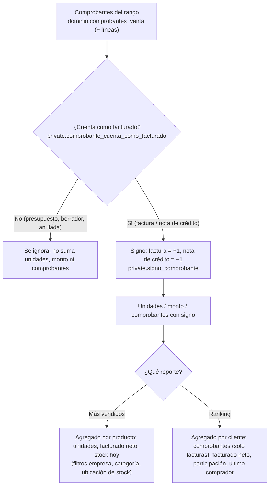
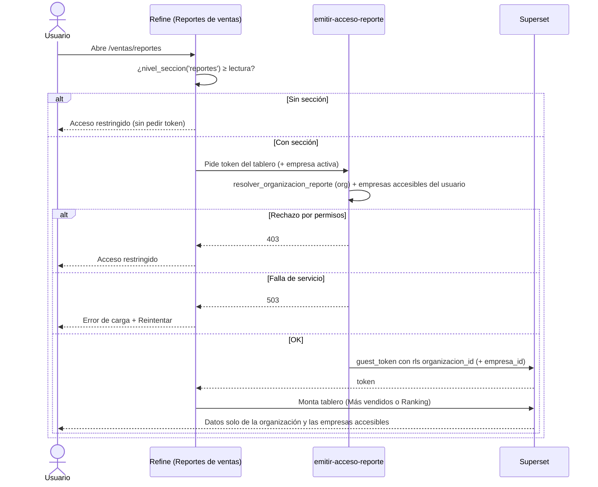
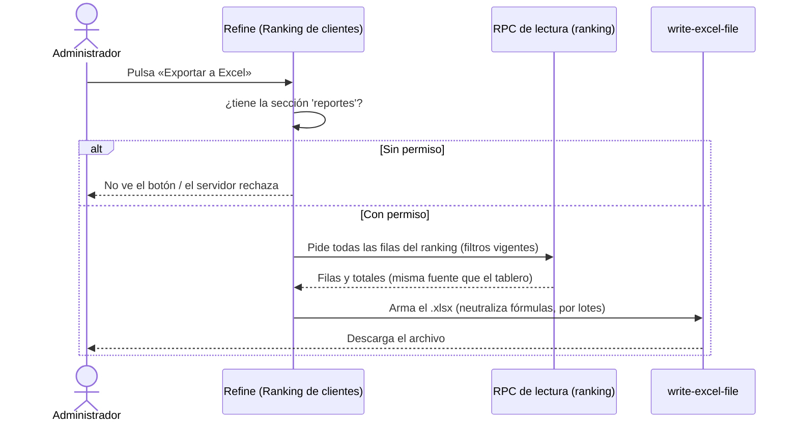

# Feature Specification: Ventas y despacho · Ventas reportes básicos

**Épica**: MSF-338 · **Spec**: `ventas-reportes-basicos` · **Hito**: Etapa 2 (desde enero de 2027) · **Prioridad**: P1 · **Horas aprox.**: 12 · **Alcance (Jira)**: diciembre
**Alcance de entrega**: `refine`, `supabase`, `superset` (sin `kestra` ni `workers`: el cálculo es SQL y los tableros los sirve Superset).
**Fuente**: especificación de Nicolás cargada en la épica (Jira), prototipo en `design/pantallas/VentasReportes.dc.html` y artefactos del producto (documento del componente, Roadmap, Funcionalidades, Relevamiento). Esta spec **traduce**; no agrega alcance.

> Nota de rama: la rama `design/prototipo` ya no existe; los prototipos viven en `design/pantallas/` y de ahí salen los inventarios (`pnpm prototipo:inventario`, `pnpm prototipo:check` al día).

## Regla de fuentes (literal de la épica)

1. Comportamiento y datos: mandan los requisitos y escenarios de esta historia.
2. Qué se ve (disposición, textos, estados, popups, flujos): el prototipo validado es referencia visual, no hace falta que quede extremadamente idéntico; los flujos (si hay) aclaran estados y acciones.
3. Cómo se construye (componentes, estilos y patrones): mandan el template y el system design del producto (épica Plataforma · Sistema de diseño). No copiar el HTML ni el CSS del prototipo: reproducir lo que muestra con los componentes del template y los tokens del sistema de diseño.
4. El prototipo muestra más que esta historia: implementar solo lo que piden los requisitos de esta historia; otras secciones, botones o diálogos son de otras historias.
5. Si algo no se puede igualar con el template / el sistema de diseño: usar lo más cercano, sin inventar, y anotar la diferencia en la descripción del PR.
6. Si el prototipo y los requisitos se contradicen: requisitos para el comportamiento, prototipo para lo visual, y dejar la contradicción anotada en el PR.

## Objetivo

Al terminar, el administrador ve en «Ventas · Reportes» los **productos más vendidos** y el **ranking de clientes por facturación**, en un rango de fechas y con filtro por empresa, y exporta el ranking a Excel.

## Modelo y supuestos

Todos los supuestos están **a confirmar con el cliente** (así lo declara la épica):

- Los reportes se calculan sobre **comprobantes confirmados y no anulados**, con las **notas de crédito restando**; los **presupuestos y anulados no cuentan**. Este criterio vive en un único predicado ya existente: `private.comprobante_cuenta_como_facturado(tipo, estado)` (factura o nota de crédito, no `borrador` ni `anulada`) junto con `private.signo_comprobante(tipo)` (nota de crédito = −1). Lo fijó Ventas (MSF-177) y es la **única** pieza que cambia si el criterio cambia.
- Los reportes se arman como **tableros Superset por organización y empresa**, embebidos en Refine (spec 007 del template).
- **Ya existe** (no se recrea): el embebido de Superset (`ReporteEmbebido`, `emitir-acceso-reporte`, `resolver_organizacion_reporte`, tablas `reportes*`), el esquema `analitica` y su rol de solo lectura `superset_analitica` (MSF-120), el importador `infra/superset/importar-dashboards.mjs`, `reportes.seccion` (MSF-120), `dominio.comprobantes_venta` y `dominio.comprobantes_venta_lineas` (MSF-159/177), `private.comprobante_cuenta_como_facturado` y `private.signo_comprobante` (MSF-177), `public.ranking_clientes` (MSF-126), `private.empresas_accesibles()` y `public.empresas_para_selector()` (F-ROL-06), `dominio.productos` (`sku`, `categoria_id`), `dominio.depositos` (ubicación de stock) y `public.stock_estados` (stock hoy).
- **No existe y lo construye esta épica** (la épica lo dice: «agrega las vistas de lectura sobre comprobantes, líneas y notas de crédito, los dos tableros versionados en YAML y el filtro por empresa — el template filtra por organización; el filtro por las empresas asignadas a cada usuario es una extensión»): dos vistas `analitica`, dos tableros YAML con su importación, el **filtro por empresa** en el token y en la pantalla, la pantalla «Reportes de ventas» y la exportación a Excel (que no viene del template).
- **Bloqueo**: MSF-177 (Ventas listado estados y anulación) ya mergeado (trae por cadena a MSF-159). **Relacionado sin bloqueo**: Superset embebido (spec 007), MSF-126 (Ranking de clientes) y MSF-192 (Rentabilidad y reportes) — ver *Decisiones abiertas*.
- **Horas**: 12 h (la suma nominal M + M es 16 h) porque el embebido, los permisos por organización y la importación de tableros ya los trae el template.
- **Por qué P1**: no hace falta para operar el día uno; el listado con exportación a CSV (F-VTA-09) permite armar los mismos reportes en planilla.

### Esquema de datos (Constitución, Principio VII)

| Objeto | Esquema | Historia | Justificación | RLS / acceso |
|--------|---------|----------|---------------|--------------|
| Vista `analitica.ventas_producto_mas_vendido` (+ funciones de apoyo `security definer` de `analitica`) | `analitica` (esquema existente, **solo vistas**) | F-VTA-22 | Contrato de lectura para Superset; no almacena datos; toda fila lleva `organizacion_id` y `empresa_id`. | Sin acceso para `anon`/`authenticated`; `select` al rol `superset_analitica`; el aislamiento lo fuerza la cláusula `rls` del guest token (`organizacion_id` + `empresa_id`). |
| Vista `analitica.ventas_ranking_clientes` (+ funciones de apoyo) | `analitica` | F-VTA-23 | Ídem. | Ídem. |
| RPC pública de lectura para la exportación a Excel | `public` | F-VTA-23 | Superficie de ejecución; no almacena datos. | `security invoker`, `revoke … from public, anon`, `grant execute … to authenticated`. |
| Extensión del token por empresa (`emitir-acceso-reporte` + RPC de empresas accesibles) | `public` / Edge Function | F-VTA-22 | Mecanismo de acceso transversal (spec 007). | La autorización sigue en `resolver_organizacion_reporte`; se agrega la cláusula `rls` por `empresa_id`. |

No se crean tablas nuevas. La prueba pgTAP `rls_en_toda_tabla` recorre `public` + `dominio` y debe seguir verde (el esquema `analitica` no tiene tablas). Reversión de cada migración: ver `plan.md` (todas aditivas).

## User Scenarios & Testing *(mandatory)*

### User Story 1 - Productos más vendidos (F-VTA-22, P1, talla M)

Como administrador quiero ver los productos más vendidos (unidades y monto) en un rango de fechas, filtrable por empresa, categoría y ubicación de stock, para decidir qué reponer.

**Why this priority**: es el primer tablero de Ventas · Reportes y establece el contrato `analitica`, el filtro por empresa y la pantalla que la otra historia completa.

**Independent Test**: con facturas de ejemplo (confirmadas, anuladas, presupuestos y notas de crédito), «Más vendidos» lista solo los productos vendidos en el rango, con unidades y facturado neto (notas restando), sin sumar anulados ni presupuestos; el filtro por empresa acota al listado exportado.

**Acceptance Scenarios**:

1. **Given** un mes con 50 facturas, **When** filtro por la empresa A, **Then** el ranking suma solo las ventas de A y coincide con el listado exportado (`CA-VTA-22-1`).
2. **Given** un usuario con la sección Reportes en «ninguno», **When** entra a la ruta, **Then** ve «Acceso restringido» (`CA-VTA-22-2`).
3. **Given** un rango sin ventas, **When** consulto, **Then** el estado vacío dice «No hay ventas en ese período» (`CA-VTA-22-3`).
4. **Given** facturas, presupuestos, anuladas y notas de crédito en el rango, **Then** suman solo las facturas confirmadas no anuladas y las notas de crédito restan (`RF-VTA-22-2`).
5. **Given** filtros de empresa, categoría y ubicación de stock, **Then** acotan el ranking y sus totales (`RF-VTA-22-1`).

### User Story 2 - Ranking de clientes con exportación (F-VTA-23, P1, talla M)

Como administrador quiero ver quiénes más compraron (facturación neta, cantidad de compras, último comprador) y exportar el ranking a Excel, para atender mejor a los clientes clave.

**Why this priority**: completa el objetivo de la épica (exportar) y reutiliza la pantalla, el filtro por empresa y el contrato `analitica` de la Historia 1.

**Independent Test**: con comprobantes de ejemplo, «Ranking de clientes» ordena por facturación neta, excluye al Consumidor final de forma opcional, y «Exportar a Excel» descarga un archivo con las mismas filas y totales que la pantalla.

**Acceptance Scenarios**:

1. **Given** un trimestre, **When** exporto, **Then** el archivo tiene las mismas filas y totales que la pantalla (`CA-VTA-23-1`).
2. **Given** un usuario sin permiso de Reportes, **When** pide la exportación, **Then** el servidor la rechaza (`CA-VTA-23-2`).
3. **Given** un cliente con solo notas de crédito en el período, **When** se calcula, **Then** aparece con facturación negativa o cero según la regla definida (`CA-VTA-23-3`).
4. **Given** el ranking, **Then** muestra por cliente la facturación neta, la cantidad de compras y el último comprador, y permite excluir a «Consumidor final» de forma opcional (`RF-VTA-23-1`).
5. **Given** el ranking aplicado, **Then** «Exportar a Excel» respeta los filtros vigentes (`RF-VTA-23-2`).

## Flujos

### F1 · Cálculo del facturado neto (más vendidos y ranking)

Dueños: criterio FR-002; signo FR-002; más vendidos FR-001; ranking FR-006. Pasos sin dueño: ninguno. **Fuera de alcance**: ningún estado nuevo — el catálogo de estados y el predicado los fija Ventas (MSF-177), no esta épica.

### F2 · Acceso al tablero con filtro por empresa

Dueños: restricción por sección FR-003/FR-007; filtro por empresa en el token FR-004; pantalla, error y reintento FR-005; acceso restringido FR-005. Pasos sin dueño: ninguno.

### F3 · Exportación del ranking a Excel

Dueños: permiso y rechazo FR-009, SC-005; lectura misma fuente FR-009; neutralización y lotes FR-009. Pasos sin dueño: ninguno.

## Requirements *(mandatory)*

### F-VTA-22 · Productos más vendidos

- **FR-001** (RF-VTA-22-1): DEBE existir la vista `analitica.ventas_producto_mas_vendido` que, sobre `dominio.comprobantes_venta` y `dominio.comprobantes_venta_lineas`, lista por producto (nombre + `sku`) las **unidades** y el **facturado neto** vendidos en un rango de fechas, con columnas `organizacion_id`, `empresa_id`, `empresa_nombre`, `producto_id`, `producto_nombre`, `sku`, `categoria` (nombre de la categoría del producto), `deposito_id`, `deposito_nombre` (ubicación de stock), `unidades`, `facturado`, `stock_hoy` y `stock_estado` (de `public.stock_estados`). Es el **contrato** que consume Superset; declarado en `contracts/analitica-ventas-reportes.md`. **Verificación**: `pnpm test:db` → `supabase/tests/database/ventas_reportes_mas_vendido.test.sql`.
- **FR-002** (RF-VTA-22-2): El cálculo DEBE contar **solo** los comprobantes que cumplen `private.comprobante_cuenta_como_facturado(tipo, estado)` (factura o nota de crédito, no `borrador` ni `anulada`) y aplicar `private.signo_comprobante(tipo)` para que las **notas de crédito resten** y **los presupuestos y anulados no sumen**. El criterio vive en ese predicado único (no se reimplementa). **Verificación**: `pnpm test:db` → `supabase/tests/database/ventas_reportes_mas_vendido.test.sql` (notas restan; presupuestos/anuladas no cuentan).
- **FR-003**: DEBEN existir el dataset y el tablero Superset **«Más vendidos»** versionados en YAML bajo `infra/superset/dashboards/ventas-reportes/`, importados de forma automática con `infra/superset/importar-dashboards.mjs` y registrados en `public.reportes` con `seccion = 'reportes'` de forma idempotente. El tablero muestra la tabla `#`, `Producto`, `Unidades`, `Facturado`, `Stock hoy` y filtros nativos de rango de fechas, empresa, categoría y ubicación de stock. **Verificación**: `pnpm test:superset:importar-dashboards` y `pnpm infra:config`.
- **FR-004** (filtro por empresa, extensión del template): `emitir-acceso-reporte` DEBE agregar al guest token, además de `organizacion_id`, una restricción por `empresa_id` acotada a las **empresas accesibles del usuario** (`private.empresas_accesibles()`, expuesta por una RPC pública como `public.empresas_para_selector()`), de modo que un usuario con empresas acotadas no vea filas de otras empresas; «Todas las tiendas» sigue acotado a las accesibles. Las vistas exponen `empresa_id`/`empresa_nombre` para esa cláusula y para los filtros nativos. **Verificación**: `node --test supabase/functions/emitir-acceso-reporte/handler.test.ts` y pgTAP de aislamiento (SC-002).
- **FR-005**: La pantalla **«Reportes de ventas»** (`/ventas/reportes`, menú junto a Ventas con ícono propio, sección `reportes`) DEBE mostrar el título «Reportes de ventas», el subtítulo «Más vendidos, avisos de «avisame cuando vuelva» y ranking de clientes por facturación.», las pestañas **«Más vendidos»** y **«Ranking de clientes»** (la de ranking la completa F-VTA-23), los filtros **Desde/Hasta** con atajos de rango (Hoy, 7 días, Este mes, Mes anterior), el filtro de empresa (`FiltroEmpresa`, píldoras «Todas las tiendas» + una por empresa) y el tablero embebido con `ReporteEmbebido`. Usa los patrones compartidos de carga, vacío («No hay ventas en ese período»), error con `Reintentar` y acceso restringido sin `reportes`. **Verificación**: Vitest `apps/web/src/pages/ventas-reportes/*.test.tsx` y capturas a 320/768/1440 px.

### F-VTA-23 · Ranking de clientes con exportación

- **FR-006** (RF-VTA-23-1): DEBE existir la vista `analitica.ventas_ranking_clientes` que, sobre `dominio.comprobantes_venta` (y `public.clientes`), rankea por **facturación neta** en un rango de fechas con columnas `organizacion_id`, `empresa_id`, `empresa_nombre`, `posicion`, `cliente_id`, `numero`, `nombre`, `tipo`, `comprobantes` (conteo de facturas que cuentan, no notas), `facturado`, `participacion` y `ultimo_comprador` (fecha del comprobante más reciente que cuenta), aplicando el mismo predicado de FR-002 y permitiendo **excluir a «Consumidor final» de forma opcional**. Declarado en `contracts/analitica-ventas-reportes.md`. **Verificación**: `pnpm test:db` → `supabase/tests/database/ventas_reportes_ranking.test.sql`.
- **FR-007**: DEBEN existir el dataset y el tablero Superset **«Ranking de clientes»** versionados en YAML (mismo directorio), importados y registrados con `seccion = 'reportes'`. El tablero muestra la tabla `#`, `Cliente`, `Tipo`, `Comprobantes`, `Facturado`, `Participación` (barra proporcional). **Verificación**: `pnpm test:superset:importar-dashboards` y `pnpm infra:config`.
- **FR-008** (RF-VTA-23-1, pantalla): La pestaña **«Ranking de clientes»** de la pantalla (reutiliza el marco, el filtro por empresa y los filtros de período de F-VTA-22) DEBE embeder el tablero con `ReporteEmbebido` y ofrecer el interruptor **«Consumidor final»** para incluir/excluirlo (valor inicial: excluido, ver *Decisiones abiertas*). **Verificación**: Vitest `apps/web/src/pages/ventas-reportes/*.test.tsx`.
- **FR-009** (RF-VTA-23-2): «Exportar a Excel» DEBE generar un `.xlsx` real con **todas** las filas del ranking que coinciden con los filtros vigentes (no solo una página), con las mismas filas y totales que la pantalla (misma fuente de datos), neutralizando `=`, `+`, `-`, `@` iniciales (reutiliza `neutralizarFormula` y `write-excel-file`, MIT) y trabajando por lotes con tope documentado. Solo quien tiene la sección `reportes` puede exportar, y **el servidor rechaza** la exportación sin permiso (no basta con ocultar el botón). **Verificación**: Vitest de exportación (SC-004, SC-005) y pgTAP de la RPC de lectura.

### Cierre (docs, seguridad, E2E)

- **FR-010**: `docs/ventas-reportes.md` (cálculo, predicado, vistas `analitica`, filtro por empresa, permisos, importación de tableros, exportación, reversión, preguntas abiertas), `docs/operar-superset.md` y `docs/roadmap-template.md` actualizados; revisión de seguridad de la superficie nueva (RLS/grants, `anon` sin acceso, rol `superset_analitica`, token por empresa, re-verificación del Principio VII); E2E de Reportes con roles y cambio de empresa. **Verificación**: `pnpm docs:check` e informe de revisión de seguridad en el PR.

## Success Criteria

- **SC-001** (CA-VTA-22-1): pgTAP — con facturas de ejemplo, la vista `ventas_producto_mas_vendido` suma solo la empresa filtrada y coincide con el listado exportado de comprobantes; notas restan y presupuestos/anuladas no cuentan. **Verificación**: `pnpm test:db`.
- **SC-002** (CA-VTA-22-2): un usuario sin sección `reportes` ve «Acceso restringido». **Verificación**: Vitest. (El token 403 y el filtro por empresa se verifican en FR-004, tarea T003.)
- **SC-003** (CA-VTA-22-3): un rango sin ventas muestra el vacío «No hay ventas en ese período»; un error de carga muestra `Reintentar`. **Verificación**: Vitest.
- **SC-004** (CA-VTA-23-1): el `.xlsx` exportado tiene las mismas filas y totales que la pantalla para los mismos filtros, neutraliza fórmulas y trabaja por lotes. **Verificación**: Vitest.
- **SC-005** (CA-VTA-23-2): el servidor rechaza la exportación sin permiso de `reportes` (no alcanza con ocultar el botón). **Verificación**: Vitest + pgTAP.
- **SC-006** (CA-VTA-23-3): un cliente con solo notas de crédito en el período aparece con facturación neta **negativa** (regla definida en *Decisiones abiertas*). **Verificación**: pgTAP.
- **SC-007**: `pnpm lint`, `pnpm build`, `pnpm infra:config`, `pnpm test`, `rls_en_toda_tabla` verde, `pnpm prototipo:check`, `pnpm matriz:check` y `pnpm docs:check` verdes. **Verificación**: CI.

## Decisiones abiertas

1. **Duplicado probable con MSF-126 (F-CLI-08/09).** F-VTA-23 (ranking + exportación) se solapa con `public.ranking_clientes` y la exportación a Excel ya entregadas por MSF-126. Provisional: F-VTA-23 construye la vista `analitica.ventas_ranking_clientes` (esta épica es Superset) y exporta desde la **misma** fuente; no reimplementa `public.ranking_clientes` (que sigue siendo la entrada de Clientes). Ambos usan el mismo predicado. Confirmar a quién pertenece cada reporte y dejar uno solo si corresponde.
2. **Exportación a Excel: ¿alcanza la nativa de Superset?** La épica dice que la exportación no viene del template y no está verificado si la nativa de Superset alcanza. Provisional: se genera el archivo en Refine (server), reutilizando `write-excel-file` y `neutralizarFormula` de F-CLI-09, para garantizar `CA-VTA-23-1` (mismas filas y totales) y `CA-VTA-23-2` (rechazo por permiso en el servidor).
3. **Regla de facturación de un cliente con solo notas de crédito (`CA-VTA-23-3`).** Provisional: facturación neta **negativa** (el neto real, sin piso en cero), coherente con `signo_comprobante` y con `public.ranking_clientes` ya mergeado. Si se quiere piso en cero, cambia solo el predicado/la vista.
4. **Filtro por empresa en el token (extensión).** Provisional: la Edge Function resuelve las empresas accesibles (`private.empresas_accesibles()`, vía `public.empresas_para_selector()`) y agrega `empresa_id IN (…)` a la cláusula `rls`. La cláusula sigue siendo un único texto SQL: la lista se interpola server-side con UUIDs validados (nunca texto libre). Si Superset no admite una lista dinámica en `rls`, se acota a la empresa activa (`empresa_id = …`) y se declara `Desvío:`.
5. **«Último comprador».** El requisito `RF-VTA-23-1` pide «último comprador»; el prototipo no lo dibuja. Provisional: se interpreta como la **fecha del último comprobante que cuenta** (columna `ultimo_comprador` de la vista). Confirmar si el dato es fecha u otro.
6. **Filtros «categoría» y «ubicación de stock»** (`RF-VTA-22-1`) no están dibujados en el prototipo: mandan los requisitos; se exponen como filtros nativos del tablero.
7. **Horas.** 12 h de la épica (embebido + permisos + import ya vienen del template) vs. la suma nominal M + M = 16 h. Decidir.
8. **Roadmap.** El «Roadmap a diciembre» manda «Reportes y tablero de inicio con Superset» como P0 con 10 h; el doc de Ventas la tiene P1 en Etapa 2 con 14 h. Manda el roadmap: Nicolás decide si entra en diciembre. No cambia el alcance de esta spec.

## Verificación por requisito

Cada FR/SC tiene su verificación nombrada (también inline, en cada requisito). NFR: no hay requisitos no funcionales separados; accesibilidad y responsividad están en FR-005/FR-008 y la seguridad en FR-004/FR-010.

| Requisito | Verificación | Tarea dueña |
|---|---|---|
| FR-001 | `pnpm test:db` → `supabase/tests/database/ventas_reportes_mas_vendido.test.sql`; contrato revisado en `contracts/analitica-ventas-reportes.md` | T001 |
| FR-002 | `pnpm test:db` → `supabase/tests/database/ventas_reportes_mas_vendido.test.sql` | T001 |
| FR-003 | `pnpm test:superset:importar-dashboards` + `pnpm infra:config` | T004 |
| FR-004 | `node --test supabase/functions/emitir-acceso-reporte/handler.test.ts` + pgTAP aislamiento | T003 |
| FR-005 | Vitest `apps/web/src/pages/ventas-reportes/*.test.tsx` + capturas 320/768/1440 px | T005 |
| FR-006 | `pnpm test:db` → `supabase/tests/database/ventas_reportes_ranking.test.sql`; contrato | T007 |
| FR-007 | `pnpm test:superset:importar-dashboards` + `pnpm infra:config` | T009 |
| FR-008 | Vitest `apps/web/src/pages/ventas-reportes/*.test.tsx` | T010 |
| FR-009 | Vitest de exportación + pgTAP de la RPC | T011 |
| FR-010 | `pnpm docs:check` + informe de seguridad | T013, T014, T015 |
| SC-001 | `pnpm test:db` (pgTAP) | T002 |
| SC-002 | Vitest (acceso restringido) | T006 |
| SC-003 | Vitest | T006 |
| SC-004 | Vitest de exportación | T012 |
| SC-005 | Vitest (rechazo por permiso) | T012 |
| SC-006 | pgTAP | T008 |
| SC-007 | CI (`pnpm lint && pnpm build && …`) | T016 |

## Matriz pantalla↔criterios

Inventario determinista con `pnpm prototipo:inventario` sobre `VentasReportes.dc.html` (`design/pantallas/VentasReportes.inventory.json`). La épica pide **menos** que el prototipo: lo que no pide no es deuda (SUBCONJUNTO). El inventario no detecta las pestañas (son dinámicas, `<sc-for>`); se mapean igual por fidelidad.

### Ventas · Reportes (`VentasReportes.dc.html`)

| Ítem del inventario / visible | Destino | Criterio |
|---|---|---|
| Título «Reportes de ventas» + subtítulo | En alcance | FR-005 |
| Botón `Exportar a Excel` (encabezado) | En alcance, para el **ranking** (el prototipo lo dibuja global; la épica solo pide la exportación del ranking, F-VTA-23) | FR-009, SC-004 |
| Filtro `Tienda` (píldoras «Todas las tiendas» / por empresa + nota «si elegís una empresa en la barra superior…») | En alcance | FR-004, FR-005 |
| Tarjetas de **desglose por tienda** (facturación + comprobantes + barra por empresa) | Fuera de alcance: no lo piden RF-VTA-22/23 (el filtro por empresa sí se pide; el desglose por tienda no). Otras épicas podrán pedirlo | — |
| Campos `Desde` / `Hasta` | En alcance | FR-005 |
| Atajos de rango (`Hoy`, `7 días`, `Este mes`, `Mes anterior`) | En alcance | FR-005 |
| Pestaña `Más vendidos` | En alcance | F-VTA-22, FR-001/003/005 |
| Tabla «Más vendidos»: columnas `#`, `Producto`, `Unidades`, `Facturado`, `Stock hoy` | En alcance | FR-001, FR-003, FR-005 |
| Filtros `categoría` y `ubicación de stock` (no dibujados; los piden los requisitos) | En alcance (manda el requisito) | FR-001, FR-003 |
| Pestaña `Ranking de clientes` | En alcance | F-VTA-23, FR-006/007/008 |
| Tabla «Ranking de clientes»: columnas `#`, `Cliente`, `Tipo`, `Comprobantes`, `Facturado`, `Participación` | En alcance | FR-006, FR-007, FR-008 |
| «Último comprador» (no dibujado; lo pide el requisito) | En alcance (manda el requisito) | FR-006 |
| Interruptor `Consumidor final` (no dibujado; lo pide el requisito) | En alcance (manda el requisito) | FR-008 |
| Pestaña `Avisos «avisame cuando vuelva»`, tabla de avisos (columnas `Producto`, `Pedidos de aviso`, `Última solicitud`, `Stock hoy`) y botón `Avisar` | Fuera de alcance: la épica lo declara («los avisos no son de esta épica») | — |
| Fila **Empresa activa** | En alcance: el filtro `Tienda` se reencuadra con la empresa activa de la barra superior (Principio VIII); al cambiar de empresa se recarga el tablero y se descarta la selección que ya no existe. Test: cambio de empresa recarga y no muestra filas de la anterior | FR-004, FR-005, SC-002 |

## Matriz de trazabilidad Jira ↔ US ↔ FR ↔ tareas

| Jira | Historia | FR / SC | Tareas |
|------|----------|---------|--------|
| F-VTA-22 (MSF-347) | US1 Productos más vendidos | FR-001…005, SC-001…003 | T001–T006 |
| F-VTA-23 (MSF-358) | US2 Ranking de clientes con exportación | FR-006…009, SC-004…006 | T007–T012 |
| Tarea de cierre (label `cierre`) | Docs, seguridad, E2E y gates | FR-010, SC-007 | T013–T016 |
