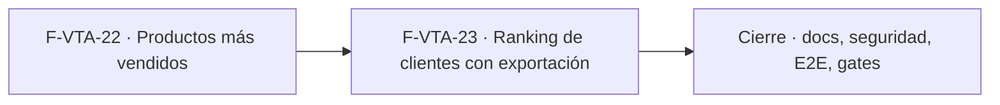

# Tasks: Ventas y despacho · Ventas reportes básicos

**Input**: [spec.md](./spec.md) y [plan.md](./plan.md) · **Épica**: MSF-338
**Formato**: `- [ ] T### [P] [Historia][USx] descripción (FR/SC)`. `[P]` = paralelizable (archivos distintos, sin dependencia dentro del mismo grupo). Cada FR/SC tiene **una sola** tarea dueña. Las dependencias y el orden son **solo dentro de la misma historia**; entre historias rige la tabla *Plan de ejecución* (objetos ya mergeados, nunca una tarea abierta de otra).
**Validación por historia**: `pnpm test:db`, `pnpm lint`, `pnpm build` y `pnpm test:web` verdes antes de cerrar la fase. Cada vista nueva: esquema re-verificado (Principio VII). Cada migración lleva su reversión en el encabezado.

## Phase 1: F-VTA-22 · Productos más vendidos

**Goal**: vista `analitica.ventas_producto_mas_vendido`, filtro por empresa en el token, tablero «Más vendidos» y la pantalla «Reportes de ventas» con su pestaña.

- [ ] T001 [F-VTA-22][US1] Migración `supabase/migrations/20270104090000_analitica_ventas_producto_mas_vendido.sql`: vista `analitica.ventas_producto_mas_vendido` (por producto: nombre + `sku`, unidades y facturado neto en el rango, `organizacion_id`, `empresa_id`, `empresa_nombre`, `categoria`, `deposito_id`/`deposito_nombre`, `stock_hoy`/`stock_estado` desde `public.stock_estados`) con helpers `security definer` de `analitica` para el predicado (`private.comprobante_cuenta_como_facturado`), el signo (`private.signo_comprobante`) y el stock; `revoke … from public, anon`; `select` al rol `superset_analitica`; reversión en el encabezado; y contrato en `contracts/analitica-ventas-reportes.md` (FR-001, FR-002) (verificación: pgTAP `supabase/tests/database/ventas_reportes_mas_vendido.test.sql`)
- [ ] T002 [P] [F-VTA-22][US1] pgTAP `supabase/tests/database/ventas_reportes_mas_vendido.test.sql`: suma solo la empresa filtrada y coincide con el listado exportado de comprobantes; notas de crédito restan; presupuestos y anuladas no cuentan; `anon`/`authenticated` sin acceso a la vista; `rls_en_toda_tabla` verde (SC-001)
- [ ] T003 [P] [F-VTA-22][US1] Extensión del filtro por empresa en `supabase/functions/emitir-acceso-reporte/`: resolver las empresas accesibles del usuario (vía `public.empresas_para_selector()`) y agregar `empresa_id IN (…)` (UUIDs validados, nunca texto libre) a la cláusula `rls` del guest token, además de `organizacion_id`; prueba `supabase/functions/emitir-acceso-reporte/handler.test.ts` (FR-004) (verificación: `node --test` de la función)
- [ ] T004 [P] [F-VTA-22][US1] `infra/superset/dashboards/ventas-reportes/`: dataset y tablero «Más vendidos» (tabla `#`, `Producto`, `Unidades`, `Facturado`, `Stock hoy`; filtros nativos de rango de fechas, empresa, categoría y ubicación de stock), empaquetado e importación con `infra/superset/importar-dashboards.mjs`, y registro idempotente en `public.reportes` con `seccion = 'reportes'` (FR-003) (verificación: `pnpm test:superset:importar-dashboards` + `pnpm infra:config`)
- [ ] T005 [F-VTA-22][US1] `apps/web/src/pages/ventas-reportes/` + `apps/web/src/lib/ventas-reportes.ts` + ruta `/ventas/reportes` y menú: título «Reportes de ventas», subtítulo, pestañas «Más vendidos» / «Ranking de clientes», filtros Desde/Hasta con atajos (Hoy, 7 días, Este mes, Mes anterior), `FiltroEmpresa` (píldoras), `ReporteEmbebido` de la pestaña «Más vendidos», estados compartidos (carga, vacío «No hay ventas en ese período», error con `Reintentar`) y `AccesoRestringido` sin `reportes` (FR-005)
- [ ] T006 [P] [F-VTA-22][US1] Vitest `apps/web/src/pages/ventas-reportes/*.test.tsx`: acceso restringido sin sección `reportes`, estado vacío y error con reintento, filtro por empresa que se reencuadra al cambiar la empresa activa (Principio VIII) y teclado/lector (SC-002, SC-003)

**Checkpoint F-VTA-22**: `pnpm test:db`, `pnpm lint`, `pnpm build` y `pnpm test:web` verdes.

## Phase 2: F-VTA-23 · Ranking de clientes con exportación

**Goal**: vista `analitica.ventas_ranking_clientes`, tablero «Ranking de clientes», su pestaña y la exportación a Excel.

- [ ] T007 [F-VTA-23][US2] Migración `supabase/migrations/20270104090100_analitica_ventas_ranking_clientes.sql`: vista `analitica.ventas_ranking_clientes` (por cliente: `posicion`, `cliente_id`, `numero`, `nombre`, `tipo`, `comprobantes` solo facturas, `facturado` neto, `participacion`, `ultimo_comprador`, `organizacion_id`/`empresa_id`/`empresa_nombre`; exclusión opcional de Consumidor final; mismo predicado/signo de FR-002) con helpers `security definer`; `revoke … from public, anon`; `select` a `superset_analitica`; contrato en `contracts/analitica-ventas-reportes.md` (FR-006) (verificación: pgTAP `supabase/tests/database/ventas_reportes_ranking.test.sql`)
- [ ] T008 [P] [F-VTA-23][US2] pgTAP `supabase/tests/database/ventas_reportes_ranking.test.sql`: orden por facturado neto, participacion sobre el total, exclusión de Consumidor final, y cliente con solo notas de crédito con facturación neta negativa (regla de la Decisión 3) (SC-006)
- [ ] T009 [P] [F-VTA-23][US2] `infra/superset/dashboards/ventas-reportes/`: dataset y tablero «Ranking de clientes» (tabla `#`, `Cliente`, `Tipo`, `Comprobantes`, `Facturado`, `Participación` con barra), empaquetado/importación y registro idempotente con `seccion = 'reportes'` (FR-007) (verificación: `pnpm test:superset:importar-dashboards` + `pnpm infra:config`)
- [ ] T010 [F-VTA-23][US2] Pestaña «Ranking de clientes» en `apps/web/src/pages/ventas-reportes/`: `ReporteEmbebido` del tablero + interruptor «Consumidor final» (excluido por defecto), reutilizando el marco, el filtro por empresa y los filtros de período de F-VTA-22 (FR-008) (verificación: Vitest (T012))
- [ ] T011 [F-VTA-23][US2] Migración `supabase/migrations/20270104090200_lectura_ranking_excel.sql` (RPC de lectura `security definer` sobre la vista con el filtro del usuario: `organizacion_id` + empresas accesibles) y exportación a Excel en `apps/web`: `.xlsx` con **todas** las filas y totales de la pantalla (misma fuente), por lotes con tope documentado, `neutralizarFormula` + `write-excel-file` (diferida), botón visible y **servidor que rechaza** sin `reportes` (FR-009)
- [ ] T012 [P] [F-VTA-23][US2] Vitest de la pestaña y la exportación: mismas filas y totales entre Excel y pantalla, neutralización de fórmulas, botón oculto y rechazo del servidor sin permiso, Consumidor final, teclado/lector (SC-004, SC-005)

**Checkpoint F-VTA-23**: `pnpm test:db`, `pnpm lint`, `pnpm build` y `pnpm test:web` verdes.

## Phase 3: Cierre (docs, seguridad, E2E, gates)

**Goal**: lo que ninguna historia atiende. Las tareas `[CIERRE]` las ejecuta la Tarea de cierre y **nunca** son prerequisito de una historia.

- [ ] T013 [P] [CIERRE] `docs/ventas-reportes.md` (cálculo, predicado, vistas `analitica`, filtro por empresa, permisos, importación de tableros, exportación, reversión, preguntas abiertas), `docs/operar-superset.md` y fila/sección de `docs/roadmap-template.md`; `pnpm docs:check` verde (FR-010)
- [ ] T014 [P] [CIERRE] Revisión de seguridad de la superficie nueva: grants de vistas y RPC, `anon` sin acceso, esquema `analitica` cerrado, rol `superset_analitica`, token por empresa, y esquema de cada objeto contra el Principio VII (FR-010) (verificación: pgTAP de RLS/grants y `pnpm test:db`)
- [ ] T015 [CIERRE] E2E de Reportes de ventas: roles (Administrador ve/exporta, Administración ve, Operador/Consulta ven acceso restringido), cambio de empresa que reencuadra el tablero y exportación del ranking (FR-010)
- [ ] T016 [CIERRE] `pnpm lint`, `pnpm build`, `pnpm infra:config`, `pnpm test`, `rls_en_toda_tabla` verde, `pnpm prototipo:check`, `pnpm matriz:check` y `pnpm docs:check` (SC-007)

**Checkpoint Cierre**: ninguna tarea queda `[ ]` sin hacerse o cerrarse con `Desvío:` y seguimiento trazado.

## Dependencias

Dentro de F-VTA-22: T001 → T002 [P]; T003 [P] y T004 [P] arrancan con T001 (T004 tras T001); T005 tras T003 y T004; T006 [P] tras T005.
Dentro de F-VTA-23: T007 → T008 [P]; T009 [P] tras T007; T010 tras T009; T011 tras T007; T012 [P] tras T010 y T011.
Cierre: T013 [P] y T014 [P] cuando todas las historias estén mergeadas; T015 → T016 al final.
Entre historias (de entrega): F-VTA-23 requiere de F-VTA-22 la pantalla «Reportes de ventas» (mismo archivo de pestañas), el filtro por empresa en el token y el directorio de tableros (ya mergeados). Por eso van en serie.

## Plan de ejecución (historias)

El **orden de toma** de las historias lo declara esta tabla: el orquestador la **consume** (no lo infiere del orden de las tareas). Una historia arranca cuando sus dependencias (`Depende de`) están **Finalizadas (mergeadas)**; las del **mismo** `Grupo` van **en paralelo**. Aquí hay dependencias reales (la pantalla y el filtro por empresa de F-VTA-22; el archivo de la pantalla y el directorio de tableros compartidos), por eso cada grupo tiene una sola historia.

| Historia | Depende de | Grupo |
|----------|------------|-------|
| F-VTA-22 | — | 1 |
| F-VTA-23 | F-VTA-22 | 2 |
| [Cierre] | F-VTA-22, F-VTA-23 | 3 |

