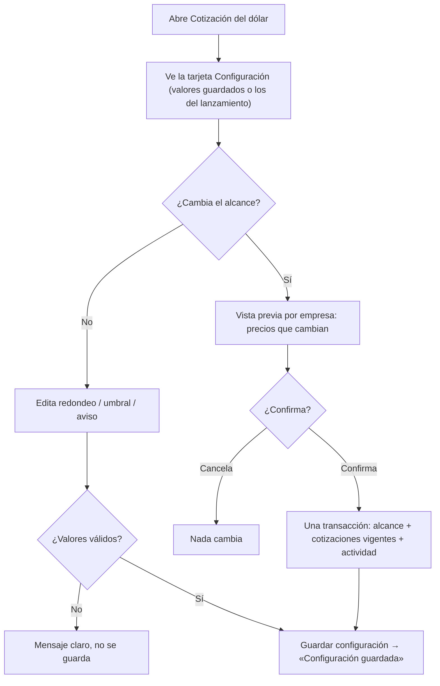
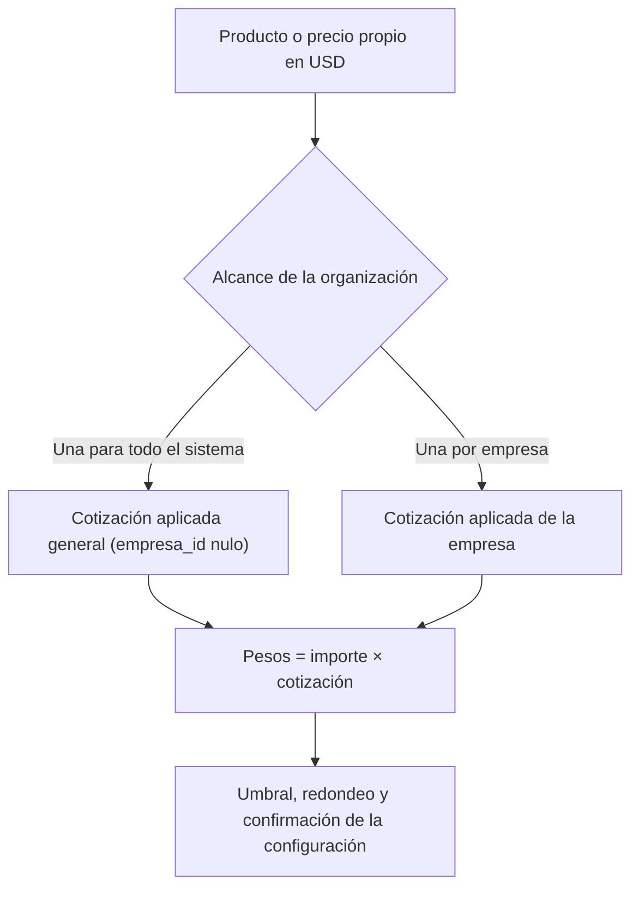
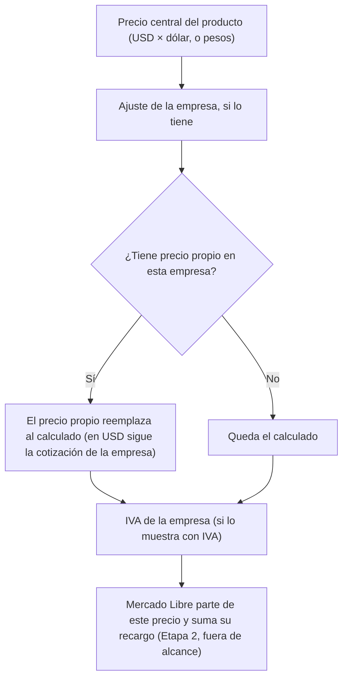
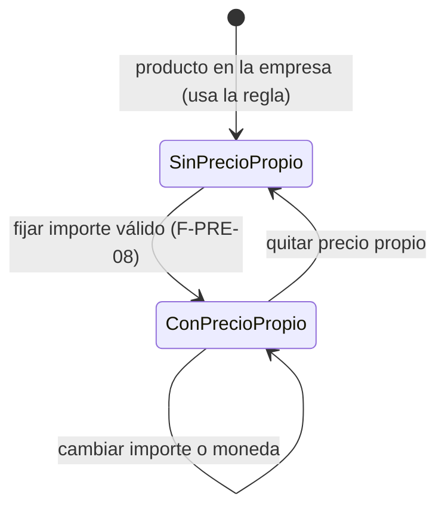
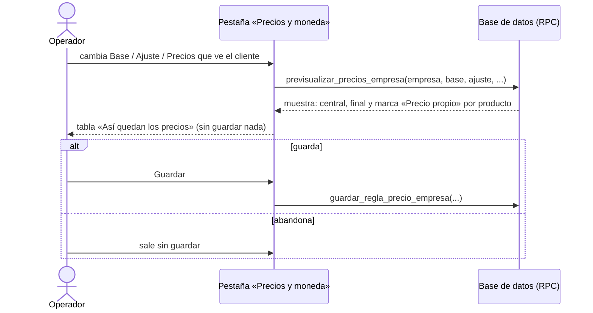

# Feature Specification: Precios y dólar · Configuración dólar y precio propio

**Épica**: MSF-352 · **Spec**: `configuracion-dolar-y-precio-propio` · **Hito**: Etapa 2 (desde enero de 2027) · **Prioridad**: P1 · **Horas aprox.**: 20
**Alcance de entrega**: `refine`, `supabase` (sin `kestra`, `superset` ni `workers`: todo es cálculo al leer y transacciones de base de datos, igual que MSF-114 y MSF-116).
**Fuente**: especificación de Nicolás cargada en la épica, prototipos `design/pantallas/Cotizacion.dc.html`, `StorePrecios.dc.html` y `SJ_StorePrecios.dc.html`, y artefactos del producto (Precios y dólar, Funcionalidades, Roadmap, Relevamiento). Esta spec **traduce**; no agrega alcance.

> Nota de rama: `design/prototipo` no existe; los prototipos viven en `design/pantallas/` y de ahí salen los inventarios (`pnpm prototipo:inventario`).

## Objetivo

Al terminar, el administrador ajusta cómo se usa el dólar (alcance, redondeo, umbral y aviso), el operador fija precios propios por producto y empresa, y se puede probar cualquier cambio de regla en un simulador antes de guardar.

## Modelo y supuestos

- **Ya existe** (repo): `dominio.cotizacion_pendiente`, `dominio.cotizaciones` (historial inmutable), `dominio.cotizacion_aplicada`, `dominio.cotizacion_inicial` y las RPC `cargar_cotizacion`, `estado_cotizacion`, `previsualizar_cotizacion`, `confirmar_cotizacion`, `descartar_cotizacion`, `listar_cotizaciones`, `cotizacion_del_dia` (MSF-116); `dominio.precios_empresa`, `private.precio_neto_empresa`, `private.aplicar_regla_precio`, `public.precios_empresa_neto`, `public.previsualizar_precios_empresa`, `private.nivel_seccion` (MSF-114). `private.precio_neto_empresa` es el **punto de extensión** que MSF-114 dejó para el precio propio.
- **Hoy los valores son fijos** (umbral 1 %, confirmación/alerta al 15 %, redondeo $ 10, aviso siempre activo, alcance «una para todo el sistema»). Esta épica los vuelve **editables sin cambiar el modelo de cálculo**: con los valores por defecto el comportamiento es idéntico al actual.
- La configuración es **de la organización** y la edita quien tiene edición en «Cotización del dólar» (sección `cotizacion_dolar`; hoy el Administrador). Lectura: ve la configuración sin guardar.
- **Precio propio** = precio neto (sin IVA) que el operador fija a mano para un producto en una empresa; **reemplaza** al calculado (central + ajuste) para esa empresa. El IVA de la empresa se aplica después, como siempre. Puede estar en pesos o en USD; si está en USD **sigue la cotización** que corresponde a esa empresa. Quitarlo devuelve al producto a la regla de la empresa.
- Un precio propio lo fija quien tiene edición en la sección `productos` (misma que guarda precio y escalas; permisos Operador/Consulta vía `private.nivel_seccion`). Consulta ve el valor sin editar.
- Los precios propios **no se envían a Mercado Libre** hasta que esa integración esté activa (Etapa 2).
- El **simulador** es la tabla «Así quedan los precios» de la pestaña «Precios y moneda» (ya existe para el ajuste, MSF-114): esta épica le suma la marca de precio propio y que cualquier cambio de la regla se vea **antes de guardar**.

### Esquema de datos (Constitución, Principio VII)

Todo es dato de negocio del producto → **`dominio`**; ninguna tabla va a `public`. Las RPC viven en `public` (superficie de ejecución, no almacenan datos). Se re-verifica en plan, tareas, implementación y PR.

| Objeto | Esquema | Historia | Justificación | RLS / acceso |
|--------|---------|----------|---------------|--------------|
| `cotizacion_configuracion` (**nueva**) | `dominio` | F-PRE-06 | Alcance, redondeo, umbral, confirmación y aviso de la organización (una fila). | `organizacion_id = (select private.organizacion_id())`; select con `cotizacion_dolar`≥`lectura`; escritura solo por `public.guardar_configuracion_cotizacion` (`edicion`); `anon` sin privilegios |
| `cotizacion_pendiente`, `cotizaciones`, `cotizacion_aplicada` (**alteradas**: columna `empresa_id` nullable) | `dominio` | F-PRE-06 | Con alcance «una por empresa» cada empresa tiene su valor; con «sistema» `empresa_id` es nulo (como hoy). | RLS vigente de MSF-116; FK compuesta `(empresa_id, organizacion_id)` → no apunta a empresa de otra organización; historial sigue **append-only** |
| `precios_propios_empresa` (**nueva**) | `dominio` | F-PRE-08 | Precio neto fijado por producto y empresa (moneda + importe). | `organizacion_id = (select private.organizacion_id())`; select con `productos`≥`lectura`; escritura solo por RPC con `productos`=`edicion`; FK compuestas a `productos` y `empresas`; `anon` sin privilegios |

Migraciones **aditivas**; cada historia trae la suya (ver `plan.md`). Reversión en el encabezado de cada una.

## User Scenarios & Testing *(mandatory)*

### User Story 1 - Configuración de la cotización (F-PRE-06, P1, talla M)

El administrador abre «Cotización del dólar», ve la tarjeta «Configuración» y cambia alcance, redondeo, umbral y aviso.

**Why this priority**: sin esto los valores del lanzamiento quedan fijos.

**Acceptance Scenarios**:
1. **Given** una organización sin configuración guardada, **When** abre la tarjeta, **Then** ve `Alcance` «Una para todo el sistema», `Redondeo del precio en pesos` «Al $ 10 más cercano», `Umbral para recalcular` 1 % y el interruptor «Aviso en Inicio» activo (los valores del lanzamiento).
2. **Given** el umbral en 2 %, **When** carga un dólar con +1,5 %, **Then** la vista previa dice «Sin recálculo — La variación es menor al umbral de 2 %…» y al confirmar los precios no cambian.
3. **Given** el umbral en 0,5 %, **When** carga +0,7 %, **Then** recalcula todos los precios.
4. **Given** «Aviso en Inicio» apagado, **When** no se cargó el dólar de hoy, **Then** no aparece el aviso en Inicio ni en la pantalla de Cotización; al encenderlo vuelve.
5. **Given** un umbral inválido (negativo, mayor a 100 o no numérico), **When** pulsa «Guardar configuración», **Then** ve un mensaje claro y no se guarda nada.
6. **Given** un cambio válido, **When** pulsa «Guardar configuración», **Then** ve «Configuración guardada», queda registrado en la actividad y la próxima carga ya usa los nuevos valores.
7. **Given** alcance «Una para todo el sistema» con dólar vigente $ 1.465, **When** elige «Una por empresa» y guarda, **Then** ve antes una **vista previa por empresa** de qué precios cambian (con el valor inicial de cada empresa = el vigente, no cambia ninguno) y recién al confirmar se aplica; aparece el texto «San Javucho y Mundo JC cargan su propio valor. Cada oferta en USD usa el de su empresa.»
8. **Given** alcance «Una por empresa» con valores distintos por empresa, **When** vuelve a «Una para todo el sistema», **Then** la vista previa muestra por empresa cuántos precios cambian (pasan a usar el valor general) y no se aplica hasta confirmar; cancelar deja todo igual.
9. **Given** alcance «Una por empresa», **When** carga el dólar de una empresa, **Then** solo cambian los precios en USD de **esa** empresa; las demás conservan el suyo.
10. **Given** la pestaña «Precios y moneda» de una empresa, **When** el alcance es «por empresa», **Then** `Cotización que usa` dice «La de <Empresa>»; con alcance «sistema», «La general del sistema».
11. **Given** un usuario con solo lectura, **When** abre la pantalla, **Then** ve la configuración pero no puede cambiarla ni ve «Guardar configuración» activo.
12. **Given** dos organizaciones, **When** una cambia su configuración o su alcance, **Then** la otra no ve ningún cambio.

### User Story 2 - Precio propio de un producto en una empresa (F-PRE-08, P1, talla M)

El operador fija, desde la ficha del producto, un precio distinto para una empresa.

**Acceptance Scenarios**:
1. **Given** un producto con precio central $ 29.186 y Mundo JC con ajuste −5 %, **When** fija un precio propio de $ 27.000 para Mundo JC, **Then** el precio neto de Mundo JC es $ 27.000 (ignora el ajuste) y San Javucho no cambia.
2. **Given** un precio propio, **When** el producto o la empresa cambia de regla (ajuste, IVA), **Then** el neto sigue en $ 27.000; el IVA de la empresa se aplica sobre él.
3. **Given** un precio propio en USD (p. ej. US$ 20), **When** se carga y confirma un dólar nuevo, **Then** el precio propio de esa empresa se recalcula con la cotización que corresponde a esa empresa (general o la propia).
4. **Given** un precio propio, **When** lo quita, **Then** el producto vuelve a la regla de la empresa.
5. **Given** un importe vacío, cero, negativo o no numérico, **When** guarda, **Then** ve un mensaje claro y no se guarda.
6. **Given** un usuario de Consulta, **When** abre la ficha, **Then** ve el precio propio sin poder editarlo.
7. **Given** dos organizaciones, **When** una fija precios propios, **Then** la otra no los ve ni los afecta (y no se puede fijar un precio propio sobre una empresa o producto ajenos).
8. **Given** un cambio de precio propio, **When** se guarda, **Then** queda en la actividad del producto (sin importes, igual que `producto.precio_actualizado`).
9. **Given** un producto con precio propio, **When** se ve su ficha o el simulador, **Then** aparece la marca «Precio propio».

### User Story 3 - Simulador «Así quedan los precios» (F-PRE-09, P1, talla S)

Antes de guardar cualquier cambio de la regla de una empresa, el operador ve cómo quedan los precios y cuáles usan precio propio.

**Acceptance Scenarios**:
1. **Given** la pestaña «Precios y moneda» de Mundo JC, **When** cambia `Base`, `Ajuste` o `Precios que ve el cliente` sin guardar, **Then** la tabla se actualiza con el cálculo del servidor y no se escribe nada.
2. **Given** un producto con precio propio en esa empresa, **When** mira la tabla, **Then** su fila lleva la marca «Precio propio» y su valor no cambia al mover el ajuste; los demás muestran «Ajustado» o «Central».
3. **Given** el texto de ayuda, **When** lo lee, **Then** dice que los productos con **precio propio** en la empresa ignoran el ajuste y se definen desde la ficha del producto.
4. **Given** el bloque «Cómo se calcula», **When** lo lee, **Then** muestra los cuatro pasos del prototipo (central; ajuste; precio propio si existe; recargo de Mercado Libre).
5. **Given** otra empresa (`Cambiar a …`), **When** abre la pestaña, **Then** no arrastra regla, formulario, simulación ni avisos de la anterior.
6. **Given** un usuario con solo lectura, **When** abre la pestaña, **Then** ve la tabla pero no puede guardar.

## Flujos

### F1 · Guardar la configuración y cambiar el alcance

Dueños: tarjeta y campos FR-008; validación FR-002; vista previa de alcance FR-005; aplicar el cambio FR-004; guardar y actividad FR-002.

### F2 · Qué cotización usa un precio en USD

Dueños: FR-003, FR-004, FR-006.

### F3 · Cálculo del precio neto de una empresa (con precio propio)

Dueños: neto con precio propio FR-014; USD FR-015; IVA sin cambios (MSF-114); recargo ML fuera de alcance (Etapa 2).

### F4 · Estados del precio propio de un producto en una empresa

Dueños: fijar/cambiar FR-013, FR-016; quitar FR-017; validación FR-016.

### F5 · Simulación antes de guardar

Dueños: simulación FR-022, FR-023; marca FR-024; guardar es F-PRE-07 (entregado).

## Requirements *(mandatory)*

### F-PRE-06 · Configuración de la cotización

- **FR-001**: Migración aditiva `20270122100000_cotizacion_configuracion.sql`: `dominio.cotizacion_configuracion` (PK `organizacion_id`; `alcance` `sistema`|`empresa` por defecto `sistema`; `redondeo_pesos` por defecto 10; `umbral_pct` por defecto 1; `confirmacion_pct` por defecto 15; `aviso_activo` por defecto true; `updated_at`), RLS por organización, `anon` sin privilegios, reversión en el encabezado. Sin fila = valores del lanzamiento.
- **FR-002**: `public.obtener_configuracion_cotizacion()` (`cotizacion_dolar`≥`lectura`) y `public.guardar_configuracion_cotizacion(p_redondeo, p_umbral, p_confirmacion, p_aviso)` (`edicion`): valida rangos (umbral entre 0 y 100; confirmación mayor al umbral y ≤ 100; redondeo en el conjunto admitido), es idempotente, registra el evento `cotizacion.configuracion_guardada` (sin importes sensibles) vía `private.insertar_actividad`. `revoke … from public, anon`, `grant execute … to authenticated`.
- **FR-003**: Migración `20270122100100_cotizacion_alcance_empresa.sql`: agrega `empresa_id` nullable (FK compuesta con `organizacion_id`) a `cotizacion_pendiente`, `cotizaciones` y `cotizacion_aplicada`, e índices únicos que dejan **una fila por organización y por empresa**; filas existentes quedan con `empresa_id` nulo (alcance sistema). Define `private.cotizacion_para(organizacion, empresa)` como **único punto de lectura** de la cotización aplicada según el alcance.
- **FR-004**: `public.cambiar_alcance_cotizacion(p_alcance)` (`edicion`): en **una transacción** cambia el alcance, inicializa la cotización de cada empresa con la vigente (sistema→empresa) o descarta las propias y vuelve a la general (empresa→sistema), exige que el llamador haya visto la vista previa (parámetro de confirmación) y registra la actividad. Ninguna empresa puede quedar con un valor mezclado.
- **FR-005**: `public.previsualizar_cambio_alcance(p_alcance)` (solo lee, `edicion`): por empresa, cantidad de precios en USD que cambian y muestra «hoy / nuevo».
- **FR-006**: `previsualizar_cotizacion`, `confirmar_cotizacion`, `descartar_cotizacion` y `cotizacion_del_dia` leen **umbral, confirmación y aviso de la configuración** (en lugar de las constantes 1 %, 15 %, siempre activo) y reciben `empresa` opcional (obligatoria si el alcance es «empresa»); el historial guarda el umbral usado. Migración `20270122100200_cotizacion_usa_configuracion.sql`. Con valores por defecto, resultados idénticos a hoy.
- **FR-007**: El redondeo configurado rige donde MSF-116 fijaba «$ 10 más cercano» (el «Nuevo» de la vista previa del recálculo y su pie «Redondeo al … más cercano.»). El redondeo **por empresa** de F-PRE-07 (regla de la empresa) **no se toca** (ver Decisión abierta 1).
- **FR-008**: Tarjeta «Configuración» en `/cotizacion`: `Alcance` (segmentado «Una para todo el sistema» / «Una por empresa»), `Redondeo del precio en pesos`, `Umbral para recalcular` (% con la ayuda «Si la variación es menor, se registra el valor pero no se tocan los precios.»), interruptor «Aviso en Inicio» («Mostrar alerta si no se cargó la cotización del día.»), el texto «Solo pueden cargarla los roles con edición en «Cotización del dólar» (hoy: Administrador).» y el botón «Guardar configuración» con aviso «Configuración guardada». Los textos del diálogo («umbral de 1 %», «supera el 15 %», «$ 10») pasan a mostrar los valores configurados.
- **FR-009**: Con alcance «Una por empresa»: texto «San Javucho y Mundo JC cargan su propio valor. Cada oferta en USD usa el de su empresa.» (con los nombres reales de las empresas); la carga, la vista previa, el historial y el aviso se acotan a la **empresa activa** de la barra superior; en «Todas mis empresas» se pide elegir una con `FiltroEmpresa`. Cambiar de empresa recarga todo (Principio VIII).
- **FR-010**: `Cotización que usa` de la pestaña «Precios y moneda» muestra «La general del sistema» o «La de <Empresa>» según el alcance y el hint «Dólar vigente $ … (fecha)» de esa empresa; `Cotización →` sigue yendo a `/cotizacion`.
- **FR-011**: Permisos: sin edición, la tarjeta es de solo lectura; sin sección `cotizacion_dolar` rige «Acceso restringido» (MSF-116). Estados de carga/error compartidos, teclado, lector y 320/768/1440 px; el diálogo y la vista previa de alcance con carga diferida.
- **SC-001**: pgTAP `cotizacion_configuracion.test.sql` con **dos organizaciones**: valores por defecto, permisos por rol (edición/lectura/ninguno), rangos inválidos, idempotencia, evento, aislamiento, `anon` sin ejecución ni acceso.
- **SC-002**: pgTAP `cotizacion_alcance.test.sql` con dos organizaciones: cambio sistema↔empresa atómico, vista previa sin escribir, carga por empresa que no mueve a las demás, umbral/confirmación/aviso configurados, comportamiento por defecto igual al de MSF-116, `a_pesos`/`cotizacion_para` con y sin fila.
- **SC-003**: Vitest de la tarjeta y de la vista previa de alcance (valores por defecto, validación, guardar, solo lectura, textos configurados, cancelar).
- **SC-004**: Vitest de **cambio de empresa activa** con alcance «por empresa» (recarga cotización, historial y aviso; descarta el diálogo abierto) y de que con alcance «sistema» la pantalla no cambia.

### F-PRE-08 · Precio propio de un producto en una empresa

- **FR-012**: Migración aditiva `20270122110000_precios_propios_empresa.sql`: `dominio.precios_propios_empresa` (`producto_id`, `empresa_id`, `organizacion_id`, `moneda` `ARS`|`USD`, `importe > 0`, `updated_at`; PK `(producto_id, empresa_id)`; FK compuestas a `productos` y `empresas`; sin DELETE directo), RLS por organización, `anon` sin privilegios, reversión en el encabezado.
- **FR-013**: `public.fijar_precio_propio(p_producto, p_empresa, p_moneda, p_importe)` (`productos`=`edicion`): crea o actualiza (idempotente); rechaza producto o empresa ajenos; registra actividad del producto sin importes.
- **FR-014**: Migración `20270122110100_precios_propios_calculo.sql`: `private.precio_neto_empresa`, la vista `public.precios_empresa_neto` y `private.precio_visible_desde_central` devuelven el precio propio cuando existe (reemplaza central + ajuste) y exponen `precio_propio boolean`. El IVA de la empresa se aplica sobre él sin cambios. Sin precio propio, resultado idéntico a hoy.
- **FR-015**: Un precio propio en USD se convierte con la cotización que corresponde a la empresa (`private.cotizacion_para`, F-PRE-06) y se recalcula al confirmar un dólar; sin cotización da `null` (no se inventa).
- **FR-016**: Validación: importe vacío, cero, negativo, no numérico o fuera de rango → error claro en la RPC y en el formulario; moneda fuera de `ARS`/`USD` → error.
- **FR-017**: `public.quitar_precio_propio(p_producto, p_empresa)` (`productos`=`edicion`): borra el precio propio y devuelve el producto a la regla de la empresa; registra actividad.
- **FR-018**: Bloque «Precio propio por empresa» en la ficha del producto (alta/edición): una fila por empresa a la que el producto se vende (`Moneda`, `Precio propio`, «Quitar»), con la marca «Precio propio» y el neto resultante de ejemplo; solo lectura para Consulta. No se agregan `Chip`/`Select` propios para elegir empresas (patrón compartido).
- **FR-019**: Marca «Precio propio» visible en la ficha del producto (FR-018). El listado de productos no tiene hoy columna de precio por empresa (`Precio` pendiente): la marca allí queda como NOTA fuera de alcance (Decisión abierta 4).
- **FR-020**: Los precios propios no se envían a Mercado Libre (Etapa 2); no hay cola ni columna ML en esta épica.
- **SC-005**: pgTAP `precios_propios_empresa.test.sql` con dos organizaciones: aislamiento, permisos por rol, fijar/actualizar/quitar idempotentes, empresa o producto ajeno rechazado, neto con y sin precio propio, IVA encima, USD que sigue la cotización de la empresa (alcance sistema y empresa), `anon`.
- **SC-006**: pgTAP: ningún camino de lectura de precio (`precios_empresa_neto`, `precio_visible_desde_central`, `previsualizar_cotizacion`) ignora el precio propio.
- **SC-007**: Vitest del bloque en la ficha (alta/edición/quitar, validación, solo lectura, marca).
- **SC-008**: Vitest de la ficha al cambiar de producto o de empresas (no arrastra importes).

### F-PRE-09 · Simulador «Así quedan los precios»

- **FR-021**: Migración `20270122120000_simulador_precio_propio.sql`: `public.previsualizar_precios_empresa` suma por fila `precio_propio boolean` (conserva su firma de entrada; columna de salida nueva ⇒ no BREAKING para quien ya la lee) y sigue sin escribir nada.
- **FR-022**: La tabla «Así quedan los precios» (`Producto (muestra)`, `Central`, `<Empresa> · Sin IVA|Con IVA incluido`, marca) se recalcula en el servidor al cambiar **cualquier** campo de la regla (`Base`, `Ajuste`, `Precios que ve el cliente`) antes de guardar; subtítulo «Se actualiza con el ajuste».
- **FR-023**: La simulación no escribe; salir sin guardar descarta el cambio; guardar sigue siendo `guardar_regla_precio_empresa` (MSF-114).
- **FR-024**: Marca por fila: «Precio propio» (tono propio) / «Ajustado» / «Central»; el valor de una fila con precio propio no cambia al mover el ajuste.
- **FR-025**: Texto «Los productos con **precio propio** en esta empresa ignoran el ajuste. Se definen desde la ficha del producto.» (con enlace/ayuda a la ficha) y paso 3 de «Cómo se calcula»: «Precio propio del producto en esta empresa, si existe: reemplaza al calculado.»
- **FR-026**: Una empresa por ruta: al abrir otra (`Cambiar a … ↔`) se reinician regla, formulario, simulación y avisos (comportamiento de MSF-114 conservado y probado con la marca).
- **SC-009**: pgTAP `simulador_precio_propio.test.sql`: la RPC marca precio propio, no escribe, aísla organizaciones, `anon` sin ejecución.
- **SC-010**: Vitest de la tabla (marca, no cambia con el ajuste, tonos, estados, 320/768/1440 px) y de «Cómo se calcula».
- **SC-011**: Vitest de cambio de empresa en la pestaña con una empresa con precio propio y otra sin.

### Cierre (docs, seguridad, verificación de la épica)

- **FR-027**: `docs/configuracion-dolar-y-precio-propio.md` (modelo, defaults, alcance, precio propio, simulador, permisos, eventos, reversión), actualizar `docs/precios.md` y `docs/dolar-y-recalculo.md` (los valores ya no son fijos), fila en `docs/roadmap-template.md`; `pnpm docs:check`.
- **FR-028**: Revisión de seguridad: RLS en las tablas nuevas/alteradas, grants de cada RPC, `anon`, FK compuestas entre organizaciones, esquema de cada tabla contra el Principio VII.
- **SC-012**: E2E: cambiar el alcance con vista previa y confirmar; fijar un precio propio y verlo marcado en el simulador; cambiar el ajuste y comprobar que ese producto no se mueve.
- **SC-013**: `rls_en_toda_tabla` verde con las tablas nuevas y suite completa `pnpm test` verde.

## Decisiones abiertas

1. **«Redondeo del precio en pesos» (RF-PRE-06-2) vs el redondeo por empresa (F-PRE-07).** Se leen como **dos cosas distintas**: el de la configuración rige el recálculo del dólar (vista previa «Nuevo»); el de la empresa rige su ajuste. Opciones del selector: las de F-PRE-07 (ninguno, $ 10, $ 50, $ 100), por defecto $ 10. *Necesita OK de Nicolás.*
2. **Alcance «por empresa».** Se interpreta: al pasar a «por empresa» cada empresa arranca con el valor vigente (no cambia ningún precio); al volver a «sistema» las cargas propias se descartan y rige el valor general (pueden cambiar precios, por eso la vista previa). *Necesita OK.*
3. **Carga por empresa**: el prototipo no dibuja cómo se elige la empresa; se usa la empresa activa de la barra superior (y `FiltroEmpresa` en «Todas mis empresas»). *Necesita OK.*
4. **Marca en listados**: el listado de productos hoy no muestra precio por empresa (columna `Precio` pendiente); la marca queda en ficha y simulador. Si Nicolás la quiere en el listado, se suma cuando exista esa columna.
5. **Confirmación al 15 %** pasa a ser un campo del modelo y de la RPC, pero **el prototipo no dibuja un campo para editarla**: no se agrega a la tarjeta (el texto del diálogo sí usa el valor guardado). *Necesita OK si debe poder editarse en pantalla.*
6. **Permiso de precio propio**: sección `productos` con edición (misma que precio y escalas). Los permisos Operador/Consulta dependen de `private.nivel_seccion` (MSF-125), que ya está en el repo.
7. **Dependencias**: MSF-116 (dólar y recálculo) y MSF-114 (tablas `precios_empresa`/`reglas`) ya están en el repo; no hay bloqueo.
8. **Esquemas**: todo en `dominio`; se confirma tabla por tabla en cada fase.
9. **Suma de tallas** M + M + S = 20 h, coincide con el relevamiento.

## Matriz pantalla↔criterios

Inventario determinista con `pnpm prototipo:inventario` sobre `Cotizacion.dc.html`, `StorePrecios.dc.html` y `SJ_StorePrecios.dc.html` (`design/pantallas/*.inventory.json`; `pnpm prototipo:check`). La épica pide **menos** que el prototipo: lo que no pide **no es deuda**; lo ya construido por MSF-114/MSF-116 se marca «Entregado».

### Cotización del dólar (`Cotizacion.dc.html`)

| Ítem del inventario | Destino | Criterio |
|---|---|---|
| Campo `Alcance` y botones `Una para todo el sistema` / `Una por empresa` | En alcance | US1-1, 7, 8, FR-004, FR-005, FR-008, FR-009 |
| Texto «San Javucho y Mundo JC cargan su propio valor…» | En alcance | US1-7, FR-009 |
| Campo `Redondeo del precio en pesos` | En alcance | US1-1, FR-007, FR-008 |
| Campo `Umbral para recalcular` y su ayuda | En alcance | US1-2, 3, 5, FR-002, FR-008 |
| Interruptor «Aviso en Inicio» | En alcance | US1-4, FR-006, FR-008 |
| Texto «Solo pueden cargarla los roles con edición…» | En alcance | FR-008, FR-011 |
| Botón `Guardar configuración` y aviso «Configuración guardada» | En alcance | US1-6, FR-008 |
| Botones `Cargar cotización`, `Cargar ahora`, `Cancelar`; diálogo «Cargar dólar del día»; campo `Dólar del día (pesos por dólar)`; tabla historial (`Fecha`, `Valor`, `Variación`, `Cargó`, `Precios`) | Entregado (MSF-116); aquí solo cambian los valores configurados | FR-006, FR-008 |
| Tabla «Producto (muestra)» (`<Empresa> hoy`, `Nuevo`) | Entregado (MSF-116); con alcance por empresa se acota a la empresa | FR-005, FR-009 |
| Columnas `Mercado Libre`, `ML hoy`, `Nuevo` (ML), «publicaciones en cola» | Fuera de alcance: Mercado Libre es Etapa 2 | — |
| Fila **Empresa activa** | Aplica solo con alcance «por empresa»: sigue a la barra superior; con «sistema» no aplica (la cotización es de la organización) | FR-009, SC-004 |

### Empresa · Precios y moneda (`StorePrecios.dc.html`, `SJ_StorePrecios.dc.html`)

| Ítem del inventario | Destino | Criterio |
|---|---|---|
| Tabla «Producto (muestra)» (`Central`, `<Empresa> · Sin IVA/Con IVA`) y su marca por fila | En alcance (marca «Precio propio» / «Ajustado» / «Central») | US3-1, 2, FR-022, FR-024 |
| Nota «Los productos con precio propio ignoran el ajuste» | En alcance | US3-3, FR-025 |
| Bloque «Cómo se calcula» (paso 3 precio propio) | En alcance | US3-4, FR-025 |
| Campo `Cotización que usa` y botón `Cotización →` | En alcance (valor según alcance) | US1-10, FR-010 |
| Campo `Moneda de la tienda` | Entregado (MSF-114, ARS) | — |
| Campos `Base`, `Ajuste sobre el precio central`, `Redondeo`, `Precios que ve el cliente`; botones `Igual al central`, `Central con ajuste`, `Sin IVA`, `Con IVA incluido`, `Guardar`, pestaña `Precios y moneda` | Entregado (MSF-114); aquí solo se simulan antes de guardar | FR-022, FR-023 |
| Botones `Empresas`, `Cambiar a … ↔` | Entregado (MSF-114); se conserva y se prueba con la marca | FR-026, SC-011 |
| Botón `Ver tienda` y pestañas `General`, `Mercado Libre`, `Identidad visual`, `Contenido`, `Catálogo visible`, `Dominio y publicación` | Fuera de alcance: otras historias de Empresas y Mercado Libre | — |
| Fila **Empresa activa** | Una empresa por ruta (como MSF-114); test que abre otra empresa y no arrastra datos | FR-026, SC-011 |

### F-PRE-08 (sin pantalla dibujada)

| Ítem | Destino | Criterio |
|---|---|---|
| Bloque «Precio propio por empresa» en la ficha (`Moneda`, `Precio propio`, «Quitar») | En alcance con los componentes del template (el prototipo no lo dibuja; solo la marca «Precio propio» y la nota de F-PRE-09) | FR-018, FR-019 |
| Marca «Precio propio» en listados | Fuera de alcance: el listado no muestra precio por empresa hoy | Decisión abierta 4 |
| Fila **Empresa activa** | La ficha edita todas las empresas del producto, no depende de la activa; test de cambio de producto | SC-008 |
