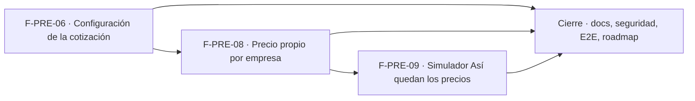

# Tasks: Precios y dólar · Configuración dólar y precio propio

**Input**: [spec.md](./spec.md) y [plan.md](./plan.md) · **Épica**: MSF-352
**Formato**: `- [ ] T### [P] [Historia][USx] descripción (FR/SC)`. `[P]` = paralelizable (archivos distintos, sin dependencia dentro del mismo grupo). Cada FR/SC tiene **una sola** tarea dueña. Las dependencias y el orden son **solo dentro de la misma historia**; entre historias rige la tabla *Plan de ejecución* del final.
**Validación por historia**: `pnpm test:db`, `pnpm lint`, `pnpm build` y `pnpm test:web` verdes antes de cerrar la fase. Cada tabla nueva o alterada: esquema `dominio` re-verificado (Principio VII). Tras tocar código: `graphify update .`.

## Phase 1: F-PRE-06 · Configuración de la cotización

**Goal**: configuración editable (redondeo, umbral, confirmación, aviso), alcance «una por empresa» con vista previa y la tarjeta «Configuración».

- [ ] T001 [F-PRE-06][US1] Migración `supabase/migrations/20270122100000_cotizacion_configuracion.sql` (parte 1): `dominio.cotizacion_configuracion` con defaults del lanzamiento, RLS por organización y sección `cotizacion_dolar`, `anon` sin privilegios, reversión en el encabezado (FR-001)
- [ ] T002 [F-PRE-06][US1] Misma migración (parte 2): `obtener_configuracion_cotizacion` y `guardar_configuracion_cotizacion` (rangos, idempotencia, evento `cotizacion.configuracion_guardada`); `revoke … from public, anon`, `grant execute … to authenticated` (FR-002)
- [ ] T003 [F-PRE-06][US1] Migración `supabase/migrations/20270122100100_cotizacion_alcance_empresa.sql`: `empresa_id` nullable con FK compuesta en `cotizacion_pendiente`/`cotizaciones`/`cotizacion_aplicada`, índices únicos con `coalesce`, `private.cotizacion_para`, sobrecarga de `a_pesos` con empresa; sin tocar filas del historial (FR-003)
- [ ] T004 [F-PRE-06][US1] Migración `supabase/migrations/20270122100150_cotizacion_cambio_alcance.sql`: `previsualizar_cambio_alcance` (solo lee) y `cambiar_alcance_cotizacion` (una transacción, exige confirmación, actividad) (FR-004, FR-005)
- [ ] T005 [F-PRE-06][US1] Migración `supabase/migrations/20270122100200_cotizacion_usa_configuracion.sql`: `previsualizar`/`confirmar`/`descartar_cotizacion` y `cotizacion_del_dia` leen umbral, confirmación y aviso de la configuración y reciben `p_empresa` (FR-006)
- [ ] T006 [F-PRE-06][US1] Misma migración (parte 2): el redondeo configurado rige el «Nuevo» de la vista previa del recálculo; el redondeo por empresa de F-PRE-07 no se toca (FR-007)
- [ ] T007 [F-PRE-06][US1] pgTAP `supabase/tests/database/cotizacion_configuracion.test.sql`: dos organizaciones, defaults, permisos por rol, rangos, idempotencia, evento, `anon` (SC-001)
- [ ] T008 [F-PRE-06][US1] pgTAP `supabase/tests/database/cotizacion_alcance.test.sql`: cambio sistema↔empresa atómico, vista previa sin escribir, carga por empresa aislada, umbral/confirmación/aviso configurados, comportamiento por defecto igual a MSF-116 (SC-002)
- [ ] T009 [P] [F-PRE-06][US1] `apps/web/src/lib/cotizacion.ts` y `apps/web/src/hooks/useConfiguracionCotizacion.ts`: lectura/guardado de la configuración, validación de umbral y mensajes de error, hook de alcance (soporte de FR-008)
- [ ] T010 [P] [F-PRE-06][US1] `apps/web/src/components/cotizacion/TarjetaConfiguracion.tsx`: `Alcance` (segmentado), `Redondeo del precio en pesos`, `Umbral para recalcular`, interruptor «Aviso en Inicio», textos del prototipo, «Guardar configuración» y «Configuración guardada»; montaje en `pages/cotizacion/index.tsx` (FR-008)
- [ ] T011 [F-PRE-06][US1] `DialogoAlcance` con vista previa por empresa (reutiliza el bloque «Qué va a cambiar»), carga acotada a la empresa activa con `FiltroEmpresa` en «Todas mis empresas», texto «San Javucho y Mundo JC cargan su propio valor…», y textos del diálogo de carga con los valores configurados (FR-009)
- [ ] T012 [F-PRE-06][US1] `Cotización que usa` y hint de dólar vigente en la pestaña «Precios y moneda» (`pages/empresas/precios.tsx`) según el alcance (FR-010)
- [ ] T013 [F-PRE-06][US1] Permisos de solo lectura, estados de carga/error, carga diferida de los diálogos, teclado/lector y 320/768/1440 px de la tarjeta (FR-011)
- [ ] T014 [F-PRE-06][US1] Vitest de la tarjeta y la vista previa de alcance: defaults, validación, guardar, solo lectura, textos configurados, cancelar (SC-003)
- [ ] T015 [F-PRE-06][US1] Vitest de cambio de empresa activa con alcance «por empresa» y de pantalla sin cambios con alcance «sistema» (SC-004)

**Checkpoint F-PRE-06**: `pnpm test:db`, `pnpm lint`, `pnpm build` y `pnpm test:web` verdes.

## Phase 2: F-PRE-08 · Precio propio de un producto en una empresa

**Goal**: precio propio por producto y empresa, integrado al cálculo del neto y a la ficha. Requiere F-PRE-06 mergeada (`private.cotizacion_para`, ver *Plan de ejecución*).

- [ ] T016 [F-PRE-08][US2] Migración `supabase/migrations/20270122110000_precios_propios_empresa.sql` (parte 1): `dominio.precios_propios_empresa` con FK compuestas, RLS por organización, `anon` sin privilegios, reversión en el encabezado (FR-012)
- [ ] T017 [F-PRE-08][US2] Misma migración (parte 2): `fijar_precio_propio` (idempotente, rechaza ajenos, actividad sin importes) y `leer_precios_propios`; `revoke … from public, anon`, `grant execute … to authenticated` (FR-013)
- [ ] T018 [F-PRE-08][US2] Misma migración (parte 3): validación de moneda e importe en la RPC (FR-016)
- [ ] T019 [F-PRE-08][US2] Misma migración (parte 4): `quitar_precio_propio` idempotente con actividad (FR-017)
- [ ] T020 [F-PRE-08][US2] Migración `supabase/migrations/20270122110100_precios_propios_calculo.sql` (parte 1): `precio_neto_empresa`, `precios_empresa_neto` (columna `precio_propio`) y `precio_visible_desde_central` devuelven el precio propio; sin precio propio, resultado idéntico (FR-014)
- [ ] T021 [F-PRE-08][US2] Misma migración (parte 2): precio propio en USD convertido con `private.cotizacion_para(org, empresa)` y sin cotización devuelve `null` (FR-015)
- [ ] T022 [F-PRE-08][US2] pgTAP `supabase/tests/database/precios_propios_empresa.test.sql`: dos organizaciones, permisos, fijar/actualizar/quitar, ajenos rechazados, neto con/sin precio propio, IVA encima, USD según alcance, `anon` (SC-005)
- [ ] T023 [F-PRE-08][US2] pgTAP: ningún camino de lectura (`precios_empresa_neto`, `precio_visible_desde_central`, `previsualizar_cotizacion`) ignora el precio propio (SC-006)
- [ ] T024 [P] [F-PRE-08][US2] `apps/web/src/lib/preciosPropios.ts` y `apps/web/src/hooks/usePreciosPropios.ts`: lectura, fijar, quitar, validación y mensajes (soporte de FR-018)
- [ ] T025 [F-PRE-08][US2] `apps/web/src/components/precios/PrecioPropioEmpresas.tsx` y montaje en `pages/productos/edit.tsx`/`create.tsx`: una fila por empresa del producto (`Moneda`, `Precio propio`, «Quitar»), neto de ejemplo, solo lectura para Consulta (FR-018)
- [ ] T026 [F-PRE-08][US2] Marca «Precio propio» en la ficha; nota fuera de alcance del listado documentada en el código y en `docs/` (FR-019)
- [ ] T027 [F-PRE-08][US2] Confirmar que el flujo no genera cola ni columna de Mercado Libre y dejarlo asentado en el comentario de la migración (FR-020)
- [ ] T028 [F-PRE-08][US2] Vitest del bloque en la ficha: alta/edición/quitar, validación, solo lectura, marca (SC-007)
- [ ] T029 [F-PRE-08][US2] Vitest de la ficha al cambiar de producto o de empresas del producto (SC-008)

**Checkpoint F-PRE-08**: `pnpm test:db`, `pnpm lint`, `pnpm build` y `pnpm test:web` verdes.

## Phase 3: F-PRE-09 · Simulador «Así quedan los precios»

**Goal**: el simulador marca los productos con precio propio y prueba cualquier cambio de la regla antes de guardar. Requiere F-PRE-08 mergeada (RF-PRE-09-2).

- [ ] T030 [F-PRE-09][US3] Migración `supabase/migrations/20270122120000_simulador_precio_propio.sql`: `previsualizar_precios_empresa` suma `precio_propio`; solo lee; reversión en el encabezado (FR-021)
- [ ] T031 [F-PRE-09][US3] pgTAP `supabase/tests/database/simulador_precio_propio.test.sql`: marca, no escribe, dos organizaciones, `anon` (SC-009)
- [ ] T032 [P] [F-PRE-09][US3] `apps/web/src/components/precios/TablaAsiQuedan.tsx`: marca por fila («Precio propio» / «Ajustado» / «Central»), valor de precio propio fijo al mover el ajuste (FR-024)
- [ ] T033 [P] [F-PRE-09][US3] `apps/web/src/pages/empresas/precios.tsx`: la simulación se recalcula con `Base`, `Ajuste` y `Precios que ve el cliente` sin guardar, subtítulo «Se actualiza con el ajuste», y salir sin guardar descarta (FR-022, FR-023)
- [ ] T034 [F-PRE-09][US3] Nota «Los productos con precio propio ignoran el ajuste…» y paso 3 de «Cómo se calcula» (FR-025)
- [ ] T035 [F-PRE-09][US3] Reinicio de regla, formulario, simulación y avisos al abrir otra empresa, con la marca (FR-026)
- [ ] T036 [F-PRE-09][US3] Vitest de la tabla y «Cómo se calcula»: marca, tonos, estados, 320/768/1440 px (SC-010)
- [ ] T037 [F-PRE-09][US3] Vitest de cambio de empresa con una empresa con precio propio y otra sin (SC-011)

**Checkpoint F-PRE-09**: `pnpm test:db`, `pnpm lint`, `pnpm build` y `pnpm test:web` verdes.

## Phase 4: Cierre (docs, seguridad, verificación de la épica)

**Goal**: lo que ninguna historia atiende. Se ejecuta con todas las historias mergeadas.

- [ ] T038 [P] [CIERRE] `docs/configuracion-dolar-y-precio-propio.md`, actualizar `docs/precios.md` y `docs/dolar-y-recalculo.md` (los valores ya no son fijos) y fila de `docs/roadmap-template.md`; `pnpm docs:check` (FR-027)
- [ ] T039 [P] [CIERRE] Revisión de seguridad: RLS en las tablas nuevas/alteradas, grants de RPC, `anon`, FK compuestas, esquema de cada tabla contra el Principio VII (FR-028)
- [ ] T040 [CIERRE] E2E: cambiar el alcance con vista previa y confirmar; fijar un precio propio, verlo marcado en el simulador y comprobar que no se mueve con el ajuste (SC-012)
- [ ] T041 [CIERRE] `rls_en_toda_tabla` verde con las tablas nuevas y suite completa `pnpm test` verde (SC-013)

## Matriz de trazabilidad tracker ↔ US ↔ tasks

| Historia (tracker) | US | Requisitos (dueño único) | Tareas |
|---|---|---|---|
| F-PRE-06 Configuración de la cotización | US1 | FR-001…FR-011, SC-001…SC-004 | T001–T015 |
| F-PRE-08 Precio propio de un producto en una empresa | US2 | FR-012…FR-020, SC-005…SC-008 | T016–T029 |
| F-PRE-09 Simulador «Así quedan los precios» | US3 | FR-021…FR-026, SC-009…SC-011 | T030–T037 |
| Tarea de cierre (label cierre) | — | FR-027, FR-028, SC-012, SC-013 | T038–T041 |

## Dependencias dentro de cada historia

- F-PRE-06: T001 → T002 → T003 → T004 → T005 → T006 → T007 → T008; T009 [P] y T010 [P] desde T002; T011 tras T004, T006 y T010; T012 tras T009; T013 tras T010; T014 y T015 al final.
- F-PRE-08: T016 → T017 → T018 → T019 → T020 → T021 → T022 → T023; T024 [P] desde T017; T025 tras T024; T026 y T027 tras T025; T028 y T029 al final.
- F-PRE-09: T030 → T031; T032 [P] y T033 [P] desde T030; T034 tras T032; T035 tras T033; T036 y T037 al final.
- Cierre: T038 [P] y T039 [P] pueden arrancar con todas las historias mergeadas; T040 → T041 al final.

## Plan de ejecución (historias)

El **orden de toma** lo declara esta tabla: el orquestador la **consume**. Una historia arranca cuando sus dependencias están **Finalizadas (mergeadas)**; las del **mismo** `Grupo` van **en paralelo**. F-PRE-08 espera a F-PRE-06 porque comparten el cálculo del neto y la cotización por empresa (`private.cotizacion_para`, `private.a_pesos`, `previsualizar_cotizacion`); F-PRE-09 espera a F-PRE-08 porque el simulador marca los productos con precio propio (RF-PRE-09-2). El tracker declara F-PRE-06 independiente en lo funcional; el orden es por archivos compartidos.

| Historia | Depende de | Grupo |
|----------|------------|-------|
| F-PRE-06 | — | 1 |
| F-PRE-08 | F-PRE-06 | 2 |
| F-PRE-09 | F-PRE-08 | 3 |
| [Cierre] | F-PRE-06, F-PRE-08, F-PRE-09 | 4 |

