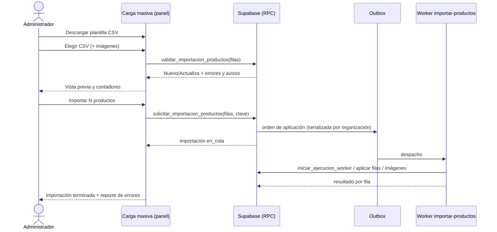
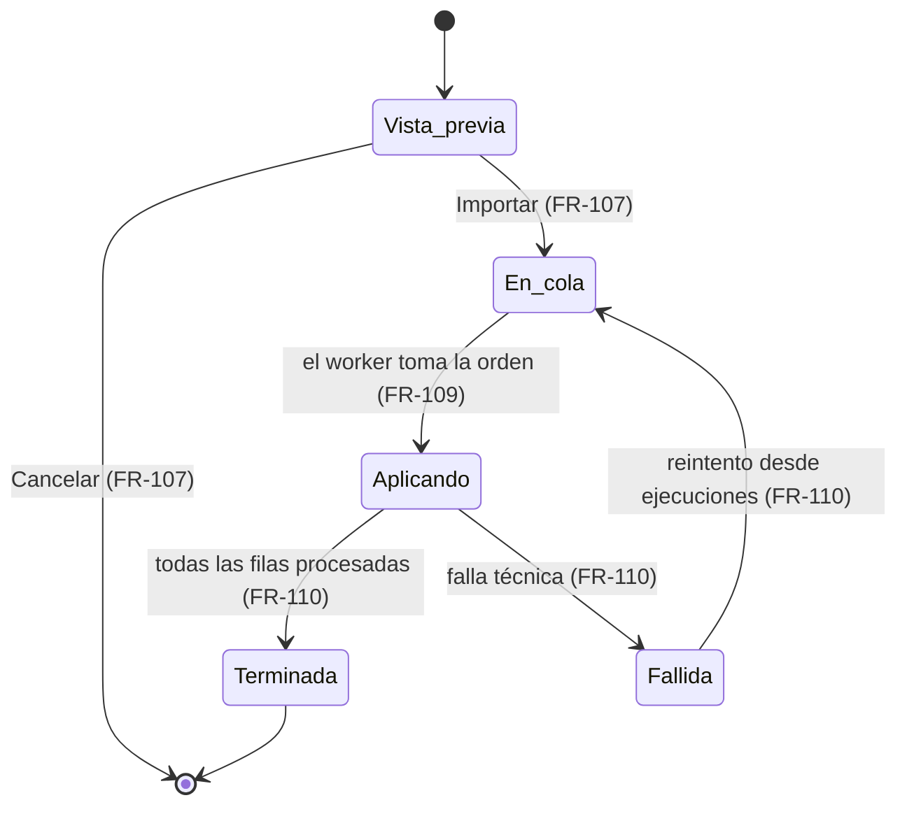
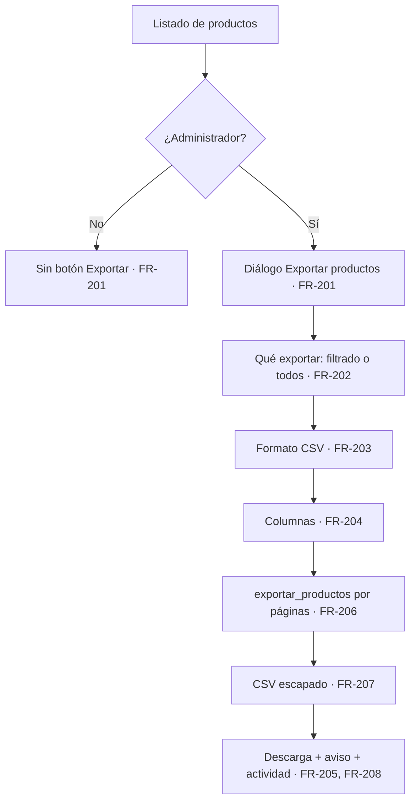
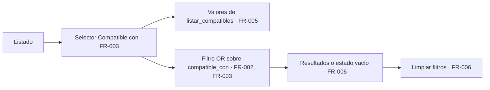

# Feature Specification: Catálogo · Catálogo compatibilidad y planillas

**Feature Branch**: `epic/MSF-202-catalogo-catalogo-compatibilidad-y-plani`

**Jira Epic**: MSF-202 — Catálogo · Catálogo compatibilidad y planillas (spec `catalogo-compatibilidad-y-planillas`)

**Created**: 2026-11-01

**Status**: Ready for implementation — traducción fiel de la épica de Nicolás; no agrega alcance. Lo que la épica deja abierto está en *Decisiones tomadas al traducir*; lo que necesita el OK de Nicolás está marcado **(OK pendiente)**.

**Delivery scope**: `refine` (`apps/web`), `supabase` (migraciones, RPC y pgTAP) y `workers` (`workers/importar-productos`, la aplicación de la importación por outbox). Sin `kestra` ni `superset`.

**Prioridad / Hito**: P1 · Etapa 2 (desde enero de 2027) · ~14 h · alcance diciembre (marcada para revisar con el roadmap).

**Historias**: F-CAT-09 (S), F-CAT-10 (M), F-CAT-11 (S).

**Input**: Epic MSF-202. Objetivo: «Al terminar, el cliente puede filtrar por consola o modelo compatible y cargar, actualizar y exportar productos en lote desde una planilla CSV.»

## Regla de fuentes (literal de la épica)

1. Comportamiento y datos: mandan los requisitos y escenarios de esta historia.
2. Qué se ve (disposición, textos, estados, popups, flujos): el prototipo validado es referencia visual, no hace falta que quede extremadamente idéntico; los flujos (si hay) aclaran estados y acciones.
3. Cómo se construye (componentes, estilos y patrones): mandan el template y el system design del producto (épica Plataforma · Sistema de diseño, MSF-117). No copiar el HTML ni el CSS del prototipo: reproducir lo que muestra con los componentes del template y los tokens del sistema de diseño.
4. El prototipo muestra más que esta historia: implementar solo lo que piden los requisitos de esta historia; otras secciones, botones o diálogos son de otras historias.
5. Si algo no se puede igualar con el template / el sistema de diseño: usar lo más cercano, sin inventar, y anotar la diferencia en la descripción del PR.
6. Si el prototipo y los requisitos se contradicen: requisitos para el comportamiento, prototipo para lo visual, y dejar la contradicción anotada en el PR.

Prototipos (solo lectura, en el árbol): `design/pantallas/ProductosCarga.dc.html`, `design/pantallas/Productos.dc.html` (botones «Importar CSV» y «Exportar», diálogo «Exportar productos») y `design/pantallas/ProductoAlta.dc.html` (campo «Compatible con»).

## Dependencias

| Dependencia | Para qué | ¿En la base de esta rama? |
|---|---|---|
| MSF-160 · Catálogo listado y categorías | `public.v_productos_listado` (F-CAT-11 la lee) y la pantalla «Productos · listado» donde se montan Importar y Exportar | Sí |
| F-CAT-02 / F-CAT-04 (alta y edición) | `dominio.productos.compatible_con text[]` y el campo «Compatible con» ya existen (`crear_producto`/`actualizar_producto`, `FormularioProducto.tsx`) | Sí |
| MSF-179 / F-CAT-16 (costo, proveedor y escalas) | `dominio.producto_costos`, proveedor y escalas de precio que la importación escribe | Sí |
| Template: `workers/CONTRATO.md`, outbox durable, `iniciar_ejecucion_worker`, `ejecuciones_worker`, `capacidades_ejecucion`, pantalla de ejecuciones | Despachar, reintentar y auditar la aplicación de la importación | Sí |
| Relacionada, sin bloqueo: MSF-167 (Tiendas online · Tienda catálogo y ficha) | Filtro y ficha pública leen `productos.compatible_con` (ya existe); el bloqueo se quitó | — |
| Relacionada, sin bloqueo: MSF-206 (Plataforma · Importaciones y monitoreo, F-IMP-01) | Posible solapamiento; ver Decisión 6 | — |

Bloquea a: ninguna épica.

## Modelo y supuestos (de la épica)

- La importación y la exportación son **exclusivas del Administrador** (`private.es_administrador_de(organizacion)`).
- La importación **se aplica con worker y outbox** para no bloquear el panel.
- La importación escribe `producto_costos` **solo si quien importa tiene acceso a Rentabilidad** (`private.nivel_seccion('rentabilidad') = 'edicion'`, mismo criterio que `crear_producto`/`actualizar_producto`).
- Dos importaciones simultáneas de la misma organización **se serializan** (una sola ejecución en curso por capacidad).
- Lo que el template **no** trae y esta épica construye: carga del archivo CSV, el worker concreto, la vista previa, el reporte de errores y la exportación CSV.

### Esquema de datos (Constitución, Principio VII)

| Objeto | Esquema | Justificación | RLS |
|--------|---------|---------------|-----|
| `dominio.productos` (existente; `compatible_con text[]`) | **`dominio`** | Dato del producto. **No se altera**: se agrega un índice GIN (aditivo). | Sin cambios (existente). |
| `public.v_productos_listado` (vista existente, F-CAT-09) | **`public`** (vista `security_invoker`) | Contrato de lectura del listado; se le **agrega al final** la columna `compatible_con`. Aditivo. | Hereda la RLS de `dominio.productos`. |
| `dominio.importaciones_productos` (nueva, F-CAT-10) | **`dominio`** | Una importación de productos: estado, totales, clave de idempotencia, ejecución del worker. Dato del producto. | Por `organizacion_id`; lectura para el Administrador de la organización; **sin** políticas de escritura para `authenticated` (las escriben las RPC y el worker); `anon` sin privilegios. |
| `dominio.importaciones_productos_filas` (nueva, F-CAT-10) | **`dominio`** | Filas ya validadas de cada importación (carga útil para el worker) y su resultado por fila (aplicada/omitida/error + mensaje). | Igual que arriba. |
| Bucket de Storage temporal de imágenes de importación (F-CAT-10) | Storage (no es tabla) | Las imágenes que se suben con la planilla esperan ahí hasta que el worker las adjunta al producto. | Política por prefijo `organizacion_id/` y solo Administrador. |
| `dominio.producto_costos`, `producto_imagenes`, `producto_empresa`, `categorias`, `proveedores`, `empresas` (existentes) | **`dominio`** | Solo se leen o se escriben por el worker con las mismas reglas que el alta/edición. No se alteran. | Sin cambios. |

Reversión: las tres migraciones son aditivas. F-CAT-09: `drop index` y `drop view public.v_productos_listado` + re-crear la definición previa (patrón de `20261022121000`). F-CAT-10: `drop table` de las dos tablas y del bucket (no se destruye ninguna columna existente). F-CAT-11: `drop function public.exportar_productos`.

## Decisiones tomadas al traducir (resuelven «A revisar» sin agregar alcance)

1. **Alcance real vs. roadmap.** La spec cubre las tres historias, pero se entregan en orden de prioridad: F-CAT-10 y F-CAT-11 primero (son lo que el roadmap a diciembre incluye como «importación por planilla»), F-CAT-09 después. Cada historia es independiente y mergeable sola. **(OK pendiente)** si Nicolás quiere sacar F-CAT-09 de esta entrega.
2. **«Etiquetas» (título de F-CAT-09).** La épica no define ninguna entidad «etiqueta» ni su comportamiento. Se interpreta como la **forma de mostrar y filtrar los valores de «Compatible con»** (cada valor es una etiqueta). No se crea tabla ni campo nuevo. **(OK pendiente)**.
3. **Filtro por compatible.** Selector con los valores de «Compatible con» ya cargados en la organización; elegir uno o más muestra los productos que tengan **alguno** de ellos. Coincidencia exacta sin distinguir mayúsculas.
4. **Rol Consulta y exportar.** Pregunta abierta de la épica. Se aplica el supuesto dado («exclusivas del Administrador»): **Consulta no exporta**. **(OK pendiente)**.
5. **Formato de exportación.** El requisito dice «exportación CSV»; el prototipo ofrece además «Excel (.xlsx)». Manda el requisito (regla 6): solo CSV; la opción Excel se muestra **deshabilitada** y la diferencia se anota en el PR.
6. **F-CAT-10/11 vs. F-IMP-01 (MSF-206).** Manda `ProductosCarga` y el diálogo «Exportar productos» (están dibujados y la épica los pide). F-IMP-01 podrá listar estas ejecuciones después; esta épica no depende de él ni lo construye.
7. **Celdas vacías en una actualización.** Una celda vacía **no pisa** el valor actual del producto (solo las columnas con valor se actualizan). **(OK pendiente)**.
8. **Límite de filas.** Hasta 2 000 filas por importación (mismo tope que la carga de stock); más filas se rechazan con un mensaje.
9. **Reporte de errores.** CSV descargable con las filas omitidas y su motivo, disponible al terminar la importación.
10. **Idempotencia.** Cada solicitud lleva una clave; reintentar con la misma clave no duplica productos ni imágenes (Principio III).

## Historias

### US1 — F-CAT-09 · Campo «Compatible con» y etiquetas (P1, S)

Como Administrador u Operador con acceso a Productos, filtro el listado por consola o modelo compatible.

- **FR-001**: El campo «Compatible con» del alta/edición (`ProductoAlta`) sigue funcionando como está (texto separado por comas, `compatible_con text[]`, hasta `MAX_COMPATIBLES` valores). Esta historia **no lo cambia**; un test de regresión lo cubre. **Verificación:** Vitest `pnpm --filter @platform/web test -- FormularioProducto` (regresión del campo).
- **FR-002**: `public.v_productos_listado` expone `compatible_con text[]` (columna agregada al final, migración aditiva) y hay un índice GIN sobre `dominio.productos(compatible_con)`. **Verificación:** pgTAP `catalogo_compatible_filtro.test.sql` (columna `compatible_con` en `v_productos_listado` e índice GIN) vía `pnpm test`.
- **FR-003**: El listado tiene un filtro «Compatible con» (selector múltiple de los valores existentes en la organización, con la pieza más cercana del template). Mostrar solo productos con **alguno** de los valores elegidos, sin distinguir mayúsculas; se combina con los demás filtros, la búsqueda y la categoría. **Verificación:** Vitest `pnpm --filter @platform/web test -- filtro-compatible` (OR, mayúsculas, combinación con búsqueda/categoría).
- **FR-004**: Los valores de «Compatible con» de cada producto se muestran como etiquetas en el listado (Decisión 2). Sin valores, no se muestra nada. **Verificación:** Vitest `pnpm --filter @platform/web test -- filtro-compatible` (etiquetas en la fila; sin valores no muestra nada).
- **FR-005**: `public.listar_compatibles()` devuelve los valores distintos (ordenados, sin vacíos) de la organización; es de solo lectura. **Verificación:** pgTAP `catalogo_compatible_filtro.test.sql` (`listar_compatibles`: distintos, ordenados, sin vacíos, aislamiento, solo lectura).
- **FR-006**: «Limpiar filtros» también limpia el filtro de compatible; sin resultados se usa el estado vacío existente. **Verificación:** Vitest `pnpm --filter @platform/web test -- filtro-compatible` (limpiar filtros y estado vacío).
- **FR-007**: *Empresa activa* (Principio VIII): al cambiar de empresa se recargan los productos **y** los valores del selector, se descartan valores elegidos que ya no existen y se reencuadra la paginación. **Verificación:** Vitest `pnpm --filter @platform/web test -- filtro-compatible` (cambio de empresa).
- **SC-001**: pgTAP `catalogo_compatible_filtro.test.sql`: aislamiento entre organizaciones de la vista y de `listar_compatibles`, `anon` sin acceso, columna nueva presente.
- **SC-002**: Vitest del filtro (OR, mayúsculas, combinación con búsqueda/categoría, limpiar, cambio de empresa).

### US2 — F-CAT-10 · Importar productos desde CSV (P1, M)

Como Administrador, cargo o actualizo productos en lote desde una planilla CSV con sus imágenes, veo una vista previa y la aplicación corre en segundo plano.

- **FR-101**: Existe la pantalla «Productos · Carga masiva (CSV)» (ruta canónica `/productos/carga`, dentro de Catálogo; sin ítem propio en el menú: se llega desde «Importar CSV» del listado). Solo el Administrador la ve y la usa; los demás roles no ven el botón y la ruta responde sin permiso. **Verificación:** Vitest `pnpm --filter @platform/web test -- carga-productos` (botón y ruta solo Administrador) + pgTAP `catalogo_importacion.test.sql`.
- **FR-102**: «Descargar plantilla CSV» baja un CSV con las columnas `sku, nombre, categoria, costo, precio_x1, precio_x5, precio_x10, precio_x50, proveedor, codigo_barras, tiendas, imagenes`. El panel «Columnas de la plantilla» muestra Columna / Obligatoria / Ejemplo (obligatorias: `sku`, `nombre`, `categoria`). **Verificación:** Vitest `pnpm --filter @platform/web test -- importacion-productos` (plantilla CSV y panel de columnas).
- **FR-103**: Paso «1 · Archivos»: se elige el CSV (nombre y resumen del archivo) y, opcionalmente, las imágenes (ZIP o archivos sueltos, «Elegir imágenes»). La columna `imagenes` lleva nombres de archivo separados por `|` (la primera es la principal); `tiendas` lleva códigos SJ o MJC separados por `|`; si queda vacía el producto se crea sin publicar en ninguna tienda. Las imágenes cumplen las reglas de `producto_imagenes` (JPG/PNG/WebP, hasta 2 MB, hasta 4 por producto). **Verificación:** Vitest `pnpm --filter @platform/web test -- carga-productos` (paso 1, `|`, reglas de imagen).
- **FR-104**: Paso «2 · Vista previa y validación»: tabla Fila / SKU / Nombre / Categoría / Precio x1 / Imágenes / Acción (Nuevo / Actualiza) / Validación, con contadores «N correctas · N con aviso · N con error». `Acción` sale de que el SKU exista o no en la organización. Texto fijo: «Las filas con error no se importan. Los avisos se importan igual.» **Verificación:** Vitest `pnpm --filter @platform/web test -- carga-productos` (tabla, Nuevo/Actualiza, contadores, texto fijo).
- **FR-105**: Validación por fila (`validar_importacion_productos`): `sku`, `nombre` y `categoria` obligatorios; la categoría debe existir (ruta «A > B > C»); precios y costo numéricos no negativos; SKU repetido en la planilla; código de barras con formato válido y no usado por otro producto; tienda desconocida; imagen citada que no se subió o inválida (aviso). Los motivos son error (se omite) o aviso (se importa). **Verificación:** pgTAP `catalogo_importacion.test.sql` (`validar_importacion_productos`) + Vitest `importacion-productos`.
- **FR-106**: Si quien importa **no** tiene acceso a Rentabilidad, la columna `costo` se ignora con un aviso por fila y **no** se escribe `producto_costos`; con acceso, se escribe igual que en el alta/edición (Decisión 7 para vacíos). **Verificación:** pgTAP `catalogo_importacion.test.sql` (costo sin Rentabilidad) + Vitest `carga-productos` (aviso por fila).
- **FR-107**: «Importar N productos» (N = filas importables) llama a `solicitar_importacion_productos`, que persiste la importación y sus filas y **encola** la orden en la outbox; el panel no espera la aplicación. Cancelar descarta la vista previa sin persistir nada. **Verificación:** Vitest `pnpm --filter @platform/web test -- carga-productos` (Cancelar no persiste; Importar encola) + pgTAP `catalogo_importacion.test.sql`.
- **FR-108**: El worker `workers/importar-productos` cumple `workers/CONTRATO.md`: registra su ejecución (`iniciar_ejecucion_worker`), comprueba `ejecucion_worker_en_curso`, aplica fila por fila las operaciones de alta/edición del catálogo (mismas reglas, SKU único, actividad registrada), adjunta las imágenes y deja el resultado por fila. Es **idempotente**: reintentar no duplica productos ni imágenes. **Verificación:** Vitest `pnpm --filter @workers/importar-productos test` (alta, actualización, imagen, reintento sin duplicar).
- **FR-109**: Dos importaciones de la misma organización se serializan: la segunda queda «En cola» hasta que termine la primera (no se rechaza). **Verificación:** pgTAP `catalogo_importacion.test.sql` (segunda importación queda `en_cola`).
- **FR-110**: Al terminar se muestra «Importación terminada. N productos procesados, M omitidos por error. Ya figuran en Catálogo · Productos.» y «Descargar reporte de errores» (CSV con fila, SKU y motivo de las omitidas). Si la ejecución falla de forma técnica, queda reintentable desde la pantalla de ejecuciones y se informa el estado. **Verificación:** Vitest `pnpm --filter @platform/web test -- carga-productos` (mensaje final y reporte de errores CSV).
- **FR-111**: Estados de la importación visibles en la pantalla: `en_cola`, `aplicando`, `terminada`, `fallida`. **Verificación:** Vitest `pnpm --filter @platform/web test -- carga-productos` (los cuatro estados) + pgTAP `catalogo_importacion.test.sql`.
- **FR-112**: Toda RPC es `security definer`, toma organización y actor de la sesión, exige `es_administrador_de`, y declara `revoke … from public, anon` + `grant … to authenticated`. Las tablas nuevas nacen sin privilegios para `anon`. **Verificación:** pgTAP `catalogo_importacion.test.sql` (solo Administrador, `anon` sin ejecución ni privilegios) vía `pnpm test`.
- **FR-113**: *Empresa activa* (Principio VIII): la importación opera sobre la **organización** y las tiendas salen de la columna `tiendas`; la pantalla no depende de la empresa activa. **No aplica**, y un test confirma que cambiar de empresa con una vista previa abierta no altera filas ni resultado.
- **SC-101**: pgTAP `catalogo_importacion.test.sql`: aislamiento, solo Administrador, `anon` sin acceso, idempotencia por clave, límite de filas.
- **SC-102**: Vitest del parser/validador de CSV y de la pantalla (vista previa, contadores, avisos de costo sin Rentabilidad, descarga de plantilla y de errores).
- **SC-103**: Vitest del worker: alta, actualización, celda vacía, imagen, reintento sin duplicar, `EJECUCION_NO_EN_CURSO` con código 78.

### US3 — F-CAT-11 · Exportar listados (P1, S)

Como Administrador, exporto el listado de productos a CSV desde el diálogo «Exportar productos».

- **FR-201**: El listado muestra el botón «Exportar» solo al Administrador; abre el diálogo «Exportar productos» con los campos «Qué exportar», «Formato» y «Columnas». **Verificación:** Vitest `pnpm --filter @platform/web test -- exportar-productos` (botón solo Administrador, campos del diálogo).
- **FR-202**: «Qué exportar»: «Lo filtrado (N)» (respeta la búsqueda, los filtros —incluido el de compatible si existe— la categoría y la empresa activa; nota «Respeta la búsqueda, los filtros y la categoría elegida.») o «Todos (N)» («Todo el catálogo, sin filtros.»). **Verificación:** Vitest `pnpm --filter @platform/web test -- exportar-productos` (filtrado vs todos y notas).
- **FR-203**: «Formato»: CSV seleccionado; «Excel (.xlsx)» visible y deshabilitado (Decisión 5). **Verificación:** Vitest `pnpm --filter @platform/web test -- exportar-productos` (CSV activo, Excel deshabilitado).
- **FR-204**: «Columnas»: casillas SKU, Nombre, Categoría, Precio, Costo, Stock, Visible en, Estado, Código de barras, Proveedor; por defecto las ocho primeras. «Costo» y «Proveedor» solo se ofrecen con acceso a Rentabilidad. «Stock» exporta la disponibilidad (la misma etiqueta del listado). **Verificación:** Vitest `pnpm --filter @platform/web test -- exportar-productos` (columnas por defecto; Costo/Proveedor según Rentabilidad).
- **FR-205**: Al confirmar, el CSV se genera y se descarga; aviso «Exportación CSV lista: N productos, M columnas». Sin productos para exportar el botón del diálogo se deshabilita. **Verificación:** Vitest `pnpm --filter @platform/web test -- exportar-productos` (descarga, aviso, botón deshabilitado sin filas).
- **FR-206**: `public.exportar_productos(p_filtros, p_columnas, p_desde, p_limite)` devuelve las filas por páginas (el listado lee `v_productos_listado`); exige Administrador, toma la organización de la sesión y devuelve solo las columnas permitidas. Una columna no autorizada (costo sin Rentabilidad) se rechaza (`42501`). **Verificación:** pgTAP `catalogo_exportar.test.sql` (Administrador, `42501` por costo sin Rentabilidad, paginación estable).
- **FR-207**: El CSV escapa comillas, comas y saltos de línea y neutraliza celdas que empiezan con `=`, `+`, `-` o `@` (inyección de fórmulas). **Verificación:** Vitest `pnpm --filter @platform/web test -- exportar-productos` (escape y neutralización de `=`, `+`, `-`, `@`).
- **FR-208**: Cada exportación queda en la actividad (`registrar_actividad`: quién, cuántos productos, qué columnas; sin valores de precio ni costo). **Verificación:** pgTAP `catalogo_exportar.test.sql` (actividad registrada sin precios ni costos).
- **FR-209**: *Empresa activa* (Principio VIII): «Lo filtrado» se reencuadra con la empresa activa; el diálogo abierto al cambiar de empresa se cierra con aviso. **Verificación:** Vitest `pnpm --filter @platform/web test -- exportar-productos` (cambio de empresa cierra el diálogo con aviso).
- **SC-201**: pgTAP `catalogo_exportar.test.sql`: aislamiento, solo Administrador, costo sin Rentabilidad rechazado, paginación estable, actividad registrada.
- **SC-202**: Vitest del diálogo y del generador de CSV (escape, fórmulas, columnas, «filtrado» vs «todos», cambio de empresa).

## Flujos

### Importación de productos (secuencia)

Mapeo: descargar plantilla → FR-102; elegir archivos → FR-103; validar y vista previa → FR-104, FR-105, FR-106; solicitar y encolar → FR-107, FR-112; serialización → FR-109; worker → FR-108; resultado y reporte → FR-110.

### Estados de una importación

### Exportar productos

### Filtrar por compatible

## Matriz pantalla↔criterios

Leyenda: **FA** = FUERA DE ALCANCE (no genera tarea; motivo indicado). Inventarios generados con `pnpm prototipo:inventario`.

### Productos · Carga masiva (CSV) (`ProductosCarga.dc.html`)

| Ítem del inventario | Dueño |
|---|---|
| Tabla «Columna / Obligatoria / Ejemplo» | FR-102 |
| Tabla «Fila / SKU / Nombre / Categoría / Precio x1 / Imágenes / Acción / Validación» | FR-104, FR-105 |
| Botón «Descargar plantilla CSV» | FR-102 |
| Botón «Elegir imágenes» (y selector del CSV, pasos «1 · Archivos» / «2 · Vista previa y validación») | FR-103, FR-104 |
| Botón «Cancelar» | FR-107 |
| Botón «Importar · productos» | FR-107 |
| Contadores «correctas / con aviso / con error», texto de ayuda de filas con error | FR-104 |
| Mensaje «Importación terminada…» | FR-110 |
| Reporte de errores (lo pide la épica; no figura en el prototipo) | FR-110 |
| Campos y tabs / diálogos | No hay en el inventario |
| Empresa activa | FR-113 (no aplica, con test) |

### Productos · listado (`Productos.dc.html`)

| Ítem del inventario | Dueño |
|---|---|
| Botón «Exportar» y diálogo «Exportar productos» | FR-201 |
| Campos «Qué exportar», «Formato», «Columnas» | FR-202, FR-203, FR-204 |
| Botón «Importar CSV» | FR-101 |
| Filtro «Compatible con» (no figura en el inventario; lo pide la épica) | FR-003, FR-004 |
| Empresa activa | FR-007, FR-209 |
| Columnas Producto, Precio, Costo, Margen, Stock, Visible en, Estado, acciones por fila; campo de búsqueda; «Nuevo producto»; «Categoría: ·»; «Limpiar filtros»; paginación | Heredado de MSF-160/179, sin cambio (salvo «Limpiar filtros»: FR-006) |
| Casilla de selección, «Quitar selección», «Mover de categoría» + diálogo, «Marcar destacado», estrella «Destacado», «Enviar al newsletter», «Borrar», «Borrar · productos», diálogo «Borrar productos», «Cancelar» | FA — otras historias (edición masiva MSF-218, newsletter, desactivación MSF-456); la épica no los pide |
| Opción «Excel (.xlsx)» del formato | FA — el requisito dice CSV (Decisión 5); se muestra deshabilitada |

### Producto · alta (`ProductoAlta.dc.html`)

| Ítem del inventario | Dueño |
|---|---|
| Campo «Compatible con» | FR-001 (ya existe; regresión) |
| Resto del formulario (nombre, SKU, descripción, categoría, proveedor, imágenes, precios, variantes, relacionados…) | FA — otras historias (F-CAT-02…16, Precios); no los pide esta épica |

## Edge cases

- CSV con BOM, separador `;` o `,`, codificación UTF-8: se detecta y, si no se puede leer, se informa sin importar nada.
- Más de 2 000 filas, CSV vacío o sin las columnas obligatorias: error claro antes de la vista previa.
- Producto existente con SKU en otra organización: nunca se ve ni se toca (RLS).
- Imagen citada pero no subida: aviso; el producto se importa sin esa imagen.
- Se cierra el panel mientras corre el worker: la importación continúa; al volver se ve su estado.

## Verificación por requisito

Cada requisito tiene su verificación nombrada (comandos desde la raíz; los pgTAP requieren `pnpm dev:supabase`).

| Requisito | Verificación |
|---|---|
| FR-001 | Vitest `pnpm --filter @platform/web test -- FormularioProducto` (regresión del campo) |
| FR-002 | pgTAP `catalogo_compatible_filtro.test.sql` (columna `compatible_con` en `v_productos_listado` e índice GIN) vía `pnpm test` |
| FR-003 | Vitest `pnpm --filter @platform/web test -- filtro-compatible` (OR, mayúsculas, combinación con búsqueda/categoría) |
| FR-004 | Vitest `pnpm --filter @platform/web test -- filtro-compatible` (etiquetas en la fila; sin valores no muestra nada) |
| FR-005 | pgTAP `catalogo_compatible_filtro.test.sql` (`listar_compatibles`: distintos, ordenados, sin vacíos, aislamiento, solo lectura) |
| FR-006 | Vitest `pnpm --filter @platform/web test -- filtro-compatible` (limpiar filtros y estado vacío) |
| FR-007 | Vitest `pnpm --filter @platform/web test -- filtro-compatible` (cambio de empresa) |
| FR-101 | Vitest `pnpm --filter @platform/web test -- carga-productos` (botón y ruta solo Administrador) + pgTAP `catalogo_importacion.test.sql` |
| FR-102 | Vitest `pnpm --filter @platform/web test -- importacion-productos` (plantilla CSV y panel de columnas) |
| FR-103 | Vitest `pnpm --filter @platform/web test -- carga-productos` (paso 1, `|`, reglas de imagen) |
| FR-104 | Vitest `pnpm --filter @platform/web test -- carga-productos` (tabla, Nuevo/Actualiza, contadores, texto fijo) |
| FR-105 | pgTAP `catalogo_importacion.test.sql` (`validar_importacion_productos`) + Vitest `importacion-productos` |
| FR-106 | pgTAP `catalogo_importacion.test.sql` (costo sin Rentabilidad) + Vitest `carga-productos` (aviso por fila) |
| FR-107 | Vitest `pnpm --filter @platform/web test -- carga-productos` (Cancelar no persiste; Importar encola) + pgTAP `catalogo_importacion.test.sql` |
| FR-108 | Vitest `pnpm --filter @workers/importar-productos test` (alta, actualización, imagen, reintento sin duplicar) |
| FR-109 | pgTAP `catalogo_importacion.test.sql` (segunda importación queda `en_cola`) |
| FR-110 | Vitest `pnpm --filter @platform/web test -- carga-productos` (mensaje final y reporte de errores CSV) |
| FR-111 | Vitest `pnpm --filter @platform/web test -- carga-productos` (los cuatro estados) + pgTAP `catalogo_importacion.test.sql` |
| FR-112 | pgTAP `catalogo_importacion.test.sql` (solo Administrador, `anon` sin ejecución ni privilegios) vía `pnpm test` |
| FR-201 | Vitest `pnpm --filter @platform/web test -- exportar-productos` (botón solo Administrador, campos del diálogo) |
| FR-202 | Vitest `pnpm --filter @platform/web test -- exportar-productos` (filtrado vs todos y notas) |
| FR-203 | Vitest `pnpm --filter @platform/web test -- exportar-productos` (CSV activo, Excel deshabilitado) |
| FR-204 | Vitest `pnpm --filter @platform/web test -- exportar-productos` (columnas por defecto; Costo/Proveedor según Rentabilidad) |
| FR-205 | Vitest `pnpm --filter @platform/web test -- exportar-productos` (descarga, aviso, botón deshabilitado sin filas) |
| FR-206 | pgTAP `catalogo_exportar.test.sql` (Administrador, `42501` por costo sin Rentabilidad, paginación estable) |
| FR-207 | Vitest `pnpm --filter @platform/web test -- exportar-productos` (escape y neutralización de `=`, `+`, `-`, `@`) |
| FR-208 | pgTAP `catalogo_exportar.test.sql` (actividad registrada sin precios ni costos) |
| FR-209 | Vitest `pnpm --filter @platform/web test -- exportar-productos` (cambio de empresa cierra el diálogo con aviso) |
| FR-113 | Vitest `pnpm --filter @platform/web test -- carga-productos` (cambiar de empresa con vista previa abierta no altera filas ni resultado) |
| SC-001 | `pnpm test` → pgTAP `catalogo_compatible_filtro.test.sql` |
| SC-002 | `pnpm --filter @platform/web test -- filtro-compatible` |
| SC-101 | `pnpm test` → pgTAP `catalogo_importacion.test.sql` |
| SC-102 | `pnpm --filter @platform/web test -- carga-productos importacion-productos` |
| SC-103 | `pnpm --filter @workers/importar-productos test` |
| SC-201 | `pnpm test` → pgTAP `catalogo_exportar.test.sql` |
| SC-202 | `pnpm --filter @platform/web test -- exportar-productos` |
