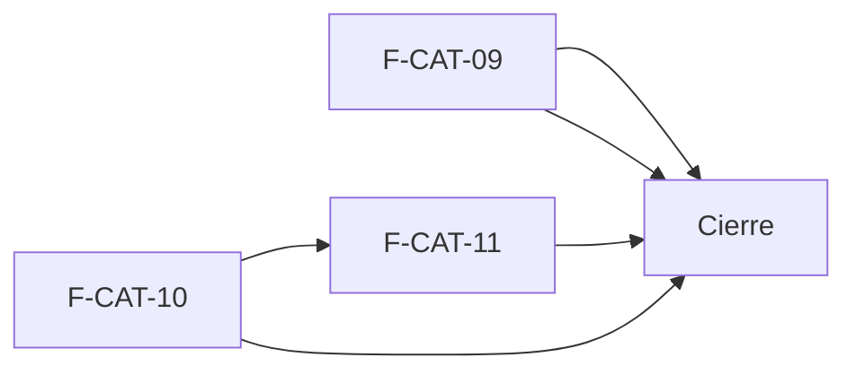

# Tasks: Catálogo · Catálogo compatibilidad y planillas

**Input**: `specs/20270125-100000-catalogo-compatibilidad-y-planillas/` (spec.md, plan.md, contracts/)

**Formato**: `- [ ] T### [P] [STORY-x][USy] descripción`. **[P]** = paralelizable (archivos distintos, sin dependencia; las [P] del mismo grupo van en paralelo); sin [P] = secuencial. Las dependencias de cada historia son solo dentro de esa historia. Cada FR/SC tiene una única tarea dueña (entre paréntesis).

**Delivery scope**: `refine`, `supabase`, `workers`

## Matriz de trazabilidad Jira ↔ US ↔ tasks

| Jira | Historia | FR / SC | Tasks |
|------|----------|---------|-------|
| F-CAT-09 | US1 Campo «Compatible con» y etiquetas | FR-001…FR-007, SC-001, SC-002 | T001–T007 |
| F-CAT-10 | US2 Importar productos desde CSV | FR-101…FR-113, SC-101…SC-103 | T008–T022 |
| F-CAT-11 | US3 Exportar listados | FR-201…FR-209, SC-201, SC-202 | T023–T030 |
| Tarea de cierre (label `cierre`) | Docs índice, seguridad y roadmap | — | T031–T033 |

## Phase 1: F-CAT-09 · Campo «Compatible con» y etiquetas (US1)

**Goal**: filtrar el listado por consola o modelo compatible.

- [ ] T001 [F-CAT-09][US1] Migración `20270125100000_catalogo_compatible_filtro.sql` (esquema `public` la vista, `dominio` el índice; Principio VII): `create or replace view public.v_productos_listado` con `compatible_con` al final, índice GIN en `dominio.productos(compatible_con)`, reversión en el encabezado (FR-002)
- [ ] T002 [F-CAT-09][US1] Migración `20270125100100_listar_compatibles.sql`: `public.listar_compatibles()` de solo lectura, `revoke … from public, anon` + `grant … to authenticated` (FR-005)
- [ ] T003 [P] [F-CAT-09][US1] pgTAP `supabase/tests/database/catalogo_compatible_filtro.test.sql`: aislamiento, `anon` sin acceso, columna presente (SC-001)
- [ ] T004 [P] [F-CAT-09][US1] Test de regresión del campo «Compatible con» en alta/edición, sin cambios de comportamiento (FR-001)
- [ ] T005 [F-CAT-09][US1] Filtro «Compatible con» (selector múltiple, OR, sin distinguir mayúsculas, combinado con búsqueda/categoría) y etiquetas en la fila del listado (FR-003, FR-004)
- [ ] T006 [F-CAT-09][US1] «Limpiar filtros» limpia el compatible; reencuadre al cambiar de empresa (recarga valores y productos, descarta valores inexistentes, reencuadra paginación) (FR-006, FR-007)
- [ ] T007 [F-CAT-09][US1] Vitest del filtro: OR, mayúsculas, combinación, limpiar, vacío, cambio de empresa; sección en `docs/catalogo.md` (SC-002)

**Checkpoint**: filtro operativo y mergeable solo.

## Phase 2: F-CAT-10 · Importar productos desde CSV (US2)

**Goal**: cargar y actualizar productos en lote desde CSV, con vista previa y aplicación por worker.

- [ ] T008 [F-CAT-10][US2] Migración `20270125110000_catalogo_importaciones.sql` (esquema `dominio`, Principio VII): `importaciones_productos` y `importaciones_productos_filas`, RLS por organización con lectura solo para Administrador, sin escritura para `authenticated`, `anon` sin privilegios, bucket temporal de imágenes con política por prefijo, reversión en el encabezado (FR-112)
- [ ] T009 [F-CAT-10][US2] Migración `20270125110100_validar_importacion_productos.sql`: `validar_importacion_productos` con las reglas de FR-105 y aviso de costo sin Rentabilidad (FR-105, FR-106)
- [ ] T010 [F-CAT-10][US2] Migración `20270125110200_solicitar_importacion_productos.sql`: `solicitar_importacion_productos` (clave de idempotencia, tope de 2000, orden en outbox, capacidad en `capacidades_ejecucion`) y `obtener_importacion_productos` (FR-107, FR-109, FR-111)
- [ ] T011 [F-CAT-10][US2] Migración `20270125110300_importacion_rpc_worker.sql`: RPC del rol `worker_*` para aplicar cada fila (reutiliza las reglas del alta/edición, SKU único, actividad) y cerrar la importación; firmas agregadas a `contracts/` (FR-108)
- [ ] T012 [F-CAT-10][US2] Worker `workers/importar-productos`: paquete `@workers/importar-productos` (`build`, `lint`, `test`, `start`), `ejecucion_worker_en_curso`, aplicación idempotente fila por fila, imágenes adjuntas con el blindaje existente, códigos de salida de `CONTRATO.md` (FR-108)
- [ ] T013 [P] [F-CAT-10][US2] Parser de CSV (BOM, `,`/`;`, límites) y plantilla: `lib/importacion-productos.ts` con «Descargar plantilla CSV» y panel «Columnas de la plantilla» (FR-102)
- [ ] T014 [F-CAT-10][US2] Ruta `/productos/carga` y botón «Importar CSV» del listado, visibles solo para Administrador; sin ítem de menú (FR-101)
- [ ] T015 [F-CAT-10][US2] Paso «1 · Archivos»: elegir CSV, elegir imágenes (ZIP/sueltas, reglas de imagen) y subida al bucket temporal (FR-103)
- [ ] T016 [F-CAT-10][US2] Paso «2 · Vista previa y validación»: tabla, Acción Nuevo/Actualiza, contadores, texto de ayuda, avisos por costo sin Rentabilidad (FR-104)
- [ ] T017 [F-CAT-10][US2] «Cancelar» (descarta sin persistir) e «Importar N productos» (solicita y encola) (FR-107)
- [ ] T018 [F-CAT-10][US2] Estados `en_cola`/`aplicando`/`terminada`/`fallida` con sondeo, mensaje «Importación terminada…» y «Descargar reporte de errores» (FR-110)
- [ ] T019 [P] [F-CAT-10][US2] pgTAP `supabase/tests/database/catalogo_importacion.test.sql`: aislamiento, solo Administrador, `anon`, idempotencia, límite, serialización (SC-101)
- [ ] T020 [P] [F-CAT-10][US2] Vitest del worker: alta, actualización, celda vacía, imagen, reintento sin duplicar, `EJECUCION_NO_EN_CURSO` con 78 (SC-103)
- [ ] T021 [F-CAT-10][US2] Vitest de la pantalla y del validador: vista previa, contadores, plantilla, reporte de errores; test de que cambiar de empresa no altera la vista previa (FR-113, SC-102)
- [ ] T022 [F-CAT-10][US2] `docs/catalogo-importacion.md` y `workers/importar-productos/README.md` (flujo, estados, serialización, reversión)

**Checkpoint**: importación de punta a punta con worker real.

## Phase 3: F-CAT-11 · Exportar listados (US3)

**Goal**: exportar el listado a CSV desde el diálogo «Exportar productos».

- [ ] T023 [F-CAT-11][US3] Migración `20270125120000_exportar_productos.sql` (esquema `public`, función de solo lectura sobre `v_productos_listado`; Principio VII): `exportar_productos` paginada, solo Administrador, columnas de costo/proveedor solo con Rentabilidad, `revoke … from public, anon` + `grant … to authenticated`, reversión en el encabezado (FR-206)
- [ ] T024 [P] [F-CAT-11][US3] Generador de CSV `lib/exportar-productos.ts`: escape de comillas/comas/saltos y neutralización de fórmulas (FR-207)
- [ ] T025 [F-CAT-11][US3] Botón «Exportar» (solo Administrador) y diálogo «Exportar productos» con «Qué exportar» (filtrado/todos con su nota) (FR-201, FR-202)
- [ ] T026 [F-CAT-11][US3] Campos «Formato» (CSV; Excel deshabilitado) y «Columnas» (por defecto las ocho; Costo/Proveedor según Rentabilidad) (FR-203, FR-204)
- [ ] T027 [F-CAT-11][US3] Confirmación: descarga paginada, aviso «Exportación CSV lista: N productos, M columnas», botón deshabilitado sin filas (FR-205)
- [ ] T028 [F-CAT-11][US3] Actividad de exportación sin precios ni costos y cierre del diálogo con aviso al cambiar de empresa (FR-208, FR-209)
- [ ] T029 [P] [F-CAT-11][US3] pgTAP `supabase/tests/database/catalogo_exportar.test.sql`: aislamiento, Administrador, costo sin Rentabilidad (`42501`), paginación, actividad (SC-201)
- [ ] T030 [F-CAT-11][US3] Vitest del diálogo y del CSV (escape, fórmulas, columnas, filtrado vs todos, cambio de empresa) y `docs/catalogo-exportacion.md` (SC-202)

**Checkpoint**: exportación operativa.

## Phase 4: Cierre

- [ ] T031 [CIERRE] Índice en `docs/catalogo.md` hacia `catalogo-importacion.md` y `catalogo-exportacion.md`; `docs/permisos-por-rol.md` si aplica; `pnpm docs:check`
- [ ] T032 [CIERRE] Revisión de seguridad: RLS de las tablas nuevas, grants de RPC (`anon` sin ejecución), bucket temporal, inyección de fórmulas en CSV, la service-role fuera del navegador
- [ ] T033 [CIERRE] Roadmap: actualizar la fila de MSF-202 en `docs/roadmap-template.md` (estado, link a la spec)

## Plan de ejecución (historias)

| Historia | Depende de | Grupo |
|----------|------------|-------|
| F-CAT-09 | — | 1 |
| F-CAT-10 | — | 1 |
| F-CAT-11 | — | 2 |
| [Cierre] | F-CAT-09, F-CAT-10, F-CAT-11 | 3 |

F-CAT-09 y F-CAT-10 no comparten tabla ni migración (tocan zonas distintas del listado) y van en paralelo; F-CAT-11 comparte la barra de acciones del listado con F-CAT-10 y por eso va después.

