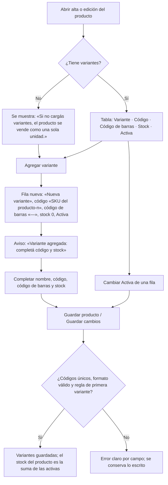
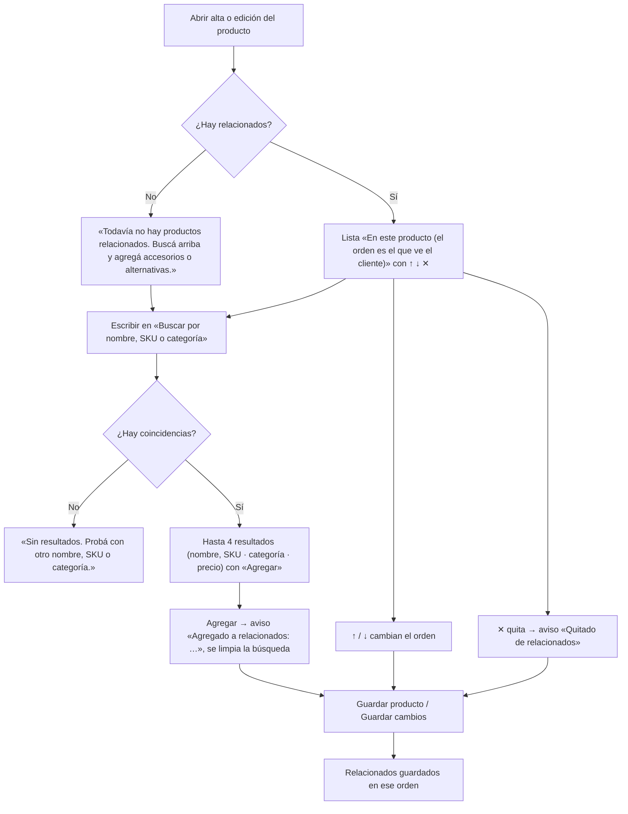

# Feature Specification: Catálogo · Catálogo variantes

**Feature Branch**: `epic/MSF-229-catalogo-catalogo-variantes`

**Jira Epic**: MSF-229 — Catálogo · Catálogo variantes (spec `catalogo-variantes`)

**Created**: 2026-11-01

**Status**: Draft — la especificación viene completa desde la épica; las decisiones abiertas están en «Decisiones para Nicolás». No hay NEEDS_INFO bloqueante.

**Delivery scope**: `refine` (apps/web) y `supabase` (migraciones, RPC, vistas, pgTAP). Sin `kestra`, `superset` ni `workers`.

**Prioridad / Hito**: P1 · Etapa 2 (desde enero de 2027, después de rentabilidad y reportes) · 34 h aprox. (F-CAT-15 ≈ 28 h, se divide al planificar —ver «División de F-CAT-15»—; F-CAT-18 ≈ 6 h).

**Dependencias**:
- Bloqueada por: MSF-114 (Precios y dólar · Precios e IVA: el precio se calcula por variante; el tronco de `productos` llega por MSF-114, que depende de MSF-160) y MSF-136 (Stock · Stock movimientos: el stock se lleva por variante y el del producto es la suma).
- Bloquea a: ninguna épica cargada hasta ahora.
- Relacionada, sin bloqueo: importación (MSF-202, F-CAT-10) y Mercado Libre (MSF-163 vínculos, MSF-123 envío de stock, MSF-137 envío de precios): se adaptan a variantes con las specs vigentes en ese momento (ver «Fuera de alcance»).

**Input**: Epic MSF-229. Objetivo: «Al terminar, un producto puede tener variantes con su propio SKU y stock sin duplicar fichas, y cada ficha sugiere productos relacionados (accesorios, juegos compatibles).»

**Supuestos de la épica**: el cliente pidió variantes y relacionados en el relevamiento del panel actual; hasta que entren, el catálogo se maneja con un SKU por variante y sin relacionados.

**Regla de fuentes** (literal de la épica):
1. Comportamiento y datos: mandan los requisitos y escenarios de esta historia.
2. Qué se ve (disposición, textos, estados, popups, flujos): el prototipo validado es referencia visual, no hace falta que quede extremadamente idéntico; los flujos (si hay) aclaran estados y acciones.
3. Cómo se construye (componentes, estilos y patrones): mandan el template y el system design del producto (MSF-117, `docs/sistema-de-diseno.md`). No copiar el HTML ni el CSS del prototipo.
4. El prototipo muestra más que esta historia: implementar solo lo que piden los requisitos; otras secciones, botones o diálogos son de otras historias.
5. Si algo no se puede igualar con el template / el sistema de diseño: usar lo más cercano, sin inventar, y anotar la diferencia en el PR.
6. Si prototipo y requisitos se contradicen: requisitos para el comportamiento, prototipo para lo visual, y dejar la contradicción anotada en el PR.

**Prototipos** (solo lectura, presentes en el árbol de trabajo): `design/pantallas/ProductoAlta.dc.html` y `design/pantallas/ProductoEditar.dc.html` (+ sus `.inventory.json`), bloques «Variantes (P1)» y «Productos relacionados». La épica referencia `design/precios-e-iva/ProductoAlta.dc.html`, que tiene los mismos bloques. No existe pantalla propia de la épica.

## Estado actual del repo (verificado)

| Pedido | Estado | Origen |
|--------|--------|--------|
| `dominio.productos` (SKU único por organización, `codigo_barras` EAN-13 único por organización, `compatible_con`, moneda, precio de lista) | **Hecho** | MSF-456 (`20261017120100`), MSF-529 (`20261019120000`) |
| `crear_producto` / `actualizar_producto` con bloqueo optimista (`p_actualizado_en`) y evento `producto.editado` | **Hecho** | MSF-456, MSF-205, MSF-179 (`20261022120900`) |
| Stock: `dominio.existencias` (por producto), `dominio.existencias_deposito` (por producto y depósito), `dominio.movimientos_stock` (libro), `registrar_movimiento_stock(...)` (8 parámetros, con depósito y lote), `dominio.reservas_stock` | **Hecho** | MSF-136, MSF-292 y lotes (`20261202100100`) |
| Disponibilidad: `private.disponibilidad_producto(uuid)`, `private.productos_con_stock()`, `private.disponible_publico(uuid)` — contrato: «solo cambia el cuerpo» | **Hecho** | MSF-179, MSF-292 y disponibilidad pública de la tienda |
| Precios: `private.precio_para`, `private.aplicar_iva`, `producto_precios_escala` (por producto) | **Hecho** | MSF-114 |
| Tabla/columna de variantes y de relacionados | **No existe** (verificado en `supabase/migrations` y `docs/`): esta épica las crea. `docs/catalogo.md` ya anota «el de variantes es de otra épica» para el código de barras | — |
| `FormularioProducto` / `pages/productos/create.tsx` / `edit.tsx` (alta y edición) | **Hecho**; esta épica les suma dos bloques | MSF-456 |

## Modelo y supuestos

- **Una variante** pertenece a un producto y tiene: nombre libre (p. ej. «Negro», «Blanco», «Rojo y azul»), código propio (SKU de la variante), código de barras propio (opcional), estado Activa/Inactiva y orden. **Sin precio propio**: «el precio es el del producto» (prototipo); la variante se vende al precio que Precios calcule para su producto (ver Decisión 3).
- **Stock por variante**: cada variante lleva su existencia (por depósito, igual que el producto); **el stock del producto con variantes es la suma** de sus variantes activas. Un producto sin variantes sigue como hoy («se vende como una sola unidad»).
- **Relacionados**: lista **ordenada** de otros productos de la misma organización, por producto («En este producto (el orden es el que ve el cliente)»). Es unidireccional: relacionar A con B no relaciona B con A.
- **Permisos**: edición de variantes y relacionados con `edicion` en `productos` (`private.nivel_seccion('productos')`, nunca `private.puede_escribir()`); ajustar el stock de una variante exige además `edicion` en `stock`; con solo lectura se ve el bloque sin editar. El Stock de la tabla de variantes se ve con `lectura`/`edicion` en `stock`; sin acceso a Stock la columna muestra «—».
- **Permiso de quien ve costo**: no cambia; las variantes no tienen costo propio (se usa el del producto).

### Esquema de datos (Constitución, Principio VII — re-verificar en plan, tareas, implementación y PR)

| Objeto | Esquema | Justificación | RLS / acceso |
|--------|---------|---------------|--------------|
| `producto_variantes` (nueva) | **`dominio`** | Entidad de negocio del producto (variante de un producto). | `organizacion_id = private.organizacion_id()`; select con `lectura`/`edicion` en `productos`; insert/update con `edicion`; **sin DELETE** (se desactiva). FK compuesta `(producto_id, organizacion_id)` a `productos`. `anon` sin privilegios. |
| `existencias_variante` (nueva) | **`dominio`** | Existencia por variante y depósito: dato de negocio del stock del producto. | Igual que `existencias_deposito`: select con `lectura`/`edicion` en `stock`; escribe solo la RPC. FK compuestas a `producto_variantes` y `depositos`. |
| `movimientos_stock` (alterada: `variante_id` nullable) | **`dominio`** | Libro de movimientos del producto; columna aditiva. | Sin políticas nuevas. |
| `producto_relacionados` (nueva) | **`dominio`** | Entidad de negocio del catálogo (vínculo ordenado entre productos). | `organizacion_id = private.organizacion_id()`; select con `lectura`/`edicion` en `productos`; insert/update/delete con `edicion` (el vínculo se quita de verdad: no tiene historia propia). FKs compuestas a `productos` en ambos extremos. `anon` sin privilegios. |
| `v_producto_variantes`, `v_producto_relacionados` (vistas nuevas) | **`public`** (vistas, no tablas) | Contrato de lectura para pantallas y consumidores futuros. | `security_invoker = true`; `revoke … from public, anon`; `grant select … to authenticated`. |
| `private.disponibilidad_producto`, `private.productos_con_stock`, `private.disponible_publico` (cuerpo cambia) | **`private`** | Solo cambia el cuerpo (contrato de F-CAT-17 / MSF-292). | Sin cambios de grants. |
| `guardar_variantes_producto`, `guardar_relacionados` (RPC nuevas), `registrar_movimiento_stock` (+1 parámetro) | **`public`** (funciones de aplicación) | Declaradas en `contracts/`. | `security invoker` (rige RLS) salvo donde se indique; `revoke … from public, anon`; `grant execute … to authenticated`. |

Las tablas nuevas se agregan a la prueba de aislamiento (`rls_en_toda_tabla`, recorre `public` + `dominio`). Migraciones **aditivas**, cada historia con la suya y su reversión en el encabezado (ver `plan.md`). Ninguna columna ni tabla se destruye en el mismo PR que la crea.

### División de F-CAT-15 (XL → bloques de trabajo)

La épica pide dividirla al planificar. Se divide **dentro de la misma historia** (una sola historia, cuatro bloques secuenciales, cada uno verificable): **A** datos y unicidad, **B** stock y suma, **C** bloque «Variantes» en la ficha, **D** precio por variante (lectura) y verificación. No se crean historias nuevas: si Nicolás prefiere historias separadas, se parte por esos bloques (Decisión 6).

## Decisiones para Nicolás

1. **Alcance de «cada ficha sugiere productos relacionados».** La épica referencia solo los bloques de `ProductoAlta`. Esta spec entrega **curar** los relacionados en la ficha del panel y un **contrato de lectura** (`v_producto_relacionados`). Mostrarlos en la ficha pública de las tiendas y sugerirlos al agregar una línea en un comprobante (el texto del prototipo lo dice) **queda fuera**: la spec de la tienda (`tienda-catalogo-y-ficha`) ya los declaró fuera y Ventas no lo pide. *Si querés la presentación pública, hay que sumarla como historia.*
2. **Cómo se cambia el stock de una variante.** Por defecto: al agregar una variante se puede cargar su **stock inicial** y, en la edición, la celda «Stock» es el **stock contado** editable (solo con `edicion` en `stock`); al guardar se registra un movimiento `ajuste` con motivo «Conteo de inventario» en el depósito por defecto. Los demás movimientos (entrada, salida, traslado) siguen en Stock con un parámetro de variante en la RPC, **sin pantalla nueva** de Stock.
3. **Precio por variante.** La épica dice «el precio se calcula por variante»; el prototipo dice «el precio es el del producto». Se respeta ambos: la variante **no guarda precio propio** y hereda el del producto, calculado por la regla vigente de Precios (IVA, dólar, escalas). Si el cliente necesita precio distinto por variante, es otra historia.
4. **Producto con stock que recibe su primera variante.** Para no perder ni duplicar existencias, la RPC **rechaza** agregar la primera variante a un producto con stock > 0 (mensaje: dejar el stock del producto en 0 y cargarlo en las variantes). *Alternativa:* transferir el stock a una variante elegida.
5. **Ventas, reservas, Mercado Libre y tienda no se adaptan acá.** Hasta que sus specs lo hagan, vender o reservar un producto con variantes **no baja el stock de la variante**. Mientras tanto, conviene cargar variantes solo en productos que no se vendan por esos canales, o priorizar las adaptaciones. Es el riesgo principal de la épica.
6. **Dividir F-CAT-15.** Se deja como una historia con cuatro bloques (ver arriba). Si preferís cuatro historias, se separan sin cambiar el contenido.
7. **Marcador «(P1)» del título.** El prototipo titula el bloque «Variantes (P1)»; es una marca interna de prioridad. Se muestra «Variantes» (diferencia anotada en el PR).

## Flujos

### Bloque «Variantes» en alta y edición (F-CAT-15)



### Estado de una variante (F-CAT-15)

```mermaid
stateDiagram-v2
    [*] --> Activa: Agregar variante
    Activa --> Inactiva: Desactivar (interruptor Activa)
    Inactiva --> Activa: Activar (interruptor Activa)
    note right of Activa: Suma al stock disponible del producto
    note right of Inactiva: No suma al stock; conserva código y movimientos
```



### Stock de un producto con variantes (F-CAT-15)

```mermaid
sequenceDiagram
    actor Admin as Usuario con edición en productos y stock
    participant UI as Ficha del producto
    participant RPC as guardar_variantes_producto / registrar_movimiento_stock
    participant DB as dominio (variantes, existencias_variante, movimientos_stock)
    Admin->>UI: Agrega variante con stock inicial / edita stock contado
    UI->>RPC: variantes (y stock contado por variante)
    RPC->>DB: valida unicidad y permisos; guarda variante
    RPC->>DB: movimiento ajuste en la variante (libro con variante_id)
    DB-->>RPC: stock de la variante
    RPC-->>UI: variantes guardadas
    UI-->>Admin: Stock del producto = suma de variantes activas
```

### Productos relacionados (F-CAT-18)



## User Scenarios & Testing *(mandatory)*

### User Story 1 - Variantes con SKU y stock propios (F-CAT-15, P1, talla XL)

Como Administrador u Operador con edición en Productos, quiero cargar en un mismo producto variantes (color, talle, modelo) con su propio código, código de barras y stock, para no duplicar la ficha.

**Independent Test**: en un producto sin stock, agregar «Negro» (código `5134a-N`, EAN `7790000000011`, stock 4) y «Blanco» (3); el producto muestra stock 7; desactivar «Blanco» lo baja a 4; repetir el código de «Negro» en «Blanco» se rechaza.

**Acceptance Scenarios**:
1. **Given** la ficha de un producto, **When** abro el bloque «Variantes», **Then** veo la tabla Variante / Código / Código de barras / Stock / Activa y, sin variantes, el texto «Si no cargás variantes, el producto se vende como una sola unidad.».
2. **Given** el bloque, **When** pulso «Agregar variante», **Then** aparece una fila «Nueva variante» activa, con código «<SKU del producto>-<n>», código de barras «—» y stock 0, y un aviso «Variante agregada: completá código y stock».
3. **Given** dos variantes, **When** repito un código ya usado en la organización (de otra variante o de un producto), **Then** se rechaza el guardado con un error en el campo y se conserva lo escrito.
4. **Given** un producto con variantes, **When** consulto su stock o disponibilidad, **Then** es la suma de las variantes activas.
5. **Given** un producto con stock mayor que 0, **When** intento agregarle su primera variante, **Then** se rechaza con un mensaje claro (Decisión 4).
6. **Given** un usuario con solo lectura, **When** abre la ficha, **Then** ve las variantes sin poder editar ni agregar.

### User Story 2 - Productos relacionados (F-CAT-18, P1, talla S)

Como Administrador u Operador con edición en Productos, quiero relacionar cada producto con accesorios o alternativas y ordenarlos, para que cada ficha sugiera qué más ofrecer.

**Independent Test**: en la ficha de un producto, buscar «vidrio», agregar dos resultados, subir uno con ↑, guardar y reabrir: la lista vuelve en ese orden; quitar uno con ✕ y guardar lo elimina.

**Acceptance Scenarios**:
1. **Given** un producto sin relacionados, **When** abro el bloque, **Then** veo «Todavía no hay productos relacionados. Buscá arriba y agregá accesorios o alternativas.» y el contador «0 productos».
2. **Given** el buscador, **When** escribo texto, **Then** veo hasta 4 productos (excluyo el propio y los ya agregados) por nombre, SKU o categoría, o «Sin resultados. Probá con otro nombre, SKU o categoría.».
3. **Given** un resultado, **When** pulso «Agregar», **Then** pasa a «En este producto» al final, se limpia la búsqueda y aparece «Agregado a relacionados: <nombre>».
4. **Given** una lista de varios, **When** uso ↑/↓, **Then** el orden cambia (↑ del primero y ↓ del último están atenuados y no hacen nada) y el orden guardado es el que se lee después.
5. **Given** un relacionado, **When** pulso ✕, **Then** se quita y aparece «Quitado de relacionados».

### Edge Cases

- Producto con todas las variantes inactivas: disponibilidad «Sin stock».
- Código de variante igual al SKU de un producto, o código de barras repetido entre variantes y productos: se rechaza (misma unicidad por organización).
- Guardado del alta: el producto se crea y luego se guardan variantes/relacionados; si esta segunda parte falla, el producto queda creado, la pantalla lo avisa y permite reintentar (las RPC son idempotentes).
- Cambio concurrente del producto: aplica el bloqueo optimista vigente (`40001`).
- Relacionar un producto consigo mismo o duplicar un relacionado: se rechaza en base.
- Borrado masivo de un producto relacionado (MSF-218): el vínculo desaparece con él (`on delete cascade`).

## Requirements *(mandatory)*

### Functional Requirements

**F-CAT-15 · Variantes (color, talle, modelo)**
- **FR-001**: Un producto MUST poder tener variantes, cada una con nombre, código propio, código de barras propio opcional, estado Activa/Inactiva y orden, sin duplicar la ficha (`dominio.producto_variantes`, sin DELETE).
- **FR-002**: El código de la variante MUST ser único por organización (entre variantes y contra los SKU de productos) y el código de barras MUST ser EAN-13 (13 dígitos) único por organización (entre variantes y contra el de productos); la base lo hace cumplir y los mensajes dicen qué código chocó.
- **FR-003**: Alta y edición de producto MUST mostrar el bloque «Variantes» con el título, el subtítulo («Para un mismo producto con distintos colores o modelos. Cada variante tiene su código, su código de barras y su stock; el precio es el del producto.»), la tabla de cinco columnas, el botón «Agregar variante» (fila por defecto y aviso del flujo), el interruptor «Activa» por fila y el texto de ayuda de producto sin variantes. Las filas se guardan con el producto.
- **FR-004**: Un producto sin variantes MUST comportarse exactamente como hoy (stock, disponibilidad, listado, tienda).
- **FR-005**: Cada variante MUST llevar su stock propio por depósito (`dominio.existencias_variante`); el stock inicial de una variante nueva se carga al agregarla y, en la edición, la celda «Stock» permite informar el stock contado solo con `edicion` en `stock` (registra un `ajuste`); sin acceso a Stock la columna muestra «—».
- **FR-006**: El stock y la disponibilidad de un producto con variantes MUST ser la suma de sus variantes activas, cambiando solo el cuerpo de `private.disponibilidad_producto`, `private.productos_con_stock` y `private.disponible_publico` (consumidores, vista y filtros no cambian).
- **FR-007**: `registrar_movimiento_stock` MUST aceptar la variante: en un producto con variantes la variante es obligatoria y se registra en el libro (`movimientos_stock.variante_id`); sin variantes, el comportamiento es el actual. Cambio de firma declarado en `contracts/variantes.md` (`BREAKING`).
- **FR-008**: La base MUST rechazar agregar la primera variante a un producto con stock mayor que 0 (Decisión 4), con un mensaje que indica cómo seguir.
- **FR-009**: La variante MUST NOT tener precio propio: su precio es el del producto, calculado por Precios (IVA, dólar, escalas) sin cambiar esas funciones; `v_producto_variantes` expone `producto_id` para que el cálculo se resuelva por variante.
- **FR-010**: Desactivar una variante MUST sacarla de la suma de stock disponible y conservar su código, su stock y su historial; un producto con todas las variantes inactivas queda «Sin stock».
- **FR-011**: Variantes y existencias MUST estar aisladas por organización con RLS, permisos por `private.nivel_seccion` (nunca `private.puede_escribir()`), `anon` sin acceso, FK compuestas y RPC con `grant … to authenticated` / `revoke … from public, anon`.
- **FR-012**: Guardar variantes MUST ser idempotente, atómico por llamada y auditable: registra el evento `producto.variantes_editadas` (sin costo) en la actividad solo si hubo cambio real, y respeta el bloqueo optimista del producto.

**F-CAT-18 · Productos relacionados**
- **FR-013**: Un producto MUST poder tener una lista ordenada de productos relacionados de su misma organización (`dominio.producto_relacionados`, unidireccional); la base rechaza relacionar un producto consigo mismo, duplicar un vínculo o cruzar organizaciones.
- **FR-014**: Alta y edición MUST mostrar el bloque «Productos relacionados» con título, subtítulo («Se muestran como «Productos relacionados» en la ficha pública de las tiendas y se sugieren al agregar una línea en un comprobante.»), contador («0 productos», «1 producto», «N productos»), buscador, lista «En este producto (el orden es el que ve el cliente)» y el estado vacío del flujo.
- **FR-015**: El buscador MUST filtrar por nombre, SKU o categoría, mostrar hasta 4 resultados (nombre y «SKU · categoría · precio») con botón «Agregar», excluir el propio producto y los ya agregados, y mostrar «Sin resultados. Probá con otro nombre, SKU o categoría.» cuando no hay coincidencias.
- **FR-016**: Cada relacionado MUST permitir ↑, ↓ y ✕ (↑ del primero y ↓ del último atenuados), con los avisos «Agregado a relacionados: <nombre>» y «Quitado de relacionados», y numeración visible.
- **FR-017**: Los relacionados MUST guardarse con el producto en el orden mostrado (`guardar_relacionados`, reemplazo completo e idempotente, evento `producto.relacionados_editados`), con `edicion` en `productos`; con solo lectura el bloque es de lectura.
- **FR-018**: MUST existir el contrato de lectura `v_producto_relacionados` (ordenado, con nombre, SKU, categoría, precio y estado del relacionado) para que la tienda y Ventas lo consuman en sus propias specs.

**Cierre**
- **FR-019**: Todo cambio de plataforma/Supabase MUST traer su documentación (`docs/catalogo.md`, `docs/stock.md`, contratos y `AGENTS.md`/`CLAUDE.md` si aplica) y `pnpm docs:check` verde.
- **FR-020**: La entrega MUST cerrar con revisión de seguridad (RLS, permisos, `anon`, cambio de firma de la RPC de stock) y validación final (`pnpm lint`, `pnpm build`, `pnpm infra:config`, `pnpm test`).

### Success Criteria

- **SC-001** *(F-CAT-15)*: un producto con 3 variantes (código y stock propios) muestra como stock la suma de las activas, sin ficha duplicada, y su disponibilidad coincide en listado y tienda.
- **SC-002** *(F-CAT-15)*: ningún código ni código de barras de variante puede repetirse en la organización; los intentos fallan con mensaje claro (pgTAP + Vitest).
- **SC-003** *(F-CAT-18)*: un orden de relacionados guardado se lee igual en la siguiente apertura y por `v_producto_relacionados`.
- **SC-004** *(F-CAT-15)*: dos organizaciones no se ven variantes, existencias ni relacionados entre sí; `anon` no accede; `rls_en_toda_tabla` verde.
- **SC-005** *(F-CAT-15)*: un producto sin variantes mantiene stock, disponibilidad y listado idénticos a antes (regresión verde).
- **SC-006** *(cierre)*: `pnpm lint`, `pnpm build`, `pnpm infra:config`, `pnpm test`, `pnpm docs:check` y `pnpm matriz:check` verdes.

## Matriz pantalla↔criterios

Inventario generado con `pnpm prototipo:inventario` (`design/pantallas/ProductoAlta.inventory.json`, `ProductoEditar.inventory.json`). La épica pide **solo** los bloques «Variantes» y «Productos relacionados»; lo demás de esas pantallas es de otras épicas (nota, no deuda).

### Producto · alta (`ProductoAlta.dc.html`) y Producto · edición (`ProductoEditar.dc.html`)

| Ítem del prototipo | Criterio / decisión |
|--------------------|---------------------|
| Tabla **Variantes**, columna **Variante** | FR-001, FR-003 |
| Tabla **Variantes**, columna **Código** | FR-001, FR-002, FR-003 |
| Tabla **Variantes**, columna **Código de barras** | FR-002, FR-003 |
| Tabla **Variantes**, columna **Stock** | FR-005, FR-003 (sin acceso a Stock: «—») |
| Tabla **Variantes**, columna **Activa** (interruptor) | FR-010, FR-003 |
| Botón **Agregar variante** (+ aviso «Variante agregada: completá código y stock», fila por defecto) | FR-003 |
| Título «Variantes (P1)», subtítulo y texto «Si no cargás variantes, el producto se vende como una sola unidad.» | FR-003, FR-004 (sin «(P1)»: Decisión 7) |
| Campo **(buscar: Buscar por nombre, SKU o categoría)** | FR-015 |
| Botón **Agregar** (resultado de búsqueda) | FR-015 |
| Resultados (hasta 4), «Sin resultados…» | FR-015 |
| Lista «En este producto…», botones ↑ ↓ ✕ (sin etiqueta en el inventario), contador de productos, estado vacío | FR-014, FR-016 |
| Avisos «Agregado a relacionados: …» / «Quitado de relacionados» | FR-016 |
| Botones **Guardar producto** / **Guardar cambios** (guardan variantes y relacionados con el producto) | FR-003, FR-017 (el botón en sí es de MSF-456) |
| Fila **Empresa activa** | **No aplica**: producto, variantes, stock y relacionados son de la **organización** (el stock es único por organización, compartido entre empresas) y el prototipo no muestra selector ni texto de empresa en estos bloques; no hay consulta que cambie con la barra superior. Test de regresión: cambiar de empresa en la barra no altera ni recarga el bloque (FR-003, FR-014). |
| Campos Nombre, SKU, Descripción, Categoría, Compatible con, Proveedor, Código del proveedor, Código de barras (EAN-13) del producto, Video, Moneda, Precio de lista, Costo, IVA, Local, Depósito principal, Stock mínimo (alerta), Lugar en Productos destacados | **Fuera** (MSF-456 / MSF-160 / MSF-205 / MSF-529 / MSF-114 / MSF-136 / Productos destacados) |
| Botones Subir imagen (Principal, 2, 3, 4) | **Fuera** (MSF-456 F-CAT-05) |
| Botón **Cotización →**, bloque «Precios por escala» | **Fuera** (Precios, MSF-114) |
| Botones **Productos** (volver), **Cancelar**, **Seguir editando**, **Descartar y salir** y diálogo **Descartar cambios** | **Fuera** (MSF-456; la épica solo suma bloques al formulario) |
| Botones **Resolver**, **Desvincular**, diálogo **Desvincular publicación**, bloque «Vinculación con Mercado Libre» | **Fuera** (Mercado Libre, relacionadas MSF-163 / 123 / 137) |
| Botones **Ver movimientos →**, **Ver productos destacados →** | **Fuera** (Stock / Productos destacados) |
| Sección de disponibilidad, Estado, Visibilidad | **Fuera** (MSF-179 / MSF-160) |

### Otras pantallas del prototipo que mencionan variantes o relacionados

| Pantalla | Criterio / decisión |
|----------|---------------------|
| `MJC_Producto`, `SJ_Producto` (+ `_M_`), sección «Productos relacionados» de la ficha pública | **Fuera** (Decisión 1; contrato de lectura en FR-018) |
| `VentasComprobante`, chip «Relacionados» al agregar una línea | **Fuera** (Decisión 1; Ventas) |

## Fuera de alcance

(Notas, no tareas.)

- Presentación pública de relacionados y selector de variante en la ficha de la tienda; sugerencia de relacionados en comprobantes (Decisión 1).
- Adaptar ventas, reservas, comprobantes, Mercado Libre (vínculos, envío de stock y de precios) e importación/planillas (MSF-202) a variantes: lo hacen sus specs vigentes (Decisión 5).
- Precio propio por variante, atributos estructurados (color/talle/modelo como campos separados), imágenes por variante, eliminar variantes (solo se desactivan).
- Pantalla nueva de Stock con selector de variante, traslados y reservas por variante en la UI (la RPC de movimientos las admite; la pantalla es de Stock).
- Límite máximo de relacionados o de variantes (la épica no lo pide).
