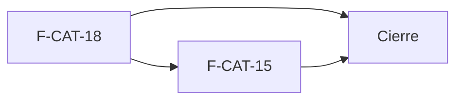

# Tasks: Catálogo · Catálogo variantes

**Input**: `specs/20270125-100000-catalogo-variantes/` (spec.md, plan.md, contracts/) · **Jira Epic**: MSF-229

**Formato**: `- [ ] T### [P] [F-CAT-xx][USy] descripción`. **[P]** = paralelizable (archivos distintos, sin dependencia; las [P] del mismo grupo van en paralelo); sin [P] = secuencial. Cada historia es autosuficiente: sus dependencias son solo internas y trae su propia migración. Regla del proyecto: ninguna tarea queda `[ ]` al cierre — se hace con evidencia o se cierra con `[x]` + `Desvío: <motivo>` (ver commit) y seguimiento trazado.

**Delivery scope**: `refine`, `supabase`

## Matriz de trazabilidad Jira ↔ US ↔ tasks

| Jira | Historia | Requisitos (dueño único) | Tasks |
|------|----------|--------------------------|-------|
| F-CAT-18 | US2 Productos relacionados | FR-013, FR-014, FR-015, FR-016, FR-017, FR-018, SC-003 | T001–T009 |
| F-CAT-15 | US1 Variantes (color, talle, modelo) | FR-001, FR-002, FR-003, FR-004, FR-005, FR-006, FR-007, FR-008, FR-009, FR-010, FR-011, FR-012, SC-001, SC-002, SC-004, SC-005 | T010–T026 |
| Tarea de cierre (label `cierre`) | Docs, seguridad, validación final, roadmap | FR-019, FR-020, SC-006 | T027–T030 |

## Phase 1: Productos relacionados (F-CAT-18 · refine + supabase)

- [ ] T001 [F-CAT-18][US2] Migración `20270125110000_catalogo_relacionados.sql` (reversión en el encabezado): tabla `dominio.producto_relacionados` (PK `(producto_id, relacionado_id)`, FK compuestas por organización a ambos extremos con `on delete cascade`, `check (producto_id <> relacionado_id)`, `orden`, índice), RLS (select `lectura`/`edicion` en `productos`; insert/update/delete `edicion`), grants mínimos y `anon` sin privilegios (FR-013)
- [ ] T002 [F-CAT-18][US2] En la misma migración: `public.guardar_relacionados(p_producto, p_relacionados)` según `contracts/relacionados.md` (reemplazo completo idempotente, orden = posición, errores `P0002`/`22023`/`42501`, evento `producto.relacionados_editados` solo con cambio real, `grant … authenticated` / `revoke … public, anon`) (FR-017)
- [ ] T003 [F-CAT-18][US2] En la misma migración: vista `public.v_producto_relacionados` (`security_invoker = true`, ordenada, con nombre/SKU/categoría/precio/moneda/activo, `revoke … public, anon`, `grant select … authenticated`) (FR-018)
- [ ] T004 [P] [F-CAT-18][US2] pgTAP `catalogo_relacionados.test.sql`: orden persistido y leído igual por la vista, autorrelación/duplicado/cruce de organización rechazados, aislamiento entre organizaciones, `anon` sin acceso, lectura sin escribir, cascada al borrar un producto; `rls_en_toda_tabla` verde (SC-003)
- [ ] T005 [P] [F-CAT-18][US2] `lib/productos-relacionados.ts`: tipos, consulta del buscador sobre `v_productos_listado` (nombre/SKU/categoría, tope 4, excluye propio y ya agregados) y payload de `guardar_relacionados` (apoya FR-015, FR-017)
- [ ] T006 [F-CAT-18][US2] Componente `BloqueRelacionados`: título, subtítulo, contador («0 productos» / «1 producto» / «N productos»), lista «En este producto (el orden es el que ve el cliente)» con numeración, ↑ ↓ ✕ (extremos atenuados), avisos «Agregado a relacionados: …» / «Quitado de relacionados» y estado vacío; solo lectura sin `edicion` en `productos` (FR-014, FR-016)
- [ ] T007 [F-CAT-18][US2] En `BloqueRelacionados`: buscador «Buscar por nombre, SKU o categoría», resultados con «Agregar» (nombre y «SKU · categoría · precio»), limpieza de la búsqueda al agregar, «Sin resultados. Probá con otro nombre, SKU o categoría.» y carga/error del kit (FR-015)
- [ ] T008 [F-CAT-18][US2] Integrar el bloque en `FormularioProducto`, `create.tsx` (guarda tras `crear_producto`, con aviso y reintento si falla) y `edit.tsx` (guarda con «Guardar cambios») (apoya FR-017)
- [ ] T009 [P] [F-CAT-18][US2] Vitest del bloque: vacío, buscar/agregar/quitar/reordenar, extremos atenuados, sin resultados, solo lectura, el cambio de empresa en la barra no altera el bloque (declaración «no aplica» de la matriz), accesible por teclado (apoya FR-014–FR-016)

**Checkpoint**: se pueden curar y reordenar relacionados y se leen por la vista; `pnpm lint`, `pnpm build`, `pnpm test` verdes.

## Phase 2: Variantes (F-CAT-15 · refine + supabase)

Bloques de trabajo: A datos y unicidad (T010–T012) · B stock y suma (T013–T016) · guardado y lectura (T017–T019) · C ficha (T020–T025) · D precio y verificación (T026).

- [ ] T010 [F-CAT-15][US1] Migración `20270125100000_catalogo_variantes_tablas.sql` (reversión en el encabezado): `dominio.producto_variantes` (nombre, código, código de barras opcional, `activa`, `orden`, FK compuesta a `productos`), RLS (select `lectura`/`edicion`; insert/update `edicion`; **sin DELETE**), grants por columna, `anon` sin privilegios (FR-001, FR-011)
- [ ] T011 [F-CAT-15][US1] En la misma migración: unicidad por organización de código y código de barras (entre variantes), `check` EAN-13 y disparador que impide choques con `productos.sku` y `productos.codigo_barras`, con mensajes que nombran el valor (FR-002)
- [ ] T012 [P] [F-CAT-15][US1] pgTAP `catalogo_variantes_datos.test.sql`: unicidad cruzada variante/variante y variante/producto, EAN-13, aislamiento entre organizaciones, `anon` sin acceso, sin DELETE; `rls_en_toda_tabla` verde (SC-002, SC-004)
- [ ] T013 [F-CAT-15][US1] Migración `20270125100100_catalogo_variantes_stock.sql` (reversión en el encabezado): `dominio.existencias_variante` (por variante y depósito, `cantidad >= 0`, FK compuestas, RLS por `nivel_seccion('stock')`, escribe solo la RPC) y `movimientos_stock.variante_id` nullable (apoya FR-005, FR-011)
- [ ] T014 [F-CAT-15][US1] Migración `20270125100200_catalogo_variantes_movimientos.sql`: `registrar_movimiento_stock` con `p_variante default null` (reemplaza la firma de 8 parámetros por la de 9, variante obligatoria con variantes y prohibida sin ellas, libro con `variante_id`, mismos eventos), `grant`/`revoke` reaplicados; revisar y probar los llamadores existentes (FR-007)
- [ ] T015 [F-CAT-15][US1] En la misma migración o la siguiente propia: cuerpo nuevo de `private.disponibilidad_producto`, `private.productos_con_stock`, `private.disponible_publico` (suma de variantes activas; sin variantes, igual que hoy; todas inactivas → Sin stock) (FR-006, FR-010)
- [ ] T016 [P] [F-CAT-15][US1] pgTAP `catalogo_variantes_stock.test.sql`: 3 variantes suman al producto, desactivar resta, movimiento con variante en el libro, firma nueva compatible con llamadores sin variante, listado/tienda coinciden con la suma (SC-001)
- [ ] T017 [F-CAT-15][US1] Migración `20270125100300_catalogo_variantes_rpc.sql`: `public.guardar_variantes_producto` según `contracts/variantes.md` (reemplazo idempotente, bloqueo optimista `40001`, ajuste de stock contado con `edicion` en `stock`, rechazo de la primera variante sobre producto con stock > 0, evento `producto.variantes_editadas`, `grant`/`revoke`) (FR-012, FR-008)
- [ ] T018 [F-CAT-15][US1] En la misma migración: vista `public.v_producto_variantes` (`security_invoker`, `stock` nulo sin acceso a Stock, sin precio ni costo, `producto_id` para que Precios resuelva por variante) (FR-009)
- [ ] T019 [P] [F-CAT-15][US1] pgTAP `catalogo_variantes_rpc.test.sql`: idempotencia, `40001`, evento sin costo solo con cambio real, permisos (stock/productos), primera variante con stock, `precio_para` se resuelve por `producto_id` sin cambios (apoya FR-008, FR-009, FR-012)
- [ ] T020 [P] [F-CAT-15][US1] `lib/productos-variantes.ts`: tipos, payload de `guardar_variantes_producto`, valores por defecto de «Agregar variante» (`Nueva variante`, `<SKU>-<n>`, `—`, stock 0, activa) y mapeo de `23505`/`22023`/`40001` a mensajes por campo (apoya FR-002, FR-003)
- [ ] T021 [F-CAT-15][US1] Componente `BloqueVariantes` con los componentes del kit: título «Variantes», subtítulo, tabla de cinco columnas (tarjetas en `xs`), botón «Agregar variante» con su aviso, celdas editables en línea (nombre, código, código de barras), interruptor «Activa» y texto de ayuda sin variantes; solo lectura sin `edicion` en `productos` (FR-003, FR-004)
- [ ] T022 [F-CAT-15][US1] En `BloqueVariantes`: columna «Stock» (stock inicial al agregar; stock contado editable en edición solo con `edicion` en `stock`; «—» sin acceso a Stock) y producto con variantes muestra el stock como suma de las activas (FR-005)
- [ ] T023 [F-CAT-15][US1] Integrar en `FormularioProducto`, `create.tsx` (tras `crear_producto`, con aviso y reintento) y `edit.tsx` (con el bloqueo optimista del producto); errores de unicidad en el campo conservando lo escrito (apoya FR-003)
- [ ] T024 [P] [F-CAT-15][US1] Vitest de `BloqueVariantes`: textos del prototipo, agregar/activar, errores por campo, permisos lectura/edición/sin Stock, estados de carga/vacío/error (apoya FR-003, FR-005)
- [ ] T025 [P] [F-CAT-15][US1] Vitest de regresión: producto sin variantes idéntico a antes en formulario, listado y disponibilidad; el cambio de empresa en la barra no altera el bloque (SC-005)
- [ ] T026 [F-CAT-15][US1] Verificación del bloque D: documentar en `docs/catalogo.md` que la variante hereda el precio del producto y que `precio_para` no cambia, y dejar el enlace para que Precios resuelva por `producto_id` (apoya FR-009)

**Checkpoint**: un producto con variantes suma su stock, rechaza códigos repetidos y se edita desde la ficha; `pnpm lint`, `pnpm build`, `pnpm test` verdes.

## Phase 3: Cierre (docs, seguridad, validación, roadmap)

- [ ] T027 [CIERRE] Documentación: `docs/catalogo.md` (variantes, relacionados, avisos de límites con ventas/ML/tienda), `docs/stock.md` (firma nueva y suma), `docs/actividad.md` (eventos nuevos), `AGENTS.md`/`CLAUDE.md` si aplica; `pnpm docs:check` verde (FR-019)
- [ ] T028 [CIERRE] Revisión de seguridad: RLS y permisos de las tres tablas, vistas `security_invoker`, `anon`, cambio de firma de `registrar_movimiento_stock` y sus llamadores, búsqueda de productos (fuga entre organizaciones) (FR-020)
- [ ] T029 [CIERRE] E2E del recorrido «variantes + relacionados + suma de stock» y validación final `pnpm lint`, `pnpm build`, `pnpm infra:config`, `pnpm test`, `pnpm docs:check`, `pnpm matriz:check` (SC-006)
- [ ] T030 [CIERRE] Actualizar la fila/sección de la épica en `docs/roadmap-template.md` (estado, link a la spec) como paso manual al mergear

## Plan de ejecución (historias)

| Historia | Depende de | Grupo |
|----------|------------|-------|
| F-CAT-18 | — | 1 |
| F-CAT-15 | F-CAT-18 | 2 |
| [Cierre] | F-CAT-18, F-CAT-15 | 3 |

Ambas historias editan `FormularioProducto`, `create.tsx` y `edit.tsx` (y el mismo `tasks.md`), por eso van en serie y no en paralelo; F-CAT-18 va primero porque solo necesita `productos`, es la más chica y deja el patrón de bloque que F-CAT-15 reutiliza. No comparten tablas ni migraciones.

