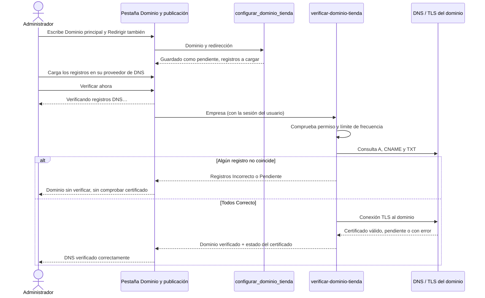
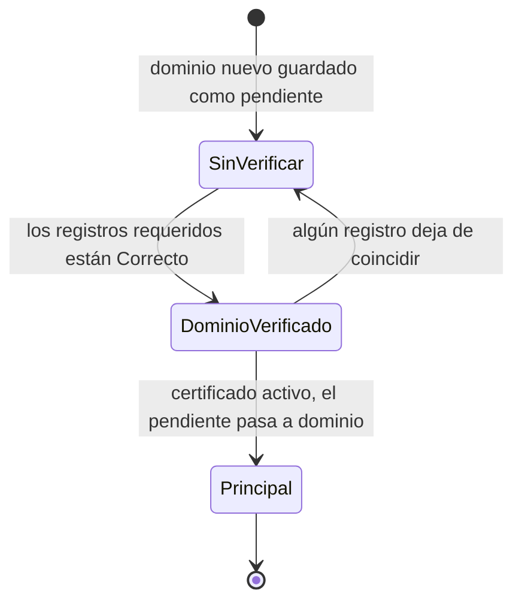
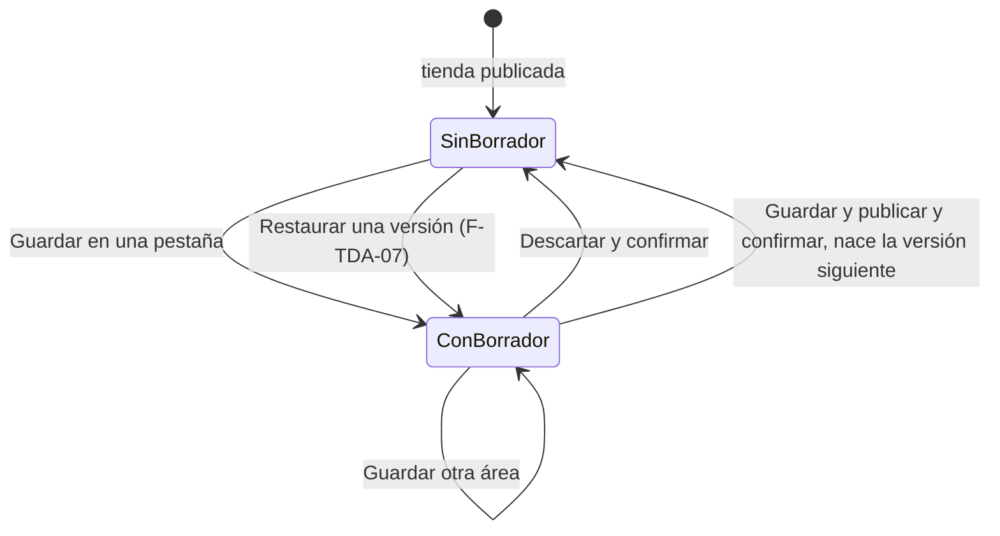
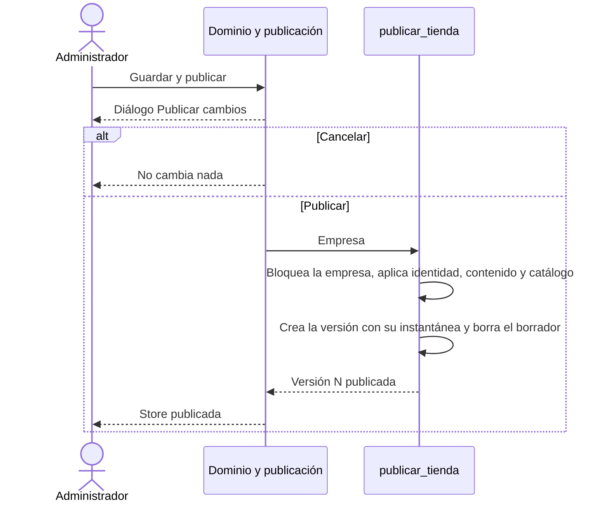
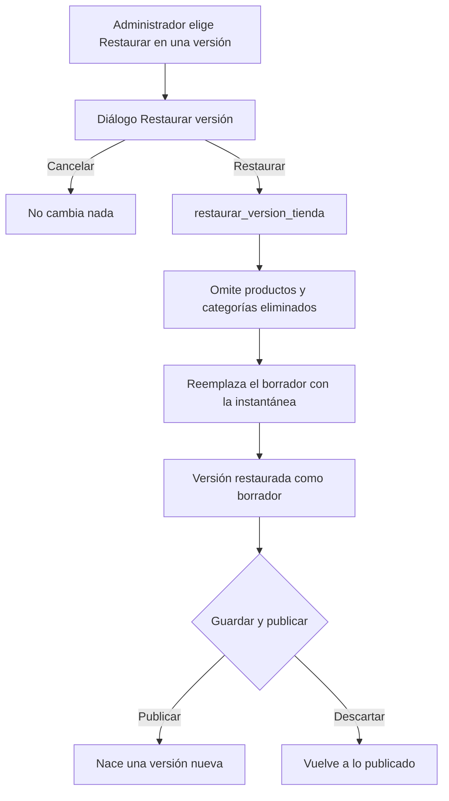
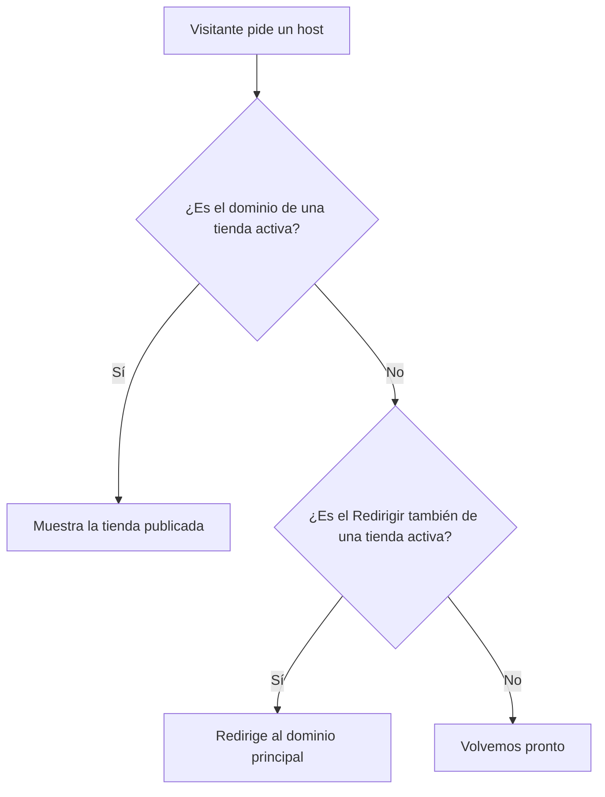

# Feature Specification: Tiendas online · Tienda dominio y publicación

**Feature Branch**: `epic/MSF-133-tiendas-online-tienda-dominio-y-publicac`

**Componente**: Tiendas online

**Jira Epic**: MSF-133 — Tiendas online · Tienda dominio y publicación (spec `tienda-dominio-y-publicacion`)

**Historias previstas**: F-TDA-05 (L), F-TDA-06 (L), F-TDA-07 (M), todas P1.

**Created**: 2026-11-01

**Status**: Draft — lista para planificar. Quedan decisiones de Nicolás en *Decisiones abiertas* (ninguna bloquea: se implementa el supuesto indicado).

**Delivery scope**: `refine` (`apps/web`: pestaña «Dominio y publicación», vista previa y ajustes a las tres pestañas existentes), `supabase` (migraciones, RPC, Edge Function `verificar-dominio-tienda`, pgTAP). Sin `kestra`, `superset` ni `workers`.

**Prioridad / Hito**: P1 · Etapa 2 (desde enero de 2027, después de rentabilidad completa y de Mercado Libre) · ~40 h · alcance etapa2.

**Input**: Epic MSF-133. Objetivo: «Al terminar, el administrador conecta y verifica el dominio de cada tienda por su cuenta, prepara cambios sin que se vean, los publica y puede volver a una versión anterior.»

## Regla de fuentes (literal de la épica)

1. Comportamiento y datos: mandan los requisitos y escenarios de esta historia.
2. Qué se ve (disposición, textos, estados, popups, flujos): el prototipo validado es referencia visual, no hace falta que quede extremadamente idéntico; los flujos (si hay) aclaran estados y acciones.
3. Cómo se construye (componentes, estilos y patrones): mandan el template y el system design del producto (épica Plataforma · Sistema de diseño). No copiar el HTML ni el CSS del prototipo: reproducir lo que muestra con los componentes del template y los tokens del sistema de diseño.
4. El prototipo muestra más que esta historia: implementar solo lo que piden los requisitos de esta historia; otras secciones, botones o diálogos son de otras historias.
5. Si algo no se puede igualar con el template / el sistema de diseño: usar lo más cercano, sin inventar, y anotar la diferencia en la descripción del PR.
6. Si el prototipo y los requisitos se contradicen: requisitos para el comportamiento, prototipo para lo visual, y dejar la contradicción anotada en el PR.

Prototipos (solo lectura, ya presentes en `design/pantallas/`): `StorePublicacion.dc.html` (Mundo JC) y `SJ_StorePublicacion.dc.html` (San Javucho), cada uno con su `.inventory.json` al día (`pnpm prototipo:check` pasa). Las dos variantes solo difieren en datos (nombre de la empresa, dominio y el botón «Cambiar a …»), no en estructura.

## Estado de partida (verificado en el repo)

La épica MSF-147 (tienda-dominio-e-identidad) **ya está en esta rama**. Los nombres de la épica se corresponden con los objetos reales así (no se renombra nada):

| Nombre en la épica MSF-133 | Objeto real en el repo |
|---|---|
| `dominios_tienda` | `dominio.tiendas` (`empresa_id` único, `dominio` único y normalizado; trigger que audita `tienda.dominio_configurado`) |
| `configuracion_tienda` | `dominio.tienda_identidad` + `dominio.tienda_contenido` |
| `categorias_tienda`, `productos_tienda` | `dominio.categorias_tienda`, `dominio.productos_tienda` |

Hoy: el dominio lo configura el equipo técnico por SQL (`docs/tiendas-online.md`); las RPC `public.guardar_tienda_identidad`, `public.guardar_tienda_contenido` y `public.guardar_catalogo_tienda` **aplican de inmediato** a la tienda pública; `publico.tienda_por_dominio(host)` resuelve por `dominio.tiendas.dominio`; la gestión vive en `apps/web/src/pages/empresas/tienda/` (pestañas por archivo en `pestanas/`, registradas en `pestanas.ts`) y el front público en `apps/web/src/pages/tienda-publica/`. No existe `openapi/` en el repo ni la función `verificar-dominio-tienda`.

## Dependencias

| Dependencia | Estado | ¿Bloquea? |
|---|---|---|
| MSF-147 · tienda-dominio-e-identidad (tablas, RPC y pestañas citadas arriba) | En la rama | Sí (base). |
| MSF-167 · tienda-catalogo-y-ficha, MSF-191 · tienda-inicio-busqueda-movil | En la rama | No (relacionadas): la vista previa muestra sus secciones públicas existentes. |
| MSF-149 · tienda-seo-legal-y-estados | Sin spec en la rama | No: esta épica agrega solo el «no indexar» de la vista previa (FR-070). |
| Registro de actividad (F-AUD-01) | Existe `private.registrar_actividad` | No: se usa el contrato de eventos de esta spec (FR-014, FR-064, FR-075). |
| Proveedor de alojamiento de la app pública (emite el SSL) | **A confirmar** | No: ver D1 y D2. |

Bloquea a: ninguna épica.

## Supuestos (de la épica)

- Hasta esta épica, el equipo técnico configura los dominios; desde ella, lo hace el administrador.
- El certificado SSL lo emite el proveedor de alojamiento de la aplicación pública (a confirmar). La aplicación **informa** su estado; no lo emite.
- El borrador cubre **identidad, contenido y catálogo visible**; **no cubre** precios, stock ni estado activo de los productos: esos se reflejan al instante en la tienda y en la vista previa.
- La gestión requiere **edición en la sección Empresas** (igual que MSF-147). Una sola tienda por empresa.

## Contradicciones prototipo ↔ épica (anotar en el PR)

1. **Estado de la tienda en la pantalla.** Los prototipos no dibujan estados negativos (dominio sin verificar, certificado pendiente, tienda desactivada). El comportamiento manda: se agregan con los mismos chips del prototipo en tono de aviso (FR-007, FR-016, FR-054).
2. **«Guardar y publicar» en las pestañas.** Los prototipos de Identidad, Contenido y Catálogo traen «Guardar y publicar» y «Hay cambios sin publicar». La épica pide *preparar cambios sin que se vean*: en esas pestañas el botón sigue siendo **«Guardar»** (MSF-147) y ahora guarda en el **borrador**; «Guardar y publicar» y «Descartar» (con sus diálogos) viven en la pestaña **Dominio y publicación**, como dibuja `StorePublicacion` (FR-053, FR-056, FR-057). Ver D3.
3. **«Ver cambios».** El prototipo dibuja el botón sin diálogo ni destino. Se resuelve como detalle desplegable de los cambios sin publicar (FR-055). Ver D4.

## Decisiones abiertas (no bloquean; se implementa el supuesto)

- **D1 · Proveedor y certificado**: falta confirmar quién emite el SSL y si hay que registrar cada dominio en el proveedor. Supuesto: el equipo técnico agrega el dominio en el proveedor (fuera de alcance: esta épica no llama a su API); la app comprueba el certificado con un intento de conexión TLS al dominio una vez que su DNS apunta a la plataforma (FR-012). Si el proveedor ofrece API de estado, se reemplaza esa única comprobación sin cambiar la pantalla.
- **D2 · DNS de las dos tiendas**: falta confirmar si los dominios de Mundo JC y San Javucho ya existen y quién controla su DNS. Supuesto: el seed usa dominios de prueba; el equipo técnico carga la IP, el destino CNAME y el prefijo TXT reales de cada entorno (FR-008).
- **D3 · Dónde se publica**: supuesto de la contradicción 2. Alternativa: «Guardar y publicar» también en cada pestaña (publicaría todo el borrador).
- **D4 · «Ver cambios»**: supuesto: lista desplegable por área (Identidad visual, Contenido, Catálogo visible) con los campos tocados, sin valores.
- **D5 · Dominio nuevo sin cortar el actual**: al cambiar el dominio principal, la tienda **sigue respondiendo en el dominio vigente** hasta que el nuevo quede verificado con certificado activo; recién ahí se intercambian (FR-003). Alternativa más simple: reemplazo inmediato (riesgo: un dominio mal escrito apaga la tienda).
- **D6 · Restaurar con borrador existente**: restaurar una versión **reemplaza** el borrador actual; el diálogo suma una línea de aviso solo si hay borrador (FR-072).
- **D7 · Límites técnicos** (la épica no los fija): «Verificar ahora» admite una comprobación cada 10 s por tienda; el listado de versiones devuelve las últimas 100; el texto del TXT usa el prefijo del prototipo `gc-verify=`. Valores ajustables en una constante/migración.

## Modelo y supuestos técnicos

- **Borrador único por empresa**, compartido por quienes tengan edición en Empresas; guarda por área (`identidad`, `contenido`, `catalogo`) el valor completo de esa área. Una área ausente del borrador = sin cambios. El **borrador y las versiones nunca se exponen a `anon`**: ninguna función de `publico` los lee y no hay privilegios para `anon` sobre las tablas.
- **Publicar** aplica el borrador a las tablas vivas en **una transacción**, crea una **versión** numerada con su instantánea y borra el borrador. Las RPC vivas `guardar_tienda_identidad|contenido` y `guardar_catalogo_tienda` dejan de ser llamables desde el navegador (`BREAKING`, ver contrato): solo `publicar` las ejecuta, para que **todo cambio visible pase por una versión**.
- **Archivos** (`tienda-identidad`): un archivo referenciado por el borrador o por alguna versión **no se borra**; la limpieza de huérfanos de MSF-147 pasa a considerar ambas referencias. Las rutas son no adivinables; el bucket sigue con lectura pública (ver riesgo en `plan.md`).
- **Vista previa**: ruta autenticada que reutiliza las secciones del front público alimentadas por el borrador sobre lo vivo; nunca lee `publico.*`.
- **Verificación DNS/certificado**: Edge Function `verificar-dominio-tienda` (consulta DNS y TLS) que escribe resultados con un RPC exclusivo de `service_role`; el navegador nunca recibe la service-role key.

## Esquema de datos (Constitución, Principio VII)

Cada objeto verificado por su naturaleza. Todas las migraciones son **aditivas**, con reversión documentada, y cada historia trae la suya.

| Objeto | Esquema | Historia | Naturaleza / justificación |
|---|---|---|---|
| `dominio.tiendas` — columnas nuevas: `dominio_redireccion`, `dominio_pendiente`, `token_verificacion`, `dominio_verificado_at`, `ultima_verificacion_at`, `certificado_estado`, `certificado_verificado_at` | `dominio` | F-TDA-05 | Alteración de una tabla de dominio del producto: el dominio de la tienda y su estado de conexión. |
| `dominio.tienda_registros_dns` (empresa_id, tipo, nombre, estado, valor_encontrado, comprobado_at) | `dominio` | F-TDA-05 | Resultado de la última comprobación de cada registro DNS de una tienda; dato de negocio de esa tienda. |
| `public.tienda_dns_plataforma` (fila única: `ip_publica`, `cname_destino`, `prefijo_txt`) | `public` | F-TDA-05 | **Configuración de plataforma/transversal** (a dónde debe apuntar cualquier tienda), no del producto en sí; sin secretos. Lectura `authenticated`; sin política de escritura (la carga el equipo técnico por migración/SQL). |
| `dominio.tienda_borrador` (empresa_id PK, `identidad`, `contenido`, `catalogo` jsonb, updated_by, updated_at) | `dominio` | F-TDA-06 | Cambios preparados de una tienda; entidad de negocio. |
| `dominio.tienda_versiones` (empresa_id, numero, publicada_at, publicada_por, resumen, cambios jsonb, instantanea jsonb) | `dominio` | F-TDA-06 | Historial de publicaciones de una tienda; entidad de negocio. Incluye la versión 1 «Configuración inicial» de las tiendas ya existentes. |
| `publico.redireccion_por_dominio(host)` | `publico` (**solo funciones, sin tablas**) | F-TDA-05 | Lectura anónima mínima para redirigir el dominio secundario al principal. |
| Edge Function `verificar-dominio-tienda` | `supabase/functions` | F-TDA-05 | Proceso con red (DNS/TLS) que no puede vivir en SQL. |

Todas las tablas con RLS por organización (`private.organizacion_id()`) **y** nivel `edicion`/`lectura` en la sección `empresas` (`private.nivel_seccion`); FK compuestas `(empresa_id, organizacion_id)` a `dominio.empresas`. **Sin políticas de escritura para `authenticated`** en ninguna: se escribe solo por RPC. `tienda_dns_plataforma` tiene RLS de solo lectura. El pgTAP de aislamiento recorre `public` + `dominio` y comprueba que `publico` sigue sin tablas.

**Reversión** (migraciones posteriores, solo mientras no haya datos productivos): F-TDA-07: `drop function` de `listar_versiones_tienda` y `restaurar_version_tienda`. F-TDA-06: reponer `execute` de las tres `guardar_*` a `authenticated` y borrar funciones nuevas; `drop table dominio.tienda_versiones, dominio.tienda_borrador`. F-TDA-05: `drop function` nuevas, `drop table dominio.tienda_registros_dns, public.tienda_dns_plataforma`, `alter table dominio.tiendas drop column …` (las columnas nuevas); retirar la función `verificar-dominio-tienda`.

## Navegación y patrones del panel (Principio VI)

- **Ubicación**: dentro de **Empresas › <empresa> › Tienda**, nueva pestaña «Dominio y publicación» (clave `publicacion`) después de «Catálogo visible». Ruta canónica `/empresas/:id/tienda/publicacion`; vista previa en `/empresas/:id/tienda/vista-previa`. Sin rutas anteriores que preservar.
- **Audiencia**: usuarios con **edición en Empresas** (igual que MSF-147). Sin edición: ni pestaña ni acceso por URL (patrón de acceso restringido existente).
- **Patrones**: carga, vacío, error y éxito del kit de panel; diálogos y avisos con los componentes compartidos; teclado, lector de pantalla y anchos de 320/768/1440 px; sin identificadores técnicos visibles (nunca UUID; se muestra el nombre de la empresa, el dominio y «Versión N»).
- **Carga diferida**: la pestaña y la vista previa se cargan con `lazy`; la tabla de versiones y la vista previa no entran al recorrido inicial de la gestión.

## User Scenarios & Testing *(mandatory)*

### US1 — Dominio, verificación DNS y certificado (F-TDA-05, P1)

El administrador abre «Dominio y publicación», ve a qué registros debe apuntar su dominio, los carga en su proveedor de DNS y pulsa «Verificar ahora».

1. **Given** una tienda con dominio, **When** abre la pestaña, **Then** ve «Dominio principal», «Redirigir también», el estado del dominio y del certificado, la última verificación y la tabla Tipo/Nombre/Valor/Estado con los registros a cargar.
2. **Given** los registros bien cargados, **When** pulsa «Verificar ahora», **Then** ve «Verificando registros DNS…», luego «DNS verificado correctamente», cada registro en «Correcto» y los avisos «Dominio verificado» y «Certificado SSL activo».
3. **Given** un registro faltante o con otro valor, **When** verifica, **Then** ese registro queda «Incorrecto» o «Pendiente», el dominio sigue sin verificar y ve el motivo; el certificado no se comprueba.
4. **Given** un dominio nuevo cargado, **When** aún no está verificado con certificado, **Then** la tienda sigue respondiendo en el dominio anterior; al verificarse, el nuevo pasa a ser el principal.
5. **Given** un dominio ya usado por otra tienda (o con formato inválido), **When** intenta guardarlo, **Then** ve un error en el campo y no se guarda nada.
6. **Given** «Redirigir también» configurado, **When** un visitante entra por ese dominio, **Then** se lo redirige al principal.
7. **Given** una empresa distinta, **When** cambia la empresa activa, **Then** la pantalla se reencuadra y no queda ningún dato de la anterior.

### US2 — Borrador, vista previa y publicación (F-TDA-06, P1)

1. **Given** las pestañas Identidad visual, Contenido o Catálogo visible, **When** guarda, **Then** el cambio queda en el **borrador** y la tienda pública **no cambia**.
2. **Given** un borrador, **When** abre «Dominio y publicación», **Then** ve «N cambios sin publicar: …», «Ver cambios», la vista previa con esos cambios y «Hay cambios sin publicar.» con «Descartar» y «Guardar y publicar».
3. **Given** el borrador, **When** pulsa «Guardar y publicar» y confirma «Publicar», **Then** la tienda muestra los cambios al instante, nace la versión siguiente y ve «Store publicada».
4. **Given** el borrador, **When** pulsa «Descartar» y confirma, **Then** se borra el borrador, las pestañas vuelven a lo publicado y ve «Cambios descartados».
5. **Given** un precio, un stock o el estado activo de un producto cambiado, **When** mira la vista previa y la tienda, **Then** ambos lo reflejan al instante, sin pasar por el borrador.
6. **Given** el acceso anónimo, **When** intenta leer el borrador, las versiones o la vista previa, **Then** el acceso es denegado y la vista previa lleva «no indexar».
7. **Given** nada para publicar, **When** mira la pestaña, **Then** «Descartar» y «Guardar y publicar» están deshabilitados y no hay aviso de cambios.

### US3 — Versiones y restauración (F-TDA-07, P1)

1. **Given** varias publicaciones, **When** abre la pestaña, **Then** ve la tabla de versiones (Versión, Fecha, Por, Cambios) de la más nueva a la más vieja, con «Restaurar» en todas menos en la vigente.
2. **Given** una versión anterior, **When** pulsa «Restaurar» y confirma, **Then** su contenido se carga como **borrador**, nada se publica y ve «Versión restaurada como borrador».
3. **Given** el borrador restaurado, **When** lo publica, **Then** nace una versión nueva (el historial no se reescribe).
4. **Given** una versión que referencia un producto o categoría ya eliminado, **When** restaura, **Then** ese elemento se omite y el resto se carga.
5. **Given** dos empresas, **When** una publica o restaura, **Then** la otra no cambia.

### Casos borde

- Verificar dos veces seguidas: la segunda dentro de los 10 s se rechaza con aviso, sin consultar DNS (D7).
- Falla de red o DNS caído durante la verificación: se informa «No se pudo verificar ahora, probá de nuevo» y no se cambia ningún estado guardado.
- Dos administradores guardan áreas distintas del borrador: ambas quedan; en la misma área gana el último guardado.
- Publicar sin borrador: no crea versión (idempotente).
- Publicar mientras otro publica: la segunda espera el bloqueo de la empresa y, al encontrar el borrador ya aplicado, no crea versión.
- Archivo del borrador subido y borrador descartado: el archivo queda sin referencia y se limpia en el siguiente reemplazo, nunca si lo referencia una versión.
- Tienda desactivada (F-EMP-04): puede prepararse y publicarse, pero el estado muestra «Fuera de línea» y los visitantes siguen viendo «Volvemos pronto».

## Requirements *(mandatory)*

### F-TDA-05 — Dominio, verificación DNS y certificado

- **FR-001**: Pestaña «Dominio y publicación» (clave `publicacion`) en la gestión de la tienda, solo con edición en Empresas, con la sección «Dominio» y los campos «Dominio principal» y «Redirigir también».
- **FR-002**: `public.configurar_dominio_tienda(empresa, dominio, redireccion)` (authenticated, edición en Empresas, `revoke … from public, anon`) valida formato, normaliza (minúsculas, sin puerto ni punto final) y exige **unicidad a nivel plataforma** entre dominios principales, pendientes y de redirección de todas las tiendas; «Redirigir también» es opcional y distinto del principal. Error por campo; si falla no se guarda nada.
- **FR-003**: Un dominio principal nuevo se guarda como **pendiente** (`dominio_pendiente`) y se resetea su verificación; la tienda sigue resolviendo por el dominio vigente. Cuando el pendiente queda verificado **y** con certificado activo, pasa a ser `dominio` (D5). La primera carga del equipo técnico (SQL) sigue siendo válida.
- **FR-004**: Tabla de registros (Tipo, Nombre, Valor, Estado) calculada en el servidor: **A** `@` → IP pública de la plataforma, **CNAME** del dominio de redirección → destino de la plataforma (solo si hay «Redirigir también») y **TXT** `_verif` → `<prefijo>=<token>` con token propio de la tienda. Los valores vienen de `public.tienda_dns_plataforma` y del token; nunca se escriben a mano en el front.
- **FR-005**: Estado por registro: «Correcto», «Incorrecto» (existe con otro valor) o «Pendiente» (sin comprobar o inexistente), con el valor encontrado como ayuda cuando es incorrecto.
- **FR-006**: Botón «Verificar ahora» que invoca la Edge Function `verificar-dominio-tienda`; mientras corre se muestra «Verificando registros DNS…» (rol alerta, botón deshabilitado) y al terminar el aviso «DNS verificado correctamente» o el error correspondiente.
- **FR-007**: Avisos de estado: «Dominio verificado» / «Dominio sin verificar» y «Certificado SSL activo» / «Certificado pendiente» / «Certificado con error», más «Última verificación hace N h» (relativa; «Nunca verificado» si no hay).
- **FR-008**: `public.tienda_dns_plataforma` (fila única) guarda IP, destino CNAME y prefijo TXT por entorno, con RLS de solo lectura para `authenticated`; el seed de desarrollo usa valores de documentación y el equipo técnico carga los reales (D2). Documentado en `docs/tiendas-online.md`.
- **FR-009**: La Edge Function autentica al usuario con su JWT, comprueba edición en Empresas y pertenencia de la empresa a su organización (`public.preparar_verificacion_tienda`), consulta DNS **solo** de los hostnames guardados de esa tienda, y escribe resultados con `public.registrar_verificacion_dns`, ejecutable **solo por `service_role`**. Sin service-role key en el navegador.
- **FR-010**: Límite de frecuencia: una verificación cada 10 s por tienda (D7); la excedida responde sin consultar DNS.
- **FR-011**: Dominio verificado = los tres registros requeridos «Correctos» (el CNAME solo cuenta si hay redirección). Se guarda `dominio_verificado_at` y `ultima_verificacion_at`.
- **FR-012**: Certificado: solo con dominio verificado y el A apuntando a la plataforma, la función intenta una conexión TLS al dominio y valida el certificado; válido = «activo», si no «pendiente» (aún no emitido) o «error» (inválido/vencido). Nunca conecta a un host cuyo DNS no apunte a la plataforma (evita SSRF). Es reemplazable por el estado del proveedor (D1).
- **FR-013**: `publico.redireccion_por_dominio(host)` (anon) devuelve el dominio principal si `host` es el «Redirigir también» de una tienda activa, y vacío en cualquier otro caso (misma respuesta para desconocido y desactivada). El front público redirige (HTTP 301 / `location.replace`) al principal antes de resolver la tienda.
- **FR-014**: Auditoría: `tienda.dominio_configurado` (ya existente por trigger, también al guardar el pendiente) y `tienda.dominio_verificado` (actor, empresa, resultado) en el registro de actividad. Payload sin valores de registros.
- **FR-015**: Pantalla de solo lectura de estado cuando la empresa no tiene tienda/dominio: estado vacío «Esta empresa todavía no tiene dominio» con el campo «Dominio principal» para cargarlo (crea la fila de `dominio.tiendas` por la RPC de FR-002).
- **FR-016**: Estados sin prototipo (contradicción 1): chips de aviso para «Dominio sin verificar», «Certificado pendiente/con error» y tabla con «Pendiente/Incorrecto», con los mismos componentes del kit.
- **FR-017**: Accesibilidad y responsividad (teclado, lector de pantalla, 320/768/1440 px) y estados de carga/vacío/error del kit.
- **FR-018**: Principio VIII — la sección opera sobre la empresa activa de la barra superior; al cambiar se invalidan y recargan todas las consultas y se descartan los cambios sin guardar con aviso (hereda `GestionTienda`).

### F-TDA-06 — Borrador, vista previa y publicación

- **FR-050**: `dominio.tienda_borrador` y `public.guardar_borrador_tienda(empresa, area, datos)` (authenticated, edición en Empresas, `revoke … from public, anon`): guarda el valor completo de un área (`identidad`, `contenido`, `catalogo`), validado con **las mismas reglas** que hoy aplican las RPC vivas (colores, tipografías, longitudes, destino cerrado, visibilidad). Un valor inválido no se guarda.
- **FR-051**: Las pestañas Identidad visual, Contenido y Catálogo visible cargan sus valores iniciales desde el borrador si existe para esa área (si no, desde lo publicado; el catálogo vía `public.listar_catalogo_tienda`, que superpone el borrador) y su «Guardar» llama a `guardar_borrador_tienda`; su «Descartar» sigue restaurando el último valor guardado (borrador o publicado) del formulario.
- **FR-052**: Las RPC `public.guardar_tienda_identidad`, `public.guardar_tienda_contenido` y `public.guardar_catalogo_tienda` dejan de ser ejecutables por `authenticated` (`BREAKING`, contrato); solo `public.publicar_tienda` las ejecuta, en una transacción.
- **FR-053**: Sección «Publicación» con «Estado: publicada» / «Estado: fuera de línea» (según empresa activa), «Versión N · publicada el dd/mm/aaaa hh:mm por <nombre>», chip «En línea» / «Fuera de línea», y —si hay borrador— el aviso «N cambios sin publicar: <resumen>.» con «Ver cambios». El resumen y el conteo se calculan en el servidor por campos/áreas tocadas (p. ej. «colores, texto del banner y 2 productos visibles»).
- **FR-054**: Estados sin prototipo: «Fuera de línea» (empresa desactivada) y ausencia de borrador (sin aviso, «Descartar» y «Guardar y publicar» deshabilitados).
- **FR-055**: «Ver cambios» despliega el detalle por área con los campos tocados, sin mostrar valores (D4).
- **FR-056**: «Guardar y publicar» abre el diálogo **«Publicar cambios»** («Los cambios se ven de inmediato en <dominio>. Podés volver a la versión anterior desde Dominio y publicación.», Cancelar / Publicar). «Publicar» ejecuta `public.publicar_tienda(empresa)`: bloquea la empresa, aplica cada área del borrador, crea la versión siguiente con su instantánea y resumen, borra el borrador, muestra «Store publicada». Sin borrador no hace nada (idempotente, sin versión nueva).
- **FR-057**: «Descartar» abre el diálogo **«Descartar cambios»** («Se pierden los cambios sin publicar de esta store.», Cancelar / Descartar). «Descartar» ejecuta `public.descartar_borrador_tienda(empresa)`, recarga las pestañas con lo publicado y muestra «Cambios descartados».
- **FR-058**: `dominio.tienda_versiones` registra cada publicación: número correlativo por empresa, fecha, autor, resumen («Cambios») e instantánea de **identidad, contenido y catálogo visible/destacado** (no precios, stock ni activo). Las tiendas ya existentes reciben una versión 1 «Configuración inicial» con su estado actual (migración aditiva).
- **FR-059**: Tarjeta «Vista previa» (banner, logo y tres productos de ejemplo) alimentada por `public.vista_previa_tienda(empresa)`: borrador superpuesto a lo publicado, con precios, stock y estado activo reales; texto «Se actualiza con los cambios sin publicar.». Nunca escribe y nunca devuelve costos, stock exacto ni proveedor.
- **FR-060**: Ruta `/empresas/:id/tienda/vista-previa` (autenticada, edición en Empresas) que renderiza la home pública con las mismas secciones del front público alimentadas por la vista previa, para ver el borrador completo antes de publicar. Navegar a catálogo, ficha y búsqueda dentro de la vista previa queda fuera de alcance (ver *Fuera de alcance*).
- **FR-061**: El borrador y las versiones **no son visibles para `anon`**: ninguna función de `publico` los lee, sin privilegios de tabla; los archivos referenciados solo por el borrador no se publican hasta publicar.
- **FR-062**: No se borran archivos de `tienda-identidad` referenciados por el borrador o por alguna versión.
- **FR-063**: Precios, stock y estado activo de los productos no pasan por el borrador: se reflejan al instante en la tienda y en la vista previa.
- **FR-064**: Auditoría: `tienda.publicada` (versión, áreas, actor) y `tienda.borrador_descartado` en el registro de actividad; nombres de campos, no valores.
- **FR-065**: Principio VIII — los diálogos «Publicar cambios» y «Descartar cambios» se cierran con aviso al cambiar de empresa; jamás aplican datos cargados de la anterior.
- **FR-066**: Accesibilidad y responsividad (teclado, lector de pantalla, 320/768/1440 px; diálogos con foco atrapado y `aria-modal`) y estados de carga/vacío/error del kit.
- **FR-070**: La vista previa (ruta y respuestas) lleva «no indexar» (`<meta name="robots" content="noindex,nofollow">`); el borrador no tiene URL pública.

### F-TDA-07 — Versiones y restauración

- **FR-071**: Sección «Versiones» con la tabla Versión, Fecha, Por, Cambios de `public.listar_versiones_tienda(empresa)` (últimas 100, más nueva primero); «Restaurar» en todas las filas menos la vigente; «Por» muestra el nombre, no un identificador.
- **FR-072**: «Restaurar» abre el diálogo **«Restaurar versión»** («La versión elegida se carga como borrador. No se publica hasta que la confirmes.», Cancelar / Restaurar); si ya hay un borrador, suma una línea que avisa que lo reemplaza (D6).
- **FR-073**: `public.restaurar_version_tienda(empresa, numero)` (authenticated, edición en Empresas, `revoke … from public, anon`) **reemplaza el borrador** con la instantánea de esa versión, omitiendo productos y categorías que ya no existen; no publica. Muestra «Versión restaurada como borrador» y deja a la vista «N cambios sin publicar».
- **FR-074**: Publicar el borrador restaurado crea una versión **nueva**; el historial nunca se reescribe ni se borra.
- **FR-075**: Auditoría: `tienda.version_restaurada` (versión origen, actor).
- **FR-076**: Principio VIII — el diálogo «Restaurar versión» se cierra con aviso al cambiar de empresa; la tabla muestra solo versiones de la empresa activa.
- **FR-077**: Accesibilidad y responsividad de la sección (teclado, lector de pantalla, tabla adaptable a 320 px) y estados de carga/vacío/error del kit.

### Transversales verificados en el cierre

- pgTAP: aislamiento entre dos organizaciones y acceso anónimo sin borrador ni versiones — SC-001, SC-002.
- E2E Playwright con dos empresas: alta de dominio, verificación, publicación y restauración — SC-003.

## Matriz pantalla↔criterios

Ítems tomados de `design/pantallas/StorePublicacion.inventory.json` y `SJ_StorePublicacion.inventory.json` (idénticos en estructura; solo cambian datos y el nombre en «Cambiar a …»), más los textos visibles que el inventario no lista.

### Inventario (generado por `pnpm prototipo:inventario`)

| Ítem del inventario | Dueño | Criterio / nota |
|---|---|---|
| Tabla «Tipo · Nombre · Valor · Estado» | F-TDA-05 | FR-004, FR-005. |
| Tabla «Versión · Fecha · Por · Cambios · (acciones)» | F-TDA-07 | FR-071. |
| Campo «Dominio principal» | F-TDA-05 | FR-001, FR-002, FR-003. |
| Campo «Redirigir también» | F-TDA-05 | FR-001, FR-002, FR-013. |
| Botón «Empresas» (migas) | MSF-147 · F-TDA-01 | Ya existe (`EncabezadoTienda`); no se toca. |
| Botón «Cambiar a San Javucho ↔» / «Cambiar a Mundo JC ↔» | MSF-147 · F-TDA-01 | Ya existe; FR-018 y FR-065/FR-076 fijan qué pasa con los diálogos al cambiar. |
| Botón «Ver tienda» | MSF-147 · F-TDA-01 | Ya existe (abre el dominio **vigente**, FR-003). |
| Pestañas «Identidad visual», «Contenido», «Catálogo visible» | MSF-147 | Ya existen; F-TDA-06 ajusta su guardado (FR-051). |
| Pestaña «Dominio y publicación» | F-TDA-05 | FR-001 (la contenedora); sus secciones: F-TDA-05, 06, 07. |
| Pestañas «General», «Precios y moneda», «Mercado Libre» | **Fuera de alcance** | General es F-EMP-04; Precios y Mercado Libre son de otras épicas; no se dibujan (igual que MSF-147). |
| Botón «Verificar ahora» | F-TDA-05 | FR-006, FR-010. |
| Botón «Ver cambios» | F-TDA-06 | FR-053, FR-055 (contradicción 3, D4). |
| Botón «Restaurar» (por fila) | F-TDA-07 | FR-071, FR-072. |
| Botón «Descartar» | F-TDA-06 | FR-057. |
| Botón «Guardar y publicar» | F-TDA-06 | FR-056 (contradicción 2, D3). |
| Diálogo «Publicar cambios» (Cancelar / Publicar) | F-TDA-06 | FR-056. |
| Diálogo «Descartar cambios» (Cancelar / Descartar) | F-TDA-06 | FR-057. |
| Diálogo «Restaurar versión» (Cancelar / Restaurar) | F-TDA-07 | FR-072, FR-073. |

### Textos y estados visibles que el inventario no lista

| Ítem | Dueño | Criterio / nota |
|---|---|---|
| Sección «Dominio»; avisos «Dominio verificado», «Certificado SSL activo», «Última verificación hace 6 h» | F-TDA-05 | FR-007; estados negativos sin prototipo: FR-016. |
| Aviso «Verificando registros DNS…» y mensaje «DNS verificado correctamente» | F-TDA-05 | FR-006. |
| Estados de fila «Correcto» (y «Incorrecto»/«Pendiente») | F-TDA-05 | FR-005, FR-016. |
| Sección «Publicación»: «Estado: publicada», «Versión 14 · publicada el … por …», chip «En línea» | F-TDA-06 | FR-053, FR-054. |
| Aviso «3 cambios sin publicar: colores, texto del banner y 2 productos visibles.» | F-TDA-06 | FR-053. |
| Tarjeta «Vista previa» (banner, logo, tres productos, «Se actualiza con los cambios sin publicar.») | F-TDA-06 | FR-059, FR-060, FR-070. |
| Tarjeta «Publicación» con «Hay cambios sin publicar.», «Descartar», «Guardar y publicar» | F-TDA-06 | FR-056, FR-057, FR-054. |
| Mensajes «Store publicada», «Cambios descartados» | F-TDA-06 | FR-056, FR-057. |
| Sección «Versiones» y mensaje «Versión restaurada como borrador» | F-TDA-07 | FR-071, FR-073. |
| **Empresa activa** | F-TDA-05, 06, 07 | FR-018, FR-065, FR-076: opera sobre la empresa activa de la barra superior en modo una empresa; «Todas mis empresas» **no aplica** (la tienda es de una sola empresa; sin empresa concreta se pide elegir una). Test de cambio de empresa con diálogo abierto en SC-006. |

### Fuera de alcance explícito (notas, no tareas)

- Pestañas General, Precios y moneda y Mercado Libre (otras épicas).
- Registrar el dominio en el proveedor de alojamiento o emitir el certificado (D1).
- Reverificación periódica automática del DNS: la épica pide verificar «por su cuenta», con «Verificar ahora».
- Navegar catálogo, ficha y búsqueda dentro de la vista previa (MSF-167/191 deberán ofrecer sus secciones sobre la misma fuente de datos).
- Comparación de valores antes/después en «Ver cambios», paginación de versiones y borrado de versiones.
- Editar precios, stock o estado activo con borrador (FR-063).

## Fuera de alcance

- Todo lo listado en la matriz como fuera de alcance.
- SEO, robots y sitemaps de la tienda pública (MSF-149); aquí solo el «no indexar» de la vista previa.
- Colaboración simultánea en tiempo real sobre el borrador (gana el último guardado por área).

## Flujos

La épica no trae diagramas; se transcriben los flujos del prototipo y de las historias sin agregar estados ni transiciones fuera de lo pedido.

### Verificación del dominio y certificado (F-TDA-05 · FR-002…FR-014)

### Estado del dominio (F-TDA-05 · FR-003, FR-011, FR-012)

### Borrador y publicación (F-TDA-06 · FR-050…FR-064)

### Restaurar una versión (F-TDA-07 · FR-071…FR-075)

### Qué ve el visitante según el host (F-TDA-05 · FR-013)

## Success Criteria *(mandatory)*

- **SC-001**: pgTAP de aislamiento entre dos organizaciones: una no lee ni escribe dominio, registros DNS, borrador ni versiones de la otra; `rls_en_toda_tabla` pasa con las tablas nuevas (FR-002, FR-050, FR-058).
- **SC-002**: pgTAP de acceso anónimo: `anon` no ve ni ejecuta nada del borrador, las versiones ni las RPC nuevas; solo `publico.redireccion_por_dominio` es ejecutable; `publico` sigue sin tablas; `registrar_verificacion_dns` solo la ejecuta `service_role` (FR-009, FR-013, FR-061).
- **SC-003**: E2E con dos empresas: alta de dominio, verificación (DNS simulado), publicación y restauración; los cambios de una no tocan la otra (FR-002, FR-006, FR-056, FR-073).
- **SC-004**: Un dominio duplicado o inválido se rechaza con error por campo y la tienda sigue respondiendo en el vigente hasta verificar el nuevo (FR-002, FR-003).
- **SC-005**: La Edge Function verifica A/CNAME/TXT, no comprueba el certificado con DNS incorrecto, respeta el límite de frecuencia y rechaza usuarios sin permiso (FR-006, FR-009…FR-012).
- **SC-006**: Cambiar de empresa en la pestaña recarga todo y cierra los diálogos con aviso, sin datos de la anterior (FR-018, FR-065, FR-076).
- **SC-007**: Guardar en una pestaña no modifica la tienda pública; publicar la modifica al instante en una transacción y crea la versión; sin borrador no crea versión (FR-050…FR-052, FR-056, FR-058).
- **SC-008**: Lint, build, `pnpm infra:config`, `pnpm test`, `pnpm prototipo:check`, `pnpm matriz:check` y `pnpm docs:check` pasan.
- **SC-009**: Documentación al día (`docs/tiendas-online.md` con dominio, borrador, versiones y operación DNS; enlace desde `docs/empresas.md`; nota de contradicciones para el PR) y `pnpm docs:check` pasa.
- **SC-010**: La fila de la épica en `docs/roadmap-template.md` refleja estado y link a esta spec al cerrar el PR (paso manual del cierre).
- **SC-011**: Dominio: tabla de registros, avisos, «Verificar ahora» con su estado de progreso, redirección y estados vacíos/error se comportan como piden FR-001…FR-018 (Vitest + axe a 320/768/1440 px).
- **SC-012**: Publicación: aviso de cambios con resumen, «Ver cambios», vista previa con borrador sobre lo vivo, diálogos Publicar/Descartar y estados «Fuera de línea»/sin borrador (FR-053…FR-066, FR-070).
- **SC-013**: Versiones: tabla sin «Restaurar» en la vigente, diálogo con y sin aviso de reemplazo, restauración que omite elementos eliminados y publicación posterior que crea versión nueva (FR-071…FR-077).
- **SC-014**: La vista previa lleva «no indexar» y ni ella ni el borrador son accesibles sin sesión (FR-061, FR-070).

## Verificación por requisito

«Impl.» es la tarea dueña que lo construye (dueño único); «Verifica» son las pruebas que lo ejercitan. Los números de tarea están en `tasks.md`.

| Requisito | Impl. | Verifica (test / SC) |
|---|---|---|
| FR-001, FR-017 | T005 | Vitest T008 · SC-011 |
| FR-002, FR-008, FR-015 | T001 | pgTAP T004 · SC-001, SC-004 |
| FR-003, FR-013 | T002 | pgTAP T004 · Vitest T008 · SC-002, SC-004 |
| FR-004, FR-005, FR-014 | T003 | pgTAP T004 · Vitest T008 |
| FR-006, FR-009, FR-010, FR-011, FR-012 | T006 | Deno test T007 · pgTAP T004 · SC-005 |
| FR-007, FR-016, FR-018 | T005 | Vitest T008 · SC-006, SC-011 |
| FR-058 | T009 | pgTAP T016 (versión 1 de las tiendas existentes) |
| FR-050, FR-061 | T010 | pgTAP T016 · SC-001, SC-002 |
| FR-052, FR-056, FR-062, FR-063, FR-064 | T011 | pgTAP T016 · SC-007 |
| FR-059, FR-060, FR-070 | T012 | pgTAP T016 (sin costos) · Vitest T017 · SC-014 |
| FR-053, FR-054, FR-055, FR-066 | T013 | Vitest + axe T017 · SC-012 |
| FR-051 | T014 | Vitest T017 · SC-007 |
| FR-057, FR-065 | T015 | Vitest T017 · SC-006, SC-012 |
| FR-073, FR-074, FR-075 | T019 | pgTAP T022 · SC-013 |
| FR-071, FR-077 | T020 | Vitest T023 · SC-013 |
| FR-072, FR-076 | T021 | Vitest T023 · SC-006, SC-013 |
| SC-001, SC-002, SC-004 | T004 | pgTAP `tienda_dominio_verificacion.test.sql` (se amplían en T016 y T022 para borrador y versiones) |
| SC-005 | T007 | Deno test de la Edge Function |
| SC-006 | T008 | Vitest (cambio de empresa con diálogo abierto; T017 y T023 repiten por pestaña/sección) |
| SC-007 | T016 | pgTAP `tienda_borrador.test.sql` |
| SC-003 | T024 | E2E Playwright con dos empresas |
| SC-008 | T028 | Comandos de validación del repo |
| SC-009 | T026 | `pnpm docs:check` + `grep -q tiendas-online docs/empresas.md` |
| SC-010 | T027 | `grep` de la clave de la spec y su link en `docs/roadmap-template.md` |
| SC-011 | T008 | Vitest + axe |
| SC-012 | T017 | Vitest |
| SC-013 | T023 | Vitest |
| SC-014 | T017 | Vitest + pgTAP T016 |
