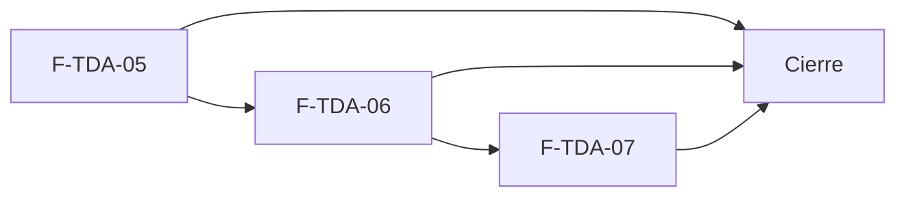

# Tasks: Tiendas online · Tienda dominio y publicación

**Input**: `specs/20270125-100000-tienda-dominio-y-publicacion/` (spec.md, plan.md, contracts/)

**Formato**: `- [ ] T### [P] [F-TDA-0x][USy] descripción`. **[P]** = paralelizable (archivos distintos, sin dependencia; las [P] del mismo grupo van en paralelo); sin [P] = secuencial. Las dependencias de cada tarea son solo dentro de su historia. Ninguna tarea `[ ]` queda abierta al cierre: se hace con evidencia o se cierra con `Desvío: <motivo>` y seguimiento trazado.

**Delivery scope**: `refine`, `supabase` (migraciones, RPC, Edge Function, pgTAP)

**Base**: MSF-147 ya está en la rama. Cada historia trae **su propia migración** aditiva con timestamp propio; las funciones PL/pgSQL referencian tablas de otras historias en tiempo de ejecución (sin dependencia al crear), el orden entre historias lo fija el *Plan de ejecución*.

## Matriz de trazabilidad Jira ↔ US ↔ tasks

| Jira | Historia | FR / SC (dueño único) | Tasks |
|------|----------|-----------------------|-------|
| F-TDA-05 (clave Jira de la historia: la asigna el orquestador) | US1 Dominio, verificación DNS y certificado | FR-001…FR-018, SC-001, SC-002, SC-004, SC-005, SC-006, SC-011 | T001–T008 |
| F-TDA-06 | US2 Borrador, vista previa y publicación | FR-050…FR-066, FR-070, SC-007, SC-012, SC-014 | T009–T017 |
| F-TDA-07 | US3 Versiones y restauración | FR-071…FR-077, SC-013 | T018–T023 |
| Tarea de cierre (label cierre) | Integración, seguridad, docs y roadmap | SC-003, SC-008, SC-009, SC-010 | T024–T028 |

### Dueño único por requisito

| Requisito | Tarea dueña | | Requisito | Tarea dueña |
|---|---|---|---|---|
| FR-002, FR-008, FR-015 | T001 | | FR-053, FR-054, FR-055, FR-066 | T013 |
| FR-003, FR-013 | T002 | | FR-051 | T014 |
| FR-004, FR-005, FR-014 | T003 | | FR-057, FR-065 | T015 |
| FR-001, FR-017 (pestaña) | T005 | | FR-073, FR-074, FR-075 | T019 |
| FR-007, FR-016, FR-018 | T005 | | FR-071, FR-077 | T020 |
| FR-006, FR-009, FR-010, FR-011, FR-012 | T006 | | FR-072, FR-076 | T021 |
| FR-058 | T009 | | SC-001, SC-002, SC-004 | T004 |
| FR-050, FR-061 | T010 | | SC-005 | T007 |
| FR-052, FR-056, FR-062, FR-063, FR-064 | T011 | | SC-006, SC-011 | T008 |
| FR-059, FR-060, FR-070 | T012 | | SC-007 | T016 |
| SC-012, SC-014 | T017 | | SC-013 | T023 |
| SC-003 | T024 | | SC-008, SC-009, SC-010 | T028, T026, T027 |

Toda tarea declara los requisitos que implementa (**FR/SC**) o verifica (**Verifica**). La verificación de cada FR está en la tabla «Verificación por requisito» de la spec.

---

## Fase 1 — F-TDA-05 · Dominio, verificación DNS y certificado (US1)

**Esquemas (Principio VII, re-verificado)**: `dominio.tiendas` (columnas nuevas) y `dominio.tienda_registros_dns` → `dominio`; `public.tienda_dns_plataforma` → `public` (configuración de plataforma); `publico.redireccion_por_dominio` → `publico` (solo funciones). Migración propia: `supabase/migrations/20270125100000_tienda_dominio_verificacion.sql`.

- [ ] T001 [F-TDA-05][US1] Migración `20270125100000_tienda_dominio_verificacion.sql`: columnas nuevas de `dominio.tiendas`; `dominio.tienda_registros_dns` y `public.tienda_dns_plataforma` (fila única + seed de documentación) con RLS y FK compuesta; `public.configurar_dominio_tienda(empresa, dominio, redireccion)` con normalización, unicidad entre principales/pendientes/redirecciones y creación de la tienda si no existe; `revoke … from public, anon`, `grant … to authenticated`. Reversión comentada en el encabezado. **FR-002, FR-008, FR-015**.
- [ ] T002 [F-TDA-05][US1] Misma migración (secuencial tras T001): `private.promover_dominio_pendiente(empresa)` (el pendiente pasa a `dominio` solo si está verificado con certificado activo; la tienda resuelve por el vigente mientras tanto) y `publico.redireccion_por_dominio(host)` (`anon`, misma respuesta para desconocido y desactivada). **FR-003, FR-013**.
- [ ] T003 [F-TDA-05][US1] Misma migración (secuencial tras T002): `public.obtener_dominio_tienda(empresa)` que devuelve dominio vigente/pendiente, redirección, avisos de dominio y certificado, última verificación y la tabla Tipo/Nombre/Valor/Estado calculada con `tienda_dns_plataforma` + token; evento `tienda.dominio_verificado` y payload mínimo. **FR-004, FR-005, FR-014**.
- [ ] T004 [F-TDA-05][US1] pgTAP `supabase/tests/database/tienda_dominio_verificacion.test.sql`: aislamiento entre dos organizaciones; unicidad y normalización; dominio pendiente sin cortar el vigente; `anon` solo ejecuta `publico.redireccion_por_dominio` y `publico` sigue sin tablas; permisos por nivel de sección; fila de actividad. Verifica **FR-002, FR-003, FR-004, FR-008, FR-013, FR-014, SC-001, SC-002, SC-004** (dueña de SC-001, SC-002, SC-004).
- [ ] T005 [P] [F-TDA-05][US1] Pestaña `apps/web/src/pages/empresas/tienda/pestanas/publicacion.tsx` (clave `publicacion` en `pestanas.ts`) que compone sus secciones por `import.meta.glob('./publicacion/*.tsx')` ordenadas por `orden`, y la sección `publicacion/Dominio.tsx`: campos «Dominio principal» y «Redirigir también», avisos, tabla de registros, «Verificar ahora» con «Verificando registros DNS…» y mensajes, estados vacío/error/carga, Principio VIII (reencuadre al cambiar de empresa), teclado/lector/320-768-1440. Redirección del dominio secundario en `apps/web/src/lib/tienda.ts` y el enrutador público. **FR-001, FR-007, FR-016, FR-017, FR-018**.
- [ ] T006 [P] [F-TDA-05][US1] Edge Function `supabase/functions/verificar-dominio-tienda/` (`index.ts`, `handler.ts`) y migración complementaria en el mismo archivo SQL de la historia (tras T003): `public.preparar_verificacion_tienda(empresa)` (authenticated, valida permiso, aplica límite de 10 s) y `public.registrar_verificacion_dns(...)` (**solo `service_role`**); consultas A/CNAME/TXT solo de los hostnames guardados, comprobación TLS solo con A correcto, resultados guardados, promoción del pendiente. Declarar en `openapi/verificar-dominio-tienda.json` (OpenAPI 3.1, ruta `/verificar-dominio-tienda`, request, respuestas y errores) en el mismo PR. **FR-006, FR-009, FR-010, FR-011, FR-012**.
- [ ] T007 [P] [F-TDA-05][US1] Deno test `supabase/functions/verificar-dominio-tienda/handler.test.ts` con DNS/TLS simulados: registros correctos/incorrectos/ausentes, certificado válido/pendiente/error, sin permiso, límite de frecuencia y que no se conecta a un host cuyo A no apunta a la plataforma. Verifica **FR-006, FR-009…FR-012, SC-005** (dueña de SC-005).
- [ ] T008 [P] [F-TDA-05][US1] Vitest + axe de la sección Dominio (`publicacion/Dominio.test.tsx`, `lib/tienda.test.ts`): tabla y estados, «Verificar ahora» con progreso y errores, dominio inválido/duplicado, redirección, estado vacío, cambio de empresa con campos sin guardar, 320/768/1440. Verifica **FR-001, FR-007, FR-016…FR-018, SC-006, SC-011** (dueña de SC-006, SC-011).

**Checkpoint F-TDA-05**: un administrador conecta y verifica el dominio de su tienda sin intervención técnica; el dominio vigente no se corta hasta tener el nuevo verificado.

---

## Fase 2 — F-TDA-06 · Borrador, vista previa y publicación (US2)

**Esquemas (Principio VII, re-verificado)**: `dominio.tienda_borrador` y `dominio.tienda_versiones` → `dominio`. Migración propia: `supabase/migrations/20270125100100_tienda_borrador_publicacion.sql`. Las funciones de `publico` **no** leen estas tablas.

- [ ] T009 [F-TDA-06][US2] Migración `20270125100100_tienda_borrador_publicacion.sql`: tablas `dominio.tienda_borrador` y `dominio.tienda_versiones` con RLS por organización y nivel de sección, FK compuestas, sin privilegios para `anon` ni escritura directa para `authenticated`; backfill aditivo de la versión 1 «Configuración inicial» con la instantánea de cada tienda existente. Reversión comentada. **FR-058**.
- [ ] T010 [F-TDA-06][US2] Misma migración (secuencial tras T009): extraer las validaciones de `guardar_tienda_identidad|contenido` y `guardar_catalogo_tienda` a funciones `private.validar_*` reutilizadas por ambas rutas (sin cambiar sus mensajes); `public.guardar_borrador_tienda(empresa, area, datos)`, `public.obtener_borrador_tienda(empresa)` (con resumen de cambios calculado en servidor) y `public.descartar_borrador_tienda(empresa)`; `listar_catalogo_tienda` superpone el borrador; evento `tienda.borrador_descartado`. **FR-050, FR-061**.
- [ ] T011 [F-TDA-06][US2] Misma migración (secuencial tras T010): `public.publicar_tienda(empresa)` (bloqueo por empresa, aplica cada área con las RPC vivas, crea versión + instantánea + resumen, borra el borrador, idempotente sin borrador); `revoke execute … from authenticated` de las tres `guardar_*` vivas (**BREAKING**, declarado en el contrato); limpieza de archivos que respeta borrador y versiones; precios/stock/activo fuera del borrador; evento `tienda.publicada`. **FR-052, FR-056, FR-062, FR-063, FR-064**.
- [ ] T012 [F-TDA-06][US2] Vista previa (secuencial tras T011): `public.vista_previa_tienda(empresa)` (borrador sobre lo vivo, lista blanca sin costos/stock exacto/proveedor) en la misma migración; fuente de datos inyectable en las secciones públicas (`tienda-publica/`); tarjeta «Vista previa» y ruta `/empresas/:id/tienda/vista-previa` perezosa y autenticada con `<meta name="robots" content="noindex,nofollow">`. **FR-059, FR-060, FR-070**.
- [ ] T013 [P] [F-TDA-06][US2] Sección `pestanas/publicacion/Publicacion.tsx`: «Estado», «Versión N · publicada el … por …», chip «En línea»/«Fuera de línea», aviso «N cambios sin publicar: …» con «Ver cambios» desplegable por área, tarjeta con «Hay cambios sin publicar.» y botones deshabilitados sin borrador; estados carga/vacío/error; a11y. **FR-053, FR-054, FR-055, FR-066**.
- [ ] T014 [P] [F-TDA-06][US2] Pestañas `identidad.tsx`, `contenido.tsx`, `catalogo.tsx`: valores iniciales desde el borrador si existe, «Guardar» llama a `guardar_borrador_tienda`, «Descartar» restaura el último valor guardado; sin cambiar su disposición. **FR-051**.
- [ ] T015 [F-TDA-06][US2] Diálogos «Publicar cambios» y «Descartar cambios» con los textos del prototipo, mensajes «Store publicada» y «Cambios descartados», recarga de pestañas tras descartar/publicar y cierre con aviso al cambiar de empresa (secuencial tras T013). **FR-057, FR-065**.
- [ ] T016 [F-TDA-06][US2] pgTAP `supabase/tests/database/tienda_borrador.test.sql`: guardar en borrador no cambia `publico.*`; `anon` sin acceso a borrador, versiones ni RPC; las tres `guardar_*` ya no son ejecutables por `authenticated`; publicar es transaccional e idempotente y crea versión; versión 1 de las tiendas existentes; la vista previa no expone costos; aislamiento entre dos organizaciones; archivos referenciados no se borran. Verifica **FR-050…FR-052, FR-056, FR-058, FR-061…FR-064, SC-007** (dueña de SC-007).
- [ ] T017 [P] [F-TDA-06][US2] Vitest + axe (`Publicacion.test.tsx`, pestañas, vista previa): aviso con resumen, «Ver cambios», diálogos y mensajes, «Fuera de línea», sin borrador, precio/stock reflejados en la vista previa, «no indexar», Principio VIII (diálogo abierto al cambiar de empresa), 320/768/1440. Verifica **FR-051, FR-053…FR-060, FR-065, FR-066, FR-070, SC-012, SC-014** (dueña de SC-012, SC-014).

**Checkpoint F-TDA-06**: guardar en una pestaña no cambia la tienda; publicar la actualiza al instante y deja una versión.

---

## Fase 3 — F-TDA-07 · Versiones y restauración (US3)

**Esquemas (Principio VII, re-verificado)**: sin tablas nuevas (usa `dominio.tienda_versiones` y `dominio.tienda_borrador` de F-TDA-06, referenciadas en tiempo de ejecución). Migración propia: `supabase/migrations/20270125100200_tienda_versiones.sql` (solo funciones).

- [ ] T018 [F-TDA-07][US3] Migración `20270125100200_tienda_versiones.sql`: `public.listar_versiones_tienda(empresa)` (últimas 100, más nueva primero, nombre del autor y marca de vigente), `revoke … from public, anon`, `grant … to authenticated`. Soporta FR-071 (dueña T020).
- [ ] T019 [F-TDA-07][US3] Misma migración (secuencial tras T018): `public.restaurar_version_tienda(empresa, numero)` que reemplaza el borrador con la instantánea omitiendo productos y categorías eliminados, sin publicar; evento `tienda.version_restaurada`; publicar después crea versión nueva. **FR-073, FR-074, FR-075**.
- [ ] T020 [P] [F-TDA-07][US3] Sección `pestanas/publicacion/Versiones.tsx`: tabla Versión/Fecha/Por/Cambios, «Restaurar» en todas menos la vigente, estados carga/vacío/error, tabla adaptable a 320 px, teclado y lector. **FR-071, FR-077**.
- [ ] T021 [P] [F-TDA-07][US3] Diálogo «Restaurar versión» con el texto del prototipo y la línea de aviso solo si hay borrador, mensaje «Versión restaurada como borrador», recarga del aviso de cambios y cierre con aviso al cambiar de empresa. **FR-072, FR-076**.
- [ ] T022 [F-TDA-07][US3] pgTAP `supabase/tests/database/tienda_versiones.test.sql`: `anon` sin acceso, aislamiento entre organizaciones, restaurar reemplaza el borrador sin tocar lo publicado, omite elementos eliminados, no reescribe el historial, permisos. Verifica **FR-071, FR-073…FR-075**.
- [ ] T023 [P] [F-TDA-07][US3] Vitest + axe (`Versiones.test.tsx`): tabla sin «Restaurar» en la vigente, diálogo con y sin aviso, mensaje, cambio de empresa con el diálogo abierto, 320/768/1440. Verifica **FR-071, FR-072, FR-076, FR-077, SC-013** (dueña de SC-013).

**Checkpoint F-TDA-07**: el administrador vuelve a una versión anterior como borrador y la publica cuando quiere.

---

## Fase 4 — Cierre (integración, seguridad, docs y roadmap)

- [ ] T024 [CIERRE] E2E Playwright con dos empresas: alta de dominio, verificación (DNS simulado), preparar cambios, publicar, restaurar y publicar; los cambios de una no tocan la otra ni el acceso anónimo. **SC-003**.
- [ ] T025 [CIERRE] Revisión de seguridad (`authz-security`, `crypto-secrets`, `infra-security` para la Edge Function): `anon` sin borrador/versiones, `registrar_verificacion_dns` solo `service_role`, SSRF de la comprobación TLS, bucket con lectura pública y rutas no adivinables, RPC con `revoke`. Registrar hallazgos; los reales se trazan. Verifica **SC-002**.
- [ ] T026 [CIERRE] Documentación: `docs/tiendas-online.md` (dominio, DNS por entorno, estados, borrador, versiones, operación y reversión), enlace en `docs/empresas.md`, nota de contradicciones para el PR; reemplazar la sección «Configurar el dominio (sin pantalla)». **SC-009**.
- [ ] T027 [CIERRE] Roadmap: actualizar a mano la fila de la épica en `docs/roadmap-template.md` (estado, link a esta spec; mover a «Backlog entregado» si aplica). **SC-010**.
- [ ] T028 [CIERRE] Verificación final: `pnpm lint`, `pnpm build`, `pnpm infra:config`, `pnpm test`, `pnpm prototipo:check`, `pnpm matriz:check`, `pnpm docs:check`. **SC-008**.

---

## Plan de ejecución (historias)

| Historia | Depende de | Grupo |
|---|---|---|
| F-TDA-05 | — | 1 |
| F-TDA-06 | F-TDA-05 | 2 |
| F-TDA-07 | F-TDA-06 | 3 |
| [Cierre] | F-TDA-05, F-TDA-06, F-TDA-07 | 4 |

La serie es real, no de comodidad: F-TDA-06 y F-TDA-05 comparten la pestaña «Dominio y publicación» (`pestanas.ts` y la composición de `publicacion/`), y F-TDA-07 restaura sobre `dominio.tienda_versiones` y `dominio.tienda_borrador`, que crea F-TDA-06, y dibuja su sección dentro de la misma pestaña.

