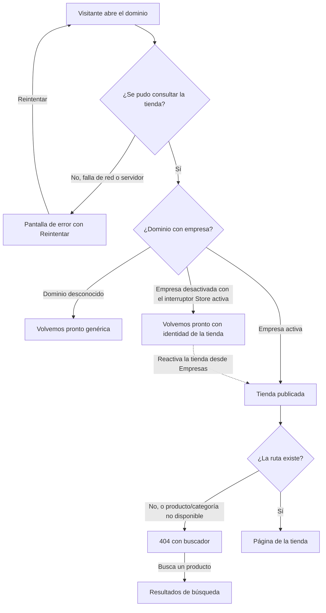
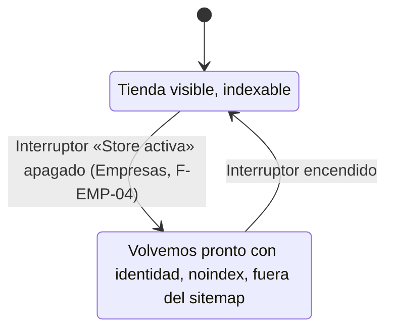
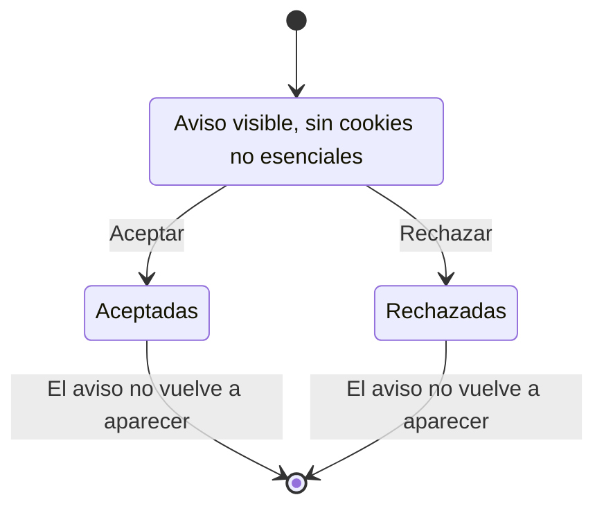
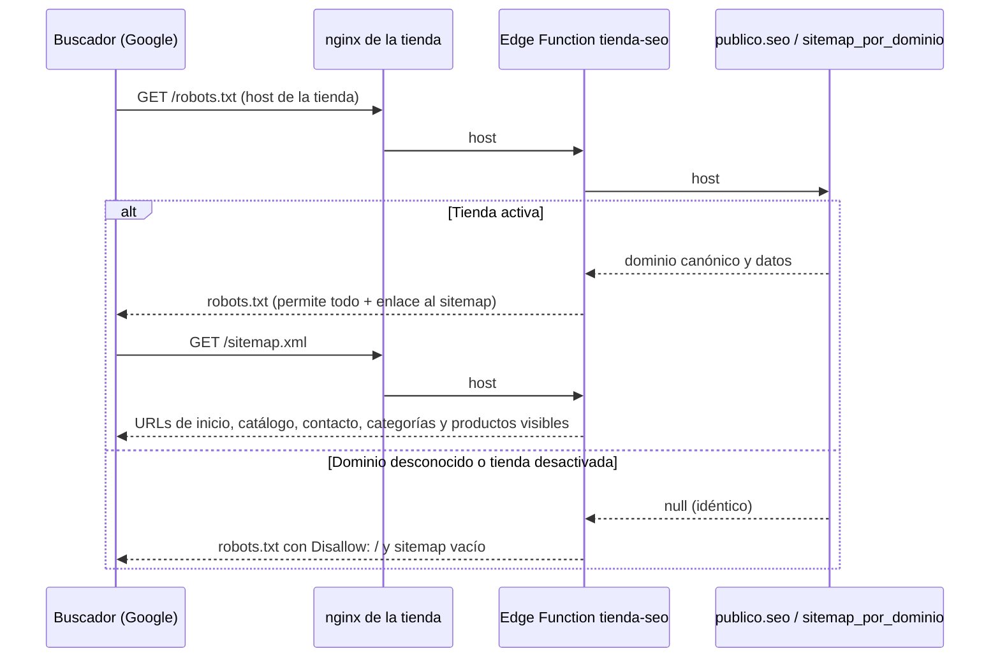

# Feature Specification: Tiendas online · Tienda SEO, legal y estados

**Feature Branch**: `epic/MSF-149-tiendas-online-tienda-seo-legal-y-estado`

**Componente**: Tiendas online

**Jira Epic**: MSF-149 — Tiendas online · Tienda seo legal y estados (spec `tienda-seo-legal-y-estados`)

**Historias previstas**: F-TDA-19 (S), F-TDA-20 (S), F-TDA-21 (M), F-TDA-22 (S), todas P1.

**Created**: 2026-11-01

**Status**: Draft — lista para planificar. Las decisiones de Nicolás quedan en *Decisiones abiertas*; ninguna bloquea implementar con el supuesto indicado.

**Delivery scope**: `refine` (`apps/web`: front público de la tienda y la configuración de nginx de `apps/web`) y `supabase` (migraciones aditivas, funciones de `publico`, una Edge Function, pgTAP). Sin `kestra`, `superset` ni `workers`.

**Prioridad / Hito**: P1 · Etapa 2 (desde enero de 2027) · ~23 h · alcance etapa2.

**Input**: Epic MSF-149. Objetivo: «Al terminar, la tienda tiene páginas claras para pausa y errores, productos relacionados en la ficha, datos para aparecer en Google y la información legal de cada empresa.»

## Regla de fuentes (literal de la épica)

1. Comportamiento y datos: mandan los requisitos y escenarios de esta historia.
2. Qué se ve (disposición, textos, estados, popups, flujos): el prototipo validado es referencia visual, no hace falta que quede extremadamente idéntico; los flujos (si hay) aclaran estados y acciones.
3. Cómo se construye (componentes, estilos y patrones): mandan el template y el system design del producto (épica Plataforma · Sistema de diseño). No copiar el HTML ni el CSS del prototipo: reproducir lo que muestra con los componentes del template y los tokens del sistema de diseño.
4. El prototipo muestra más que esta historia: implementar solo lo que piden los requisitos de esta historia; otras secciones, botones o diálogos son de otras historias.
5. Si algo no se puede igualar con el template / el sistema de diseño: usar lo más cercano, sin inventar, y anotar la diferencia en la descripción del PR.
6. Si el prototipo y los requisitos se contradicen: requisitos para el comportamiento, prototipo para lo visual, y dejar la contradicción anotada en el PR.

Prototipos (solo lectura, ya presentes en `design/pantallas/`): `StoreGeneral` y `SJ_StoreGeneral` (interruptor «Store activa», F-TDA-19) y `MJC_Producto`, `SJ_Producto`, `MJC_M_Producto`, `SJ_M_Producto` (sección «Productos relacionados» de la ficha, F-TDA-20), cada uno con su `.inventory.json`. F-TDA-21 y F-TDA-22 **no tienen pantalla dibujada**. Las pantallas públicas Home, Catálogo, Categoría y Contacto se citan en la épica como marco de la ficha: no se rediseñan.

## Dependencias

| Dependencia | Estado en esta rama | ¿Bloquea? |
|---|---|---|
| MSF-191 · Tienda inicio, búsqueda y móvil (`BuscadorTienda` reutilizable; por transitividad MSF-167 y MSF-147) | **Presente** (`layout/BuscadorTienda.tsx`, `PaginaNoEncontrada.tsx`, `ErrorConReintento.tsx`, `catalogo/TarjetaProducto.tsx`, migraciones `20261023150xxx` y `20261203xxxxxx`) | Sí; ya está en la base. |
| MSF-138 · Empresas (F-EMP-04 interruptor de tienda activa; datos fiscales por transitividad) | **Presente**: `pages/empresas/edit.tsx` pausa/reactiva (`dominio.empresas.activa`); `razon_social` y `cuit` ya existen (migración `20261211120000`) | No (relacionada). |
| MSF-133 · Tienda dominio y publicación | **No presente** en la rama | No: el «no indexar» de borrador y vista previa lo agrega MSF-133 sobre el mecanismo de F-TDA-21 (FR-024 deja el punto de extensión). |
| MSF-117 · Sistema de diseño (tokens, `TemaTienda`) | Presente | No. |

Bloquea a: MSF-164 (tienda-contenido-y-analitica): F-TDA-22 define el aviso de cookies que usa F-TDA-24 (contrato en FR-033/FR-034).

## Supuestos (de la épica)

- La página «Volvemos pronto» básica ya existe desde F-TDA-01 (`VolvemosPronto.tsx`); acá se completa con la identidad de la tienda, la 404 con buscador y la pantalla de error.
- Los enlaces legales exactos se confirman con el cliente.

## Contradicciones y notas prototipo ↔ épica (anotar en el PR)

1. **«Volvemos pronto» P0 en F-TDA-01 y P1 en F-TDA-19** (de la épica, «A revisar»): la versión mínima ya está en la base; esta épica agrega la identidad (FR-002).
2. **F-TDA-19 trazada a «Empresa · General» y F-TDA-20 a las pantallas públicas aunque ambas son P1.** El interruptor «Store activa» de `StoreGeneral` ya existe en el panel (F-EMP-04, MSF-138); acá solo se verifica su efecto en la tienda (SC-003). No se rediseña esa pantalla.
3. **Prototipo de «Productos relacionados»**: muestra 4 tarjetas en escritorio y 2 en celular, elegidas a mano y solo con imagen (`hasImg`). La épica no define la regla de elección; se usa la del supuesto D2 y las tarjetas «Sin imagen» / «Sin stock» se mantienen porque el prototipo las dibuja.
4. **Aviso de cookies, SEO y bloque legal sin pantalla en el prototipo.** Se construyen con los componentes del template y los tokens de la tienda; el aspecto exacto es decisión de diseño anotada en el PR.

## Decisiones abiertas (no bloquean; se implementa el supuesto)

- **D1 · «Volvemos pronto» con identidad revela que el dominio existe.** Hoy dominio desconocido y tienda desactivada responden igual (MSF-147, FR-003/SC-004), para no revelar. La épica pide la identidad de la tienda en la pausa. **Supuesto**: una tienda **desactivada** muestra su nombre, logo, colores y tipografías (datos ya públicos de su marca); un dominio **desconocido** sigue mostrando la versión genérica. No se expone ninguna otra cosa (ni catálogo, ni contacto, ni datos legales).
- **D2 · Regla de «Productos relacionados».** La épica no la define. **Supuesto**: hasta **4** productos efectivamente visibles de la **misma categoría** que el actual, sin incluirlo, destacados primero y luego por nombre. Sin relacionados, la sección no se muestra. Si Nicolás prefiere completar con otras categorías, cambia solo la función de FR-010.
- **D3 · Alcance del SEO básico.** La épica dice «SEO y posicionamiento básico» y «revisión con una herramienta de SEO», sin lista. **Supuesto**: título y descripción por página, URL canónica, Open Graph, datos estructurados (organización en el inicio, producto en la ficha), `robots.txt`, `sitemap.xml` y `noindex` en páginas de estado, de cuenta del cliente y de resultados de búsqueda. Fuera: editor de campos SEO por producto, hreflang, analítica (MSF-164), «no indexar» de borrador/vista previa (MSF-133).
- **D4 · Render en el navegador.** La tienda es una SPA: los metadatos se actualizan en el cliente (Google ejecuta JavaScript, pero los previews de redes sociales que no lo hacen no verán los Open Graph). **Supuesto**: sin prerender en esta épica. Si el cliente necesita previews en redes, se abre otra historia (prerender o HTML servido por la Edge Function).
- **D5 · Datos legales: quién los carga.** La épica no pide pantalla de edición legal. **Supuesto**: razón social, CUIT y dirección ya se editan en Empresas; los **enlaces legales** (título + URL https) los carga el equipo técnico en `dominio.tienda_legal_enlaces`, como el dominio en MSF-147 (sin pantalla ni RPC de escritura). Si Nicolás quiere editarlos desde el panel, es otra historia (y la «pantalla de gestión» se resuelve dentro de Empresas, no una nueva).
- **D6 · Qué legal exige cada marca (pregunta abierta de la fuente).** Qué razones sociales, CUIT, políticas y botones legales (p. ej. botón de arrepentimiento, Defensa del consumidor, Data Fiscal) lleva Mundo JC y San Javucho **se confirma con el cliente**. La mecánica es genérica (lista de enlaces por empresa), así que el código no espera la respuesta; solo los datos reales de cada empresa quedan pendientes.
- **D7 · Aviso de cookies.** La épica solo dice que F-TDA-22 lo define y F-TDA-24 lo usa. **Supuesto mínimo**: aviso con «Aceptar» y «Rechazar», decisión guardada en el navegador y exposición de la decisión para la analítica futura. Sin enlace a una política hasta que D6 confirme cuál es; sin categorías granulares.
- **D8 · Umbral de la revisión SEO.** **Supuesto**: la categoría SEO de Lighthouse (u herramienta equivalente) no marca fallas en home, catálogo, categoría, ficha y contacto de las dos tiendas; sin puntaje fijo inventado.

## Modelo y supuestos técnicos

- **Una sola tabla nueva** (`dominio.tienda_legal_enlaces`, F-TDA-22). El resto son funciones de `publico` (lectura anónima, `SECURITY DEFINER`, `stable`, `set search_path = ''`, lista blanca, `revoke … from public, anon`, `grant execute … to anon, authenticated`), como MSF-167/MSF-191. `publico` sigue sin tablas.
- **Host desconocido y tienda desactivada**: las funciones de lectura de la tienda siguen devolviendo lo mismo (`null`). La única excepción deliberada es `publico.estado_tienda_por_dominio` (D1).
- **`robots.txt` y `sitemap.xml` por dominio** los sirve una Edge Function `tienda-seo` (`supabase/functions/tienda-seo`) que lee solo funciones de `publico`; nginx de `apps/web` proxea esas dos rutas. Su contrato va en `openapi/tienda-seo.json`.
- **Metadatos** con un componente único de cabecera (`seo/CabeceraSeo`) que escribe `<title>`, `<meta>`, `<link rel="canonical">` y `<script type="application/ld+json">` y los limpia al salir de la página. Todo texto va escapado; el JSON-LD escapa `<`.
- **Consentimiento de cookies**: módulo `lib/consentimientoCookies.ts` (lectura/escritura de la decisión en `localStorage`, hook y evento) que F-TDA-24 consume sin tocar el banner.

## Esquema de datos (Constitución, Principio VII)

| Objeto | Esquema | Historia | Naturaleza / justificación |
|---|---|---|---|
| `dominio.tienda_legal_enlaces` (tabla nueva) | **`dominio`** | F-TDA-22 | Dato del producto Tiendas online atado a una empresa (enlaces legales del pie de su tienda). No es plataforma genérica. **RLS habilitada** por organización (`organizacion_id = private.organizacion_id()`, solo `select` para `authenticated`); sin `insert/update/delete` para roles de API (la carga la hace el equipo técnico, D5); sin privilegios para `anon`. |
| `dominio.empresas.razon_social`, `cuit`, `direccion` | `dominio` (existentes) | F-TDA-22 | Solo lectura desde `publico.legal_por_dominio`; no se altera la tabla. |
| `publico.estado_tienda_por_dominio(host)` | `publico` (función) | F-TDA-19 | Lectura anónima mínima de identidad de una tienda pausada (D1). |
| `publico.relacionados_por_dominio(host, producto)` | `publico` (función) | F-TDA-20 | Lectura anónima de productos relacionados. |
| `publico.seo_tienda_por_dominio(host)`, `publico.sitemap_por_dominio(host)` | `publico` (función) | F-TDA-21 | Lectura anónima de datos de SEO y mapa del sitio. |
| `publico.legal_por_dominio(host)` | `publico` (función) | F-TDA-22 | Lectura anónima de datos legales y enlaces. |

No se agrega ninguna tabla en `public`. Cada historia trae **su propia migración aditiva** con reversión documentada (ver `plan.md`). El pgTAP de aislamiento sigue recorriendo `public` + `dominio` (la tabla nueva debe tener RLS) y verifica que `publico` no tiene tablas y que `anon` ejecuta solo funciones de `publico`.

## Navegación y patrones (Principio VI)

Es el **front público** de la tienda, no el panel: sin sesión, sin menú del panel ni empresa activa. No hay rutas nuevas con pantalla propia: se completan las existentes (`*` → 404, «Volvemos pronto», ficha `/producto/:productoId`, pie de la tienda) y se agregan dos rutas de servidor (`/robots.txt`, `/sitemap.xml`). Estados de carga / vacío / error / éxito del kit; teclado y lector de pantalla; 320 / 768 / 1440 px; sin identificadores técnicos en pantalla; carga por ruta con `lazy` y el banner de cookies y los relacionados fuera del recorrido crítico (carga diferida). El interruptor de tienda activa vive en la pantalla de Empresas existente (ruta y menú sin cambios).

## Flujos

La épica describe los flujos en prosa; se transcriben sin agregar estados ni transiciones.

### Qué ve el visitante según el estado de la tienda (F-TDA-19 · FR-001…FR-005)

### Pausa y reactivación de la tienda (F-TDA-19 · SC-003)

### Aviso de cookies (F-TDA-22 · FR-033…FR-034)

### Datos para buscadores (F-TDA-21 · FR-020…FR-025)

Trazabilidad de los flujos: desconocido / desactivada / activa / identidad → FR-001, FR-002; 404 con buscador → FR-003; error y Reintentar → FR-004; interruptor y reactivación → SC-003 (el interruptor es de MSF-138, fuera de alcance de construcción); aviso de cookies → FR-033, FR-034; robots/sitemap/desactivada → FR-023, FR-025; búsqueda desde la 404 reutiliza MSF-191 (sin FR propio). Sin pasos fuera de alcance salvo el interruptor (motivo: existe).

## User Scenarios & Testing *(mandatory)*

### US1 — Estados especiales de la tienda (F-TDA-19, P1)

El visitante que llega a una tienda pausada ve una página «Volvemos pronto» con la marca de la tienda; el que llega a una página que no existe ve una 404 amable con buscador; el que sufre una falla ve una pantalla de error con «Reintentar».

1. **Given** la empresa Mundo JC con «Store activa» apagado, **When** el visitante abre su dominio, **Then** ve «Volvemos pronto» con el nombre, el logo y los colores de Mundo JC.
2. **Given** un dominio que no es de ninguna tienda, **When** lo abre, **Then** ve la «Volvemos pronto» genérica de hoy.
3. **Given** la tienda reactivada, **When** el visitante recarga, **Then** ve la tienda completa.
4. **Given** una URL inexistente, un producto oculto o una categoría de otra empresa, **When** la abre, **Then** ve la misma 404 con un buscador y «Volver al inicio».
5. **Given** una falla de red al cargar la tienda o una página, **When** ocurre, **Then** ve la pantalla de error sin detalles técnicos y «Reintentar» repite el pedido.

### US2 — Productos relacionados (F-TDA-20, P1)

En la ficha de un producto el visitante ve otros productos de la misma categoría y navega a ellos.

1. **Given** un producto con otros de su categoría, **When** abre su ficha, **Then** ve «Productos relacionados» con hasta 4 tarjetas (imagen o «Sin imagen», «Sin stock», nombre, precio, disponibilidad) que enlazan a sus fichas.
2. **Given** un producto sin otros en su categoría, **When** abre la ficha, **Then** la sección no aparece y no queda hueco.
3. **Given** dos tiendas, **When** el visitante abre una ficha, **Then** solo ve productos de esa tienda.

### US3 — SEO y posicionamiento básico (F-TDA-21, P1)

Los buscadores encuentran las páginas útiles de cada tienda, con título, descripción y datos estructurados correctos, y no indexan las tiendas desactivadas ni las páginas de estado.

1. **Given** la ficha de un producto visible, **When** un buscador la lee, **Then** encuentra título, descripción, URL canónica, Open Graph y datos estructurados de producto.
2. **Given** una tienda activa, **When** se pide `/robots.txt` y `/sitemap.xml`, **Then** recibe las reglas y las URLs visibles de **esa** tienda con su dominio.
3. **Given** una tienda desactivada o un dominio desconocido, **When** se piden, **Then** la respuesta es idéntica y no indexa nada.
4. **Given** la 404, «Volvemos pronto», el error o las páginas de cuenta del cliente, **When** un buscador las lee, **Then** llevan `noindex`.

### US4 — Información legal (F-TDA-22, P1)

El visitante ve en el pie la información legal de la empresa dueña de la tienda y decide sobre las cookies.

1. **Given** una empresa con razón social, CUIT y enlaces legales, **When** el visitante ve el pie, **Then** ve esos datos y los enlaces (cada tienda los suyos).
2. **Given** una empresa sin datos legales, **When** ve el pie, **Then** no aparece el bloque ni texto inventado.
3. **Given** un visitante nuevo, **When** entra, **Then** ve el aviso de cookies y al elegir «Aceptar» o «Rechazar» no vuelve a aparecer.

### Casos borde

- Host desconocido, inválido o tienda desactivada: las funciones de lectura devuelven `null`; la única que distingue «pausada» es `estado_tienda_por_dominio` (D1) y solo entrega marca.
- Nombre de empresa, producto o enlaces con HTML/script: se muestran literales (React escapa; JSON-LD escapa `<`; el sitemap escapa XML).
- Producto sin precio calculable: la tarjeta no muestra precio (como el catálogo) y el JSON-LD omite `offers.price`.
- Producto que se oculta mientras se ve su ficha: los relacionados fallan en silencio y la ficha sigue.
- Enlace legal con esquema distinto de `https://` (p. ej. `javascript:`): la base lo rechaza (check) y el front no lo renderiza.
- `localStorage` bloqueado (navegación privada): el aviso se muestra en cada visita y no rompe la página.
- Sitemap con más de 50.000 URLs: se corta en el tope del protocolo (constante única; ver plan).

## Requirements *(mandatory)*

### F-TDA-19 — Estados especiales de la tienda

- **FR-001**: `publico.estado_tienda_por_dominio(host)` (ejecutable por `anon`) devuelve `{ estado: 'pausada', nombre, color_primario, color_primario_oscuro, color_acento, color_fondo, tipografia_titulos, tipografia_texto, logo_ruta }` **solo** si el host pertenece a una empresa **desactivada**; devuelve `null` para host desconocido, inválido o empresa activa. Lista blanca (nunca `organizacion_id`, contacto ni datos fiscales). **Verificación:** pgTAP `supabase/tests/database/tienda_estado_pausada.test.sql` (lista blanca, `null` para activa/desconocida/inválida); `pnpm test`.
- **FR-002**: «Volvemos pronto» con identidad: para una tienda pausada muestra el logo (o el nombre si no hay logo), el nombre comercial y el texto actual, con los colores y tipografías de la tienda; para dominio desconocido conserva la versión genérica; no contiene enlaces al catálogo ni datos de contacto; no se reconstruye con datos del catálogo. **Verificación:** Vitest + axe `apps/web/src/pages/tienda-publica/VolvemosPronto.test.tsx` y E2E `apps/web/e2e/tienda-estados.e2e.ts`; `pnpm test`.
- **FR-003**: 404 con buscador: `PaginaNoEncontrada` conserva «No encontramos esta página» y «Volver al inicio» y suma `BuscadorTienda` de MSF-191 en el cuerpo; el mensaje es idéntico para ruta desconocida, producto/categoría oculto, inexistente o de otra empresa (no revela existencia). **Verificación:** Vitest + axe `PaginaNoEncontrada.test.tsx` y E2E `tienda-estados.e2e.ts`; `pnpm test`.
- **FR-004**: Pantalla de error: una falla al resolver la tienda o al cargar una página muestra una pantalla completa (título «No pudimos cargar esta página.», explicación breve, «Reintentar» que repite el pedido y «Volver al inicio»), anunciada con `role="alert"`, sin mensajes técnicos; dentro de la tienda conserva el encabezado y el pie. Un error de red nunca se disfraza de «Volvemos pronto». **Verificación:** Vitest + axe `ErrorConReintento.test.tsx` / `index.test.tsx` y E2E `tienda-estados.e2e.ts` (conexión caída); `pnpm test`.
- **FR-005**: Las tres pantallas funcionan con teclado y lector de pantalla, en 320 / 768 / 1440 px sin scroll horizontal y con los tokens de la tienda (`TemaTienda`). **Verificación:** E2E `tienda-estados.e2e.ts` (anchos) y Vitest + axe; `pnpm test`.

### F-TDA-20 — Productos relacionados

- **FR-010**: `publico.relacionados_por_dominio(host, producto)` devuelve `jsonb` `{ productos: [{ id, nombre, precio, disponible, imagen, categoria_id }] }` con hasta **4** productos efectivamente visibles (`private.catalogo_tienda_efectivo`) de la misma categoría que el producto, sin incluirlo, destacados primero y luego por nombre (D2); `precio` = `private.precio_final_publico`, `disponible` = `private.disponible_publico`. `null` idéntico para host desconocido, empresa desactivada, producto inexistente, oculto, inactivo o de otra empresa. Nunca costos, existencias ni `organizacion_id`. **Verificación:** pgTAP `supabase/tests/database/tienda_relacionados.test.sql` (categoría, exclusión del actual, tope 4, orden, aislamiento entre tiendas, `null` idéntico, lista blanca); `pnpm test`.
- **FR-011**: Sección «Productos relacionados» en la ficha (`/producto/:productoId`), debajo de los datos del producto y «Ver más productos»: título de sección y tarjetas con `TarjetaProducto` (imagen o «Sin imagen», insignia «Sin stock», nombre, precio, disponibilidad; toda la tarjeta enlaza a su ficha). Sin relacionados no se renderiza nada (sin hueco ni título). **Verificación:** Vitest + axe `ficha/Relacionados.test.tsx`; `pnpm --filter @platform/web test`.
- **FR-012**: Disposición responsiva: 4 columnas en escritorio y 2 en celular (como el prototipo); estado de carga discreto; si el pedido falla, la sección se omite y la ficha sigue intacta (sin mensaje de error propio). La sección se carga diferida (fuera del primer pintado de la ficha). **Verificación:** Vitest `Relacionados.test.tsx` (falla → omitida) y E2E `apps/web/e2e/tienda-relacionados.e2e.ts` (320 / 768 / 1440 px); `pnpm test`.

### F-TDA-21 — SEO y posicionamiento básico

- **FR-020**: `publico.seo_tienda_por_dominio(host)` devuelve `{ dominio, nombre, descripcion, logo_ruta }` de la tienda activa del host (dominio canónico de `dominio.tiendas`, nombre comercial, descripción tomada del subtítulo de `dominio.tienda_contenido` o, sin él, del texto genérico «<nombre> · tienda online», y ruta del logo); `null` idéntico para desconocido/desactivada. **Verificación:** pgTAP `supabase/tests/database/tienda_seo.test.sql` (lista blanca, descripción por defecto, `null` idéntico); `pnpm test`.
- **FR-021**: Metadatos por página con un componente único `CabeceraSeo`: `<title>`, `meta description`, `link rel="canonical"` (siempre con el dominio canónico de FR-020 y la ruta sin parámetros de filtro) y Open Graph (`og:title`, `og:description`, `og:type`, `og:url`, `og:image` cuando hay imagen) en inicio, catálogo, categoría, ficha y contacto. Título ≤ 60 y descripción ≤ 160 caracteres, recortados; plantilla «<página> | <empresa>»; la ficha usa nombre y descripción del producto y su primera imagen; la categoría, su nombre. Al salir de la página los metadatos se limpian. **Verificación:** Vitest `seo/CabeceraSeo.test.tsx` y E2E `apps/web/e2e/tienda-seo.e2e.ts` (cada página de las dos tiendas); `pnpm test`.
- **FR-022**: Datos estructurados JSON-LD: `Organization` (nombre, url, logo) en el inicio y `Product` (nombre, descripción, sku, imagen, `offers` con `priceCurrency: "ARS"`, `price` solo si es calculable y `availability` `InStock`/`OutOfStock`) en la ficha; solo campos ya públicos, escapando `<`; nunca costos ni existencias. **Verificación:** Vitest `seo/datosEstructurados.test.ts` (campos, escape, sin precio) y revisión con una herramienta de SEO (SC-007); `pnpm test`.
- **FR-023**: `GET /robots.txt` y `GET /sitemap.xml` por dominio, servidos por la Edge Function `tienda-seo` (proxeada por nginx de `apps/web`). Tienda activa: `robots.txt` permite el sitio y apunta al sitemap con el dominio canónico; el sitemap lista inicio, catálogo, contacto, categorías visibles y productos efectivamente visibles (`publico.sitemap_por_dominio(host)`), con `<lastmod>` cuando existe y URLs escapadas, hasta el tope del protocolo (50.000). Contrato en `openapi/tienda-seo.json` y `contracts/tienda-seo-legal-estados.md`. **Verificación:** pgTAP `tienda_seo.test.sql` (`sitemap_por_dominio`: solo visibles, aislamiento, tope) y E2E `tienda-seo.e2e.ts` (respuestas de cada tienda); `pnpm test`.
- **FR-024**: `noindex` (`<meta name="robots" content="noindex">`) en las páginas que no deben indexarse: 404, «Volvemos pronto», pantalla de error, ingresar / recuperar / definir contraseña y resultados de búsqueda (D3). El componente expone `indexable` como punto de extensión para el «no indexar» de borrador y vista previa de MSF-133. **Verificación:** Vitest `seo/CabeceraSeo.test.tsx` y `VolvemosPronto.test.tsx`; `pnpm --filter @platform/web test`.
- **FR-025**: Una tienda desactivada o un dominio desconocido **no se indexa**: `seo_tienda_por_dominio` y `sitemap_por_dominio` devuelven `null`, la Edge Function responde `robots.txt` con `Disallow: /` y un sitemap vacío, idénticos para ambos casos; al reactivar vuelve a indexable sin otra acción. **Verificación:** pgTAP `tienda_seo.test.sql` (desactivada = desconocida, reactivar cambia el resultado) y E2E `tienda-seo.e2e.ts`; `pnpm test`.

### F-TDA-22 — Información legal

- **FR-030**: Tabla `dominio.tienda_legal_enlaces` (`id`, `organizacion_id`, `empresa_id`, `titulo` ≤ 80, `url` `https://…` ≤ 500, `orden`, `created_at`) con FK compuesta a `dominio.empresas`, RLS habilitada por organización (solo `select` para `authenticated`), sin privilegios para `anon`, índice por empresa y orden; `url` validada por check. **Verificación:** pgTAP `supabase/tests/database/tienda_legal.test.sql` (RLS activa, check de URL, sin `grant` a `anon`) y pgTAP global de aislamiento; `pnpm test`.
- **FR-031**: `publico.legal_por_dominio(host)` devuelve `{ razon_social, cuit, direccion, enlaces: [{ titulo, url }] }` de la empresa del host (enlaces por `orden`); campos vacíos como `null`/lista vacía; `null` idéntico para desconocido/desactivada; lista blanca (nunca `whatsapp` interno, `organizacion_id` ni otros campos de `dominio.empresas`). **Verificación:** pgTAP `tienda_legal.test.sql` (lista blanca, orden, aislamiento entre tiendas, `null` idéntico); `pnpm test`.
- **FR-032**: Bloque legal en el pie de la tienda (`layout/PieLegal`, montado desde `PieCategorias`): «<Razón social> · CUIT <XX-XXXXXXXX-X>», dirección y la lista de enlaces legales (pestaña nueva, `rel="noopener noreferrer"`, sin renderizar URLs no `https`). Cada dato ausente se omite; sin ningún dato, el bloque no aparece. Texto escapado. **Verificación:** Vitest + axe `layout/PieLegal.test.tsx` y E2E `apps/web/e2e/tienda-legal.e2e.ts` (cada tienda muestra los suyos); `pnpm test`.
- **FR-033**: Aviso de cookies `AvisoCookies` (región con nombre accesible, carga diferida): texto breve, «Aceptar» y «Rechazar»; visible mientras no haya decisión; no bloquea el uso de la tienda, no roba el foco y es operable con teclado. **Verificación:** Vitest + axe `layout/AvisoCookies.test.tsx` y E2E `tienda-legal.e2e.ts`; `pnpm test`.
- **FR-034**: Contrato de consentimiento para F-TDA-24: `lib/consentimientoCookies.ts` expone `leerConsentimiento()` (`'aceptadas' | 'rechazadas' | null`), `guardarConsentimiento(valor)`, el hook `useConsentimientoCookies()` y un evento de cambio; la decisión persiste en `localStorage` (si no hay `localStorage`, el aviso reaparece y nada se rompe). Sin decisión equivale a «rechazadas» para quien la consuma. **Verificación:** Vitest `lib/consentimientoCookies.test.ts` (persistencia, evento, `localStorage` bloqueado); `pnpm --filter @platform/web test`.

### Transversales

- **FR-060**: Aislamiento por tienda: cada función y pantalla resuelve la empresa por el `Host` y nunca mezcla datos de otra empresa. **Verificación:** pgTAP de cada historia (aislamiento entre dos tiendas) y los E2E con las dos tiendas del seed; `pnpm test`.
- **FR-061**: Las funciones de `publico` nuevas respetan la regla de `anon` del repositorio (`revoke … from public, anon` + `grant execute … to anon, authenticated`; solo funciones de `publico`). **Verificación:** pgTAP existente de `anon` + el de cada historia; `pnpm test`.

## Success Criteria *(mandatory)*

- **SC-001** (F-TDA-19): pgTAP de `estado_tienda_por_dominio` y Vitest + axe de «Volvemos pronto» con identidad y genérica, 404 con buscador y pantalla de error con reintento (FR-001, FR-002, FR-003, FR-004, FR-005).
- **SC-002** (F-TDA-19): E2E `tienda-estados.e2e.ts` en las dos tiendas: pausada → identidad propia; dominio desconocido → genérica; 404 con buscador que lleva a resultados; conexión caída → error con reintento; 320 / 768 / 1440 px (FR-002…FR-005).
- **SC-003** (F-TDA-19): E2E del interruptor: apagar «Store activa» en Empresas hace que el dominio muestre «Volvemos pronto» y encenderlo vuelve a mostrar la tienda (usa el interruptor existente de MSF-138; FR-002, FR-025).
- **SC-004** (F-TDA-20): pgTAP de `relacionados_por_dominio` (FR-010).
- **SC-005** (F-TDA-20): Vitest + axe de la sección y E2E en las dos tiendas: tarjetas, enlace a la ficha, sección ausente sin relacionados, 2 / 4 columnas (FR-011, FR-012, FR-060).
- **SC-006** (F-TDA-21): pgTAP `tienda_seo.test.sql`: desactivadas y desconocidas idénticas y no indexables, sitemap solo con visibles, aislamiento, lista blanca (FR-020, FR-023, FR-025, FR-060, FR-061).
- **SC-007** (F-TDA-21): revisión con una herramienta de SEO (Lighthouse SEO o equivalente) sobre home, catálogo, categoría, ficha y contacto de las dos tiendas, más validación del JSON-LD de la ficha; sin fallas (D8) y el resultado queda en el PR (FR-021, FR-022, FR-024).
- **SC-008** (F-TDA-21): Vitest de `CabeceraSeo` / datos estructurados y E2E `tienda-seo.e2e.ts`: metadatos por página, canónica, `noindex` en las páginas de estado, `robots.txt` y `sitemap.xml` de cada tienda (FR-021…FR-025).
- **SC-009** (F-TDA-22): pgTAP `tienda_legal.test.sql` (tabla con RLS, lista blanca, aislamiento) (FR-030, FR-031).
- **SC-010** (F-TDA-22): Vitest + axe y E2E `tienda-legal.e2e.ts`: pie legal por tienda, bloque oculto sin datos, aviso de cookies y su persistencia, contrato de consentimiento (FR-032, FR-033, FR-034).
- **SC-011** (Cierre): documentación al día (`docs/tiendas-online.md`, nota de contradicciones para el PR). **Verificación:** `pnpm docs:check` y revisión de la sección «Estados, relacionados, SEO y legal» de `docs/tiendas-online.md`.
- **SC-012** (Cierre): `pnpm lint`, `pnpm build`, `pnpm infra:config`, `pnpm test`, `pnpm prototipo:check`, `pnpm matriz:check` y `pnpm docs:check` pasan.
- **SC-013** (Cierre): la fila de la épica en `docs/roadmap-template.md` refleja estado y link a esta spec al cerrar el PR (paso manual). **Verificación:** revisión de la fila MSF-149 (`git diff main -- docs/roadmap-template.md`) y `pnpm docs:check`.

## Verificación por requisito

| Requisito | Verifica |
|---|---|
| FR-001, FR-002, FR-003, FR-004, FR-005 | SC-001 · SC-002 |
| FR-010 | SC-004 |
| FR-011, FR-012 | SC-005 |
| FR-020, FR-023, FR-025 | SC-006 · SC-008 |
| FR-021, FR-022, FR-024 | SC-007 · SC-008 |
| FR-030, FR-031 | SC-009 |
| FR-032, FR-033, FR-034 | SC-010 |
| FR-060, FR-061 | pgTAP de cada historia · E2E de dos tiendas |
| SC-003 | E2E con el interruptor de Empresas (F-EMP-04, existente) |
| SC-011, SC-013 | Revisión de `docs/tiendas-online.md` y `docs/roadmap-template.md` (tareas de cierre) |
| SC-012 | `pnpm lint`, `build`, `infra:config`, `test`, `prototipo:check`, `matriz:check`, `docs:check` |

## Matriz pantalla↔criterios

Inventarios corridos (`pnpm prototipo:inventario`, ya versionados en `design/pantallas/*.inventory.json`) sobre las pantallas citadas por la épica.

### Empresa Mundo JC · General / Empresa San Javucho · General (`StoreGeneral`, `SJ_StoreGeneral`) — sirven solo al interruptor de F-TDA-19

| Ítem del inventario | Dueño | Criterio / nota |
|---|---|---|
| Interruptor «Store activa» («Si la desactivás, el dominio muestra un aviso de «Volvemos pronto».») | **Existente (F-EMP-04, MSF-138)**; su efecto en la tienda lo verifica esta épica | FR-002, SC-003. No se reconstruye. |
| Campos Nombre comercial, Dominio o subdominio, Idioma, Moneda, WhatsApp, Correo, Instagram, Dirección (opcional) | **Fuera de alcance** | La épica solo pide el interruptor; los campos son de F-EMP-02 / MSF-147. |
| Botones «Empresas», «Cambiar a San Javucho ↔» / «Cambiar a Mundo JC ↔», «Ver tienda» | **Fuera de alcance** | Navegación de la pantalla existente, sin cambios. |
| Pestañas General, Precios y moneda, Mercado Libre, Identidad visual, Contenido, Catálogo visible, Dominio y publicación | **Fuera de alcance** | De sus propias épicas (MSF-147, MSF-133, MSF-122…). |
| Botones «Descartar», «Guardar y publicar» y diálogos «Publicar cambios» / «Descartar cambios» (con «Cancelar» / «Publicar») | **Fuera de alcance** | Flujo de edición de otra historia; el interruptor es una acción inmediata ya construida. |
| Empresa activa | **Aplica al interruptor, ya resuelto** | La pantalla de Empresas existente ya trabaja con la empresa activa; esta épica no la modifica. |

### Ficha de producto (`MJC_Producto`, `SJ_Producto`, `MJC_M_Producto`, `SJ_M_Producto`) — sirven a F-TDA-20

| Ítem del inventario | Dueño | Criterio / nota |
|---|---|---|
| Sección «Productos relacionados» y tarjetas «Sin imagen» / «Sin stock» (nombre, precio, disponibilidad) | F-TDA-20 | FR-011, FR-012 |
| Botón «Ver más productos» | **Existente (MSF-167)** | Sin cambios; los relacionados van debajo (FR-011). |
| Buscar productos, «Ver todos los resultados →», Inicio, Contacto y categorías del menú, «Todos los productos», «← Todos los productos», «SAN JAVUCHO» | **Existente / fuera de alcance** | Encabezado, menú y migas ya construidos (MSF-167, MSF-191); no cambian. |
| «Consultar por WhatsApp», «Cancelar», «Abrir WhatsApp» | **Fuera de alcance** | De MSF-212 (F-TDA-14), ya presente. |
| «Escribinos» y datos de contacto del pie | **Fuera de alcance** | De MSF-212 (F-TDA-16). El pie legal se suma sin tocarlos (FR-032). |
| «© 2026 … Todos los derechos reservados.» (pie del prototipo) | **Fuera de alcance** | La épica no la pide; el texto del pie es contenido editable de F-TDA-03. |
| Tienda pública · Home, Catálogo, Categoría y Contacto (`MJC_Home`, `MJC_Catalogo`, `MJC_Categoria`, `MJC_Contacto` y sus `SJ_`/`_M_`) | **Fuera de alcance** | La épica los cita como marco; ninguno de sus elementos es de esta épica. El SEO (FR-021) solo agrega metadatos invisibles. |

### Elementos nuevos sin pantalla en el prototipo

| Ítem | Dueño | Criterio / nota |
|---|---|---|
| «Volvemos pronto» con identidad, 404 con buscador, pantalla de error | F-TDA-19 | FR-002…FR-005 (sin pantalla dibujada; aspecto de la tienda, anotado en el PR) |
| Bloque legal del pie y aviso de cookies | F-TDA-22 | FR-032, FR-033 (sin pantalla dibujada) |
| Metadatos, `robots.txt`, `sitemap.xml` | F-TDA-21 | FR-020…FR-025 (no visibles) |
| Empresa activa | **No aplica** a las pantallas públicas | Front público anónimo: sin barra superior ni selector; la tienda se resuelve por el `Host` (FR-060). El equivalente a «cambiar de empresa» es cambiar de dominio, verificado con los E2E de las dos tiendas. |

## Fuera de alcance

- El interruptor «Store activa» y toda la edición de Empresas (MSF-138, ya existe).
- «No indexar» de borrador y vista previa (MSF-133) y la analítica (F-TDA-24, MSF-164), que solo consume el contrato de consentimiento.
- Prerender o HTML servido para previews de redes sociales (D4); campos SEO editables por producto; hreflang.
- Pantalla de edición de los enlaces legales y páginas legales con texto propio (D5); la decisión de qué legal lleva cada marca (D6).
- Cookies por categoría o con política enlazada (D7).
- Compra online y cuentas (MSF-176, MSF-237).
