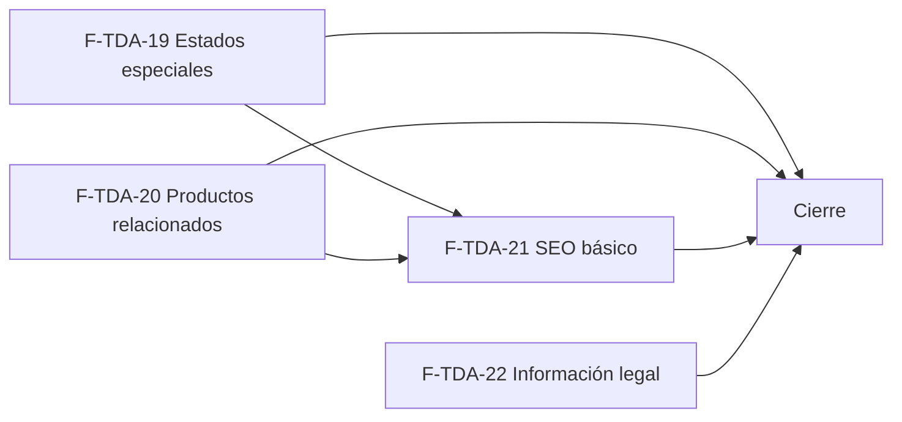

# Tasks: Tiendas online · Tienda SEO, legal y estados

**Input**: `specs/20270125-100000-tienda-seo-legal-y-estados/` (spec.md, plan.md, contracts/tienda-seo-legal-estados.md)

**Formato**: `- [ ] T### [P] [F-TDA-xx][USy] descripción`. **[P]** = paralelizable (archivos distintos, sin dependencia; las [P] del mismo grupo van en paralelo); sin [P] = secuencial. Las dependencias de cada tarea son solo dentro de su historia. Regla del proyecto: ninguna tarea queda `[ ]` al cierre — se hace con evidencia o se cierra con `[x]` + `Desvío:` y seguimiento trazado.

**Delivery scope**: `refine`, `supabase`

## Matriz de trazabilidad Jira ↔ US ↔ tasks

| Jira | Historia | FR / SC (dueño único) | Tasks |
|------|----------|-----------------------|-------|
| F-TDA-19 (clave Jira: la asigna el orquestador) | US1 Estados especiales de la tienda | FR-001…FR-005, SC-001, SC-002, SC-003 | T001–T008 |
| F-TDA-20 (clave Jira: la asigna el orquestador) | US2 Productos relacionados | FR-010, FR-011, FR-012, SC-004, SC-005 | T020–T025 |
| F-TDA-22 (clave Jira: la asigna el orquestador) | US4 Información legal | FR-030…FR-034, SC-009, SC-010 | T040–T047 |
| F-TDA-21 (clave Jira: la asigna el orquestador) | US3 SEO y posicionamiento básico | FR-020…FR-025, SC-006, SC-007, SC-008 | T060–T069 |
| Tarea de cierre (label cierre) | Documentación, verificación transversal, roadmap y gates | FR-060, FR-061, SC-011, SC-012, SC-013 | T090–T092 |

Cada FR/SC declara su verificación nombrada en `spec.md`; la tarea dueña la ejecuta y deja la evidencia.

### Dueño único por requisito

| Requisito | Tarea dueña | | Requisito | Tarea dueña |
|---|---|---|---|---|
| FR-001 | T001 | | FR-020 | T060 |
| FR-002 | T004 | | FR-021 | T065 |
| FR-003 | T005 | | FR-022 | T066 |
| FR-004 | T006 | | FR-023, FR-025 | T062 |
| FR-005, SC-001 | T007 | | FR-024 | T067 |
| SC-002, SC-003 | T008 | | SC-006 | T061 |
| FR-010 | T020 | | SC-008 | T068 |
| SC-004 | T021 | | SC-007 | T069 |
| FR-012 | T023 | | FR-030 | T040 |
| FR-011 | T024 | | FR-031 | T041 |
| SC-005 | T025 | | SC-009 | T042 |
| FR-032 | T044 | | FR-034 | T045 |
| FR-033 | T046 | | SC-010 | T047 |
| FR-060, FR-061, SC-012 | T092 | | SC-011 | T090 |
| SC-013 | T091 | | | |

## Phase 1 — F-TDA-19 · Estados especiales de la tienda (US1)

**Base de datos** (un solo archivo `supabase/migrations/20270125100000_tienda_estado_pausada.sql`, reversión en `plan.md`)

- [ ] T001 [F-TDA-19][US1] Crear la migración con `publico.estado_tienda_por_dominio(host)`: devuelve la marca (nombre, colores, tipografías, `logo_ruta` con los mismos defaults de `identidad_por_dominio`) solo si el host es de una empresa **desactivada**; `null` para desconocida, inválida o activa; `revoke … from public, anon` + `grant execute … to anon, authenticated`; comentario con D1 (FR-001).
- [ ] T002 [F-TDA-19][US1] pgTAP `supabase/tests/database/tienda_estado_pausada.test.sql`: lista blanca, `null` para activa / desconocida / host inválido, pasar de activa a desactivada y volver cambia el resultado, aislamiento entre dos tiendas y que `anon` ejecuta la función (soporte de FR-001; depende de T001).

**Front**

- [ ] T003 [P] [F-TDA-19][US1] `apps/web/src/lib/tiendaEstado.ts`: cliente de `estado_tienda_por_dominio` y hook `useEstadoTienda(host)` con los estados `cargando | pausada | desconocida | error`, y tests unitarios.
- [ ] T004 [F-TDA-19][US1] `VolvemosPronto.tsx` y la rama «sin tienda» de `index.tsx`: con marca (logo o nombre, nombre comercial, texto actual, colores y tipografías por `TemaTienda`) para la tienda pausada; versión genérica de hoy para el dominio desconocido; sin catálogo ni contacto (depende de T003) (FR-002).
- [ ] T005 [P] [F-TDA-19][US1] `PaginaNoEncontrada.tsx`: conserva el mensaje y «Volver al inicio» y suma `BuscadorTienda` (de MSF-191) en el cuerpo; mismo mensaje para todos los casos; verificar con axe que no hay ids ni roles duplicados con el buscador del encabezado (FR-003).
- [ ] T006 [F-TDA-19][US1] `PantallaError.tsx` (nuevo): pantalla completa «No pudimos cargar esta página.» con «Reintentar» y «Volver al inicio», `role="alert"`, sin detalle técnico; usarla en la rama de error de `index.tsx` y en `ErrorDeRuta` de `EnrutadorTienda.tsx` (dentro de la tienda conserva encabezado y pie) (depende de T004, que edita `index.tsx`) (FR-004).
- [ ] T007 [F-TDA-19][US1] Vitest + axe de «Volvemos pronto» (con marca y genérica, `VolvemosPronto.test.tsx`), 404 con buscador (`PaginaNoEncontrada.test.tsx`) y pantalla de error / reintento (`PantallaError.test.tsx`, `index.test.tsx`), con teclado, lector de pantalla y 320 / 768 / 1440 px (depende de T004, T005, T006) (FR-005, SC-001).
- [ ] T008 [F-TDA-19][US1] E2E `apps/web/e2e/tienda-estados.e2e.ts` con las dos tiendas: apagar y encender «Store activa» en Empresas y ver «Volvemos pronto» con la marca propia y luego la tienda; dominio desconocido → genérica; 404 con buscador que lleva a resultados; conexión caída → error con «Reintentar»; anchos 320 / 768 / 1440 (depende de T002, T007) (SC-002, SC-003).

**Checkpoint F-TDA-19**: estados de punta a punta; `pnpm test` verde.

## Phase 2 — F-TDA-20 · Productos relacionados (US2)

- [ ] T020 [F-TDA-20][US2] Migración `supabase/migrations/20270125110000_tienda_relacionados.sql` con `publico.relacionados_por_dominio(host, producto)`: hasta 4 efectivamente visibles de la misma categoría, sin el actual, destacados primero y luego `lower(nombre), id`; `null` idéntico para host desconocido / empresa desactivada / producto ajeno, oculto, inactivo o inexistente; lista blanca; grants de `anon` (FR-010).
- [ ] T021 [F-TDA-20][US2] pgTAP `supabase/tests/database/tienda_relacionados.test.sql`: categoría, exclusión del actual, tope 4, orden, productos ocultos fuera, aislamiento entre dos tiendas, `null` idéntico y sin costos ni existencias (depende de T020) (SC-004).
- [ ] T022 [P] [F-TDA-20][US2] `apps/web/src/lib/tiendaRelacionados.ts`: cliente RPC, URLs de imágenes con el mismo mecanismo que el catálogo y hook `useRelacionados(host, productoId)` con estados `cargando | lista | vacia | error`, con tests.
- [ ] T023 [F-TDA-20][US2] `ficha/Relacionados.tsx` (carga diferida): título «Productos relacionados» y `TarjetaProducto` en 4 columnas en escritorio y 2 en celular, estado de carga discreto, falla → la sección se omite sin mensaje (depende de T022) (FR-012).
- [ ] T024 [F-TDA-20][US2] Integrar en `rutas/producto.tsx` debajo de los datos y «Ver más productos»: sin relacionados no se renderiza título ni hueco (depende de T023) (FR-011).
- [ ] T025 [F-TDA-20][US2] Vitest + axe `ficha/Relacionados.test.tsx` y E2E `apps/web/e2e/tienda-relacionados.e2e.ts` en las dos tiendas: tarjetas, enlace a la ficha, ausencia sin relacionados, solo productos de la tienda, 2 / 4 columnas en 320 / 768 / 1440 px (depende de T021, T024) (SC-005).

**Checkpoint F-TDA-20**: ficha con relacionados de punta a punta; `pnpm test` verde.

## Phase 3 — F-TDA-22 · Información legal (US4)

**Base de datos** (un solo archivo `supabase/migrations/20270125120000_tienda_legal.sql`, reversión en `plan.md`)

- [ ] T040 [F-TDA-22][US4] Crear en la migración la tabla `dominio.tienda_legal_enlaces` (esquema `dominio`; `titulo` ≤ 80; `url` con check `^https://` ≤ 500; `orden`; FK compuesta a `dominio.empresas`; RLS por organización con solo `select` a `authenticated`; sin privilegios para `anon`; índice `(empresa_id, orden)`) (FR-030).
- [ ] T041 [F-TDA-22][US4] En la misma migración: `publico.legal_por_dominio(host)` con `razon_social`, `cuit`, `direccion` de `dominio.empresas` y `enlaces` por `orden`; lista blanca; `null` idéntico para desconocida / desactivada; grants de `anon` (depende de T040) (FR-031).
- [ ] T042 [F-TDA-22][US4] pgTAP `supabase/tests/database/tienda_legal.test.sql`: tabla con RLS y sin `grant` a `anon`, check de URL (`javascript:` rechazado), lista blanca, orden, aislamiento entre dos tiendas, `null` idéntico; el pgTAP global de aislamiento sigue verde (depende de T041) (SC-009).

**Front**

- [ ] T043 [P] [F-TDA-22][US4] `apps/web/src/lib/tiendaLegal.ts`: cliente de `legal_por_dominio`, formato de CUIT `XX-XXXXXXXX-X` y hook `useLegalTienda(host)`, con tests.
- [ ] T044 [F-TDA-22][US4] `layout/PieLegal.tsx` montado desde `layout/PieCategorias.tsx`: «<Razón social> · CUIT …», dirección y enlaces (pestaña nueva, `rel="noopener noreferrer"`, nunca URLs no `https`); datos ausentes se omiten y sin datos el bloque no aparece (depende de T043) (FR-032).
- [ ] T045 [P] [F-TDA-22][US4] `apps/web/src/lib/consentimientoCookies.ts`: `leerConsentimiento`, `guardarConsentimiento`, `useConsentimientoCookies` y evento `tienda:consentimiento-cookies`, tolerante a `localStorage` bloqueado, con tests (FR-034).
- [ ] T046 [F-TDA-22][US4] `layout/AvisoCookies.tsx` (carga diferida): región accesible con texto breve, «Aceptar» y «Rechazar», sin robar el foco ni bloquear el uso, y montaje desde `layout/PieCategorias.tsx` (depende de T044, T045) (FR-033).
- [ ] T047 [F-TDA-22][US4] Vitest + axe de `PieLegal`, `AvisoCookies` y consentimiento, y E2E `apps/web/e2e/tienda-legal.e2e.ts` en las dos tiendas: pie con los datos de **cada** empresa, bloque oculto sin datos, aviso que desaparece al decidir y no vuelve, 320 / 768 / 1440 px (depende de T042, T046) (SC-010).

**Checkpoint F-TDA-22**: pie legal y aviso de cookies de punta a punta; `pnpm test` verde.

## Phase 4 — F-TDA-21 · SEO y posicionamiento básico (US3)

**Base de datos y servidor** (un solo archivo `supabase/migrations/20270125130000_tienda_seo.sql`, reversión en `plan.md`)

- [ ] T060 [F-TDA-21][US3] Crear la migración con `publico.seo_tienda_por_dominio(host)` (dominio canónico, nombre, descripción desde `dominio.tienda_contenido.subtitulo` o «<nombre> · tienda online», `logo_ruta`, `indexable`) y `publico.sitemap_por_dominio(host)` (inicio, catálogo, contacto, categorías visibles y productos efectivamente visibles, tope 50.000 como constante única); `null` idéntico para desconocida / desactivada; grants de `anon` (FR-020).
- [ ] T061 [F-TDA-21][US3] pgTAP `supabase/tests/database/tienda_seo.test.sql`: desactivada = desconocida, reactivar cambia el resultado, sitemap solo con visibles y de la propia tienda, tope, lista blanca (depende de T060) (SC-006).
- [ ] T062 [F-TDA-21][US3] Edge Function `supabase/functions/tienda-seo` (`robots.txt` y `sitemap.xml` a partir de T060, `Disallow: /` y sitemap vacío idénticos para desactivada y desconocida, XML escapado, `verify_jwt = false`), ruta `/robots.txt` y `/sitemap.xml` en `apps/web/nginx.conf` con la cabecera `X-Tienda-Host`, y `openapi/tienda-seo.json` en el mismo PR. **Primero verificar en el entorno cómo llega el `Host` y cómo se configura la URL de Supabase en el contenedor**; si no es viable, frenar con el estado del bloqueo (depende de T060) (FR-023, FR-025).

**Front** (depende de que F-TDA-19 y F-TDA-20 estén mergeadas: comparten archivos, ver Plan de ejecución)

- [ ] T063 [P] [F-TDA-21][US3] `seo/CabeceraSeo.tsx` + `lib/tiendaSeo.ts` (cliente de `seo_tienda_por_dominio` y hook): escribe y limpia `<title>`, `description`, `canonical`, Open Graph y `robots`, con recorte (título ≤ 60, descripción ≤ 160) y la propiedad `indexable` como punto de extensión de MSF-133.
- [ ] T064 [P] [F-TDA-21][US3] `seo/datosEstructurados.ts`: constructores JSON-LD `Organization` y `Product` (`priceCurrency` ARS, `price` solo si es calculable, `availability`), escapando `<`, con tests.
- [ ] T065 [F-TDA-21][US3] Montar `CabeceraSeo` en `rutas/inicio.tsx`, `catalogo.tsx`, `categoria.tsx`, `producto.tsx` y `contacto.tsx` con título, descripción e imagen de cada página y canónica sin filtros (depende de T063) (FR-021).
- [ ] T066 [F-TDA-21][US3] JSON-LD `Organization` en el inicio y `Product` en la ficha (depende de T064, T065, que también edita `rutas/producto.tsx`) (FR-022).
- [ ] T067 [F-TDA-21][US3] `noindex` en 404, «Volvemos pronto», pantalla de error, ingresar / recuperar / definir contraseña y resultados de búsqueda (depende de T065) (FR-024).
- [ ] T068 [F-TDA-21][US3] Vitest de `CabeceraSeo` y datos estructurados, y E2E `apps/web/e2e/tienda-seo.e2e.ts` en las dos tiendas: metadatos por página, canónica, `noindex` en las páginas de estado, `robots.txt` y `sitemap.xml` de cada tienda y de una pausada (depende de T061, T062, T066, T067) (SC-008).
- [ ] T069 [F-TDA-21][US3] Revisión con Lighthouse SEO (o equivalente) de home, catálogo, categoría, ficha y contacto de las dos tiendas y validación del JSON-LD de la ficha; dejar el resultado en el PR (depende de T068) (SC-007).

**Checkpoint F-TDA-21**: datos para buscadores de punta a punta; `pnpm test` verde.

## Phase 5 — Cierre [CIERRE]

- [ ] T090 [CIERRE] Documentar en `docs/tiendas-online.md` (sección «Estados, relacionados, SEO y legal»): funciones públicas, tabla `dominio.tienda_legal_enlaces` y su esquema, Edge Function `tienda-seo` y el proxy de nginx (con la configuración de despliegue en `docs/deployment.md` si hace falta), contrato de consentimiento de cookies para F-TDA-24, cómo se cargan los enlaces legales (D5), decisiones D1…D8 con su supuesto, contradicciones para el PR y migraciones con reversión (SC-011).
- [ ] T091 [CIERRE] Actualizar la fila de MSF-149 en `docs/roadmap-template.md` (estado, link a esta spec, horizonte → «Backlog entregado» si aplica) al cerrar el PR; paso manual con criterio, sin script (SC-013).
- [ ] T092 [CIERRE] Verificación transversal y gates: confirmar que cada pgTAP incluye aislamiento entre dos tiendas y que el de `anon` pasa (FR-060, FR-061); correr `pnpm lint`, `pnpm build`, `pnpm infra:config`, `pnpm test`, `pnpm prototipo:check`, `pnpm matriz:check` y `pnpm docs:check`; revisión de seguridad del diff (RLS de `tienda_legal_enlaces`, `grant`s de `anon`, función de «pausada», texto escapado, XML y JSON-LD escapados, enlaces `https`) (depende de T090, T091) (SC-012).

## Plan de ejecución (historias)

| Historia | Depende de | Grupo |
|---|---|---|
| F-TDA-19 | — | 1 |
| F-TDA-20 | — | 1 |
| F-TDA-22 | — | 1 |
| F-TDA-21 | F-TDA-19, F-TDA-20 | 2 |
| [Cierre] | F-TDA-19, F-TDA-20, F-TDA-21, F-TDA-22 | 3 |

F-TDA-19, F-TDA-20 y F-TDA-22 son independientes: cada una trae su propia migración y sus propios archivos del front (F-TDA-19: `VolvemosPronto`, `PaginaNoEncontrada`, `PantallaError`, `index.tsx`, `EnrutadorTienda`; F-TDA-20: `ficha/Relacionados`, `rutas/producto.tsx`; F-TDA-22: `PieCategorias`, `PieLegal`, `AvisoCookies`), así que van en paralelo. F-TDA-21 va después por una dependencia real de archivos: monta `CabeceraSeo` y el `noindex` en `rutas/producto.tsx` (de F-TDA-20) y en `VolvemosPronto`, `PaginaNoEncontrada` y `PantallaError` (de F-TDA-19).

