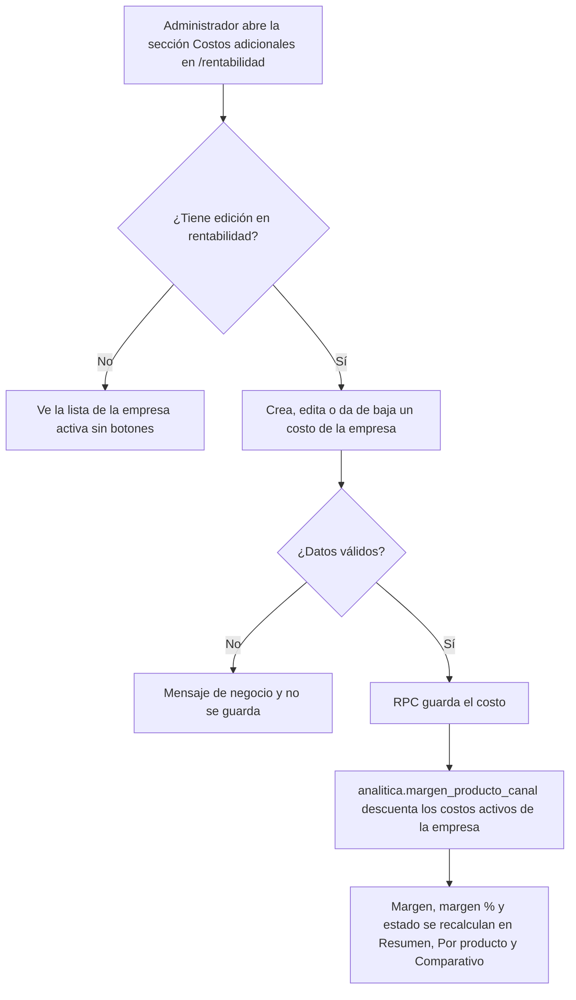
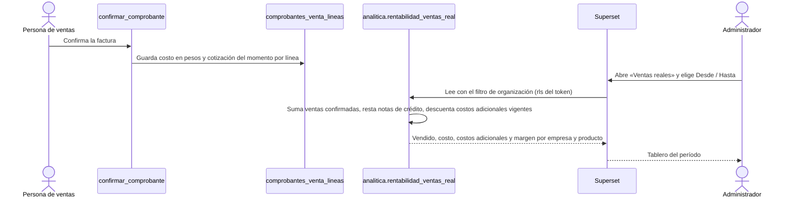
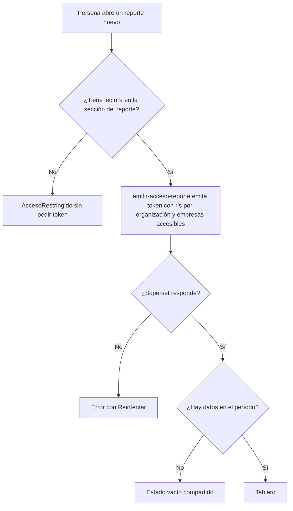

# Feature Specification: Inicio, rentabilidad y reportes · Rentabilidad real y reportes de ventas

**Épica**: MSF-192 · **Spec**: `rentabilidad-real-y-reportes-de-ventas` · **Hito**: Etapa 3 (sin fecha) · **Prioridad**: P2 · **Horas aprox.**: 40 (una historia L, dos M y una S suman 36 h; se confirma al planificar) · **Alcance (Jira)**: fuera-de-diciembre
**Alcance de entrega**: `refine`, `supabase`, `superset` (sin `kestra` ni `workers`: el cálculo es SQL y los tableros los sirve Superset, igual que MSF-120, MSF-127 y MSF-338).
**Fuente**: especificación de Nicolás cargada en la épica (It's a Plan) y artefactos del producto. Esta spec **traduce**; no agrega alcance. Los puntos que la épica deja abiertos están en «Supuestos a confirmar»: son supuestos de trabajo, no requisitos nuevos.

## Regla de fuentes (literal de la épica)

1. Comportamiento y datos: mandan los requisitos y escenarios de esta historia.
2. Qué se ve (disposición, textos, estados, popups, flujos): el prototipo validado es referencia visual, no hace falta que quede extremadamente idéntico; los flujos (si hay) aclaran estados y acciones.
3. Cómo se construye (componentes, estilos y patrones): mandan el template y el system design del producto (épica Plataforma · Sistema de diseño). No copiar el HTML ni el CSS del prototipo: reproducir lo que muestra con los componentes del template y los tokens del sistema de diseño.
4. El prototipo muestra más que esta historia: implementar solo lo que piden los requisitos de esta historia; otras secciones, botones o diálogos son de otras historias.
5. Si algo no se puede igualar con el template / el sistema de diseño: usar lo más cercano, sin inventar, y anotar la diferencia en la descripción del PR.
6. Si el prototipo y los requisitos se contradicen: requisitos para el comportamiento, prototipo para lo visual, y dejar la contradicción anotada en el PR.

## Objetivo

Al terminar, el administrador suma costos reales al margen, mide cuánto ganó con lo efectivamente vendido en un período y ve qué productos y canales mueven el negocio.

## Modelo y supuestos

- **Bloqueada por** MSF-120 (vista `analitica.margen_producto_canal`, rol de Superset, `reportes.seccion`, pantalla `/rentabilidad`, importador), MSF-177 (ventas registradas y anuladas; por su cadena MSF-159, comprobantes) y MSF-130 (`dominio.intereses_whatsapp`, F-CON-02). Se reutilizan, no se recrean. Ya están en el repo: `analitica.margen_producto_canal` (`20261130100200`), `dominio.comprobantes_venta` / `dominio.comprobantes_venta_lineas`, `public.confirmar_comprobante(uuid)`, `analitica.comprobante_cuenta_como_facturado` / `analitica.signo_comprobante` (`20270116110100`), `dominio.intereses_whatsapp` (`20261214100000`), `infra/superset/dashboards/{rentabilidad,ventas-reportes}/`.
- **Qué cuenta como venta** (criterio único, ya vigente en MSF-338): comprobantes confirmados y no anulados (`analitica.comprobante_cuenta_como_facturado`), con la nota de crédito restando (`analitica.signo_comprobante`). Presupuestos, borradores y anulados no cuentan. **No se reimplementa**.
- **Canales = tiendas de cada empresa.** Mercado Libre (MSF-123) no se pide: cuando llegue, sus ventas se suman a F-REN-09 y F-REP-05; hasta entonces ese canal queda vacío y no hay columnas ni series de Mercado Libre. MSF-128 y MSF-140 **no se piden** (esta épica no usa su código).
- **Supuesto de la épica, hoy sin cubrir**: las ventas guardan al registrarse precio, costo y cotización del momento. En el repo `dominio.comprobantes_venta_lineas` guarda `precio_unitario` pero **no** costo ni cotización. Esta spec lo cubre **dentro de F-REN-09** con una migración aditiva (columnas nuevas y captura en `confirmar_comprobante`, misma firma). No hay datos históricos que reconstruir: las ventas confirmadas antes de esa migración **no** tienen costo guardado y quedan fuera de F-REN-09 (no se inventa costo).
- Los supuestos de MSF-120 siguen vigentes: margen sobre el **neto sin IVA**, costo sin IVA, umbral de margen bajo de la organización.
- F-REN-09 es L: se divide al planificar si hace falta (las tareas ya están separadas por capa: captura, vista, tablero).

### Supuestos a confirmar (preguntas abiertas de la épica; no bloquean la spec)

Se trabaja con el supuesto de la columna «Supuesto de trabajo»; si Nicolás decide otra cosa, cambia solo la tarea indicada.

| # | Pregunta abierta de la épica | Supuesto de trabajo | Afecta |
|---|---|---|---|
| 1 | ¿Qué costos reales quiere sumar el cliente (envío, impuestos, otros) y cómo se mantienen? | Catálogo **libre** por empresa (tienda): cada costo tiene un nombre, un tipo (**porcentaje sobre el neto** o **monto en pesos por unidad**) y un valor; se crean, editan y dan de baja desde `/rentabilidad`. No se fijan nombres como «envío» o «impuestos»: los define el administrador. | F-REN-08 |
| 2 | ¿Ponderar el margen por unidades en stock o por ventas reales, en lugar de una unidad por producto? | **Por ventas reales**: F-REN-09 pondera por lo efectivamente vendido. El margen de lista por producto (MSF-120) no cambia de ponderación. Stock queda fuera. | F-REN-09 |
| 3 | ¿El rol Consulta debe ver costos en los reportes o solo cantidades? | **Solo cantidades**: costo y margen siguen siendo exclusivos de la sección `rentabilidad` (hoy Administrador y Administración); F-REP-04 y F-REP-05 muestran cantidades y facturado, **nunca costo ni margen**. | F-REP-04, F-REP-05, F-REN-09 |
| 4 | Costos adicionales en ventas ya hechas | F-REN-09 aplica los costos adicionales **vigentes al consultar** (no se guardan en la venta). | F-REN-09 |

### Esquema de datos (Constitución, Principio VII)

| Objeto | Esquema | Historia | Justificación | RLS / acceso |
|---|---|---|---|---|
| Tabla `dominio.costos_adicionales_canal` (**nueva**) | **`dominio`** | F-REN-08 | Regla de negocio del producto (costos de cada tienda), hermana de `dominio.rentabilidad_config`; no es plataforma. | RLS por `private.organizacion_id()` y sección `rentabilidad`: `select` con `lectura`/`edicion`; sin políticas de insert/update/delete para `authenticated` (escribe solo la RPC `security definer`); `anon` sin privilegios |
| RPC `public.listar_costos_adicionales()`, `public.guardar_costo_adicional(...)`, `public.dar_baja_costo_adicional(uuid)` (**nuevas**) | `public` (superficie de ejecución, no almacena datos) | F-REN-08 | Única vía de escritura; exigen `edicion` en `rentabilidad` y empresa accesible. | `revoke … from public, anon` + `grant execute … to authenticated` explícito |
| Columna aditiva `costo_unitario` y `cotizacion` en `dominio.comprobantes_venta_lineas` (**nuevas**, nulables) | **`dominio`** | F-REN-09 | Dato de la venta: lo que costaba y la cotización del momento. Misma tabla y RLS ya vigentes (sección `ventas`). | Sin política nueva; las escribe solo `confirmar_comprobante` |
| Función `public.confirmar_comprobante(uuid)` (**misma firma**, cuerpo ampliado) | `public` | F-REN-09 | Captura el costo y la cotización al confirmar. | Grants vigentes; sin cambio |
| Vista `analitica.margen_producto_canal` (**se ajusta**: columna `costos_adicionales` y `margen` los descuenta) y función `analitica.costos_adicionales_de(...)` | `analitica` (solo vistas/funciones) | F-REN-08 | Contrato de lectura para Superset; no almacena datos. | Sin acceso para `anon`/`authenticated`; `select` solo al rol de Superset de MSF-120 |
| Vista `analitica.rentabilidad_ventas_real` (**nueva**) | `analitica` | F-REN-09 | Margen de lo efectivamente vendido, por empresa × producto × fecha. | Ídem; aislamiento por la cláusula `rls` del guest token |
| Vista `analitica.consultas_producto_mas_consultado` (**nueva**) | `analitica` | F-REP-04 | Interés por WhatsApp por empresa × producto × fecha. | Ídem |
| Vista `analitica.ventas_periodo_canal` (**nueva**) | `analitica` | F-REP-05 | Ventas por empresa (canal) × fecha. | Ídem |
| Reportes nuevos en `public.reportes` (filas) | `public` (plataforma; tabla de la spec 007) | F-REN-09, F-REP-04, F-REP-05 | Registro idempotente por el importador; no cambia el esquema. | RLS vigente de `reportes` |

Esquema verificado contra el repo: **no existen** `dominio.costos_adicionales_canal`, las columnas de costo/cotización en `comprobantes_venta_lineas` ni las tres vistas nuevas; todo es aditivo. `analitica` no tiene tablas, así que `rls_en_toda_tabla` (recorre `public` + `dominio`) debe seguir verde con la tabla nueva. La reversión de cada migración está en `plan.md` (todas aditivas; el único cambio sobre algo existente, la vista de margen, es una redefinición compatible: ver `contracts/`).

## User Scenarios & Testing *(mandatory)*

### User Story 1 - Costos adicionales del canal (F-REN-08, P2, talla M)

Como administrador quiero definir los costos reales de cada tienda (por ejemplo envío o impuestos, los que el cliente decida) y que el margen los descuente, para que la rentabilidad no sobreestime lo que se gana.

**Escenarios**:
1. **Dado** una empresa sin costos adicionales, **entonces** el margen de cada producto es exactamente el de MSF-120 (neto − costo): la vista no cambia sus valores.
2. **Dado** un costo adicional del 5 % sobre el neto en una empresa y un producto con neto $ 10.000 y costo $ 6.000, **entonces** el margen de ese producto en esa empresa es $ 3.500 (35 %), y en las demás empresas sigue en $ 4.000.
3. **Dado** un costo adicional de $ 200 por unidad, **entonces** se descuenta $ 200 del margen unitario; **dado** varios costos activos en la misma empresa, **entonces** se descuentan todos.
4. **Dado** que doy de baja un costo, **entonces** deja de descontarse desde ese momento y el margen vuelve a su valor anterior; el estado «Margen bajo/negativo» de la pantalla se recalcula con el umbral de la organización.
5. **Dado** un administrador, **cuando** abre la sección de costos adicionales en `/rentabilidad`, **entonces** ve los costos de la empresa activa y puede crear, editar y dar de baja; **dado** Administración (`lectura`), **entonces** los ve pero no existen los botones de edición.
6. **Dado** un nombre repetido en la misma empresa, un valor negativo o un porcentaje fuera de 0–100, **entonces** el formulario lo rechaza con mensaje de negocio y la RPC también.
7. **Dado** dos organizaciones, **entonces** los costos y márgenes de A nunca incluyen datos de B; **dado** un usuario sin `lectura` en `rentabilidad`, **entonces** `AccesoRestringido` y sin token.
8. **Dado** un cambio de empresa en la barra superior, **entonces** la lista se recarga con la nueva empresa, se cierra con aviso cualquier diálogo abierto de la anterior y nunca se guarda un costo bajo otra empresa.

### User Story 2 - Rentabilidad de ventas reales (F-REN-09, P2, talla L)

Como administrador quiero ver cuánto gané con lo efectivamente vendido en un período, usando el precio, el costo y la cotización de cada venta, para medir la rentabilidad real y no solo la de lista.

**Escenarios**:
1. **Dado** una factura que se confirma, **entonces** cada línea queda con el costo del producto en pesos y la cotización vigentes **en ese momento**; un cambio posterior de costo o de cotización **no** altera lo ya guardado.
2. **Dado** una venta de 3 unidades con precio $ 10.000, costo del momento $ 6.000 y sin costos adicionales, **entonces** el margen real es $ 12.000 (40 %).
3. **Dado** costos adicionales vigentes de la empresa (F-REN-08), **entonces** se descuentan del margen real (porcentaje sobre el neto vendido; monto por unidad vendida).
4. **Dado** una nota de crédito, **entonces** resta ventas, costo y margen; **dado** una factura anulada o un presupuesto o borrador, **entonces** no cuenta.
5. **Dado** una venta confirmada antes de que existiera el costo guardado, **entonces** no aparece en el margen real (no se inventa costo) y el tablero lo aclara en su nota.
6. **Dado** un rango de fechas «Desde / Hasta», **entonces** el tablero muestra totales de vendido, costo, costos adicionales y margen del período, y el desglose por empresa y por producto, con margen % y estado según el umbral.
7. **Dado** un período sin ventas, **entonces** estado vacío del patrón compartido; **dado** que no hay Mercado Libre, **entonces** no hay canal ni serie de Mercado Libre.
8. **Dado** dos organizaciones, **entonces** el tablero de A solo trae filas de A; **dado** un usuario sin `lectura` en `rentabilidad` (p. ej. Consulta), **entonces** `AccesoRestringido`, sin token y sin costos en ninguna pantalla; **dado** un fallo del tablero, error con `Reintentar`.

### User Story 3 - Productos más consultados (F-REP-04, P2, talla S)

Como administrador quiero ver qué productos más consultan los clientes por WhatsApp en un período, para saber qué les interesa aunque todavía no lo compren.

**Escenarios**:
1. **Dado** toques en «Consultar por WhatsApp» registrados (F-CON-02), **cuando** abro el reporte con un rango «Desde / Hasta», **entonces** veo los productos ordenados por cantidad de consultas del período, con la cantidad y la fecha de la última.
2. **Dado** un filtro por empresa, **entonces** cuenta solo las consultas de esa tienda; sin filtro, las de todas las empresas accesibles.
3. **Dado** un período sin consultas, **entonces** estado vacío compartido.
4. **Dado** dos organizaciones o empresas no accesibles, **entonces** nunca aparecen filas ajenas; el reporte **no muestra costo ni margen**.
5. **Dado** un fallo del tablero, error con `Reintentar`; **dado** un usuario sin `lectura` en `reportes`, `AccesoRestringido` sin pedir token.

### User Story 4 - Ventas por período y canal (F-REP-05, P2, talla M)

Como administrador quiero ver cuánto se vendió por período y por canal, para saber en qué momentos y por dónde se mueve el negocio.

**Escenarios**:
1. **Dado** ventas confirmadas, **cuando** abro el reporte y elijo un rango «Desde / Hasta», **entonces** veo, por período (día, semana o mes, a elección del tablero) y por canal (empresa/tienda), la cantidad de comprobantes, las unidades y lo facturado.
2. **Dado** una nota de crédito, **entonces** resta; **dado** presupuestos, borradores o anulados, **entonces** no cuentan (mismo predicado único que MSF-338).
3. **Dado** que el total facturado coincide con el de «Más vendidos» (MSF-338) para el mismo período y empresa, **entonces** el reporte cuadra con lo exportado de comprobantes (`total_con_iva`).
4. **Dado** que no hay Mercado Libre, **entonces** el canal Mercado Libre no aparece; cuando MSF-123 lo habilite, se suma sin cambiar el reporte.
5. **Dado** un período sin ventas, estado vacío; dos organizaciones o empresas no accesibles, nunca filas ajenas; el reporte **no muestra costo ni margen**; un fallo del tablero, error con `Reintentar`.

### Edge Cases

- Producto en USD y cotización que cambia entre la venta y hoy → el costo de F-REN-09 es el guardado en la venta; el margen de lista (MSF-120) usa la cotización vigente.
- Producto dado de baja o empresa pausada → se mantiene el criterio activo/activa de MSF-120 para la vista de lista; las **ventas ya hechas** de un producto dado de baja sí cuentan en F-REN-09, F-REP-05.
- Neto de la venta ≤ 0 → sin margen % para esa fila (evita división por cero).
- Dos empresas con el mismo producto → nunca se mezclan; el desglose es por empresa.
- Costo adicional dado de baja con ventas ya hechas → F-REN-09 deja de descontarlo (supuesto 4).
- Superset caído → error con reintento; el resto de la app sigue.
- Venta confirmada dos veces (reintento) → `confirmar_comprobante` ya es idempotente: no vuelve a escribir costo ni cotización.

## Flujos

### F1 · Margen de lista con costos adicionales (F-REN-08)

| Paso | Dueño |
|---|---|
| Abrir la sección / ver sin botones | US1-5, FR-004, FR-005 |
| Crear, editar, dar de baja y validar | US1-3/4/6, FR-001, FR-002 |
| Margen descuenta costos activos y recalcula | US1-1…4, FR-003 |

### F2 · De la venta confirmada al margen real (F-REN-09)

| Paso | Dueño |
|---|---|
| Captura de costo y cotización al confirmar (idempotente) | US2-1, FR-006, FR-007 |
| Predicado único, signo y exclusión de ventas sin costo | US2-4/5, FR-008 |
| Costos adicionales vigentes | US2-3, FR-008 |
| Rango, totales, desglose y estados | US2-2/6/7, FR-009 |
| Token acotado y acceso | US2-8, FR-009 |

### F3 · Acceso a un tablero (los cuatro; igual que MSF-120)

| Paso | Dueño |
|---|---|
| Acceso restringido / token acotado | US2-8, US3-5, US4-5, FR-009, FR-011, FR-013 |
| Error, vacío y tablero | US2-7, US3-3, US4-5, FR-009, FR-011, FR-013 |

### F4 · Del toque en WhatsApp al reporte (F-REP-04)

| Paso | Dueño |
|---|---|
| Registro del toque | Fuera de alcance: lo entrega MSF-130 (F-CON-02); aquí solo se lee |
| Vista y tablero | US3-1…4, FR-010, FR-011 |

## Requirements *(mandatory)*

### Funcionales — F-REN-08 (US1)

- **FR-001**: Existe `dominio.costos_adicionales_canal` (organización, empresa, nombre, tipo `porcentaje` | `monto`, valor, activo, auditoría de alta) con RLS por organización y `rentabilidad`, nombre único por empresa entre costos activos, valor ≥ 0 y porcentaje ≤ 100. **Verificación**: pgTAP `costos_adicionales_canal.test.sql`, `rls_en_toda_tabla`.
- **FR-002**: Las RPC `listar_costos_adicionales`, `guardar_costo_adicional` y `dar_baja_costo_adicional` son la única vía de escritura, exigen `edicion` en `rentabilidad` y empresa accesible, `revoke … from public, anon` y `grant … to authenticated`. **Verificación**: pgTAP (permisos, validaciones, `anon` sin ejecución).
- **FR-003**: `analitica.margen_producto_canal` expone `costos_adicionales` y su `margen` es `neto − costo − comisión − costos_adicionales` (porcentaje sobre el neto; monto por unidad); sin costos activos los valores son idénticos a los de MSF-120. Las vistas derivadas (`margen_comparativo_producto`, resumen, consolidado) lo heredan. **Verificación**: pgTAP (casos 1–4 de US1, valores sin costos iguales a antes).
- **FR-004**: En `/rentabilidad` hay una sección «Costos adicionales» con lista de la empresa activa de la barra superior, diálogo de alta/edición («Aplica a» con `SelectorEmpresas`) y baja; al cambiar de empresa invalida y recarga todas sus consultas y cierra con aviso el diálogo abierto; estados compartidos, teclado/lector, 320/768/1440 px. **Verificación**: Vitest (SC-003).
- **FR-005**: Administrador edita; Administración solo lee (sin botones de edición); los demás roles ven `AccesoRestringido`. **Verificación**: Vitest y pgTAP.

### Funcionales — F-REN-09 (US2)

- **FR-006**: `dominio.comprobantes_venta_lineas` suma `costo_unitario` (pesos) y `cotizacion`, ambas nulables y aditivas; sin política nueva. **Verificación**: pgTAP (columnas, RLS vigente, `rls_en_toda_tabla`).
- **FR-007**: `public.confirmar_comprobante(uuid)` guarda en cada línea el costo del producto en pesos y la cotización vigentes al confirmar, sin cambiar firma y de forma idempotente; ningún cambio posterior altera lo guardado. **Verificación**: pgTAP (cambio de costo y de cotización después de confirmar; doble confirmación).
- **FR-008**: `analitica.rentabilidad_ventas_real` (empresa × producto × fecha) usa `analitica.comprobante_cuenta_como_facturado` y `analitica.signo_comprobante` (sin reimplementarlos), calcula vendido, costo y margen con lo guardado en la línea, descuenta los costos adicionales vigentes (`analitica.costos_adicionales_de`) y excluye líneas sin costo guardado. **Verificación**: pgTAP (casos 2–5 de US2).
- **FR-009**: Tablero versionado «Rentabilidad · Ventas reales» (rango Desde/Hasta, totales del período, desglose por empresa y producto, margen %, estado según el umbral, vacío, nota de ventas sin costo) registrado idempotentemente en `reportes` (`seccion = 'rentabilidad'`, rol por defecto `administracion`) y pestaña `Ventas reales` en `/rentabilidad` con `ReporteEmbebido`, `AccesoRestringido` (también ante 403), error con `Reintentar`, accesibilidad y 320/768/1440 px; sin Mercado Libre; no depende de la empresa activa (compara todas las empresas). **Verificación**: Vitest (SC-006), `pnpm test:superset:importar-dashboards`.

### Funcionales — F-REP-04 (US3)

- **FR-010**: `analitica.consultas_producto_mas_consultado` (empresa × producto × fecha) cuenta los registros de `dominio.intereses_whatsapp`; expone `organizacion_id`, `empresa_id` y `empresa_nombre`; sin costo ni margen. **Verificación**: pgTAP.
- **FR-011**: Tablero «Reportes · Productos más consultados» (rango Desde/Hasta, filtro por empresa, producto, consultas, última consulta, vacío), registrado idempotentemente en `reportes` (`seccion = 'reportes'`, `filtro_empresa: true`, rol por defecto `administracion`) y pestaña en «Ventas · Reportes» con `TableroReporte` y `FiltrosPeriodo` reutilizados. **Verificación**: Vitest (SC-009), importador.

### Funcionales — F-REP-05 (US4)

- **FR-012**: `analitica.ventas_periodo_canal` (empresa × fecha) con comprobantes, unidades y facturado con IVA (mismo número que el listado y la exportación), con el predicado y el signo únicos; canal = empresa/tienda; sin costo ni margen. **Verificación**: pgTAP (cuadre con `total_con_iva`, NC resta, exclusiones).
- **FR-013**: Tablero «Reportes · Ventas por período y canal» (rango Desde/Hasta, agrupación por período y canal, filtro por empresa, vacío), registrado idempotentemente (`seccion = 'reportes'`, `filtro_empresa: true`, rol por defecto `administracion`) y pestaña en «Ventas · Reportes»; sin Mercado Libre. **Verificación**: Vitest (SC-012), importador.

### Funcionales — Cierre

- **FR-014**: Documentación: `docs/rentabilidad.md` (costos adicionales, ventas reales, contrato, reversión, supuestos), `docs/ventas-reportes.md` (los dos reportes), `docs/operar-superset.md` y fila de `docs/roadmap-template.md`; `pnpm docs:check` verde.
- **FR-015**: Revisión de seguridad de la superficie nueva (esquema `analitica` cerrado, rol de Superset, token por sección, costo/margen solo con `rentabilidad`, RPC con `anon` sin ejecución) y esquema de cada objeto contra el Principio VII.

### Criterios de éxito

- **SC-001** (F-REN-08): pgTAP de costos adicionales y de la vista de margen verde. **SC-002** (F-REN-08): pgTAP de aislamiento entre organizaciones y de permisos por rol. **SC-003** (F-REN-08): Vitest de la sección, incluido el cambio de empresa de la barra superior.
- **SC-004** (F-REN-09): pgTAP de captura de costo/cotización y de la vista de ventas reales. **SC-005** (F-REN-09): pgTAP de aislamiento y secreto de costos para roles sin `rentabilidad`. **SC-006** (F-REN-09): Vitest de la pestaña `Ventas reales`.
- **SC-007** (F-REP-04): pgTAP de la vista. **SC-008** (F-REP-04): pgTAP de aislamiento por organización y empresa. **SC-009** (F-REP-04): Vitest de la pestaña.
- **SC-010** (F-REP-05): pgTAP de la vista (cuadre con comprobantes). **SC-011** (F-REP-05): pgTAP de aislamiento. **SC-012** (F-REP-05): Vitest de la pestaña.
- **SC-013** (Cierre): E2E de los reportes con los roles Administrador, Administración y Operador/Consulta. **SC-014** (Cierre): `pnpm lint && pnpm build && pnpm infra:config && pnpm test && pnpm prototipo:check && pnpm matriz:check` verdes.

## Decisiones y entrega

- **Sin decisiones tomadas todavía por Nicolás** para esta épica: los cuatro supuestos de la tabla «Supuestos a confirmar» son de trabajo y se pueden cambiar sin rehacer el resto.
- **Duplicado entre componentes** (F-VTA-22 de MSF-338 y F-STK-18 de Stock vs. reportes de esta épica): esta spec **no** repite «Más vendidos» ni el ranking de clientes (son de MSF-338); F-REP-05 es por **período y canal**, no por producto ni por cliente. F-REP-04 es **consultas por WhatsApp**, no ventas.
- **Prerrequisito de ejecución**: F-REN-09 implementa la captura de costo y cotización en Ventas (hoy ausente). Si Nicolás prefiere que esa captura sea de MSF-159, F-REN-09 queda bloqueada hasta que exista.
- Las tareas se despachan por grupos (ver «Plan de ejecución» en `tasks.md`).

## Verificación por requisito

Cada FR/SC lleva su verificación inline. NFR: accesibilidad y responsividad en FR-004/FR-009/FR-011/FR-013; rendimiento: las vistas se calculan al leer, empujan el filtro `organizacion_id`/`empresa_id` del token al escaneo (EXPLAIN en las tareas de cada vista) y los tableros cargan bajo demanda (`ReporteEmbebido`).

## Matriz pantalla↔criterios

La épica declara que sus pantallas **no están dibujadas** («se dibujan al entrar en la etapa»; `pnpm prototipo:check` al día: 120 pantallas). El único artboard relacionado, `VentasReportes.dc.html`, el doc de Ventas lo asigna a MSF-338 y se usa **solo como referencia visual** de F-REP-04 y F-REP-05 (rango Desde/Hasta, tabla de ranking). La épica pide **menos** que el prototipo: lo que no pide no es deuda. Se implementa con los componentes del template y los tokens del sistema de diseño (reglas 3 y 4).

Inventario de `VentasReportes` (`pnpm prototipo:inventario`): tablas `# · Producto · Unidades · Facturado · Stock hoy`, `Producto · Pedidos de aviso · Última solicitud · Stock hoy · (acción)`, `# · Cliente · Tipo · Comprobantes · Facturado · Participación`; campos `Desde`, `Hasta`; botones `Exportar a Excel`, `Avisar`; sin tabs ni diálogos.

| Ítem | Destino | Criterio |
|---|---|---|
| Campos `Desde` y `Hasta` de `VentasReportes` | En alcance: mismo `FiltrosPeriodo` en «Productos más consultados» y «Ventas por período y canal»; el rango de «Ventas reales» lo da el filtro del tablero | US3-1, US4-1, US2-6, FR-009, FR-011, FR-013 |
| Tabla `# · Producto · Unidades · Facturado · Stock hoy` (más vendidos) | Fuera de alcance: es F-VTA-22 de MSF-338 (ya entregada); no se repite | — |
| Tabla `Producto · Pedidos de aviso · Última solicitud · Stock hoy` y botón `Avisar` | Fuera de alcance: avisos de reposición son de MSF-338 / Stock. Solo se toma como referencia de forma para «Productos más consultados» (producto, consultas, última consulta), sin `Stock hoy` ni `Avisar` | US3-1, FR-011 |
| Tabla `# · Cliente · Tipo · Comprobantes · Facturado · Participación` (ranking de clientes) | Fuera de alcance: es F-VTA-23 de MSF-338 | — |
| Botón `Exportar a Excel` | Fuera de alcance: la épica no pide exportar; la exportación del ranking es de MSF-338 | — |
| Sección «Costos adicionales» de `/rentabilidad` (lista, diálogo alta/edición, baja) — **no está en el prototipo** | En alcance, con componentes del template | US1-5/6, FR-004 |
| Pestaña `Ventas reales` de `/rentabilidad` y tablero — **no está en el prototipo** | En alcance | US2-6, FR-009 |
| Pestañas «Productos más consultados» y «Ventas por período y canal» en «Ventas · Reportes» — **no están en el prototipo** | En alcance | US3, US4, FR-011, FR-013 |
| Pestañas existentes de `/rentabilidad` y de «Ventas · Reportes»; botón `Editar comisión`, `Por publicación de ML` | Ya entregadas por MSF-120/MSF-127/MSF-338 o de Mercado Libre; no se tocan | — |
| Estados que el prototipo no dibuja: vacío, error con `Reintentar`, acceso restringido | En alcance | US1-7, US2-7/8, US3-3/5, US4-5, FR-004, FR-009, FR-011, FR-013 |
| Filtro de empresas | `FiltroEmpresa` y `SelectorEmpresas` solo donde el patrón lo pide: «Aplica a» del diálogo de costos usa `SelectorEmpresas`; los tableros de reportes usan el filtro de empresa del tablero (`filtro_empresa`) como MSF-338; no se agregan `Chip`, `Select` ni listas propias | FR-004, FR-011, FR-013 |
| Fila **Empresa activa** | **Costos adicionales**: respeta la empresa activa de la barra superior (concreta o «Todas mis empresas»), recarga y reencuadra al cambiar (test SC-003). **Ventas reales**: no aplica con motivo (compara todas las empresas, como MSF-120); test que verifica que el cambio de empresa no deja datos ajenos (SC-006). **Productos más consultados / Ventas por período y canal**: siguen el patrón de empresa de MSF-338 (`filtro_empresa` + empresas accesibles del token); test SC-009 y SC-012 | US1-8, SC-003, SC-006, SC-009, SC-012 |

## Matriz de trazabilidad Jira ↔ US ↔ FR ↔ tareas

| Jira | Historia | FR / SC | Tareas |
|---|---|---|---|
| F-REN-08 | US1 Costos adicionales del canal | FR-001…005, SC-001…003 | T001–T010 |
| F-REN-09 | US2 Rentabilidad de ventas reales | FR-006…009, SC-004…006 | T011–T022 |
| F-REP-04 | US3 Productos más consultados | FR-010, FR-011, SC-007…009 | T023–T030 |
| F-REP-05 | US4 Ventas por período y canal | FR-012, FR-013, SC-010…012 | T031–T038 |
| Tarea de cierre (label `cierre`) | Docs, seguridad, E2E y roadmap | FR-014, FR-015, SC-013, SC-014 | T039–T042 |
