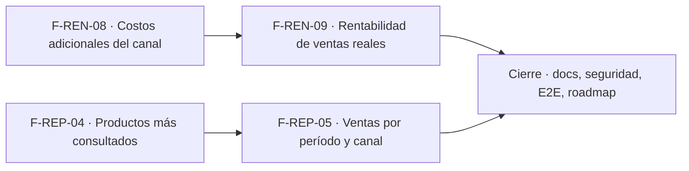

# Tasks: Inicio, rentabilidad y reportes · Rentabilidad real y reportes de ventas

**Input**: [spec.md](./spec.md) y [plan.md](./plan.md) · **Épica**: MSF-192
**Formato**: `- [ ] T### [P] [Historia][USx] descripción (FR/SC)`. `[P]` = paralelizable (archivos distintos, sin dependencia dentro del mismo grupo). Cada FR/SC tiene **una sola** tarea dueña. Las dependencias y el orden son **solo dentro de la misma historia**; entre historias rige la tabla *Plan de ejecución*.
**Validación por historia**: `pnpm test:db`, `pnpm lint`, `pnpm build` y `pnpm test:web` verdes antes de cerrar la fase. Cada migración lleva su reversión en el encabezado y re-verifica el esquema (Principio VII).

## Phase 1: F-REN-08 · Costos adicionales del canal

**Goal**: catálogo de costos adicionales por empresa, margen que los descuenta y sección en `/rentabilidad`.

- [ ] T001 [F-REN-08][US1] Migración `supabase/migrations/20270201100000_costos_adicionales_canal.sql`: tabla `dominio.costos_adicionales_canal` (RLS por organización y `rentabilidad`; sin políticas de escritura; `anon` sin privilegios; nombre único por empresa entre activos; valor ≥ 0, porcentaje ≤ 100; reversión en el encabezado; esquema `dominio` re-verificado) (FR-001) (verificación: pgTAP T005)
- [ ] T002 [F-REN-08][US1] Migración `20270201100010_costos_adicionales_rpc.sql`: `public.listar_costos_adicionales`, `guardar_costo_adicional`, `dar_baja_costo_adicional` (`security definer`, `search_path = ''`, exigen `edicion` en `rentabilidad` y empresa accesible; `revoke … from public, anon`; `grant execute … to authenticated`) (FR-002) (verificación: pgTAP T005)
- [ ] T003 [F-REN-08][US1] Migración `20270201100100_analitica_margen_costos_adicionales.sql`: `analitica.costos_adicionales_de(...)` y redefinición compatible de `analitica.margen_producto_canal` (columna `costos_adicionales` al final; `margen` los descuenta; sin costos los valores no cambian; vistas derivadas lo heredan; reversión = vista anterior) (FR-003) (verificación: pgTAP T005)
- [ ] T004 [F-REN-08][US1] Contrato `contracts/rentabilidad-real-y-reportes.md`: firmas de las RPC y de la vista ajustada con su línea `BREAKING` (semántica de `margen`) (soporte de FR-002 y FR-003)
- [ ] T005 [P] [F-REN-08][US1] pgTAP `supabase/tests/database/costos_adicionales_canal.test.sql`: casos 1–4 y 6 de US1, valores iguales a MSF-120 sin costos, vistas derivadas, permisos de las RPC, `anon` sin ejecución, `rls_en_toda_tabla` (SC-001)
- [ ] T006 [P] [F-REN-08][US1] pgTAP `supabase/tests/database/costos_adicionales_aislamiento.test.sql`: dos organizaciones, Administración solo lee, roles sin `rentabilidad` sin acceso (SC-002)
- [ ] T007 [F-REN-08][US1] `apps/web/src/pages/rentabilidad/`: sección «Costos adicionales» (lista de la empresa activa, diálogo alta/edición con `SelectorEmpresas` en «Aplica a», baja, validaciones con mensajes de negocio, estados compartidos, teclado/lector, 320/768/1440 px; invalida y recarga al cambiar de empresa y cierra con aviso el diálogo abierto) (FR-004)
- [ ] T008 [F-REN-08][US1] Permisos de la sección: botones de edición solo con `edicion`; Administración en solo lectura; `AccesoRestringido` sin `lectura` (FR-005)
- [ ] T009 [F-REN-08][US1] Vitest de la sección: lista, alta, edición, baja, validaciones, cambio de empresa de la barra superior (diálogo cerrado, sin datos de la anterior), solo lectura (SC-003)
- [ ] T010 [F-REN-08][US1] Capturas `pnpm --filter @platform/web pantallas:capturar` a 320/768/1440 px y revisión contra el sistema de diseño; diferencias anotadas en el PR (soporte de FR-004)

**Checkpoint F-REN-08**: `pnpm test:db`, `pnpm lint`, `pnpm build` y `pnpm test:web` verdes.

## Phase 2: F-REN-09 · Rentabilidad de ventas reales

**Goal**: guardar costo y cotización en cada línea al confirmar, vista de margen real y pestaña `Ventas reales`. (L: si hace falta, se parte en captura / vista / tablero; las tareas ya están separadas.)

- [ ] T011 [F-REN-09][US2] Migración `supabase/migrations/20270201110000_comprobante_lineas_costo_cotizacion.sql`: columnas nulables `costo_unitario` y `cotizacion` en `dominio.comprobantes_venta_lineas` (aditiva, sin política nueva, reversión en el encabezado; esquema `dominio` re-verificado) (FR-006) (verificación: pgTAP T014)
- [ ] T012 [F-REN-09][US2] Migración `20270201110100_confirmar_comprobante_costo_cotizacion.sql`: `public.confirmar_comprobante(uuid)` (misma firma y grants) guarda costo en pesos y cotización por línea al confirmar, idempotente; verificar qué RPC escribe las líneas de notas de crédito y aplicar la misma captura (FR-007) (verificación: pgTAP T014)
- [ ] T013 [F-REN-09][US2] Migración `20270201110200_analitica_rentabilidad_ventas_real.sql`: `analitica.rentabilidad_ventas_real` (empresa × producto × fecha; predicado y signo de `analitica.*` sin reimplementar; vendido, costo, costos adicionales vigentes y margen; excluye líneas sin costo; `select` al rol de Superset; EXPLAIN del empuje de `organizacion_id`) (FR-008) (verificación: pgTAP T014)
- [ ] T014 [P] [F-REN-09][US2] pgTAP `supabase/tests/database/rentabilidad_ventas_real.test.sql`: casos 1–5 de US2, cambio de costo/cotización posterior, doble confirmación, nota de crédito, anuladas/presupuestos/borradores, producto dado de baja, neto ≤ 0, `anon`/`authenticated` sin acceso, `rls_en_toda_tabla` (SC-004)
- [ ] T015 [P] [F-REN-09][US2] pgTAP `supabase/tests/database/rentabilidad_ventas_real_aislamiento.test.sql`: dos organizaciones, 403 del token y ausencia de costo/margen para roles sin `rentabilidad` (SC-005)
- [ ] T016 [F-REN-09][US2] Dataset y tablero «Rentabilidad · Ventas reales» en `infra/superset/dashboards/rentabilidad/` (rango Desde/Hasta, totales, desglose por empresa y producto, margen %, estado por umbral, vacío, nota de ventas sin costo) sin Mercado Libre (FR-009) (verificación: Vitest T019 e importador)
- [ ] T017 [F-REN-09][US2] Registro idempotente en `reportes` (`seccion = 'rentabilidad'`, rol por defecto `administracion`) y test del importador (soporte de FR-009) (verificación: `pnpm test:superset:importar-dashboards`)
- [ ] T018 [F-REN-09][US2] `apps/web/src/pages/rentabilidad/`: pestaña `Ventas reales` con `ReporteEmbebido`, estados compartidos, `AccesoRestringido` (sin token, tampoco ante 403), accesibilidad y 320/768/1440 px (soporte de FR-009)
- [ ] T019 [F-REN-09][US2] Vitest de la pestaña: vacío, error/reintento, acceso restringido, sin Mercado Libre, teclado/lector, cambio de empresa que no deja datos ajenos (SC-006)
- [ ] T020 [F-REN-09][US2] Capturas `pantallas:capturar` a 320/768/1440 px y revisión contra el sistema de diseño; diferencias anotadas en el PR (soporte de FR-009)
- [ ] T021 [F-REN-09][US2] Contrato: agregar a `contracts/rentabilidad-real-y-reportes.md` las columnas nuevas de `comprobantes_venta_lineas` y la vista `rentabilidad_ventas_real` (soporte de FR-006 y FR-008)
- [ ] T022 [F-REN-09][US2] Verificación manual con datos de prueba: confirmar una factura, cambiar costo y cotización, comprobar que el margen real no se mueve; documentar en el PR (soporte de FR-007)

**Checkpoint F-REN-09**: `pnpm test:db`, `pnpm lint`, `pnpm build` y `pnpm test:web` verdes.

## Phase 3: F-REP-04 · Productos más consultados

**Goal**: reporte de productos más consultados por WhatsApp en un período.

- [ ] T023 [F-REP-04][US3] Migración `supabase/migrations/20270201120000_analitica_consultas_producto_mas_consultado.sql`: `analitica.consultas_producto_mas_consultado` (empresa × producto × fecha desde `dominio.intereses_whatsapp`; `organizacion_id`, `empresa_id`, `empresa_nombre`; sin costo ni margen; sin acceso para `anon`/`authenticated`; reversión en el encabezado) (FR-010) (verificación: pgTAP T024)
- [ ] T024 [P] [F-REP-04][US3] pgTAP `supabase/tests/database/consultas_mas_consultados.test.sql`: orden, conteo por rango, última consulta, empresa, vacío, `anon`/`authenticated` sin acceso (SC-007)
- [ ] T025 [P] [F-REP-04][US3] pgTAP `supabase/tests/database/consultas_mas_consultados_aislamiento.test.sql`: dos organizaciones y empresas no accesibles, sin acceso sin sección `reportes` (SC-008)
- [ ] T026 [F-REP-04][US3] Paquete Superset propio `infra/superset/dashboards/consultas-reportes/` (dataset, gráfico y tablero «Productos más consultados», `reportes.json` con `seccion = 'reportes'`, `filtro_empresa: true`, rol `administracion`) (FR-011) (verificación: Vitest T029 e importador)
- [ ] T027 [F-REP-04][US3] Importación idempotente del paquete y su test (soporte de FR-011) (verificación: `pnpm test:superset:importar-dashboards`)
- [ ] T028 [F-REP-04][US3] `apps/web/src/pages/ventas-reportes/`: pestaña «Productos más consultados» con `TableroReporte` y `FiltrosPeriodo` reutilizados, estados compartidos, `AccesoRestringido`, accesibilidad y 320/768/1440 px (soporte de FR-011)
- [ ] T029 [F-REP-04][US3] Vitest de la pestaña: vacío, error/reintento, acceso restringido, rango, filtro de empresa, cambio de empresa (SC-009)
- [ ] T030 [F-REP-04][US3] Capturas `pantallas:capturar` y revisión contra el sistema de diseño; diferencias anotadas en el PR (soporte de FR-011)

**Checkpoint F-REP-04**: `pnpm test:db`, `pnpm lint`, `pnpm build` y `pnpm test:web` verdes.

## Phase 4: F-REP-05 · Ventas por período y canal

**Goal**: reporte de ventas por período y canal (empresa/tienda).

- [ ] T031 [F-REP-05][US4] Migración `supabase/migrations/20270201130000_analitica_ventas_periodo_canal.sql`: `analitica.ventas_periodo_canal` (empresa × fecha; comprobantes, unidades y facturado con IVA; predicado y signo de `analitica.*`; sin costo ni margen; sin acceso para `anon`/`authenticated`; EXPLAIN del empuje de filtros; reversión en el encabezado) (FR-012) (verificación: pgTAP T032)
- [ ] T032 [P] [F-REP-05][US4] pgTAP `supabase/tests/database/ventas_periodo_canal.test.sql`: cuadre con `total_con_iva`, nota de crédito resta, presupuestos/borradores/anulados fuera, rango, vacío, sin Mercado Libre (SC-010)
- [ ] T033 [P] [F-REP-05][US4] pgTAP `supabase/tests/database/ventas_periodo_canal_aislamiento.test.sql`: dos organizaciones y empresas no accesibles, sin acceso sin sección `reportes` (SC-011)
- [ ] T034 [F-REP-05][US4] Paquete Superset propio `infra/superset/dashboards/ventas-periodo-canal/` (dataset, gráficos y tablero «Ventas por período y canal» con agrupación por día/semana/mes, `reportes.json` con `seccion = 'reportes'`, `filtro_empresa: true`, rol `administracion`) (FR-013) (verificación: Vitest T037 e importador)
- [ ] T035 [F-REP-05][US4] Importación idempotente del paquete y su test (soporte de FR-013) (verificación: `pnpm test:superset:importar-dashboards`)
- [ ] T036 [F-REP-05][US4] `apps/web/src/pages/ventas-reportes/`: pestaña «Ventas por período y canal» con `TableroReporte` y `FiltrosPeriodo`, estados compartidos, `AccesoRestringido`, accesibilidad y 320/768/1440 px (soporte de FR-013)
- [ ] T037 [F-REP-05][US4] Vitest de la pestaña: vacío, error/reintento, acceso restringido, rango, filtro de empresa, cambio de empresa, sin Mercado Libre (SC-012)
- [ ] T038 [F-REP-05][US4] Capturas `pantallas:capturar` y revisión contra el sistema de diseño; diferencias anotadas en el PR (soporte de FR-013)

**Checkpoint F-REP-05**: `pnpm test:db`, `pnpm lint`, `pnpm build` y `pnpm test:web` verdes.

## Phase 5: Cierre

- [ ] T039 [P] [CIERRE] Documentación: `docs/rentabilidad.md`, `docs/ventas-reportes.md`, `docs/operar-superset.md` y fila/sección de `docs/roadmap-template.md`; `pnpm docs:check` verde (FR-014)
- [ ] T040 [P] [CIERRE] Revisión de seguridad de la superficie nueva (esquema `analitica` cerrado, rol de Superset, token por sección, costo/margen solo con `rentabilidad`, RPC sin `anon`) y esquema de cada objeto contra el Principio VII (FR-015)
- [ ] T041 [CIERRE] E2E de los cuatro reportes y de la sección de costos con Administrador, Administración y Operador/Consulta (SC-013)
- [ ] T042 [CIERRE] `pnpm lint`, `pnpm build`, `pnpm infra:config`, `pnpm test`, `rls_en_toda_tabla`, `pnpm prototipo:check` y `pnpm matriz:check` (SC-014)

**Checkpoint Cierre**: ninguna tarea queda `[ ]` sin hacerse o cerrarse con `Desvío:` y seguimiento trazado.

## Dependencias

Dentro de F-REN-08: T001 → T002 → T003 → T004; T005 [P] y T006 [P] tras T003; T007 tras T003; T008 tras T007; T009 tras T008; T010 tras T007.
Dentro de F-REN-09: T011 → T012 → T013 → T021; T014 [P] y T015 [P] tras T013; T016 tras T013; T017 tras T016; T018 tras T017; T019 y T020 tras T018; T022 tras T012.
Dentro de F-REP-04: T023 → (T024 [P], T025 [P]); T026 tras T023; T027 tras T026; T028 tras T027; T029 y T030 tras T028.
Dentro de F-REP-05: T031 → (T032 [P], T033 [P]); T034 tras T031; T035 tras T034; T036 tras T035; T037 y T038 tras T036.
Cierre: T039 [P] y T040 [P] cuando todas las historias estén mergeadas; T041 → T042.
Entre historias: F-REN-09 usa `analitica.costos_adicionales_de` y el archivo de pestañas de `/rentabilidad` que toca F-REN-08; F-REP-05 comparte con F-REP-04 el archivo de pestañas de `ventas-reportes/`. Cada una trae su propio paquete Superset y su propia migración (sin encadenar entre sí).

## Plan de ejecución (historias)

| Historia | Depende de | Grupo |
|----------|------------|-------|
| F-REN-08 | — | 1 |
| F-REP-04 | — | 1 |
| F-REN-09 | F-REN-08 | 2 |
| F-REP-05 | F-REP-04 | 2 |
| [Cierre] | F-REN-08, F-REN-09, F-REP-04, F-REP-05 | 3 |

