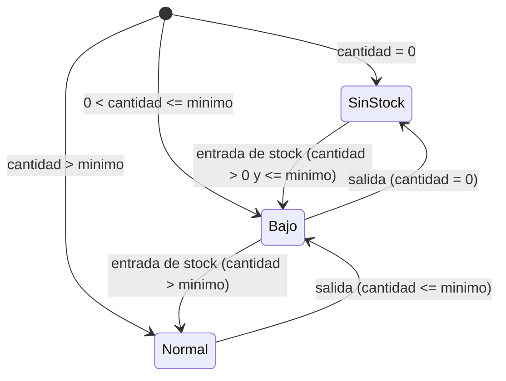
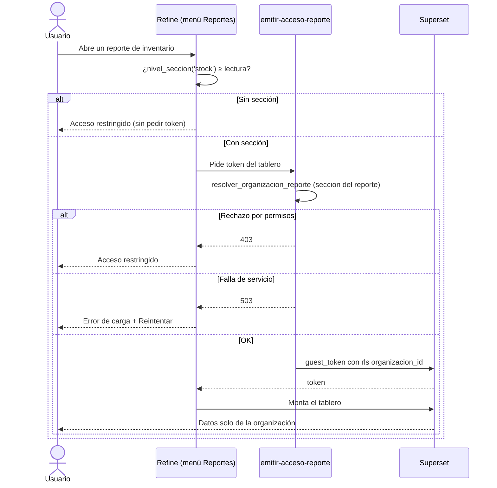
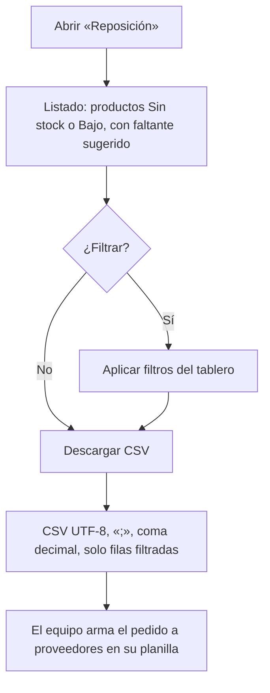

# Feature Specification: Inicio, rentabilidad y reportes · Reportes de inventario y exportación

**Épica**: MSF-140 · **Spec**: `reportes-de-inventario-y-exportacion` · **Hito**: Etapa 2 (desde enero de 2027) · **Prioridad**: P1 · **Horas aprox.**: 16 · **Alcance (Jira)**: etapa-2
**Alcance de entrega**: `refine`, `supabase`, `superset` (sin `kestra` ni `workers`: el cálculo es SQL y los tableros y la descarga los sirve Superset).
**Fuente**: especificación de Nicolás cargada en la épica (Jira) y artefactos del producto (documento del componente, Roadmap, Funcionalidades, Relevamiento). Esta spec **traduce**; no agrega alcance.

## Regla de fuentes (literal de la épica)

1. Comportamiento y datos: mandan los requisitos y escenarios de esta historia.
2. Qué se ve (disposición, textos, estados, popups, flujos): el prototipo validado es referencia visual, no hace falta que quede extremadamente idéntico; los flujos (si hay) aclaran estados y acciones.
3. Cómo se construye (componentes, estilos y patrones): mandan el template y el system design del producto (épica Plataforma · Sistema de diseño). No copiar el HTML ni el CSS del prototipo: reproducir lo que muestra con los componentes del template y los tokens del sistema de diseño.
4. El prototipo muestra más que esta historia: implementar solo lo que piden los requisitos de esta historia; otras secciones, botones o diálogos son de otras historias.
5. Si algo no se puede igualar con el template / el sistema de diseño: usar lo más cercano, sin inventar, y anotar la diferencia en la descripción del PR.
6. Si el prototipo y los requisitos se contradicen: requisitos para el comportamiento, prototipo para lo visual, y dejar la contradicción anotada en el PR.

## Objetivo

Al terminar, el equipo ve el valor del inventario, arma el pedido a proveedores desde el listado de reposición y descarga cualquier reporte en CSV tal como lo filtró.

## Modelo y supuestos

- **«Reportes» no es una sección propia de la matriz de permisos** (supuesto de la épica): cada reporte sigue la sección de sus datos — inventario y reposición, **Stock** (`stock`); publicaciones, Mercado Libre — y se agrupan en un menú «Reportes» del panel. *Ver «Decisiones abiertas» 2: el repo ya tiene una fila `reportes` en la matriz (usada por «Reportes de ventas»); esta épica no la usa para inventario.*
- La exportación **sale de Superset** (descarga de la tabla con los filtros aplicados), con permiso de descarga solo para roles con acceso al reporte.
- El CSV usa **UTF-8, punto y coma como separador y coma decimal**, para abrirse bien en Excel en español.
- El reporte calcula **Sin stock, Bajo y Normal** con las existencias y el mínimo de MSF-136, **no** con la pantalla de alertas ni el stock único entre canales (MSF-231 es «relacionada», sin bloqueo).
- **Costo en moneda y cotización**: los costos pueden estar en USD; se convierten a pesos con la cotización vigente (MSF-116), por la misma función que ya usa Rentabilidad (`private.a_pesos`, envuelta en `analitica.a_pesos`).
- **Template**: el embebido de Superset por organización existe (spec 007). El template **no** trae exportación de datos a planilla ni vistas de stock: las vistas `analitica.*` de inventario, los tableros y la descarga son nuevos.
- **Bloqueos**: MSF-136 (tabla `existencias`, mínimos F-STK-05, entradas F-STK-02) y MSF-116 (cotización vigente; por esa cadena llega MSF-114, que trae costo y moneda). **Bloquea a** MSF-128 (usa F-REP-06). **Relacionadas sin bloqueo**: MSF-231, MSF-192, MSF-265 (reutilizan la exportación pero no la requieren).
- **Estado actual verificado en el repo** (existe, no se recrea): `dominio.existencias` con `minimo` y `public.stock_estados` (migración `20261017160000`), `dominio.productos` (`sku`, `categoria_id`, `moneda`, `proveedor_id`, `codigo_proveedor`), `dominio.producto_costos` (RLS por sección `rentabilidad`), `dominio.existencias_deposito` y `dominio.depositos`, `private.a_pesos`, el esquema `analitica` con el rol `superset_analitica`, `public.reportes` (+ `seccion`, `filtro_empresa`), `emitir-acceso-reporte`, el importador `infra/superset/importar-dashboards.mjs`, `ReporteEmbebido`, y el rol guest de Superset con `can_csv` (`infra/superset/configurar_embebido.py`). **No existe** y lo construye esta épica: las vistas `analitica` de inventario/reposición, sus dos tableros YAML, el menú «Reportes» con sus pantallas y la configuración del CSV de Superset (`CSV_EXPORT` no está en `superset_config.py`).
- **Horas**: 16 h (M + S + S).

### Esquema de datos (Constitución, Principio VII)

| Objeto | Esquema | Historia | Justificación | RLS / acceso |
|--------|---------|----------|---------------|--------------|
| Vista `analitica.inventario_productos_stock` (+ funciones de apoyo existentes `analitica.a_pesos`) | `analitica` (existente, **solo vistas**) | F-REP-01 | Contrato de lectura para Superset; no almacena datos; cada fila lleva `organizacion_id`. | Sin acceso para `anon`/`authenticated`; `select` al rol `superset_analitica`; el aislamiento lo fuerza la cláusula `rls` del guest token. |
| Vista `analitica.inventario_reposicion` | `analitica` | F-REP-02 | Ídem. | Ídem. |
| Alta idempotente de reportes en `public.reportes` (datos, vía `reportes.json` + importador) | `public` (plataforma, spec 007) | F-REP-01, F-REP-02 | Catálogo de reportes embebibles: es plataforma. | RLS existente de `reportes*`; sin tablas nuevas. |
| Configuración `CSV_EXPORT` de Superset | n/a (config de Superset) | F-REP-06 | Infra, no datos. | Descarga solo con token emitido por `resolver_organizacion_reporte`. |

**No se crean tablas nuevas.** La prueba pgTAP `rls_en_toda_tabla` recorre `public` + `dominio` y debe seguir verde. Todas las migraciones son aditivas; reversión en `plan.md`.

## User Scenarios & Testing *(mandatory)*

### User Story 1 - Reporte de productos y stock (F-REP-01, P1, talla M)

Como equipo quiero ver todos los productos con su stock, costo y valor, y el valor total del inventario, filtrables, para saber cuánto vale lo que tenemos.

**Why this priority**: es el reporte base del inventario; establece la vista, el menú «Reportes» y el patrón de tablero que la otra historia reutiliza.

**Independent Test**: con productos de ejemplo (costos en ARS y USD, con y sin cotización), el tablero lista cada producto con cantidad, costo en pesos y valor (cantidad × costo), y el total coincide con la suma de las filas; un usuario sin sección `stock` ve «Acceso restringido».

**Acceptance Scenarios**:

1. **Given** productos con costo en USD y una cotización vigente, **When** abro el reporte, **Then** el costo y el valor aparecen convertidos a pesos con esa cotización (`FR-002`).
2. **Given** un usuario sin la sección `stock`, **When** entra a la ruta, **Then** ve «Acceso restringido» y no se emite token (`FR-004`, `SC-002`).
3. **Given** filtros aplicados, **Then** el valor total del inventario refleja solo las filas filtradas (`FR-003`).
4. **Given** un producto sin costo cargado, **Then** aparece con stock y sin valor (no se inventa un costo) (`FR-002`).

### User Story 2 - Productos sin stock o con stock bajo (F-REP-02, P1, talla S)

Como equipo quiero un listado de reposición con los productos sin stock o con stock bajo y el faltante sugerido, para armar el pedido a proveedores.

**Why this priority**: es el uso operativo del inventario (reponer); depende del estado del stock, no de los costos.

**Independent Test**: con productos Sin stock, Bajo y Normal, el listado muestra solo los dos primeros, con el faltante sugerido calculado y ordenados por severidad.

**Acceptance Scenarios**:

1. **Given** productos con cantidad 0, cantidad ≤ mínimo y cantidad > mínimo, **When** abro el reporte, **Then** aparecen solo los dos primeros, con su estado (`FR-005`).
2. **Given** un producto con mínimo 10 y cantidad 4, **Then** el faltante sugerido es 6 (regla provisional, ver Decisiones abiertas 4) (`FR-006`).
3. **Given** el listado filtrado, **Then** se puede descargar tal como se filtró (cubierto por F-REP-06, `FR-007`).

### User Story 3 - Exportar reportes (F-REP-06, P1, talla S)

Como equipo quiero descargar cualquier reporte en CSV tal como lo filtré, para trabajarlo en Excel.

**Why this priority**: lo reutiliza MSF-128 y lo aprovechan los demás reportes; sin esto los reportes son solo de lectura.

**Independent Test**: se descarga la tabla de un tablero con un filtro aplicado y el CSV tiene solo las filas filtradas, en UTF-8, con `;` y coma decimal, y abre sin romper tildes en Excel en español.

**Acceptance Scenarios**:

1. **Given** un reporte con filtros, **When** descargo la tabla, **Then** el CSV trae las filas filtradas (`FR-007`, `SC-004`).
2. **Given** un número decimal (p. ej. 1234,5), **Then** sale con coma decimal y el separador es `;` (`FR-008`, `SC-005`).
3. **Given** un usuario sin acceso al reporte, **When** pide la descarga, **Then** no hay token y no puede descargar (`FR-009`, `SC-006`).

## Flujos

### F1 · Estado del stock de un producto (reporte de reposición)



Estados Sin stock / Bajo / Normal calculados con `existencias` y el mínimo de MSF-136 (`public.stock_estados`: `sin_stock`, `stock_bajo`, `disponible`): `FR-005`. Los movimientos que cambian el estado los registra Stock (MSF-136); **fuera de alcance** de esta épica (solo se lee). Con mínimo 0 cualquier cantidad > 0 es Normal (regla de MSF-136).

### F2 · Acceso al reporte y apertura del tablero



Dueños: restricción por sección `FR-004`; pantalla, error y reintento `FR-001`/`FR-005`. Pasos sin dueño: ninguno.

### F3 · Armado del pedido a proveedores desde la reposición



Dueños: listado y faltante `FR-005`/`FR-006`; descarga `FR-007`/`FR-008`. El armado del pedido es un paso **manual externo**: **fuera de alcance** crear órdenes de compra o enviar pedidos (la épica solo pide el listado y su descarga).

### F4 · Descarga de un reporte en CSV

```mermaid
sequenceDiagram
  actor U as Usuario
  participant S as Superset (tablero embebido)
  U->>S: Aplica filtros en el tablero
  U->>S: Descarga la tabla (CSV)
  S->>S: ¿el guest token permite descargar? (can_csv)
  alt Token válido (rol con acceso al reporte)
    S-->>U: .csv con las filas filtradas (UTF-8, «;», coma decimal)
  else Sin token / sin acceso
    S-->>U: Sin descarga
  end
```

Dueños: filas filtradas `FR-007`; formato `FR-008`; permiso `FR-009`. Pasos sin dueño: ninguno.

## Requirements *(mandatory)*

### F-REP-01 · Reporte de productos y stock

- **FR-001**: DEBE existir el menú **«Reportes»** del panel que agrupa los reportes y la pantalla **«Productos y stock»** (ruta `/reportes/inventario`), con el tablero embebido (`ReporteEmbebido`), título y estados compartidos de carga, vacío, error con `Reintentar` y éxito; usable con teclado y lector de pantalla, a 320/768/1440 px. Sin identificadores técnicos como identidad visible. **Verificación**: Vitest `apps/web/src/pages/reportes/*.test.tsx` + capturas 320/768/1440.
- **FR-002**: DEBE existir la vista `analitica.inventario_productos_stock` con una fila por producto activo: `organizacion_id`, `producto_id`, `producto_nombre`, `sku`, `categoria`, `cantidad` (de `dominio.existencias`), `minimo`, `estado`, `moneda_costo`, `costo` (en su moneda), `costo_ars` (convertido con la cotización vigente por `analitica.a_pesos`) y `valor_ars` (= `cantidad × costo_ars`). Un producto sin costo (o USD sin cotización) aparece sin `costo_ars`/`valor_ars`: no se inventa un valor. **Verificación**: pgTAP `supabase/tests/database/reportes_inventario_productos_stock.test.sql`.
- **FR-003**: DEBE existir el dataset y el tablero Superset **«Inventario · Productos y stock»** versionados en YAML bajo `infra/superset/dashboards/inventario/`, con la tabla de productos y stock, el **valor total del inventario** (suma de `valor_ars`) y filtros nativos (producto/SKU, categoría, estado). El valor total refleja las filas filtradas. Importado con `infra/superset/importar-dashboards.mjs` y registrado en `public.reportes` de forma idempotente con `seccion = 'stock'`. **Verificación**: `pnpm test:superset:importar-dashboards` + `pnpm infra:config`.
- **FR-004**: El acceso a los reportes de inventario DEBE seguir la sección de sus datos (**Stock**): `resolver_organizacion_reporte` (con `reportes.seccion = 'stock'`) devuelve acceso solo con `lectura` o `edicion` en `stock`; sin ella la pantalla muestra «Acceso restringido» sin pedir token y la función `emitir-acceso-reporte` responde 403. «Reportes» **no** se agrega como sección de la matriz. **Verificación**: Vitest (pantalla) + pgTAP de `resolver_organizacion_reporte` con el reporte nuevo.

### F-REP-02 · Productos sin stock o con stock bajo

- **FR-005**: DEBE existir la vista `analitica.inventario_reposicion` con los productos activos cuyo estado es **Sin stock** o **Bajo** (misma regla que `public.stock_estados`: cantidad = 0, o 0 < cantidad ≤ mínimo; un producto Normal no aparece), con `organizacion_id`, `producto_id`, `producto_nombre`, `sku`, `categoria`, `proveedor` (nombre, si el producto tiene `proveedor_id`), `codigo_proveedor`, `cantidad`, `minimo`, `estado` y `faltante_sugerido`. El tablero **«Inventario · Reposición»** (YAML en `infra/superset/dashboards/inventario/`, `seccion = 'stock'`) lo muestra ordenado por severidad (Sin stock antes que Bajo), con filtros nativos de producto/SKU, categoría, estado y proveedor, y la pantalla **«Reposición»** (`/reportes/reposicion`) lo embebe. **Verificación**: pgTAP `reportes_inventario_reposicion.test.sql` + `pnpm test:superset:importar-dashboards` + Vitest.
- **FR-006**: El **faltante sugerido** DEBE calcularse como `minimo − cantidad` (lo que falta para volver al mínimo; nunca negativo) — regla provisional hasta resolver la Decisión abierta 4; el cálculo vive en un único lugar (la vista), de modo que cambiar a un objetivo de cobertura toca solo esa expresión. **Verificación**: pgTAP (mínimo 10 / cantidad 4 → 6; Sin stock con mínimo 10 → 10).

### F-REP-06 · Exportar reportes

- **FR-007**: Todo reporte embebido DEBE poder **descargar su tabla en CSV con los filtros aplicados** usando la descarga de Superset (permiso `can_csv` del rol guest ya configurado en `configurar_embebido.py`), sin construir un exportador propio en Refine. La descarga trae solo las filas que el tablero muestra con sus filtros. **Verificación**: prueba de integración documentada en `quickstart`/`docs` (descarga de un tablero con filtro) + `pnpm infra:config`.
- **FR-008**: Superset DEBE configurarse (`CSV_EXPORT` en `infra/superset/superset_config.py`) para exportar **UTF-8, separador `;` y coma decimal**, de modo que el CSV abra bien en Excel en español (tildes y números). La configuración aplica a todos los reportes embebidos. **Verificación**: test de la configuración (`node --test`/pytest sobre `superset_config.py`) + descarga real documentada.
- **FR-009**: La descarga DEBE estar disponible **solo para roles con acceso al reporte**: no se agrega ningún camino de descarga fuera del embebido; sin token (emitido por `resolver_organizacion_reporte` según la sección del reporte) no hay tablero ni descarga. **Verificación**: pgTAP/Vitest de la emisión del token (403 sin sección) + revisión de seguridad del cierre.

### Cierre (docs, seguridad, E2E)

- **FR-010**: `docs/reportes-inventario.md` (vistas, regla de estados y faltante, conversión de costos, permisos, exportación y su configuración, reversión, preguntas abiertas), `docs/operar-superset.md` y `docs/roadmap-template.md` actualizados; revisión de seguridad de la superficie nueva (grants de vistas, `anon` sin acceso, rol `superset_analitica`, costos expuestos en `analitica` frente a la RLS de `producto_costos`, esquema de cada objeto contra el Principio VII); E2E de cada reporte y su descarga. **Verificación**: `pnpm docs:check` + informe de seguridad + E2E.

## Success Criteria

- **SC-001**: pgTAP — la vista de productos y stock suma `valor_ars` = cantidad × costo convertido con la cotización vigente, deja sin valor al producto sin costo y no mezcla organizaciones. **Verificación**: `pnpm test:db`.
- **SC-002**: un usuario sin sección `stock` ve «Acceso restringido» en ambos reportes y el servidor responde 403 al token. **Verificación**: Vitest + pgTAP.
- **SC-003**: pgTAP — la vista de reposición incluye Sin stock y Bajo, excluye Normal, y calcula el faltante sugerido de la FR-006. **Verificación**: `pnpm test:db`.
- **SC-004**: el CSV descargado con un filtro aplicado contiene exactamente las filas filtradas. **Verificación**: E2E de descarga.
- **SC-005**: el CSV sale en UTF-8 con `;` y coma decimal. **Verificación**: test de configuración + E2E de descarga.
- **SC-006**: sin acceso al reporte no hay descarga. **Verificación**: Vitest/pgTAP.
- **SC-007**: `pnpm lint`, `pnpm build`, `pnpm infra:config`, `pnpm test`, `rls_en_toda_tabla` verde, `pnpm prototipo:check`, `pnpm matriz:check` y `pnpm docs:check` verdes. **Verificación**: CI.

## Decisiones abiertas

1. **Roadmap vs. doc del componente.** El Roadmap a diciembre incluye «Reportes y tablero de inicio con Superset» (10 h) en el tercer bloque de diciembre y manda «Rentabilidad y reportes avanzados» a enero; el doc del componente deja estos reportes en Etapa 2 (16 h). Manda el roadmap: Nicolás decide y se alinea. No cambia el alcance de esta spec.
2. **¿«Reportes» como sección propia de la matriz en Etapa 2?** Provisional (supuesto de la épica): **no**; cada reporte sigue la sección de sus datos (`stock`). Nota: el repo ya tiene la fila `reportes` (la usa «Reportes de ventas»); no se toca ni se reutiliza para inventario.
3. **¿El rol Consulta ve costos y valor del inventario, o solo cantidades?** Pregunta abierta de la épica. Hoy el costo vive tras la sección `rentabilidad` (`dominio.producto_costos`), pero las vistas `analitica` corren con privilegios del dueño y el token filtra solo por organización: **quien abre el tablero ve las columnas de costo y valor**. Provisional: un único tablero con `seccion = 'stock'` y costos visibles para todo rol con acceso a Stock. Si la respuesta es «solo cantidades», la salida sin tocar el esquema es separar el valor en un segundo tablero con `seccion = 'rentabilidad'`. Se resuelve antes de implementar F-REP-01.
4. **Faltante sugerido.** ¿Alcanza con volver al mínimo o conviene un objetivo de cobertura (p. ej. el doble del mínimo)? Provisional: volver al mínimo (`minimo − cantidad`); cambiar la regla toca solo la expresión de la vista (FR-006).
5. **Formato del CSV y Excel.** UTF-8 puro puede mostrar mal las tildes en algunas versiones de Excel; Superset permite `utf-8-sig` (UTF-8 con BOM). Provisional: se verifica en la prueba de descarga y, si hace falta, se usa `utf-8-sig` (sigue siendo UTF-8). Es un detalle de FR-008, no cambia el alcance.
6. **Menú «Reportes» y reportes existentes.** La épica agrupa los reportes en un menú «Reportes». Provisional: el menú nace con los dos reportes de inventario; **no** se mueven ni se renombran «Reportes de ventas» ni Rentabilidad (rutas intactas). Reubicarlos queda a decisión de Nicolás.
7. **Reportes de publicaciones (Mercado Libre).** La épica los menciona solo como ejemplo de la regla de permisos; no pide ninguno en esta spec.

## Verificación por requisito

| Requisito | Verificación | Tarea dueña |
|---|---|---|
| FR-001 | Vitest `apps/web/src/pages/reportes/*.test.tsx` + capturas 320/768/1440 px | T004 |
| FR-002 | pgTAP `reportes_inventario_productos_stock.test.sql` | T001 |
| FR-003 | `pnpm test:superset:importar-dashboards` + `pnpm infra:config` | T003 |
| FR-004 | Vitest + pgTAP de `resolver_organizacion_reporte` | T002 |
| FR-005 | pgTAP + importación + Vitest | T006 |
| FR-006 | pgTAP | T007 |
| FR-007 | Prueba de descarga documentada | T010 |
| FR-008 | Test de configuración + descarga real | T009 |
| FR-009 | Vitest/pgTAP del token + revisión de seguridad | T011 |
| FR-010 | `pnpm docs:check` + informe de seguridad + E2E | T012, T013, T014 |
| SC-001 | pgTAP | T001 |
| SC-002 | Vitest + pgTAP | T005 |
| SC-003 | pgTAP | T007 |
| SC-004 | E2E de descarga | T010 |
| SC-005 | Test de configuración + E2E | T009 |
| SC-006 | Vitest/pgTAP | T011 |
| SC-007 | CI | T015 |

## Matriz pantalla↔criterios

La épica **no tiene pantallas dibujadas en el prototipo** (se dibujan al entrar en la etapa): `pnpm prototipo:inventario` no tiene un `.dc.html` de estos reportes que inventariar, así que no hay ítems de prototipo con dueño pendiente. Se implementa con los componentes del template y los tokens del sistema de diseño (regla de fuentes 3). No se inventa UI más allá de lo que piden los requisitos.

### Reportes de inventario (sin `.dc.html`)

| Ítem visible / requerido | Destino | Criterio |
|---|---|---|
| Menú «Reportes» (agrupa los reportes) | En alcance | FR-001 |
| Pantalla «Productos y stock» (tabla de productos con stock, costo, valor) | En alcance | FR-001, FR-002, FR-003 |
| Valor total del inventario | En alcance | FR-003, SC-001 |
| Filtros nativos (producto/SKU, categoría, estado) | En alcance (los pide la usabilidad del reporte y la descarga «tal como lo filtró») | FR-003, FR-005 |
| Pantalla «Reposición» (Sin stock / Bajo + faltante sugerido) | En alcance | FR-005, FR-006 |
| Filtro por proveedor y columna proveedor | En alcance (el pedido es «a proveedores») | FR-005 |
| Descarga CSV de la tabla con filtros | En alcance | FR-007, FR-008, FR-009 |
| «Acceso restringido» / error con `Reintentar` / vacío | En alcance (estados compartidos) | FR-001, FR-004, SC-002 |
| Alta de órdenes de compra / envío de pedidos a proveedores | Fuera de alcance: la épica pide el listado y su descarga, no gestionar pedidos | — |
| Reportes de publicaciones (Mercado Libre), ventas, rentabilidad | Fuera de alcance: son de otras épicas (MSF-128, MSF-338, MSF-192) | — |
| Pantalla de alertas / stock único entre canales | Fuera de alcance: MSF-231 es «relacionada», el reporte no la usa | — |
| Fila **Empresa activa** | **No aplica** (Principio VIII): los datos de inventario son por **organización**, no por empresa — `dominio.existencias` y `dominio.productos` no tienen `empresa_id` — y el prototipo no dibuja selector de empresa. El token filtra por `organizacion_id`. Test: el Vitest de FR-001 verifica que la pantalla no muestra selector propio y que no mezcla organizaciones | FR-001, FR-004 |

## Matriz de trazabilidad Jira ↔ US ↔ FR ↔ tareas

| Jira | Historia | FR / SC | Tareas |
|------|----------|---------|--------|
| F-REP-01 | US1 Reporte de productos y stock | FR-001…004, SC-001, SC-002 | T001–T005 |
| F-REP-02 | US2 Productos sin stock o con stock bajo | FR-005, FR-006, SC-003 | T006–T008 |
| F-REP-06 | US3 Exportar reportes | FR-007…009, SC-004…006 | T009–T011 |
| Tarea de cierre (label `cierre`) | Docs, seguridad, E2E y gates | FR-010, SC-007 | T012–T015 |
