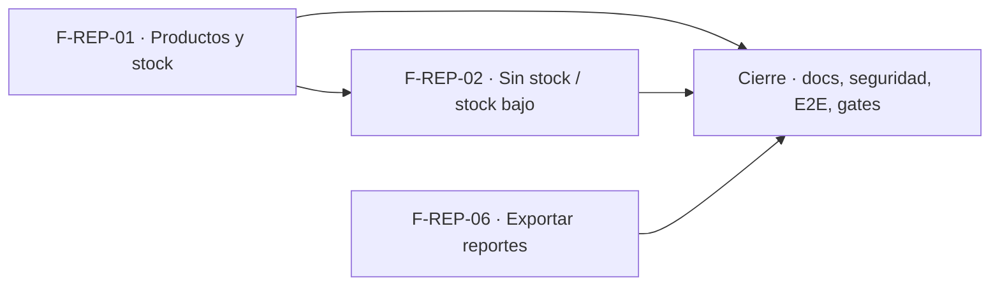

# Tasks: Inicio, rentabilidad y reportes · Reportes de inventario y exportación

**Input**: [spec.md](./spec.md) y [plan.md](./plan.md) · **Épica**: MSF-140
**Formato**: `- [ ] T### [P] [Historia][USx] descripción (FR/SC)`. `[P]` = paralelizable (archivos distintos, sin dependencia dentro del mismo grupo). Cada FR/SC tiene **una sola** tarea dueña. Las dependencias y el orden son **solo dentro de la misma historia**; entre historias rige la tabla *Plan de ejecución*.
**Validación por historia**: `pnpm test:db`, `pnpm lint`, `pnpm build` y `pnpm test:web` verdes antes de cerrar la fase. Cada vista nueva: esquema re-verificado (Principio VII). Cada migración lleva su reversión en el encabezado.

## Phase 1: F-REP-01 · Reporte de productos y stock

**Goal**: vista `analitica.inventario_productos_stock`, tablero «Productos y stock», menú «Reportes» y pantalla `/reportes/inventario`.

- [ ] T001 [F-REP-01][US1] Migración `supabase/migrations/20270201090000_analitica_inventario_productos_stock.sql`: vista `analitica.inventario_productos_stock` (producto activo: `organizacion_id`, `producto_id`, `producto_nombre`, `sku`, `categoria`, `cantidad`, `minimo`, `estado`, `moneda_costo`, `costo`, `costo_ars` vía `analitica.a_pesos`, `valor_ars`; sin costo/cotización → sin valor), `select` solo a `superset_analitica`, reversión en el encabezado, esquema `analitica` re-verificado (FR-002, SC-001) (verificación: pgTAP `reportes_inventario_productos_stock.test.sql` vía `pnpm test:db`, escrito en esta misma tarea: valor = cantidad × costo convertido, sin costo → sin valor, sin mezcla de organizaciones)
- [ ] T002 [P] [F-REP-01][US1] pgTAP `supabase/tests/database/reportes_inventario_acceso.test.sql`: `resolver_organizacion_reporte` con `reportes.seccion = 'stock'` devuelve acceso solo con `lectura`/`edicion` en `stock` y null sin ella (→ 403 en `emitir-acceso-reporte`); `anon`/`authenticated` sin acceso a la vista; `rls_en_toda_tabla` verde (FR-004) (verificación: `pnpm test:db`)
- [ ] T003 [F-REP-01][US1] `infra/superset/dashboards/inventario/`: dataset y tablero «Inventario · Productos y stock» (tabla, valor total del inventario, filtros nativos producto/SKU, categoría, estado), `reportes.json` con `seccion = "stock"` y `filtro_empresa: false`, empaquetado e importación idempotente (FR-003) (verificación: `pnpm test:superset:importar-dashboards` + `pnpm infra:config`)
- [ ] T004 [F-REP-01][US1] `apps/web/src/pages/reportes/` + `apps/web/src/lib/reportes-inventario.ts` + ruta `/reportes/inventario` y menú «Reportes» (ícono propio, visible con sección `stock`): título, `ReporteEmbebido`, estados compartidos (carga/vacío/error con `Reintentar`), teclado y lector, 320/768/1440 px (FR-001) (verificación: Vitest `apps/web/src/pages/reportes/*.test.tsx` vía `pnpm test:web` + `pnpm --filter @platform/web pantallas:capturar` a 320/768/1440 px)
- [ ] T005 [P] [F-REP-01][US1] Vitest `apps/web/src/pages/reportes/*.test.tsx`: «Acceso restringido» sin sección `stock` sin pedir token, error con reintento, sin selector de empresa propio (SC-002) (verificación: `pnpm test:web`; el 403 del servidor lo cubre T002 con `pnpm test:db`)

**Checkpoint F-REP-01**: `pnpm test:db`, `pnpm lint`, `pnpm build` y `pnpm test:web` verdes.

## Phase 2: F-REP-02 · Productos sin stock o con stock bajo

**Goal**: vista `analitica.inventario_reposicion`, tablero «Reposición» y pantalla `/reportes/reposicion`.

- [ ] T006 [F-REP-02][US2] Migración `supabase/migrations/20270201090100_analitica_inventario_reposicion.sql` (vista con Sin stock/Bajo, proveedor, `faltante_sugerido`; reversión en el encabezado), tablero «Inventario · Reposición» en `infra/superset/dashboards/inventario/` (orden por severidad; filtros producto/SKU, categoría, estado, proveedor; `seccion = "stock"`) y pantalla `/reportes/reposicion` en el menú «Reportes» (FR-005) (verificación: pgTAP T007 + `pnpm test:superset:importar-dashboards` + Vitest T008)
- [ ] T007 [P] [F-REP-02][US2] pgTAP `supabase/tests/database/reportes_inventario_reposicion.test.sql`: incluye Sin stock y Bajo, excluye Normal (mínimo 0 con cantidad > 0 es Normal), faltante `minimo − cantidad` (10/4 → 6; Sin stock con mínimo 10 → 10), sin mezcla de organizaciones (FR-006, SC-003) (verificación: `pnpm test:db`)
- [ ] T008 [P] [F-REP-02][US2] Vitest de la pantalla «Reposición»: acceso restringido sin `stock`, estados de carga/error y entrada en el menú «Reportes» (verifica FR-005; sin requisito propio) (verificación: `pnpm test:web`)

**Checkpoint F-REP-02**: `pnpm test:db`, `pnpm lint`, `pnpm build` y `pnpm test:web` verdes.

## Phase 3: F-REP-06 · Exportar reportes

**Goal**: descarga CSV de la tabla con filtros, formato Excel-es y solo para quien tiene acceso.

- [ ] T009 [F-REP-06][US3] `infra/superset/superset_config.py`: `CSV_EXPORT` con UTF-8 (`utf-8-sig` si la prueba lo exige), `sep=";"`, `decimal=","` + test de la configuración (FR-008, SC-005) (verificación: test automatizado `infra/superset/superset_config.test.py` (`python3 -m unittest`/pytest) que importa `superset_config.py` y afirma `CSV_EXPORT` con `sep=";"`, `decimal=","` y encoding UTF-8; más descarga real de la tabla documentada en `docs/reportes-inventario.md`; `pnpm infra:config`)
- [ ] T010 [P] [F-REP-06][US3] Verificar la descarga del rol guest (`can_csv` en `configurar_embebido.py`) sobre un tablero embebido existente con un filtro aplicado: el CSV trae solo las filas filtradas; prueba de integración/E2E documentada (FR-007, SC-004) (verificación: E2E Playwright de descarga con filtro, T014, y procedimiento manual documentado en `docs/reportes-inventario.md`; `pnpm infra:config`)
- [ ] T011 [P] [F-REP-06][US3] Vitest/pgTAP: sin sección no se emite token (403) y por lo tanto no hay tablero ni descarga; no existe otro camino de descarga fuera del embebido (FR-009, SC-006) (verificación: pgTAP `reportes_inventario_acceso.test.sql` (T002) + Vitest `pnpm test:web`)

**Checkpoint F-REP-06**: `pnpm infra:config`, `pnpm test` verdes.

## Phase 4: Cierre (docs, seguridad, E2E, gates)

**Goal**: lo que ninguna historia atiende. Las tareas `[CIERRE]` las ejecuta la Tarea de cierre y **nunca** son prerequisito de una historia.

- [ ] T012 [P] [CIERRE] `docs/reportes-inventario.md`, `docs/operar-superset.md` y fila/sección de `docs/roadmap-template.md`; `pnpm docs:check` verde (FR-010) (verificación: `pnpm docs:check`)
- [ ] T013 [P] [CIERRE] Revisión de seguridad: grants de vistas, `anon` sin acceso, rol `superset_analitica`, costos expuestos en `analitica` frente a la RLS de `producto_costos` (Decisión 3), esquema de cada objeto contra el Principio VII (FR-010) (verificación: informe de seguridad adjunto al PR + `pnpm test:db` con `rls_en_toda_tabla` y los grants de T001/T002)
- [ ] T014 [CIERRE] E2E de cada reporte y su descarga CSV (roles con y sin `stock`, filtro aplicado, formato del archivo) (FR-010, SC-004, SC-005) (verificación: `pnpm test:e2e`)
- [ ] T015 [CIERRE] `pnpm lint`, `pnpm build`, `pnpm infra:config`, `pnpm test`, `rls_en_toda_tabla` verde, `pnpm prototipo:check`, `pnpm matriz:check` y `pnpm docs:check` (SC-007) (verificación: CI, los mismos comandos)

**Checkpoint Cierre**: ninguna tarea queda `[ ]` sin hacerse o cerrarse con `Desvío:` y seguimiento trazado.

## Dependencias

Dentro de F-REP-01: T001 → T002 [P]; T003 tras T001; T004 tras T003; T005 [P] tras T004.
Dentro de F-REP-02: T006 → T007 [P], T008 [P].
Dentro de F-REP-06: T009 → T010 [P], T011 [P].
Cierre: T012 [P] y T013 [P] cuando todas las historias estén mergeadas; T014 → T015 al final.

## Plan de ejecución (historias)

F-REP-02 reutiliza el menú «Reportes», el directorio de tableros y `reportes.json` que crea F-REP-01 (mismos archivos): va después. F-REP-06 solo toca `superset_config.py` y pruebas sobre tableros ya existentes: es independiente y corre en paralelo con F-REP-01.

| Historia | Depende de | Grupo |
|----------|------------|-------|
| F-REP-01 | — | 1 |
| F-REP-06 | — | 1 |
| F-REP-02 | F-REP-01 | 2 |
| [Cierre] | F-REP-01, F-REP-02, F-REP-06 | 3 |

