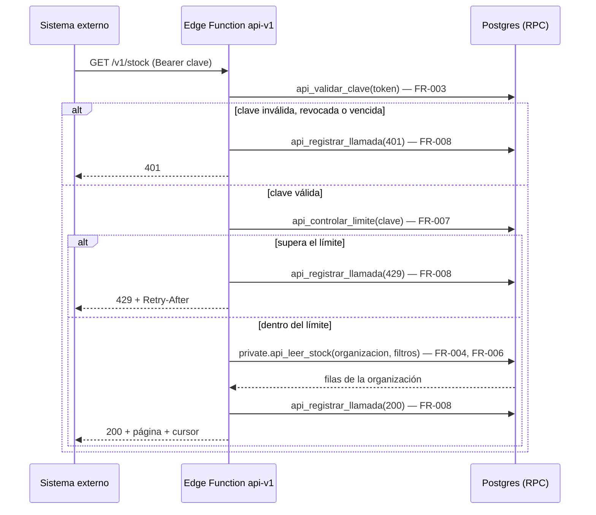
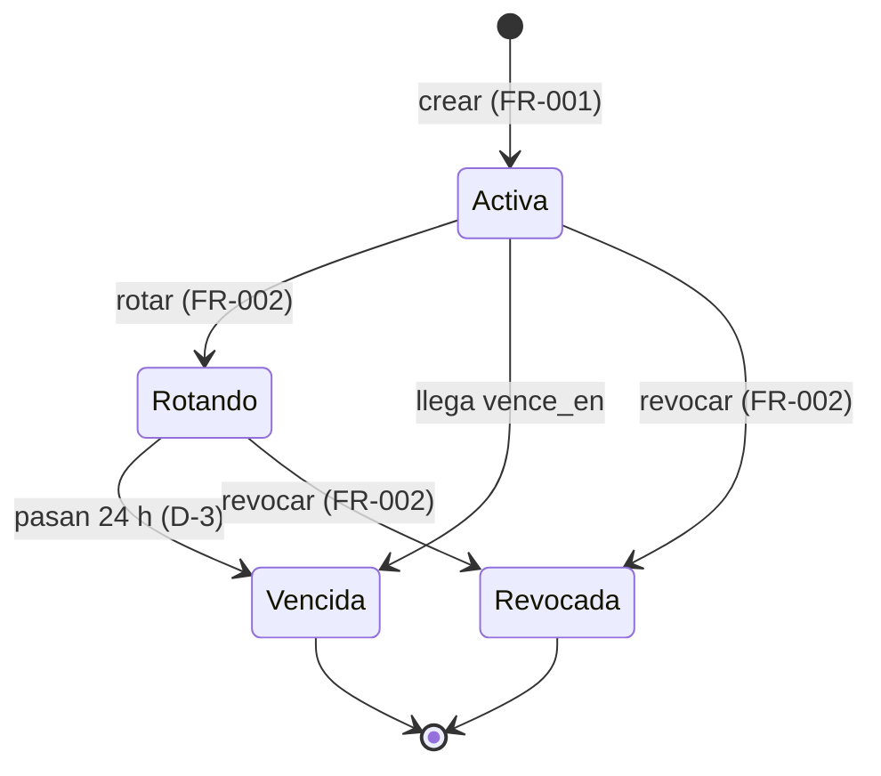
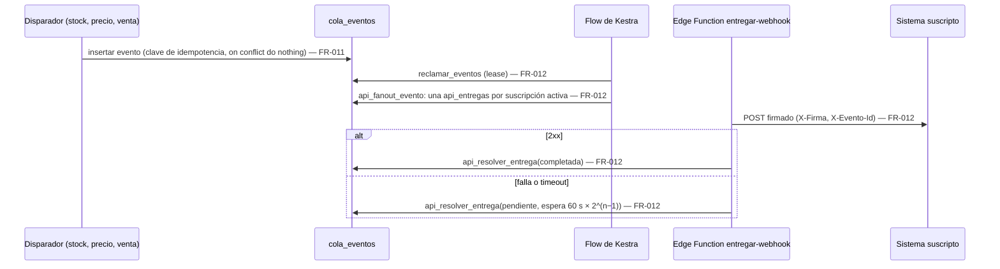
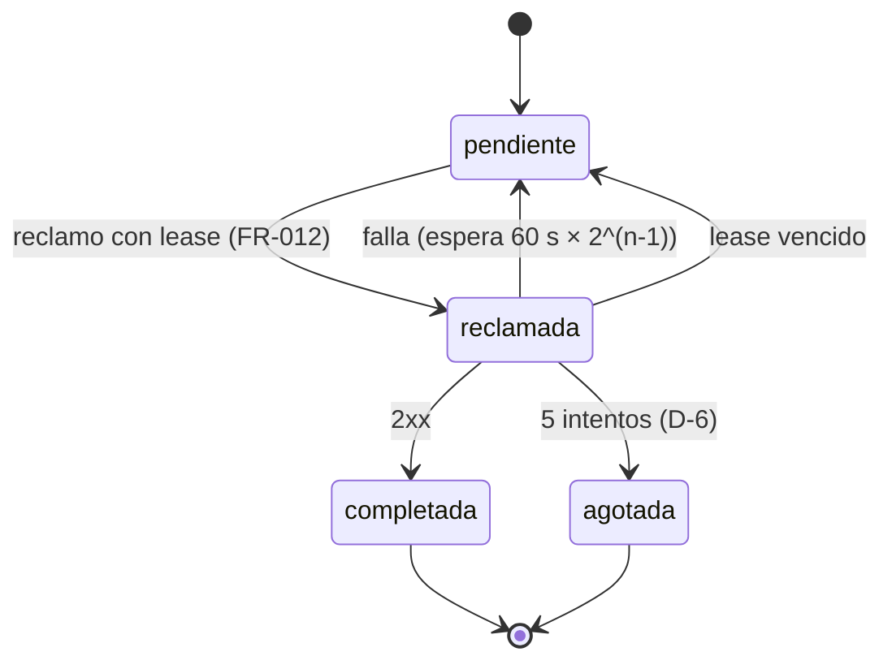
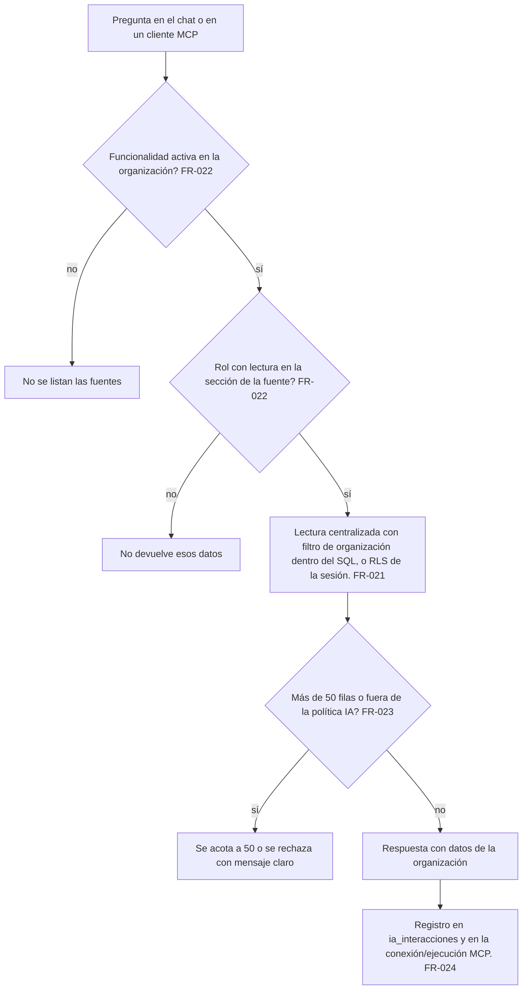

# Feature Specification: Plataforma · API e asistente con IA

**Épica**: MSF-233 · **Spec**: `api-e-asistente-con-ia` · **Estado**: Implementada (dokploy, PR #843, 2026-11-11; ajustes posteriores en #863, #871 y #873) · **Prioridad**: P3 · **Alcance (Jira)**: fuera · **Horas aprox.**: sin estimar (referencia por tallas: F-API-01 L, F-IA-01 M)
**Alcance de entrega**: `refine`, `supabase`, `kestra` (sin `superset` ni `workers`: la API y el asistente corren en Edge Functions; la entrega de avisos y la retención de auditoría las dispara un flow de Kestra, precedente `avisos-reposicion-stock`, `recalcular-alertas-inicio` y `limpieza-evidencia`).
**Fuente**: especificación de Nicolás cargada en la épica (It's a Plan), la orden de retome de MSF-233, las descripciones de MSF-403 (F-API-01) y MSF-411 (F-IA-01) y artefactos del repo. Esta spec **traduce**; no agrega alcance de negocio. Las decisiones D-1…D-10 ya están confirmadas por Nicolás y no se vuelven a preguntar.

> Nota de rama: la orden nombra la rama `epic/MSF-233-api-e-asistente-con-ia`; el worktree de la épica trabaja sobre `epic/MSF-233-plataforma-api-e-asistente-con-ia`. Se entrega en la segunda (no se crea una rama paralela).

## Objetivo

Al terminar, otros sistemas pueden conectarse a la plataforma por una API con avisos de cambios, y quien lo pida cuenta con un asistente que responde sobre catálogo, stock, precios y ventas de su organización.

## Modelo y supuestos

- **Se activa por organización y solo si el cliente lo pide.** Está implementada (ver el estado arriba); cada organización la usa cuando un Administrador crea claves o el superadmin habilita el asistente.
- **F-API-01 no tiene base en el template** (sin claves de API, OpenAPI, webhooks salientes ni límite de uso; roadmap del template #25, #35, #36 y #47). Se construye sobre lo que sí hay: la outbox genérica `public.cola_eventos` (idempotencia, lease y reintentos; ver `docs/stock-eventos.md`), el patrón de lectura centralizada con filtro de organización dentro de SQL (`private.mcp_leer_fila`) y el patrón de credencial con solo el hash persistido (`credenciales_mcp`).
- **F-IA-01 es de configuración.** El template ya trae IA gobernada (`ia_politicas`, `ia_interacciones`), chat flotante (`ChatFlotante`, Edge Function `chat-ia-responder`), servidor MCP (`packages/mcp-server`) y RAG (`indexar-documento`, `preguntar-documentos`). El producto **solo registra las capacidades de consulta** (tablas `capacidades_chat_ia`/`fuentes_chat_ia` y `capacidades_mcp`/`fuentes_mcp`); no se escribe un motor nuevo ni se usa RAG para datos estructurados.
- **Datos que se exponen** (la épica los nombra): catálogo, stock, precios y ventas. Son de solo lectura: ninguna capacidad de ejecución (`ejecucion = false`).
- **Aislamiento**: la organización se deriva **siempre** de la credencial (clave de API) o de la sesión del usuario, nunca de un parámetro del llamador. La service-role solo vive en Edge Functions, nunca en el navegador.
- **Sin pantallas dibujadas en el prototipo** (`design/pantallas/` no tiene `.dc.html` de esta épica; `pnpm prototipo:inventario` no tiene nada que inventariar). La UI nueva (F-API-01) se arma con los componentes del template y los tokens del sistema de diseño (MSF-117); toda diferencia se anota en la descripción del PR. F-IA-01 no agrega pantalla: usa `ia/capacidades-chat` e `ia/capacidades-mcp`.
- **Datos de otras épicas (se consumen, no se recrean)**: `public.cola_eventos` y el evento `stock.actualizado` (F-STK-04), `private.mcp_leer_fila`, `private.puede_chat_leer_funcionalidad`, `private.puede_mcp_leer_funcionalidad`, `private.tiene_feature`, `private.nivel_seccion`, `private.organizacion_id`, `private.es_administrador_de`, las vistas `public.v_productos_listado`, `public.stock_por_deposito`, `public.stock_estados`, `public.depositos_listado` y las tablas `dominio.productos`, `dominio.producto_precios_escala`, `dominio.comprobantes_venta`.
- **Las tablas origen de los eventos nuevos ya están confirmadas** (D-5, verificado en migraciones): precio = `dominio.productos` (`precio_lista`, `moneda`) y `dominio.producto_precios_escala` (`precio`); venta = `dominio.comprobantes_venta` al pasar a `estado = 'confirmada'` y `tipo = 'factura'`. No se inventan tablas.
- **Una migración de base de datos en vuelo a la vez**: F-IA-01 va después de F-API-01 solo por esa razón; no comparten tablas ni código.

### Esquema de datos (Constitución, Principio VII)

Todas las tablas nuevas son **plataforma / integraciones genéricas** → `public`. Ninguna es entidad de negocio del producto, por eso no van a `dominio`. Se re-verifica en plan, tareas, implementación y PR.

| Objeto | Esquema | Historia | Justificación | RLS / acceso |
|--------|---------|----------|---------------|--------------|
| `api_claves` (**nueva**: `id`, `organizacion_id`, `nombre`, `prefijo` unique, `hash` bytea unique, `alcances text[]`, `limite_por_minuto` default 60, `creada_por` (nulo si se da de baja a quien la creó; `on delete set null`), `creada_en`, `vence_en` null, `revocada_en` null, `ultimo_uso_en` null) | `public` | F-API-01 | Credencial de integración genérica por organización; no es dato del negocio. | RLS por `organizacion_id = (select private.organizacion_id())` y Administrador; `grant select` solo de columnas seguras (nunca `hash`); **sin escritura directa** (solo RPC); `anon` sin privilegios; solo el hash se persiste |
| `api_suscripciones` (**nueva**: `id`, `organizacion_id`, `url`, `tipos text[]`, `secreto_vault_id` → `vault.secrets`, `activa`, `creada_por` (nulo si se da de baja a quien la creó), `creada_en`, `actualizada_en`) | `public` | F-API-01 | Suscripción saliente genérica, complemento de `conexiones_oauth` (entrantes). | Igual que `api_claves`; el secreto de firma vive en Vault y no se lee desde la app |
| `api_entregas` (**nueva**: `id`, `organizacion_id`, `evento_id` → `cola_eventos`, `suscripcion_id` → `api_suscripciones`, `estado`, `intentos`, `proximo_intento_en`, `reclamada_en`, `vence_en`, `ultimo_estado_http`, `ultimo_error_sanitizado`, `creada_en`, `actualizada_en`; `unique (evento_id, suscripcion_id)`) | `public` | F-API-01 | Outbox por destinatario, mismo patrón que `cola_eventos`/`despachos_ejecucion`. | select solo Administrador de la organización; escritura solo por funciones `private` (`security definer`) ejecutables por `kestra_orquestacion`/`service_role` |
| `api_llamadas` (**nueva**: `id`, `organizacion_id` null, `clave_id` null, `metodo`, `ruta`, `version`, `estado_http`, `duracion_ms`, `creada_en`) | `public` | F-API-01 | Auditoría de uso de la API; sin cuerpos ni la clave. `organizacion_id`/`clave_id` nulos solo si el token no permite resolver la organización (prefijo desconocido). | select solo Administrador; inserta solo la Edge Function (`service_role`); retención 90 días |
| Funciones `private.api_leer_productos/stock/precios/ventas(p_organizacion_id, p_cursor, p_limite, p_actualizado_desde)` | `private` | F-API-01 | Lectura con el filtro de organización armado **dentro** del SQL (patrón `mcp_leer_fila`); ahí vive el aislamiento, no en TypeScript. | `security definer`, `set search_path = ''`; ejecutables solo por `service_role` |
| RPC `public.crear_clave_api`, `rotar_clave_api`, `revocar_clave_api`, `crear_suscripcion_api`, `actualizar_suscripcion_api`, `eliminar_suscripcion_api` | `public` | F-API-01 | Superficie de ejecución para la pantalla. | `grant execute … to authenticated`, `revoke … from public, anon`; validan Administrador de la organización |
| RPC `public.api_validar_clave`, `api_controlar_limite`, `api_registrar_llamada` | `public` | F-API-01 | Superficie para la Edge Function. | `revoke … from public, anon, authenticated`; `grant … to service_role` |
| Funciones `private.api_fanout_evento`, `private.api_reclamar_entregas`, `private.api_resolver_entrega`, `private.purgar_api_llamadas(p_retencion_dias integer default 90)` | `private` | F-API-01 | Fan-out, lease/reintento de entregas y retención de auditoría; no son superficie de PostgREST. | `security definer`; ejecutables por `kestra_orquestacion`/`service_role` según corresponda |
| Disparadores `private.emitir_precio_actualizado`, `private.emitir_venta_registrada` (el de stock ya existe) | `private` | F-API-01 | Escriben en `cola_eventos`; no son superficie. | `security definer`; sin ejecución para `public/anon/authenticated` |
| Vistas `public.ia_consulta_catalogo`, `ia_consulta_stock`, `ia_consulta_precios`, `ia_consulta_ventas` (**nuevas**; columnas exactas en `contracts/ia-consulta.md`, con `organizacion_id`) | `public` | F-IA-01 | Superficie de lectura sin datos propios que registran `fuentes_chat_ia`/`fuentes_mcp`; solo columnas aptas para el asistente. | solo lectura; `security_invoker = true` (rige la RLS de las tablas base); las lee `private.mcp_leer_fila` con filtro de organización dentro del SQL o el chat con la sesión del usuario; `anon` sin acceso |
| Filas en `features`, `capacidades_chat_ia`, `fuentes_chat_ia`, `capacidades_mcp`, `fuentes_mcp` (**datos**, no tablas nuevas) | `public` | F-IA-01 | Registro de capacidades de consulta; las tablas ya existen. | las gobiernan sus políticas actuales (solo superadmin escribe); el registro es una migración de datos idempotente |

La prueba pgTAP `rls_en_toda_tabla` (recorre `public` + `dominio`) debe seguir verde y ganar casos para las tablas nuevas. Todas las migraciones son **aditivas**; reversión en `plan.md`. Cada historia trae **su propia migración** con su timestamp y **solo una migración de base de datos está en vuelo a la vez** (ver tabla de ejecución).

## User Scenarios & Testing *(mandatory)*

### User Story 1 - API y avisos hacia otros sistemas (F-API-01 · MSF-403, P3, talla L)

Una organización cuyo cliente quiere conectar su propio sistema crea una clave de API, consulta catálogo, stock, precios y ventas por una API versionada y documentada, y se suscribe a avisos de cambios de stock, precio y ventas para enterarse sin consultar todo el tiempo.

**Why this priority**: es el único habilitador de integraciones partner-a-partner; P3 y condicional a que un cliente lo pida.

**Independent Test**: con una organización de prueba, crear una clave, llamar `GET /v1/stock` y ver solo datos de esa organización; suscribir una URL de prueba, cambiar un stock y recibir un aviso firmado exactamente una vez por evento.

**Acceptance Scenarios**:

1. **Given** un Administrador, **When** crea una clave con alcance de lectura, **Then** ve el valor completo una sola vez; después solo ve nombre, prefijo, alcances, estado y último uso.
2. **Given** una clave válida, **When** llama a `GET /v1/productos`, **Then** recibe solo productos de su organización, paginados.
3. **Given** una clave revocada o vencida, **When** llama a cualquier ruta, **Then** recibe `401` y la llamada queda auditada.
4. **Given** una clave que superó su límite de uso, **When** vuelve a llamar, **Then** recibe `429` con `Retry-After`.
5. **Given** una suscripción activa a `stock.actualizado`, **When** cambia el stock, **Then** se entrega un aviso firmado; si el destino falla, se reintenta con espera creciente y, agotados los 5 intentos, queda `agotada` y visible.
6. **Given** un evento reprocesado, **When** se vuelve a despachar, **Then** el destino no recibe un segundo aviso para el mismo `evento_id` y suscripción por efecto de la plataforma.

### User Story 2 - Asistente con IA sobre el catálogo (F-IA-01 · MSF-411, P3, talla M)

Quien lo pida (organización con la funcionalidad activa) le pregunta al asistente por el catálogo, el stock, los precios y las ventas y recibe una respuesta con datos de su organización, sin que el asistente pueda cambiar nada.

**Why this priority**: es configuración sobre capacidades ya presentes en el template; entrega valor con poco costo.

**Independent Test**: activar la funcionalidad en una organización, preguntar «¿cuánto stock queda de X?» en el chat flotante y obtener el dato de esa organización; repetir con otra organización y confirmar que no ve datos ajenos.

**Acceptance Scenarios**:

1. **Given** la funcionalidad activa y un rol con lectura sobre la sección de la fuente, **When** pregunta por un producto, **Then** el asistente responde con datos de su organización.
2. **Given** un rol sin lectura sobre «Productos» (catálogo y precios), **When** pregunta por precios, **Then** el asistente no devuelve precios.
3. **Given** un producto inexistente, **When** se pregunta por él, **Then** el asistente dice que no lo encuentra y no inventa datos.
4. **Given** el cliente MCP externo con una credencial de la organización, **When** consulta las mismas fuentes, **Then** ve lo mismo que el chat y nada de otra organización.
5. **Given** una consulta que supera el tope de filas o de uso, **When** se ejecuta, **Then** se acota a 50 filas o se rechaza con un mensaje claro.

### Edge Cases

- Clave rotada: la anterior sigue válida 24 h (D-3) y luego vence; ambas auditadas.
- URL de webhook a una dirección interna/privada (`localhost`, rangos privados, metadatos de nube): se rechaza al guardar y al entregar (SSRF).
- Destino lento: el timeout de 10 s corta la entrega y cuenta como intento fallido.
- Evento sin suscripciones activas: se completa sin crear entregas.
- Suscripción pausada con entregas pendientes: las pendientes se conservan y se entregan al reactivar (no se pierden).
- Cambio de una organización a otra con la pantalla abierta: la pantalla de claves es por organización (no por empresa); ver Empresa activa en la matriz.
- Funcionalidad de IA desactivada para la organización: el asistente y MCP no listan las fuentes.
- Token con prefijo conocido pero secreto inválido: la llamada se audita contra esa organización y responde `401`; token con prefijo desconocido se audita sin organización.

## Requirements *(mandatory)*

### Functional Requirements

**F-API-01 (US1)**

- **FR-001**: Una organización puede crear **claves de API** con nombre, alcances de lectura (`productos`, `stock`, `precios`, `ventas`) y vencimiento opcional. El valor completo se muestra **una sola vez**; solo el hash SHA-256 y un prefijo se persisten. Crea y gestiona el Administrador de la organización. **Verificación:** pgTAP `supabase/tests/database/api_claves.test.sql` (hash no legible, prefijo, alcances, valor devuelto una vez) · Vitest `apps/web/src/pages/api/api-claves.test.tsx` · `pnpm test:db`.
- **FR-002**: Una clave se puede **rotar** (genera una nueva y programa el vencimiento de la anterior 24 h después, D-3; la gracia se otorga **una sola vez** y nunca alarga una clave que vencía antes) y **revocar** (efecto inmediato). Una clave revocada o vencida responde `401`. **Verificación:** pgTAP `api_claves.test.sql` (rotación con gracia de 24 h y revocación inmediata) · Vitest `api-claves.test.tsx` · `pnpm test:db`.
- **FR-003**: La API autentica con `Authorization: Bearer <clave>`; sin clave o inválida → `401`; alcance insuficiente → `403`. La organización se deriva de la clave, nunca de un parámetro. **Verificación:** `supabase/functions/api-v1/handler.test.ts` (401 sin token/inválido, 403 por alcance, organización derivada de la clave) · `pnpm test:edge:api-v1`.
- **FR-004**: La API versionada `/api-v1/v1/*` expone lectura de `productos`, `stock`, `precios` y `ventas` con paginación por cursor, filtro `actualizado_desde` y formato de error uniforme (`contracts/api-v1.md`). **Verificación:** `supabase/functions/api-v1/handler.test.ts` (rutas, cursor, `actualizado_desde`, error uniforme) · `pnpm test:edge:api-v1`.
- **FR-005**: El contrato se publica como **OpenAPI 3.1** en `openapi/api-v1.json` (y se sirve en `GET /v1/openapi.json`) y la Edge Function interna de entrega en `openapi/entregar-webhook.json`; se actualizan en el mismo PR que el handler y el guard de contratos bloquea cambios sin `BREAKING:`. **Verificación:** `scripts/verificar-openapi.test.mjs` (rutas de `/api-v1` y de `entregar-webhook` cubiertas; un cambio incompatible sin `BREAKING:` falla) · `pnpm test:openapi`.
- **FR-006**: **Aislamiento por organización**: toda lectura pasa por funciones SQL `private.api_leer_*` que arman el filtro de organización dentro del SQL; prueba pgTAP de que una clave de la organización A nunca lee filas de B. **Verificación:** pgTAP `supabase/tests/database/api_aislamiento.test.sql` (dos organizaciones, misma consulta, cero filas cruzadas) · `pnpm test:db`.
- **FR-007**: **Límite de uso** por clave (D-2): 60 solicitudes/min; al superarlo, `429` + `Retry-After`; el rechazo queda registrado. **Verificación:** `api-v1/handler.test.ts` (61.ª llamada → 429 y `Retry-After`) · pgTAP `api_llamadas.test.sql` (rechazo auditado) · `pnpm test:db`.
- **FR-008**: **Auditoría** de toda llamada (incluidas las rechazadas) en `api_llamadas`: clave, método, ruta, versión, estado y duración, sin cuerpos ni la clave; retención 90 días; visible para el Administrador. **Verificación:** pgTAP `api_llamadas.test.sql` (401/429 auditados, sin token, purga de 90 días) · Vitest `apps/web/src/pages/api/api-suscripciones.test.tsx` (tabla de llamadas) · `pnpm test:db`.
- **FR-009**: **Versionado y deprecación**: la versión va en la ruta; los cambios aditivos no rompen `v1`; un cambio incompatible exige `v2`; una versión o campo en retiro responde con `Deprecation` y `Sunset` y se avisa con al menos 6 meses (D-4). **Verificación:** `api-v1/handler.test.ts` (cabeceras `Deprecation`/`Sunset` y versión en ruta) · `pnpm test:edge:api-v1`.
- **FR-010**: Una organización puede **suscribir webhooks salientes**: URL `https`, tipos de evento, activar/pausar y eliminar. El secreto de firma se muestra una sola vez y se guarda en Vault. Las URL a destinos internos/privados se rechazan al guardar. **Verificación:** pgTAP `supabase/tests/database/api_suscripciones_entregas.test.sql` (URL `http`, `localhost`, rango privado y metadatos rechazados; secreto solo una vez) · `pnpm test:db`.
- **FR-011**: Eventos disponibles: `stock.actualizado` (ya existe), `precio.actualizado` y `venta.registrada`, con envoltorio común (`id`, `tipo`, `organizacion_id`, `ocurrido_en`, `datos`) en `cola_eventos` con clave de idempotencia. **Verificación:** pgTAP `supabase/tests/database/api_eventos.test.sql` (cambio de `productos.precio_lista`, de `producto_precios_escala.precio` y confirmación de factura emiten una sola fila por cambio) · `pnpm test:db`.
- **FR-012**: **Entrega durable**: un flow de Kestra reclama eventos, genera una `api_entregas` por suscripción (idempotente por `evento_id` + `suscripcion_id`) y las entrega firmadas (`X-Firma` HMAC-SHA256 con marca de tiempo, `X-Evento-Id`) con timeout de 10 s, 5 intentos con espera `60 s × 2^(n−1)` y estado final `agotada` (D-6); el `ultimo_error_sanitizado` nunca incluye secretos. **Verificación:** `supabase/functions/entregar-webhook/handler.test.ts` (firma, timeout, SSRF al entregar, error sanitizado, 5 intentos) · `infra/kestra/flows/entregar-webhooks-api.test.mjs` (fan-out idempotente y lease) · `pnpm test:edge:entregar-webhook` · `pnpm test:kestra:webhooks`.
- **FR-013**: Pantalla **«API»** en el panel (sin prototipo): navegación, ruta `/api`, bloque de **claves** (crear, valor visible una vez, rotar, revocar); patrones compartidos de carga, vacío, error y éxito; teclado y 320/768/1440 px; no depende de la empresa activa. **Verificación:** Vitest `apps/web/src/pages/api/api-claves.test.tsx` (permisos, estados, valor único, acciones) y `apps/web/src/pages/api/empresa-activa-api.test.tsx` (cambiar de empresa no recarga ni altera) · `pnpm --filter @platform/web test`.
- **FR-014**: Bloques de la pantalla «API» para **suscripciones** (crear, pausar/reanudar, eliminar) y para **entregas y llamadas recientes** con su estado. **Verificación:** Vitest `apps/web/src/pages/api/api-suscripciones.test.tsx` (suscripciones, entregas y llamadas; estados vacío/error) · `pnpm --filter @platform/web test`.

**F-IA-01 (US2)**

- **FR-020**: Se **registran capacidades de consulta de solo lectura** sobre catálogo, stock, precios y ventas, tanto para el chat (`capacidades_chat_ia`/`fuentes_chat_ia`) como para MCP (`capacidades_mcp`/`fuentes_mcp`), con `lectura = true` y `ejecucion = false`, mediante migración de datos idempotente. **Verificación:** pgTAP `supabase/tests/database/ia_consulta_registro.test.sql` (cuatro features, una vista por feature, `lectura = true`, `ejecucion = false`, segunda corrida sin duplicados) · `pnpm test:db`.
- **FR-021**: Cada fuente es una vista `public.ia_consulta_*` con `organizacion_id`, `security_invoker = true` y **solo** las columnas listadas en `contracts/ia-consulta.md` (D-7); el filtro de organización lo arma el SQL de lectura centralizada (MCP) o la RLS de la sesión (chat). **Verificación:** pgTAP `supabase/tests/database/ia_consulta_vistas.test.sql` (columnas exactas, `security_invoker`, `anon` sin acceso, dos organizaciones) · `pnpm test:db`.
- **FR-022**: **Permisos**: el asistente consulta una fuente solo si la funcionalidad está activa en la organización (`private.tiene_feature`) y el rol tiene al menos lectura sobre la sección de la fuente (`private.nivel_seccion`): catálogo y precios → `productos`; stock → `stock`; ventas → `ventas`. Activar la funcionalidad por organización es del superadmin (pantalla Funcionalidades). **Verificación:** pgTAP `ia_consulta_vistas.test.sql` (sin feature no hay filas; `nivel_seccion = ninguno` no ve la fuente) · Vitest `supabase/functions/chat-ia-responder/handler.test.ts` (rol sin `productos` no recibe precios) · `pnpm test:db`.
- **FR-023**: **Límites de uso** (D-8): máximo 50 filas por consulta, y el límite de intentos/tiempo de la política IA aprobada existente; las consultas fuera de límite se acotan a 50 o se rechazan con mensaje claro. **Verificación:** pgTAP `ia_consulta_vistas.test.sql` (consulta con más de 50 filas devuelve 50) · `chat-ia-responder/handler.test.ts` (tope y mensaje claro) · `pnpm test:db`.
- **FR-024**: Las consultas del asistente y de MCP quedan **auditadas** con los registros existentes (`ia_interacciones` y la conexión/ejecución MCP); F-IA-01 verifica que las nuevas fuentes los alimenten y que el detalle no guarde datos sensibles. **Verificación:** pgTAP `ia_consulta_registro.test.sql` (interacción y conexión MCP registradas al consultar una fuente nueva) · `pnpm test:db`.
- **FR-025**: F-IA-01 **no agrega pantalla**: las nuevas funcionalidades aparecen en `ia/capacidades-chat` e `ia/capacidades-mcp`. Documentación en `docs/`. **Verificación:** Vitest `apps/web/src/pages/ia/capacidades-ia.test.tsx` (las cuatro fuentes listadas en ambas pantallas, sin ruta nueva) · `pnpm --filter @platform/web test`.

**Transversal**

- **FR-030**: Documentación de F-API-01 en el mismo cambio (`docs/api-publica.md` y su entrada en `docs/README.md`). **Verificación:** `docs/api-publica.md` enlazado desde `docs/README.md` · `pnpm docs:check`.
- **FR-031**: Documentación de F-IA-01 en el mismo cambio (`docs/asistente-catalogo.md` y su entrada en `docs/README.md`). **Verificación:** `docs/asistente-catalogo.md` enlazado desde `docs/README.md` · `pnpm docs:check`.
- **FR-032**: **Topes y retención de claves y suscripciones** (agregado en #871). Cada organización puede tener hasta **50 claves vigentes** al crear (revocadas y vencidas no cuentan), **100** al rotar y **20 suscripciones**; al superarlos la RPC responde `54000` y la pantalla lo avisa. La purga diaria borra las claves revocadas o vencidas hace más de 90 días. `creada_por` es `on delete set null` (dar de baja a una persona no corta la integración) y el secreto de Vault se borra con la suscripción. **Verificación:** pgTAP `api_decisiones_abiertas.test.sql` · Vitest `api-claves.test.tsx` y `api-suscripciones.test.tsx` · `pnpm test:db`.
- **FR-033**: **Llamadas sin clave válida** (agregado en #863): se auditan hasta 600 por minuto y por organización (o sin organización); el exceso no se guarda. **Verificación:** pgTAP `api_llamadas.test.sql`.
- **FR-034**: **Retención de eventos y entregas, alertas y reintento manual** (MSF-836, MSF-837, MSF-838). La purga diaria borra los eventos terminados viejos sin entregas vivas (con sus entregas terminadas); un flow de salud avisa por correo a soporte si hay entregas agotadas, atrasadas o eventos sin repartir; y el Administrador devuelve una entrega agotada a la cola con **Reintentar**. **Verificación:** pgTAP `api_seguimientos.test.sql` · Vitest `api-suscripciones.test.tsx` · `pnpm test:kestra:webhooks` · `pnpm test:db`.
- **FR-035**: **Rotación del secreto de una suscripción** (MSF-839). El Administrador rota el secreto de firma de una suscripción de su organización: el nuevo se muestra una sola vez, el anterior sigue valiendo 24 horas y durante la gracia cada aviso lleva las dos firmas (`X-Firma: t=…,v1=<nuevo>,v1=<anterior>`); rotar de nuevo reemplaza al anterior, la purga limpia el vencido y borrar la suscripción borra los dos secretos. **Verificación:** pgTAP `api_rotar_secreto.test.sql` · `handler.test.ts` de `entregar-webhook` · Vitest `api-suscripciones.test.tsx` · `scripts/ejemplos-guia-api.test.mjs` · `pnpm test:db`.

### Key Entities

- **Clave de API** (`api_claves`): credencial por organización con alcances, vencimiento, límite y estado.
- **Suscripción** (`api_suscripciones`): destino https y tipos de evento de una organización.
- **Evento** (`cola_eventos`): hecho de stock, precio o venta, con clave de idempotencia.
- **Entrega** (`api_entregas`): intento durable de un evento a una suscripción.
- **Llamada** (`api_llamadas`): registro de auditoría de una llamada a la API.
- **Capacidad/fuente de consulta**: registro de qué vista puede leer el asistente.

### Success Criteria

- **SC-001**: Con una clave válida, el 100 % de las lecturas devuelve solo filas de la organización de la clave. **Verificación:** pgTAP `api_aislamiento.test.sql` + `supabase/functions/api-v1/handler.test.ts` · `pnpm test:db`.
- **SC-002**: Una clave revocada deja de funcionar en la llamada siguiente (`401`). **Verificación:** `api-v1/handler.test.ts` (revocar y llamar de nuevo) · `pnpm test:edge:api-v1`.
- **SC-003**: Cada evento llega **a lo sumo una vez por efecto de la plataforma** a cada suscripción activa y, si falla, se reintenta hasta 5 intentos y queda visible. **Verificación:** `api_suscripciones_entregas.test.sql` (idempotencia por evento/suscripción) + `entregar-webhook/handler.test.ts` (reintentos y `agotada`) · `pnpm test:db`.
- **SC-004**: `openapi/api-v1.json` describe todas las rutas de `/api-v1` y `openapi/entregar-webhook.json` la entrega interna; el guard de contratos pasa. **Verificación:** `scripts/verificar-openapi.test.mjs` · `pnpm test:openapi`.
- **SC-005**: El asistente responde sobre las cuatro fuentes con datos de la organización y no devuelve datos de otra ni de secciones sin permiso. **Verificación:** `ia_consulta_vistas.test.sql` + `chat-ia-responder/handler.test.ts` (dos organizaciones y rol sin sección) · `pnpm test:db`.
- **SC-006**: Ninguna capacidad de ejecución queda habilitada para las nuevas fuentes. **Verificación:** `ia_consulta_registro.test.sql` (`ejecucion = false` en chat y MCP) · `pnpm test:db`.
- **SC-007** (verificación global): `pnpm lint`, `pnpm build`, `pnpm infra:config`, `pnpm test`, `pnpm docs:check` y `rls_en_toda_tabla` en verde. **Verificación:** salida de los comandos en el PR y `supabase/tests/database/rls_en_toda_tabla.test.sql` · `pnpm test:db`.
- **SC-008**: Al mergear el PR, `docs/roadmap-template.md` refleja el estado de la épica, el link a esta spec y su horizonte. **Verificación:** diff de `docs/roadmap-template.md` en el PR de cierre · `pnpm docs:check`.

## Verificación por requisito

| Requisito | Prueba ejecutable nombrada | Comando |
|---|---|---|
| FR-001 | `api_claves.test.sql` + `apps/web/src/pages/api/api-claves.test.tsx` | `pnpm test:db` / `pnpm --filter @platform/web test` |
| FR-002 | `api_claves.test.sql` (rotación 24 h, revocación) | `pnpm test:db` |
| FR-003 | `supabase/functions/api-v1/handler.test.ts` | `pnpm test:edge:api-v1` |
| FR-004 | `api-v1/handler.test.ts` | `pnpm test:edge:api-v1` |
| FR-005 | `scripts/verificar-openapi.test.mjs` | `pnpm test:openapi` |
| FR-006 | `api_aislamiento.test.sql` | `pnpm test:db` |
| FR-007 | `api-v1/handler.test.ts` + `api_llamadas.test.sql` | `pnpm test:edge:api-v1` / `pnpm test:db` |
| FR-008 | `api_llamadas.test.sql` + `api-suscripciones.test.tsx` | `pnpm test:db` |
| FR-009 | `api-v1/handler.test.ts` | `pnpm test:edge:api-v1` |
| FR-010 | `api_suscripciones_entregas.test.sql` | `pnpm test:db` |
| FR-011 | `api_eventos.test.sql` | `pnpm test:db` |
| FR-012 | `entregar-webhook/handler.test.ts` + `entregar-webhooks-api.test.mjs` | `pnpm test:edge:entregar-webhook` / `pnpm test:kestra:webhooks` |
| FR-013 | `api-claves.test.tsx` + `empresa-activa-api.test.tsx` | `pnpm --filter @platform/web test` |
| FR-014 | `api-suscripciones.test.tsx` | `pnpm --filter @platform/web test` |
| FR-020 | `ia_consulta_registro.test.sql` | `pnpm test:db` |
| FR-021 | `ia_consulta_vistas.test.sql` | `pnpm test:db` |
| FR-022 | `ia_consulta_vistas.test.sql` + `chat-ia-responder/handler.test.ts` | `pnpm test:db` |
| FR-023 | `ia_consulta_vistas.test.sql` + `chat-ia-responder/handler.test.ts` | `pnpm test:db` |
| FR-024 | `ia_consulta_registro.test.sql` | `pnpm test:db` |
| FR-025 | `capacidades-ia.test.tsx` | `pnpm --filter @platform/web test` |
| FR-030 | `docs/api-publica.md` + `docs/README.md` | `pnpm docs:check` |
| FR-031 | `docs/asistente-catalogo.md` + `docs/README.md` | `pnpm docs:check` |
| FR-032 | `api_decisiones_abiertas.test.sql` + `api-claves.test.tsx` + `api-suscripciones.test.tsx` | `pnpm test:db` · `pnpm --filter @platform/web test` |
| FR-033 | `api_llamadas.test.sql` | `pnpm test:db` |
| FR-034 | `api_seguimientos.test.sql` + `api-suscripciones.test.tsx` + `monitoreo-api-entregas.test.mjs` | `pnpm test:db` · `pnpm --filter @platform/web test` · `pnpm test:kestra:webhooks` |
| FR-035 | `api_rotar_secreto.test.sql` + `entregar-webhook/handler.test.ts` + `api-suscripciones.test.tsx` | `pnpm test:db` · `pnpm test:edge:entregar-webhook` · `pnpm --filter @platform/web test` |
| SC-001 | `api_aislamiento.test.sql` + `api-v1/handler.test.ts` | `pnpm test:db` |
| SC-002 | `api-v1/handler.test.ts` | `pnpm test:edge:api-v1` |
| SC-003 | `api_suscripciones_entregas.test.sql` + `entregar-webhook/handler.test.ts` | `pnpm test:db` |
| SC-004 | `scripts/verificar-openapi.test.mjs` | `pnpm test:openapi` |
| SC-005 | `ia_consulta_vistas.test.sql` + `chat-ia-responder/handler.test.ts` | `pnpm test:db` |
| SC-006 | `ia_consulta_registro.test.sql` | `pnpm test:db` |
| SC-007 | `rls_en_toda_tabla.test.sql` + gates | `pnpm test:db` / `pnpm test` |
| SC-008 | `docs/roadmap-template.md` | `pnpm docs:check` |

## Decisiones confirmadas (D-1…D-10)

| ID | Tema | Valor confirmado |
|----|------|------------------|
| D-1 | Modelo de credencial | Clave por organización con alcances de solo lectura, `Bearer`, hash SHA-256 persistido. Sin OAuth de cliente en esta épica. |
| D-2 | Límite de uso de la API | 60 solicitudes/min por clave, ventana deslizante por clave, configurable por plataforma (`limite_por_minuto`). |
| D-3 | Rotación | La clave anterior vence 24 h después de rotar. |
| D-4 | Deprecación | Aviso mínimo de 6 meses con `Deprecation`/`Sunset`; `v1` solo cambia de forma aditiva. |
| D-5 | Eventos de precio y venta | Precio: `dominio.productos` (`precio_lista`, `moneda`) y `dominio.producto_precios_escala` (`precio`). Venta: `dominio.comprobantes_venta` al confirmar una factura. Disparadores `private` a `cola_eventos`. |
| D-6 | Entrega de webhooks | Outbox sobre `cola_eventos` + `api_entregas`; 5 intentos, espera `60 s × 2^(n−1)`, timeout 10 s, firma HMAC-SHA256, `X-Evento-Id`. |
| D-7 | Qué ve el asistente | Catálogo: producto, nombre, SKU, categoría, activo. Stock: producto, depósito, cantidad, reservado, disponible. Precios: `precio_lista` y moneda (precio neto central; el precio final por empresa/IVA queda fuera). Ventas: factura confirmada, número, fecha, totales y estado. **No** costos, márgenes ni datos de contacto de clientes. |
| D-8 | Límites del asistente | Máximo 50 filas por consulta; política IA aprobada existente; si no hay presupuesto de Gateway IA declarado, se difiere y se anota en el PR. |
| D-9 | Quién gestiona claves y suscripciones | Administrador de la organización. |
| D-10 | Retención de auditoría | 90 días de `api_llamadas`, purgados por `private.purgar_api_llamadas` desde un flow de Kestra (no hay `pg_cron` en el repo). |

## Flujos

La épica no trae diagramas; los flujos se derivan de las decisiones confirmadas (autenticación, eventos con outbox, auditoría, versionado, asistente) sin agregar pasos.

### Llamada a la API (F-API-01)

Dueños: validar y alcances (FR-003), límite (FR-007), lectura aislada (FR-004, FR-006), auditoría (FR-008), contrato (FR-005).

### Estado de una clave (F-API-01)

### Entrega de un aviso (F-API-01)

Dueños: evento e idempotencia (FR-011), fan-out/reintentos/firma/agotada (FR-012), SSRF (FR-010), visibilidad (FR-013, FR-014).

### Consulta al asistente (F-IA-01)

Dueños: funcionalidad y rol (FR-022), aislamiento (FR-021), límites (FR-023), auditoría (FR-024), registro de fuentes (FR-020), pantallas existentes (FR-025).

## Matriz pantalla↔criterios

**Inventario del prototipo**: ninguna pantalla de esta épica está dibujada (`design/pantallas/` no tiene `.dc.html` para ella; el prototipo de «San Javucho y Mundo JC · Plataforma» no trae un artboard para ella). `pnpm prototipo:inventario` no produce ítems. Como no hay referencia, la tabla lista los elementos que **esta spec define** para la pantalla nueva, cada uno con dueño; no hay elementos visibles del prototipo sin dueño. Todo se arma con componentes del template y tokens del sistema de diseño; las diferencias se anotan en el PR (Regla de fuentes, puntos 3 y 5).

| Elemento | Pantalla | Dueño |
|---|---|---|
| Entrada «API» en la navegación, bajo Administración, con icono `Api` y ruta `/api` (sin rutas anteriores) | API (nueva) | FR-013 |
| Tabla de claves: `Nombre`, `Prefijo`, `Alcances`, `Estado`, `Último uso`, `Vence` | API | FR-013 |
| Botón `Crear clave` y diálogo (nombre, alcances, vencimiento opcional) | API | FR-001 |
| Diálogo de valor de la clave (se muestra una sola vez, `Copiar`) | API | FR-001 |
| Acciones `Rotar` y `Revocar` (con confirmación) | API | FR-002 |
| Tabla de suscripciones: `URL`, `Eventos`, `Estado` | API | FR-010, FR-014 |
| Botón `Nueva suscripción` y diálogo (URL https, eventos; secreto visible una vez) | API | FR-014 |
| Acciones `Pausar`/`Reanudar` y `Eliminar` | API | FR-014 |
| Tabla de entregas recientes: `Evento`, `Destino`, `Estado`, `Intentos`, `Último error` | API | FR-014 |
| Tabla de llamadas recientes: `Cuándo`, `Método`, `Ruta`, `Estado`, `Duración` | API | FR-014 |
| Estados de carga, vacío, error y éxito | API | FR-013 |
| Nuevas funcionalidades de consulta (catálogo, stock, precios, ventas) en las pantallas existentes de capacidades de chat y MCP | `ia/capacidades-chat`, `ia/capacidades-mcp` | FR-020, FR-025 (sin pantalla nueva) |
| Chat flotante | Template | Fuera de alcance: ya existe; F-IA-01 solo registra capacidades (FR-025) |
| Filtros por empresa, Superset, exportaciones, reintento manual de entregas agotadas, acciones del asistente, OAuth de clientes | — | Fuera de alcance: la épica no los pide |
| Empresa activa | API / capacidades | **No aplica**: claves, suscripciones y capacidades son **por organización**, no por empresa (D-1, Principio VIII). La pantalla no lee ni escribe datos de una empresa concreta; la API expone datos de la organización completa. Test: cambiar de empresa en la barra superior **no** altera ni recarga la pantalla «API» (Vitest `empresa-activa-api.test.tsx`, T010). |

## Fuera de alcance (notas, no tareas)

- Acciones del asistente: las cuatro fuentes son `lectura = true`, `ejecucion = false`; no se habilitan RPC de ejecución (FR-020, SC-006).
- OAuth para clientes de la API: la épica usa claves `Bearer`; OAuth de clientes queda para otra spec.
- Exportaciones de datos y filtros por empresa en la API o el asistente: no los pide la épica.
- Reintento manual de entregas agotadas desde la pantalla: se muestra el estado `agotada`, pero el reintento manual queda para otra spec.
- Dashboards de Superset: no aplica; el alcance de entrega no incluye `superset`.
- Precio final por empresa, IVA y conversión de moneda: el asistente y la API exponen `precio_lista` y `moneda`; el cálculo final queda en Precios.
- Presupuestos y notas de crédito en `/v1/ventas` y en `venta.registrada`: solo facturas confirmadas.
- RAG/semantic search sobre documentos: existe en el template, pero F-IA-01 no lo usa para datos estructurados.
