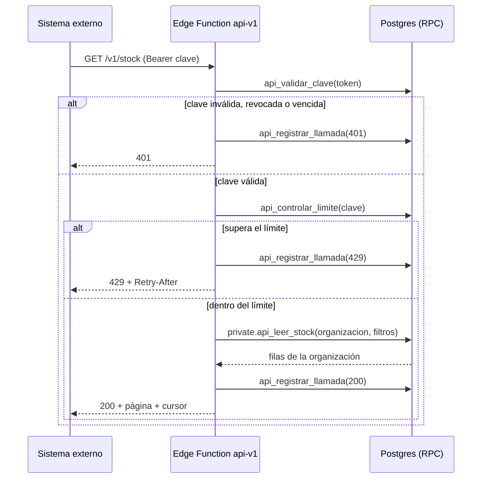
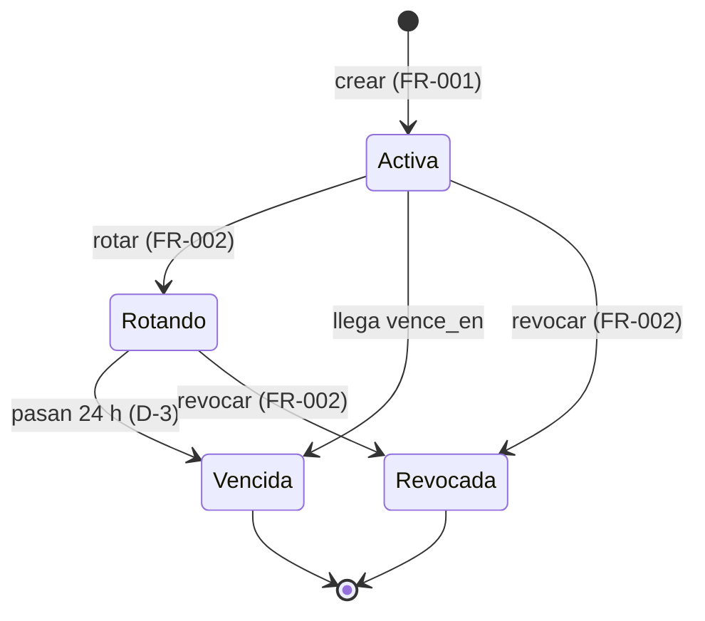
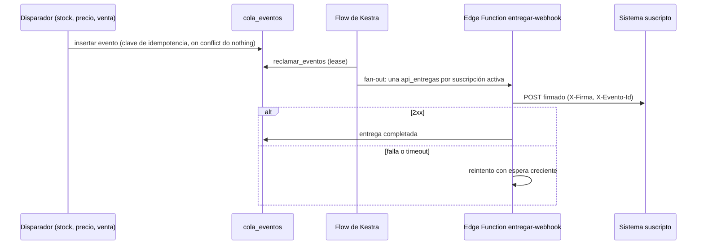
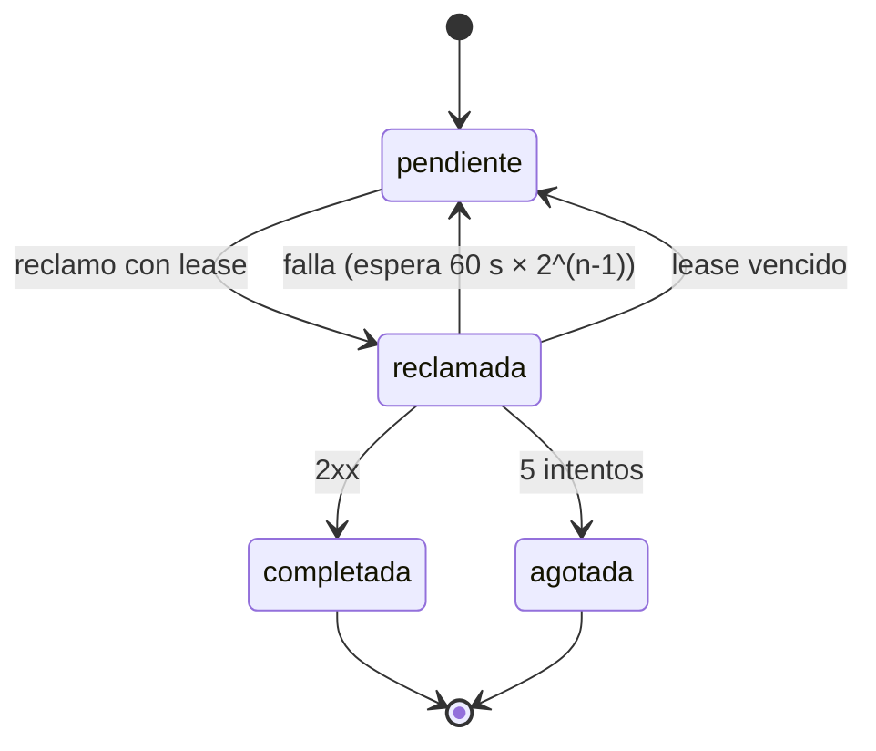
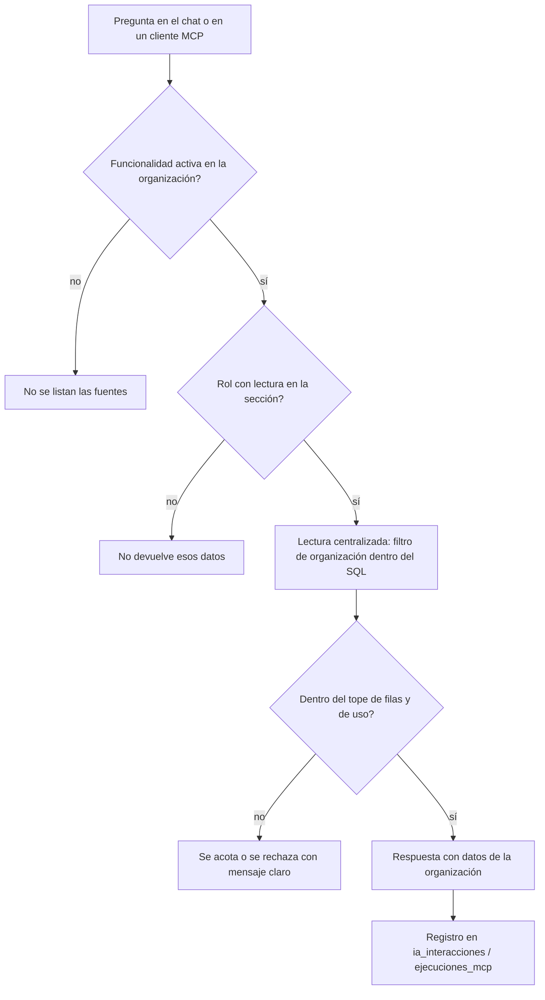

# Feature Specification: Plataforma · API e asistente con IA

**Épica**: MSF-233 · **Spec**: `api-e-asistente-con-ia` · **Hito**: Backlog (a definir con el cliente) · **Prioridad**: P3 · **Alcance (Jira)**: fuera · **Horas aprox.**: sin estimar (referencia por tallas: F-API-01 L, F-IA-01 M; se estima al pasar a un hito)
**Alcance de entrega**: `refine`, `supabase`, `kestra` (sin `superset` ni `workers`: la API y el asistente corren en Edge Functions; la entrega de avisos la dispara un flow de Kestra, precedente `avisos-reposicion-stock` y `recalcular-alertas-inicio`).
**Fuente**: especificación de Nicolás cargada en la épica (It's a Plan), la orden de retome de MSF-233, las descripciones de MSF-403 (F-API-01) y MSF-411 (F-IA-01) y artefactos del repo. Esta spec **traduce**; no agrega alcance de negocio. Lo que la épica deja abierto se resuelve con un valor por defecto anotado en «Decisiones abiertas».

> Nota de rama: la orden nombra la rama `epic/MSF-233-api-e-asistente-con-ia`; el worktree de la épica trabaja sobre `epic/MSF-233-plataforma-api-e-asistente-con-ia`. Se entrega en la segunda (no se crea una rama paralela).

## Objetivo

Al terminar, otros sistemas pueden conectarse a la plataforma por una API con avisos de cambios, y quien lo pida cuenta con un asistente que responde sobre el catálogo.

## Modelo y supuestos

- **Solo se activa si el cliente lo pide.** Los requisitos de las historias se redactan cuando pasen a un hito (Backlog sin fecha): esta spec deja el alcance traducido y listo, y la implementación arranca recién con la aprobación de Nicolás sobre el alcance.
- **F-API-01 no tiene base en el template** (sin claves de API, OpenAPI, webhooks salientes ni límite de uso; roadmap del template #25, #35, #36 y #47). Se construye sobre lo que sí hay: la outbox genérica `public.cola_eventos` (idempotencia, lease y reintentos, ver `docs/stock-eventos.md`), el patrón de lectura centralizada con filtro de organización dentro de SQL (`private.mcp_leer_fila`) y el patrón de credencial con solo el hash persistido (`credenciales_mcp`).
- **F-IA-01 es de configuración.** El template ya trae IA gobernada (`ia_politicas`, `ia_interacciones`), chat flotante (`ChatFlotante`, Edge Function `chat-ia-responder`), servidor MCP (`packages/mcp-server`) y RAG (`indexar-documento`, `preguntar-documentos`). El producto **solo registra las capacidades de consulta** (tablas `capacidades_chat_ia`/`fuentes_chat_ia` y `capacidades_mcp`/`fuentes_mcp`); no se escribe un motor nuevo.
- **Datos que se exponen** (la épica los nombra): catálogo, stock, precios y ventas. Son de solo lectura: ninguna capacidad de ejecución (`ejecucion = false`).
- **Aislamiento**: la organización se deriva **siempre** de la credencial (clave de API) o de la sesión del usuario, nunca de un parámetro del llamador. La service-role solo vive en Edge Functions, nunca en el navegador.
- **Sin pantallas dibujadas en el prototipo** (`design/pantallas/` no tiene `.dc.html` de esta épica; `pnpm prototipo:inventario` no tiene nada que inventariar). La UI nueva (F-API-01) se arma con los componentes del template y los tokens del sistema de diseño (MSF-117, no la bloquea); toda diferencia se anota en la descripción del PR. F-IA-01 no agrega pantalla: usa `ia/capacidades-chat` e `ia/capacidades-mcp`.
- **Datos de otras épicas (se consumen, no se recrean)**: `public.cola_eventos` y el evento `stock.actualizado` (F-STK-04), `private.mcp_leer_fila`, `private.tiene_feature`, `private.nivel_seccion`, `private.organizacion_id`, `private.puede_escribir`. **A verificar antes de implementar**: de qué tablas salen los eventos de precio y de venta (el grafo y `docs/` no los identifican con certeza; ver D-5).

### Esquema de datos (Constitución, Principio VII)

Todas las tablas nuevas son **plataforma / integraciones genéricas** → `public`. Ninguna es entidad de negocio del producto, por eso no van a `dominio`. Se re-verifica en plan, tareas, implementación y PR.

| Objeto | Esquema | Historia | Justificación | RLS / acceso |
|--------|---------|----------|---------------|--------------|
| `api_claves` (**nueva**: `id`, `organizacion_id`, `nombre`, `prefijo`, `hash` unique, `alcances text[]`, `creada_por`, `creada_en`, `vence_en` null, `revocada_en` null, `ultimo_uso_en` null) | `public` | F-API-01 | Credencial de integración genérica por organización; no es dato del negocio. | RLS por `organizacion_id = (select private.organizacion_id())`; select solo del Administrador; **sin escritura directa** (solo RPC); `anon` sin privilegios; solo el hash se persiste |
| `api_suscripciones` (**nueva**: `id`, `organizacion_id`, `url`, `tipos text[]`, `secreto_ref`, `activa`, `creada_por`, `creada_en`) | `public` | F-API-01 | Suscripción saliente genérica, complemento de `conexiones_oauth` (entrantes). | Igual que `api_claves`; el secreto de firma no se lee desde la app |
| `api_entregas` (**nueva**: `id`, `organizacion_id`, `evento_id` → `cola_eventos`, `suscripcion_id`, `estado`, `intentos`, `proximo_intento_en`, `reclamada_en`, `vence_en`, `ultimo_estado_http`, `ultimo_error_sanitizado`; `unique (evento_id, suscripcion_id)`) | `public` | F-API-01 | Outbox por destinatario, mismo patrón que `cola_eventos`/`despachos_ejecucion`. | select solo Administrador de la organización; escritura solo por funciones `private` (`security definer`) ejecutables por `kestra_orquestacion`/`service_role` |
| `api_llamadas` (**nueva**: `id`, `organizacion_id`, `clave_id`, `metodo`, `ruta`, `version`, `estado_http`, `duracion_ms`, `creada_en`) | `public` | F-API-01 | Auditoría de uso de la API; sin cuerpos ni la clave. | select solo Administrador; inserta solo la Edge Function (service_role); retención 90 días |
| Funciones `private.api_leer_*` (productos, stock, precios, ventas) | `private` | F-API-01 | Lectura con el filtro de organización armado **dentro** del SQL (patrón `mcp_leer_fila`); ahí vive el aislamiento, no en TypeScript. | `security definer`, `set search_path = ''`; ejecutables solo por `service_role` |
| RPC `public.crear_clave_api`, `revocar_clave_api`, `rotar_clave_api`, `crear_suscripcion_api`, `actualizar_suscripcion_api` | `public` | F-API-01 | Superficie de ejecución para la pantalla. | `grant execute … to authenticated`, `revoke … from public, anon`; validan Administrador de la organización |
| RPC `public.api_validar_clave`, `api_registrar_llamada`, `api_controlar_limite` | `public` | F-API-01 | Superficie para la Edge Function. | `revoke … from public, anon, authenticated`; `grant … to service_role` |
| Disparadores `private.emitir_precio_actualizado`, `emitir_venta_registrada` (el de stock ya existe) | `private` | F-API-01 | Escriben en `cola_eventos`; no son superficie. | `security definer`; sin ejecución para `public/anon/authenticated` |
| Vistas `public.ia_consulta_catalogo`, `ia_consulta_stock`, `ia_consulta_precios`, `ia_consulta_ventas` (**nuevas**; columnas listadas en `contracts/ia-consulta.md`, con `organizacion_id`) | `public` | F-IA-01 | Superficie de lectura sin datos propios que registran `fuentes_chat_ia`/`fuentes_mcp`; solo columnas aptas para el asistente. | solo lectura; las lee `private.mcp_leer_fila` / el chat con filtro de organización dentro del SQL; `anon` sin acceso |
| Filas en `features`, `capacidades_chat_ia`, `fuentes_chat_ia`, `capacidades_mcp`, `fuentes_mcp` (**datos**, no tablas nuevas) | `public` | F-IA-01 | Registro de capacidades de consulta; las tablas ya existen. | las gobiernan sus políticas actuales (solo superadmin escribe); el registro es una migración de datos idempotente |

La prueba pgTAP `rls_en_toda_tabla` (recorre `public` + `dominio`) debe seguir verde y ganar casos para las tablas nuevas. Todas las migraciones son **aditivas**; reversión en `plan.md`. Cada historia trae **su propia migración** con su timestamp y **solo una migración de base de datos está en vuelo a la vez** (ver tabla de ejecución).

## User Scenarios & Testing *(mandatory)*

### User Story 1 - API y avisos hacia otros sistemas (F-API-01 · MSF-403, P3, talla L)

Una organización cuyo cliente quiere conectar su propio sistema crea una clave de API, consulta catálogo, stock, precios y ventas por una API versionada y documentada, y se suscribe a avisos de cambios de stock, precio y ventas para enterarse sin consultar todo el tiempo.

**Why this priority**: es el único habilitador de integraciones partner-a-partner; P3 y condicional a que un cliente lo pida.

**Independent Test**: con una organización de prueba, crear una clave, llamar `GET /v1/stock` y ver solo datos de esa organización; suscribir una URL de prueba, cambiar un stock y recibir un aviso firmado exactamente una vez por evento.

**Acceptance Scenarios**:

1. **Given** un Administrador, **When** crea una clave con alcance de lectura, **Then** ve el valor completo una sola vez; después solo ve nombre, prefijo, alcances, estado y último uso.
2. **Given** una clave válida, **When** llama a `GET /v1/productos`, **Then** recibe solo productos de su organización, paginados.
3. **Given** una clave revocada o vencida, **When** llama a cualquier ruta, **Then** recibe `401` y la llamada queda auditada.
4. **Given** una clave que superó su límite de uso, **When** vuelve a llamar, **Then** recibe `429` con `Retry-After`.
5. **Given** una suscripción activa a `stock.actualizado`, **When** cambia el stock, **Then** se entrega un aviso firmado; si el destino falla, se reintenta con espera creciente y, agotados los intentos, queda `agotada` y visible.
6. **Given** un evento reprocesado, **When** se vuelve a despachar, **Then** el destino no recibe un segundo aviso para el mismo `evento_id` y suscripción por efecto de la plataforma.

### User Story 2 - Asistente con IA sobre el catálogo (F-IA-01 · MSF-411, P3, talla M)

Quien lo pida (organización con la funcionalidad activa) le pregunta al asistente por el catálogo, el stock, los precios y las ventas y recibe una respuesta con datos de su organización, sin que el asistente pueda cambiar nada.

**Why this priority**: es configuración sobre capacidades ya presentes en el template; entrega valor con poco costo.

**Independent Test**: activar la funcionalidad en una organización, preguntar «¿cuánto stock queda de X?» en el chat flotante y obtener el dato de esa organización; repetir con otra organización y confirmar que no ve datos ajenos.

**Acceptance Scenarios**:

1. **Given** la funcionalidad activa y un rol con lectura sobre la sección, **When** pregunta por un producto, **Then** el asistente responde con datos de su organización.
2. **Given** un rol sin lectura sobre «Precios», **When** pregunta por precios, **Then** el asistente no devuelve precios.
3. **Given** un producto inexistente, **When** se pregunta por él, **Then** el asistente dice que no lo encuentra y no inventa datos.
4. **Given** el cliente MCP externo con una credencial de la organización, **When** consulta las mismas fuentes, **Then** ve lo mismo que el chat y nada de otra organización.
5. **Given** una consulta que supera el tope de filas o de uso, **When** se ejecuta, **Then** se acota o se rechaza con un mensaje claro.

### Edge Cases

- Clave rotada: la anterior sigue válida un período corto (D-3) y luego vence; ambas auditadas.
- URL de webhook a una dirección interna/privada (`localhost`, rangos privados, metadatos de nube): se rechaza al guardar y al entregar (SSRF).
- Destino lento: el timeout corta la entrega y cuenta como intento fallido.
- Evento sin suscripciones activas: se completa sin crear entregas.
- Suscripción pausada con entregas pendientes: las pendientes se conservan y se entregan al reactivar (no se pierden).
- Cambio de una organización a otra con la pantalla abierta: la pantalla de claves es por organización (no por empresa); ver Empresa activa en la matriz.
- Funcionalidad de IA desactivada para la organización: el asistente y MCP no listan las fuentes.

## Requirements *(mandatory)*

### Functional Requirements

**F-API-01 (US1)**

- **FR-001**: Una organización puede crear **claves de API** con nombre, alcances de lectura (`productos`, `stock`, `precios`, `ventas`) y vencimiento opcional. El valor completo se muestra **una sola vez**; solo el hash y un prefijo se persisten. Crea y gestiona el Administrador de la organización.
- **FR-002**: Una clave se puede **rotar** (genera una nueva y programa el vencimiento de la anterior, D-3) y **revocar** (efecto inmediato). Una clave revocada o vencida responde `401`.
- **FR-003**: La API autentica con `Authorization: Bearer <clave>`; sin clave o inválida → `401`; alcance insuficiente → `403`. La organización se deriva de la clave, nunca de un parámetro.
- **FR-004**: La API versionada `/api-v1/v1/*` expone lectura de `productos`, `stock`, `precios` y `ventas` con paginación por cursor, filtro `actualizado_desde` y formato de error uniforme (`contracts/api-v1.md`).
- **FR-005**: El contrato se publica como **OpenAPI 3.1** en `openapi/api-v1.json` (y se sirve en `GET /v1/openapi.json`); se actualiza en el mismo PR que el handler y el guard de contratos bloquea cambios sin `BREAKING:`.
- **FR-006**: **Aislamiento por organización**: toda lectura pasa por funciones SQL `private.api_leer_*` que arman el filtro de organización dentro del SQL; prueba pgTAP de que una clave de la organización A nunca lee filas de B.
- **FR-007**: **Límite de uso** por clave (D-2): al superarlo, `429` + `Retry-After`; el rechazo queda registrado.
- **FR-008**: **Auditoría** de toda llamada (incluidas las rechazadas) en `api_llamadas`: clave, método, ruta, versión, estado y duración, sin cuerpos ni la clave; retención 90 días; visible para el Administrador.
- **FR-009**: **Versionado y deprecación**: la versión va en la ruta; los cambios aditivos no rompen `v1`; un cambio incompatible exige `v2`; una versión o campo en retiro responde con `Deprecation` y `Sunset` y se avisa con al menos 6 meses (D-4).
- **FR-010**: Una organización puede **suscribir webhooks salientes**: URL `https`, tipos de evento, activar/pausar y eliminar. El secreto de firma se muestra una sola vez. Las URL a destinos internos/privados se rechazan.
- **FR-011**: Eventos disponibles: `stock.actualizado` (ya existe), `precio.actualizado` y `venta.registrada`, con envoltorio común (`id`, `tipo`, `organizacion_id`, `ocurrido_en`, `datos`) en `cola_eventos` con clave de idempotencia.
- **FR-012**: **Entrega durable**: un flow de Kestra reclama eventos, genera una `api_entregas` por suscripción (idempotente por `evento_id` + `suscripcion_id`) y las entrega firmadas (`X-Firma` HMAC-SHA256 con marca de tiempo, `X-Evento-Id`) con timeout, reintentos de espera exponencial y estado final `agotada` (D-6); el `ultimo_error_sanitizado` nunca incluye secretos.
- **FR-013**: Pantalla **«API»** en el panel (sin prototipo): navegación, rutas y bloque de **claves** (crear, rotar, revocar); patrones compartidos de carga, vacío, error y éxito; teclado y 320/768/1440 px; no depende de la empresa activa.
- **FR-014**: Bloques de la pantalla «API» para **suscripciones** (crear, pausar/reanudar, eliminar) y para **entregas y llamadas recientes** con su estado.

**F-IA-01 (US2)**

- **FR-020**: Se **registran capacidades de consulta de solo lectura** sobre catálogo, stock, precios y ventas, tanto para el chat (`capacidades_chat_ia`/`fuentes_chat_ia`) como para MCP (`capacidades_mcp`/`fuentes_mcp`), con `lectura = true` y `ejecucion = false`, mediante migración de datos idempotente.
- **FR-021**: Cada fuente es una vista `public.ia_consulta_*` con `organizacion_id` y **solo** las columnas listadas en `contracts/ia-consulta.md` (D-7); el filtro de organización lo arma el SQL de lectura centralizada.
- **FR-022**: **Permisos**: el asistente consulta una fuente solo si la funcionalidad está activa en la organización (`private.tiene_feature`) y el rol tiene al menos lectura sobre su sección (`private.nivel_seccion`). Activar la funcionalidad es del Administrador.
- **FR-023**: **Límites de uso** (D-8): tope de filas por consulta, y el límite de intentos/tiempo de la política IA aprobada existente; las consultas fuera de límite se acotan o se rechazan con mensaje claro.
- **FR-024**: Las consultas del asistente y de MCP quedan **auditadas** con los registros existentes (`ia_interacciones`, `ejecuciones_mcp`); F-IA-01 solo verifica que las nuevas fuentes los alimenten.
- **FR-025**: F-IA-01 **no agrega pantalla**: las nuevas funcionalidades aparecen en `ia/capacidades-chat` e `ia/capacidades-mcp`. Documentación en `docs/`.

**Transversal**

- **FR-030**: Documentación de F-API-01 en el mismo cambio (`docs/api-publica.md` y su entrada en `docs/README.md`); `pnpm docs:check` verde.
- **FR-031**: Documentación de F-IA-01 en el mismo cambio (`docs/asistente-catalogo.md` y su entrada en `docs/README.md`); `pnpm docs:check` verde.

### Key Entities

- **Clave de API** (`api_claves`): credencial por organización con alcances, vencimiento y estado.
- **Suscripción** (`api_suscripciones`): destino https y tipos de evento de una organización.
- **Evento** (`cola_eventos`): hecho de stock, precio o venta, con clave de idempotencia.
- **Entrega** (`api_entregas`): intento durable de un evento a una suscripción.
- **Llamada** (`api_llamadas`): registro de auditoría de una llamada a la API.
- **Capacidad/fuente de consulta**: registro de qué vista puede leer el asistente.

### Success Criteria

- **SC-001**: Con una clave válida, el 100 % de las lecturas devuelve solo filas de la organización de la clave (pgTAP + prueba de contrato).
- **SC-002**: Una clave revocada deja de funcionar en la llamada siguiente (`401`).
- **SC-003**: Cada evento llega **a lo sumo una vez por efecto de la plataforma** a cada suscripción activa y, si falla, se reintenta hasta el máximo y queda visible.
- **SC-004**: `openapi/api-v1.json` describe todas las rutas de `/api-v1`; el guard de contratos pasa.
- **SC-005**: El asistente responde sobre las cuatro fuentes con datos de la organización y no devuelve datos de otra ni de secciones sin permiso.
- **SC-006**: Ninguna capacidad de ejecución queda habilitada para las nuevas fuentes.
- **SC-007** (verificación global): `pnpm lint`, `pnpm build`, `pnpm infra:config`, `pnpm test`, `pnpm docs:check` y `rls_en_toda_tabla` en verde.

### Verificación por requisito

| Requisito | Verifica |
|---|---|
| FR-001, FR-002, FR-003 | pgTAP de RPC de claves (hash, un solo valor visible, revocación) + Vitest de la función `api-v1` |
| FR-004 | prueba de contrato contra `openapi/api-v1.json` |
| FR-005, SC-004 | guard de contratos (`openapi/api-v1.json` describe todas las rutas de `/api-v1`) |
| FR-006, SC-001 | pgTAP de aislamiento entre dos organizaciones |
| FR-007, FR-008 | Vitest/Deno de la función (429, auditoría) + pgTAP de retención |
| FR-009 | prueba de cabeceras `Deprecation`/`Sunset` |
| FR-010, FR-011, FR-012, SC-003 | pgTAP de `api_entregas` (idempotencia, lease, reintentos) + Vitest del firmado + validación SSRF |
| FR-013, FR-014 | Vitest de la pantalla (permisos, estados, un solo valor visible, no depende de la empresa activa) |
| FR-020–FR-024, SC-005, SC-006 | pgTAP del registro y de las vistas + Vitest del chat con dos organizaciones |
| FR-025 | Vitest de capacidades (`ia/capacidades-chat`, `ia/capacidades-mcp`) |
| FR-030 | `pnpm docs:check` con `docs/api-publica.md` |
| FR-031 | `pnpm docs:check` con `docs/asistente-catalogo.md` |

## Decisiones abiertas (a confirmar con Nicolás; valor por defecto anotado)

| ID | Tema | Valor por defecto |
|----|------|-------------------|
| D-1 | Modelo de credencial | Clave por organización con alcances de solo lectura, `Bearer`, hash persistido. Sin OAuth de cliente en esta épica. |
| D-2 | Límite de uso de la API | 60 solicitudes/min por clave, configurable por plataforma; ventana deslizante por clave. |
| D-3 | Rotación | La clave anterior vence 24 h después de rotar. |
| D-4 | Deprecación | Aviso mínimo de 6 meses con `Deprecation`/`Sunset`; `v1` solo cambia de forma aditiva. |
| D-5 | Eventos de precio y venta | Se emiten con disparadores `private` a `cola_eventos`; **las tablas origen se confirman en la primera tarea** (no se inventan). |
| D-6 | Entrega de webhooks | Outbox durable sobre `cola_eventos` + `api_entregas`; 5 intentos, espera `60 s × 2^(n−1)`, timeout 10 s, firma HMAC-SHA256. |
| D-7 | Qué ve el asistente | Catálogo (nombre, SKU, categoría, estado), stock (por producto/depósito, disponible), precios (precio de venta vigente) y ventas (comprobante, fecha, total, estado). **No** costos, márgenes ni datos de contacto de clientes. |
| D-8 | Límites del asistente | Máximo 50 filas por consulta; política IA aprobada existente; tope de consultas por organización según el presupuesto del Gateway IA si existe (si no, se difiere y se anota). |
| D-9 | Quién gestiona claves y suscripciones | Administrador de la organización. |
| D-10 | Retención de auditoría | 90 días de `api_llamadas`. |

## Flujos

La épica no trae diagramas; los flujos se derivan de las decisiones de la orden (autenticación, eventos con outbox, auditoría, versionado, asistente) sin agregar pasos.

### Llamada a la API (F-API-01)

Dueños: validar (FR-003), límite (FR-007), lectura aislada (FR-004, FR-006), auditoría (FR-008).

### Estado de una clave (F-API-01)

### Entrega de un aviso (F-API-01)

Dueños: evento e idempotencia (FR-011), fan-out/reintentos/firma/agotada (FR-012), SSRF (FR-010), visibilidad (FR-013).

### Consulta al asistente (F-IA-01)

Dueños: funcionalidad y rol (FR-022), aislamiento (FR-021), límites (FR-023), auditoría (FR-024).

## Matriz pantalla↔criterios

**Inventario del prototipo**: ninguna pantalla de esta épica está dibujada (`design/pantallas/` no tiene `.dc.html` para ella; el prototipo de «San Javucho y Mundo JC · Plataforma» no trae un artboard para ella). `pnpm prototipo:inventario` no produce ítems. Como no hay referencia, la tabla lista los elementos que **esta spec define** para la pantalla nueva, cada uno con dueño; no hay elementos visibles del prototipo sin dueño. Todo se arma con componentes del template y tokens del sistema de diseño; las diferencias se anotan en el PR (Regla de fuentes, puntos 3 y 5).

| Elemento | Pantalla | Dueño |
|---|---|---|
| Entrada «API» en la navegación (icono y grupo de Administración/Integraciones, rutas `/api` y `/api/claves`) | API (nueva) | FR-013 |
| Tabla de claves: `Nombre`, `Prefijo`, `Alcances`, `Estado`, `Último uso`, `Vence` | API | FR-013 |
| Botón `Crear clave` y diálogo (nombre, alcances, vencimiento) | API | FR-001 |
| Diálogo de valor de la clave (se muestra una sola vez, `Copiar`) | API | FR-001 |
| Acciones `Rotar` y `Revocar` (con confirmación) | API | FR-002 |
| Tabla de suscripciones: `URL`, `Eventos`, `Estado` | API | FR-010, FR-014 |
| Botón `Nueva suscripción` y diálogo (URL https, eventos) | API | FR-014 |
| Acciones `Pausar`/`Reanudar` y `Eliminar` | API | FR-014 |
| Tabla de entregas recientes: `Evento`, `Destino`, `Estado`, `Intentos`, `Último error` | API | FR-014 |
| Tabla de llamadas recientes: `Cuándo`, `Método`, `Ruta`, `Estado`, `Duración` | API | FR-014 |
| Estados de carga, vacío, error y éxito | API | FR-013 |
| Nuevas funcionalidades de consulta (catálogo, stock, precios, ventas) en las pantallas existentes de capacidades de chat y MCP | `ia/capacidades-chat`, `ia/capacidades-mcp` | FR-020, FR-025 (sin pantalla nueva) |
| Chat flotante | Template | Fuera de alcance: ya existe; F-IA-01 solo registra capacidades (FR-025) |
| Filtros por empresa, Superset, exportaciones, reintento manual de entregas agotadas | — | Fuera de alcance: la épica no los pide |
| Empresa activa | API / capacidades | **No aplica**: claves, suscripciones y capacidades son **por organización**, no por empresa (D-1, Principio VIII). La pantalla no lee ni escribe datos de una empresa concreta; la API expone datos de la organización completa. Test: cambiar de empresa en la barra superior **no** altera ni recarga la pantalla «API» (Vitest en T010). |
