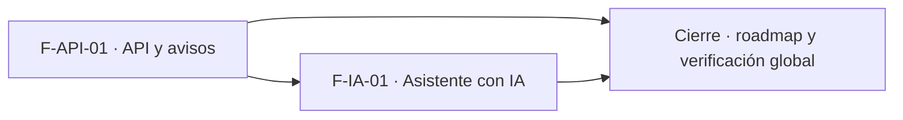

# Tasks: Plataforma · API e asistente con IA (MSF-233)

**Spec**: [`spec.md`](./spec.md) · **Plan**: [`plan.md`](./plan.md) · **Contratos**: [`contracts/`](./contracts/)
**Formato**: `- [ ] T### [P] [STORY][USy] descripción`. **[P]** = paralelizable (archivos distintos, sin dependencia; las [P] del mismo grupo van en paralelo); sin [P] = secuencial. Las dependencias de cada tarea son solo dentro de su historia. Las tareas `[CIERRE]` van al final y nunca son prerequisito de una historia. La verificación nombrada de cada FR/SC está en `spec.md`; la tarea dueña crea esa prueba. Una tarea «soporta FRxx» colabora con la dueña de ese requisito pero **no** lo posee (dueño único).
**Delivery scope**: `refine`, `supabase`, `kestra`

## Matriz de trazabilidad (tracker ↔ US ↔ tasks)

| Tracker | Historia | US | FR / SC dueños | Tareas |
|---|---|---|---|---|
| MSF-403 | F-API-01 | US1 | FR-001–FR-014, FR-030, SC-001–SC-004 | T001–T012 |
| MSF-411 | F-IA-01 | US2 | FR-020–FR-025, FR-031, SC-005, SC-006 | T013–T019 |
| Tarea de cierre (label cierre) | — | — | SC-007, SC-008 | T020–T021 |

## Dueño único por requisito

| Requisito | Tarea dueña | | Requisito | Tarea dueña |
|---|---|---|---|---|
| FR-001, FR-002 | T001 | | FR-020 | T014 |
| FR-003, FR-004, FR-009, SC-002 | T006 | | FR-021 | T013 |
| FR-005, SC-004 | T007 | | FR-022 | T015 |
| FR-006, SC-001 | T003 | | FR-023 | T016 |
| FR-007, FR-008 | T002 | | FR-024 | T017 |
| FR-010 | T004 | | FR-025, SC-005 | T018 |
| FR-011 | T005 | | FR-031 | T019 |
| FR-012, SC-003 | T008 | | SC-006 | T014 |
| FR-013 | T010 | | SC-007 | T021 |
| FR-014 | T011 | | SC-008 | T020 |
| FR-030 | T012 | | | |

## Fase 1 — F-API-01 · API y avisos hacia otros sistemas (US1)

- [ ] T001 [F-API-01][US1] Migración `20270203100000_api_claves.sql` (esquema `public`, aditiva, reversión en el encabezado): `api_claves` con RLS por organización y Administrador, `hash bytea unique`, `prefijo unique`, `alcances` válidos, `limite_por_minuto` 60, `vence_en`/`revocada_en`/`ultimo_uso_en`; `grant select` solo de columnas seguras (nunca `hash`), sin escritura directa; RPC `crear_clave_api`, `rotar_clave_api` (gracia 24 h) y `revocar_clave_api` (`security definer`, Administrador, `grant authenticated`, `revoke public, anon`). **FR-001, FR-002**. Verificación: pgTAP `api_claves.test.sql` (hash, prefijo, alcances, un solo valor, rotación/revocación) · `pnpm test:db` · Vitest `api-claves.test.tsx`.
- [ ] T002 [F-API-01][US1] Migración `20270203100100_api_llamadas_y_limite.sql`: `api_llamadas` (organización/clave nullable, método, ruta, versión, estado, duración, sin cuerpos ni token), RLS solo Administrador, insert solo `service_role`; `api_validar_clave`, `api_controlar_limite` (60/min, lock por clave) y `api_registrar_llamada`; `private.purgar_api_llamadas(90)` para Kestra. **FR-007, FR-008**. Verificación: pgTAP `api_llamadas.test.sql` (401/429 auditados, límite, purga) · `pnpm test:db`.
- [ ] T003 [F-API-01][US1] Migración `20270203100200_api_lectura.sql`: `private.api_leer_productos/stock/precios/ventas` (`security definer`, `search_path = ''`, filtro de organización dentro del SQL, cursor y `actualizado_desde`, máximo 100 filas) sobre las tablas/vistas reales del plan; solo `service_role`. **FR-006, SC-001**. Verificación: pgTAP `api_aislamiento.test.sql` (dos organizaciones, cero filas cruzadas) · `pnpm test:db`.
- [ ] T004 [F-API-01][US1] Migración `20270203100300_api_suscripciones_entregas.sql`: `api_suscripciones` (`secreto_vault_id`, tipos válidos), `api_entregas` (`unique (evento_id, suscripcion_id)`, estados, 5 intentos, lease), RLS solo Administrador y escritura solo por funciones; RPC `crear_suscripcion_api` (secreto en Vault, visible una vez), `actualizar_suscripcion_api`, `eliminar_suscripcion_api`; validación SSRF al guardar (`https`, sin credenciales, sin localhost/IP privada/metadata); `private.api_fanout_evento`, `private.api_reclamar_entregas`, `private.api_resolver_entrega`. **FR-010**. Verificación: pgTAP `api_suscripciones_entregas.test.sql` (SSRF, secreto único, idempotencia, lease, reintentos) · `pnpm test:db`.
- [ ] T005 [F-API-01][US1] Migración `20270203100400_api_eventos_precio_venta.sql`: `private.emitir_precio_actualizado` en `dominio.productos` (`precio_lista`, `moneda`) y `dominio.producto_precios_escala` (`precio`), y `private.emitir_venta_registrada` en `dominio.comprobantes_venta` al confirmar una factura; `cola_eventos` con clave de idempotencia; reutiliza `stock.actualizado`. **FR-011**. Verificación: pgTAP `api_eventos.test.sql` (un evento por cambio real, sin duplicados) · `pnpm test:db`.
- [ ] T006 [F-API-01][US1] Edge Function `supabase/functions/api-v1`: auth `Bearer`, alcances, rutas `/v1/productos|stock|precios|ventas`, paginación por cursor, `actualizado_desde`, error uniforme, `429` + `Retry-After`, auditoría y cabeceras `Deprecation`/`Sunset`; script `test:edge:api-v1`. **FR-003, FR-004, FR-009, SC-002**. Verificación: `api-v1/handler.test.ts` · `pnpm test:edge:api-v1`.
- [ ] T007 [P] [F-API-01][US1] `openapi/api-v1.json` (OpenAPI 3.1) y `openapi/entregar-webhook.json` (contrato interno), `GET /v1/openapi.json`, en el mismo PR que el handler; script `scripts/verificar-openapi.mjs` + `scripts/verificar-openapi.test.mjs` y `test:openapi` en `package.json`; `BREAKING:` obligatorio si cambia una firma. **FR-005, SC-004**. Verificación: `pnpm test:openapi`.
- [ ] T008 [F-API-01][US1] Edge Function `supabase/functions/entregar-webhook`: firma HMAC-SHA256 con marca de tiempo, `X-Evento-Id`, timeout 10 s, SSRF al entregar (DNS y rangos privados), sin redirecciones, error sanitizado, 5 intentos con espera `60 s × 2^(n−1)` y estado `agotada`; script `test:edge:entregar-webhook`. **FR-012, SC-003**. Verificación: `entregar-webhook/handler.test.ts` · `pnpm test:edge:entregar-webhook`.
- [ ] T009 [F-API-01][US1] Flows de Kestra `infra/kestra/flows/entregar-webhooks-api.yml` (reclamo, fan-out, entrega, reintentos) y `purgar-api-llamadas.yml` (retención 90 días), con `.test.mjs`; scripts `test:kestra:webhooks` en `package.json` y en `pnpm test`; variables en `infra/kestra/.env.example`. Soporta FR-012 (dueño T008) y FR-008 (dueño T002). Verificación: `entregar-webhooks-api.test.mjs` · `pnpm test:kestra:webhooks`.
- [ ] T010 [F-API-01][US1] Pantalla «API» en `apps/web/src/pages/api/`: entrada en la navegación bajo Administración con icono `Api` y ruta `/api` (sin ruta anterior), bloque de claves (crear, valor visible una vez con `Copiar`, rotar, revocar), estados compartidos, teclado y 320/768/1440 px; no depende de la empresa activa. **FR-013**. Verificación: `api-claves.test.tsx` y `empresa-activa-api.test.tsx` · `pnpm --filter @platform/web test`.
- [ ] T011 [F-API-01][US1] Bloques de la pantalla «API»: suscripciones (crear con secreto visible una vez, pausar/reanudar, eliminar) y tablas de entregas y llamadas recientes con estado y error sanitizado. **FR-014**. Verificación: `api-suscripciones.test.tsx` · `pnpm --filter @platform/web test`.
- [ ] T012 [P] [F-API-01][US1] `docs/api-publica.md` (claves, rutas, límites, versionado, eventos, firma, reintentos, SSRF, retención, reversión) y entrada en `docs/README.md`. **FR-030**. Verificación: `pnpm docs:check`.

**Checkpoint F-API-01**: una clave lee solo su organización y un aviso firmado llega una vez por suscripción; la retención de auditoría corre por Kestra.

## Fase 2 — F-IA-01 · Asistente con IA sobre el catálogo (US2)

- [x] T013 [F-IA-01][US2] Migración `20270203110000_ia_consulta_vistas.sql`: vistas `public.ia_consulta_catalogo/stock/precios/ventas` con las columnas exactas de `contracts/ia-consulta.md`, `organizacion_id`, `security_invoker = true`, solo lectura, `anon` sin acceso; catálogo y precios sobre `productos`, stock por depósito, ventas = facturas confirmadas. **FR-021**. Verificación: pgTAP `ia_consulta_vistas.test.sql` (columnas, RLS, dos organizaciones, tope 50) · `pnpm test:db`.
- [x] T014 [F-IA-01][US2] Migración `20270203110100_ia_consulta_registro.sql` idempotente: features `catalogo`, `stock`, `precios`, `ventas`; una fila por feature en `fuentes_chat_ia` y `fuentes_mcp` (`limit 1` de `mcp_leer_fila`); `capacidades_chat_ia`/`capacidades_mcp` con `lectura = true`, `ejecucion = false`. **FR-020, SC-006**. Verificación: pgTAP `ia_consulta_registro.test.sql` (cuatro features, una vista cada una, sin ejecución, segunda corrida sin duplicados) · `pnpm test:db`.
- [x] T015 [F-IA-01][US2] Permisos en chat y MCP: funcionalidad activa y `nivel_seccion` de la sección real (`productos` para catálogo/precios, `stock`, `ventas`); sin permiso no se devuelve el dato. **FR-022**. Verificación: `chat-ia-responder/handler.test.ts` (rol sin `productos` no recibe precios; dos organizaciones) + pgTAP · `pnpm test:db`.
- [x] T016 [F-IA-01][US2] Tope de 50 filas por consulta en las vistas/lectura y límites de la política IA aprobada; si falta el presupuesto de Gateway IA, anotarlo en el PR. **FR-023**. Verificación: `ia_consulta_vistas.test.sql` (51 filas → 50) + `chat-ia-responder/handler.test.ts` · `pnpm test:db`.
- [x] T017 [F-IA-01][US2] Verificar que consultar las nuevas fuentes deja registro en `ia_interacciones` y en la conexión/ejecución MCP, sin datos sensibles en el detalle. **FR-024**. Verificación: `ia_consulta_registro.test.sql` · `pnpm test:db`.
- [x] T018 [F-IA-01][US2] Las cuatro funcionalidades aparecen en `ia/capacidades-chat` e `ia/capacidades-mcp` sin pantalla nueva; prueba con dos organizaciones de que el asistente no cruza datos. **FR-025, SC-005**. Verificación: `capacidades-ia.test.tsx` · `pnpm --filter @platform/web test`.
- [x] T019 [P] [F-IA-01][US2] `docs/asistente-catalogo.md` (qué se expone, permisos, límites, features, reversión) y entrada en `docs/README.md`. **FR-031**. Verificación: `pnpm docs:check`.

**Evidencia F-IA-01 (MSF-411)**: migraciones `20270224110000` (vistas), `20270224110100` (registro idempotente con `private.registrar_fuentes_ia_consulta()`) y `20270224110200` (tope de 50 filas en `private.mcp_leer_fila`); pgTAP `ia_consulta_vistas.test.sql` e `ia_consulta_registro.test.sql`; `supabase/functions/chat-ia-responder/limites.ts` con `limites.test.ts` (`pnpm test:edge:chat-ia-limites`); Vitest `capacidades-ia.test.tsx`; `docs/asistente-catalogo.md` y su entrada en `docs/README.md`. **Desvíos**: (1) T015/T016: la spec nombra `chat-ia-responder/handler.test.ts`, pero la función no tiene `handler.ts` (es un solo `index.ts` con Deno); la lógica del tope se extrajo a `limites.ts` y se prueba con `limites.test.ts`, y los permisos por rol del chat los garantiza la RLS de las tablas base, probada en pgTAP. (2) T017: el registro en `ia_interacciones` y en la ejecución MCP lo hacen el gateway del chat y el servidor MCP del template, no la base; el pgTAP verifica que las vistas no exponen costos, márgenes ni contactos. (3) pgTAP no se ejecutó en la máquina de Claude Code (sin Supabase local): lo valida el job `database` del CI.

**Checkpoint F-IA-01**: el asistente responde sobre catálogo, stock, precios y ventas de la organización, sin ejecutar nada.

## Fase 3 — Cierre

- [ ] T020 [CIERRE] Actualizar `docs/roadmap-template.md` (filas #25, #35, #36 y #47 y la entrada de la épica: estado, link a esta spec y horizonte) al mergear el PR; paso manual con criterio. **SC-008**. Verificación: diff del roadmap en el PR · `pnpm docs:check`.
- [ ] T021 [CIERRE] Verificación global: `pnpm lint`, `pnpm build`, `pnpm infra:config`, `pnpm test`, `pnpm docs:check`, `pnpm matriz:check`, `pnpm test:openapi`, `pnpm test:edge:api-v1`, `pnpm test:edge:entregar-webhook`, `pnpm test:kestra:webhooks` y `rls_en_toda_tabla` en verde; evidencia en el PR. **SC-007**. Verificación: salida de los comandos.

## Dependencias

Dentro de F-API-01: T001 → T002 → T003 → T004 → T005 (migraciones en serie); T006 tras T003; T007 [P] en paralelo con T006 (contract-first) y converge con él; T008 tras T004 y T005; T009 tras T008; T010 tras T001; T011 tras T004 y T010; T012 [P] al final. Dentro de F-IA-01: T013 → T014 → T015 → T016 → T017 → T018; T019 [P]. Cierre al final y nunca prerequisito de una historia.

## Plan de ejecución (historias)

F-IA-01 espera a F-API-01 solo para que **haya una sola migración de base de datos en vuelo a la vez**; no comparten tablas ni código (cada una trae su propia migración con su timestamp).

| Historia | Depende de | Grupo |
|----------|------------|-------|
| F-API-01 | — | 1 |
| F-IA-01 | F-API-01 | 2 |
| [Cierre] | F-API-01, F-IA-01 | 3 |

