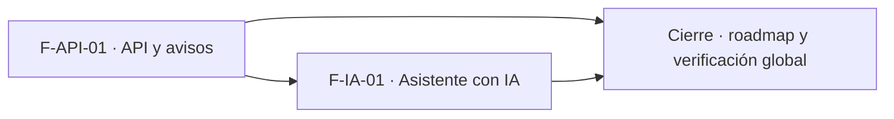

# Tasks: Plataforma · API e asistente con IA (MSF-233)

**Spec**: [`spec.md`](./spec.md) · **Plan**: [`plan.md`](./plan.md) · Formato: `- [ ] T001 [P] [STORY][USy] descripción`. Fuera de alcance = nota en la matriz, no tarea. Solo **una migración** de base de datos a la vez: las tareas de migración van en serie.

## Matriz de trazabilidad (tracker ↔ US ↔ tasks)

| Tracker | Historia | US | FR / SC dueños | Tareas |
|---|---|---|---|---|
| MSF-403 | F-API-01 | US1 | FR-001–FR-014, FR-030, SC-001–SC-004 | T001–T012 |
| MSF-411 | F-IA-01 | US2 | FR-020–FR-025, FR-031, SC-005, SC-006 | T013–T019 |
| Tarea de cierre (label cierre) | — | — | SC-007 (verificación global) | T020–T021 |

## Phase 1: F-API-01 · API y avisos hacia otros sistemas (US1)

- [ ] T001 [F-API-01][US1] Migración `api_claves` (esquema `public`) con RLS por organización, hash unique, sin escritura directa, y RPC `crear_clave_api`/`rotar_clave_api`/`revocar_clave_api` (Administrador; `grant authenticated`, `revoke public, anon`); pgTAP (FR-001, FR-002). Verifica: pgTAP `api_claves`, `rls_en_toda_tabla`
- [ ] T002 [F-API-01][US1] Migración `api_llamadas` + `api_validar_clave`, `api_controlar_limite` (60/min por clave), `api_registrar_llamada` (solo `service_role`) y retención de 90 días (FR-007, FR-008). Verifica: pgTAP `api_llamadas`
- [ ] T003 [F-API-01][US1] Migración con `private.api_leer_productos/stock/precios/ventas` (filtro de organización dentro del SQL, patrón `mcp_leer_fila`) y pgTAP con dos organizaciones (FR-006, SC-001). Verifica: pgTAP `api_aislamiento`
- [ ] T004 [F-API-01][US1] Migración `api_suscripciones` y `api_entregas` (`unique (evento_id, suscripcion_id)`), RPC de suscripción con rechazo de URL no `https`/interna, fan-out idempotente y reclamo/resolución con lease y reintentos (FR-010). Verifica: pgTAP `api_entregas`
- [ ] T005 [F-API-01][US1] Confirmar con `graphify` y migraciones las tablas origen de precio y venta (D-5; si no existen, anotar y proponer) y migración con `private.emitir_precio_actualizado`/`emitir_venta_registrada` hacia `cola_eventos` con clave de idempotencia; reutiliza `stock.actualizado` (FR-011). Verifica: pgTAP de disparadores
- [ ] T006 [F-API-01][US1] Edge Function `api-v1`: auth `Bearer`, alcances, rutas `/v1/*`, paginación por cursor, error uniforme, `429` + `Retry-After`, auditoría y cabeceras `Deprecation`/`Sunset` (FR-003, FR-004, FR-009, SC-002). Verifica: Deno/Vitest `api-v1`
- [ ] T007 [P] [F-API-01][US1] `openapi/api-v1.json` (OpenAPI 3.1) y `GET /v1/openapi.json`, en el mismo PR que el handler; guard de contratos en verde (FR-005, SC-004). Verifica: guard de contratos
- [ ] T008 [F-API-01][US1] Edge Function `entregar-webhook`: firma HMAC-SHA256 con marca de tiempo, `X-Evento-Id`, timeout 10 s, validación SSRF al entregar, errores sanitizados, 5 intentos con espera `60 s × 2^(n−1)` y estado `agotada` (FR-012, SC-003). Verifica: Deno/Vitest `entregar-webhook`
- [ ] T009 [F-API-01][US1] Flow de Kestra `entregar-webhooks-api` que reclama eventos, genera las entregas y llama a `entregar-webhook` (soporte de FR-012; dueño T008). Verifica: `pnpm infra:config`
- [ ] T010 [P] [F-API-01][US1] Pantalla «API»: entrada en la navegación bajo Administración, rutas `/api`, bloque de claves (crear, valor visible una vez, rotar, revocar), estados compartidos, 320/768/1440 px; Vitest por rol y que cambiar de empresa no altera la pantalla (FR-013). Verifica: `api-claves.test.tsx`, `empresa-activa-api.test.tsx`
- [ ] T011 [F-API-01][US1] Bloques de la pantalla «API»: suscripciones (crear, pausar/reanudar, eliminar) y tablas de entregas y llamadas recientes con estado (FR-014). Verifica: `api-suscripciones.test.tsx`
- [ ] T012 [P] [F-API-01][US1] `docs/api-publica.md` (claves, rutas, límites, versionado, eventos, firma, reintentos, reversión) y entrada en `docs/README.md` (FR-030). Verifica: `pnpm docs:check`

**Checkpoint F-API-01**: una clave lee solo su organización y un aviso firmado llega una vez por suscripción.

## Phase 2: F-IA-01 · Asistente con IA sobre el catálogo (US2)

- [ ] T013 [F-IA-01][US2] Migración con vistas `public.ia_consulta_catalogo/stock/precios/ventas` (columnas reales confirmadas contra las tablas; sin costos, márgenes ni contactos), solo lectura, `anon` sin acceso (FR-021). Verifica: pgTAP `ia_consulta_vistas`
- [ ] T014 [F-IA-01][US2] Migración de datos idempotente: funcionalidades, `capacidades_chat_ia`/`fuentes_chat_ia` y `capacidades_mcp`/`fuentes_mcp` con `lectura = true`, `ejecucion = false` (FR-020, SC-006). Verifica: pgTAP `ia_consulta_registro`
- [ ] T015 [F-IA-01][US2] Pruebas de permisos: funcionalidad activa y `nivel_seccion ≥ lectura` en chat y MCP; sin permiso no se devuelve el dato (FR-022). Verifica: Vitest `chat-permisos` + pgTAP
- [ ] T016 [F-IA-01][US2] Tope de 50 filas por consulta y límites de la política IA aprobada; si falta el presupuesto del Gateway IA, anotarlo (FR-023). Verifica: Vitest del tope
- [ ] T017 [F-IA-01][US2] Verificar que las consultas a las nuevas fuentes queden en `ia_interacciones` y `ejecuciones_mcp` (FR-024). Verifica: pgTAP/Vitest de auditoría
- [ ] T018 [F-IA-01][US2] Las nuevas funcionalidades aparecen en `ia/capacidades-chat` e `ia/capacidades-mcp` sin pantalla nueva, y prueba con dos organizaciones de que el asistente no cruza datos (FR-025, SC-005). Verifica: Vitest `capacidades-ia`, `chat-dos-organizaciones`
- [ ] T019 [P] [F-IA-01][US2] `docs/asistente-catalogo.md` (qué se expone, permisos, límites, reversión) y entrada en `docs/README.md` (FR-031). Verifica: `pnpm docs:check`

**Checkpoint F-IA-01**: el asistente responde sobre catálogo, stock, precios y ventas de la organización, sin ejecutar nada.

## Phase 3: Cierre

- [ ] T020 [CIERRE] Actualizar `docs/roadmap-template.md` (filas #25, #35, #36 y #47 y la entrada de la épica: estado, link a la spec) al mergear el PR; paso manual con criterio
- [ ] T021 [CIERRE] Verificación global: `pnpm lint`, `pnpm build`, `pnpm infra:config`, `pnpm test`, `pnpm docs:check`, `pnpm matriz:check` y `rls_en_toda_tabla` (SC-007)

## Dependencias

Dentro de F-API-01: T001 → T002 → T003 → T004 → T005 (migraciones en serie); T006 tras T003; T007 [P] junto a T006; T008 tras T004 y T005; T009 tras T008; T010 [P] tras T001; T011 tras T004 y T010; T012 [P] al final. Dentro de F-IA-01: T013 → T014 → T015 → T016 → T017 → T018; T019 [P]. Cierre al final y nunca prerequisito de una historia.

## Plan de ejecución (historias)

F-IA-01 espera a F-API-01 solo para que **haya una sola migración de base de datos en vuelo a la vez**; no comparten tablas ni código (cada una trae su propia migración con su timestamp).

| Historia | Depende de | Grupo |
|----------|------------|-------|
| F-API-01 | — | 1 |
| F-IA-01 | F-API-01 | 2 |
| [Cierre] | F-API-01, F-IA-01 | 3 |

