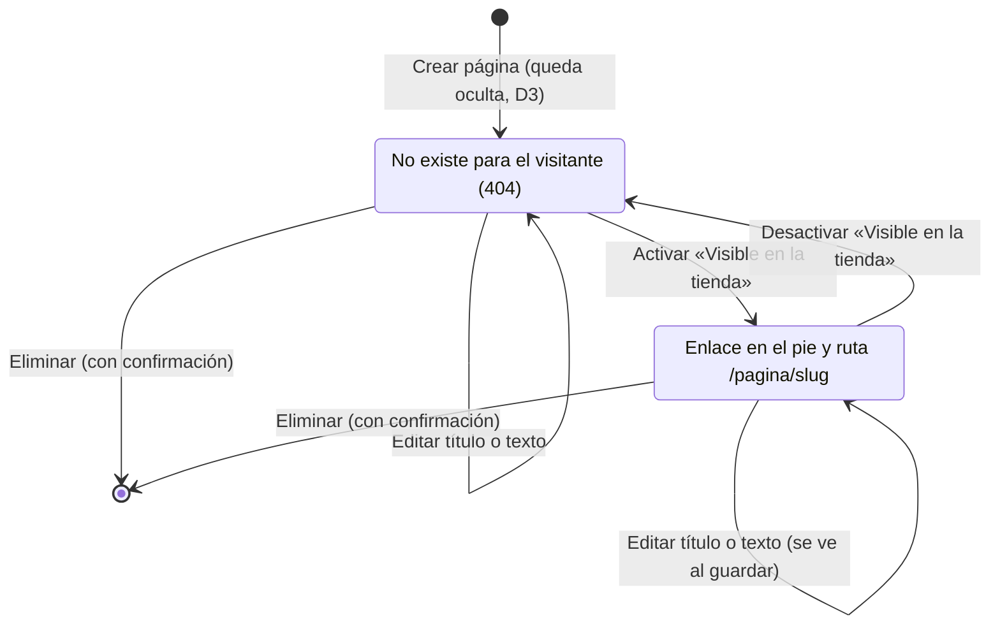
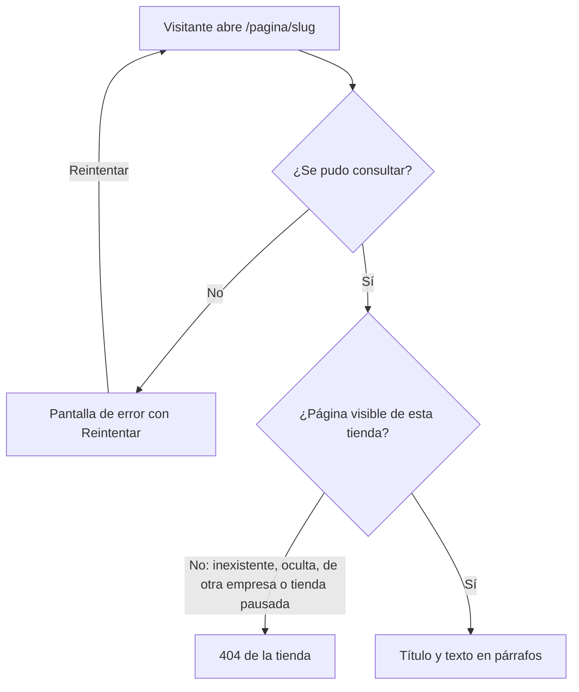
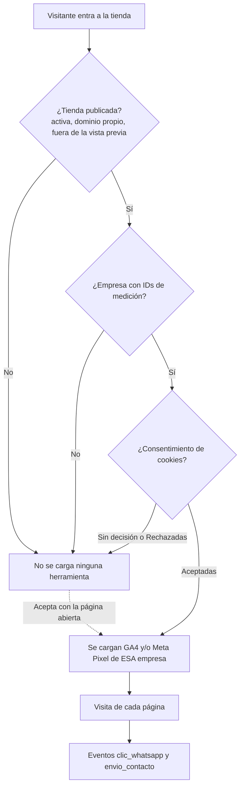
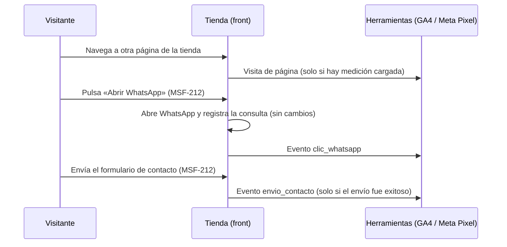
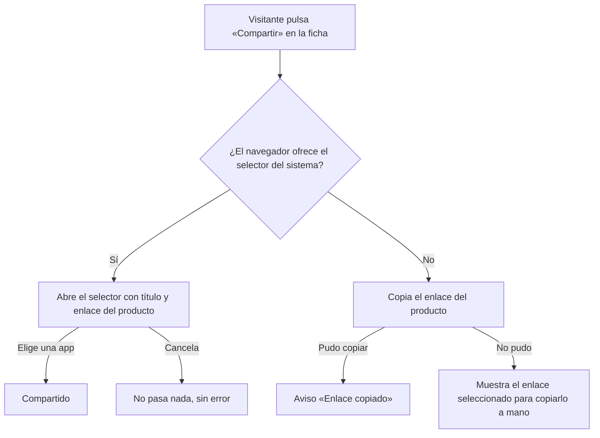

# Feature Specification: Tiendas online · Tienda contenido y analítica

**Feature Branch**: `epic/MSF-164-tiendas-online-tienda-contenido-y-analit`

**Componente**: Tiendas online

**Jira Epic**: MSF-164 — Tiendas online · Tienda contenido y analítica (spec `tienda-contenido-y-analitica`)

**Historias previstas**: F-TDA-23 «Páginas de contenido» (M), F-TDA-24 «Analítica de visitas» (S), F-TDA-25 «Compartir producto» (S), todas P2.

**Created**: 2026-11-07

**Status**: Draft — lista para planificar. Las decisiones de Nicolás quedan en *Decisiones abiertas*; ninguna bloquea implementar con el supuesto indicado.

**Delivery scope**: `refine` (`apps/web`: front público de la tienda y gestión de la tienda en el panel) y `supabase` (migraciones aditivas, funciones de `publico`, pgTAP). Sin `kestra`, `superset` ni `workers`. Sin Edge Function nueva (no hay `openapi/`).

**Prioridad / Hito**: P2 · Etapa 3 (sin fecha) · ~19 h · alcance «fuera».

**Input**: Epic MSF-164. Objetivo: «Al terminar, cada empresa tiene páginas de contenido propias, mide las visitas con sus herramientas y el visitante puede compartir un producto.»

## Regla de fuentes (literal de la épica)

1. Comportamiento y datos: mandan los requisitos y escenarios de esta historia.
2. Qué se ve (disposición, textos, estados, popups, flujos): el prototipo validado es referencia visual, no hace falta que quede extremadamente idéntico; los flujos (si hay) aclaran estados y acciones.
3. Cómo se construye (componentes, estilos y patrones): mandan el template y el system design del producto (épica Plataforma · Sistema de diseño). No copiar el HTML ni el CSS del prototipo: reproducir lo que muestra con los componentes del template y los tokens del sistema de diseño.
4. El prototipo muestra más que esta historia: implementar solo lo que piden los requisitos de esta historia; otras secciones, botones o diálogos son de otras historias.
5. Si algo no se puede igualar con el template / el sistema de diseño: usar lo más cercano, sin inventar, y anotar la diferencia en la descripción del PR.
6. Si el prototipo y los requisitos se contradicen: requisitos para el comportamiento, prototipo para lo visual, y dejar la contradicción anotada en el PR.

**Prototipo.** La épica **no tiene pantallas dibujadas**. Se corrió `pnpm prototipo:inventario` sobre las pantallas vecinas (`MJC_Producto`, `SJ_Producto`, `MJC_M_Producto`, `SJ_M_Producto`, `StoreContenido`, `SJ_StoreContenido`, `StorePublicacion`): ninguna trae «Compartir», páginas de contenido ni campos de analítica. Se construye con los componentes del template y los tokens de la tienda (`TemaTienda`); el aspecto exacto es decisión de diseño anotada en el PR.

## Dependencias

| Dependencia | Qué aporta | Estado en esta rama | ¿Bloquea? |
|---|---|---|---|
| MSF-149 · Tienda SEO, legal y estados (F-TDA-22) | Aviso de cookies y contrato de consentimiento (`lib/consentimientoCookies.ts`: `leerConsentimiento()`, `guardarConsentimiento()`, `useConsentimientoCookies()` y evento de cambio; contrato de consentimiento de MSF-149); `CabeceraSeo` (título/descripción por página) | Su rama está **desbloqueada y desplegada en DEV**; el código **no está aún en `main`**. | Sí, para F-TDA-24 (consentimiento) y para el `<head>` de F-TDA-23. Antes de implementar hay que tener MSF-149 mergeada en la base; si los nombres del contrato cambian, se ajusta la tarea dueña (FR-014). |
| MSF-212 · Tienda WhatsApp y contacto (F-TDA-14, F-TDA-16) | Puntos de enganche en el diálogo «Abrir WhatsApp» (`whatsapp/DialogoWhatsApp.tsx`) y en el éxito del formulario de contacto (`contacto/FormularioContacto.tsx`) | **Presente** en la base | No (ya está). |
| MSF-191 · Tienda inicio, búsqueda y móvil | Menú, pie (`layout/PieCategorias.tsx`) y búsqueda | Presente | No (relacionada, sin bloqueo). |
| MSF-133 · Tienda dominio y publicación | Gestión de la tienda por pestañas (`empresas/tienda/pestanas.ts`), vista previa, borrador y versiones | Presente | No. |

Bloquea a: ninguna épica.

## Supuestos (de la épica)

- El contenido de las páginas es **texto simple, sin HTML libre**.
- Las herramientas de medición se cargan **solo en la tienda publicada**.

## Esquema de datos (Constitución, Principio VII)

| Objeto | Esquema | Historia | Naturaleza / justificación |
|---|---|---|---|
| `dominio.tienda_paginas` (tabla nueva) | **`dominio`** | F-TDA-23 | Dato del producto Tiendas online atado a una empresa (páginas de su tienda). No es plataforma genérica. **RLS habilitada** por organización (`organizacion_id = private.organizacion_id()`, solo `select` para `authenticated`); la escritura es solo por RPC; **sin privilegios para `anon`**. |
| `dominio.tienda_analitica` (tabla nueva, una fila por empresa) | **`dominio`** | F-TDA-24 | Configuración de medición de la tienda de una empresa; dato de producto, no de plataforma. Misma RLS y mismas reglas de privilegios que la anterior. |
| `publico.paginas_por_dominio(host)`, `publico.pagina_por_dominio(host, slug)`, `publico.analitica_por_dominio(host)` | `publico` (funciones) | F-TDA-23 / F-TDA-24 | Lectura anónima con lista blanca (como MSF-167/MSF-149). `publico` sigue sin tablas. |
| `public.guardar_pagina_tienda`, `public.eliminar_pagina_tienda`, `public.guardar_analitica_tienda` (RPC) | `public` (funciones) | F-TDA-23 / F-TDA-24 | Escritura desde el panel, `SECURITY DEFINER`, `revoke … from public, anon` + `grant execute … to authenticated`. |

F-TDA-25 **no toca la base**. Cada historia trae **su propia migración aditiva**; la reversión se documenta en el `plan.md` (no se destruye nada en el mismo PR que lo crea). El pgTAP de aislamiento sigue recorriendo `public` + `dominio` (las dos tablas nuevas deben tener RLS).

## Decisiones abiertas (no bloquean; se implementa el supuesto)

- **D1 · Dónde se administran las páginas y la analítica.** La épica no dibuja pantallas. **Supuesto**: la gestión de la tienda de cada empresa (`/empresas/:id/tienda/:pestana`) suma dos pestañas, **«Páginas»** (F-TDA-23) y **«Analítica»** (F-TDA-24), cada una en su archivo de `pestanas/` y registrada en `pestanas.ts`; no se crea una pantalla nueva (regla «una pantalla de gestión por producto»). Permiso: edición en Empresas, como el resto de la gestión. Si Nicolás prefiere una sección dentro de «Contenido», cambia solo el registro de la pestaña.
- **D2 · Qué herramientas de medición.** La épica dice «sus herramientas» sin nombrarlas. **Supuesto**: **Google Analytics 4** (ID `G-…`) y **Meta Pixel** (ID numérico), cada empresa con los suyos y ambos opcionales. Solo se guarda el **ID** (nunca código HTML/script pegado por la persona usuaria). Otras herramientas serían otra historia.
- **D3 · Páginas y analítica no pasan por el borrador/versiones.** El borrador de MSF-133 cubre identidad, contenido y catálogo. **Supuesto**: las páginas y la analítica se aplican **al guardar** (como precios y stock), pero cada página tiene un interruptor **«Visible en la tienda»** (apagado por defecto) para poder prepararlas sin que se vean. Integrarlas al borrador y las versiones sería otra historia.
- **D4 · Dónde aparecen las páginas en la tienda.** **Supuesto**: ruta `/pagina/:slug` y un enlace por página visible en el **pie** (columna «Información»). No se tocan el menú ni la búsqueda (MSF-191). El `slug` se genera del título (sin tildes, minúsculas, guiones) y es único por empresa.
- **D5 · Formato del texto.** **Supuesto**: texto plano; una línea en blanco separa párrafos; los saltos simples se respetan. Sin negritas, enlaces ni imágenes (supuesto de la épica). Límites: título ≤ 80, contenido ≤ 10 000 caracteres.
- **D6 · Eventos de medición.** La épica pide que F-TDA-24 emita los eventos de WhatsApp y de contacto (MSF-212). **Supuesto**: visita de página (en cada cambio de ruta de la tienda, que es una SPA), `clic_whatsapp` (al pulsar «Abrir WhatsApp») y `envio_contacto` (al confirmarse el envío del formulario). En GA4 se envían con ese nombre; en Meta Pixel como `PageView` y `trackCustom` con el mismo nombre. Compartir producto **no** emite evento (no está pedido).
- **D7 · «Compartir» sin WhatsApp propio.** La historia dice «con un enlace o por WhatsApp», pero el requisito solo pide **copiar el enlace o abrir el selector del sistema** (conflicto anotado en «A revisar» de la épica). **Supuesto**: manda el requisito; sin botón de WhatsApp propio (el selector del sistema ya lo ofrece donde exista).
- **D8 · Consentimiento.** **Supuesto**: sin decisión equivale a «rechazadas» (contrato de consentimiento de MSF-149): no se carga ninguna herramienta. Si la persona acepta con la página abierta, se cargan en ese momento sin recargar. No hay «revocar» (el aviso de MSF-149 no lo trae).

## Navegación y patrones (Principio VI)

- **Panel**: dos pestañas nuevas dentro de la gestión de tienda ya existente (ruta y menú sin cambios; compatibilidad de rutas: `/empresas/:id/tienda/paginas` y `/empresas/:id/tienda/analitica` son nuevas). Audiencia: quien tenga edición en Empresas. **Contexto de empresa**: las pestañas operan sobre la empresa de la gestión de tienda (mismo comportamiento que las otras pestañas, ver «Empresa activa»).
- **Front público**: sin sesión ni panel. Una ruta nueva `/pagina/:slug` (carga diferida) y el botón «Compartir» en la ficha. Estados de carga / vacío / error / éxito del kit; teclado y lector de pantalla; 320 / 768 / 1440 px; sin identificadores técnicos en pantalla (nunca UUID: se muestra el título y la dirección legible).
- **Rendimiento**: las pestañas y la ruta de página se cargan diferidas; los scripts de medición se inyectan solo con consentimiento y de forma asíncrona, fuera del primer pintado.

## Flujos

La épica describe los flujos en prosa; se transcriben sin agregar estados ni transiciones salvo los que fijan las decisiones D3, D6 y D8.

### Ciclo de una página de contenido (F-TDA-23)

### Qué ve el visitante de una página (F-TDA-23)

### Carga condicional de la medición (F-TDA-24)

### Emisión de eventos (F-TDA-24)

### Compartir un producto (F-TDA-25)

## User Scenarios & Testing *(mandatory)*

### US1 — Páginas de contenido (F-TDA-23, P2)

Cada empresa crea, edita y elimina páginas de texto propias (p. ej. «Cómo comprar», «Envíos»); el visitante las lee desde el pie de **su** tienda.

1. **Given** una persona con edición en Empresas, **When** abre la pestaña «Páginas» de una empresa y crea «Cómo comprar» con su texto, **Then** la página queda guardada y **oculta**, y ve un aviso de éxito.
2. **Given** una página oculta, **When** activa «Visible en la tienda», **Then** aparece como enlace en el pie de esa tienda y su ruta `/pagina/como-comprar` muestra título y texto.
3. **Given** dos empresas, **When** cada una tiene su página «Envíos», **Then** cada tienda muestra solo la suya (las rutas no se cruzan).
4. **Given** una página con texto ``, **When** se muestra, **Then** se ve literal, sin ejecutarse.
5. **Given** una página visible, **When** se oculta o se elimina, **Then** el enlace del pie desaparece y su ruta muestra la 404 de la tienda.
6. **Given** una empresa sin páginas visibles, **When** el visitante ve el pie, **Then** no aparece la columna «Información» ni queda hueco.
7. **Given** una persona sin permiso de edición en Empresas, **When** intenta crear o borrar, **Then** la base lo rechaza.

### US2 — Analítica de visitas (F-TDA-24, P2)

Cada empresa carga sus IDs de medición; la tienda publicada mide las visitas y los eventos de WhatsApp y contacto, respetando el consentimiento de cookies.

1. **Given** la pestaña «Analítica» de una empresa, **When** guarda su ID de GA4 y/o de Meta Pixel, **Then** quedan guardados; un valor con formato inválido se rechaza con un mensaje bajo el campo.
2. **Given** una tienda publicada con IDs y un visitante que **aceptó** las cookies, **When** navega, **Then** se cargan las herramientas de **esa** empresa y se registra cada visita.
3. **Given** un visitante sin decisión o que **rechazó**, **When** navega, **Then** no se descarga ningún script de medición.
4. **Given** una tienda pausada, un dominio desconocido o la vista previa del panel, **When** se abre, **Then** no se carga ninguna herramienta.
5. **Given** medición cargada, **When** el visitante pulsa «Abrir WhatsApp» o envía el formulario de contacto con éxito, **Then** se emiten `clic_whatsapp` / `envio_contacto`; un envío inválido o fallido no emite nada.
6. **Given** dos tiendas con IDs distintos, **When** se miden, **Then** cada una usa solo los suyos.
7. **Given** una empresa sin IDs, **When** un visitante acepta las cookies, **Then** no se carga nada.

### US3 — Compartir producto (F-TDA-25, P2)

En la ficha, el visitante comparte el producto con el selector del sistema o copiando el enlace.

1. **Given** un navegador con selector del sistema, **When** pulsa «Compartir», **Then** se abre con el nombre del producto y su enlace.
2. **Given** un navegador sin selector, **When** pulsa «Compartir», **Then** se copia el enlace y ve «Enlace copiado».
3. **Given** que cierra el selector sin elegir, **When** vuelve a la ficha, **Then** no ve error.
4. **Given** que no se puede copiar (permiso denegado), **When** pulsa «Compartir», **Then** ve el enlace para copiarlo a mano.
5. **Given** dos tiendas, **When** comparte un producto de cada una, **Then** el enlace usa el dominio de **esa** tienda.

### Casos borde

- Título que genera un `slug` ya usado en la misma empresa: se agrega un sufijo numérico (`envios-2`); el `slug` no cambia al editar el título (los enlaces compartidos no se rompen).
- Título vacío, solo espacios o que genera un `slug` vacío (p. ej. solo símbolos): se rechaza con mensaje bajo el campo.
- Texto o título con HTML: se guarda literal y se muestra escapado (React); nunca `dangerouslySetInnerHTML`.
- Host desconocido o tienda pausada: las funciones de lectura devuelven `null`, idéntico para ambos casos (no revelan existencia).
- `localStorage` bloqueado: el consentimiento queda sin decisión y no se carga medición (contrato de consentimiento de MSF-149).
- Bloqueador de anuncios o falla al descargar un script de medición: la tienda sigue funcionando; el error no se muestra al visitante.
- Producto oculto o de otra tienda: «Compartir» no existe (la ficha ya muestra la 404 de la tienda).
- Cambio de empresa en la gestión con un formulario con cambios sin guardar: aviso estándar del kit (`useWarnAboutChange`), como las otras pestañas.

## Requirements *(mandatory)*

### F-TDA-23 — Páginas de contenido

- **FR-001**: Tabla `dominio.tienda_paginas` (`id`, `organizacion_id`, `empresa_id`, `titulo` ≤ 80, `slug` ≤ 80, `contenido` ≤ 10 000, `visible` boolean default `false`, `created_at`, `updated_at`) con FK compuesta a `dominio.empresas`, `unique (empresa_id, slug)`, checks de longitud y de formato de `slug` (`^[a-z0-9]+(-[a-z0-9]+)*$`), RLS habilitada por organización (solo `select` para `authenticated`), **sin privilegios para `anon`**. **Verificación:** pgTAP `supabase/tests/database/tienda_paginas.test.sql` (RLS activa, checks, `unique`, sin `grant` a `anon`) y pgTAP global de aislamiento; `pnpm test`.
- **FR-002**: `public.guardar_pagina_tienda(empresa, pagina, titulo, contenido, visible)` (crea si `pagina` es `null`, edita si no): exige edición en Empresas y empresa de la organización; recorta espacios; valida longitudes y título no vacío; genera el `slug` del título (sin tildes, minúsculas, guiones, sufijo numérico si choca) **solo al crear**; devuelve la fila; un error no guarda nada y su `hint` nombra el campo. `public.eliminar_pagina_tienda(empresa, pagina)` con las mismas reglas. Ambas con `revoke … from public, anon` + `grant execute … to authenticated`. **Verificación:** pgTAP `tienda_paginas.test.sql` (permisos, empresa ajena, slug único y estable, límites, texto con HTML guardado literal); `pnpm test`.
- **FR-003**: `publico.paginas_por_dominio(host)` (ejecutable por `anon`) devuelve `{ paginas: [{ titulo, slug }] }` de las páginas **visibles** de la empresa del host, ordenadas por título; lista blanca (nunca `organizacion_id`, `id`, `contenido` ni fechas). `null` idéntico para host desconocido, inválido o empresa desactivada. `publico.pagina_por_dominio(host, slug)` devuelve `{ titulo, slug, contenido }` de una página visible; `null` idéntico para host desconocido, empresa desactivada, `slug` inexistente, oculto o de otra empresa. **Verificación:** pgTAP `tienda_paginas.test.sql` (visibles solamente, orden, aislamiento entre dos tiendas, `null` idéntico, lista blanca); `pnpm test`.
- **FR-004**: Pestaña «Páginas» en la gestión de la tienda (`pestanas/paginas.tsx`, registrada en `pestanas.ts`; D1): lista de las páginas de la empresa (título, dirección `/pagina/<slug>`, estado Visible/Oculta) con carga por tandas (`IntersectionObserver`) y «Cargar más», contador total, estado vacío con «Nueva página», carga y error con «Reintentar»; botón «Nueva página» que abre el diálogo de FR-005; acciones Editar y Eliminar por fila. Se reencuadra al cambiar de empresa (ver «Empresa activa»). **Verificación:** Vitest + axe `apps/web/src/pages/empresas/tienda/paginas.test.tsx` (lista, vacío, error con reintento, carga por tandas, cambio de empresa); `pnpm --filter @platform/web test`.
- **FR-005**: Diálogo crear/editar página: campos «Título» y «Contenido» (texto plano multilínea, con contador de caracteres) y el interruptor «Visible en la tienda» (apagado al crear); «Guardar» (deshabilitado mientras guarda) y «Cancelar»; errores del servidor bajo cada campo; éxito con aviso del kit. Eliminar pide **confirmación** con el título de la página. Teclado, foco atrapado y devuelto, lector de pantalla. **Verificación:** Vitest + axe `paginas.test.tsx` (validación, éxito, error por campo, confirmación de borrado, foco); `pnpm --filter @platform/web test`.
- **FR-006**: Ruta pública `/pagina/:slug` (carga diferida, `rutas/pagina.tsx`) dentro del `LayoutTienda`: migas «Inicio / <título>», título y texto como **texto plano en párrafos** (línea en blanco = párrafo; saltos simples respetados; nunca HTML); `<title>` y descripción con `CabeceraSeo` de MSF-149. Slug inexistente, oculto, de otra empresa o tienda pausada → la 404 de la tienda (idéntica, no revela existencia); falla de red → el error con «Reintentar» de la tienda. **Verificación:** Vitest + axe `apps/web/src/pages/tienda-publica/rutas/pagina.test.tsx` (párrafos, texto con HTML literal, 404, error con reintento) y E2E `apps/web/e2e/tienda-paginas.e2e.ts`; `pnpm test`.
- **FR-007**: Pie de la tienda: columna «Información» en `layout/PieCategorias.tsx` con un enlace por página visible (a `/pagina/<slug>`), en el mismo estilo que «Categorías»; sin páginas visibles no se muestra (sin hueco). Si el pedido falla, el pie sigue sin la columna (sin error propio). **Verificación:** Vitest + axe `layout/PieInformacion.test.tsx` y E2E `tienda-paginas.e2e.ts` (cada tienda ve las suyas; oculta/eliminada desaparece); `pnpm test`.
- **FR-008**: Aislamiento por tienda: toda lectura de páginas sale de la empresa del `Host` y toda escritura valida organización y empresa; las respuestas no mezclan empresas. **Verificación:** pgTAP `tienda_paginas.test.sql` (dos tiendas) y E2E `tienda-paginas.e2e.ts` con las dos tiendas del seed; `pnpm test`.

### F-TDA-24 — Analítica de visitas

- **FR-010**: Tabla `dominio.tienda_analitica` (`empresa_id` PK con FK compuesta a `dominio.empresas`, `organizacion_id`, `ga4_id` null con check `^G-[A-Z0-9]{4,20}$`, `meta_pixel_id` null con check `^[0-9]{8,20}$`, `updated_at`), RLS habilitada por organización (solo `select` para `authenticated`), **sin privilegios para `anon`**. **Verificación:** pgTAP `supabase/tests/database/tienda_analitica.test.sql` (RLS, checks, sin `grant` a `anon`) y pgTAP global de aislamiento; `pnpm test`.
- **FR-011**: `public.guardar_analitica_tienda(empresa, ga4_id, meta_pixel_id)`: exige edición en Empresas y empresa de la organización; recorta espacios, pasa a mayúsculas el ID de GA4, vacío = quitar la herramienta; formato inválido → error con `hint` del campo y no guarda nada; `revoke … from public, anon` + `grant execute … to authenticated`. **Verificación:** pgTAP `tienda_analitica.test.sql` (permisos, empresa ajena, formatos, vaciar); `pnpm test`.
- **FR-012**: `publico.analitica_por_dominio(host)` (ejecutable por `anon`) devuelve `{ ga4_id, meta_pixel_id }` (cada uno `string | null`) **solo** si el host pertenece a una empresa **activa**; `null` idéntico para host desconocido, inválido o empresa desactivada. Lista blanca (nunca `organizacion_id`). **Verificación:** pgTAP `tienda_analitica.test.sql` (lista blanca, `null` idéntico para pausada/desconocida/inválida, aislamiento entre tiendas); `pnpm test`.
- **FR-013**: Pestaña «Analítica» en la gestión de la tienda (`pestanas/analitica.tsx`, registrada en `pestanas.ts`; D1): campos «ID de Google Analytics 4» (ej. `G-XXXXXXXXXX`) y «ID de Meta Pixel», cada uno con ayuda y validación de formato bajo el campo, aviso «Solo se cargan en la tienda publicada y si la persona acepta las cookies», «Guardar» y «Descartar» (restaura el último valor guardado); éxito y error con los patrones del kit. Se reencuadra al cambiar de empresa y avisa de cambios sin guardar. **Verificación:** Vitest + axe `apps/web/src/pages/empresas/tienda/analitica.test.tsx` (validación, guardar, descartar, error, cambio de empresa); `pnpm --filter @platform/web test`.
- **FR-014**: Carga condicional: el cargador `lib/analiticaTienda.ts` consulta `analitica_por_dominio` una vez por visita y **solo** carga los scripts oficiales (`googletagmanager.com`, `connect.facebook.net`) si se cumplen **todas**: (a) tienda publicada, (b) la empresa tiene al menos un ID, (c) el consentimiento es `aceptadas` (contrato de consentimiento de MSF-149), (d) no es la vista previa del panel. Los IDs se pasan como datos (nunca se arma código con texto de la persona usuaria). Si la persona acepta con la página abierta, se cargan en ese momento; sin decisión o `rechazadas`, no se descarga nada. Una falla de carga no afecta a la tienda ni se muestra. **Verificación:** Vitest `apps/web/src/lib/analiticaTienda.test.ts` (cada condición por separado, aceptación tardía, falla silenciosa, IDs como datos) y E2E `apps/web/e2e/tienda-analitica.e2e.ts` (con y sin consentimiento, pausada, vista previa; sin pedidos a los dominios de medición); `pnpm test`.
- **FR-015**: Visita de página: con la medición cargada, cada cambio de ruta de la tienda (SPA) registra una visita (D6) en las herramientas que la empresa tenga; sin medición cargada no hace nada. **Verificación:** Vitest `analiticaTienda.test.ts` (una visita por navegación, ninguna sin carga) y E2E `tienda-analitica.e2e.ts`; `pnpm test`.
- **FR-016**: Eventos de MSF-212: `clic_whatsapp` al pulsar «Abrir WhatsApp» (`whatsapp/DialogoWhatsApp.tsx`) y `envio_contacto` al confirmarse el envío del formulario (`contacto/FormularioContacto.tsx`, solo en estado `exito`). El evento nunca bloquea ni retrasa la acción (apertura de WhatsApp, registro de la consulta, envío) ni muestra fallas; no incluye datos del visitante ni del mensaje (solo el nombre del evento). **Verificación:** Vitest `DialogoWhatsApp.test.tsx` y `FormularioContacto.test.tsx` (evento emitido una vez; ninguno en envío inválido o fallido) y E2E `tienda-analitica.e2e.ts`; `pnpm --filter @platform/web test`.
- **FR-017**: Aislamiento por tienda: cada tienda carga solo los IDs de su empresa (resueltos por el `Host`); nada mezcla empresas. **Verificación:** pgTAP `tienda_analitica.test.sql` y E2E `tienda-analitica.e2e.ts` con las dos tiendas del seed (IDs distintos); `pnpm test`.

### F-TDA-25 — Compartir producto

- **FR-020**: Botón «Compartir» en la ficha (`/producto/:productoId`), junto a las acciones del producto (`ficha/BotonCompartir.tsx`), con el estilo de los botones secundarios de la tienda (`TemaTienda`). **Verificación:** Vitest + axe `apps/web/src/pages/tienda-publica/ficha/BotonCompartir.test.tsx` (presente, nombre accesible, teclado); `pnpm --filter @platform/web test`.
- **FR-021**: Al pulsarlo: si el navegador ofrece el selector del sistema (`navigator.share`), lo abre con el **nombre del producto** y el **enlace**; si la persona lo cierra sin elegir (`AbortError`) no hay error ni aviso. **Verificación:** Vitest `BotonCompartir.test.tsx` (llamada con título y URL, cancelación silenciosa); `pnpm --filter @platform/web test`.
- **FR-022**: Sin selector del sistema, copia el enlace al portapapeles y muestra el aviso «Enlace copiado» (región `aria-live`); si no se puede copiar, muestra el enlace en un campo seleccionado para copiarlo a mano. Un fallo del selector que no sea cancelación cae en este mismo camino. **Verificación:** Vitest `BotonCompartir.test.tsx` (copia, aviso, rechazo del portapapeles → enlace visible) y E2E `apps/web/e2e/tienda-compartir.e2e.ts`; `pnpm test`.
- **FR-023**: El enlace compartido es la URL de la ficha con el **dominio de la tienda** (el del `Host` actual) y la ruta `/producto/<id>`, sin parámetros de seguimiento, de filtro ni de búsqueda; nunca incluye datos de la persona. **Verificación:** Vitest `apps/web/src/lib/enlaceProducto.test.ts` (dominio y ruta, sin parámetros) y E2E `tienda-compartir.e2e.ts` en las dos tiendas; `pnpm test`.
- **FR-024**: Funciona con teclado y lector de pantalla, en 320 / 768 / 1440 px sin desbordes. **Verificación:** Vitest + axe `BotonCompartir.test.tsx` y E2E `tienda-compartir.e2e.ts` (anchos); `pnpm test`.

### Transversales

- **FR-060**: Las funciones de `publico` y las RPC nuevas respetan la regla de `anon` del repositorio: `anon` ejecuta solo funciones de `publico`; las RPC de `public` llevan `revoke … from public, anon` + `grant execute … to authenticated`; las tablas nuevas nacen sin privilegios para `anon`. Los contratos están declarados en `contracts/tienda-contenido-analitica.md`. **Verificación:** pgTAP existente de `anon` + los de cada historia; `pnpm test`.

## Success Criteria *(mandatory)*

- **SC-001** (F-TDA-23): pgTAP `tienda_paginas.test.sql`: tabla con RLS, alta/edición/baja con permisos, slug único y estable, visibles solamente, aislamiento entre tiendas, `null` idéntico, lista blanca (FR-001, FR-002, FR-003, FR-008).
- **SC-002** (F-TDA-23): Vitest + axe de la pestaña «Páginas», el diálogo, la ruta pública y el pie (FR-004, FR-005, FR-006, FR-007).
- **SC-003** (F-TDA-23): E2E `tienda-paginas.e2e.ts` en las dos tiendas: crear una página en el panel → oculta no se ve → visible aparece en el pie y se lee → ocultar/eliminar da 404 → cada tienda solo las suyas; 320 / 768 / 1440 px (FR-004…FR-008).
- **SC-004** (F-TDA-24): pgTAP `tienda_analitica.test.sql`: RLS, formatos, permisos, `null` idéntico para pausada/desconocida, lista blanca, aislamiento (FR-010, FR-011, FR-012, FR-017).
- **SC-005** (F-TDA-24): Vitest de `analiticaTienda` y de la pestaña «Analítica» (FR-013, FR-014, FR-015, FR-016).
- **SC-006** (F-TDA-24): E2E `tienda-analitica.e2e.ts`: sin consentimiento no hay pedidos a los dominios de medición; con consentimiento se cargan los IDs de cada tienda; pausada y vista previa no cargan; `clic_whatsapp` y `envio_contacto` se emiten (FR-014…FR-017).
- **SC-007** (F-TDA-25): Vitest + axe de `BotonCompartir` y `enlaceProducto` (FR-020…FR-024).
- **SC-008** (F-TDA-25): E2E `tienda-compartir.e2e.ts` en las dos tiendas: selector del sistema simulado, copia con aviso, enlace con el dominio correcto; 320 / 768 / 1440 px (FR-021…FR-024).
- **SC-009** (Cierre): documentación al día (`docs/tiendas-online.md`: sección «Contenido y analítica», contradicciones para el PR). **Verificación:** `pnpm docs:check`.
- **SC-010** (Cierre): `pnpm lint`, `pnpm build`, `pnpm infra:config`, `pnpm test`, `pnpm prototipo:check`, `pnpm matriz:check` y `pnpm docs:check` pasan; FR-060 verificado de punta a punta.
- **SC-011** (Cierre): la fila de la épica en `docs/roadmap-template.md` refleja estado y link a esta spec al cerrar el PR (paso manual). **Verificación:** revisión de la fila MSF-164 y `pnpm docs:check`.

## Verificación por requisito

Cada FR/SC tiene su verificación nombrada (test o comando) y su tarea dueña en `tasks.md`.

| Requisito | Verificación (test/archivo) | Comando |
|---|---|---|
| FR-001 | pgTAP `supabase/tests/database/tienda_paginas.test.sql` (RLS, checks, unique, sin grant a anon) | `pnpm test` |
| FR-002 | pgTAP `supabase/tests/database/tienda_paginas.test.sql` (permisos, slug, límites, HTML literal) | `pnpm test` |
| FR-003 | pgTAP `supabase/tests/database/tienda_paginas.test.sql` (visibles, `null` idéntico, lista blanca) | `pnpm test` |
| FR-004 | Vitest `apps/web/src/pages/empresas/tienda/paginas.test.tsx` | `pnpm --filter @platform/web test` |
| FR-005 | Vitest `apps/web/src/pages/empresas/tienda/paginas.test.tsx` (diálogo) | `pnpm --filter @platform/web test` |
| FR-006 | Vitest `apps/web/src/pages/tienda-publica/rutas/pagina.test.tsx` + E2E `apps/web/e2e/tienda-paginas.e2e.ts` | `pnpm test` |
| FR-007 | Vitest `apps/web/src/pages/tienda-publica/layout/PieInformacion.test.tsx` + E2E `apps/web/e2e/tienda-paginas.e2e.ts` | `pnpm test` |
| FR-008 | pgTAP `supabase/tests/database/tienda_paginas.test.sql` + E2E `apps/web/e2e/tienda-paginas.e2e.ts` | `pnpm test` |
| FR-010 | pgTAP `supabase/tests/database/tienda_analitica.test.sql` (RLS, checks, sin grant a anon) | `pnpm test` |
| FR-011 | pgTAP `supabase/tests/database/tienda_analitica.test.sql` (permisos, formatos, vaciar) | `pnpm test` |
| FR-012 | pgTAP `supabase/tests/database/tienda_analitica.test.sql` (lista blanca, `null` idéntico) | `pnpm test` |
| FR-013 | Vitest `apps/web/src/pages/empresas/tienda/analitica.test.tsx` | `pnpm --filter @platform/web test` |
| FR-014 | Vitest `apps/web/src/lib/analiticaTienda.test.ts` + E2E `apps/web/e2e/tienda-analitica.e2e.ts` | `pnpm test` |
| FR-015 | Vitest `apps/web/src/lib/analiticaTienda.test.ts` + E2E `apps/web/e2e/tienda-analitica.e2e.ts` | `pnpm test` |
| FR-016 | Vitest `DialogoWhatsApp.test.tsx` y `FormularioContacto.test.tsx` (en `apps/web/src/pages/tienda-publica/`) + E2E `apps/web/e2e/tienda-analitica.e2e.ts` | `pnpm test` |
| FR-017 | pgTAP `supabase/tests/database/tienda_analitica.test.sql` + E2E `apps/web/e2e/tienda-analitica.e2e.ts` (dos tiendas) | `pnpm test` |
| FR-020 | Vitest + axe `apps/web/src/pages/tienda-publica/ficha/BotonCompartir.test.tsx` | `pnpm --filter @platform/web test` |
| FR-021 | Vitest `apps/web/src/pages/tienda-publica/ficha/BotonCompartir.test.tsx` (`navigator.share` con título y URL; `AbortError` silencioso) | `pnpm --filter @platform/web test` |
| FR-022 | Vitest `apps/web/src/pages/tienda-publica/ficha/BotonCompartir.test.tsx` + E2E `apps/web/e2e/tienda-compartir.e2e.ts` | `pnpm test` |
| FR-023 | Vitest `apps/web/src/lib/enlaceProducto.test.ts` + E2E `apps/web/e2e/tienda-compartir.e2e.ts` | `pnpm test` |
| FR-024 | Vitest + axe `BotonCompartir.test.tsx` + E2E `apps/web/e2e/tienda-compartir.e2e.ts` (320/768/1440 px) | `pnpm test` |
| FR-060 | pgTAP existente de `anon` + `tienda_paginas.test.sql` y `tienda_analitica.test.sql` (en `supabase/tests/database/`) | `pnpm test` |
| SC-001 | `supabase/tests/database/tienda_paginas.test.sql` | `pnpm test` |
| SC-002 | `paginas.test.tsx`, `pagina.test.tsx`, `PieInformacion.test.tsx` | `pnpm --filter @platform/web test` |
| SC-003 | `apps/web/e2e/tienda-paginas.e2e.ts` | `pnpm test` |
| SC-004 | `supabase/tests/database/tienda_analitica.test.sql` | `pnpm test` |
| SC-005 | `analiticaTienda.test.ts`, `analitica.test.tsx` | `pnpm --filter @platform/web test` |
| SC-006 | `apps/web/e2e/tienda-analitica.e2e.ts` | `pnpm test` |
| SC-007 | `BotonCompartir.test.tsx`, `enlaceProducto.test.ts` | `pnpm --filter @platform/web test` |
| SC-008 | `apps/web/e2e/tienda-compartir.e2e.ts` | `pnpm test` |
| SC-009 | revisión de `docs/tiendas-online.md` (sección «Contenido y analítica») | `pnpm docs:check` |
| SC-010 | los siete comandos de validación del repo | `pnpm lint && pnpm build && pnpm infra:config && pnpm test && pnpm prototipo:check && pnpm matriz:check && pnpm docs:check` |
| SC-011 | revisión de la fila MSF-164 en `docs/roadmap-template.md` | `pnpm docs:check` |

## Matriz pantalla↔criterios

Inventario corrido con `pnpm prototipo:inventario` sobre las pantallas vecinas: `MJC_Producto`, `SJ_Producto`, `MJC_M_Producto`, `SJ_M_Producto` (ficha), `StoreContenido`, `SJ_StoreContenido` (pestaña Contenido) y `StorePublicacion`. **La épica no tiene pantallas dibujadas:** ningún ítem del inventario pertenece a esta épica; lo nuevo se construye con los componentes del template y se declara abajo.

### Ítems nuevos (sin pantalla en el prototipo)

| Ítem | Dueño | Criterio / nota |
|---|---|---|
| Pestaña «Páginas»: lista, contador, «Nueva página», Editar, Eliminar | F-TDA-23 | FR-004 (D1). |
| Diálogo de página: «Título», «Contenido», «Visible en la tienda», «Guardar», «Cancelar» y confirmación de borrado | F-TDA-23 | FR-005. |
| Ruta pública `/pagina/:slug` | F-TDA-23 | FR-006. |
| Columna «Información» del pie | F-TDA-23 | FR-007. |
| Pestaña «Analítica»: «ID de Google Analytics 4», «ID de Meta Pixel», «Guardar», «Descartar» | F-TDA-24 | FR-013 (D2). |
| Carga condicional, visita y eventos `clic_whatsapp` / `envio_contacto` (sin UI propia) | F-TDA-24 | FR-014, FR-015, FR-016. |
| Botón «Compartir», aviso «Enlace copiado» y enlace manual | F-TDA-25 | FR-020, FR-021, FR-022. |

### Ítems del prototipo vecino que NO cambian

| Ítem del inventario | Dueño | Criterio / nota |
|---|---|---|
| Botones de la ficha («Consultar por WhatsApp», «Ver más productos», «Escribinos», «Cancelar», «Abrir WhatsApp») | **Fuera de alcance** (ya construidos por MSF-212 / MSF-167) | Esta épica solo agrega el evento de medición a «Abrir WhatsApp» y al éxito del contacto (FR-016); no cambia su aspecto. |
| Pestañas del prototipo de gestión (General, Precios y moneda, Mercado Libre, Identidad visual, Contenido, Catálogo visible, Dominio y publicación) y sus campos | **Fuera de alcance** | Ya existen (MSF-147/MSF-133/MSF-138). Se suman «Páginas» y «Analítica» sin alterarlas; «Texto del pie de página» de Contenido no cambia. |
| «Guardar y publicar», «Descartar» y diálogos «Publicar cambios» / «Descartar cambios» | **Fuera de alcance** | Son del borrador de MSF-133; páginas y analítica no pasan por él (D3). |
| Buscar, menú, categorías, «Ver todos los resultados →» | **Fuera de alcance** | MSF-191. |

### Empresa activa (Principio VIII)

| Ítem | Dueño | Criterio / nota |
|---|---|---|
| Empresa activa de la barra superior en las pestañas «Páginas» y «Analítica» | F-TDA-23 / F-TDA-24 | **Aplica**: operan sobre la empresa de la gestión de tienda (`/empresas/:id/tienda/…`), que sigue a la empresa activa como las demás pestañas. Al cambiar de empresa recargan **todas** sus consultas, reencuadran la carga por tandas y cierran el diálogo abierto con aviso (sin guardar datos de la anterior bajo la nueva). Test que cambia de empresa en FR-004 y FR-013. |
| Empresa activa en el front público (ruta de página, pie, «Compartir», medición) | — | **No aplica**: front anónimo sin barra superior; la tienda se resuelve por el `Host` y nunca mezcla empresas (FR-008, FR-017, FR-023). El equivalente a «cambiar de empresa» es cambiar de dominio, verificado en los E2E con las dos tiendas del seed. |

## Fuera de alcance (notas, no tareas)

- Páginas con HTML libre, imágenes, enlaces o formato enriquecido (supuesto de la épica: texto simple).
- Orden manual de las páginas, páginas en el menú principal o en el buscador, y páginas en el `sitemap.xml` de MSF-149 (se ordenan por título; solo en el pie).
- Páginas y analítica dentro del borrador y las versiones de MSF-133 (D3).
- Otras herramientas de medición (Google Tag Manager, Hotjar, TikTok y similares) y scripts pegados a mano; eventos de comercio (compra, ver producto).
- Categorías de cookies, «revocar consentimiento» y enlace a política (MSF-149 D7).
- Botón propio de «Compartir por WhatsApp» (D7) y evento de analítica al compartir.
- Prerender / previews en redes (MSF-149 D4), campos SEO editables por página.
- Tablero de analítica interno (Superset) y exportación de datos de visitas: la medición vive en las herramientas de cada empresa.
- `Opiniones.dc.html` (Tienda · Opiniones, Etapa 2): sin épica ni historia en el tracker (nota de «A revisar»).
